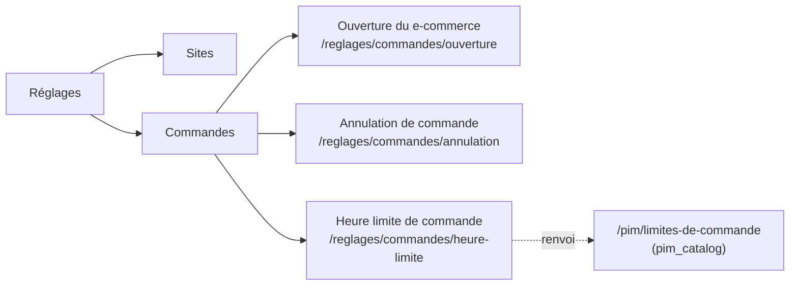

# Réglages › Commandes — ouverture, heure limite et annulation sous `lfc_order_settings`

**Statut** : 📐 plan, rien n'est bâti. Écrit le 2026-10-13. Annoncé par le
§5.4 de
[`../livraisons/transferts/plan-sites-transfert-interne-tri-et-couleurs.md`](../livraisons/transferts/plan-sites-transfert-interne-tri-et-couleurs.md)
(lot O1), et élargi ici.

**Pourquoi un document à part, et ici** : le plan des sites parle de lieux, de
transferts et de couleurs ; ce lot parle de la **règle qui refuse une
commande**, et doit se tenir à côté de ce qu'il touche —
[`architecture-heure-limite-de-commande.md`](architecture-heure-limite-de-commande.md),
[`demontage-order-cutoff.md`](demontage-order-cutoff.md),
[`plan-heure-limite-par-clientele.md`](plan-heure-limite-par-clientele.md) et
[`annulation/annulation-par-le-client.md`](annulation/annulation-par-le-client.md).
Les documents de commande vivent dans `commandes/` (CLAUDE.md §8). Le lot O1
grossissait aussi d'un déplacement d'écran (taille S) à une question d'argent
et de frontière : il n'a plus sa place en une ligne d'un autre plan.

⚠️ Le plan touche une **frontière de sécurité** (deux surfaces changent de
ressource) : `vitruve` d'office avant Hugo (CLAUDE.md §9 bis). **Pas encore
fait.**

## 0. La demande (Hugo, 2026-10-13)

Dans **Réglages**, une section **« Commandes »** à **trois entrées**, dans
cet ordre proposé :

1. **« Ouverture du e-commerce »** — aujourd'hui « Ouverture de la boutique »
   (`/b2b/reglages/ouverture-boutique`) : la boutique prend-elle les commandes
   des pros ? des particuliers ? (ajout de Hugo, 2026-10-13) ;
2. **« Heure limite de commande »** — la limite générale du commerce **par
   clientèle** (B2B avec son rattrapage et ses dérogations ; B2C à venir), et
   un **renvoi** vers la limite de fabrication par article, qui reste au
   référentiel (`/pim/limites-de-commande`) ;
3. **« Annulation de commande »** — l'annulation par le client, aujourd'hui
   `/b2b/reglages/commandes`.

L'ordre suit la vie d'une commande : **peut-on** commander, **jusqu'à quand**,
puis **peut-on revenir dessus**. Un autre ordre ne se justifie que par la
fréquence d'usage (l'heure limite est la plus touchée) — Q7.

Le tout sous le droit **`lfc_order_settings`** (ajouté à `StaffResource` au lot
S0, accordé à aucun rôle). La limite **par point de retrait n'est pas
reprise** : le démontage d'`OrderCutoff` est décidé
([`demontage-order-cutoff.md`](demontage-order-cutoff.md), Hugo 2026-09-04).

## 1. Ce qu'est « la limite générale » aujourd'hui (vérifié le 2026-10-13)

Il y a **deux** systèmes, et la garde les compose.

|                                  | L'échelle du référentiel                                                                | La règle du commerce                                                               |
| -------------------------------- | --------------------------------------------------------------------------------------- | ---------------------------------------------------------------------------------- |
| Table                            | `pim.order_time_limit` (`OrderTimeLimit`, `prisma/schema/pim/sales-contexts.prisma`)    | `public.order_cutoff` (`OrderCutoff`, `prisma/schema/public/orders.prisma` l. 715) |
| Portée                           | `scopeType` / `scopeId` — global, puis rangs plus fins                                  | `pickupAddressId` (null = tous) × `weekday` (null = tous)                          |
| Champs                           | `daysBefore?`, `time?`, `graceMinutes?` — tous nullables                                | `daysBefore` (défaut 1), `time`, `graceMinutes` (défaut 0)                         |
| Écran                            | `/pim/limites-de-commande`                                                              | `/b2b/reglages/heures-limites` (`OrderCutoffsPage`)                                |
| Route                            | `order-time-limits`                                                                     | `admin/order-cutoffs` (GET/POST/PATCH/DELETE)                                      |
| Droit                            | `@AdminSurface("pim_catalog")`                                                          | `@AdminSurface("b2b_settings")`                                                    |
| Comment elle atteint la commande | résolue par `resolveOrderTimeLimit`, figée à l'ingestion dans `CatalogItem.orderLimit*` | lue à chaque passation par `OrderDrafting` (port `OrderCutoffReader`)              |

**La garde** — `ensureWithinOrderCutoff`
(`apps/lfd-api/src/b2b/orders/domain/services/order-cutoff-guard.ts`) :
ligne par ligne, une limite d'article décide **seule** ; un article sans
limite retombe sur le commerce (`decideOrderCutoff`,
`packages/contracts/src/order-cutoff.ts`), calculé une fois par panier ; la
décision la plus fermée l'emporte (`open` < `grace` < `closed`). Rien nulle
part → tout passe.

**Donc « la limite générale » est aujourd'hui la ligne `OrderCutoff` à
`pickupAddressId = null` (et `weekday = null`)** — sous `b2b_settings`, à
`/b2b/reglages/heures-limites` — **mais seulement pour les articles que le
référentiel n'a pas limités**. Le rang global de l'échelle, s'il pose délai
**et** heure, et une fois une livraison ingérée et validée, la remplace pour
chaque article.

**Le rattrapage** (« période de grâce ») est un champ de chaque règle,
`graceMinutes` des deux côtés ; dans la fenêtre, le client est refusé avec
`OrderCutoffGraceError` (message « appelez-nous ») au lieu de
`PastOrderCutoffError`. Borne au contrat : `0..720`
(`orderCutoffPayloadSchema`).

**Les dérogations** — `OrderCutoffWaiver` (`orders.prisma` l. 685) : une
société × une **date de retrait**, un motif, un staff, consommée par **une**
commande (`usedByOrderId`). Accordées **pendant la saisie d'une commande par
l'équipe** (`commandes/nouvelle-commande/nouvelle-commande-page.ts`, si
`b2b_order_waivers:write`), lues par `GET admin/order-cutoff-waivers/:companyId`,
révoquées par `DELETE …/:id`, sous **`b2b_order_waivers`**. Ce n'est **pas**
un réglage : c'est un geste ponctuel. Il n'existe aujourd'hui **aucune** liste
transverse des dérogations.

**L'ouverture** — `admin/order-opening`
(`b2b/order-opening/http/admin-order-opening.controller.ts`, GET/PATCH),
`@AdminSurface("b2b_settings")` ; agrégat `OrderOpening`
(`ordersOpenToB2b`, `ordersOpenToB2c`, `b2b/order-opening/domain/order-opening.ts`) ;
écran `OrderOpeningPage` à `/b2b/reglages/ouverture-boutique`. Fermée = le
catalogue et les prix restent visibles, les commandes sont refusées
([`ouverture-de-la-boutique.md`](ouverture-de-la-boutique.md)). C'est déjà
un réglage **par clientèle** : le seul des trois qui l'est aujourd'hui.

**L'annulation par le client** : `admin/customer-cancellation`
(`b2b/order-opening/http/admin-customer-cancellation.controller.ts`),
`@AdminSurface("b2b_settings")`, écran `CustomerCancellationPage` à
`/b2b/reglages/commandes`, vue `commandes` de la section « Réglages » de
l'espace e-commerce (`workspaces.ts`).

## 2. Où doit vivre la règle générale — trois options, non tranchées

Le démontage reste bloqué par ce que son document consigne : les préconditions
sont des **états réversibles que rien ne tient** (§1 : échelle vidée,
`orderLimit*` remis à `null` à chaque upsert, `DELETE` du rang global sans
garde côté commerce), le déploiement A ne peut pas partir avec les lots 0–7
(§3), et ses tests se **reportent** (§4, treize `seedCutoffPassedBy`, trois
tests d'accès qui prennent `/admin/order-cutoffs` comme exemple de
`b2b_settings`).

### Option A — garder `OrderCutoff` « défaut » le temps du démontage

L'écran « Heure limite » n'édite que **la ligne générale**
(`pickupAddressId = null`, `weekday = null`) d'`OrderCutoff` ; les lignes par
point ou par jour, s'il en existe en production, sont **affichées en lecture**
avec la mention « non reprise, retirée au démontage ».

- ✅ Aucune migration, aucun changement de garde : O1 reste un déplacement
  d'écran + un changement de ressource. Ne durcit ni n'ouvre rien.
- ⚠️ Fait éditer, sous un droit neuf, une table promise au démontage : l'écran
  sera **réécrit** au déploiement B du démontage.
- ⚠️ « Par clientèle » n'existe pas : la ligne vaut pour tous les clients du
  commerce. Le B2C ne la lit déjà pas
  ([`plan-heure-limite-par-clientele.md`](plan-heure-limite-par-clientele.md) §4,
  à vérifier au moment du lot) — l'écran le dit, il ne le règle pas.

### Option B — la règle générale devient le rang global de l'échelle PIM

Réglages › Commandes **n'édite rien** de la limite : la page montre le rang
global (lecture) et renvoie au référentiel.

- ✅ Cohérent avec l'arbitrage du 2026-09-04 (« l'échelle est le bon système ») ;
  une seule source.
- 🔴 Ne lève aucun des bloquants : un rang global supprimé au référentiel
  ouvre toujours toute la plateforme. Et le droit qui règle la limite
  générale du commerce reste `pim_catalog` — `lfc_order_settings` n'y règle
  plus que l'annulation.
- ⚠️ Pas de « par clientèle » : l'échelle ne connaît pas la clientèle (elle
  parle d'articles), et ne doit pas l'apprendre (frontière `pim` / `b2b`).

### Option C — une table du commerce par clientèle (`order_time_policy`)

Une ligne par clientèle (`professional`, puis `public`) : `daysBefore`,
`time`, `graceMinutes`. Le repli de la garde lit **cette** ligne au lieu
d'`OrderCutoff` ; le démontage devient « remplacer » au lieu de « supprimer ».

- ✅ C'est la seule qui donne un sens à « par clientèle » et à
  `lfc_order_settings` ; elle **ferme le trou du §1 du démontage** : le filet
  du commerce n'est plus suspendu à un rang du référentiel. Le B2C y trouve sa
  place quand sa règle sera décidée.
- 🔴 Contredit l'arbitrage du 2026-09-04 tel qu'il est écrit (« l'échelle
  seule ») : le commerce garde un repli. C'est une décision, pas un détail.
- ⚠️ Migration de données (copier la ligne générale d'`OrderCutoff`) →
  `vitruve` et `lecteur-de-migrations` d'office ; trois déploiements
  (étendre / basculer la garde / retirer `OrderCutoff`).

**Proposition** : **A maintenant** (O1 ne fait que déplacer et changer la
ressource), **C ou B décidé par Hugo avant de rouvrir le démontage** — C si
« par clientèle » doit être un réglage du commerce, B si l'échelle doit rester
seule. Dans les deux cas l'écran du §3 garde la même forme.

## 3. L'écran

**Convention vérifiée** (`reglages/reglages.routes.ts`, `workspaces.ts`) : les
Réglages sont des enfants de la route `reglages`, chacun gardé par son
`permissionGuard` ; leur rail est `EXPLOITATION_VIEWS`, une vue par entrée,
`section` = le titre de la section (`'Sites'` aujourd'hui). « Commandes » y
devient une section à **trois vues**, `needs: 'lfc_order_settings:read'`.

### 3.0 « Ouverture du e-commerce » — `/reglages/commandes/ouverture`

`OrderOpeningPage` déplacée telle quelle, libellés « boutique » →
« e-commerce » (titre seulement ; la doc garde son nom de fichier).
⚠️ C'est l'interrupteur qui **ferme toute prise de commande** d'une
clientèle : son droit se discute à part (§3.4, Q5).

### 3.1 « Annulation de commande » — `/reglages/commandes/annulation`

`CustomerCancellationPage` déplacée telle quelle (dossier `reglages/commandes/`),
bouton d'enregistrement suivant `lfc_order_settings:write`.

### 3.2 « Heure limite de commande » — `/reglages/commandes/heure-limite`

Trois blocs, dans cet ordre :

1. **Clientèle professionnelle** — délai, heure, **rattrapage** (minutes,
   0–720) avec la phrase de ce qu'il ouvre (« le client est invité à
   appeler ») ; en option A, la ligne générale d'`OrderCutoff`. Sous le bloc,
   **Dérogations** : la liste des dérogations ouvertes (société, date, motif,
   qui, consommée ou non), révoquables si `b2b_order_waivers:write`. L'accord
   reste dans la saisie de commande (c'est là qu'il a un motif) ; ⚠️ la liste
   transverse **n'existe pas** côté serveur (seul `GET …/:companyId`) : une
   requête `ListOpenOrderCutoffWaivers` est à bâtir (Q4).
2. **Clientèle particulière — à venir** — carte vide qui dit ce que le public
   suit aujourd'hui (le délai d'article, pas la règle du commerce) et renvoie
   au plan.
3. **Limite de fabrication par article** — le renvoi : « Certains articles
   demandent plus de temps : réglé au référentiel », lien
   `/pim/limites-de-commande`, affiché seulement si `pim_catalog:read`.

### 3.3 Redirections et arbres de navigation

- `/b2b/reglages/commandes` → `/reglages/commandes/annulation` ;
- `/b2b/reglages/heures-limites` → `/reglages/commandes/heure-limite` ;
- `/b2b/reglages/ouverture-boutique` → `/reglages/commandes/ouverture` ;
- `/reglages/commandes` → `/reglages/commandes/ouverture` (la première) ;
- `/b2b/reglages` (`''` redirige aujourd'hui vers `heures-limites`) → la
  section « Réglages » de l'e-commerce ne garde que « Contact » et « Motifs
  des demandes » (sous leurs droits) : rediriger vers l'une d'elles, ou vers
  `/reglages/commandes/ouverture` ;
- **les deux arbres** (CLAUDE.md du back-office) : retirer les vues
  `ouverture-boutique`, `heures-limites` et `commandes` de la section « Réglages » de l'e-commerce,
  ajouter les trois vues dans `EXPLOITATION_VIEWS` — une table pour le rail et
  le lanceur mobile, comme Sites ; vérifier les tuiles de l'accueil et
  `FALLBACK_HOMES` de `permission.guard.ts` (une entrée
  `lfc_order_settings:read` → `/reglages/commandes/ouverture`, sans quoi un
  staff qui n'a que ce droit rebondit) ;
- `lint:router-links` sur les `routerLink` qui pointaient l'ancienne adresse.

### 3.4 Routes serveur qui changent de ressource

| Route                         | Aujourd'hui         | Après O1                                         |
| ----------------------------- | ------------------- | ------------------------------------------------ |
| `admin/order-opening`         | `b2b_settings`      | `lfc_order_settings` **ou** un droit à elle (Q5) |
| `admin/customer-cancellation` | `b2b_settings`      | `lfc_order_settings`                             |
| `admin/order-cutoffs`         | `b2b_settings`      | `lfc_order_settings`                             |
| `admin/order-cutoff-waivers`  | `b2b_order_waivers` | **inchangé** (geste de saisie, pas réglage)      |
| `order-time-limits` (PIM)     | `pim_catalog`       | **inchangé**                                     |

⚠️ Les trois tests d'accès qui prennent `/admin/order-cutoffs` comme exemple
d'un `PATCH` sur `b2b_settings` (`staff-access.e2e-spec.ts`,
`staff-roles.e2e-spec.ts`, cités au démontage §4) se **reportent** sur une
autre route `b2b_settings` (ex. `admin/order-opening`) — ne pas les supprimer.

### 3.5 Le geste de bascule des droits

1. S0 est déployé (la valeur existe, accordée à personne) ;
2. **avant** le merge d'O1 : l'admin accorde `lfc_order_settings` (lecture /
   écriture) à l'écran `/admin/staff-roles` aux rôles qui avaient
   `b2b_settings` et doivent garder ces réglages (et le droit propre à
   l'ouverture s'il est retenu, ajouté à `StaffResource` par une migration
   additive avant O1) — sans quoi, au déploiement, **plus personne** n'ouvre
   ni ne ferme le e-commerce, ni ne règle la limite ou l'annulation ;
3. merge d'O1 ; le message de livraison dit le geste. Aucune migration
   n'accorde (`lint:no-role-grants-in-migrations`).

Conséquence voulue à dire : le **commercial**, qui a `b2b_settings: read`, ne
voit plus ces trois réglages s'il n'en reçoit pas le droit.

## 4. Lots

| Lot     | Taille | Contenu                                                                                                                                                                                                                                             | Migration                                |
| ------- | ------ | --------------------------------------------------------------------------------------------------------------------------------------------------------------------------------------------------------------------------------------------------- | ---------------------------------------- |
| **O1a** | S      | serveur : `@AdminSurface("lfc_order_settings")` sur `order-opening` (ou son droit propre), `customer-cancellation` et `order-cutoffs` ; report des trois tests d'accès ; e2e « `b2b_settings` seul est refusé »                                     | aucune                                   |
| **O1b** | S      | front : section Commandes (trois vues), pages Ouverture et Annulation déplacées, page Heure limite = `OrderCutoffsPage` réduite à la ligne générale (option A) + renvoi PIM + carte B2C « à venir » ; redirections ; deux arbres ; `FALLBACK_HOMES` | aucune                                   |
| **O1c** | S      | dérogations : requête serveur de la liste ouverte (sous `b2b_order_waivers:read`), bloc dans la page                                                                                                                                                | aucune                                   |
| **O2**  | M      | option C **si** Hugo la retient : table par clientèle, garde basculée, puis démontage d'`OrderCutoff` repris sur cette base                                                                                                                         | oui → `vitruve`, `lecteur-de-migrations` |

O1a et O1b partent **ensemble** (un serveur sous le nouveau droit avec un front
encore sous l'ancien rendrait 403). Le geste du §3.5 les précède.

## 5. Questions à Hugo

1. **Où vit la règle générale** (§2) : A le temps du démontage, puis B ou C ?
   C revient sur « l'échelle seule » du 2026-09-04.
2. Les lignes d'`OrderCutoff` **par point ou par jour** existent-elles en
   production ? En option A, la page les montre en lecture ; faut-il plutôt
   les retirer avant O1 ?
3. **Qui reçoit `lfc_order_settings`** au geste du §3.5 — les mêmes rôles que
   `b2b_settings`, ou pas le commercial ?
4. **Dérogations** : une liste transverse (O1c) dans la page Heure limite, ou
   rien de plus que la saisie de commande ? Et leur droit reste-t-il
   `b2b_order_waivers` ?
5. **Le droit de l'ouverture** : `lfc_order_settings` comme les deux autres
   (simple, une section = un droit), ou un droit à elle
   (`lfc_order_opening`) parce que fermer une clientèle arrête **tout** le
   chiffre de cette clientèle — régler une heure limite n'a pas cette portée.
   Proposition : un droit à elle si quelqu'un doit régler l'heure limite sans
   pouvoir fermer le e-commerce ; sinon `lfc_order_settings`.
6. La **carte B2C** : simple mention « à venir », ou attendre que le plan par
   clientèle soit tranché pour l'afficher ?

7. **L'ordre** des trois entrées : ouverture → heure limite → annulation
   (le cycle de la commande), ou l'heure limite en tête (la plus fréquente) ?

## 6. Ce que ce plan n'a pas ouvert

Les tuiles de l'accueil du back-office (leur fichier n'est pas relu), le texte
exact de `plan-heure-limite-par-clientele.md` §4 sur ce que lit le public
aujourd'hui, et la présence en production de lignes `OrderCutoff` non
générales.

## Contradiction par `vitruve` (2026-10-13) — non encore corrigée

| #   | Niveau   | Objection                                                                                                                                                                                                                           | État                                                                                                                                                                                                                                    |
| --- | -------- | ----------------------------------------------------------------------------------------------------------------------------------------------------------------------------------------------------------------------------------- | --------------------------------------------------------------------------------------------------------------------------------------------------------------------------------------------------------------------------------------- |
| B1  | BLOQUANT | Option A : une règle par point ou par jour décide **à la place** de la ligne générale (`resolveOrderCutoff`, `order-cutoff.ts` l. 107-140) et ne serait plus modifiable                                                             | **Levée par constat** : en production, une seule règle, le défaut « la veille à 19:00, tous les jours » (écran `/b2b/reglages/heures-limites`, lu le 2026-10-13). Le point de départ d'O1 est `1b286aaf6` (sous-carte du site retirée). |
| B2  | BLOQUANT | Le report des tests est sous-compté : les trois routes apparaissent dans 8 suites e2e (`order-cutoffs`, `order-opening`, `order-customer-cancel(-scene)`, `production-settings`, `fulfillment-days`, `staff-access`, `staff-roles`) | à corriger dans O1a                                                                                                                                                                                                                     |
| S1  | SÉRIEUX  | Le libellé de `lfc_order_settings` (`staff-resource-scopes.ts` l. 171) ne parle que de l'annulation : l'admin accorderait plus qu'il ne lit                                                                                         | à réécrire **avant** le geste d'accord                                                                                                                                                                                                  |
| S2  | SÉRIEUX  | L'ordre du geste : S0 n'est pas en production ; un droit propre à l'ouverture (Q5) ajoute une migration et un déploiement                                                                                                           | à réécrire selon Q5                                                                                                                                                                                                                     |
| S3  | SÉRIEUX  | Avec A, le droit neuf gouverne une table promise à la suppression, et une valeur d'enum ne s'ôte pas                                                                                                                                | à assumer ou non avec Q1                                                                                                                                                                                                                |
| S4  | SÉRIEUX  | A ne lève aucun bloquant du démontage et laisse ouvert sans échéance le trou « rang global supprimé = tout passe »                                                                                                                  | à assumer ou non avec Q1                                                                                                                                                                                                                |
| S5  | SÉRIEUX  | Le commercial, la comptabilité et `dev` ont `b2b_settings: read` ; la graine dit que le commercial « doit pouvoir dire à un client si la boutique est ouverte »                                                                     | à intégrer à Q3                                                                                                                                                                                                                         |

Mineurs : `lfc_order_settings` accordé à l'admin par la graine ; la section
Réglages de l'e-commerce sera vide après O1 (décider ce qu'elle devient) ;
JSDoc « exige `b2b_settings:write` » à corriger dans trois pages ; le lien
vers le PIM n'est qu'un affichage.
