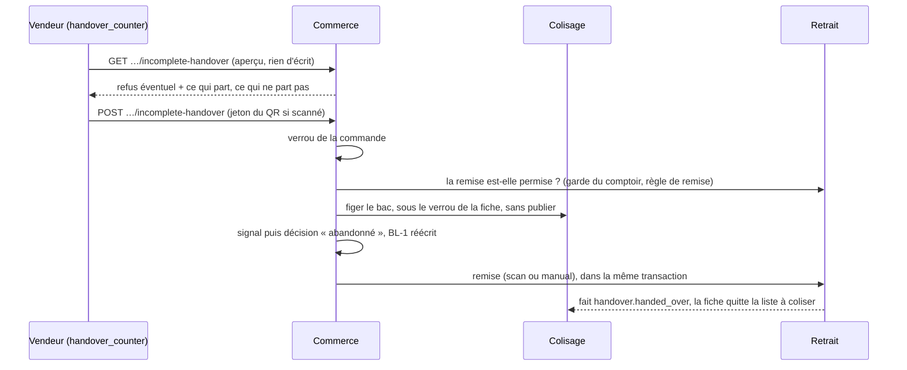

# Le départ incomplet décidé au comptoir

> ✅ Doc d'état, écrite le 2026-11-03 au bout du chantier (lots C1, C1b, C2 et
> leurs suites, tous sur `dev`). Elle remplace le plan du même jour, contredit
> par `vitruve` (quatre objections bloquantes, toutes corrigées avant de
> bâtir). Les numéros de section sont ceux du plan : le code y renvoie.

## 1. Le problème

Au comptoir, « Remettre la commande » passait sur un sac pas fini : le
serveur ne refuse jamais le premier envoi pour « pas colisé »
(`handoverBlocker`, `src/handover/domain/services/handover.ts` — `prepared`
vaut toujours vrai au rang 1 : c'est `shipmentPrepared()` de
`handover/domain/services/handover-shipments.ts` qui le pose). Le bon de
livraison naît à la remise et, sans décision de départ, chiffre la commande
**entière** (`departingSourceOf`) ; la facture suit. Un client qui emportait
42 pièces recevait un BL et une facture pour 234.

## 2. Les décisions de Hugo (2026-11-03)

| #   | Décision                                                                                                                                                |
| --- | ------------------------------------------------------------------------------------------------------------------------------------------------------- |
| D1  | Le comptoir décide lui-même du départ incomplet.                                                                                                        |
| D2  | **Tout vendeur du comptoir** (`handover_counter:write`) peut le décider ; la décision est tracée (qui, quand).                                          |
| D3  | Ce qui part = **ce qui est au bac** au colisage, jamais une saisie.                                                                                     |
| D4  | Le sort du reste : abandonné aujourd'hui ; le reliquat viendra (§5).                                                                                    |
| D5  | **Pas de dialogue sur le chemin heureux** : sac fini, « Remettre la commande » remet directement.                                                       |
| D6  | Le reliquat se choisira au comptoir : le client repasse à une heure convenue, ou on le lui porte — le plus souvent à pied, sans réveiller la livraison. |
| Q1  | « Remettre la commande entière » malgré un manque n'est **pas** offert : il facturerait le commandé sur la parole du vendeur ; on corrige le colisage.  |
| —   | Quand le départ est déjà tranché (décidé, autorisé, bac fermé), le comptoir n'a plus qu'à remettre, et l'écran dit qui l'a validé.                      |

Ce que le domaine impose : **carte** et **bon de fidélité** n'ont pas de
départ incomplet (il faudrait un remboursement partiel, E9, pas bâti) ; **rien
au bac**, pas de départ — on annule.

🔴 **Pas encore de retrait partiel pour une commande de particulier** (noté
par Hugo le 2026-11-03). Un particulier paie en ligne par carte : le dialogue
lui oppose `card`, et seule « Fermer » s'offre. Il faut d'abord le
remboursement partiel (E9), qui n'est pas bâti.

> **2026-11-10 : E9 est débloqué, pas bâti.** Le remboursement d'un montant
> existe : `CardRefunds.requestAmount` du bloc `card-payment`, en production
> depuis le lot P1 (2026-11-10). Le départ incomplet d'une commande carte ne
> s'en sert pas encore : le refus `card` tient toujours.

## 3. Le circuit

Le chemin des managers (« Il manque » au poste, puis
`POST admin/orders/:id/shortfall-decision` sous `b2b_orders_shortfall`) ne
change pas ; il partage avec le comptoir la même décision
(`shortfall-departure.ts`).

## 4. Ce qui est bâti

### 4.1 Les états d'un sac « pas fini »

L'aperçu `GET /admin/counter/orders/:orderId/incomplete-handover`
(`handover_counter:read`) rend `CounterIncompleteHandoverView` : un `refusal`
(ou `null`), les lignes (`due`, `departing`, `notDeparting`, en grammes au
poids) et, quand le départ est déjà tranché, `decision` (`decidedAt`,
`decidedByName`). Les codes, dans l'ordre où le geste juge
(`packages/contracts/src/counter-incomplete-handover.ts`) :

| Code                                                                                                                                                   | Ce que voit le vendeur                                                      |
| ------------------------------------------------------------------------------------------------------------------------------------------------------ | --------------------------------------------------------------------------- |
| `null`                                                                                                                                                 | « Remettre ce qui est au bac — le reste est abandonné »                     |
| `nothing_short` (tout réparti, bac pas fermé)                                                                                                          | la remise ordinaire, sans dialogue                                          |
| `already_decided`, `already_authorized`                                                                                                                | « Départ incomplet validé par <nom> à <heure> » et « Remettre la commande » |
| `sealed` (le colisage a fermé le sac)                                                                                                                  | « Le colisage a fermé ce sac. » et « Remettre la commande »                 |
| `card`, `voucher`, `not_confirmed`, `too_old`, `nothing_departs`, `not_drawn`, `withdrawn`, `counted`, `handover_refused`, `not_a_pickup`, `other_day` | une phrase, et seulement « Fermer »                                         |

Chaque bloc expose sa règle « rendue au lieu de levée » ; l'aperçu et le geste
la partagent (`shortfall-standing.ts`, `shortfall-decidability.ts`,
`counter-reach.ts`). L'aperçu ne promet rien : le geste rejuge sous verrou.

### 4.2 Le geste — une transaction, dans le commerce

`POST /admin/counter/orders/:orderId/incomplete-handover`, corps
`{ remainder: "abandoned", token? }`, 204 (`HandOverPackedAtCounterHandler`) :

1. verrou de la commande ;
2. le retrait juge, sans écrire (`CounterHandoverDesk.vet`) : la garde du
   comptoir, la règle de remise, le jeton ;
3. les refus de la décision qui ne dépendent pas du bac ;
4. le colisage fige le bac (`ShortfallFreezeDesk`, dans la transaction de
   l'appelant), sans publier `packing.shortfall_reported` ;
5. le commerce écrit le signal puis la décision, autorise la fiche et réécrit
   le BL-1 ;
6. le retrait remet (`handOver`) : `scan` avec un jeton de cette commande,
   `manual` sans.

Tout ou rien. Un « Il manque » pressé au poste juste avant est repris ; un
signal du poste **plus récent** que ce que lit le comptoir fait refuser
(`orders.shortfall.signal_outrun`). Un jeton d'une autre commande refuse
(`handover.counter.token_mismatch`), rien d'écrit.

### 4.3 Le droit

La garde (`counterReachOf`) : un **retrait** (`pickup`) de la **journée** du
comptoir — une livraison ou un autre jour, 403
`handover.counter.out_of_reach`. « Qui peut décider » est séparé de « quel
sort » : le sort est un paramètre (`abandoned` seul), pour que le reliquat s'y
ajoute sans rouvrir la question du droit. Aucune migration de droit.

Le rail lit sa fiche de colis par `GET /admin/counter/orders/:orderId/packing-sheet`,
sous le même droit : le tableau du colisage, sous `production_packing`,
refusait le vendeur — sans fiche, le rail proposait « Remettre la commande »
et la commande partait facturée en entier (corrigé le 2026-11-03).

### 4.4 L'écran

- Sac fini : « Remettre la commande ».
- Sac pas fini : **« Procédure commande incomplète »**, qui lit l'aperçu puis
  ouvre le dialogue (`handover-shop/incomplete-handover-dialog/`) selon le
  tableau du §4.1. Un refus du geste reste dans le dialogue.
- Dans la file et le rail, une commande partie incomplète se dit en une ligne :
  « Commande incomplète · 192 pièces non données sur 16 produits ».

Le BL remis au comptoir est le BL de **transport**, sans montant, avec « Reçu
par, le, signature » au bas de la page ; il n'imprime que les lignes remises
et dit le reste sous le tableau (« Non livré : … ») —
[`../commandes/bon-de-livraison.md`](../commandes/bon-de-livraison.md).

## 5. Les lots, et ce qui reste

| Lot | État                                                                                                                                                                                                                                                                            |
| --- | ------------------------------------------------------------------------------------------------------------------------------------------------------------------------------------------------------------------------------------------------------------------------------- |
| C1  | ✅ le geste en une transaction, la garde (`19d471d42`)                                                                                                                                                                                                                          |
| C1b | ✅ l'aperçu et ses codes ; la fiche quitte le colisage après la remise (`b405087d7`, §7)                                                                                                                                                                                        |
| C2  | ✅ le dialogue (`9521dd2ed`), le départ déjà tranché et le jeton du QR (`a9d87343b`, `6c43e704a`)                                                                                                                                                                               |
| R   | ⏳ **le reliquat** (D6) : « le client repasse » ou « on le lui porte », dans le même dialogue. Repose sur **L8** d'E7 (la naissance du BL-2), pas bâti — [`../commandes/etat-chantier-e7-reliquat.md`](../commandes/etat-chantier-e7-reliquat.md). À planifier, avec `vitruve`. |

## 6. Ce qui reste ouvert

- **Le retrait partiel d'une commande de particulier** : refusé (`card`)
  tant que le départ incomplet ne demande pas le remboursement partiel (E9) ;
  ce remboursement existe depuis le 2026-11-10 (`CardRefunds.requestAmount`,
  bloc `card-payment`, P1) : E9 est débloqué, pas bâti (§2).
- Les cas `not_drawn`, `withdrawn`, `sealed`, `counted` et
  `already_authorized` de l'aperçu ne sont éprouvés qu'en unitaire : la scène
  e2e ne les atteint pas au rang 1.
- Une remise **avant** le tirage de la liste n'a pas de fiche à sortir ; si le
  fournil tire ensuite une commande déjà retirée, sa fiche naîtra ouverte.

## 7. La fiche de colis après la remise

Le colisage écoute le fait du retrait `handover.handed_over`, par un canal
que le retrait déclare (`src/handover/channels/packing/`, case
`packing → handover : port uniquement` de la matrice, `CLAUDE.md` §3, validée
par Hugo le 2026-11-03). Un `@DurableHandler`
(`packing/application/handlers/on-order-handed-over.handler.ts`) décide du sort
de la fiche (`PackingSheet.leaveAtHandover`) : rien au bac → retirée ;
quelque chose au bac → fermée telle quelle ; déjà fermée → inchangée.
Idempotent. Un « prête » qui arrive ensuite sur une commande déjà retirée est
un succès sans effet côté commerce (`mark-order-ready.handler.ts`) : plus de
message mort sur la carte de santé.
