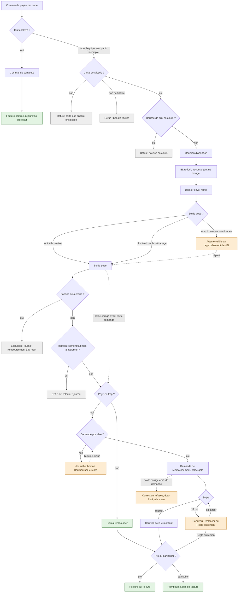
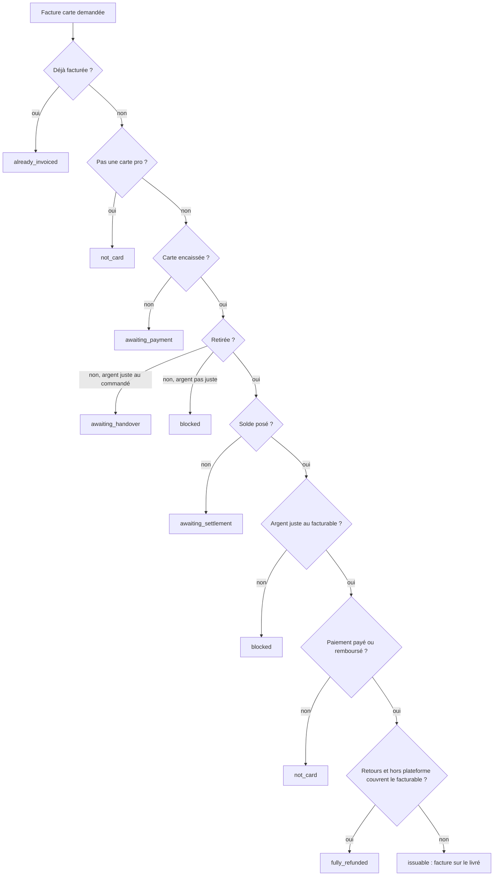

# Plan E9 — rembourser le reste d'une commande payée par carte (v5)

> Statut : **lot F bâti le 2026-11-13 (non commité à l'écriture)** ; E9a et
> E9b doc-first. v1 à v4 contredites par `vitruve`
> (§ 12) ; cette v5 répond à chaque objection, revérifiée dans le code le
> 2026-11-13. Décisions de Hugo :
>
> - 2026-11-13 (v1) : **on rembourse au solde, pas à la décision** ;
> - 2026-11-13 (v3) : **le lot F se bâtit et se livre d'abord, seul** ;
>   **pas de migration** — le gel d'un remboursement `shortfall` se fait dans le
>   code, par le port `OrderShortfallRefundReader` (§ 4.7) ;
> - 2026-11-13 (v4) : F d'abord, seul, sans migration (confirmé) ; **un schéma
>   qui montre toutes les branches** (Partie 1).
>
> Contexte : [`reliquat.md`](reliquat.md), [`todo-reliquat.md`](todo-reliquat.md),
> [`../../comptabilite/etat-argent-et-comptabilite.md`](../../comptabilite/etat-argent-et-comptabilite.md),
> [`../modification/plan-m2-historique-de-transactions.md`](../modification/plan-m2-historique-de-transactions.md) § 3.6.

> **Requête préalable lancée en production le 2026-11-13 par Hugo : 0 partout** (`a_rattraper`, `en_ecart`, `facturable_different`, `cartes_partielles`, commandes bloquées en « remboursée en totalité », remboursements hors plateforme). Aucune facture en retard ne partira au déploiement de F : la question des e-mails ne se pose pas.

## Partie 1 — En clair

### Toutes les branches, d'un coup d'œil

Le schéma part d'une commande payée par carte et suit chaque cas jusqu'à son
issue. Les cases grises sont des refus ou des exclusions, les vertes des
issues normales, les orange des attentes ou des reprises à la main.



Lecture des cas :

- **Commande complète** : rien ne change, la facture part au retrait comme
  aujourd'hui.
- **Carte pas encore encaissée**, **bon de fidélité**, **hausse de prix en
  cours** : la décision d'abandon est refusée, avec une phrase qui dit
  pourquoi.
- **Décision d'abandon** : le BL est réécrit, aucun argent ne bouge, le
  comptoir n'attend jamais un remboursement.
- **Solde** : il est posé à la remise du dernier envoi, ou plus tard par le
  rattrapage du rapprochement. S'il manque une donnée (jour de réception,
  BL), la commande attend ; l'écart est listé au rapprochement des BL.
- **Facture déjà émise** : on ne rembourse pas automatiquement (un ajustement
  après facture n'aurait jamais d'avoir) ; journal, l'équipe rend à la main.
- **Remboursement fait hors plateforme** : on ne devine pas ce qu'il a rendu ;
  journal, pas de calcul.
- **Payé en trop** : une demande part. Si elle ne peut pas être demandée
  (paiement occupé, montant qui ne tombe pas), le journal le dit et la fiche
  commande montre « Rembourser le reste ».
- **Stripe réussit** : courriel avec le montant, puis facture sur le livré.
  **Stripe refuse** : le bandeau d'aujourd'hui, « Relancer » ou « Réglé
  autrement » ; la facture part ensuite.
- **Particulier** : remboursé de la même façon, il n'a pas de facture.
- **Solde corrigé** : avant toute demande, le calcul est refait ; après une
  demande, le solde ne bouge plus, l'écart est listé et traité à la main.

### La facture carte seule (lot F)

Ses verdicts, dans l'ordre où ils sont jugés. Le premier qui répond gagne.



### Les trois temps

Aujourd'hui, une commande payée par carte ne peut pas partir incomplète. E9
lève ce refus quand la carte est **déjà encaissée**. Le travail se fait en
trois temps : **F** d'abord, livré seul, puis E9a, puis E9b.

**F — la facture carte porte ce qui a été livré.** Avant tout remboursement,
la facture d'un pro payée par carte apprend à attendre le solde de la commande
et à porter le **livré**, comme la facture au compte. Le solde posé publie un
fait, `order.billing_settled`, qui réveille la facture : une facture qui
attend le solde repart seule quand il arrive. Pour les commandes d'aujourd'hui,
toutes complètes, le montant ne change pas. Deux choses changent :

- une commande remise dont le solde manque attend au lieu d'être facturée ;
  une requête en base les compte avant la livraison de F (§ 3.6) ;
- la règle « remboursée en totalité » ne compte plus les ajustements : un
  ajustement rend un trop-perçu, ce n'est pas une vente annulée. Une commande
  baissée par une modification, ou qui a reçu un ajustement puis un retour,
  était écartée sans facture ; elle est facturée, et le retour aura son avoir
  (§ 3.2).

**E9a — le remboursement au solde.**

1. **La décision ne touche pas à l'argent.** L'équipe décide qu'une partie ne
   sera pas livrée ; le bon de livraison est réécrit. Rien n'est remboursé : le
   comptoir n'est jamais bloqué par un remboursement.
2. **Le remboursement part au solde**, quand le dernier envoi est remis et
   qu'on sait ce qui a été livré : l'encaissé, moins ce qui a déjà été rendu en
   ajustement (y compris « Réglé autrement »), moins le total livré. Si le
   solde est corrigé avant tout remboursement, le calcul est refait ; dès qu'un
   remboursement du reste existe, le solde ne bouge plus. Ce gel est tenu par
   le code, pas par la base (§ 4.7).
3. **La facture d'un pro attend** que le remboursement soit réglé, puis part
   sur le livré.
4. **Si le remboursement ne peut pas être demandé**, rien n'est écrit côté
   argent : la fiche commande le dit, avec un bouton « Rembourser le reste ».
   Si Stripe refuse, c'est le bandeau d'aujourd'hui.

**E9b — ce que lisent le client et l'équipe.** Le client lit « le reste vous
sera remboursé sur votre carte », sans montant. Le montant lui est écrit
**quand Stripe confirme**, jamais avant.

Ne change pas : une carte pas encore encaissée reste refusée (avec un message
qui le dit), un bon de fidélité aussi ; une hausse de prix en cours empêche la
décision ; le reste à relivrer (L8) n'existe pas encore.

## Partie 2 — Technique

Chemins relatifs à `apps/lfd-api/src/`, vérifiés le 2026-11-13.

### 1. Ce qui existe

- **Refus** : `termsRefusalOf` rend `card` pour `due` et `paid`
  (`lafoliecoffee/orders/domain/services/shortfall-decidability.ts:64-75`),
  partagé par la décision et l'aperçu du comptoir (`decidabilityRefusalOf`,
  l. 37-44). Au rang 1, la décision n'est permise qu'au statut `confirmed`
  (l. 57-59). La décision tourne sur un `LockedShortfallSubject`
  (`orders/application/services/shortfall-departure.ts:55-60`), verrouillé par
  `PrismaOrderShortfallRepository.lock` : `SELECT "id" FROM "public"."orders"
WHERE "order_number" = $1 FOR UPDATE`
  (`orders/infrastructure/prisma-order-shortfall.repository.ts:53-57`).
- **Solde** : `OrderBilling` (`orders/domain/entities/order-billing.ts`) —
  `closeBilling` pose une fois (l. 92) ; `correctBilling(notes, engaged)`
  recompose si non engagée (l. 112) ; `settlementGapOf` nomme l'écart
  (l. 151) ; `settlementOf` (l. 178-186) ne rend rien hors `fulfilled` : une
  commande annulée n'est **jamais soldée**. Les montants de la commande
  (`orderAmounts`) contiennent les frais de retard
  (`orders/infrastructure/order-money-columns.ts:169-171`).
- **Verrou du solde** : `PrismaOrderBillingRepository.lock` = `FOR UPDATE` sur
  `orders`, puis la lecture (`orders/infrastructure/prisma-order-billing.repository.ts:61-69`).
  Même verrou que la facture carte (`accounting/infrastructure/prisma-order-invoicing-lock.ts:35`)
  et que la révision (`orders/revision/infrastructure/prisma-order-revision.repository.ts:47-50`).
- **Écrivain du solde** : `OrderBillingCloser`
  (`delivery-notes/application/services/order-billing-closer.ts`).
  Constructeur l. 54 (`billings`, `notes`, `engagements`, `settlement`,
  `clock`, `uow` — aucun publieur) ; `closeLocked` l. 64, appelé par
  `delivery-note-follower.ts:51` (remise) et
  `hand-over-remainder-note.handler.ts:76` (reste remis) ; le réconciliateur
  `reconcile` → `verdictOf` (l. 97-129, `frozen` l. 128) → `repair`
  (l. 131-156, sa propre `uow.run`, `closed` ou `corrected` l. 150) ;
  `persist` l. 158 ; `engaged()` l. 179.
  **Aucun déclencheur de facture n'écoute un solde posé par `repair`** :
  c'est l'objection bloquante de la v4, corrigée en F (§ 3.5).
- **Engagement** : `AccountOrderEngagementReader`
  (`orders/domain/ports/account-order-engagement.ts`) lit la facture 380 et
  la ligne d'encaissement au compte, **rien de la carte**.
- **Gel en base** : `orders_billable_frozen`
  (`prisma/migrations/20261025160000_la_facture_lit_les_montants_facturables`).
  Une commande carte n'a pas d'`order_collection` : avant sa 380, rien ne la
  gèle en base. **E9 ne l'étend pas** (§ 4.7).
- **Frontière carte** : `card_payment` est agnostique ; aucune clé ne sort vers
  `public`, aucune n'y entre (`prisma/schema/card_payment.prisma:11-13`).
- **Facture carte** :
  - verdict `cardInvoiceVerdict` (`accounting/domain/services/card-invoicing.ts:97-123`) ;
    `moneySquares` (l. 131-137) compare `chargedCents − adjustmentRefundedCents`
    au `totalCents` **commandé** ; `fully_refunded` (l. 122) compare
    `refundedCents` (toutes natures) au `totalCents` ;
  - contenu : `prepareCardInvoice` (`accounting/application/card-invoice-support.ts`)
    simule `candidate.frozen` (l. 101, 108), compare le TTC recalculé à
    `candidate.totalCents` (l. 109-115), pose l'acompte à `candidate.totalCents`
    (l. 145) ; son `catch` (l. 152-156) range en `blocked` les seules
    `DomainError` et `BusinessError`, **et relance toute autre erreur** ;
  - lecteur : `PrismaCardInvoicingReader.candidate`
    (`accounting/infrastructure/prisma-card-invoicing.reader.ts:40-93`),
    `frozen: toFrozenInvoiceOrder(order)` (l. 91), commentaire l. 89-90
    (« la facture carte garde les totaux de la COMMANDE ») ;
  - mapper du livré : `toBillableInvoiceOrder`
    (`accounting/infrastructure/billable-invoice-order.mapper.ts:113-140`) lève
    `UnsettledPartialOrderError` sur une commande décidée sans solde
    (l. 117-120). Sur une commande **complète soldée**, il diffère de
    `toFrozenInvoiceOrder` en trois points : remises de panier ventilées par
    les parts des BL remis quand ils en portent (`invoiceBasketDiscountsOf`),
    `vatShares` lus sur `billable_vat_shares`, et `warnedOfBasketDiscountFallback`
    (§ 3.3). `handedOverNoteNumbersOf` (l. 143-147) lit `deliveryNotes[].number`
    du `select` partagé. Précédent du bon ordre : la facture du mois
    (`prisma-monthly-invoicing.reader.ts:82-87`) ;
  - commande d'émission : `IssueCardInvoiceHandler.execute`
    (`accounting/application/commands/issue-card-invoice.handler.ts:64-89`),
    sous verrou ; seul `blocked` est rangé dans `card_invoice_outcome`
    (CHECK `issued|blocked`, `apps/lfd-api/prisma/schema/public/invoice.prisma`) ;
  - déclencheurs durables : `IssueCardInvoiceOnPaid`, `…OnFulfilled`,
    `…OnRefundSettled` (`accounting/application/handlers/`), liés dans
    `accounting/card-invoice.providers.ts` ;
  - contrat : `CardInvoiceOutcome` (`packages/contracts/src/issued-invoices.ts:162-170`) ;
  - back-office : `RETRIED`, un `Record<CardInvoiceOutcome, string>`
    (`apps/lfd-backoffice-frontend/src/app/comptabilite/procedure-de-prelevement/card-invoice-signals/card-invoice-signals.ts:28-36`).
- **Position carte** : `positionFrom` (`card-payment/infrastructure/settlement-position.ts:26-50`) —
  `refundedByNature = { return, adjustment, unattributed }` ; `unattributed` =
  remboursement réussi sans nature (un `re_` fait hors de la plateforme) ;
  `refundedCents` = la somme des trois ; demandes ouvertes = `to_issue`,
  `issued`, `stopped`.
- **Argent carte** :
  - `requestAmount` (`card-payment/application/refunds/block-card-refunds.ts:67-91`)
    verrouille (`CardPaymentNotFoundError`, `CardRefundPaymentNotPaidError`),
    refuse `CardRefundAmountExceedsRemainderError`, écrit la demande et
    programme l'envoi à Stripe après la validation (`dispatch.afterCommitFor`) ;
  - `splitCardRefund` (`orders/revision/domain/services/revision-card-refund.ts:43-61`)
    lève `CardRefundNotCoveredError` ;
  - `RevisionCardRefund.refundablesOf` (`orders/revision/application/services/revision-card-refund.ts:123-137`) ;
  - `ensureFirst` (`orders/application/services/order-card-payments.ts:70-89`) :
    `firstOf`, sinon `standings.ofOrder` — un `findUnique` Prisma
    (`orders/infrastructure/prisma-order-card-standing.reader.ts:53-56`) —, puis
    `uow.run(adopt)` ; `BlockCardPayments.adopt`
    (`card-payment/application/block-card-payments.ts:152-180`) ne fait que
    `findByProviderRef` et `addIfAbsent`. **Aucun appel réseau** : conforme à
    la porte `network-outside-transaction`.
- **Demandes** : états `to_issue`, `issued`, `refunded`, `stopped`,
  `settled_elsewhere`. **« Réglé autrement »** écrit une ligne `manual`
  `succeeded` (`amountCents` pour une demande `amount`,
  `ledger.remainderCents()` pour une `remainder`), puis publie
  `order.refund_succeeded`
  (`card-payment/application/commands/settle-card-refund-elsewhere.handler.ts:55-61`).
- **Vues du canal** : `CardRefundView` porte `source` mais pas l'identifiant de
  la demande ; `CardRefundRequestView` porte `reason`
  (`card-payment/channels/requests/card-settlement.reader.ts:78-117`).
- **Avoir** : aucun pour un `adjustment` (`accounting/application/services/refund-reconciler.ts:96`) ;
  un `return` rapproché après la facture reçoit un avoir.
- **Boîte d'envoi** : `publish` en `ON CONFLICT (key) DO NOTHING`
  (`platform/outbox/prisma-outbox.ts:44-47`) ; `DurableDeliveryGuard.deliver`
  pose le reçu et appelle l'abonné dans **une** transaction
  (`platform/outbox/durable-delivery-guard.ts:34-46`) ; `uow.run` imbriqué
  rejoint la transaction sans point de reprise (`platform/database/unit-of-work.ts:49-56`) ;
  abonné qui lève : tout est annulé, nouvel essai (`outbox-relay.ts:86-102`),
  au plus 10 (`retry-policy.ts:8`), puis lettre morte ; purge 30 jours après
  livraison (`outbox-retention.ts:7`).
- **Porte `durable-cross-block`** (`dev-toolbox/gates/durable-cross-block.mjs`) :
  le bloc est le **premier dossier sous `src/`**. `delivery-notes` et
  `accounting` sont tous deux sous `lafoliecoffee/` : même bloc. La porte ne
  vise que les `@EventsHandler` ; un `@DurableHandler` est de toute façon la
  forme qu'elle demande.
- **Idempotence des routes** : `@Idempotent` ou `@IntentKey()` +
  `OncePerIntent.runSealed` (`pnpm gate write-idempotence`) ; effet externe →
  clé d'intention. Précédent : « Relancer »
  (`card-payment/http/admin-card-refunds.controller.ts:36-42`).
- **Particulier** : il a un BL et un solde ; ses frais de retard sont nuls.
- **Frais de retard sur un reste** : aucun (`delivery-notes/domain/services/remainder-decision-source.ts:28`).
- **Reste à relivrer** : `DeliveryNote.planRemainder` sans appelant de
  production ; une commande carte n'a jamais de rang > 1.

### 2. La décision (E9a)

#### 2.1 Les refus

`termsRefusalOf` : `due` → nouveau refus **`card_unpaid`**
(`CardOrderUnpaidShortfallError`, « la carte n'est pas encore encaissée ») ;
`paid` avec un projet de hausse vivant → nouveau refus
**`card_increase_pending`** ; `paid` sinon → permis. Le projet vivant est lu
sous le verrou du `LockedShortfallSubject` et versé au sujet : la règle reste
pure et sert aussi l'aperçu du comptoir. Le bon reste refusé.
`ShortfallDeparture.decide` ne prend aucun port d'argent ;
`order.shortfall_decided` ne gagne aucun champ.

#### 2.2 Aucune hausse vivante au solde : la règle

- Une carte **encaissée** se révise : `standingBlockOf` ne rend `card_settled`
  que pour `due` ou une demande M4 (`order-revisability.ts:92`) ; `plan_closed`
  (l. 121) et `packed` (`order-cancellation.ts:205`) ne ferment pas la fenêtre
  pour l'équipe.
- **Ce qui la ferme** : `ensureNoShortfallDecision`
  (`orders/revision/domain/entities/order-revision.ts:212-215`), rejouée sous
  le verrou dans `OrderRevisingService.ensureRevisable`
  (`orders/revision/application/services/order-revising.service.ts:125`).
- **Avant la décision**, `card_increase_pending` refuse si un projet est vivant.
- **Même verrou, vérifié** : la révision prend `SELECT "id" FROM
"public"."orders" WHERE "id" = $1 FOR UPDATE`
  (`prisma-order-revision.repository.ts:47-50`) ; la décision prend le même
  `FOR UPDATE` sur la même ligne, cherchée par `order_number`
  (`prisma-order-shortfall.repository.ts:53-57`). Les deux se suivent : une
  révision qui attend la décision relit la commande décidée et est refusée ;
  une décision qui attend la révision lit le projet vivant et est refusée.

La fenêtre est **couverte**. La garde `increase_pending` reste dans l'abonné
(§ 4.4) comme filet.

### 3. Lot F — la facture carte porte le livré (à bâtir et livrer d'abord)

F se livre **seul**, avant toute ligne d'E9a. Il ne touche ni à l'argent, ni à
la décision, ni à la base : **aucune migration**. Il publie un fait nouveau,
`order.billing_settled` (§ 3.5), dont le nom et la clé deviennent définitifs
au premier merge (§ 11).

#### 3.1 Le lecteur — ordre exact

`PrismaCardInvoicingReader.candidate` :

1. Le `select` devient `BILLABLE_INVOICE_ORDER_SELECT` (qui contient
   `FROZEN_INVOICE_ORDER_SELECT`, les `billable_*`, `shortfallDecisions` et les
   BL remis avec leur `number`), plus `id`, `companyId`, `billedCompanyId`,
   `clientele`, `status`, `paymentStatus`, `paidAt`, `handedOverAt`,
   `receivedOn`. Le `deliveryNotes { number }` propre au lecteur disparaît :
   `handedOverNoteNumbersOf(order)` lit le `number` du `select` partagé (sa
   signature ne demande que `deliveryNotes[].number`, l. 143-147).
2. Le lecteur lit **la colonne brute** `order.billableTotalCents` :
   - **NULL** → `billableCents: null`, `frozen: toFrozenInvoiceOrder(order)`.
     Le mapper du livré n'est pas appelé ; `UnsettledPartialOrderError` ne
     peut pas partir d'ici. Ce `frozen` ne sert jamais à émettre : le verdict
     rend `awaiting_settlement` avant `prepareCardInvoice` ;
   - **posée** → `billableCents: order.billableTotalCents`,
     `frozen: toBillableInvoiceOrder(order)`.
     C'est la figure de `prisma-monthly-invoicing.reader.ts:82-87`.
3. Le commentaire des l. 89-90 est réécrit : « La facture carte porte le LIVRÉ
   (plan E9, lot F) : les montants facturables du solde, lus sur la colonne
   brute ; sans solde, le verdict attend (`awaiting_settlement`) et le mapper
   du livré n'est jamais appelé — il lèverait `UnsettledPartialOrderError` sur
   une commande décidée. » La doc du mapper (l. 43-47) est réécrite pareil.
4. `CardInvoiceCandidate` gagne `billableCents: number | null`.

#### 3.2 Le verdict — ordre exact

```text
1. invoiced                                   → already_invoiced
2. sans société, public, annulée,
   totalCents <= 0, not_required              → not_card        (régime : total commandé)
3. due ou paidAt NULL                         → awaiting_payment
4. handedOverAt NULL                          → moneySquares(totalCents) ? awaiting_handover : blocked
5. billableCents NULL                         → awaiting_settlement
6. !moneySquares(billableCents)               → blocked
7. paymentStatus ∉ {paid, refunded}           → not_card
8. refundedCents − adjustmentRefundedCents
   >= billableCents                           → fully_refunded
9. sinon                                      → issuable
```

- L'étape 4 rend exactement le verdict d'aujourd'hui avant la remise.
- `moneySquares(base)` = aucun ajustement ouvert ni arrêté, et
  `chargedCents − adjustmentRefundedCents === base`. **`settled_elsewhere` est
  compté** : sa ligne `manual` est dans `adjustmentRefundedCents`.
- **`fully_refunded` : nouvelle règle, assumée.** `refundedCents −
adjustmentRefundedCents` = `return + unattributed`. Elle change le verdict
  de **toute** commande qui a reçu un ajustement, pas seulement des baisses
  M2. Contre-exemple de `vitruve` : total 100, encaissé 130, ajustement 30,
  retour 80. Aujourd'hui : 30 + 80 = 110 ≥ 100 → `fully_refunded`, aucune
  facture, alors qu'une vente de 100 a eu lieu. Demain : 80 < 100 →
  `issuable`. **C'est la bonne règle** : l'ajustement rendait un trop-perçu
  (130 encaissés pour 100 dus), pas de la marchandise ; la vente de 100 doit
  être facturée, puis le retour de 80 reçoit son avoir par le rapprochement
  (`refund-reconciler.ts`, nature `return`). L'ancienne règle mêlait les deux
  et taisait une vente.
- **`unattributed`** compte comme « pas de vente » dans `fully_refunded` (comme
  aujourd'hui), hors de l'égalité. On ne devine pas sa nature. L'abonné d'E9a
  refuse d'agir sur un sujet qui en porte (§ 4.4).
- Nouvelle phrase `CARD_INVOICE_AWAITS_SETTLEMENT` : « La facture attend que le
  solde de la commande soit posé (remise complète et jour de réception) ; elle
  partira seule au solde. » Rendue par `IssueCardInvoiceHandler` comme message
  de `awaiting_settlement` (l. 79). **Rien n'est rangé** : le CHECK de
  `card_invoice_outcome` (`issued|blocked`) reste tel quel.
- `CardInvoiceOutcome` (`packages/contracts/src/issued-invoices.ts:162-170`)
  gagne `"awaiting_settlement"` ; le `Record` `RETRIED` du back-office gagne
  « Solde pas encore posé : la facture partira au solde ».

#### 3.3 Le contenu de la facture (PDF, Factur-X)

`prepareCardInvoice` (`card-invoice-support.ts`) :

- l. 108 simule `candidate.frozen`, désormais le livré ;
- l. 109-115 : le TTC recalculé se compare à **`billableCents`**, phrase
  « diffère du facturable ». `billableCents` n'est jamais NULL ici (l'étape 5
  l'a écarté) ; on le garde par une `TechnicalError` explicite. Celle-ci n'est
  **pas** rangée en `blocked` : le `catch` des l. 152-156 ne range que
  `DomainError` et `BusinessError` et **relance** le reste. Elle remonte donc
  au déclencheur (relance bornée de la boîte d'envoi, puis lettre morte) ou à
  la route `retry` (500). C'est voulu : c'est un défaut de code, pas un état
  métier ;
- l. 145 : `prepayment.amountCents` = **`billableCents`**, égal par l'étape 6
  à l'encaissé net (`chargedCents − adjustmentRefundedCents`).

**Écarts possibles entre les deux mappers, sur une commande complète.**
`toBillableInvoiceOrder` ventile les remises de panier par les parts des BL
remis quand ils en portent, lit `billable_vat_shares` et `billable_vat_cents`,
et avertit d'un repli de remise. Sur une commande complète, le solde recopie
les totaux et le BL recopie les lignes : les deux doivent coïncider. S'ils
diffèrent, **le livré est juste** : c'est ce que porte déjà la facture au
compte, et ce que le BL remis a acté. On ne garde pas l'ancienne ventilation.
Avant la livraison, Q5 (§ 3.6) compte les commandes carte pro non facturées où
les deux diffèrent ; si le compteur n'est pas nul, on regarde chaque cas avant
de livrer. Le test de non-régression (§ 3.8) compare le Factur-X entier.

#### 3.4 Ce que F change vraiment

- **`order.fulfilled`** : sans effet ; le solde est posé dans la même
  transaction (`delivery-note-follower.ts:49-52`), et une commande sans
  décision a pour facturable la recopie de ses totaux.
- **Une commande remise à facturable NULL** : `awaiting_settlement`,
  **réveillée** quand le réconciliateur pose le solde (§ 3.5). Si le solde ne
  peut pas être posé (BL sans en-tête), elle attend que l'écart soit réparé.
- **Limite** : une commande complète ancienne à `received_on` NULL n'est ni
  soldée ni listée comme écart (`settlementOf` rend `null` sans jour de
  réception, `settlementGapOf` ne la nomme pas) : sa facture carte attend sans
  signal. Zéro en production au 2026-11-13 (`en_ecart`) ; toute remise pose
  `receivedOn` (`mark-order-fulfilled.handler.ts:95`).
- **Toute commande avec ajustement** que l'ancien `fully_refunded` écartait
  est facturée (§ 3.2) ; Q4 les compte.

#### 3.5 Le réveil : `order.billing_settled` et `IssueCardInvoiceOnBillingSettled`

**Le fait.** `order.billing_settled`, publié par `OrderBillingCloser.persist`
après un `save` réussi, pour `closed` **et** `corrected`, jamais sur un `save`
refusé ni sur un écart gelé. Payload
`{ orderId, write, billableTotalCents, settledOn }`. **Clé
`order.billing_settled:<writeId>`**, `writeId` tiré de l'`IdGenerator` à
chaque écriture : unique par écriture. Une clé dérivée du contenu
(`orderId:total:jour`) aurait été avalée par l'`ON CONFLICT DO NOTHING` de la
boîte d'envoi sur une correction de TVA seule ou un aller-retour A → B → A.
`OrderBillingCloser` injecte `DurablePublisher` et `IdGenerator`. `persist`
tourne toujours dans une unité de travail (celle de la remise ou celle de
`repair`) : le fait est écrit avec le solde.

**L'abonné.** `IssueCardInvoiceOnBillingSettled`, dans
`accounting/application/handlers/`, nom stable
`accounting.issue-card-invoice.on-billing-settled`. Le fait part pour **toute**
commande soldée, au compte et particuliers compris : l'abonné lit d'abord le
périmètre sur la ligne `orders` seule (port `CardInvoiceScopeReader`, cinq
colonnes par clé primaire, sans verrou ni position carte) et rend sans rien
faire si `outsideCardInvoicing` (sans société, publique, annulée, gratuite, au
compte) ou si la commande est introuvable. Sinon il rejoue
`IssueCardInvoiceCommand(orderId)`. Aucune commande hors carte ne finit en
relance ni en lettre morte (`OrderToInvoiceNotFoundError` ne part que d'une
commande inexistante, et l'abonné l'écarte avant). **Le périmètre n'est pas
dans le payload** : un champ de plus y serait définitif pour économiser une
lecture par clé primaire, et le règlement se lit au moment de juger.

**Double exécution à la remise, gardée.** À la remise d'une commande carte
pro, `…OnFulfilled` et `…OnBillingSettled` tournent tous les deux : le second
trouve `already_invoiced` sous le verrou et lance `reconciler.reconcile` —
ce n'est pas « sans écriture », c'est le rapprochement des remboursements,
idempotent. `…OnFulfilled` n'est pas retiré : sa couverture n'est pas
prouvée identique (une remise qui ne passe pas par `closeLocked` ne serait
réveillée qu'au passage suivant du rapprochement, et ses livraisons en attente
portent son nom). Coût : un verrou et une lecture du candidat de plus par
commande carte pro remise.

**La porte.** `delivery-notes` (publieur) et `accounting` (abonné) sont dans
le même bloc `lafoliecoffee` ; l'abonné est un `@DurableHandler`. La porte
`lint:durable-cross-block` passe des deux façons.

**La visibilité de l'attente : tranché, on l'accepte.** Rien n'est rangé
(`card_invoice_outcome` ne connaît que `blocked`, et pas de migration). Une
attente se résout de deux façons :

- le solde peut être posé : le réconciliateur le pose, le fait part, la
  facture part. L'attente dure un passage du réconciliateur ;
- le solde ne peut pas être posé : l'écart est **déjà listé** par le
  rapprochement des BL (`order-billing-closer.ts:107-115`), seul endroit où il
  se répare. Un second signal dans l'écran des factures carte doublerait la
  même liste.

Le `retry` d'une facture en attente rend la phrase « partira au solde ». Pas de
compteur nouveau dans l'écran des signaux.

#### 3.6 Requêtes préalables (lecture seule, comptes seulement)

À lancer en production avant F. Aucune donnée personnelle.

```sql
-- Q1 — cartes pro REMISES (fulfilled), non facturées (380) : solde manquant ou différent
WITH card_pro AS (
  SELECT o.id, o.received_on, o.total_cents, o.billable_total_cents
  FROM public.orders o
  WHERE o.payment_status IN ('paid', 'refunded') AND o.total_cents > 0
    AND o.company_id IS NOT NULL AND (o.clientele IS NULL OR o.clientele = 'pro')
    AND o.status = 'fulfilled'
    AND NOT EXISTS (SELECT 1 FROM public.invoice_order io
                     WHERE io.order_id = o.id AND io.invoice_type = '380')
)
SELECT
  count(*) FILTER (WHERE billable_total_cents IS NULL AND received_on IS NOT NULL) AS a_rattraper,
  count(*) FILTER (WHERE billable_total_cents IS NULL AND received_on IS NULL)     AS en_ecart,
  count(*) FILTER (WHERE billable_total_cents IS NOT NULL
                     AND billable_total_cents <> total_cents)                     AS facturable_different
FROM card_pro;

-- Q2 — anciennes cartes partielles ou à plusieurs envois (toute clientèle)
SELECT
  count(*)                                                  AS cartes_partielles,
  count(*) FILTER (WHERE o.billable_total_cents IS NULL)    AS sans_solde,
  count(*) FILTER (WHERE o.status = 'cancelled')            AS annulees
FROM public.orders o
WHERE o.payment_status IN ('pending', 'failed', 'paid', 'refunded') AND o.total_cents > 0
  AND (EXISTS (SELECT 1 FROM public.order_shortfall_decision d WHERE d.order_id = o.id)
    OR EXISTS (SELECT 1 FROM public.delivery_note n WHERE n.order_id = o.id AND n.rank > 1));

-- Q3 — cartes à facturable NULL que le réconciliateur va solder (toute clientèle)
SELECT count(*) AS soldes_a_poser
FROM public.orders o
WHERE o.payment_status IN ('paid', 'refunded') AND o.total_cents > 0
  AND o.status = 'fulfilled' AND o.billable_total_cents IS NULL
  AND o.received_on IS NOT NULL;

-- Q4 — cartes pro remises, non facturées : l'ancien `fully_refunded` les écarte,
--      le nouveau passe l'étape 6 (argent juste au facturable) et facture
WITH money AS (
  SELECT p.subject_id AS order_id,
         sum(p.amount_cents)                                                                  AS charged,
         sum(r.amount_cents) FILTER (WHERE r.status = 'succeeded')                           AS refunded,
         sum(r.amount_cents) FILTER (WHERE r.status = 'succeeded' AND r.nature = 'adjustment') AS adjusted,
         sum(r.amount_cents) FILTER (WHERE r.status = 'succeeded' AND r.nature IS NULL)      AS unattributed
  FROM card_payment.payment p
  LEFT JOIN card_payment.refund r ON r.payment_id = p.id
  WHERE p.subject_type = 'order'
  GROUP BY p.subject_id
),
open_adjustment AS (
  SELECT DISTINCT p.subject_id AS order_id
  FROM card_payment.refund_request rr
  JOIN card_payment.payment p ON p.id = rr.payment_id
  WHERE p.subject_type = 'order' AND rr.nature = 'adjustment'
    AND rr.state IN ('to_issue', 'issued', 'stopped')
)
SELECT
  count(*)                                         AS faux_fully_refunded,
  count(*) FILTER (WHERE m.unattributed > 0)       AS dont_hors_plateforme
FROM public.orders o
JOIN money m ON m.order_id = o.id
WHERE o.company_id IS NOT NULL AND (o.clientele IS NULL OR o.clientele = 'pro')
  AND o.status = 'fulfilled'
  AND o.payment_status IN ('paid', 'refunded') AND o.total_cents > 0
  AND o.billable_total_cents IS NOT NULL
  AND NOT EXISTS (SELECT 1 FROM public.invoice_order io
                   WHERE io.order_id = o.id AND io.invoice_type = '380')
  AND NOT EXISTS (SELECT 1 FROM open_adjustment a WHERE a.order_id = o.id)
  AND coalesce(m.refunded, 0) >= o.total_cents                                  -- l'ancien verdict
  AND m.charged - coalesce(m.adjusted, 0) = o.billable_total_cents              -- étape 6 du nouveau
  AND coalesce(m.refunded, 0) - coalesce(m.adjusted, 0) < o.billable_total_cents; -- étape 8 du nouveau

-- Q5 — cartes pro complètes soldées, non facturées : le livré diffère-t-il de la commande ?
SELECT count(*) AS ventilation_differente
FROM public.orders o
WHERE o.payment_status IN ('paid', 'refunded') AND o.total_cents > 0
  AND o.company_id IS NOT NULL AND (o.clientele IS NULL OR o.clientele = 'pro')
  AND o.status = 'fulfilled' AND o.billable_total_cents IS NOT NULL
  AND NOT EXISTS (SELECT 1 FROM public.order_shortfall_decision d WHERE d.order_id = o.id)
  AND NOT EXISTS (SELECT 1 FROM public.invoice_order io
                   WHERE io.order_id = o.id AND io.invoice_type = '380')
  AND (o.billable_vat_cents      IS DISTINCT FROM o.vat_cents
    OR o.billable_discount_cents IS DISTINCT FROM o.discount_cents
    OR o.billable_total_cents    IS DISTINCT FROM o.total_cents);
```

Les noms de colonnes de Q4 (`payment.amount_cents`) et de Q5 (`vat_cents`,
`discount_cents`) sont relus contre le schéma avant de lancer. Q5 ne voit pas
la ventilation par part des remises de panier ; le test du § 3.8 la couvre.

Lecture attendue : `en_ecart = 0`, `facturable_different = 0`,
`cartes_partielles = 0`, `ventilation_differente = 0`. Sinon, on s'arrête et
on en parle. `a_rattraper` / `soldes_a_poser` : une fois F livré, le
réconciliateur les pose et le fait les facture (§ 3.5) ; on peut aussi le
laisser passer avant. `faux_fully_refunded` : la liste est relue avant
livraison (Q7), car **F les émettra seul** au prochain réveil ;
`dont_hors_plateforme` se regarde une à une.

#### 3.7 Fichiers de F

- `accounting/domain/services/card-invoicing.ts` — `billableCents`,
  `awaiting_settlement`, ordre du § 3.2, `fully_refunded`, docs,
  `CARD_INVOICE_AWAITS_SETTLEMENT`.
- `accounting/infrastructure/prisma-card-invoicing.reader.ts` — `select`,
  colonne brute, commentaire l. 89-90.
- `accounting/infrastructure/billable-invoice-order.mapper.ts` — doc l. 43-47.
- `accounting/application/card-invoice-support.ts` — l. 109-115 et l. 145.
- `accounting/application/commands/issue-card-invoice.handler.ts` — message.
- `lafoliecoffee/accounting/application/handlers/issue-card-invoice-on-billing-settled.handler.ts`
  (nouveau) et `accounting/card-invoice.providers.ts`.
- `lafoliecoffee/accounting/domain/ports/card-invoice-scope.reader.ts` et
  `lafoliecoffee/accounting/infrastructure/prisma-card-invoice-scope.reader.ts` (nouveaux).
- `accounting/domain/errors/card-invoice-errors.ts` —
  `UnsettledCardInvoicePreparationError`.
- `delivery-notes/application/services/order-billing-closer.ts` — publieur,
  `persist`.
- `lafoliecoffee/orders/domain/events/order-billing-settled.fact.ts` (nouveau,
  à côté de `order-refund-succeeded.fact.ts`).
- `packages/contracts/src/issued-invoices.ts` — `CardInvoiceOutcome`.
- `apps/lfd-backoffice-frontend/src/app/comptabilite/procedure-de-prelevement/card-invoice-signals/card-invoice-signals.ts` — `RETRIED`.

#### 3.8 Tests de F

- **Unitaires `cardInvoiceVerdict`** : la table d'aujourd'hui rejouée sans
  changement pour une commande complète **sans ajustement** ; avant la
  remise : `awaiting_handover` / `blocked` comme aujourd'hui ; remise,
  `billableCents` NULL → `awaiting_settlement` ; égalité au facturable
  (encaissé 100, facturable 60, ajustement 40 → `issuable`) ; ajustement
  `stopped` → `blocked`, puis `settled_elsewhere` → `issuable` ; baisse M2 de
  plus de la moitié → `issuable` ; **ajustement puis retour** (total 100,
  encaissé 130, ajustement 30, retour 80 → `issuable`, était
  `fully_refunded`) ; retour total → `fully_refunded` ; `unattributed`
  couvrant le facturable → `fully_refunded`.
- **`OrderBillingCloser`** : fait publié sur `closed` et `corrected`, jamais
  sur un `save` refusé ni sur `frozen` ; clé stable.
- **Abonné `IssueCardInvoiceOnBillingSettled`** : rejoue la commande ;
  intégration par la vraie `DurableDeliveryGuard` — commande carte pro remise
  à facturable NULL, `repair` pose le solde → la facture est émise sans
  `retry`.
- **Lecteur (intégration base)** : commande décidée à facturable NULL →
  candidat rendu, `billableCents: null`, aucune exception ; décidée soldée →
  `frozen` sur les lignes des BL remis.
- **Contenu (intégration, bloquant)** : commande carte pro décidée (décision,
  BL remis, `billable_*`, paiement 100, ajustement `succeeded` 40) → la
  facture a un TTC et un acompte de 60 et les lignes du BL. Même test sur une
  baisse M2 sans décision.
- **Non-régression (bloquant)** : commande carte pro **complète**, avec une
  **remise de panier**, dont le BL remis porte des **parts** de remise :
  le **XML Factur-X entier** émis par F est comparé à celui de l'ancien code
  (instantané pris avant le changement). Égalité attendue ; un écart se lit
  comme un défaut de recopie du solde ou du BL, et se tranche pour le livré
  (§ 3.3).
- **`pnpm test` à la racine** : le contrat (`packages/contracts`) et le
  back-office se compilent avec la nouvelle valeur.

#### 3.8 bis Ce qui est bâti (2026-11-13)

- Unitaires : `card-invoicing.spec.ts` (verdicts du § 3.2, filtre
  `outsideCardInvoicing`), `issue-card-invoice-billable.handler.spec.ts`
  (attente, contenu « TTC = acompte = facturable » sur un livré de 600 pour
  1 000 encaissés et 400 d'ajustement, refus « diffère du facturable »,
  `UnsettledCardInvoicePreparationError`), `order-billing-closer-fact.spec.ts`
  (fait sur `closed` et `corrected` seulement, deux clés pour deux écritures au
  même contenu), `issue-card-invoice-on-billing-settled.handler.spec.ts`
  (commande au compte, particulier, sans société, introuvable : rien, sans
  erreur).
- E2E `test/card-invoice-billable.e2e-spec.ts` : réveil par le rapprochement
  sans « Réessayer » ; commande au compte livrée du premier coup à l'abonné,
  sans facture ; non-régression sur une commande carte complète avec remise de
  panier et parts sur le BL — le Factur-X préparé sur le livré est **égal** à
  celui préparé sur la commande (numéro, identifiant et instant d'émission
  neutralisés, identiques des deux côtés). L'« instantané de l'ancien code »
  est rejoué dans le test par l'ancienne lecture (`toFrozenInvoiceOrder`,
  jugée au total commandé) au lieu d'un fichier figé.
- Écart au § 3.2 : aucun. Écart au § 3.5 : clé par écriture et filtre de
  l'abonné (objections de la relecture de la v5).

#### 3.9 Livraison et retour arrière

1. Q1-Q5 en production ; arrêt si un compteur bloquant est > 0.
2. Relire la liste de Q4 (Q7 de Hugo).
3. **Back-office d'abord** (le `Record` connaît `awaiting_settlement`), **puis
   l'API** : un back-office ancien recevrait une valeur qu'il ne sait pas
   libeller.
4. Les soldes en attente se posent au passage du réconciliateur et les
   factures partent par le fait.

Retour arrière : revenir sur le code de l'API (le back-office peut rester). Les
faits `order.billing_settled` déjà écrits et non livrés restent dans la boîte
d'envoi sans abonné ; ils sont sans effet et purgés. Une facture émise par F
l'est sur un montant juste ; elle reste valide.

### 4. Le remboursement au solde (E9a)

#### 4.1 Le fait

E9a **ne crée pas** le fait : il existe depuis F (§ 3.5). E9a ajoute un
second abonné, `RefundShortfallOnBillingSettled` (bloc `lafoliecoffee`,
`orders`), sur `order.billing_settled`. Il part **après** la validation de la
remise : un refus ne bloque jamais le comptoir.

#### 4.2 L'abonné `RefundShortfallOnBillingSettled` — juger, puis écrire

Il tourne **dans la transaction du reçu**. Un `uow.run` interne la rejoint,
sans point de reprise. D'où deux phases.

**Phase 1 — juger (aucune écriture d'argent).**

1. Verrou `FOR UPDATE` sur `orders`.
2. Rien si : pas de décision `partial` ; régime ≠ `paid` ; facturable NULL ;
   une 380 couvre la commande (cause `already_invoiced`, § 5).
3. Projet de hausse vivant → cause `increase_pending`.
4. `RefundablePayments.of(orderId)` (service partagé, sorti de
   `RevisionCardRefund.refundablesOf`) : `ensureFirst`, compléments `applied`,
   restes, demandes ouvertes, position. `ensureFirst` est **la seule écriture
   avant de juger** : une adoption idempotente, sans argent et sans réseau
   (§ 1). Elle n'est **jamais validée seule** : elle est validée **avec le
   reçu** (et le journal ou les demandes) quand l'abonné rend, ou **annulée
   avec tout** quand il lève.
5. `unattributed > 0` → cause `unattributed_refund`.
6. **Montant** = `chargedCents − refundedByNature.adjustment − Σ announcedCents
des demandes adjustment non terminales − billableTotalCents`.
7. Montant ≤ 0 → rien.
8. Un paiement visé non `paid` → cause `payment_not_paid`.
9. **`splitRefund`** (pure, extraite de `splitCardRefund`) rend
   `{ kind: "split", parts }` ou `{ kind: "uncovered", hasStoppedAmount }`,
   sans lever. `uncovered` → cause `not_covered`.

Toute cause : journal `order.shortfall_refund_blocked` (cause, montant
calculé), l'abonné **rend normalement** ; reçu, journal et adoption sont
validés ensemble ; le fait est acquitté.

**Phase 2 — écrire.** `requestAmount` par part (nature `adjustment`, raison
**`shortfall`**, `requestedBy: null`). **Aucune erreur n'y est attrapée.**
Sous le verrou, les refus de `requestAmount` ne sont qu'un filet ; s'ils
partent, la garde annule toute la transaction (reçu, adoption, parts) et la
boîte d'envoi relance, au plus 10 fois, puis lettre morte visible.

**Révision** : `splitCardRefund` enveloppe `splitRefund` et convertit
`uncovered` en `CardRefundNotCoveredError(orderId, hasStoppedAmount, by)` ;
ses tests passent tels quels.

#### 4.3 Verrous

Commande (`FOR UPDATE orders`) → paiement (`CardRefundScope.lock`). Ordre du
§ 3.6 de M2. La fiche du colisage n'est jamais prise avec un paiement.

#### 4.4 Causes journalisées

| Cause                    | Où                        | Écrit                                    |
| ------------------------ | ------------------------- | ---------------------------------------- |
| `already_invoiced`       | phase 1, 2                | journal                                  |
| `increase_pending`       | phase 1, 3 (filet, § 2.2) | journal                                  |
| `unattributed_refund`    | phase 1, 5                | journal                                  |
| `payment_not_paid`       | phase 1, 8                | journal                                  |
| `not_covered`            | phase 1, 9                | journal                                  |
| refus de `requestAmount` | phase 2 (filet)           | rien ; relance bornée, puis lettre morte |

#### 4.5 Le geste de reprise : « Rembourser le reste »

`POST admin/orders/:orderId/shortfall-refund`, permission `card_payments:write`.

- Idempotence par intention (`@IntentKey()` + `OncePerIntent.runSealed`) ;
  seconde défense : le recalcul sous verrou trouve 0.
- Même service (phases 1 et 2), dans sa propre unité de travail ; une cause
  rend un **409** avec sa phrase, rien n'est écrit.
- Visibilité par lecture d'état : décidée `partial`, régime `paid`, facturable
  posé, pas de 380, aucune demande de raison `shortfall` (tous états), et un
  journal `order.shortfall_refund_blocked`.

#### 4.6 Idempotence

1. **La vraie défense est le recalcul sous verrou** (rejeu → 0). Tests : après
   une demande ouverte, `refunded`, `stopped`, « Réglé autrement ».
2. La clé du fait n'est qu'un raccourci (purge à 30 jours).
3. Pas de colonne de clé dans `card_payment`.

#### 4.7 Solde corrigé après coup — le gel dans le code

1. Le fait part aussi sur `corrected` (§ 3.5). Tant qu'aucune demande
   `shortfall` n'existe, l'abonné recalcule : une baisse rembourse la
   différence, une hausse ne rend rien.
2. **Gel dès qu'une demande `shortfall` existe**, par le port
   `OrderShortfallRefundReader.hasShortfallRefund(orderId)`
   (`orders/domain/ports/`), sur `CardSettlementReader.refundRequestsOf`.
   `OrderBillingCloser.engaged = engagement non libre OU hasShortfallRefund`.
   `correctBilling` est refusée ; le réconciliateur range l'écart en `frozen`,
   `engaged: true`.
3. **Course** : `repair` et l'abonné verrouillent `orders` ; ils se suivent.

**Pas de migration (Hugo).** Frontière `card_payment` ; une purge des demandes
lèverait le gel en silence.

Ce que le gel en code ne couvre pas : une écriture de `billable_*` hors
`OrderBillingCloser` ; une demande supprimée ou purgée ; un écart gelé n'est
pas repris par E9 (listé, traité à la main).

### 5. Facture déjà émise : exclusion

Avec F, aucune facture carte ne précède le solde. Si une 380 existe quand même,
l'abonné journalise `already_invoiced` : un `adjustment` après facture
n'aurait jamais d'avoir (`refund-reconciler.ts:96`). L'équipe rend à la main.

### 6. Stripe refuse

La demande passe `stopped` : bandeau « Relancer » / « Réglé autrement ». La
facture reste `blocked`. Après `refund.succeeded` ou « Réglé autrement »,
`order.refund_succeeded` part, `IssueCardInvoiceOnRefundSettled` rejuge,
l'égalité tombe juste, la facture part sur le livré, sans avoir.

### 7. Courriels et écran (E9b)

- `customer.order-shortfall` gagne `cardWillBeRefunded` : « Le reste vous sera
  remboursé sur votre carte. » Sans montant (fr/en/it, manifeste, rendu de
  référence).
- Nouveau `customer.order-shortfall-refunded` (« {amount} vous ont été
  remboursés sur votre carte »), abonné durable à `order.refund_succeeded`, au
  succès, si `source = provider` et demande de raison `shortfall`.
  `CardRefundView` gagne `requestId` (additif). Une part = un courriel. Clé
  `customer.order-shortfall-refunded:<refundId>`. Conforme à
  `lint:mail-status-honest`.
- Refus `card_unpaid` et `card_increase_pending` libellés dans l'aperçu du
  comptoir, `order-shortfall-decision` et `order-shortfall-banner`.
- Fiche commande : journal de blocage et « Rembourser le reste ».

### 8. Lots

1. **F** (§ 3), livré seul, sans migration : facture sur le livré, verdicts,
   fait `order.billing_settled`, abonné `IssueCardInvoiceOnBillingSettled`.
2. **E9a** — `card_unpaid`, `card_increase_pending`, abonné
   `RefundShortfallOnBillingSettled` en deux phases, `RefundablePayments` et
   `splitRefund` partagés, port `OrderShortfallRefundReader`, `engaged()`,
   journal, « Rembourser le reste ».
3. **E9b** — courriels, `requestId` dans `CardRefundView`, libellés.

### 9. Tests d'E9a et E9b

- **Unitaires**
  - `termsRefusalOf` : `due`, `paid`, `paid` avec hausse vivante, bon.
  - `OrderBillingCloser.engaged()` vrai avec une demande `shortfall` (tout
    état) ; `correctBilling` refusée.
  - `splitRefund` : `split` / `uncovered` ; `splitCardRefund` inchangé.
  - Abonné : montant exact ; plusieurs paiements ; baisse M2 antérieure ;
    ajustement arrêté ; rejeu → 0 ; correction à la baisse avant demande ;
    chaque cause → journal, aucune demande, fait acquitté ; refus en phase 2 →
    rien de validé ; commande non partielle → rien.
- **Intégration** : vraie `DurableDeliveryGuard` — refus de phase 2 forcé sur
  la seconde part : aucune demande, aucune adoption, reçu absent,
  `attempts = 1`.
- **E2E** (Stripe doublé) : parcours pro complet ; rejeu sans seconde demande ;
  refus → « Relancer » → facture ; refus → « Réglé autrement » → facture, pas
  de courriel ; « Rembourser le reste » après `not_covered`, rejoué avec la
  même clé → une seule demande ; commande complète inchangée ; particulier
  remboursé, sans facture ; `due` → 409 `card_unpaid`.

### 10. Ce que le plan ne fait pas

Carte pas encore encaissée ; bon de fidélité ; reste à relivrer (L8) et
abandon après coup (L9) ; avoir sur une facture déjà émise ; colonne de clé
dans `card_payment` ; gel en base ; reprise automatique d'un refus journalisé ;
reprise d'un écart de solde gelé ; attribution d'un remboursement hors
plateforme ; signal nouveau pour une facture en attente du solde (§ 3.5).

### 11. Irréversible au premier merge

- **F** :
  - le type `order.billing_settled`, la forme de son payload et de sa clé ;
  - le nom de l'abonné `accounting.issue-card-invoice.on-billing-settled`
    (les livraisons en attente le portent, `outbox-relay.ts:81-84`) ;
  - la valeur `awaiting_settlement` du contrat `CardInvoiceOutcome` ;
  - **aucune valeur nouvelle en base** hors boîte d'envoi.
- **E9a** :
  - `card_payment.refund_request.reason = 'shortfall'` ;
  - le type `order.shortfall_refund_blocked` et ses causes ;
  - le nom de l'abonné `RefundShortfallOnBillingSettled`.
- **E9b** : la clé `customer.order-shortfall-refunded:<refundId>` et le nom du
  gabarit.

### 12. Les objections de `vitruve`

#### Sur la v1

| Objection                            | Réponse                                                  |
| ------------------------------------ | -------------------------------------------------------- |
| Facture au premier retrait partiel   | `awaiting_settlement` dans F                             |
| Montant figé à la décision ≠ solde   | Calculé au solde, sur le facturable posé ou corrigé      |
| Facture déjà émise                   | Exclusion et journal (§ 5)                               |
| Stripe refuse                        | `stopped`, bandeau, « Relancer », facture `blocked`      |
| Comptoir bloqué                      | La décision ne rembourse plus ; abonné hors de la remise |
| Mauvais refus pour `due`             | `card_unpaid` avant toute écriture                       |
| Verrous commande → fiche → paiement  | Décision sans paiement ; abonné commande → paiement      |
| `adjustment` irréversible sans avoir | Jamais d'`adjustment` sur une commande facturée          |
| F « sans changement »                | Changement dit (§ 3.4) et compté (§ 3.6)                 |
| Plafond réel                         | Restes sous le verrou `orders` (§ 4.2)                   |
| Contrat de `order.shortfall_decided` | Aucun champ ; fait séparé                                |
| Frais de retard                      | Dans le facturable, jamais rendus                        |
| Hausse M2 vivante                    | Refus à la décision ; règle réelle au § 2.2              |

#### Sur la v2

| Objection                                     | Réponse                                                   |
| --------------------------------------------- | --------------------------------------------------------- |
| B1 — solde corrigé sans effet                 | Fait sur `corrected` + gel dès la demande (§ 4.7)         |
| B2 — `settled_elsewhere`                      | Ligne `manual` comptée ; tests (§ 3.8, § 4.6)             |
| S1 — `engaged()`                              | Port `OrderShortfallRefundReader` ; pas de nouveau `kind` |
| S2 — courriel à la demande                    | Au succès, `provider` seulement (§ 7)                     |
| S3 — mauvaise erreur                          | Refus listés (§ 4.4)                                      |
| S4 — F « sans effet »                         | § 3.4, Q1                                                 |
| S5 — rattrapage du réconciliateur             | Q2, Q3 ; le fait réveille la facture (§ 3.5)              |
| S6 — irréversibilité                          | § 11                                                      |
| Mineurs (remise du reste, publieur, `return`) | § 1, § 3.5, § 4.2                                         |

#### Sur la v3

| Objection                                  | Réponse                                                                                        |
| ------------------------------------------ | ---------------------------------------------------------------------------------------------- |
| B1 — contenu rempli sur la commande        | `frozen` sur le livré ; TTC et acompte au facturable ; tests (§ 3.1, 3.3, 3.8)                 |
| B2 — mapper qui lève sur solde NULL décidé | Colonne brute d'abord ; NULL → `awaiting_settlement` sans mapper (§ 3.1, 3.2)                  |
| S2 — citation fausse de l'inatteignable    | `ensureNoShortfallDecision` ; même verrou vérifié (§ 2.2)                                      |
| S3 — `fully_refunded` et `unattributed`    | Hors égalité, compté comme « pas de vente » ; l'abonné refuse ; Q4                             |
| S4 — `uncovered`, `ensureFirst`, relances  | Deux phases ; relances bornées ; `ensureFirst` validé avec le reçu ou annulé avec tout (§ 4.2) |
| S5 — route « Rembourser le reste »         | `@IntentKey`, visibilité par lecture d'état (§ 4.5)                                            |
| S6 — clé et purge                          | Recalcul sous verrou d'abord (§ 4.6)                                                           |
| m — « Réglé autrement » d'un `remainder`   | `ledger.remainderCents()` ; E9 n'écrit que des `amount`                                        |
| m — Q1 et `partially_handed_over`          | Filtre `fulfilled`                                                                             |
| m — `uncovered` pour la révision           | Écrit (§ 4.2)                                                                                  |
| Q5 (migration du gel)                      | Non (Hugo) ; limites dites (§ 4.7)                                                             |

#### Sur la v4

| Objection                                                   | Réponse                                                                                                                                                                                                                                                                                                                                                                                                                        |
| ----------------------------------------------------------- | ------------------------------------------------------------------------------------------------------------------------------------------------------------------------------------------------------------------------------------------------------------------------------------------------------------------------------------------------------------------------------------------------------------------------------ |
| **BLOQUANT — `awaiting_settlement` ni réveillé ni visible** | `order.billing_settled` passe dans F (`persist`, `closed` et `corrected`, `DurablePublisher`) ; abonné `IssueCardInvoiceOnBillingSettled` rejoue `IssueCardInvoiceCommand` ; même bloc `lafoliecoffee`, `@DurableHandler` : `durable-cross-block` passe ; visibilité : réveil automatique, le solde impossible reste listé au rapprochement des BL, pas de signal nouveau ni de migration (§ 3.5) ; nom définitif dès F (§ 11) |
| S2 — `fully_refunded` change toute commande avec ajustement | Assumé comme la bonne règle, expliqué (ajustement ≠ vente annulée ; le retour a son avoir) ; contre-exemple 100/130/30/80 en test ; non-régression restreinte à « sans ajustement » (§ 3.2, 3.8)                                                                                                                                                                                                                               |
| S3 — `toBillableInvoiceOrder` ≠ `toFrozenInvoiceOrder`      | Trois écarts nommés ; le livré est juste ; Q5 avant livraison ; non-régression sur le Factur-X entier avec remise de panier et parts de BL (§ 3.3, 3.6, 3.8)                                                                                                                                                                                                                                                                   |
| S4 — `CardInvoiceOutcome` dans le contrat                   | `packages/contracts/src/issued-invoices.ts:162-170` nommé ; `pnpm test` racine ; back-office avant API (§ 3.2, 3.8, 3.9)                                                                                                                                                                                                                                                                                                       |
| E9a — `ensureFirst` « validé seul »                         | Corrigé : validé avec le reçu ou annulé avec tout ; `ofOrder` et `adopt` sans réseau (§ 1, § 4.2)                                                                                                                                                                                                                                                                                                                              |
| E9a — même verrou à vérifier                                | Vérifié : `prisma-order-revision.repository.ts:47-50` et `prisma-order-shortfall.repository.ts:53-57`, même ligne `orders` (§ 2.2)                                                                                                                                                                                                                                                                                             |
| E9a — le fait                                               | E9a ne fait plus que s'y abonner (§ 4.1)                                                                                                                                                                                                                                                                                                                                                                                       |
| m — Q4 sans l'égalité de l'étape 6                          | Ajoutée (`charged − adjusted = billable`)                                                                                                                                                                                                                                                                                                                                                                                      |
| m — `TechnicalError` du § 3.3                               | Relancée par le `catch` l. 152-156, pas rangée ; dit (§ 3.3)                                                                                                                                                                                                                                                                                                                                                                   |
| m — réserve sur `handedOverNoteNumbersOf`                   | Retirée : la signature ne demande que `deliveryNotes[].number`                                                                                                                                                                                                                                                                                                                                                                 |

### 13. Questions pour Hugo

1. Livrer F seul, après Q1-Q5, avant toute ligne d'E9a ? _Oui (décidé le
   2026-11-13)._
2. Le fait `order.billing_settled` naît dans F, publié sur `closed` et
   `corrected`, et réveille la facture ? _Proposé : oui ; nom définitif au
   premier merge de F._
3. Pas de signal nouveau pour une facture en attente du solde : réveillée
   seule, ou listée au rapprochement des BL ? _Proposé : oui._
4. La nouvelle règle « remboursée en totalité » (ajustements exclus) facture
   des commandes aujourd'hui écartées ; on les émet après relecture de Q4 ?
   _Proposé : oui, liste relue avant de livrer, celles avec un remboursement
   hors plateforme une à une._
5. Si Q5 trouve un écart entre le livré et la commande sur une commande
   complète, la facture suit le livré ? _Proposé : oui, après avoir regardé
   chaque cas._
6. Gel par `OrderShortfallRefundReader`, sans migration ? _Oui (décidé) ;
   limites du § 4.7 acceptées._
7. Un remboursement hors plateforme : facture comme aujourd'hui, l'abonné
   refuse de calculer le reste ? _Oui._
8. « Rembourser le reste » par clé d'intention, seul geste de reprise ? _Oui._
9. Un écart de solde gelé se traite à la main, hors E9 ? _Oui._
10. Courriel du montant au succès Stripe, aucun pour « Réglé autrement » ?
    _Oui._

### Fichiers ouverts

- `lafoliecoffee/accounting/domain/services/card-invoicing.ts`
- `lafoliecoffee/accounting/infrastructure/prisma-card-invoicing.reader.ts`
- `lafoliecoffee/accounting/infrastructure/billable-invoice-order.mapper.ts`
- `lafoliecoffee/accounting/infrastructure/invoice-basket-discounts.columns.ts`
- `lafoliecoffee/accounting/application/card-invoice-support.ts`
- `lafoliecoffee/accounting/application/commands/issue-card-invoice.handler.ts`
- `lafoliecoffee/accounting/application/handlers/issue-card-invoice-on-refund-settled.handler.ts`
- `lafoliecoffee/accounting/card-invoice.providers.ts`
- `lafoliecoffee/delivery-notes/application/services/order-billing-closer.ts`
- `lafoliecoffee/orders/application/services/order-card-payments.ts`
- `lafoliecoffee/orders/infrastructure/prisma-order-card-standing.reader.ts`
- `lafoliecoffee/orders/infrastructure/prisma-order-shortfall.repository.ts`
- `lafoliecoffee/orders/revision/infrastructure/prisma-order-revision.repository.ts`
- `lafoliecoffee/orders/revision/application/services/revision-card-refund.ts`
- `lafoliecoffee/orders/revision/domain/services/revision-card-refund.ts`
- `lafoliecoffee/orders/domain/services/shortfall-decidability.ts`
- `card-payment/application/block-card-payments.ts`
- `card-payment/application/refunds/block-card-refunds.ts`
- `card-payment/channels/requests/card-settlement.reader.ts`
- `platform/outbox/durable-delivery-guard.ts`
- `packages/contracts/src/issued-invoices.ts`
- `apps/lfd-backoffice-frontend/src/app/comptabilite/procedure-de-prelevement/card-invoice-signals/card-invoice-signals.ts`
- `dev-toolbox/gates/durable-cross-block.mjs`
