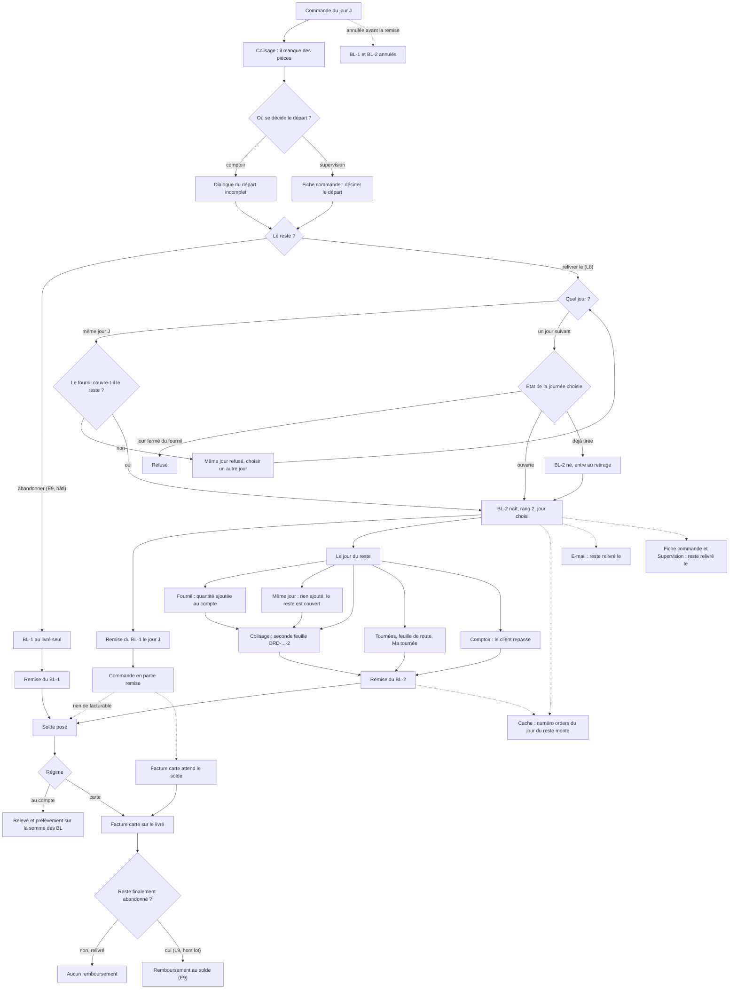
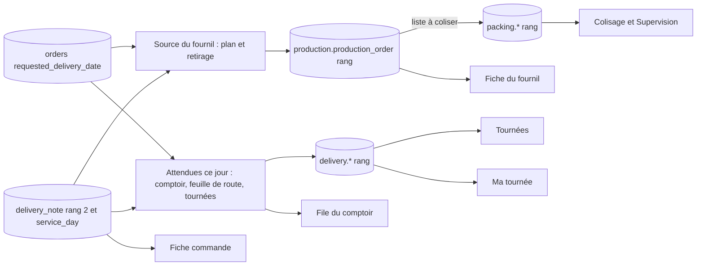

# Plan L7 et L8 — le reste relivré un autre jour (ou le même)

> Reliquat, lots **L7** (les sources du jour lisent les BL de rang > 1, sans
> geste) puis **L8** (le geste « reste à relivrer le <date> »). L9 (abandonner
> un reste après coup) est hors plan. Touche l'argent et une migration :
> **passe par `vitruve`** avant tout code.
> Sources : `documentation/commandes/reliquat/reliquat.md` § 6 et § 7,
> `todo-reliquat.md` § 2, `plan-e9-reste-carte.md`,
> `documentation/caching-usage/le-cache-du-back-office.md` § 2 et § 3,
> `CLAUDE.md` § 3.

## Toutes les ramifications

## Qui lit quoi le jour du reste

---

## Partie 1 — En clair

**Aujourd'hui.** Quand une commande part incomplète, on décide au comptoir ou
en supervision ; le seul sort possible du reste est « abandonner » : le BL-1
porte ce qui part, la commande se solde à sa remise, et une carte encaissée
est remboursée de la différence au solde (E9). Le reliquat sait déjà vivre :
un BL de rang 2 avec son jour, son colisage, son retrait, son solde à la
dernière remise. Mais **aucun geste ne le crée**, et **aucun écran du jour
ne le voit** : toutes les sources du jour cherchent les commandes par leur
date de livraison, jamais les BL de rang 2.

**L7 — les écrans voient le reste (sans geste).** Le fournil, le colisage, les
tournées, la feuille de route, « Ma tournée » et la file du comptoir apprennent
à lire un BL de rang 2 prévu pour leur journée, comme un envoi de plus. Rien
ne change à l'écran tant que personne n'en crée (L7 se teste avec
`planRemainder` dans les tests).

**L8 — le geste.** Dans la décision du départ, un second choix : « relivrer le
reste le <date> ». Le BL-2 naît avec les lignes du reste, aux mêmes prix
(remises en pourcentage réappliquées, pas de port). Sa journée :

- **un jour suivant ouvert** : il entre au plan à l'arrêt, comme une commande ;
- **un jour suivant déjà tiré** : il entre au retirage ;
- **le même jour** : seulement si le fournil a encore à faire au moins le
  reste (quantité prévue moins ce qui est déjà enfourné) ; on n'ajoute rien
  au compte, on prend dans ce qui reste à cuire ; sinon, le même jour n'est
  pas proposé ;
- **un jour fermé du fournil** : refusé.

Le jour du reste, il passe au fournil, au colisage (une seconde feuille
`ORD-…-2`), en tournée ou au comptoir (« le client repasse »), puis sa remise
solde la commande. Au compte, le relevé porte la somme des deux BL. À la
carte, la facture attend le solde et porte tout le livré ; **aucun
remboursement** puisque tout a été livré. Le client reçoit, s'il est prévenu,
« le reste vous sera relivré le <date> ». La fiche commande, la Supervision,
le colisage, la feuille de route et le comptoir disent « reste relivré le
<date> ».

**Ce que le plan ne fait pas.** Abandonner un reste relivré après coup (L9),
le bon de fidélité (toujours refusé), changer le jour d'un BL-2 déjà né,
relivrer un reste d'un reste (rang 3) depuis l'écran.

---

## Partie 2 — Technique (vérifiée)

### 1. Ce qui existe

#### 1.1 Le BL du reste

- `DeliveryNote.planRemainder(id, source, rank, serviceDay, plannedAt)` —
  `apps/lfd-api/src/lafoliecoffee/delivery-notes/domain/entities/delivery-note.ts:162-183` :
  `RemainderSchedule.of` refuse rang ≤ 1 et jour antérieur à celui de la
  commande ; statut `PLANNED` ; `copyTermsFrom(source)`. Source typée
  `DeliveryNoteRemainderSource` (même fichier, l. 49). **Aucun appelant hors
  tests** (grep : seule la déclaration et `dist/`).
- Montants du reste : `remainderAdjustmentsOf`
  (`delivery-notes/domain/services/remainder-decision-source.ts:23-34`) — remises
  en pourcentage gardées, port, surtaxe, bon et port TTC à zéro. Aucune
  fonction ne fabrique encore la `DeliveryNoteRemainderSource` « commande
  moins ce qui part » : L8 l'écrit.
- En base : `delivery_note.rank` (`prisma/schema/public/delivery-notes.prisma:25`),
  `service_day` nullable avec CHECK `rank = 1 OR service_day IS NOT NULL`
  (l. 30-32), `status` (l. 34), unique `(order_id, rank)` (l. 87).

#### 1.2 Le sort du reste

- Contrat : `shortfallRemainderSchema = z.literal("abandoned")`
  (`packages/contracts/src/admin-order-detail.ts:134`), utilisé par le corps
  de la supervision (l. 183) et celui du comptoir (l. 198).
- Base : `CONSTRAINT "order_shortfall_decision_remainder" CHECK ("remainder"
IN ('abandoned'))` (`prisma/migrations/20261025140100_la_decision_du_depart/migration.sql:84`),
  le commentaire l. 12-13 annonce qu'E7 l'élargira. Décision par envoi :
  `(order_id, rank)` depuis `20261026110000_le_manque_par_envoi` (l. 26-27).
- Fait : `REMAINDERS: readonly ShortfallRemainder[] = ["abandoned"]`
  (`orders/domain/events/order-shortfall-decided.event.ts:15`).

#### 1.3 La décision

- `DecideOrderShortfallHandler.execute` (`orders/application/commands/decide-order-shortfall.handler.ts:52-63`) :
  `uow.run`, `lockSubject(orderId, rank)` puis `ShortfallDeparture.decide`.
- `ShortfallDeparture.decide` (`orders/application/services/shortfall-departure.ts:55-82`) :
  agrégat, `desk.authorize`, signal, décision, `followDecision(orderId, rank)`,
  `order.shortfall_decided`. Partagé avec le comptoir.
- Refus : `termsRefusalOf` → `card_unpaid`, `card_increase_pending`
  (`orders/domain/services/shortfall-decidability.ts:79-84`), reste non prévu
  `remainder_not_planned` (l. 69).
- Routes : `POST admin/orders/:id/shortfall-decision` sous
  `b2b_orders_shortfall:write` (`orders/http/admin-order-shortfall.controller.ts:43-44`) ;
  `POST admin/counter/orders/:orderId/incomplete-handover` sous
  `handover_counter` (`orders/http/admin-counter-incomplete-handover.controller.ts:25-26`, l. 59).

#### 1.4 Le solde et l'argent (E9)

- `statusAfterFirstHandover(pendingRemainder)` → `partially_handed_over` si un
  reste vivant attend (`orders/domain/services/shipment-settlement.ts:17-19`) ;
  `settlesOnRemainder` (l. 27-29).
- `OrderBillingCloser.closeLocked` pose le solde sur les BL remis
  (`delivery-notes/application/services/order-billing-closer.ts:72-81`) et
  publie `order.billing_settled` (l. 166-184).
- Remboursement : `partial` = « une décision existe »
  (`orders/infrastructure/prisma-shortfall-refund-subject.ts:56`) ; garde
  `!subject.partial || regime !== PAID_CARD || billableTotalCents === null`
  (`orders/domain/services/shortfall-refund.ts:90`) ; montant = encaissé −
  facturable (plan E9 § 4.2, point 6). Relivré et remis : facturable = total,
  montant ≤ 0 → rien. **Aucun changement d'E9 nécessaire.**
- Facture carte : `awaiting_settlement` tant que le solde n'est pas posé
  (`accounting/domain/services/card-invoicing.ts:154`), réveillée par
  `IssueCardInvoiceOnBillingSettled`
  (`accounting/application/handlers/issue-card-invoice-on-billing-settled.handler.ts:44-51`).
  Elle attend donc le BL-2 sans rien ajouter.

#### 1.5 Comment chaque source du jour choisit ses commandes

| Source                                                   | Sélection                                                                                       | Fichier:ligne                                                                                                                                                                                                     |
| -------------------------------------------------------- | ----------------------------------------------------------------------------------------------- | ----------------------------------------------------------------------------------------------------------------------------------------------------------------------------------------------------------------- |
| Plan du fournil (arrêt et retirage)                      | `requestedDeliveryDate = jour` + `planWhere()`                                                  | `orders/infrastructure/prisma-day-orders.source.ts:51-57`                                                                                                                                                         |
| `planWhere`                                              | `status: placed` + règlement + pas de vitrine                                                   | `orders/infrastructure/plan-filter.ts:53-55`, `STATUS_IN_PLAN = "placed"` `orders/domain/services/production-plan.ts:157`                                                                                         |
| Prévisionnel                                             | `planWhere()`                                                                                   | `orders/infrastructure/prisma-expected-production.reader.ts:68`                                                                                                                                                   |
| Port du fournil                                          | `DayOrdersReader.producibleFor(day)`, `ProducibleOrder` **sans rang**                           | `production/channels/commerce/day-orders.reader.ts:173-174`                                                                                                                                                       |
| Retirage                                                 | `absorbArrivals` filtre **par `orderId` seul** ; `freezeOrder` pose `rank: FIRST_SHIPMENT_RANK` | `production/domain/services/production-count.ts:194-195`, `:40` ; `production-day.plan.ts:119-133`                                                                                                                |
| Base du fournil                                          | unique `(serviceDay, orderId, rank)`                                                            | `prisma/schema/production.prisma:187`                                                                                                                                                                             |
| Colisage                                                 | nourri par la liste à coliser du fournil, rang porté                                            | `production/channels/packing/packing-list-drawn.event.ts:43` ; `packing.prisma` clés `(serviceDay, orderId, rank)` l. 67                                                                                          |
| Attendues ce jour (comptoir, feuille de route, tournées) | `expectedOnWhere(day)` = `requestedDeliveryDate`                                                | `orders/infrastructure/handover-order.query.ts:124-130` ; file `prisma-handover-queue.reader.ts:51` ; tournées `prisma-delivery-orders.reader.ts:107` ; feuille de route `prisma-delivery-run-sheet.reader.ts:19` |
| Ce qui part (comptoir, feuille de route)                 | manque du **rang 1** seul, « ce qui part d'un reste se lit sur son BL (L8) »                    | `handover-order.query.ts:140-144`                                                                                                                                                                                 |
| Port des tournées                                        | `DeliveryOrderRef` **sans rang**                                                                | `delivery/channels/commerce/delivery-orders.reader.ts:21-24`, `:98-103`                                                                                                                                           |
| Arrêts de tournée, Ma tournée                            | rang en base, `(order_id, rank)` dans une tournée vivante                                       | `prisma/schema/delivery.prisma:226-227`                                                                                                                                                                           |
| Supervision du jour                                      | `requestedDeliveryDate`                                                                         | `orders/infrastructure/prisma-day-supervision.reader.ts:61`                                                                                                                                                       |

Le fournil porte déjà le rang dans son instantané
(`production/domain/entities/production-day.snapshot.ts:72`, commentaire :
« Rien n'inscrit encore de reliquat au plan (L7, L8) »).

#### 1.6 Journée ouverte, tirée, fermée

- Admission : `PlanAdmissionDesk.admit(day)` → `open | closed`, déclaré et
  implémenté par le fournil, appelé par le commerce, verrou
  `production_day:<jour>` (`production/channels/commerce/plan-admission.desk.ts:30-32`).
  Ordre des verrous documenté : l'annulation prend la commande puis la
  journée (même fichier, commentaire C3.4 ter) — L8 suit cet ordre.
- `ClosedPlansReader.closedBetween` (`closed-plans.reader.ts:15-20`), sans
  verrou, pour proposer.
- Retirage : `RetakeProductionDayHandler` relit sous verrou
  `retakeUnderLock(day)` puis `locked.retake`
  (`production/application/commands/retake-production-day.handler.ts:46-57`) ;
  le commentaire l. 16-17 : « les commandes absorbées sont des `placed` ».
- Jours fermés du fournil : `add-production-closed-day` / `remove-…`
  (`production/application/commands/`).

#### 1.7 Le cache des écrans de journée

- Insertion ou mise à jour d'un `delivery_note` à `service_day` posé écrit
  dans `public.day_change` pour CE jour
  (`prisma/migrations/20261026060000_le_jour_du_reliquat_fait_bouger_la_journee/migration.sql:15-45`) :
  le numéro `orders` du jour du reste **monte** à la naissance du BL-2, à sa
  préparation, à sa remise, à son annulation.
- `OrdersDayVersionSource` lit `public.day_change`
  (`orders/application/services/orders-day-version.source.ts:8-24`).
- Toutes les étiquettes des écrans de journée portent `orders` (fiche,
  colisage, file, tournées : `le-cache-du-back-office.md` § 3.2 à 3.5). Le
  numéro `production` monte quand le plan absorbe (tables `production_order`).
- **Trou** : un changement de la ligne `orders` (statut
  `partially_handed_over`, règlement) fait monter le jour J
  (`requested_delivery_date`), pas le jour du reste. Les écrans du jour du
  reste qui affichent un champ de la commande (statut, règlement) peuvent le
  servir figé. Tant que tout geste qui touche la commande et intéresse le
  jour du reste écrit aussi le BL-2 dans la même transaction (remise,
  annulation : `voidLiveFor`, `delivery-note-follower.ts`), il n'y a pas de
  figé ; un e2e le tient (§ 5).

#### 1.8 Le courrier

`OrderShortfallDraftData` (`mail/templates/order-shortfall-mail.ts:35-46`) :
`reference`, `departed`, `missing`, `cardWillBeRefunded`, `locale` — rien
pour une date de relivraison.

### 2. L7 — les sources lisent les BL de rang > 1 (sans geste)

Principe : **un envoi = (commande, rang)**. Un BL de rang > 1 `planned` dont
`service_day = jour` est attendu ce jour, comme le rang 1 d'une commande à
`requested_delivery_date = jour`.

**L7a — le filtre, écrit une fois (commerce).**

- _apps/lfd-api/src/lafoliecoffee/orders/infrastructure/remainder-day-filter.ts (à créer)_ :
  `remainderPlanWhere(day)` pour `prisma.deliveryNote` : `rank > 1`,
  `serviceDay = jour`, `status: planned` (puis `prepared` pour les lecteurs
  du retrait), commande non annulée, `settlementWhere()` sur la commande,
  `notFromStock()`. **Pas** `status: placed` : la commande est `confirmed`
  ou `partially_handed_over`. Miroir de `planWhere`, mêmes raisons écrites.
- `remainderExpectedWhere(day)` pour les « attendues » : rang > 1, jour,
  statut du BL non `voided`.

**L7b — le fournil.**

- `ProducibleOrder` gagne `rank` (`day-orders.reader.ts`, défaut 1) ;
  `PrismaDayOrdersSource.producibleFor` ajoute les restes du jour : lignes
  = lignes du BL-2, référence `ORD-…-2`, mêmes détails de feuille que la
  commande. Le fournil continue de lire par son canal (production →
  lafoliecoffee interdit, `CLAUDE.md` § 3).
- `absorbArrivals` et `freezeOrder` gardent `(orderId, rank)` au lieu de
  `orderId` (`production-count.ts:40`, `:194-195`), sans quoi un reste du même
  jour serait écarté comme « déjà au plan ». Idem `DayPlan.absorbed`
  (`production-day.plan.ts:124-127`) et `withoutWithdrawn`.
- **Même jour** : un reste de rang > 1 sur le jour même de son rang 1 entre
  au plan **marqué couvert** (`coveredByFirstShipment`) et n'entre pas au
  compte (`recount` l'ignore) : le rang 1 a déjà compté la commande entière,
  le fournil ne doit pas fabriquer deux fois. À faire valider par `vitruve`.
- Le prévisionnel (`prisma-expected-production.reader.ts:68`) ajoute les
  restes des jours suivants.

**L7c — le colisage.** Rien à lire de neuf : la liste à coliser du fournil
porte déjà le rang (`packing-list-drawn.event.ts:43`), le colisage a ses
clés par rang. L7 vérifie par e2e qu'une seconde feuille `ORD-…-2` apparaît.

**L7d — attendues ce jour (comptoir, feuille de route, tournées, Ma tournée).**

- `DeliveryOrderRef` gagne `rank` ; `expectedOn(day)` rend aussi les restes
  du jour (`prisma-delivery-orders.reader.ts:107`). La composition et les
  arrêts sont déjà par rang en base (`delivery.prisma:226-227`).
- `PrismaHandoverQueueReader` (l. 51) et `PrismaDeliveryRunSheetReader`
  lisent `expectedOnWhere(day)` **et** `remainderExpectedWhere(day)` ; la
  ligne porte `rank` et la référence `-<rang>`.
- `DEPARTURE_SELECT` : pour un rang > 1, ce qui part se lit sur le BL et son
  manque de rang ; aujourd'hui `where: { rank: FIRST_SHIPMENT_RANK }`
  (`handover-order.query.ts:143-144`).
- Supervision du jour (`prisma-day-supervision.reader.ts:61`) : idem.

**L7e — le cache.** Aucune clé nouvelle. Ajouter au § 3 du document du cache
que le jour d'un reste est suivi par `delivery_note.service_day`.

### 3. L8 — le geste « relivrer le reste le <date> »

**L8a — migration additive** _apps/lfd-api/prisma/migrations/2026111…\_le_reste_a_relivrer/migration.sql (à créer)_ :

- `order_shortfall_decision.remainder` : CHECK élargi à
  `('abandoned', 'redelivered')` ;
- colonne `redeliver_on DATE NULL` + CHECK
  `(remainder = 'redelivered') = (redeliver_on IS NOT NULL)` ;
- retour arrière écrit en tête (refuser s'il existe une ligne `redelivered`).

**L8b — contrats.**

- `shortfallRemainderSchema = z.enum(["abandoned", "redelivered"])` ; corps
  de décision et du comptoir : `redeliverOn?: "AAAA-MM-JJ"` requis si
  `redelivered` (`superRefine`).
- `AdminOrderShortfallDecision` gagne `redeliverOn: string | null`.
- Aperçu du comptoir : jours proposés et `sameDayCovered: boolean`.
- `REMAINDERS` du fait accepte `redelivered` ; le fait porte `redeliverOn`.

**L8c — le port du fournil.**

- _apps/lfd-api/src/production/channels/commerce/remainder-coverage.desk.ts (à créer)_ :
  déclaré **et** implémenté par le fournil (précédent `PlanAdmissionDesk`),
  `covers(day, lines): Promise<boolean>` = pour chaque article, quantité au
  compte − Σ fournées ≥ reste, **sous le verrou de la journée** ; plus
  `admitRemainder(day)` → `open | retaken | closed_day` (jour fermé).
- Implémentation dans _apps/lfd-api/src/production/application/services/remainder-coverage.service.ts (à créer)_,
  reliée dans `appBootstrap`.

**L8d — le domaine.**

- `ShortfallDecision.decide` accepte `redelivered` + `redeliverOn` ; refus
  nouveaux : jour antérieur (déjà `RemainderSchedule`), jour fermé, même jour
  non couvert, rang déjà > 1 (relivrer un reste d'un reste : refusé en L8),
  bon de fidélité (inchangé).
- _apps/lfd-api/src/lafoliecoffee/delivery-notes/domain/services/remainder-source.ts (à créer)_ :
  `remainderSourceOf(order, departing)` → `DeliveryNoteRemainderSource`
  (lignes commandées − parties, termes de la commande).

**L8e — le geste**, dans `ShortfallDeparture.decide`, même transaction, après
le verrou de la commande (ordre commande puis journée, comme l'annulation) :

1. jugement et `desk.authorize` comme aujourd'hui ;
2. si `redelivered` : `RemainderCoverageDesk.admitRemainder(jour)` (verrou de
   la journée) ; même jour → `covers` ;
3. `DeliveryNote.planRemainder(id, source, 2, jour, now)` et sauvegarde ;
4. décision écrite ;
5. `followDecision(orderId, 1)` ;
6. si la journée est déjà tirée : rien d'automatique — la fiche montre
   « 1 arrivée à reprendre » et le retirage l'absorbe (L7b). Question pour
   Hugo (Q2).
   Au **comptoir**, la remise du BL-1 suit dans la même transaction : le BL-2
   doit exister **avant** `statusAfterFirstHandover` pour écrire
   `partially_handed_over` (`shipment-settlement.ts:17-19`).

**L8f — écrans (back-office).**

- `order-shortfall-decision.ts` et `incomplete-handover-dialog.ts` : second
  choix + sélecteur de jour (jours fermés et arrêtés lus par
  `ClosedPlansReader`), « même jour » grisé avec sa raison. D6 au comptoir :
  « le client repasse » ou « on le lui porte » (= mode du BL-2, Q3).
- « Reste relivré le <date> » : bandeau de la fiche commande
  (`order-shortfall-banner.ts`), Supervision (`packing-shortfall.ts`),
  colisage, comptoir, feuille de route.

**L8g — courrier.** `OrderShortfallDraftData` gagne
`redeliverOn: string | null` ; le texte dit « le reste vous sera relivré le
<date> » et ne dit plus « remboursé » quand la carte est relivrée
(`cardWillBeRefunded` faux si `redelivered`). Le geste reste un geste
(`write-shortfall-letter.handler.ts`).

**L8h — droits.** Aucun droit nouveau : supervision sous
`b2b_orders_shortfall:write`, comptoir sous `handover_counter:write`.

### 4. L'interaction avec E9

- Solde : posé à la dernière remise seulement (`order-billing-closer.ts:72-81`
  - `settlesOnRemainder`) ; `partially_handed_over` n'a rien de facturable.
- Carte encaissée relivrée : `partial` vrai mais facturable = total →
  montant ≤ 0 → aucun remboursement (`shortfall-refund.ts:90` et formule § 4.2
  d'E9). Un e2e le tient.
- Facture carte : `awaiting_settlement` jusqu'au BL-2 (`card-invoicing.ts:154`).
- Relivré puis abandonné : L9, hors plan.
- Annulation : `voidLiveFor` annule le BL-2 vivant ; refusée dès qu'un envoi
  est retiré.

### 5. Lots et tests

| Lot       | Contenu                                                      | Tests                                                                                                                                                |
| --------- | ------------------------------------------------------------ | ---------------------------------------------------------------------------------------------------------------------------------------------------- |
| L7a       | filtres des restes                                           | unitaire du `where` (miroir de `planWhere`)                                                                                                          |
| L7b       | fournil par `(orderId, rank)`, reste couvert hors compte     | unitaires `absorbArrivals`, `recount` ; e2e : BL-2 né par `planRemainder` entre au plan J+1, au retirage J+1, et au même jour sans changer le compte |
| L7c       | colisage                                                     | e2e : seconde feuille `ORD-…-2`                                                                                                                      |
| L7d       | attendues, tournées, feuille de route, comptoir, Supervision | e2e : BL-2 visible dans la file, placé en tournée, sur Ma tournée                                                                                    |
| L7e       | cache                                                        | e2e : naissance et remise du BL-2 font monter `orders` de J+1 et changent l'étiquette                                                                |
| L8a       | migration                                                    | e2e de migration (précédent `shortfall-by-shipment-migration.e2e-spec.ts`)                                                                           |
| L8b à L8e | contrat, port, domaine, geste                                | unitaires de `decide`, `remainderSourceOf`, `covers`                                                                                                 |
| L8f, L8g  | écrans, courrier                                             | specs des composants, spécimen de courrier                                                                                                           |

**E2e de bout en bout** (_apps/lfd-api/test/remainder-redelivery.e2e-spec.ts (à créer)_, sur la scène de `remainder-settlement.e2e-spec.ts`) :

1. au compte, relivrer à J+1 ouvert : BL-2, arrêt de J+1, colisage, remise,
   solde = Σ BL, relevé ;
2. même jour couvert : accepté, compte inchangé ; non couvert : refusé ;
3. J+1 déjà tiré : retirage absorbe le reste ;
4. jour fermé : refusé ;
5. carte encaissée relivrée : facture `awaiting_settlement` puis émise sur le
   total, aucun remboursement ;
6. comptoir : décision + remise du BL-1 → `partially_handed_over` ;
7. annulation avant remise : BL-2 annulé, fournil prévenu.

### 6. Ce que le plan ne fait pas

L9 (abandon après coup), bon de fidélité, changer le jour d'un BL-2, rang 3
depuis l'écran, avoir sur facture émise, reprise auto du retirage.

### 7. Questions pour Hugo

1. **Même jour : le reste n'ajoute rien au compte** (il prend dans ce qui
   reste à cuire). Recommandation : oui.
2. **Journée déjà tirée** : retirage manuel (« 1 arrivée à reprendre ») ou
   absorption automatique au geste ? Recommandation : manuel, le fournil
   garde la main.
3. **Comptoir, « on le lui porte »** : le BL-2 d'une commande à retirer
   devient-il une livraison (zone, adresse) ? Recommandation : L8 n'offre
   que « le client repasse » ; la livraison d'un reste de retrait en lot
   à part.
4. **Jours proposés** : jusqu'à quand ? Recommandation : 7 jours, jours
   fermés et arrêts exclus d'avance, rejugé sous verrou.
5. **Courrier** : envoyé automatiquement au geste ? Recommandation : non, il
   reste un geste relu.

### Fichiers ouverts

- apps/lfd-api/src/lafoliecoffee/delivery-notes/domain/entities/delivery-note.ts
- apps/lfd-api/src/lafoliecoffee/delivery-notes/domain/services/remainder-decision-source.ts
- apps/lfd-api/src/lafoliecoffee/delivery-notes/application/services/order-billing-closer.ts
- apps/lfd-api/src/lafoliecoffee/delivery-notes/application/services/delivery-note-follower.ts
- apps/lfd-api/src/lafoliecoffee/orders/application/commands/decide-order-shortfall.handler.ts
- apps/lfd-api/src/lafoliecoffee/orders/application/services/shortfall-departure.ts
- apps/lfd-api/src/lafoliecoffee/orders/domain/entities/shortfall-decision.ts
- apps/lfd-api/src/lafoliecoffee/orders/domain/services/shortfall-decidability.ts
- apps/lfd-api/src/lafoliecoffee/orders/domain/services/shipment-settlement.ts
- apps/lfd-api/src/lafoliecoffee/orders/domain/services/shortfall-refund.ts
- apps/lfd-api/src/lafoliecoffee/orders/infrastructure/plan-filter.ts
- apps/lfd-api/src/lafoliecoffee/orders/infrastructure/handover-order.query.ts
- apps/lfd-api/src/lafoliecoffee/orders/infrastructure/prisma-day-orders.source.ts
- apps/lfd-api/src/lafoliecoffee/orders/infrastructure/prisma-day-supervision.reader.ts
- apps/lfd-api/src/lafoliecoffee/orders/infrastructure/prisma-shortfall-refund-subject.ts
- apps/lfd-api/src/lafoliecoffee/orders/http/admin-order-shortfall.controller.ts
- apps/lfd-api/src/lafoliecoffee/orders/http/admin-counter-incomplete-handover.controller.ts
- apps/lfd-api/src/lafoliecoffee/accounting/domain/services/card-invoicing.ts
- apps/lfd-api/src/production/channels/commerce/day-orders.reader.ts
- apps/lfd-api/src/production/channels/commerce/plan-admission.desk.ts
- apps/lfd-api/src/production/channels/commerce/closed-plans.reader.ts
- apps/lfd-api/src/production/channels/commerce/planned-delivery-notes.reader.ts
- apps/lfd-api/src/production/domain/services/production-count.ts
- apps/lfd-api/src/production/domain/entities/production-day.ts
- apps/lfd-api/src/production/domain/entities/production-day.plan.ts
- apps/lfd-api/src/production/domain/entities/production-day.snapshot.ts
- apps/lfd-api/src/production/application/commands/retake-production-day.handler.ts
- apps/lfd-api/src/delivery/channels/commerce/delivery-orders.reader.ts
- apps/lfd-api/src/mail/templates/order-shortfall-mail.ts
- apps/lfd-api/prisma/schema/public/delivery-notes.prisma
- apps/lfd-api/prisma/schema/production.prisma
- apps/lfd-api/prisma/migrations/20261025140100_la_decision_du_depart/migration.sql
- apps/lfd-api/prisma/migrations/20261026060000_le_jour_du_reliquat_fait_bouger_la_journee/migration.sql
- packages/contracts/src/admin-order-detail.ts
- documentation/caching-usage/le-cache-du-back-office.md
