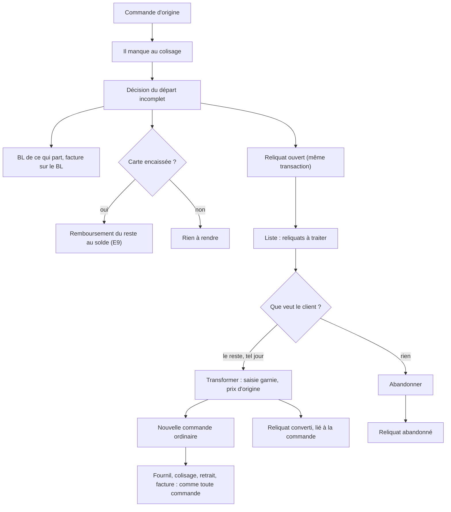

# Plan — le reliquat devient une commande

> Remplace le plan L7-L8 (« reste relivré le <date> », second envoi de la même
> commande), abandonné par Hugo le 2026-11-25 : « on fait trop compliqué ».
> Touche l'argent et porte une migration : **passe par `vitruve`** avant Hugo.
> Sources : [`reliquat.md`](reliquat.md), [`todo-reliquat.md`](todo-reliquat.md),
> [`plan-e9-reste-carte.md`](plan-e9-reste-carte.md),
> [`../passation/commande-passee-par-l-equipe.md`](../passation/commande-passee-par-l-equipe.md).

## Décisions de Hugo (2026-11-25)

1. Le **reliquat** se crée **automatiquement**, dans la **même transaction**
   que la décision du départ incomplet.
2. Ce **n'est pas une commande** : il passe de `open` à `converted` (une
   commande ordinaire pour un jour choisi, aujourd'hui compris) ou à
   `abandoned`.
3. Côté origine, le reste reste `abandoned` (la valeur de la décision ne
   change pas).
4. La commande d'origine solde et rembourse son reste **comme aujourd'hui**
   (E9) ; la commande issue du reliquat se paie comme toute commande, **sans
   transfert d'encaissement**.
5. La commande issue du reliquat garde le **prix de la commande d'origine**.
6. `planRemainder` et les BL de rang > 1 sont du **code mort à retirer**.
7. Le **port est offert**, obligatoirement, sur la commande issue d'un
   reliquat : « on fait tout dans l'intérêt du client ». La transformation
   l'impose ; ni l'équipe ni le calcul ne peuvent le remettre.
8. **Aucune surtaxe de retard** sur la commande issue d'un reliquat,
   imposée de la même façon que le port.
9. Le nom est **`Backorder`**.
10. Pour aujourd'hui après l'heure limite : la **dérogation commune** de
    l'équipe.
11. Une remise de l'origine est **gardée** même si le reste n'atteint plus
    son seuil.
12. Un reliquat ouvert n'a **pas de limite de durée**.
13. Les **particuliers ont un reliquat**, avec trois gestes : le transformer
    en commande **réglée en boutique**, le transformer en commande
    **offerte**, ou l'**abandonner** (« on donne un choix paiement en
    boutique ou offert ou abandon »).
14. Le port reste **offert quelle que soit la zone**, y compris après une
    modification de la commande qui change la zone de livraison.
15. Pour l'heure limite d'un **particulier**, le geste « hors plan » du
    comptoir suffit.
16. Le drapeau `delivery_offered` est posé sur **toute** commande issue d'un
    reliquat, retrait compris : si elle passe ensuite en livraison, le port
    reste offert.

## Partie 1 — En clair

Quand une commande part incomplète, la commande d'origine ne change pas : le
bon de livraison porte ce qui part, la facture porte le bon, une carte
encaissée est remboursée du reste au solde.

Ce qui est nouveau : au moment même de la décision, **un reliquat naît**. Il
garde ce qui n'est pas parti, pour qui, et à quel prix. Il n'est pas une
commande : le fournil, le colisage, la livraison et la facture ne le voient
pas. Il attend dans une liste « Reliquats à traiter ».

Depuis la liste ou la fiche de la commande d'origine, l'équipe peut :

- **le transformer en commande**, pour le jour que le client veut,
  aujourd'hui compris. C'est une commande ordinaire, passée à la place du
  client, **aux prix de la commande d'origine** ; elle se paie comme toute
  commande : pour un pro, au compte, par lien ou offerte ; pour un
  particulier, **à la caisse de la boutique** au retrait, ou offerte ;
- **l'abandonner** : le client ne veut pas du reste.

Une fois transformé ou abandonné, c'est définitif.

Ce que l'équipe doit savoir :

- le prix est celui de l'origine, y compris ses **remises en pourcentage** ;
  une remise en montant fixe a déjà servi sur l'origine et ne revient pas ;
- le **port est offert** sur la commande issue d'un reliquat, toujours ;
- **aucune surtaxe de retard**, jamais ;
- l'**heure limite** vaut comme pour toute commande passée par l'équipe :
  après l'heure, la dérogation pour un pro, le « hors plan » du comptoir
  pour un particulier ;
- un client carte remboursé du reste paie la nouvelle commande à part :
  jamais deux fois la même pièce, puisque l'origine ne facture que ce qui est
  parti.

## Partie 2 — Technique (vérifiée sur `dev`, 2026-11-25)

### 1. Ce qui existe

- **La décision** : `ShortfallDeparture.decide`
  (`apps/lfd-api/src/lafoliecoffee/orders/application/services/shortfall-departure.ts`),
  partagée par la décision des managers et le départ au comptoir, dans
  l'unité de travail de l'appelant, après le verrou `orders … FOR UPDATE`
  (`prisma-shortfall-decision.repository.ts:108-112`) : agrégat, `desk.authorize`,
  signal, décision, `followDecision`, fait `order.shortfall_decided`.
- **Ce qui part** : `decision.departing` (`[{ sku, quantity }]`, colonne
  `order_shortfall_decision.departing`, `prisma/schema/public/orders.prisma:691`) ;
  il se répartit sur les lignes de la commande dans leur ordre
  (`departingSourceOf`, `lafoliecoffee/delivery-notes/domain/services/departing-source.ts`).
- **Le sort** : `abandoned` seul (`packages/contracts/src/admin-order-detail.ts:208` et
  le CHECK de `20261025140100_la_decision_du_depart`). **Inchangé** (décision 3).
- **E9** : `shortfallRefundOf` (`orders/domain/services/shortfall-refund.ts`)
  rend `encaissé − ajustements − facturable` de l'origine seule, sujet =
  son `orderId`. **Inchangé** (décision 4).
- **La passation de l'équipe** : `PlaceOrderForCustomerHandler`
  (`orders/application/commands/place-order-for-customer.handler.ts`), route
  `POST admin/orders` sous `b2b_place_order:write`
  (`orders/http/admin-orders.controller.ts:218-219`), estimation
  `POST admin/orders/quote` (l. 177-178), toutes deux par
  `prepareStaffOrder` → `OrderDrafting`. L'heure limite et le jour de
  production tiennent (commentaire de `staff-order-preparation.ts` avant
  `drafting.draft`) ; une dérogation se consomme dans la transaction
  (`OrderCutoffWaiverGate`, `orders/domain/ports/order-cutoff-waiver.gate.ts`).
  Règlements : `account | link | offered` (`admin-order.ts:52`) ; `link`
  refusé au comptoir (`ensureCounterSettlement`).
- **Garder un prix figé — le mécanisme existe** : la révision passe
  `revised: { lines, discounts }` à `OrderComposition.load`
  (`orders/revision/application/services/order-revising.service.ts:299-302`).
  `priceRevisedLines` (`orders/revision/application/services/revised-line-pricing.ts:67`)
  garde la ligne figée d'un SKU dont la **quantité ne change pas** et ne
  retarife que les quantités changées ; les remises de panier sont
  **rejouées** (`orders/domain/services/basket-discount-replay.ts`, en-tête),
  pas rejugées. La passation, elle, met `revised: null`
  (`orders/application/services/order-drafting.service.ts:219`). Le calcul
  reste `priceBasket` dans les deux cas : **une seule arithmétique**.
- **La règle d'argent d'un reste** existe déjà : `remainderDiscountsOf`
  (`lafoliecoffee/delivery-notes/domain/services/note-basket-discounts.ts`) — les
  pourcentages restent, les montants fixes sortent ; port et surtaxe à zéro
  (`remainderAdjustmentsOf`, `remainder-decision-source.ts`).

### 2. B1 — la table et l'agrégat (migration additive)

**Nom** : `Backorder` (« reliquat de commande » en anglais commercial), table
`public.backorder`. `OrderRemainder` est écarté : `OrderRemainderSettler`
(`orders/application/services/order-remainder-settler.ts`) porte déjà le mot
pour le second envoi mort, et deux sens d'un même mot dans un contexte se
confondent (décision 9).

**Où** : `src/lafoliecoffee/orders/backorder/` (domaine, application,
infrastructure, http) — le contexte des commandes. Ni le fournil, ni le
colisage, ni la livraison ne le lisent : aucune ligne n'est ajoutée à la
matrice des blocs.

_apps/lfd-api/prisma/migrations/2026112…\_le_reliquat_de_commande/migration.sql (à créer)_,
modèle dans _apps/lfd-api/prisma/schema/public/backorder.prisma (à créer)_ :

| Colonne                                                 | Rôle                                                                                                                                                     |
| ------------------------------------------------------- | -------------------------------------------------------------------------------------------------------------------------------------------------------- |
| `id`                                                    | ULID                                                                                                                                                     |
| `origin_order_id` → `orders`                            | `UNIQUE` : un reliquat par commande d'origine (seule la décision de rang 1 en fait naître un, et elle est unique par `(order_id, rank)`)                 |
| `company_id` (nul pour un particulier), `buyer_user_id` | recopiés de l'origine ; le mur tenant se pose sur `company_id` quand il existe ; un reliquat de particulier se lit par l'équipe seule, comme sa commande |
| `lines` `jsonb`                                         | `[{ sku, quantity, sale_unit }]` — quantités en grammes au poids                                                                                         |
| `state`                                                 | `open` / `converted` / `abandoned`, CHECK                                                                                                                |
| `converted_order_id` → `orders`                         | `UNIQUE`, non nul **ssi** `converted` (CHECK)                                                                                                            |
| `closed_at`, `closed_by_staff_id`                       | non nuls ssi l'état n'est pas `open` (CHECK)                                                                                                             |
| `created_at`                                            | instant de la décision                                                                                                                                   |

**Pas de copie du prix dans le reliquat** : le prix d'origine se relit sur les
lignes de la commande d'origine (`order_line`, modèle `OrderLine`,
`orders.prisma:736`), au moment de la transformation (§ 4). Elles ne bougent
plus après la décision : la révision est refusée dès qu'une décision existe
(`ensureNoShortfallDecision`, `orders/revision/application/services/order-revising.service.ts:135`).
Une copie serait un second endroit où le prix vit.

**Le coût d'un retour** (assumé) : l'`UNIQUE` sur `origin_order_id` interdit
pour toujours un second reliquat sur la même commande, et `converted` /
`abandoned` sont définitifs (décision 2). Un reliquat converti dont la
nouvelle commande est ensuite annulée est perdu : l'équipe repasse une
commande ordinaire.

**Les faits** : `backorder.opened`, `backorder.converted`,
`backorder.abandoned` s'écrivent au journal dans la transaction de chaque
écriture (qui, quand, la commande créée). **RGPD** : `closed_by_staff_id` entre
au registre `documentation/legal/rgpd-registre.json`, comme
`order_shortfall_decision.decided_by_staff_id` (`lint:rgpd-staff`).

**L'agrégat** (_apps/lfd-api/src/lafoliecoffee/orders/backorder/domain/entities/backorder.ts (à créer)_) : `Backorder.open(…)` refuse
zéro ligne et une quantité ≤ 0 ; `convert(orderId, at, by)` et
`abandon(at, by)` refusent tout état autre que `open`
(`BackorderClosedError`, `BusinessError`). Port `BackorderRepository`
`load`/`save` (§ 3.1 du `CLAUDE.md`).

Retour arrière écrit en tête de la migration : `DROP TABLE` tant qu'aucune
ligne n'existe ; au-delà, la table reste, morte.

### 3. B2 — la naissance, dans la décision

**Ce qui manque pour la faire, et que le plan ajoute** : ni
`LockedShortfallSubject` (`orders/domain/ports/shortfall-decision.repository.ts:8-13`,
`placedByUserId` seul) ni `ShortfallDecisionSubject` ne portent les lignes ni
la société, et `ShortfallDeparture` n'injecte aucun lecteur. B2 ajoute un
port étroit `BackorderOriginReader.ofLocked(orderId)` → `{ companyId,
buyerUserId, lines: [{ sku, quantity, saleUnit }] }`, lu **après** le verrou
de la commande déjà pris (même transaction, aucun verrou nouveau), et un
service `BackorderOpening` que `ShortfallDeparture` appelle — les deux portes
(managers, comptoir `HandOverPackedAtCounterHandler`) passent par `decide`,
donc par lui.

Dans `ShortfallDeparture.decide`, après `decisions.save(decision)` et
**seulement au rang 1** (les décisions de rang > 1 disparaissent avec le
démontage, § 7) :

1. le reste par SKU = quantité commandée − `decision.departing` (une ligne
   par SKU dans une commande) ; les SKU à zéro sortent ;
2. reste vide → aucun reliquat (tout est parti) ;
3. sinon `Backorder.open(...)` et `save`, dans la même transaction (décision 1).

Le fait `order.shortfall_decided` ne change pas ; `backorder.opened` part au
journal dans la même transaction.

Tests : unitaire de la soustraction (poids, tout parti, origine sans
société sans reliquat jusqu'à B6) ; unitaire de `decide` (le reliquat est sauvé après la décision,
et pas au rang > 1) ; e2e : décision managers et décision au comptoir font
chacune naître un reliquat, une seconde décision est refusée comme avant.

### 4. B3 — transformer : le prix d'origine par le chemin de la révision

`POST admin/backorders/:id/convert` sous `b2b_place_order:write`, corps =
celui de `adminPlaceOrderPayloadSchema` **sans** `companyId` ni lignes
(repris du reliquat) ; `buyerUserId` proposé à l'acheteur d'origine et
modifiable (un acheteur parti de la société fait refuser
`ensureOrderMember` : l'équipe en choisit un autre). Estimation sœur
`POST admin/backorders/:id/quote`. **C'est l'écran qui appelle ces deux
routes**, jamais `POST admin/orders` : une passation ordinaire ne fermerait
pas le reliquat.

**Idempotence** : `@IntentKey()` et un handler qui scelle (`runSealed`) comme
`PlaceOrderForCustomerHandler` (`lint:write-idempotence`) ; l'intention porte
l'`id` du reliquat, si bien qu'un double clic rend la même commande, pas un 409. Côté écran, la clé vient d'une `GestureIntents` (`lint:front-intent-keys`).

`ConvertBackorderHandler`, dans une unité de travail :

1. verrou de la ligne `backorder` (`FOR UPDATE`), `load`, refus si non `open` ;
2. composition par `prepareStaffOrder` → `OrderDrafting` **avec un rejeu** :
   `OrderDrafting` gagne un paramètre `replayed: RevisedFrom | null` qu'il
   passe à `composition.load` à la place du `null` d'aujourd'hui (l. 219). La
   passation ordinaire passe `null` : son comportement ne change pas ;
3. le rejeu est construit par une fonction pure
   _apps/lfd-api/src/lafoliecoffee/orders/backorder/domain/services/backorder-replay.ts (à créer)_ :
   - **lignes** : les `OrderLineSnapshot` de l'origine pour les SKU du
     reliquat, **ramenées à la quantité du reliquat** ; comme la saisie
     demande exactement ces quantités, `priceRevisedLines` les voit
     inchangées et **garde leur prix unitaire figé** (aucune retarification,
     aucun palier rejugé) ;
   - **remises** : `replayableDiscountsOf(origin)` filtré par la règle du
     reste — pourcentages gardés, montants fixes sortis (même règle que
     `remainderDiscountsOf`). **Le seuil** (`min_quantity`) : le rejeu ne
     refuse rien lui-même, il rend `refusals` à part et enchaîne la remise
     (`basket-discount-replay.ts:131-140`) ; c'est la révision qui les lève
     (`order-revising.service.ts:240-248`), alors que la passation les range
     dans les notes (`order-priced-draft.ts:64`). Passé par la passation, un
     reste sous le seuil **garde la remise** — c'est la décision 11 — **sans toucher `basket-discount-replay.ts`**, que la
     révision partage. Un test l'épingle ;
   - **la mercuriale** : `sealing` n'est calculé que pour les lignes neuves
     (`revised-line-pricing.ts:105`) ; une ligne gardée fixée par une
     mercuriale à l'origine doit rester hors de l'assiette de la remise
     rejouée. Ça tient si la remise porte ses `coveredSkus`, et dépend de
     `pickupDiscountEligible` par le repli des colonnes
     (`basket-discount-replay.ts:125, 257-258`). **À établir au bâti par un
     test**, pas supposé ;
     Le lecteur du rejeu (`BackorderOriginReader.replayOf(originId)` →
     `OrderLineSnapshot[]` et `ReplayableOrder` : remises actives et colonnes
     `discount_*`, `basket-discount-replay.ts:46-55`) est un port du contexte des
     commandes ; le total d'une ligne se recalcule dans `priceBasket`
     (`price-basket.ts:110-113`), comme pour toute ligne.

**Le prix TTC d'un particulier (`exact_ht`)** : `frozenLineOf`
(`revision/domain/services/revised-lines.ts:93-102`) ne recopie pas
`unitPriceTtcCents`, et n'a pas à le faire : l'étiquette TTC d'une ligne se
**déduit** de `unitPriceMillicents` — `OrderLine.ofTtc` refuse toute
composition dont `labelCents` diffère de
`ttcCentsFromHtMillicents(unitPriceMillicents, vatRate)`
(`orders/domain/value-objects/order-line.ts:217-225`). Garder le prix HT
figé garde donc l'étiquette TTC d'origine, au centime ; le TTC de la ligne
est étiquette × quantité. La révision d'une commande `exact_ht` passe déjà
par ce chemin (`order-revising.service.ts:523`). Un test e2e l'épingle :
étiquette TTC de la nouvelle commande = étiquette de l'origine après une
hausse du catalogue.

4. `place` de la nouvelle commande, `waivers.consume` s'il y a dérogation
   (pro seulement), règlement selon la branche (ci-dessous) ;
5. `backorder.convert(newOrderId)` et `save` ;
6. le lien vers l'origine est la colonne `backorder.converted_order_id` ;
   la note de la commande (`orders.note`, `packages/contracts/src/order.ts:315`,
   visible du client) reste celle que l'équipe saisit, sans ajout automatique.

**Particuliers** : lot B6, § 5 bis, après les pros.

**Ce que B3 change, précisément** (relecture `vitruve` du 2026-11-25) :

- **`DraftPolicy`** (`order-drafting.service.ts:57-69`) gagne trois champs :
  `replayed: RevisedFrom | null`, `offeredDelivery: boolean` et
  `lateFee: "apply" | "waive"`. Aujourd'hui `lateFee: admission.lateFee`
  (l. 250) passe sans condition ; sous `"waive"`, `null`.
  `BACKORDER_POLICY = { deadlineWaiver: "consider", lateFee: "waive",
offeredDelivery: true, replayed: <le rejeu>, windowRequester: null }` —
  le seul couple « la dérogation se dépense, la surtaxe non ». Les politiques
  existantes prennent `"apply"`, `false`, `null` : rien ne change pour elles.
- **Les préparations** ne prennent aujourd'hui ni politique ni rejeu
  (`staff-order-preparation.ts:66` ; pour B6, `counter-particular-order-preparation.ts:51`
  et `offered-particular-order-preparation.ts:48`, cette dernière appelant
  `draft` l. 48, donc avec `PLACEMENT_POLICY`, défaut de `OrderDrafting.draft` à `order-drafting.service.ts:184`). Chacune gagne un
  paramètre `policy`, et leurs appelants (une estimation et une passation
  chacune) passent `PLACEMENT_POLICY` comme aujourd'hui.
- **Une seule arithmétique** : `POST admin/backorders/:id/quote` passe par
  `prepareStaffOrder` → `draft` **sous `BACKORDER_POLICY`**, comme `convert`.
  Il ne réutilise **pas** `OrderQuoting`, qui force `lateFee: null`
  (`order-quoting.service.ts:81`) par un autre chemin. Un e2e compare le
  total de `quote` et celui de `convert`, avec dérogation et réglage de
  surtaxe.

**Le port offert (décision 7), par le franco qui existe.** Le franco de la
route est le mécanisme : `priceBasket` juge `judgedFreeDelivery`
(`orders/domain/services/free-delivery-judgement.ts:43-56`), « atteint quand
la base vaut le seuil ou plus », et fige une `FreeDelivery` (frais facturé
nul, ligne « Livraison offerte » affichée, barème retenu —
`orders/domain/value-objects/free-delivery.ts`). Un seuil de **0** est
toujours atteint. Le seuil vient de la route, dans
`PricingContext.routeOf` (`orders/application/services/pricing-context.service.ts:308-345`) :
`tariff.freeDeliveryThresholdCents ?? zone.value.freeDeliveryThresholdCents`.

- **Le geste** : la composition reçoit un seuil de franco **forcé à 0** —
  un champ `offeredDelivery: boolean` de `PricingRequest`, lu par `routeOf`
  seul, qui remplace le seuil de la route par 0. Ce n'est pas un champ du
  corps d'une route : l'équipe ne peut pas l'ôter, et une passation
  ordinaire ne peut pas le poser. Le calcul reste celui de `priceBasket`
  (une seule arithmétique).
- **Durable (décision 14)** : c'est une propriété de la **commande**, pas de
  la transformation. Colonne `orders.delivery_offered BOOLEAN NOT NULL
DEFAULT false` (même migration que la table du reliquat), posée par
  l'agrégat `Order` à la passation sous `BACKORDER_POLICY` seulement, et
  figée comme le lieu de règlement (déclencheur qui refuse de la modifier
  après la passation, précédent `orders_settlement_venue_frozen` de
  `commande-particulier-reglee-en-boutique.md` § 4.3). La base refuse
  l'incohérence : `CHECK (NOT delivery_offered OR (delivery_fee_cents = 0 AND COALESCE(delivery_fee_ttc_cents, 0) = 0))` — le TTC d'une commande `exact_ht` compris, comme le précédent `orders_free_delivery_waives_fee` (migration `20261120120000`)
  (`delivery_fee_cents`, `orders.prisma:346`). La **révision** relit
  `order.deliveryOffered` et le passe à `PricingRequest.offeredDelivery`, à
  côté de `frozenDeliveryFee` (`order-revising.service.ts:315`) : dans une
  autre zone, le barème du jour est lu, mais le seuil reste 0, donc le port
  reste offert.
- **Posé même en retrait** (décision 16) : une commande transformée en
  retrait porte le drapeau, et une révision vers une livraison a le port
  offert. Test e2e : transformée en retrait, révisée vers une livraison en
  zone à frais, port nul.
- **Le déclencheur** laisse passer l'INSERT et refuse un **changement** de
  valeur (`IS DISTINCT FROM`, sans quoi chaque `save()` qui réécrit toutes
  les colonnes échouerait), comme
  `orders_settlement_venue_frozen`. La colonne entre dans `orders.prisma`
  dans le même lot (`schema-drift`). L'écrivain de la révision
  (`prisma-order-revision.repository.ts`) ne l'écrit pas : à vérifier au bâti.
- **Qui relit le drapeau** : toute recomposition d'une commande existante
  passe par `OrderRevising` — la révision (`revise-order.handler.ts:95`),
  la hausse carte (`propose-card-increase.handler.ts:167`,
  `apply-card-increase.handler.ts:102`) et les deux devis
  (`quote-order-revision.handler.ts:45`, `quote-order-change-request.handler.ts:47`,
  par `revising.quote`). Un seul `composition.load` y existe
  (`order-revising.service.ts:299-315`) : B3 charge `delivery_offered` dans
  `RevisableOrder` (`revision/infrastructure/revisable-order.row.ts`) et le
  passe là. Le devis et la révision lisent donc la même chose ; un e2e
  compare le devis de révision et la révision d'une commande issue d'un
  reliquat passée en livraison.
- **Une promotion « livraison offerte » dès 0 €** gagne l'égalité des seuils
  contre la route (`free-delivery-candidates.ts:88-99`, « la promotion avant
  la route ») : le port reste nul, mais la livraison offerte figée est
  attribuée à la promotion (`free_delivery_promotion_id`), et l'export et le
  journal la comptent à son crédit. **Assumé** : le client n'y perd rien ;
  un test l'épingle pour que ce ne soit pas une surprise.
- **Les écrans** qui montrent la progression vers le franco (récapitulatif de
  la boutique, écran de révision) n'ont pas été ouverts : avec un seuil figé
  à 0, ils doivent dire « Livraison offerte », pas « encore 0 € ». À vérifier
  au bâti de B3, spec de composant à l'appui.
- **L'ordre dans `priceBasket`** (tient déjà par construction,
  `basket-terms.ts:104-118` : un franco jugé met le frais à 0, `vitruve`) : le CHECK dépend
  de `judgedFreeDelivery` ; une promotion de frais (`deliveryFeePromotions`)
  appliquée après le franco ne doit pas rendre un frais non nul. Un unitaire
  de `priceBasket` (seuil 0 + promotion de frais) le tient — sans quoi une
  erreur d'ordre deviendrait un 500 du CHECK au lieu d'un refus nommé.
- **Pourquoi pas `frozenDeliveryFee`** : il ne s'applique que si sa
  `zoneId` égale la zone résolue de l'adresse (`pricing-context.service.ts:330`),
  qu'on ne connaît qu'au chargement ; le construire avant serait deviner la
  zone.
- **En retrait** : aucun frais, rien à offrir (`judgedFreeDelivery` rend
  `null` quand la livraison ne coûte rien).
- **Pourquoi pas le seul seuil figé** : la révision ne relit le franco figé
  que dans la même zone (`pricing-context.service.ts:330`) ; dans une autre,
  elle prendrait le seuil du jour, et le port redeviendrait payant —
  contraire à la décision 14.
- **Où vivent ces règles** : `OrderDrafting` a déjà une politique par
  passation, `DraftPolicy` (`orders/application/services/order-drafting.service.ts:57-82`,
  `PLACEMENT_POLICY`, `RECURRING_OCCURRENCE_POLICY`). La transformation a la
  sienne, `BACKORDER_POLICY`, qui porte le rejeu, le port offert et
  l'absence de surtaxe ; aucune route ne la reçoit d'un corps.

**Aucune surtaxe de retard (décision 8).** Elle existe sur ce chemin :
`priceLateness` (`order-cutoffs/domain/deadline/judge-order-deadline.ts:196-204`)
l'ajoute à un verdict en rattrapage qu'une dérogation fait passer, si un
réglage existe, et `OrderDrafting` la passe au calcul
(`order-drafting.service.ts:250`, `lateFee: admission.lateFee`). Sous
`BACKORDER_POLICY`, `OrderDrafting` passe `lateFee: null` quel que soit le
verdict : la dérogation se dépense quand même (elle admet la commande), la
surtaxe ne s'applique pas. Le précédent : `RECURRING_OCCURRENCE_POLICY` n'a
aucune surtaxe parce qu'elle ne dépense pas de dérogation (même fichier,
l. 73-78). Pour un particulier, sans dérogation, `priceLateness` ne
surtaxe déjà jamais.

**Ce que la nouvelle commande ne reprend pas de l'origine** : le barème de
livraison (sans objet, le port est offert), la clientèle et
les CGV (celles du jour, comme toute passation), le bon de fidélité (jamais
dépensé par l'équipe).

**Mur tenant** : un reliquat de pro se lit par `company_id`, et l'acheteur
doit encore être membre de la société (`ensureOrderMember` dans
`prepareStaffOrder`). Un reliquat de particulier n'a pas de société : il
n'est lu que par l'équipe (surface staff), jamais par un client.

Tests : **le port durable** — e2e : la commande issue d'un reliquat,
livrée en zone A à port offert, est modifiée vers une adresse de la zone B
à frais : le port reste nul et « Livraison offerte » reste figée ; une
écriture directe qui poserait un frais avec `delivery_offered` est refusée
par le CHECK ; le déclencheur refuse de rendre `delivery_offered` faux.
**Aucune surtaxe** — unitaire d'`OrderDrafting` sous
`BACKORDER_POLICY` (verdict en rattrapage avec dérogation et réglage →
`lateFee` nul ; la même chose sous `PLACEMENT_POLICY` → surtaxe) ; e2e : un
reliquat de pro transformé pour aujourd'hui après l'heure, avec dérogation et
un réglage de surtaxe, donne une commande sans surtaxe, la dérogation
consommée. **Le particulier** — e2e : reliquat d'une commande `exact_ht`
transformé en réglée en boutique (`shop_till`, étiquette TTC d'origine, port
nul) et en offerte ; une origine carte remboursée par E9 au solde, puis la
nouvelle commande `shop_till`, sans lien d'argent. **Le port offert** — unitaire de `routeOf` (`offeredDelivery` met le
seuil à 0, la passation ordinaire garde celui de la route) ; e2e : un reliquat
transformé en livraison, dans une zone à frais et sous le franco, donne une
commande à frais facturé nul avec « Livraison offerte » figée, la même dans
l'estimation et la passation, et un corps `convert` qui tenterait d'y
ajouter un frais n'a aucun champ pour le faire (schéma strict) ; unitaire de
`backorder-replay` (poids, remise % et fixe, seuil,
mercuriale) ; unitaire du handler (ordre, refus `converted`) ; e2e :
transformer pour J+1 puis aujourd'hui avec dérogation, prix unitaire = celui
de l'origine même après une hausse du catalogue, double clic = une seule
commande, reliquat abandonné refusé ; **une seule arithmétique** : l'estimation
et la passation donnent le même total.

### 5. B4 — abandonner, et les écrans

- `POST admin/backorders/:id/abandon` sous `b2b_orders_shortfall:write` ;
  `@Idempotent` (une seconde fois rend le refus `BackorderClosedError`).
- **L'origine annulée** : l'annulation n'est pas verrouillée par la décision
  (rien dans `orders/cancellation/` ne lit le manque). Annuler la commande
  d'origine **abandonne son reliquat ouvert** dans la même transaction
  (par le noyau `OrderCancellation`) ; un reliquat déjà converti n'est pas
  touché — sa commande vit sa vie.
- `GET admin/backorders?state=open` : la liste, par société, du plus ancien
  au plus récent ; la fiche commande d'origine montre son reliquat et son
  état, la nouvelle commande montre son origine.
- Back-office : la liste « Reliquats à traiter », et sur la fiche commande
  (bandeau du départ décidé,
  `apps/lfd-backoffice-frontend/src/app/commandes/order-shortfall-banner/`)
  les gestes : pour un pro, « Transformer » (saisie garnie, date et
  règlement à choisir) et « Abandonner » ; pour un particulier, « Réglée en
  boutique », « Offerte » et « Abandonner ». Abandonner un reliquat de
  particulier payé par carte : le reste est remboursé par E9 au solde de
  l'origine, comme aujourd'hui — l'abandon du reliquat n'y change rien.
- Le courrier du manque (`OrderShortfallDraftData`,
  `mail/templates/order-shortfall-mail.ts:35-46`) ne change pas.

Droits : aucun nouveau. Une migration n'accorde aucun droit (`CLAUDE.md` § 3).

### 5 bis. B6 — les particuliers (décision 13), après les pros

**Priorité de Hugo (2026-11-25) : les pros d'abord.** B1 à B4 se bâtissent
et se livrent seuls ; B6 vient après. D'ici là, B2 ne fait naître **aucun**
reliquat pour une origine sans société (`company_id` nul) : le reste y est
abandonné et remboursé comme aujourd'hui, et aucune ligne ne reste ouverte
sans geste pour la fermer. B6 lève cette garde.

**Un particulier ne passe pas par la saisie de l'équipe** (elle exige une
société, `admin-order.ts:229`). Deux passations du particulier existent déjà,
toutes deux par `OrderDrafting`, et le rejeu y entre de la même façon :

- **réglée en boutique** (décision 13a) — la saisie du comptoir,
  `POST /admin/counter/particular-orders`, préparation partagée
  `orders/application/services/counter-particular-order-preparation.ts`
  ([`../passation/commande-particulier-reglee-en-boutique.md`](../passation/commande-particulier-reglee-en-boutique.md),
  § 4 et § 5). `payment_status = 'not_required'`, `settlement_venue =
'shop_till'`, posé par le seul `Order.settleAtShopTill()` ; le CHECK
  `orders_shop_till_shape` exige `clientele = 'public'`, `entry_origin =
'counter'`, `company_id IS NULL` — ce que la transformation d'un reliquat
  de particulier, faite au comptoir, remplit. **Retrait seulement**
  (`orders.shop_till.not_pickup`) : le port offert y est sans objet. Notre
  système n'encaisse rien : la caisse certifiée de la boutique encaisse au
  retrait ;
- **offerte** (décision 13b) — `POST /admin/offered-orders/particular`,
  `offered-particular-order-preparation.ts`
  ([`../passation/la-commande-offerte.md`](../passation/la-commande-offerte.md)),
  sous le droit d'offrir ; retrait ou livraison.

**Le règlement en boutique n'est pas dans la préparation** :
`prepareCounterParticularOrder` (`counter-particular-order-preparation.ts:40-74`)
compose seulement ; `fixOn` (le délai d'annulation), `ensureTotalSeen` et
`settleAtShopTill()` sont dans le handler
(`place-particular-order-at-counter.handler.ts:84-88`). B6 les sort dans un
service que les deux handlers partagent, plutôt que de les recopier : oublié,
`settleAtShopTill` laisserait la commande en carte `pending`, et `fixOn` le
délai d'annulation non figé. Un e2e épingle les trois. L'estimation sœur du
particulier : `estimate-particular-order-at-counter.handler.ts:73` (boutique)
et `estimate-offered-particular-order.handler.ts:72` (offerte), sous la même
politique.

**Le corps particulier** porte `expectedTotalCents` (exigé par
`ensureTotalSeen`). **Les limites d'article** : `prepareCounterParticularOrder`
passe `exceedItemLimits: false` ; un reste qu'une limite de l'espace client
refuse est refusé, avec le motif de la limite — l'équipe abandonne ou offre.

La route `convert` a donc **deux corps** selon l'origine — pro (le corps de
la saisie de l'équipe) ou particulier (`venue: "shop_till" | "offered"`, le
point de retrait, le jour, le créneau) — et le handler appelle la
préparation correspondante avec le rejeu. L'acheteur d'un particulier passe
le mur `particular-buyer-wall.ts` (un particulier non désactivé, sans
adhésion à une société) ; s'il est refusé, l'équipe choisit la personne,
comme dans la saisie du particulier, sans rattachement automatique.

**L'heure limite d'un particulier** : les dérogations sont tenues par
société, un particulier n'en a pas ; ses exceptions passent par les gestes
du comptoir (« jour même par la porte du comptoir, plan arrêté → hors
plan », même doc § 5). La décision 10 vaut pour les pros ; pour un
particulier, le hors plan du comptoir suffit (décision 15).

**Carte et paiement en boutique, dans l'ordre** : (1) décision du départ
incomplet sur l'origine payée par carte, et naissance du reliquat ; (2)
remise de ce qui part, solde de l'origine, `order.billing_settled` ; (3) E9
rembourse le reste sur la carte (`RefundShortfallOnBillingSettled`,
`plan-e9-reste-carte.md` § 4.2) ; (4) à tout moment après (1), la
transformation crée la commande réglée en boutique ; (5) au retrait, la
caisse de la boutique encaisse le TTC de la nouvelle commande. (3) et (5)
sont indépendants : le client peut payer en boutique avant que le
remboursement n'arrive sur sa carte. Aucun transfert (décision 4) ; aucun
lien entre les deux argents chez nous. Si le remboursement E9 est bloqué
(`already_invoiced`, `payment_not_paid`…), il reste bloqué comme
aujourd'hui, avec sa cause à la fiche de l'origine : la transformation ne le
débloque ni ne l'aggrave.

**Proposition pour Hugo (pas une décision) : « payer par lien » pour un
particulier.** Cherché le 2026-11-25 : **aucun chemin n'existe** pour qu'une
commande de particulier créée par l'équipe se règle par lien.

- Le règlement `link` de l'équipe n'existe que dans
  `PlaceOrderForCustomerHandler`, qui exige une société
  (`admin-order.ts:229`) ; le lien rendu est la page `/reglement/:id` de la
  commande ([`../../payment/les-liens-de-paiement.md`](../../payment/les-liens-de-paiement.md), § 1).
- La demande de paiement libre (`free_charge`, même doc § 4) porte une
  société et un montant libre : pas une commande, et pas un particulier.
- Les deux passations de particulier de l'équipe n'ont pas de champ de
  règlement : `shop_till` implicite au comptoir, `offered` pour l'offerte.

Le faire demanderait une passation de particulier par l'équipe avec une
intention de paiement carte (`pending`, comme le panier web d'un particulier)
et une page de règlement que le client ouvre connecté (`settle.guard.ts`).
C'est une surface neuve, hors de ce plan ; si Hugo la veut, elle s'ajoute à
B6 comme quatrième geste.

### 6. Questions pour Hugo

Toutes tranchées le 2026-11-25 (décisions 7 à 16). Aucune ne reste.

### 7. B5 — retirer le second envoi (code mort, décision 6)

Après B2 en service. Rien ne crée de BL de rang > 1 en base aujourd'hui
(`planRemainder` n'a d'appelant que dans les tests) : le démontage est du code
et des tests, **sans migration** — les colonnes `rank` restent, mortes, et la
valeur d'énumération `partially_handed_over` aussi (une valeur ne se retire
pas sans recréer le type, en-tête de `20261026100000_la_commande_en_partie_retiree`).

Dans le commerce, les fichiers qui portent le mécanisme (grep du 2026-11-25
sur `planRemainder|RemainderSchedule|remainder-note|RemainderSettle|RemainderShipment|settlesOnRemainder|DECIDABLE_REMAINDER_NOTE|partially_handed_over`,
hors tests) : `delivery-note.ts` (`planRemainder`), `remainder-schedule.ts`,
`remainder-decision-source.ts`, `remainder-decision-follower.ts`,
`prepare-remainder-note.handler.ts`, `hand-over-remainder-note.handler.ts`,
`on-remainder-packed.handler.ts`, `on-remainder-handed-over.handler.ts`,
`order-remainder-settler.ts`, `remainder-settlement.ts`,
`remainder-shipment.reader.ts` et son adaptateur Prisma,
`shipment-settlement.ts`, le refus `remainder_not_planned` de
`shortfall-decidability.ts`, et **43** lecteurs de `partially_handed_over`
hors tests (compte de `vitruve`, 2026-11-25), dont des contrats servis aux
fronts et des fichiers générés (`shop-copy-manifest.json`, sous
`lint:shop-copy-digest`). Hors
du commerce, le rang porté au fournil, au colisage, à la livraison et au
retrait (`ShipmentRef`, clés `:r<rang>`) reste — il vaut toujours 1.

B5 commence par un inventaire écrit (fichier par fichier : retiré, ou gardé
parce que le rang 1 le traverse) soumis à `vitruve`, puis un lot par bloc.
Le reliquat (B1-B4) n'en dépend pas.

### 8. Ce que le plan ne fait pas

Second envoi de la même commande ; date sur la décision ; reliquat d'un
reliquat (la nouvelle commande peut elle-même partir incomplète : elle a alors
son propre reliquat, comme toute commande) ; transfert d'encaissement ;
paiement au comptoir ; reliquat sur une commande carte non encaissée ou avec
un bon de fidélité (déjà refusés à la décision, `termsRefusalOf`).

### 9. Lots

| Lot | Contenu                              | Tests                                                                      |
| --- | ------------------------------------ | -------------------------------------------------------------------------- |
| B1  | migration, agrégat, dépôt            | unitaires de l'agrégat, e2e des CHECK                                      |
| B2  | naissance dans la décision           | unitaires, e2e managers et comptoir                                        |
| B3  | transformer, rejeu du prix d'origine | unitaires du rejeu, e2e prix et idempotence                                |
| B4  | abandonner, liste, écrans            | e2e, specs des composants                                                  |
| B5  | démontage du second envoi            | inventaire et `vitruve` d'abord                                            |
| B6  | particuliers : boutique, offerte     | e2e `shop_till`, offerte, TTC, carte puis boutique, estimation = passation |
