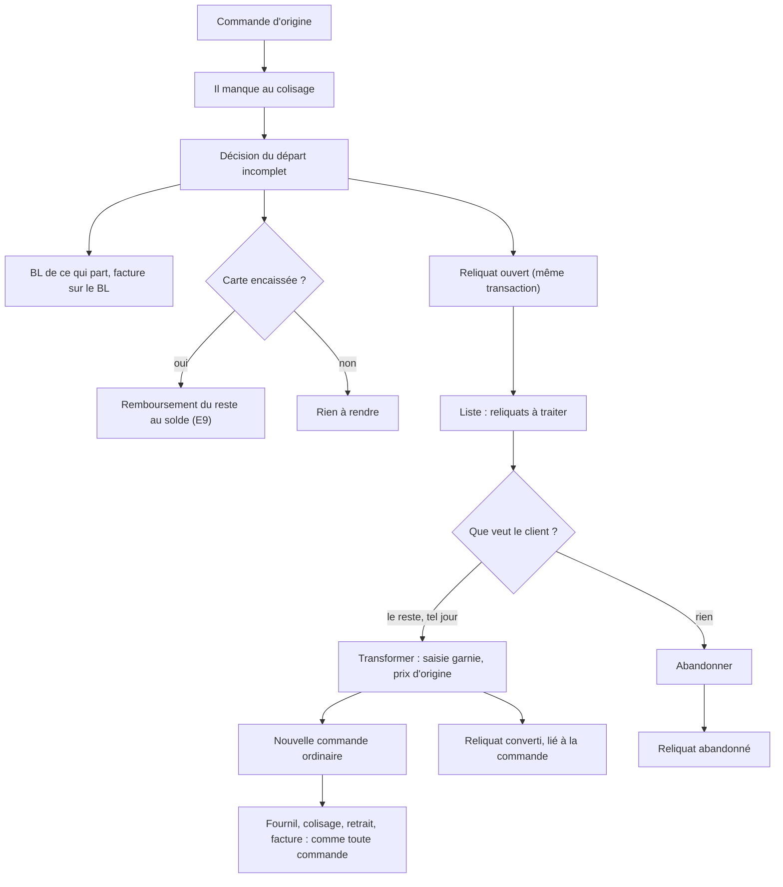

# Plan — le reliquat devient une commande

> Remplace le plan L7-L8 (« reste relivré le <date> », second envoi de la même
> commande), abandonné par Hugo le 2026-11-25 : « on fait trop compliqué ».
> Touche l'argent et porte une migration : **passe par `vitruve`** avant Hugo.
> Sources : [`reliquat.md`](reliquat.md), [`todo-reliquat.md`](todo-reliquat.md),
> [`plan-e9-reste-carte.md`](plan-e9-reste-carte.md),
> [`../passation/commande-passee-par-l-equipe.md`](../passation/commande-passee-par-l-equipe.md).

## Décisions de Hugo (2026-11-25)

1. Le **reliquat** se crée **automatiquement**, dans la **même transaction**
   que la décision du départ incomplet.
2. Ce **n'est pas une commande** : il passe de `open` à `converted` (une
   commande ordinaire pour un jour choisi, aujourd'hui compris) ou à
   `abandoned`.
3. Côté origine, le reste reste `abandoned` (la valeur de la décision ne
   change pas).
4. La commande d'origine solde et rembourse son reste **comme aujourd'hui**
   (E9) ; la commande issue du reliquat se paie comme toute commande, **sans
   transfert d'encaissement**.
5. La commande issue du reliquat garde le **prix de la commande d'origine**.
6. `planRemainder` et les BL de rang > 1 sont du **code mort à retirer**.

## Partie 1 — En clair

Quand une commande part incomplète, la commande d'origine ne change pas : le
bon de livraison porte ce qui part, la facture porte le bon, une carte
encaissée est remboursée du reste au solde.

Ce qui est nouveau : au moment même de la décision, **un reliquat naît**. Il
garde ce qui n'est pas parti, pour qui, et à quel prix. Il n'est pas une
commande : le fournil, le colisage, la livraison et la facture ne le voient
pas. Il attend dans une liste « Reliquats à traiter ».

Depuis la liste ou la fiche de la commande d'origine, l'équipe peut :

- **le transformer en commande**, pour le jour que le client veut,
  aujourd'hui compris. C'est une commande ordinaire, passée à la place du
  client, **aux prix de la commande d'origine** ; elle se paie comme toute
  commande (au compte, par lien, ou offerte) ;
- **l'abandonner** : le client ne veut pas du reste.

Une fois transformé ou abandonné, c'est définitif.

Ce que l'équipe doit savoir :

- le prix est celui de l'origine, y compris ses **remises en pourcentage** ;
  une remise en montant fixe a déjà servi sur l'origine et ne revient pas ;
- l'**heure limite** vaut comme pour toute commande passée par l'équipe :
  après l'heure, il faut une dérogation (§ 6, question 2) ;
- un client carte remboursé du reste paie la nouvelle commande à part :
  jamais deux fois la même pièce, puisque l'origine ne facture que ce qui est
  parti.

## Partie 2 — Technique (vérifiée sur `dev`, 2026-11-25)

### 1. Ce qui existe

- **La décision** : `ShortfallDeparture.decide`
  (`apps/lfd-api/src/lafoliecoffee/orders/application/services/shortfall-departure.ts`),
  partagée par la décision des managers et le départ au comptoir, dans
  l'unité de travail de l'appelant, après le verrou `orders … FOR UPDATE`
  (`prisma-shortfall-decision.repository.ts:108-112`) : agrégat, `desk.authorize`,
  signal, décision, `followDecision`, fait `order.shortfall_decided`.
- **Ce qui part** : `decision.departing` (`[{ sku, quantity }]`, colonne
  `order_shortfall_decision.departing`, `prisma/schema/public/orders.prisma:691`) ;
  il se répartit sur les lignes de la commande dans leur ordre
  (`departingSourceOf`, `lafoliecoffee/delivery-notes/domain/services/departing-source.ts`).
- **Le sort** : `abandoned` seul (`packages/contracts/src/admin-order-detail.ts:208` et
  le CHECK de `20261025140100_la_decision_du_depart`). **Inchangé** (décision 3).
- **E9** : `shortfallRefundOf` (`orders/domain/services/shortfall-refund.ts`)
  rend `encaissé − ajustements − facturable` de l'origine seule, sujet =
  son `orderId`. **Inchangé** (décision 4).
- **La passation de l'équipe** : `PlaceOrderForCustomerHandler`
  (`orders/application/commands/place-order-for-customer.handler.ts`), route
  `POST admin/orders` sous `b2b_place_order:write`
  (`orders/http/admin-orders.controller.ts:218-219`), estimation
  `POST admin/orders/quote` (l. 177-178), toutes deux par
  `prepareStaffOrder` → `OrderDrafting`. L'heure limite et le jour de
  production tiennent (commentaire de `staff-order-preparation.ts` avant
  `drafting.draft`) ; une dérogation se consomme dans la transaction
  (`OrderCutoffWaiverGate`, `orders/domain/ports/order-cutoff-waiver.gate.ts`).
  Règlements : `account | link | offered` (`admin-order.ts:52`) ; `link`
  refusé au comptoir (`ensureCounterSettlement`).
- **Garder un prix figé — le mécanisme existe** : la révision passe
  `revised: { lines, discounts }` à `OrderComposition.load`
  (`orders/revision/application/services/order-revising.service.ts:299-302`).
  `priceRevisedLines` (`orders/revision/application/services/revised-line-pricing.ts:67`)
  garde la ligne figée d'un SKU dont la **quantité ne change pas** et ne
  retarife que les quantités changées ; les remises de panier sont
  **rejouées** (`orders/domain/services/basket-discount-replay.ts`, en-tête),
  pas rejugées. La passation, elle, met `revised: null`
  (`orders/application/services/order-drafting.service.ts:219`). Le calcul
  reste `priceBasket` dans les deux cas : **une seule arithmétique**.
- **La règle d'argent d'un reste** existe déjà : `remainderDiscountsOf`
  (`lafoliecoffee/delivery-notes/domain/services/note-basket-discounts.ts`) — les
  pourcentages restent, les montants fixes sortent ; port et surtaxe à zéro
  (`remainderAdjustmentsOf`, `remainder-decision-source.ts`).

### 2. B1 — la table et l'agrégat (migration additive)

**Nom** : `Backorder` (« reliquat de commande » en anglais commercial), table
`public.backorder`. `OrderRemainder` est écarté : `OrderRemainderSettler`
(`orders/application/services/order-remainder-settler.ts`) porte déjà le mot
pour le second envoi mort, et deux sens d'un même mot dans un contexte se
confondent (§ 6, question 1).

**Où** : `src/lafoliecoffee/orders/backorder/` (domaine, application,
infrastructure, http) — le contexte des commandes. Ni le fournil, ni le
colisage, ni la livraison ne le lisent : aucune ligne n'est ajoutée à la
matrice des blocs.

_apps/lfd-api/prisma/migrations/2026112…\_le_reliquat_de_commande/migration.sql (à créer)_,
modèle dans _apps/lfd-api/prisma/schema/public/backorder.prisma (à créer)_ :

| Colonne                                 | Rôle                                                                                                                                     |
| --------------------------------------- | ---------------------------------------------------------------------------------------------------------------------------------------- |
| `id`                                    | ULID                                                                                                                                     |
| `origin_order_id` → `orders`            | `UNIQUE` : un reliquat par commande d'origine (seule la décision de rang 1 en fait naître un, et elle est unique par `(order_id, rank)`) |
| `company_id` (non nul), `buyer_user_id` | recopiés de l'origine ; le mur tenant se pose sur `company_id`                                                                           |
| `lines` `jsonb`                         | `[{ sku, quantity, sale_unit }]` — quantités en grammes au poids                                                                         |
| `state`                                 | `open` / `converted` / `abandoned`, CHECK                                                                                                |
| `converted_order_id` → `orders`         | `UNIQUE`, non nul **ssi** `converted` (CHECK)                                                                                            |
| `closed_at`, `closed_by_staff_id`       | non nuls ssi l'état n'est pas `open` (CHECK)                                                                                             |
| `created_at`                            | instant de la décision                                                                                                                   |

**Pas de copie du prix dans le reliquat** : le prix d'origine se relit sur les
lignes de la commande d'origine (`order_line`, modèle `OrderLine`,
`orders.prisma:736`), au moment de la transformation (§ 4). Elles ne bougent
plus après la décision : la révision est refusée dès qu'une décision existe
(`ensureNoShortfallDecision`, `orders/revision/application/services/order-revising.service.ts:135`).
Une copie serait un second endroit où le prix vit.

**Le coût d'un retour** (assumé) : l'`UNIQUE` sur `origin_order_id` interdit
pour toujours un second reliquat sur la même commande, et `converted` /
`abandoned` sont définitifs (décision 2). Un reliquat converti dont la
nouvelle commande est ensuite annulée est perdu : l'équipe repasse une
commande ordinaire.

**Les faits** : `backorder.opened`, `backorder.converted`,
`backorder.abandoned` s'écrivent au journal dans la transaction de chaque
écriture (qui, quand, la commande créée). **RGPD** : `closed_by_staff_id` entre
au registre `documentation/legal/rgpd-registre.json`, comme
`order_shortfall_decision.decided_by_staff_id` (`lint:rgpd-staff`).

**L'agrégat** (_apps/lfd-api/src/lafoliecoffee/orders/backorder/domain/entities/backorder.ts (à créer)_) : `Backorder.open(…)` refuse
zéro ligne et une quantité ≤ 0 ; `convert(orderId, at, by)` et
`abandon(at, by)` refusent tout état autre que `open`
(`BackorderClosedError`, `BusinessError`). Port `BackorderRepository`
`load`/`save` (§ 3.1 du `CLAUDE.md`).

Retour arrière écrit en tête de la migration : `DROP TABLE` tant qu'aucune
ligne n'existe ; au-delà, la table reste, morte.

### 3. B2 — la naissance, dans la décision

**Ce qui manque pour la faire, et que le plan ajoute** : ni
`LockedShortfallSubject` (`orders/domain/ports/shortfall-decision.repository.ts:8-13`,
`placedByUserId` seul) ni `ShortfallDecisionSubject` ne portent les lignes ni
la société, et `ShortfallDeparture` n'injecte aucun lecteur. B2 ajoute un
port étroit `BackorderOriginReader.ofLocked(orderId)` → `{ companyId,
buyerUserId, lines: [{ sku, quantity, saleUnit }] }`, lu **après** le verrou
de la commande déjà pris (même transaction, aucun verrou nouveau), et un
service `BackorderOpening` que `ShortfallDeparture` appelle — les deux portes
(managers, comptoir `HandOverPackedAtCounterHandler`) passent par `decide`,
donc par lui.

Dans `ShortfallDeparture.decide`, après `decisions.save(decision)` et
**seulement au rang 1** (les décisions de rang > 1 disparaissent avec le
démontage, § 7) :

0. **origine sans société** (particulier, `companyId` nul, commande
   `exact_ht` — `order-vat-method.ts:28-29`) : **aucun reliquat**. La saisie
   de l'équipe exige une société (`admin-order.ts:229`) et ne règle pas un
   particulier (`account | link | offered`) : un reliquat né là n'aurait
   d'autre issue que l'abandon. Le reste est abandonné comme aujourd'hui
   (§ 6, question 6) ;
1. le reste par SKU = quantité commandée − `decision.departing` (une ligne
   par SKU dans une commande) ; les SKU à zéro sortent ;
2. reste vide → aucun reliquat (tout est parti) ;
3. sinon `Backorder.open(...)` et `save`, dans la même transaction (décision 1).

Le fait `order.shortfall_decided` ne change pas ; `backorder.opened` part au
journal dans la même transaction.

Tests : unitaire de la soustraction (poids, tout parti, particulier sans
reliquat) ; unitaire de `decide` (le reliquat est sauvé après la décision,
et pas au rang > 1) ; e2e : décision managers et décision au comptoir font
chacune naître un reliquat, une seconde décision est refusée comme avant.

### 4. B3 — transformer : le prix d'origine par le chemin de la révision

`POST admin/backorders/:id/convert` sous `b2b_place_order:write`, corps =
celui de `adminPlaceOrderPayloadSchema` **sans** `companyId` ni lignes
(repris du reliquat) ; `buyerUserId` proposé à l'acheteur d'origine et
modifiable (un acheteur parti de la société fait refuser
`ensureOrderMember` : l'équipe en choisit un autre). Estimation sœur
`POST admin/backorders/:id/quote`. **C'est l'écran qui appelle ces deux
routes**, jamais `POST admin/orders` : une passation ordinaire ne fermerait
pas le reliquat.

**Idempotence** : `@IntentKey()` et un handler qui scelle (`runSealed`) comme
`PlaceOrderForCustomerHandler` (`lint:write-idempotence`) ; l'intention porte
l'`id` du reliquat, si bien qu'un double clic rend la même commande, pas un 409. Côté écran, la clé vient d'une `GestureIntents` (`lint:front-intent-keys`).

`ConvertBackorderHandler`, dans une unité de travail :

1. verrou de la ligne `backorder` (`FOR UPDATE`), `load`, refus si non `open` ;
2. composition par `prepareStaffOrder` → `OrderDrafting` **avec un rejeu** :
   `OrderDrafting` gagne un paramètre `replayed: RevisedFrom | null` qu'il
   passe à `composition.load` à la place du `null` d'aujourd'hui (l. 219). La
   passation ordinaire passe `null` : son comportement ne change pas ;
3. le rejeu est construit par une fonction pure
   _apps/lfd-api/src/lafoliecoffee/orders/backorder/domain/services/backorder-replay.ts (à créer)_ :
   - **lignes** : les `OrderLineSnapshot` de l'origine pour les SKU du
     reliquat, **ramenées à la quantité du reliquat** ; comme la saisie
     demande exactement ces quantités, `priceRevisedLines` les voit
     inchangées et **garde leur prix unitaire figé** (aucune retarification,
     aucun palier rejugé) ;
   - **remises** : `replayableDiscountsOf(origin)` filtré par la règle du
     reste — pourcentages gardés, montants fixes sortis (même règle que
     `remainderDiscountsOf`). **Le seuil** (`min_quantity`) : le rejeu ne
     refuse rien lui-même, il rend `refusals` à part et enchaîne la remise
     (`basket-discount-replay.ts:131-140`) ; c'est la révision qui les lève
     (`order-revising.service.ts:240-248`), alors que la passation les range
     dans les notes (`order-priced-draft.ts:64`). Passé par la passation, un
     reste sous le seuil **garde la remise** — c'est la recommandation (§ 6,
     question 4) — **sans toucher `basket-discount-replay.ts`**, que la
     révision partage. Un test l'épingle ;
   - **la mercuriale** : `sealing` n'est calculé que pour les lignes neuves
     (`revised-line-pricing.ts:105`) ; une ligne gardée fixée par une
     mercuriale à l'origine doit rester hors de l'assiette de la remise
     rejouée. Ça tient si la remise porte ses `coveredSkus`, et dépend de
     `pickupDiscountEligible` par le repli des colonnes
     (`basket-discount-replay.ts:125, 257-258`). **À établir au bâti par un
     test**, pas supposé ;
     Le lecteur du rejeu (`BackorderOriginReader.replayOf(originId)` →
     `OrderLineSnapshot[]` et `ReplayableOrder` : remises actives et colonnes
     `discount_*`, `basket-discount-replay.ts:46-55`) est un port du contexte des
     commandes ; le total d'une ligne se recalcule dans `priceBasket`
     (`price-basket.ts:110-113`), comme pour toute ligne.

**Particulier** : sans objet, aucun reliquat (§ 3). Une origine `exact_ht`
n'arrive donc jamais ici : `frozenLineOf` (`revision/domain/services/revised-lines.ts:93-102`)
ne recopie pas `unitPriceTtcCents`, et ce chemin n'aura pas à le faire.

4. `place` de la nouvelle commande, `waivers.consume` s'il y a dérogation,
   règlement comme la passation ;
5. `backorder.convert(newOrderId)` et `save` ;
6. le lien vers l'origine est la colonne `backorder.converted_order_id` ;
   la note de la commande (`orders.note`, `packages/contracts/src/order.ts:315`,
   visible du client) reste celle que l'équipe saisit, sans ajout automatique.

**Ce que la nouvelle commande ne reprend pas de l'origine** : le port et le
barème (une commande nouvelle a ses frais, § 6 question 3), la clientèle et
les CGV (celles du jour, comme toute passation), le bon de fidélité (jamais
dépensé par l'équipe).

**Mur tenant** : le reliquat se lit par `company_id` ; l'acheteur doit encore
être membre de la société (`ensureOrderMember` dans `prepareStaffOrder`).

Tests : unitaire de `backorder-replay` (poids, remise % et fixe, seuil,
mercuriale) ; unitaire du handler (ordre, refus `converted`) ; e2e :
transformer pour J+1 puis aujourd'hui avec dérogation, prix unitaire = celui
de l'origine même après une hausse du catalogue, double clic = une seule
commande, reliquat abandonné refusé ; **une seule arithmétique** : l'estimation
et la passation donnent le même total.

### 5. B4 — abandonner, et les écrans

- `POST admin/backorders/:id/abandon` sous `b2b_orders_shortfall:write` ;
  `@Idempotent` (une seconde fois rend le refus `BackorderClosedError`).
- **L'origine annulée** : l'annulation n'est pas verrouillée par la décision
  (rien dans `orders/cancellation/` ne lit le manque). Annuler la commande
  d'origine **abandonne son reliquat ouvert** dans la même transaction
  (par le noyau `OrderCancellation`) ; un reliquat déjà converti n'est pas
  touché — sa commande vit sa vie.
- `GET admin/backorders?state=open` : la liste, par société, du plus ancien
  au plus récent ; la fiche commande d'origine montre son reliquat et son
  état, la nouvelle commande montre son origine.
- Back-office : la liste « Reliquats à traiter », et sur la fiche commande
  (bandeau du départ décidé,
  `apps/lfd-backoffice-frontend/src/app/commandes/order-shortfall-banner/`)
  les deux gestes ; « Transformer » ouvre la saisie de l'équipe garnie
  (date à choisir, règlement à choisir).
- Le courrier du manque (`OrderShortfallDraftData`,
  `mail/templates/order-shortfall-mail.ts:35-46`) ne change pas.

Droits : aucun nouveau. Une migration n'accorde aucun droit (`CLAUDE.md` § 3).

### 6. Questions pour Hugo

1. **Le nom** : `Backorder` (recommandé) plutôt que `OrderRemainder`.
2. **L'heure limite pour aujourd'hui** : règle commune de la saisie de
   l'équipe, la dérogation existante après l'heure (recommandé : l'équipe
   n'échappe à rien) ; ou la transformation d'un reliquat passe l'heure de
   droit ?
3. **Le port** de la commande issue du reliquat : celui du jour, comme toute
   commande (recommandé), ou offert parce que c'est un reste ?
4. **Le seuil d'une remise** acquise sur l'origine et que le reste n'atteint
   plus : la garder (recommandé, c'est le « prix d'origine »).
5. **Un reliquat jamais traité** : reste ouvert sans limite (recommandé pour
   commencer), ou s'abandonne seul après N jours ?
6. **Les particuliers** (commande sans société) : aucun reliquat
   (recommandé ; la saisie de l'équipe ne sait pas les servir), ou une autre
   porte à concevoir ?

### 7. B5 — retirer le second envoi (code mort, décision 6)

Après B2 en service. Rien ne crée de BL de rang > 1 en base aujourd'hui
(`planRemainder` n'a d'appelant que dans les tests) : le démontage est du code
et des tests, **sans migration** — les colonnes `rank` restent, mortes, et la
valeur d'énumération `partially_handed_over` aussi (une valeur ne se retire
pas sans recréer le type, en-tête de `20261026100000_la_commande_en_partie_retiree`).

Dans le commerce, les fichiers qui portent le mécanisme (grep du 2026-11-25
sur `planRemainder|RemainderSchedule|remainder-note|RemainderSettle|RemainderShipment|settlesOnRemainder|DECIDABLE_REMAINDER_NOTE|partially_handed_over`,
hors tests) : `delivery-note.ts` (`planRemainder`), `remainder-schedule.ts`,
`remainder-decision-source.ts`, `remainder-decision-follower.ts`,
`prepare-remainder-note.handler.ts`, `hand-over-remainder-note.handler.ts`,
`on-remainder-packed.handler.ts`, `on-remainder-handed-over.handler.ts`,
`order-remainder-settler.ts`, `remainder-settlement.ts`,
`remainder-shipment.reader.ts` et son adaptateur Prisma,
`shipment-settlement.ts`, le refus `remainder_not_planned` de
`shortfall-decidability.ts`, et **43** lecteurs de `partially_handed_over`
hors tests (compte de `vitruve`, 2026-11-25), dont des contrats servis aux
fronts et des fichiers générés (`shop-copy-manifest.json`, sous
`lint:shop-copy-digest`). Hors
du commerce, le rang porté au fournil, au colisage, à la livraison et au
retrait (`ShipmentRef`, clés `:r<rang>`) reste — il vaut toujours 1.

B5 commence par un inventaire écrit (fichier par fichier : retiré, ou gardé
parce que le rang 1 le traverse) soumis à `vitruve`, puis un lot par bloc.
Le reliquat (B1-B4) n'en dépend pas.

### 8. Ce que le plan ne fait pas

Second envoi de la même commande ; date sur la décision ; reliquat d'un
reliquat (la nouvelle commande peut elle-même partir incomplète : elle a alors
son propre reliquat, comme toute commande) ; transfert d'encaissement ;
paiement au comptoir ; reliquat sur une commande carte non encaissée ou avec
un bon de fidélité (déjà refusés à la décision, `termsRefusalOf`).

### 9. Lots

| Lot | Contenu                              | Tests                                       |
| --- | ------------------------------------ | ------------------------------------------- |
| B1  | migration, agrégat, dépôt            | unitaires de l'agrégat, e2e des CHECK       |
| B2  | naissance dans la décision           | unitaires, e2e managers et comptoir         |
| B3  | transformer, rejeu du prix d'origine | unitaires du rejeu, e2e prix et idempotence |
| B4  | abandonner, liste, écrans            | e2e, specs des composants                   |
| B5  | démontage du second envoi            | inventaire et `vitruve` d'abord             |
