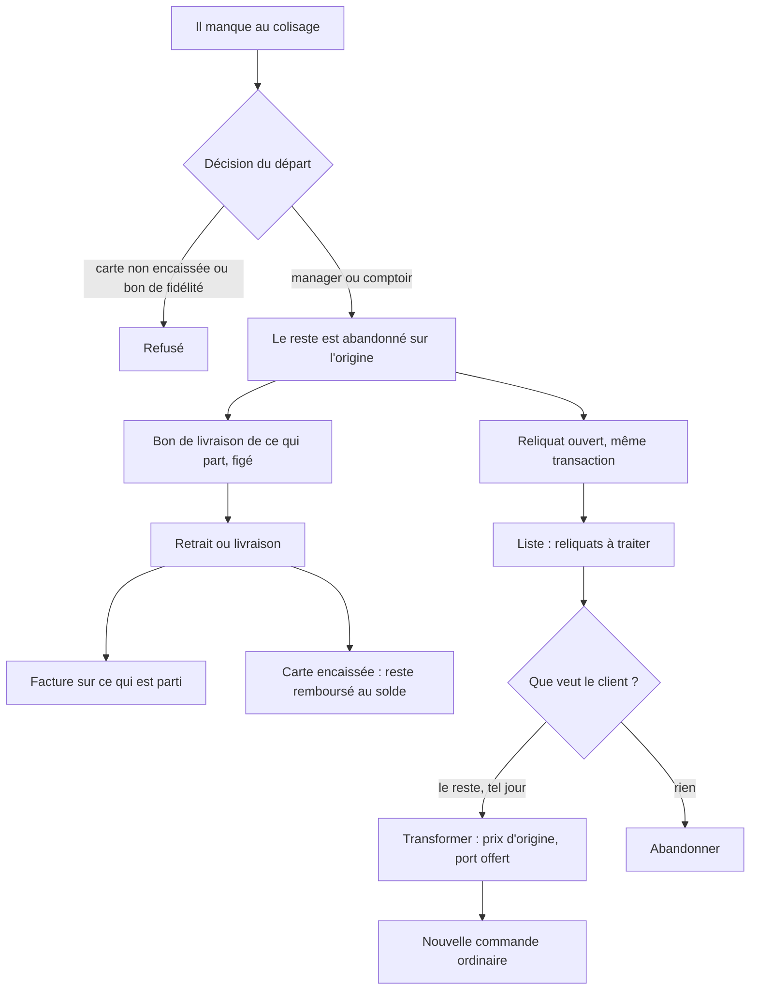
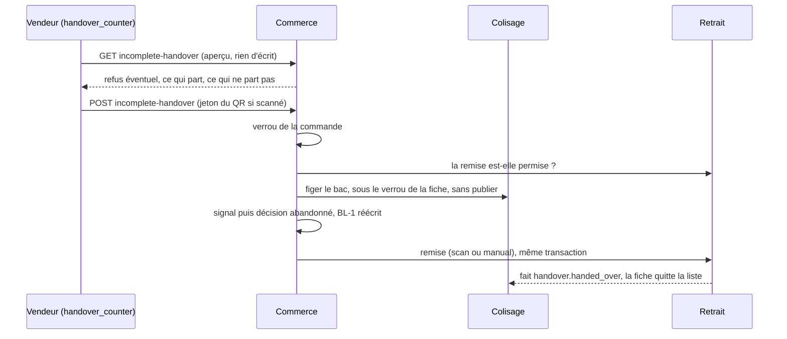
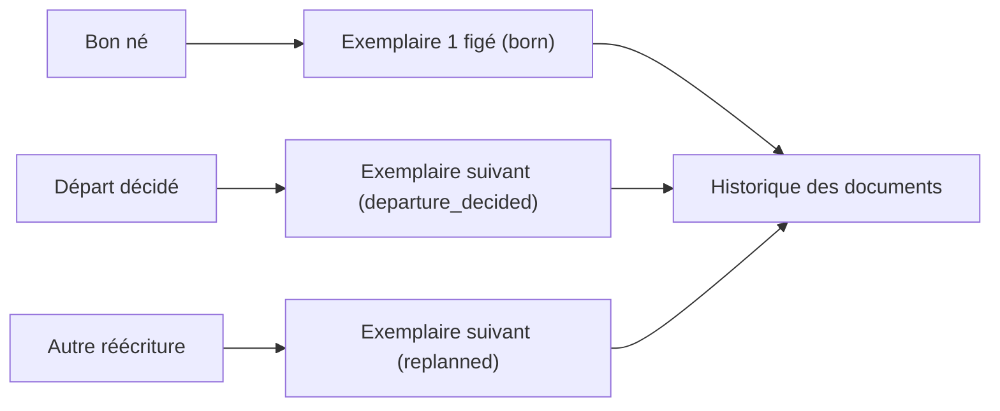

# Le départ incomplet et le reliquat de commande

> ✅ **Doc d'état, relue le 2026-11-25** contre le code du chantier du
> reliquat (chaque chemin cité a été ouvert ce jour-là). Ce qui n'est pas
> bâti est dans [`todo-reliquat.md`](todo-reliquat.md). Voisines :
> [`../bon-de-livraison.md`](../bon-de-livraison.md) (le bon de livraison,
> ses montants et son gel) et [`plan-e9-reste-carte.md`](plan-e9-reste-carte.md)
> (le reste d'une commande carte, remboursé au solde).

## En bref

Au colisage, il arrive qu'un article manque : le bac ne se remplit pas. La
commande peut alors **partir incomplète**, mais seulement si quelqu'un le
**décide** — un manager depuis la fiche commande, ou le vendeur du comptoir au
moment du retrait. Ce qui part, c'est **ce qui est au bac**, jamais une
saisie. Le bon de livraison ne porte que ce qui part, et la facture ne compte
que les bons remis : le client ne paie pas ce qu'il n'a pas reçu. Une carte
déjà encaissée est remboursée du reste au solde. L'équipe peut ensuite
**écrire au client** pour le prévenir.

Côté commande d'origine, le reste est **abandonné**. Mais au même instant,
dans la même transaction, **un reliquat naît** : il garde ce qui n'est pas
parti, pour qui, et à quel prix. Ce n'est pas une commande — ni le fournil,
ni le colisage, ni la livraison, ni la facture ne le voient. Il attend dans
la liste « Reliquats à traiter », et l'équipe :

- le **transforme en commande** ordinaire, pour le jour que veut le client,
  aujourd'hui compris, **aux prix de la commande d'origine**, port offert,
  sans surtaxe de retard. Un pro passe par la saisie de l'équipe (au compte,
  par lien ou offerte) ; un particulier repart en commande **réglée en
  boutique** (la caisse de la boutique encaisse au retrait) ou **offerte** ;
- ou l'**abandonne** : le client ne veut pas du reste.

Transformé ou abandonné, c'est définitif. Une commande ne part qu'en **un
seul envoi** : il n'y a pas de second bon pour la même commande.

## 1. Le manque constaté au colisage

« Il manque » sur une fiche ouverte (`PackingSheet.reportShortfall`,
`src/packing/domain/entities/packing-sheet.ts`) fige les quantités au bac par
article et publie `packing.shortfall_reported` par `packing/channels/commerce/`.
Le commerce le tient **par envoi** dans l'agrégat `OrderShortfall`
(`lafoliecoffee/orders/domain/entities/order-shortfall.ts`, table `order_shortfall`, clé
`(order_id, rank)`). La page Commandes, la fiche commande et la Supervision le
montrent. Refermer le bac complet efface le signal
(`packing.shortfall_cleared`). Tant que le commerce n'a pas décidé, un bac
incomplet ne se ferme pas (`ShortfallAwaitingDecisionError`). Détail du signal
côté bon : [`../bon-de-livraison.md`](../bon-de-livraison.md#le-départ-incomplet).

## 2. La décision du départ

Une décision par commande (`ShortfallDecision`,
`lafoliecoffee/orders/domain/entities/shortfall-decision.ts`, table
`order_shortfall_decision`, unique par `(order_id, rank)`), définitive. Le
sort du reste ne prend qu'une valeur : `abandoned` (`shortfallRemainderSchema`,
`packages/contracts/src/admin-order-detail.ts`). Deux chemins écrivent la même
décision par `shortfall-departure.ts` (`lafoliecoffee/orders/application/services/`).

### 2.1 Le manager

`POST admin/orders/:id/shortfall-decision`, corps `{ remainder: "abandoned" }`, sous
`b2b_orders_shortfall:write` (`admin-order-shortfall.controller.ts`). Refus
`409` : déjà décidée, aucun manque, pas confirmée, carte, bon de fidélité,
trop ancienne, rien au bac, bac déjà fermé, bac changé depuis le signal.
Le corps ne porte pas de rang : une commande part en un seul envoi (§ 8).

### 2.2 Le comptoir — les décisions de Hugo du 2026-11-03

| #   | Décision                                                                                                                                                |
| --- | ------------------------------------------------------------------------------------------------------------------------------------------------------- |
| D1  | Le comptoir décide lui-même du départ incomplet.                                                                                                        |
| D2  | **Tout vendeur du comptoir** (`handover_counter:write`) peut le décider ; la décision est tracée (qui, quand).                                          |
| D3  | Ce qui part = **ce qui est au bac**, jamais une saisie.                                                                                                 |
| D4  | Le reste est abandonné sur l'origine ; un reliquat naît (§ 6).                                                                                          |
| D5  | **Pas de dialogue sur le chemin heureux** : sac fini, « Remettre la commande » remet directement.                                                       |
| D6  | Le reliquat se choisira au comptoir : le client repasse à une heure convenue, ou on le lui porte — le plus souvent à pied, sans réveiller la livraison. |
| Q1  | « Remettre la commande entière » malgré un manque n'est **pas** offert : il facturerait le commandé sur la parole du vendeur ; on corrige le colisage.  |

#### 2.2.1 L'aperçu

`GET /admin/counter/orders/:orderId/incomplete-handover`
(`handover_counter:read`, `admin-counter-incomplete-handover.controller.ts`)
rend `CounterIncompleteHandoverView`
(`packages/contracts/src/counter-incomplete-handover.ts`) : un `refusal` (ou
`null`), les lignes (`due`, `departing`, `notDeparting`, en grammes au poids)
et, quand le départ est déjà tranché, `decision` (`decidedAt`,
`decidedByName`). Rien n'est écrit, rien n'est promis : le geste rejuge sous
verrou.

| Code                                                                                                                                                                                   | Ce que voit le vendeur                                                      |
| -------------------------------------------------------------------------------------------------------------------------------------------------------------------------------------- | --------------------------------------------------------------------------- |
| `null`                                                                                                                                                                                 | « Remettre ce qui est au bac — le reste est abandonné »                     |
| `nothing_short` (tout réparti, bac pas fermé)                                                                                                                                          | la remise ordinaire, sans dialogue                                          |
| `already_decided`, `already_authorized`                                                                                                                                                | « Départ incomplet validé par <nom> à <heure> » et « Remettre la commande » |
| `sealed` (le colisage a fermé le sac)                                                                                                                                                  | « Le colisage a fermé ce sac. » et « Remettre la commande »                 |
| `card_unpaid`, `card_increase_pending`, `voucher`, `not_confirmed`, `too_old`, `nothing_departs`, `not_drawn`, `withdrawn`, `counted`, `handover_refused`, `not_a_pickup`, `other_day` | une phrase, et seulement « Fermer »                                         |

Chaque bloc expose sa règle « rendue au lieu de levée », partagée par l'aperçu
et le geste : `packing/domain/services/shortfall-standing.ts`,
`lafoliecoffee/orders/domain/services/shortfall-decidability.ts`,
`handover/domain/services/counter-reach.ts`.

#### 2.2.2 Le geste — une transaction, dans le commerce

`POST /admin/counter/orders/:orderId/incomplete-handover`, corps
`{ remainder: "abandoned", token? }`, `204`
(`hand-over-packed-at-counter.handler.ts`) :

1. verrou de la commande ;
2. le retrait juge sans écrire (`CounterHandoverDesk.vet`) : la garde du
   comptoir, la règle de remise, le jeton ;
3. les refus de la décision qui ne dépendent pas du bac ;
4. le colisage fige le bac (`ShortfallFreezeDesk`, dans la transaction de
   l'appelant), sans publier `packing.shortfall_reported` ;
5. le commerce écrit le signal puis la décision, autorise la fiche et réécrit
   le BL-1 ;
6. le retrait remet : `scan` avec un jeton de cette commande, `manual` sans.

Tout ou rien. Un « Il manque » pressé au poste juste avant est repris ; un
signal du poste plus récent que ce que lit le comptoir fait refuser
(`orders.shortfall.signal_outrun`). Un jeton d'une autre commande refuse
(`handover.counter.token_mismatch`).

#### 2.2.3 Le droit

La garde (`counterReachOf`) : un **retrait** (`pickup`) de la **journée** du
comptoir — une livraison ou un autre jour, `403`
`handover.counter.out_of_reach`. « Qui peut décider » est séparé de « quel
sort » : le sort est un paramètre (`abandoned` seul), pour qu'un second sort
s'y ajoute sans rouvrir le droit. Le rail lit sa fiche de colis par
`GET /admin/counter/orders/:orderId/packing-sheet`, sous le même droit.

#### 2.2.4 L'écran

`apps/lfd-backoffice-frontend/src/app/handover-shop/incomplete-handover-dialog/`
et `comptoir/counter-incomplete-handover.service.ts` : sac fini, « Remettre la
commande » ; sac pas fini, « Procédure commande incomplète », qui lit l'aperçu
puis ouvre le dialogue selon le tableau du § 2.2.1. Dans la file et le rail,
une commande partie incomplète se dit en une ligne (« Commande incomplète ·
192 pièces non données sur 16 produits »).

## 3. Ce qui est refusé

| Cas                                           | Pourquoi                                                                                       | Refus                                                               |
| --------------------------------------------- | ---------------------------------------------------------------------------------------------- | ------------------------------------------------------------------- |
| Commande carte **pas encore encaissée**       | il n'y a rien à répartir entre ce qui part et ce qui est rendu                                 | `CardOrderUnpaidShortfallError`, aperçu `card_unpaid`               |
| Commande carte avec une **hausse en attente** | le montant encaissé n'est pas encore celui de la commande                                      | `CardIncreasePendingShortfallError`, aperçu `card_increase_pending` |
| Commande avec un **bon de fidélité**          | un départ incomplet ne sait pas encore répartir le bon sur ce qui part                         | `VoucherOrderShortfallError`, aperçu `voucher`                      |
| Rien au bac                                   | rien ne part : on annule la commande                                                           | `NothingDepartsError`, aperçu `nothing_departs`                     |
| Commande trop ancienne                        | un montant non nul sans la règle figée qui l'a produit : le BL partiel ne se recomposerait pas | `OrderTooOldForShortfallError`, aperçu `too_old`                    |

L'aperçu ne produit plus `card`, gardé dans la liste du contrat servi.
Les refus de conditions se lisent dans `termsRefusalOf`
(`lafoliecoffee/orders/domain/services/shortfall-decidability.ts`).

**Une commande carte encaissée part incomplète.** Le reste ne se rembourse
pas à la décision mais **au solde** : à `order.billing_settled`, l'abonné
`RefundShortfallOnBillingSettled`
(`lafoliecoffee/orders/application/handlers/refund-shortfall-on-billing-settled.handler.ts`)
demande au bloc `payment` le montant `shortfallRefundOf`
(`lafoliecoffee/orders/domain/services/shortfall-refund.ts`) : encaissé −
ajustements − facturable. La facture carte lit les montants facturables
(`lafoliecoffee/accounting/infrastructure/prisma-card-invoicing.reader.ts`).
Le détail, ses refus et son blocage : [`plan-e9-reste-carte.md`](plan-e9-reste-carte.md).

## 4. Le bon de livraison de ce qui part

`departingSourceOf` (`lafoliecoffee/delivery-notes/domain/services/departing-source.ts`)
réduit les lignes aux quantités décidées (une ligne qui ne part pas reste, à
zéro) et recompose l'en-tête par les mêmes fonctions que la passation : les
ajustements figés réappliqués aux lignes livrées. Un BL décidé n'est jamais
réaligné sur la commande entière. Le BL remis au comptoir est le BL de
**transport**, sans montant, avec « Reçu par, le, signature » ; il n'imprime
que les lignes remises et dit le reste sous le tableau (« Non livré : … »).
Tout le détail : [`../bon-de-livraison.md`](../bon-de-livraison.md).

## 5. La lettre au client

« Écrire au client » est un **geste**, jamais un abonné
(`write-shortfall-letter.handler.ts`) : `GET admin/orders/:id/shortfall-letter`
rend une proposition, `POST` envoie le texte relu par le bloc `mail`, sous
`b2b_orders_shortfall:write`. L'agrégat `ShortfallNotice`
(`lafoliecoffee/orders/domain/entities/shortfall-notice.ts`) tient « une fois par
décision » (clé `order-shortfall:<décision>`) et trace qui, quand. « Prévenu »
veut dire « le courriel est demandé » ; son issue se lit au suivi des e-mails.

## 6. Le reliquat de commande

### 6.1 L'agrégat et sa table

`Backorder` (`lafoliecoffee/orders/backorder/domain/entities/backorder.ts`),
table `public.backorder` (`prisma/schema/public/backorder.prisma`). Le
contexte est celui des commandes : aucun autre bloc ne le lit.

| Colonne                           | Rôle                                                                                      |
| --------------------------------- | ----------------------------------------------------------------------------------------- |
| `origin_order_id` → `orders`      | `UNIQUE` : un reliquat par commande d'origine                                             |
| `company_id`, `buyer_user_id`     | recopiés de l'origine, sans clé étrangère ; `company_id` nul pour un particulier          |
| `lines` `jsonb`                   | `[{ sku, quantity, sale_unit }]`, quantités en grammes au poids                           |
| `state`                           | `open`, `converted` ou `abandoned` (CHECK)                                                |
| `converted_order_id` → `orders`   | `UNIQUE`, non nul **ssi** `converted` ; jamais l'origine (`backorder_not_its_own_origin`) |
| `closed_at`, `closed_by_staff_id` | non nuls ssi l'état n'est pas `open` ; `closed_by_staff_id` est au registre RGPD          |

**Aucun prix dans le reliquat** : le prix se relit sur les lignes de la
commande d'origine, qui ne bougent plus après la décision (la révision est
refusée dès qu'une décision existe). Une copie serait un second endroit où
le prix vit.

L'agrégat refuse zéro ligne, une quantité nulle ou négative et un SKU en
double ; `convert` et `abandon` refusent tout état autre que `open`
(`BackorderClosedError`, 409). `Backorder.restore` ne rejuge pas les règles
d'état : les CHECK de la base les tiennent, et le mapper refuse une ligne mal
formée. Port `BackorderRepository` (`load`/`save`).

Les faits `backorder.opened`, `backorder.converted` et `backorder.abandoned`
s'écrivent au journal dans la transaction de chaque écriture, avec la
**commande d'origine** pour sujet (`backorder-journal-facts.ts`) ; le
back-office les dit en phrases
(`apps/lfd-backoffice-frontend/src/app/shared/journal/phrases/backorder-phrases.ts`).

**Assumé** : un reliquat converti dont la nouvelle commande est ensuite
annulée est perdu — l'équipe repasse une commande ordinaire.

### 6.2 La naissance, dans la décision

`ShortfallDeparture.decide`
(`lafoliecoffee/orders/application/services/shortfall-departure.ts`) est
partagé par la décision des managers et le départ au comptoir. Après
l'écriture de la décision, il appelle `BackorderOpening`
(`orders/backorder/application/backorder-opening.ts`), qui lit l'origine
sous le verrou déjà pris (`BackorderOriginReader.ofLocked`) et calcule le
reste par SKU — commandé moins ce qui part (`backorder-remainder.ts`). Reste
vide : aucun reliquat. Sinon `Backorder.open`, dans la même transaction.
Pros et particuliers ont tous deux un reliquat.

### 6.3 Transformer — un pro, par la saisie de l'équipe

`POST admin/backorders/:id/convert` et son estimation
`POST admin/backorders/:id/quote`, sous `b2b_place_order:write`
(`orders/backorder/http/admin-backorders.controller.ts`). Le corps est celui
de la saisie de l'équipe, sans société ni lignes (reprises du reliquat), et
**strict** : un champ inconnu, un frais par exemple, est un 400. L'acheteur
d'origine est proposé ; s'il a quitté la société, l'équipe en choisit un
autre. L'écran appelle ces deux routes, jamais `POST admin/orders` : une
passation ordinaire ne fermerait pas le reliquat.

`ConvertBackorderHandler` scelle son intention (`runSealed`, intention
portant l'`id` du reliquat : un double clic rend la même commande) puis,
dans une transaction : verrou du reliquat, état rejugé, passation par
`StaffOrderPlacement` (`orders/application/services/staff-order-placement.ts`,
le même code que la saisie ordinaire), fermeture (`backorder-closing.ts`).
L'estimation passe par `StaffOrderEstimation` sous la **même** politique :
une seule arithmétique.

**La politique** `backorderPolicyOf(rejeu)`
(`orders/backorder/application/backorder-placement.ts`) :

- **le prix d'origine, par le rejeu.** `backorderReplayOf`
  (`orders/backorder/domain/services/backorder-replay.ts`) prend les lignes
  de l'origine ramenées aux quantités du reliquat, et le chemin de la
  révision (`priceRevisedLines`) garde leur prix unitaire figé : ni
  retarification, ni palier rejugé. L'étiquette TTC d'une ligne se déduit du
  prix HT figé, donc un particulier `exact_ht` garde son étiquette au
  centime. Les remises de panier sont rejouées : les **pourcentages**
  restent, les **montants fixes** sortent (ils ont servi sur l'origine), et
  une remise sous son seuil est gardée ;
- **le port offert** (`offeredDelivery: true`) : le seuil de franco de la
  route est forcé à 0 dans `PricingContext`, et `priceBasket` fige une
  « Livraison offerte ». Aucune route ne le reçoit d'un corps ;
- **aucune surtaxe de retard** (`lateFee: "waive"`) : la dérogation d'heure
  limite se dépense quand même, elle admet la commande.

**Le port offert est durable.** Colonne `orders.delivery_offered`, posée par
`Order.offerDelivery()` à la passation issue d'un reliquat — retrait compris
—, figée par un déclencheur qui refuse un changement de valeur, et tenue par
un CHECK (port HT et TTC nuls quand elle est vraie). Toute recomposition
(`OrderRevising` : révision, devis, hausse carte) la relit : une commande
modifiée vers une autre zone, ou passée du retrait à la livraison, garde son
port offert. Une promotion « livraison offerte » dès 0 € gagne l'égalité des
seuils : le port reste nul, mais la livraison offerte est attribuée à la
promotion.

La nouvelle commande ne reprend de l'origine ni le barème de livraison, ni
les CGV (celles du jour), ni le bon de fidélité. Elle se paie comme toute
commande, **sans transfert d'encaissement** : l'origine ne facture que ce
qui est parti, et rembourse son reste carte au solde.

### 6.4 Transformer — un particulier, réglée en boutique ou offerte

Un particulier ne passe pas par la saisie de l'équipe (elle exige une
société). Les mêmes routes reçoivent un second corps, reconnu à son `venue`
(`adminBackorderConvertBodySchema`, `packages/contracts/src/admin-backorder.ts`) :
`"shop_till"` ou `"offered"`, le point de retrait, le jour, le créneau, le
total vu, l'acheteur facultatif (absent, l'acheteur d'origine, qui passe le
mur du particulier). `ConvertParticularBackorderHandler` et
`QuoteParticularBackorderHandler` passent par les passations du particulier,
sous la même politique :

- **réglée en boutique** — `ShopTillParticularPlacement`
  (`orders/application/services/shop-till-particular-placement.ts`) : le
  délai d'annulation figé, le total vu, `settleAtShopTill()`. Retrait
  seulement ; notre système n'encaisse rien, la caisse certifiée de la
  boutique encaisse au retrait ;
- **offerte** — `OfferedParticularPlacement`, sous le droit d'offrir
  (`b2b_offer_order:write`).

Un corps pro sur un reliquat de particulier rend
`ParticularBackorderNotConvertibleError` (409), l'inverse
`CompanyBackorderNeedsStaffEntryError` (409). L'heure limite d'un
particulier passe par le « hors plan » du comptoir ; il n'a pas de
dérogation. Une origine carte remboursée au solde et une commande réglée en
boutique sont deux argents indépendants : aucun lien entre eux chez nous.

L'écran (`/commandes/:orderId/reliquat-particulier`, `?venue=offered`) ne
propose que le retrait ; une offerte livrée reste possible par l'API.

### 6.5 Abandonner, la liste et les écrans

- `POST admin/backorders/:id/abandon`, sous `b2b_orders_shortfall:write`,
  `@Idempotent` (une seconde fois rend `BackorderClosedError`).
- **Annuler l'origine** abandonne son reliquat ouvert dans la même
  transaction (noyau `OrderCancellation`) ; un reliquat converti n'est pas
  touché. Une annulation par un client qui trouverait un reliquat ouvert est
  refusée (`BackorderAbandonNeedsStaffError`) plutôt que d'écrire un abandon
  sans auteur.
- `GET admin/backorders?state=open` : la liste, du plus ancien au plus
  récent, non paginée (un reliquat ouvert n'a pas de limite de durée).
- Le détail d'une commande sert `backorder` sur l'origine et
  `backorderOrigin` sur la commande issue (`AdminOrderView`).
- Back-office (`apps/lfd-backoffice-frontend/src/app/commandes/`) : la liste
  « Reliquats » (`backorders-page/`, route `/reliquats`), la carte du
  reliquat sur la fiche (`order-backorder-card/`), le rappel de l'origine
  (`order-backorder-origin/`), l'écran de transformation d'un pro
  (`backorder-conversion-page/`, `/commandes/:orderId/reliquat`) et d'un
  particulier (`particular-backorder-conversion-page/`). Le total vient du
  serveur ; la ligne « Livraison offerte » ne fait que nommer un port nul.

Aucun droit nouveau.

### 6.6 Les décisions de Hugo du 2026-11-25

| #   | Décision                                                                                                                             |
| --- | ------------------------------------------------------------------------------------------------------------------------------------ |
| 1   | Le reliquat se crée automatiquement, dans la même transaction que la décision du départ incomplet.                                   |
| 2   | Ce n'est pas une commande : il passe de `open` à `converted` (une commande pour un jour choisi, aujourd'hui compris) ou `abandoned`. |
| 3   | Côté origine, le reste reste `abandoned`.                                                                                            |
| 4   | L'origine solde et rembourse son reste comme avant (E9) ; la commande issue se paie comme toute commande, sans transfert.            |
| 5   | La commande issue du reliquat garde le prix de la commande d'origine.                                                                |
| 6   | Le second envoi (`planRemainder`, BL de rang > 1) est du code mort à retirer.                                                        |
| 7   | Le port est offert, obligatoirement, sur la commande issue d'un reliquat : « on fait tout dans l'intérêt du client ».                |
| 8   | Aucune surtaxe de retard sur la commande issue d'un reliquat.                                                                        |
| 9   | Le nom est `Backorder`.                                                                                                              |
| 10  | Pour aujourd'hui après l'heure limite : la dérogation commune de l'équipe.                                                           |
| 11  | Une remise de l'origine est gardée même si le reste n'atteint plus son seuil.                                                        |
| 12  | Un reliquat ouvert n'a pas de limite de durée.                                                                                       |
| 13  | Les particuliers ont un reliquat : réglée en boutique, offerte, ou abandon.                                                          |
| 14  | Le port reste offert quelle que soit la zone, y compris après une modification qui change la zone.                                   |
| 15  | Pour l'heure limite d'un particulier, le « hors plan » du comptoir suffit.                                                           |
| 16  | `delivery_offered` est posé sur toute commande issue d'un reliquat, retrait compris.                                                 |

Exigence de Hugo du même jour, principe du chantier : « on doit pouvoir
tracer absolument ce qui s'est passé » (§ 7).

## 7. Tracer ce qui s'est passé

**Chaque exemplaire du bon client est figé à sa naissance.** Table
`public.delivery_note_version` (`(delivery_note_id, content_version)`
unique, `rendered jsonb`, `cause` = `born` | `departure_decided` |
`replanned`, `recorded_at`). Ce qui se fige est l'**entrée complète du
rendu** (le bon client que le composeur produit, `rendered-client-note.ts`),
pas la ligne du bon : le PDF d'un exemplaire se rend d'elle seule. Le dépôt
du bon compare la version écrite à celle en base et appelle le port
`DeliveryNoteVersionKeeper`
(`lafoliecoffee/delivery-notes/domain/ports/delivery-note-version.keeper.ts`),
dans la même transaction : aucun écrivain ne peut l'oublier. Une composition
qui échoue annule l'écriture du bon. Les règles de cause :
`delivery-note-version.ts` (`domain/services/`). Aucune purge : c'est une
trace. La porte `lint:delivery-note-version-readers` limite les lecteurs à
l'écrivain, au lecteur de l'historique et à la purge de démonstration.

Le PDF d'un exemplaire :
`GET …/delivery-notes/:number/editions/:edition/client.pdf`
(`admin-order-delivery-notes.controller.ts`) — ce n'est pas une impression,
il n'est pas compté comme tel. Les bons nés avant la table n'ont pas
d'exemplaire d'origine : l'historique dit « version d'origine non
conservée ».

**L'historique des documents** de la fiche : le bon de commande rangé à la
passation, le **BL d'origine** (premier exemplaire), le **BL définitif**
(dernier) s'il diffère, puis factures et preuve de retrait.

**L'historique de la commande** lit les activités (`growth.activity_events`),
chacune avec qui et quand : manque signalé (un par signal, le précédent
jamais écrasé), impression d'un BL, lettre au client, faits du reliquat,
prête, retrait. Le remboursement carte se lit à la fiche par le lecteur du
bloc `payment`, pas par un fait.

**La fiche d'un départ partiel** : la décision en tête (ce qui part, qui a
décidé, le reliquat et son état), une colonne « Parti » à côté de
« Commandé », le reste abandonné marqué avec un lien vers son reliquat, et
les montants **commandé** et **livré** (facturable).

## 8. Un seul envoi par commande

La commande part en **un** envoi, le rang 1. Le second envoi d'une même
commande (un BL de rang 2 avec son jour, son colisage, son retrait et un
solde à la dernière remise) a été retiré du code, sur décision de Hugo du
2026-11-25 (décision 6) : le reste devient un reliquat (§ 6).

Ce qui reste, **sans migration** :

- les colonnes `rank` au fournil, au colisage, à la livraison et au retrait,
  `ShipmentRef` et `shipmentKeySuffix`
  (`production/day/domain/value-objects/shipment-ref.value-object.ts`) : le
  rang vaut toujours 1, et les clés de la boîte d'envoi restent identiques ;
  `delivery_note.service_day` aussi ;
- la valeur d'énumération `partially_handed_over`, en base **sans
  écrivain** : une valeur ne se retire pas sans recréer le type. Ses
  lecteurs (comptabilité, annulation, révision, client) restent, et ne la
  rencontrent jamais ;
- **deux abonnés durables muets**, `b2b.delivery-notes.prepare-remainder`
  (`OnRemainderPacked`) et `b2b.delivery-notes.hand-over-remainder`
  (`OnRemainderHandedOver`), dans
  `lafoliecoffee/delivery-notes/application/handlers/` : chaque
  `packing.order_packed` et `handover.handed_over` publié crée une livraison
  par abonné inscrit, et une livraison dont l'abonné a disparu finit en
  lettre morte. Ils restent inscrits et rendent la main sans rien faire,
  jusqu'à ce que Hugo constate leur file vide
  ([`todo-reliquat.md`](todo-reliquat.md)).

La décision du départ ne prend plus de rang ; le retrait juge un seul envoi.

## 9. La facture somme les bons remis

Au compte, la facture du mois et le prélèvement lisent les montants
**facturables** de la commande (`billable_*`), qui valent la somme des BL
remis une fois le sort du reste décidé. La facture carte lit les mêmes
montants (§ 3). Les points de fidélité portent sur les mêmes montants, au
solde. Le gel et l'engagement :
[`../bon-de-livraison.md`](../bon-de-livraison.md#les-montants-facturables-et-leur-gel).

## 10. La fiche de colis après la remise

Le colisage écoute `handover.handed_over` par `handover/channels/packing/`
(`@DurableHandler` `packing/application/handlers/on-order-handed-over.handler.ts`)
et décide du sort de la fiche (`PackingSheet.leaveAtHandover`) : rien au bac,
retirée ; quelque chose au bac, fermée telle quelle ; déjà fermée, inchangée.
Idempotent. Un « prête » qui arrive ensuite sur une commande déjà retirée est
un succès sans effet (`mark-order-ready.handler.ts`).

## 11. Renvois des documents retirés

Le code cite encore les sections de documents retirés ; leur texte se relit
dans l'historique git.

| Renvoi dans le code                         | Ici                                                                                        |
| ------------------------------------------- | ------------------------------------------------------------------------------------------ |
| départ incomplet § 2, § 3                   | [§ 2.2](#22-le-comptoir--les-décisions-de-hugo-du-2026-11-03), [§ 3](#3-ce-qui-est-refusé) |
| départ incomplet § 4.1                      | [§ 2.2.1](#221-laperçu)                                                                    |
| départ incomplet § 4.2                      | [§ 2.2.2](#222-le-geste--une-transaction-dans-le-commerce)                                 |
| départ incomplet § 4.3                      | [§ 2.2.3](#223-le-droit)                                                                   |
| départ incomplet § 4.4                      | [§ 2.2.4](#224-lécran)                                                                     |
| départ incomplet § 7                        | [§ 10](#10-la-fiche-de-colis-après-la-remise)                                              |
| plan E7 reliquat (choix, lots L1 à L5c, LB) | [§ 8](#8-un-seul-envoi-par-commande), [§ 9](#9-la-facture-somme-les-bons-remis)            |
| plan E7 reliquat, choix 7 ; lots L7, L8, L9 | [§ 6](#6-le-reliquat-de-commande)                                                          |
