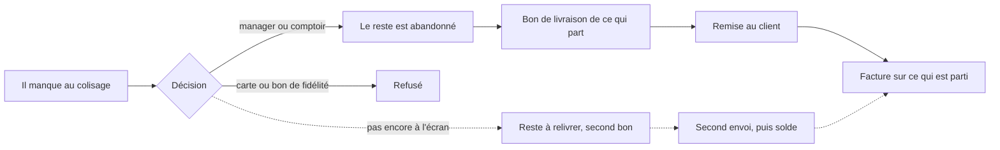
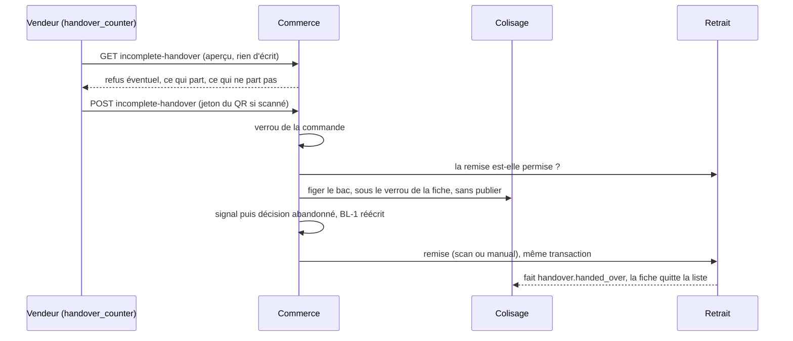

# Le départ incomplet et le reliquat

> ✅ **Doc d'état, écrite le 2026-11-10** contre le code de `dev` et de `main`
> (tous les commits cités ici sont sur `main`, vérifié le 2026-11-10). Elle
> réunit et remplace la doc d'état du départ incomplet au comptoir
> (2026-11-03) et les plans du reliquat E7 (programme, plan de bâti, plan
> E7.1, recensement, état du chantier), retirés le 2026-11-10 : leur texte se
> relit dans l'historique git. Ce qui n'est pas bâti est dans
> [`todo-reliquat.md`](todo-reliquat.md). Voisine :
> [`../bon-de-livraison.md`](../bon-de-livraison.md) (le bon de livraison, ses
> montants et son gel).

## En bref

Au colisage, il arrive qu'un article manque : le bac ne se remplit pas. La
commande peut alors **partir incomplète**, mais seulement si quelqu'un le
**décide** — un manager depuis la fiche commande, ou le vendeur du comptoir au
moment de la remise. Ce qui part, c'est **ce qui est au bac**, jamais une
saisie. Le bon de livraison ne porte que ce qui part, et la facture ne compte
que les bons remis : le client ne paie pas ce qu'il n'a pas reçu. L'équipe
peut ensuite **écrire au client** pour le prévenir.

Le **reste** est aujourd'hui toujours **abandonné**. Le système sait déjà
fabriquer, coliser, livrer, retirer et facturer un **second envoi** de la même
commande (le « reliquat », avec son propre bon) — mais aucun écran ne permet
encore de le créer.

Une commande payée **par carte** ou avec un **bon de fidélité** ne part jamais
incomplète : il faudrait rembourser la part non livrée, et ce n'est pas
branché.

## 1. Le manque constaté au colisage

« Il manque » sur une fiche ouverte (`PackingSheet.reportShortfall`,
`src/packing/domain/entities/packing-sheet.ts`) fige les quantités au bac par
article et publie `packing.shortfall_reported` par `packing/channels/commerce/`.
Le commerce le tient **par envoi** dans l'agrégat `OrderShortfall`
(`b2b/orders/domain/entities/order-shortfall.ts`, table `order_shortfall`, clé
`(order_id, rank)`). La page Commandes, la fiche commande et la Supervision le
montrent. Refermer le bac complet efface le signal
(`packing.shortfall_cleared`). Tant que le commerce n'a pas décidé, un bac
incomplet ne se ferme pas (`ShortfallAwaitingDecisionError`). Détail du signal
côté bon : [`../bon-de-livraison.md`](../bon-de-livraison.md#le-départ-incomplet).

## 2. La décision du départ

Une décision par envoi (`ShortfallDecision`,
`b2b/orders/domain/entities/shortfall-decision.ts`, table
`order_shortfall_decision`, unique par `(order_id, rank)`), définitive. Le
sort du reste ne prend qu'une valeur : `abandoned` (`shortfallRemainderSchema`,
`packages/contracts/src/admin-order-detail.ts`). Deux chemins écrivent la même
décision par `shortfall-departure.ts` (`b2b/orders/application/services/`).

### 2.1 Le manager

`POST admin/orders/:id/shortfall-decision`, corps `{ remainder: "abandoned",
rank? }` (`rank` absent = la commande elle-même), sous
`b2b_orders_shortfall:write` (`admin-order-shortfall.controller.ts`). Refus
`409` : déjà décidée, aucun manque, pas confirmée, carte, bon de fidélité,
trop ancienne, rien au bac, bac déjà fermé, bac changé depuis le signal.

### 2.2 Le comptoir — les décisions de Hugo du 2026-11-03

| #   | Décision                                                                                                                                                |
| --- | ------------------------------------------------------------------------------------------------------------------------------------------------------- |
| D1  | Le comptoir décide lui-même du départ incomplet.                                                                                                        |
| D2  | **Tout vendeur du comptoir** (`handover_counter:write`) peut le décider ; la décision est tracée (qui, quand).                                          |
| D3  | Ce qui part = **ce qui est au bac**, jamais une saisie.                                                                                                 |
| D4  | Le reste est abandonné ; le reliquat viendra ([`todo-reliquat.md`](todo-reliquat.md)).                                                                  |
| D5  | **Pas de dialogue sur le chemin heureux** : sac fini, « Remettre la commande » remet directement.                                                       |
| D6  | Le reliquat se choisira au comptoir : le client repasse à une heure convenue, ou on le lui porte — le plus souvent à pied, sans réveiller la livraison. |
| Q1  | « Remettre la commande entière » malgré un manque n'est **pas** offert : il facturerait le commandé sur la parole du vendeur ; on corrige le colisage.  |

#### 2.2.1 L'aperçu

`GET /admin/counter/orders/:orderId/incomplete-handover`
(`handover_counter:read`, `admin-counter-incomplete-handover.controller.ts`)
rend `CounterIncompleteHandoverView`
(`packages/contracts/src/counter-incomplete-handover.ts`) : un `refusal` (ou
`null`), les lignes (`due`, `departing`, `notDeparting`, en grammes au poids)
et, quand le départ est déjà tranché, `decision` (`decidedAt`,
`decidedByName`). Rien n'est écrit, rien n'est promis : le geste rejuge sous
verrou.

| Code                                                                                                                                                   | Ce que voit le vendeur                                                      |
| ------------------------------------------------------------------------------------------------------------------------------------------------------ | --------------------------------------------------------------------------- |
| `null`                                                                                                                                                 | « Remettre ce qui est au bac — le reste est abandonné »                     |
| `nothing_short` (tout réparti, bac pas fermé)                                                                                                          | la remise ordinaire, sans dialogue                                          |
| `already_decided`, `already_authorized`                                                                                                                | « Départ incomplet validé par <nom> à <heure> » et « Remettre la commande » |
| `sealed` (le colisage a fermé le sac)                                                                                                                  | « Le colisage a fermé ce sac. » et « Remettre la commande »                 |
| `card`, `voucher`, `not_confirmed`, `too_old`, `nothing_departs`, `not_drawn`, `withdrawn`, `counted`, `handover_refused`, `not_a_pickup`, `other_day` | une phrase, et seulement « Fermer »                                         |

Chaque bloc expose sa règle « rendue au lieu de levée », partagée par l'aperçu
et le geste : `packing/domain/services/shortfall-standing.ts`,
`b2b/orders/domain/services/shortfall-decidability.ts`,
`handover/domain/services/counter-reach.ts`.

#### 2.2.2 Le geste — une transaction, dans le commerce

`POST /admin/counter/orders/:orderId/incomplete-handover`, corps
`{ remainder: "abandoned", token? }`, `204`
(`hand-over-packed-at-counter.handler.ts`) :

1. verrou de la commande ;
2. le retrait juge sans écrire (`CounterHandoverDesk.vet`) : la garde du
   comptoir, la règle de remise, le jeton ;
3. les refus de la décision qui ne dépendent pas du bac ;
4. le colisage fige le bac (`ShortfallFreezeDesk`, dans la transaction de
   l'appelant), sans publier `packing.shortfall_reported` ;
5. le commerce écrit le signal puis la décision, autorise la fiche et réécrit
   le BL-1 ;
6. le retrait remet : `scan` avec un jeton de cette commande, `manual` sans.

Tout ou rien. Un « Il manque » pressé au poste juste avant est repris ; un
signal du poste plus récent que ce que lit le comptoir fait refuser
(`orders.shortfall.signal_outrun`). Un jeton d'une autre commande refuse
(`handover.counter.token_mismatch`).

#### 2.2.3 Le droit

La garde (`counterReachOf`) : un **retrait** (`pickup`) de la **journée** du
comptoir — une livraison ou un autre jour, `403`
`handover.counter.out_of_reach`. « Qui peut décider » est séparé de « quel
sort » : le sort est un paramètre (`abandoned` seul), pour qu'un second sort
s'y ajoute sans rouvrir le droit. Le rail lit sa fiche de colis par
`GET /admin/counter/orders/:orderId/packing-sheet`, sous le même droit.

#### 2.2.4 L'écran

`apps/lfd-backoffice-frontend/src/app/handover-shop/incomplete-handover-dialog/`
et `comptoir/counter-incomplete-handover.service.ts` : sac fini, « Remettre la
commande » ; sac pas fini, « Procédure commande incomplète », qui lit l'aperçu
puis ouvre le dialogue selon le tableau du § 2.2.1. Dans la file et le rail,
une commande partie incomplète se dit en une ligne (« Commande incomplète ·
192 pièces non données sur 16 produits »).

## 3. Ce qui est refusé

| Cas                                           | Pourquoi                                                                                       | Refus                                            |
| --------------------------------------------- | ---------------------------------------------------------------------------------------------- | ------------------------------------------------ |
| Commande réglée par **carte** (`due`, `paid`) | la part non livrée devrait être remboursée, et le départ incomplet ne le demande pas           | `CardOrderShortfallError`, aperçu `card`         |
| Commande avec un **bon de fidélité**          | un départ incomplet ne sait pas encore répartir le bon sur ce qui part                         | `VoucherOrderShortfallError`, aperçu `voucher`   |
| Rien au bac                                   | rien ne part : on annule la commande                                                           | `NothingDepartsError`, aperçu `nothing_departs`  |
| Commande trop ancienne                        | un montant non nul sans la règle figée qui l'a produit : le BL partiel ne se recomposerait pas | `OrderTooOldForShortfallError`, aperçu `too_old` |

Conséquence : **une commande de particulier ne part jamais incomplète**, elle
paie en ligne par carte (noté par Hugo le 2026-11-03).

> **Note du 2026-11-10.** Le remboursement d'un montant existe désormais :
> `CardRefunds.requestAmount` (`src/card-payment/channels/requests/card-refunds.ts`,
> lot P1 du bloc `card-payment`) et la répartition d'une baisse sur les
> paiements (`b2b/orders/revision/domain/services/revision-card-refund.ts`, lot S1 de
> la modification de commande), tous deux sur `main`. Le départ incomplet ne
> s'en sert pas : le refus `card` tient. Ce qu'il faudrait :
> [`todo-reliquat.md`](todo-reliquat.md#1-le-départ-incomplet-dune-commande-carte-e9).

## 4. Le bon de livraison de ce qui part

`departingSourceOf` (`b2b/delivery-notes/domain/services/departing-source.ts`)
réduit les lignes aux quantités décidées (une ligne qui ne part pas reste, à
zéro) et recompose l'en-tête par les mêmes fonctions que la passation : les
ajustements figés réappliqués aux lignes livrées. Un BL décidé n'est jamais
réaligné sur la commande entière. Le BL remis au comptoir est le BL de
**transport**, sans montant, avec « Reçu par, le, signature » ; il n'imprime
que les lignes remises et dit le reste sous le tableau (« Non livré : … »).
Tout le détail : [`../bon-de-livraison.md`](../bon-de-livraison.md).

## 5. La lettre au client

« Écrire au client » est un **geste**, jamais un abonné
(`write-shortfall-letter.handler.ts`) : `GET admin/orders/:id/shortfall-letter`
rend une proposition, `POST` envoie le texte relu par le bloc `mail`, sous
`b2b_orders_shortfall:write`. L'agrégat `ShortfallNotice`
(`b2b/orders/domain/entities/shortfall-notice.ts`) tient « une fois par
décision » (clé `order-shortfall:<décision>`) et trace qui, quand. « Prévenu »
veut dire « le courriel est demandé » ; son issue se lit au suivi des e-mails.

## 6. Le reliquat — un second envoi de la même commande

Décisions de Hugo (2026-10-25) : le reliquat est la suite de la **même**
commande, aux mêmes prix ; il a son propre bon et son propre jour ; un cycle
de vie **par bon** plutôt qu'une commande de suite (« A »).

**Ce qui est bâti** (lots L1 à L5c et LB, 2026-10-26) :

- **L'envoi.** Un envoi se désigne par `(commande, rang)` ; le rang 1 est la
  commande elle-même, ses écrans et ses clés n'ont pas changé.
  `ShipmentRef` (`production/domain/value-objects/shipment-ref.value-object.ts`)
  porte le rang dans les faits du flux ; les clés d'idempotence gagnent
  `:r<rang>` au-delà du rang 1. Le rang est en base au fournil, au colisage,
  à la livraison et au retrait (migrations `20261026070000` à `20261026090000`).
- **Son bon et son jour.** `DeliveryNote.planRemainder`
  (`b2b/delivery-notes/domain/entities/delivery-note.ts`) fabrique un BL de
  rang > 1 avec son `service_day` (`RemainderSchedule` refuse un rang ≤ 1 ou
  un jour antérieur à celui de la commande). Ses montants : les lignes du
  reste seul, les pourcentages de remise réappliqués, port, surtaxe et remise
  fixe à zéro (`remainderAdjustmentsOf`,
  `b2b/delivery-notes/domain/services/remainder-decision-source.ts`) — un
  reste ne paie pas de livraison (Hugo, 2026-10-26).
- **Prêt et retrait.** Un reste colisé prépare son BL
  (`prepare-remainder-note.handler.ts`) ; le retrait se juge par envoi, la
  référence prend `-<rang>` (`handover/domain/services/handover-shipments.ts`) ;
  au comptoir, le QR et la saisie `ORD-…-2` rendent les envois prêts, et le
  comptoir choisit entre deux. Chaque BL suit la règle de son propre arrêt
  (Q-R1). Le reste a ses courriels « prête » et « en route »
  (`RemainderShipmentReader`).
- **Le solde.** La remise du rang 1 écrit `partially_handed_over` si un reste
  vivant attend, sinon `fulfilled` (`statusAfterFirstHandover`,
  `b2b/orders/domain/services/shipment-settlement.ts`) ; le dernier reste
  remis solde la commande (`OrderRemainderSettler`). Un reste abandonné n'est
  pas vivant (Q-R3). Annuler annule tous les BL vivants et refuse dès qu'un
  envoi est retiré. Le client voit « En partie retirée / livrée ».
- **Le manque par envoi.** Un reste peut lui-même manquer : sa décision se
  prend sur son rang, tant que son BL est `planned` (refus
  `remainder_not_planned`).

**Ce qui n'existe pas** : aucun geste ne crée un reste. `planRemainder` n'est
appelé que par les tests ; le sort « à relivrer », les sources du jour qui
liraient un BL de rang > 1 et l'abandon d'un reste après coup sont dans
[`todo-reliquat.md`](todo-reliquat.md#2-le-reliquat-à-lécran-l7-l8-l9). Avec
un seul envoi, tout se comporte comme avant le reliquat.

## 7. La facture somme les bons remis

Au compte, la facture du mois et le prélèvement lisent les montants
**facturables** de la commande (`billable_*`), qui valent la somme des BL
remis une fois le sort du reste décidé ; une commande `partially_handed_over`
n'a rien de facturable, et l'onglet Factures la montre « Partielle — reste à
relivrer ». Les points de fidélité portent sur les mêmes montants, au solde.
Les livraisons non confirmées nomment une commande en partie remise « en
attente du reste » (`b2b/accounting/domain/ports/unconfirmed-deliveries.reader.ts`).
Le gel et l'engagement : [`../bon-de-livraison.md`](../bon-de-livraison.md#les-montants-facturables-et-leur-gel).

La facture **carte** garde les totaux de la **commande**
(`b2b/accounting/infrastructure/prisma-card-invoicing.reader.ts`) : c'est
juste tant qu'une commande carte ne part jamais incomplète (§ 3).

## 8. La fiche de colis après la remise

Le colisage écoute `handover.handed_over` par `handover/channels/packing/`
(`@DurableHandler` `packing/application/handlers/on-order-handed-over.handler.ts`)
et décide du sort de la fiche (`PackingSheet.leaveAtHandover`) : rien au bac,
retirée ; quelque chose au bac, fermée telle quelle ; déjà fermée, inchangée.
Idempotent. Un « prête » qui arrive ensuite sur une commande déjà retirée est
un succès sans effet (`mark-order-ready.handler.ts`).

## 9. Renvois des documents retirés

Le code cite encore les sections des documents retirés le 2026-11-10.

| Renvoi dans le code                                                   | Ici                                                                                                   |
| --------------------------------------------------------------------- | ----------------------------------------------------------------------------------------------------- |
| départ incomplet § 2, § 3                                             | [§ 2.2](#22-le-comptoir--les-décisions-de-hugo-du-2026-11-03), [§ 3](#3-ce-qui-est-refusé)            |
| départ incomplet § 4.1                                                | [§ 2.2.1](#221-laperçu)                                                                               |
| départ incomplet § 4.2                                                | [§ 2.2.2](#222-le-geste--une-transaction-dans-le-commerce)                                            |
| départ incomplet § 4.3                                                | [§ 2.2.3](#223-le-droit)                                                                              |
| départ incomplet § 4.4                                                | [§ 2.2.4](#224-lécran)                                                                                |
| départ incomplet § 7                                                  | [§ 8](#8-la-fiche-de-colis-après-la-remise)                                                           |
| plan E7 reliquat, choix 2, 3, 5, 6, 12, 13 ; lots L1 à L4c ; annexe F | [§ 6](#6-le-reliquat--un-second-envoi-de-la-même-commande)                                            |
| plan E7 reliquat, choix 4, 17 ; lot L4d                               | [§ 6](#6-le-reliquat--un-second-envoi-de-la-même-commande), prêt et retrait                           |
| plan E7 reliquat, choix 8 ; lots L5a, L5b, L5c                        | [§ 6](#6-le-reliquat--un-second-envoi-de-la-même-commande), le solde                                  |
| plan E7 reliquat, choix 10 ; choix 16 (les points)                    | [§ 6](#6-le-reliquat--un-second-envoi-de-la-même-commande), [§ 7](#7-la-facture-somme-les-bons-remis) |
| plan E7 reliquat, choix 11 ; lot LB                                   | [§ 1](#1-le-manque-constaté-au-colisage), [§ 6](#6-le-reliquat--un-second-envoi-de-la-même-commande)  |
| plan E7 reliquat, choix 7 ; lots L7, L8, L9                           | [`todo-reliquat.md`](todo-reliquat.md)                                                                |

Le texte intégral du plan de bâti et de la doc du départ incomplet se relit
dans l'historique git, au commit qui les retire (2026-11-10).

## 10. Les lots bâtis

Tous sur `main` (vérifié le 2026-11-10, `git merge-base --is-ancestor`).

| Lot       | Ce qu'il a posé                                                              | Commit                                             |
| --------- | ---------------------------------------------------------------------------- | -------------------------------------------------- |
| L-points  | les points de fidélité sur ce qui est parti (`billable_*`)                   | `d9851af88`                                        |
| L1        | `delivery_note.service_day`, `DeliveryNote.planRemainder`                    | `6668de6fd`                                        |
| L3a       | les faits portent l'envoi (`ShipmentRef`), clés `:r<rang>`                   | `1d03edf9e`                                        |
| L3b à L3d | le rang en base au fournil, au colisage, à la livraison, au retrait          | `0361e4501`, `32d636973`, `d6a5386d9`              |
| L4a à L4d | prêt et retrait par envoi, le choix au comptoir, les courriels du reste      | `41d23158f`, `82651e355`, `e8d0c243e`, `c283d04fa` |
| L5a à L5c | « En partie retirée », le solde au dernier envoi, le suivi client            | `28566239c`, `3a1268d83`, `84fd906f4`              |
| LB        | le manque et sa décision par envoi (`order_shortfall`)                       | `f1c5fdcc3`                                        |
| —         | « Prête » compte, Partielle aux Factures, le port du reste n'est pas affiché | `c46d4f6a0`                                        |
| C1, C1b   | le départ incomplet au comptoir, l'aperçu, la fiche qui quitte le colisage   | `19d471d42`, `b405087d7`                           |
| C2        | le dialogue, le départ déjà tranché, le jeton du QR                          | `9521dd2ed`, `a9d87343b`, `6c43e704a`              |
