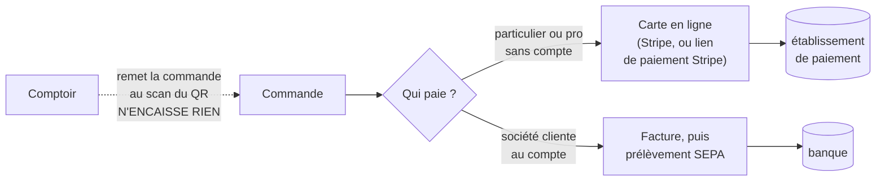

# Pourquoi nous n'avons pas de logiciel de caisse certifié

> **État au 2026-10-11.** Recherche faite ce jour sur les textes officiels
> (BOFiP, impots.gouv) et quelques sources professionnelles ; **ce n'est pas un
> avis juridique**. Un point reste à faire confirmer par le cabinet (§5). Si la
> façon d'encaisser change, ce document est faux — relisez le §4 d'abord.

## 1. En une phrase

La loi impose un logiciel de caisse **sécurisé et certifié** à qui enregistre
les paiements de particuliers ; l'administration en **dispense**, par
tolérance, le site de vente en ligne qui n'accepte **que la carte bancaire ou
le virement**. C'est notre cas, et il le reste **tant que rien ne s'encaisse
ailleurs** — ni au comptoir, ni hors ligne.

## 2. L'obligation

**Article 286, I-3° bis du Code général des impôts** (loi de finances pour
2016, champ resserré en 2018).

| Qui                                                                                                                        | Quoi                                                                                                                                       |
| -------------------------------------------------------------------------------------------------------------------------- | ------------------------------------------------------------------------------------------------------------------------------------------ |
| tout assujetti à la TVA qui enregistre les règlements de **clients particuliers** dans un logiciel ou un système de caisse | utiliser un logiciel qui garantit l'**inaltérabilité**, la **sécurisation**, la **conservation** et l'**archivage** des données (« ISCA ») |

- **« Système de caisse »** : « un système informatique doté d'une
  fonctionnalité de caisse » (BOFiP, § 30) — il enregistre des règlements.
- **Quel que soit le moyen de paiement** : espèces, chèque, carte, virement,
  prélèvement (BOFiP, § 30 ; FAQ impots.gouv).
- **Hors champ** : la franchise en base de TVA et les opérations exonérées
  (article 286, II-2) ; les ventes **uniquement entre professionnels**, parce
  qu'elles sont facturées (FAQ impots.gouv) ; un **simple terminal de
  paiement** n'est pas une caisse.
- **Sanction** : **7 500 €** par logiciel ou système non conforme (article
  1770 duodecies du CGI), constatable lors d'une simple visite.
- **La preuve de conformité** a bougé deux fois. La loi de finances pour 2025
  avait supprimé l'attestation de l'éditeur (seul un certificat NF 525 ou LNE
  aurait valu, au plus tard au 1er septembre 2026) ; **la loi de finances pour
  2026 l'a rétablie** (article 125, en vigueur depuis février 2026 selon les
  sources consultées). Aujourd'hui : certificat **ou** attestation de
  l'éditeur. ⚠️ Non relu sur Légifrance.

## 3. La tolérance

**BOFiP, BOI-TVA-DECLA-30-10-30, § 35, exemple 1** — en substance :

> le gérant d'un site de e-commerce qui vend des biens à des particuliers et
> propose **exclusivement** comme mode de paiement **la carte bancaire ou le
> virement** est dispensé, **par tolérance administrative**, de l'obligation
> de faire certifier son système informatique.

**La condition** : **tous** les paiements reçus en contrepartie d'une vente
passent par un établissement bancaire, auprès duquel l'administration peut
exercer son **droit de communication**. Le fisc n'a pas besoin de notre
logiciel pour reconstituer nos recettes : la banque les a.

Ce n'est pas une exemption écrite dans la loi, c'est une **doctrine** : elle
est opposable à l'administration tant qu'elle est publiée, et elle peut être
retirée.

## 4. Pourquoi nous y sommes — et ce qui nous en ferait sortir

**Décidé par Hugo le 2026-10-11 : « soit on est au compte, soit on paye,
c'est tout ».**

| Ce qui se passe                                                     | Dans la tolérance ?       | Pourquoi                                                           |
| ------------------------------------------------------------------- | ------------------------- | ------------------------------------------------------------------ |
| un particulier paie sa commande en ligne par carte                  | ✅                        | la carte passe par Stripe                                          |
| un lien de paiement Stripe envoyé après coup                        | ✅                        | toujours une carte, en ligne                                       |
| une société au compte, facturée puis prélevée                       | ✅ (hors champ)           | vente entre professionnels, facturée : l'obligation ne la vise pas |
| le comptoir scanne le QR et remet la commande                       | ✅                        | il n'enregistre aucun règlement                                    |
| **le comptoir encaisse** espèces, chèque, ou carte saisie chez nous | ❌ **la tolérance tombe** | « tous les paiements » n'est plus vrai                             |
| une commande non payée « réglée autrement » hors ligne              | ❌                        | même raison                                                        |

🔴 **Un seul encaissement hors carte en ligne, même ponctuel, suffit.** Le
jour où le comptoir doit encaisser, il faut **avant** une caisse conforme :
soit une caisse du marché certifiée (ses ventes remontant ensuite chez nous),
soit notre logiciel rendu conforme (journaux chaînés et signés, clôtures
journalières, mensuelles et annuelles, puis certificat ou attestation) — ce
second chemin est lourd.

La règle est aussi écrite là où elle risque d'être oubliée :
[`../../commandes/architecture-commande-sans-compte.md`](../../commandes/architecture-commande-sans-compte.md),
D4 : une commande non réglée expire, elle ne se règle jamais au comptoir.

## 5. Ce qui reste à faire confirmer par le cabinet

1. **Stripe vaut-il « établissement bancaire » ?** Le § 35 parle de banque ;
   Stripe est un **établissement de paiement** (de droit irlandais pour
   l'Europe). L'esprit — l'administration peut obtenir les flux auprès d'un
   tiers régulé — semble tenu, mais le texte ne le dit pas.
2. **Une société « au compte » réglée par prélèvement** : confirmer qu'elle est
   bien hors champ (vente B2B facturée), y compris pour une entreprise
   individuelle.
3. **Le prélèvement rejeté puis « réglé autrement »** (`prelevement/retours-bancaires.md`)
   : vérifier qu'il ne crée pas, côté pro, un encaissement hors banque qui
   poserait question.

## 6. À ne pas confondre

- **Le ticket de caisse** est une autre obligation : depuis le 1er août 2023
  (loi AGEC, article L. 541-15-10 du Code de l'environnement), il n'est remis
  **qu'à la demande** du client, avec une mention affichée près du lieu
  d'encaissement ; quelques cas restent obligatoires (produits pesés, etc.).
  Sans encaissement au comptoir, la question ne s'y pose pas.
- **La confirmation de commande en ligne** relève du Code de la consommation
  (article L. 221-13) : elle doit être envoyée **sur support durable** — un
  e-mail qui reprend les informations du contrat, pas un simple lien vers les
  conditions générales (CJUE, 5 juillet 2012, C-49/11).
- **La facture électronique** (réception obligatoire pour toutes les
  entreprises à partir de septembre 2026, émission pour les PME en 2027) et
  l'**e-reporting** des ventes aux particuliers : chantier distinct, qui vise
  nos ventes même hors de toute caisse.

## Sources

- [BOFiP, BOI-TVA-DECLA-30-10-30 — § 10, 30, 35](https://bofip.impots.gouv.fr/bofip/10691-PGP.html/identifiant=BOI-TVA-DECLA-30-10-30-20180704)
- [impots.gouv — champ d'application du logiciel de caisse sécurisé](https://www.impots.gouv.fr/professionnel/questions/quel-est-le-champ-dapplication-de-lobligation-de-detenir-un-logiciel-de)
- [economie.gouv.fr — la certification des logiciels de caisse](https://www.economie.gouv.fr/entreprises/gerer-son-entreprise-au-quotidien/gerer-sa-comptabilite-et-ses-demarches/ce-quil-faut-savoir-sur-la-certification-des-logiciels-de-caisse)
- [Produire Bio — l'attestation individuelle rétablie](https://www.produire-bio.fr/articles-pratiques/certification-des-logiciels-de-caisse-lattestation-individuelle-retablie/)
- [DGCCRF — ticket de caisse et de carte bancaire](https://www.economie.gouv.fr/dgccrf/les-fiches-pratiques-et-les-faq/ticket-de-caisse-et-de-carte-bancaire)
