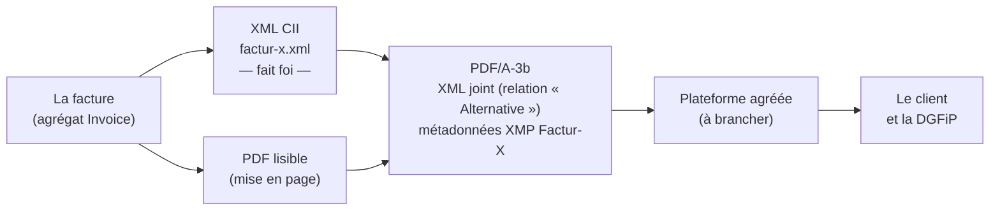
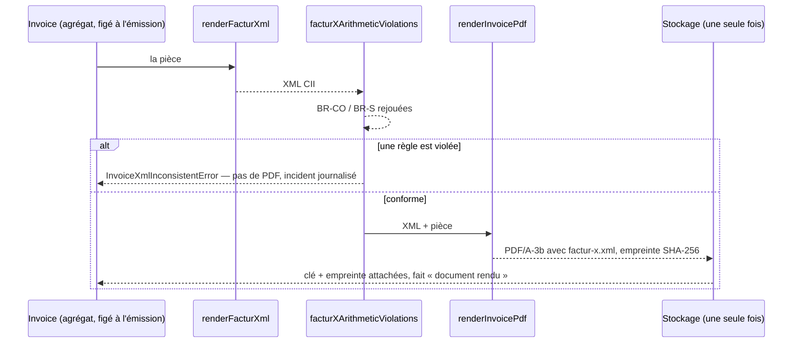

# Factur-X — ce que la règle demande, et comment on le traite

> **État au 2026-10-22.** Ce document explique le format et la façon dont le
> code s'y prend ; le détail de la pièce émise (mentions, numérotation,
> archivage) vit dans [`facture-emise.md`](facture-emise.md). Un lot
> « conformité française » est **en cours** le même jour (XSD CII et règles
> BR-FR branchés dans les tests) : ce qui est marqué « non vérifié » ci-dessous
> est ce qu'il vient vérifier.
>
> Les textes officiels (impots.gouv.fr, BOFiP) étaient en maintenance le jour
> de l'écriture : ce qui en est tiré vient de leurs extraits publiés et des
> pages de la FNFE-MPE, et sera relu quand ils reviennent.

## 1. Ce qu'est Factur-X

Une facture Factur-X est **un PDF lisible par un humain qui embarque un XML
lisible par une machine**. C'est le XML qui fait foi : le PDF n'en est que la
représentation.

Trois couches de règles s'empilent :

| Couche                  | Ce qu'elle fixe                                                             | Publiée par                         |
| ----------------------- | --------------------------------------------------------------------------- | ----------------------------------- |
| **EN 16931**            | le modèle européen de la facture : les données (BT-…), leurs règles (BR-…)  | CEN                                 |
| **Factur-X**            | le contenant : PDF/A-3 + XML CII, et des **profils** plus ou moins complets | FNFE-MPE (France) et FeRD (ZUGFeRD) |
| **CIUS-FR** (« BR-FR ») | ce que la France ajoute : SIREN, adresses de routage, cadre de facturation… | AFNOR XP Z12-012, FNFE-MPE, DGFiP   |

## 2. Les profils, et celui qu'on retient

| Profil          | Lignes de facture | Suffisant pour la réforme française                      |
| --------------- | ----------------- | -------------------------------------------------------- |
| MINIMUM         | non               | non                                                      |
| BASIC WL        | non               | non                                                      |
| BASIC           | oui, réduites     | non                                                      |
| **EN 16931**    | oui               | **oui** — profil retenu par XP Z12-012 (avec la CIUS-FR) |
| EXTENDED-CTC-FR | oui, étendues     | oui — extension française pour les cas complexes         |

La norme française (AFNOR XP Z12-012) retient, pour chacun des trois formats
(Factur-X, UBL, CII), **deux profils** : EN 16931 et EXTENDED-CTC-FR.

**Décision (Hugo, 2026-10-22) : on garde EN 16931.** Nos factures aux pros —
mensuelles, plusieurs taux de TVA, remises — y tiennent. EXTENDED-CTC-FR ne
servirait que pour un cas que la norme seule ne sait pas dire (lignes hors
champ de TVA mêlées à d'autres taux, sous-traitance, mandat).

## 3. Ce que le code produit (lu le 2026-10-22)

| Élément                    | Valeur                                                                                                                    | Où                                                               |
| -------------------------- | ------------------------------------------------------------------------------------------------------------------------- | ---------------------------------------------------------------- |
| Syntaxe                    | CII D16B                                                                                                                  | `apps/lfd-api/src/b2b/accounting/domain/services/facturx-xml.ts` |
| Profil dans le XML (BT-24) | `urn:cen.eu:en16931:2017`                                                                                                 | `facturx-xml.ts`, `FACTURX_EN16931_PROFILE`                      |
| Profil dans le XMP         | `ConformanceLevel` = `EN 16931`, espace `…:invoice:1p0#`                                                                  | `facturx-xmp.ts`                                                 |
| Contenant                  | PDF/A-3**b** (pas « a » : `pdfkit` ne balise pas le document)                                                             | `facturx-pdf-document.ts`                                        |
| Version Factur-X visée     | 1.07 dans les commentaires ; la FNFE-MPE publie 1.08 (en vigueur depuis le 15/01/2026, compatible D16B) et annonce 1.09.2 | à trancher par le lot de conformité                              |

## 4. Les arrondis — par ligne, ou un seul à la fin ?

**Les deux, chacun à sa place.**

| Montant                   | Règle                                                     | Arrondi                   |
| ------------------------- | --------------------------------------------------------- | ------------------------- |
| HT d'une ligne (BT-131)   | un montant au centime                                     | **par ligne**             |
| Base HT par taux (BT-116) | = Σ HT des lignes du taux + frais − remises (**BR-S-08**) | aucun : somme de centimes |
| TVA par taux (BT-117)     | = base HT du taux × taux (**BR-S-09**)                    | **une fois par taux**     |
| Totaux (BT-109 à BT-115)  | sommes exactes (**BR-CO-10 à BR-CO-16**)                  | aucun                     |

**La TVA ne se calcule jamais ligne par ligne.** Additionner des TVA de ligne
déjà arrondies s'écarte de « base × taux » et fait refuser la pièce (BR-S-09).
Le droit français dit la même chose : une facture porte, **par taux**, le total
hors taxe et la taxe correspondante (CGI, annexe II, art. 242 nonies A). La
norme n'impose pas le sens de l'arrondi (BR-S-09 tolère le centime).

**Chez nous :**

- **le HT d'une ligne de facture reprend les bons** : c'est la somme des HT figés
  des bons qu'elle regroupe, pas `arrondi(Σ quantité × prix)` — un client qui
  rapproche ses bons et sa facture retrouve le centime (Hugo, 2026-10-08 ;
  `apps/lfd-api/src/b2b/accounting/domain/services/invoice-lines.ts`). Le
  Schematron EN 16931 ne vérifie pas quantité × prix sur une ligne ; Peppol le
  tolère à 0,02 ; **les règles françaises ne l'ont pas encore été** (lot en
  cours) ;
- **la TVA est calculée une fois par taux**, sur la base HT ;
- **chaque émission rejoue l'arithmétique** (`facturXArithmeticViolations`,
  `facturx-arithmetic.ts` : BR-CO-10 à 16, BR-S-08, BR-S-09) : une pièce dont
  le XML est faux n'est pas rendue (`InvoiceXmlInconsistentError`), et la pièce
  émise ne change pas.

## 5. Comment une facture est produite

- **Le XML est une fonction pure de la pièce** (pas d'horloge, pas d'entrée-
  sortie) : `domain/services/`. Le PDF, le stockage et l'événement sont dans
  `application/services/invoice-document-renderer.ts`.
- **Rendu une fois, gardé ensuite** : une pièce qui a déjà sa clé de document
  est relue, jamais régénérée ; l'empreinte SHA-256 est gardée avec elle.
- **Le transport vers la plateforme agréée est un port**
  (`EInvoiceTransport`, [`../../b2b/architecture-facturation.md`](../../b2b/architecture-facturation.md)) :
  le jour où la plateforme est choisie, on branche l'adaptateur sans toucher au
  domaine.

## 6. Ce qui est vérifié, et ce qui ne l'est pas

| Vérification                                                                  | État                                                                           |
| ----------------------------------------------------------------------------- | ------------------------------------------------------------------------------ |
| Schematron EN 16931 officiel (`validation-1.3.16`), sur chaque forme de pièce | ✅ (`__tests__/facturx-schematron.spec.ts`, 2026-10-09)                        |
| Arithmétique BR-CO / BR-S à chaque émission                                   | ✅                                                                             |
| PDF/A-3b                                                                      | ✅ (`__tests__/facturx-pdf.verapdf.ts`)                                        |
| Schéma XSD CII D16B                                                           | ❌ jamais passé — l'ordre des éléments est écrit de mémoire ; **lot en cours** |
| Règles françaises BR-FR (« Flux 2 »)                                          | ❌ **lot en cours** — la première cause de rejet par une plateforme            |
| Identifiant BT-24 du profil français                                          | ❌ écrit de mémoire ; **lot en cours**                                         |
| Une plateforme agréée qui accepte nos pièces                                  | ❌ pas de plateforme branchée                                                  |

## 7. Le calendrier

- **Réception** des factures électroniques : obligatoire pour toutes les
  entreprises **depuis le 1ᵉʳ septembre 2026** (choisir une plateforme agréée
  pour recevoir celles des fournisseurs).
- **Émission** (et e-reporting) : **1ᵉʳ septembre 2027** pour les PME — notre
  cas probable, à confirmer avec l'expert-comptable.

Les ventes aux **particuliers** ne passent pas par Factur-X : elles relèvent de
l'**e-reporting** (totaux par jour et par taux, transmis par la plateforme
agréée). Même logique d'arrondi : on additionne les HT du jour par taux, puis on
calcule la TVA une fois. (Le document de l’e-reporting reste à écrire.)

## 8. Sources

- FNFE-MPE — Factur-X : https://fnfe-mpe.org/factur-x/
- FNFE-MPE — Factur-X 1.08 / ZUGFeRD 2.4 : https://fnfe-mpe.org/wp-content/uploads/2025/12/2025-12-04_Factur-X_1.08_ZUGFeRD_2.4_Press_Release_EN.pdf
- AFNOR XP Z12-012 (mai 2025) : https://www.impots.gouv.fr/sites/default/files/media/1_metier/2_professionnel/EV/2_gestion/290_facturation_electronique/specification_externes_b2b/afnor/norme-afnor-factures.pdf
- FNFE-MPE — spécifications externes : https://fnfe-mpe.org/rfe-specifications-externes-2-4/
