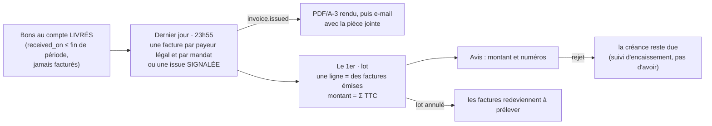
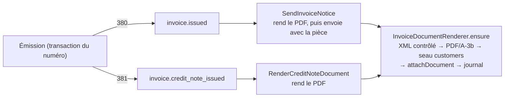

# La facture émise

> Doc d'état, écrite le 2026-10-09 à partir du code. Elle remplace le plan
> « L'émission de la facture » (supprimé ; il reste dans l'historique git, et
> des migration.sql le citent encore).

Les règles du CGI et du Code de commerce citées ici l'ont été **de mémoire** ;
le cabinet tranche. La facture carte et l'avoir de remboursement sont décrits
dans [`facture-carte-et-remboursements.md`](facture-carte-et-remboursements.md).

## Les règles (décisions d'Hugo)

- C'est la plateforme qui émet, tant qu'un logiciel comptable ne le fait pas ;
  elle fera toujours le fichier de prélèvement.
- Profil Factur-X **EN 16931**, avec la **CIUS-FR** (2026-10-22 : on le
  garde ; XP Z12-012 retient deux profils, EN16931 avec CIUS-FR et
  EXTENDED-CTC-FR). Factur-X visé : **1.09.2**. Une facture pour **toute
  vente pro** ; le **public** n'en reçoit pas (bon chiffré).
- Numérotation continue et chronologique ; une facture émise ne se supprime
  pas, elle se compense par un **avoir** (381).
- **La facture précède le lot** : émise le dernier jour du mois, le lot du 1er
  ne fait qu'encaisser des factures émises (Q1).
- **Le mois est celui de la LIVRAISON** (`orders.received_on`) depuis le lot
  ZL ([`plan-zero-faille.md`](plan-zero-faille.md), §11–§12, Hugo
  2026-10-22) — il était celui de la commande (`createdAt`, Q2). Pour une
  livraison de biens, le fait générateur et l'exigibilité de la TVA sont la
  livraison (CGI art. 269-1-a et 269-2-a) ; une facture récapitulative couvre
  les livraisons d'un même mois civil (CGI art. 289-I-3). Un bon commandé le
  30 et livré le 5 part dans la facture du mois du 5. **La facture carte
  garde son fait générateur** (le paiement, `facture-carte-et-remboursements.md`) :
  ZL ne la touche pas — à confirmer au cabinet.
- **L'acheteur légal est la maison mère** ; l'émission prévient les rôles
  facturation de la maison mère **et** des sous-comptes dont les bons figurent
  sur la facture (Q3).
- **Pénalités** : l'écran propose le taux BCE + 10 points comme suggestion,
  rien n'est posé d'office (Q4).
- **Unité** : une pièce (`H87`) partout tant qu'aucun produit ne se vend au
  poids variable ; la ligne porte déjà son code d'unité et une quantité qui
  admet des décimales (Q5).
- **Une facture par (payeur légal, mandat effectif)**, émise à **23h55** (Paris).

## Le cycle

## Les mentions de paiement de l'entité

`InvoicePaymentTerms` sur l'entité émettrice (colonnes
`invoice_late_penalty_rate_bp`, `invoice_recovery_indemnity_cents`,
`invoice_early_payment_discount`), toutes nullables = « à renseigner ». Taux en
points de base (1 à 10 000), indemnité en centimes (4 000 à 100 000 — attrape un
« 40 » tapé en centimes), escompte en clair (1 à 200 caractères). Route
`PUT /admin/accounting/legal-entities/:id/invoice-payment-terms`, fait
`legal_entity.invoice_payment_terms_changed`. La carte « Mentions de la
facture » fait saisir le taux BCE (non enregistré) et propose BCE + 10 points ;
aucun taux BCE dans le code.

**Refus d'émettre**, nommés et sans valeur inventée :
`invoiceIssuanceBlockers(seller, buyer)` (`domain/services/invoice-issuance-blockers.ts`)
— entité absente ou archivée, vendeur incomplet (RCS ; TVA si la forme est
assujettie), mentions absentes, acheteur absent, sans SIREN, assujetti sans
TVA, plusieurs entités en service (`several_issuers`). Le dossier de
facturation les affiche en tête ; la fiche de l'entité, ceux du vendeur. Un
compte actif sans SIREN reste actif.

## L'agrégat `Invoice`

`b2b/accounting/domain/entities/invoice.ts` (+ `invoice.types.ts`,
`invoice-invariants.ts`, `invoice-parties.ts`), `value-objects/invoice-number.ts`,
`value-objects/invoice-quantity.ts`, `services/invoice-from-dossier.ts`.

- **Numéro** `FA-<préfixe>-<année>-<6 chiffres>` (ex. `FA-LFD-2026-000001`,
  lot ZA de [`plan-zero-faille.md`](plan-zero-faille.md)), avoirs dans la même
  séquence ; l'année est celle de `issued_on`, le préfixe celui de l'entité
  (`InvoicePrefix`, 2 à 6 lettres majuscules). 21 caractères au plus,
  lettres, chiffres et `-` : BR-FR-01/02 (BT-1) tenues par construction.
- **Bon sans date de livraison** (`received_on` NULL) : l'émission est
  bloquée (`order_delivery_unknown`, M5) ; le refus nomme le bon et le geste
  (enregistrer son retrait ou sa livraison, ou l'annuler). Depuis ZL, ce n'est
  plus qu'un **filet** : l'assiette ne prend que des bons livrés, et un bon
  sans date est dans les « Bons à constater » (§ « La date de réception »).
- **Parties figées** (vendeur, acheteur = payeur légal) ; mentions copiées de
  l'entité, catégorie `goods`, pas d'option sur les débits.
  `Invoice.issue` juge les manques **avant** tout le reste
  (`InvoiceIssuanceBlockedError`, 409).
- **Quantité** en millièmes entiers ; `H87` reste entière, `KGM` admet trois
  décimales.
- **Dates de réception** par bon (`orders[].receivedOn`, « reçue le ») : la copie de
  `orders.received_on`, celle qui a fait entrer le bon dans l'assiette (ZL).
- **Remises et frais** : pas de ligne à part, ils vivent dans la ventilation par
  taux.
- **Invariants** (`InvoiceTotalsMismatchError`, 500) : Σ lignes par taux, base =
  marchandise − remises + frais, Σ bases = HT, Σ TVA = TVA, TTC = HT + TVA ;
  échéance ≥ émission.
- **Avoir** (`Invoice.creditNote`) : reprend parties et mentions de la facture
  corrigée, sans échéance ; refuse de corriger un avoir, une date antérieure, un
  bon absent de la facture, un avoir à zéro ; plafond par taux = facture −
  avoirs déjà émis.
- **Immuable** : seule mutation, `attachDocument`, une fois. **Pas de statut de
  paiement** : « prélevée », « rejetée » vivent dans le suivi d'encaissement.

## La persistance et la numérotation

Schéma `apps/lfd-api/prisma/schema/public/invoice.prisma` ; tables `invoice`,
`invoice_order`, `invoice_number_counter`, `invoice_monthly_outcome`,
`invoice_autopilot_run`, `invoicing_floor`. Ports `InvoiceNumbering`,
`InvoiceRepository` (`insert`, `attachDocument`), `InvoiceReader` ; service
`InvoiceIssuer` (`application/services/invoice-issuer.ts`).

- **Compteur par (entité, année)**, avancé par `INSERT … ON CONFLICT DO UPDATE …
WHERE last_issued_on <= jour` dans la transaction de l'émission, refusé hors
  transaction. Un jour antérieur à la dernière émission est refusé
  (`InvoiceIssuedBeforePreviousError`, 409). La base refuse un compteur qui ne
  naît pas à 1, qui avance d'autre chose que +1, qui recule ou qu'on supprime.
  Un refus défait la transaction et rend le rang : aucun trou.
- **Le brouillon se construit après le numéro** : `InvoiceIssuer.issue` reçoit
  une fonction `draft(number)`.
- **Numéro unique dans toute la base**, en plus de (entité, année, rang).
- **Préfixe par entité** (lot ZA, migration `20261022160000_le_prefixe_de_numero`) :
  `legal_entities.invoice_prefix`, posé dans la fiche de l'entité au
  back-office (carte « Numérotation des factures », `PUT
/admin/accounting/legal-entities/:id/invoice-prefix`), unique entre entités,
  **figé dès la première pièce** — agrégat (`InvoicePrefixIsFrozenError`) et
  base (`legal_entity_invoice_prefix_frozen`). Sans préfixe, l'entité n'émet
  pas (`invoice_prefix_missing`). Recopié sur `invoice.invoice_prefix` ;
  `invoice_prefix_of_entity` refuse une pièce d'un autre préfixe, la ligne de
  l'entité lue `FOR SHARE`.
- **Rang lié au compteur en base** (lot ZA) : `invoice_rank_from_counter`
  refuse une pièce dont le rang n'est pas celui que le compteur vient
  d'atteindre ; `invoice_number_counter_has_invoice` (différé au COMMIT)
  refuse un compteur avancé sans sa pièce. « Aucun trou » tient en base.
- **Un bon n'est facturé qu'une fois** : index partiel unique sur
  `invoice_order.order_id` pour les seules 380. Un avoir, même total, ne libère
  pas ses bons.
- **Immuabilité en base** : `invoice_immutable` refuse `DELETE` et `UPDATE` sauf
  `document_key` + `document_sha256` de NULL à une valeur, une fois ;
  `invoice_order_immutable` refuse tout. Contrôles : format du numéro, année,
  381 ⇔ facture corrigée (`corrects_invoice_id`), avoir sans échéance, TTC = HT + TVA.
- Aucune donnée personnelle (l'acheteur est une société).

## La facture du mois

`IssueMonthlyInvoicesCommand` (`application/commands/issue-monthly-invoices.handler.ts`),
domaine `domain/services/monthly-invoicing.ts`. Routes
`GET|POST admin/accounting/monthly-invoices` (`b2b_accounting`, le bouton
« Émettre les factures de … ») et `POST admin/accounting/monthly-invoices/autopilot`
(machine, `http/invoice-autopilot.controller.ts`). Cron `55 21,22 * * *`
(`MONTHLY_INVOICE_CRON`, `apps/lfd-api/container/worker.ts` et
`apps/lfd-api/wrangler.jsonc`).

- **Périmètre** (lot ZL, 2026-10-22) : les bons passés au compte et non
  annulés (`billableOrderWhere`) **livrés** depuis le plancher jusqu'au
  dernier jour de la période — `received_on` comparé jour à jour, à Paris —
  qu'aucune 380 ne porte encore (filtre en mémoire de
  `PrismaMonthlyInvoicingReader`, tenu en base par l'index unique
  `invoice_order_invoiced_once`). Un bon livré le 31 mais constaté le 1er,
  après l'émission, part dans la facture suivante, sa ligne « livré le 31 »
  (Q-L2) : jamais perdu, jamais deux fois. Payeur par `billedPayerOf`, mandat
  par `effectiveMandateOf` (la règle du lot). Les bons sans mandat effectif
  font leur facture, sans moyen de paiement.
- **Les six lecteurs** de `billableOrderWhere` (facture, dossier, relevé,
  aperçu du lot, constitution, état d'encaissement) lisent la livraison ; la
  facture et la constitution partent du plancher et retirent ce qui est déjà
  facturé, ou n'est plus ouvert à l'encaissement.
- **La période** (depuis R3, 2026-10-12,
  [`plan-rythme-de-facturation.md`](plan-rythme-de-facturation.md)) : une
  **clôture** du rythme de l'entité, plus un mois. **Le 1er de chaque mois est
  une clôture de tout rythme** depuis ZL (Q-L1, `isClosingDay`,
  `domain/services/billing-cycle.ts`) : une semaine, une quinzaine ou un mois
  « au 28 » qui chevauche deux mois civils fait deux périodes, donc deux
  factures — et deux lots. Les issues et les tentatives
  sont clées par `period_closes_at` (migration `20261012200000`) ; `month`
  reste en base, nulle et plus écrite. Le passage rattrape dans l'ordre toutes
  les clôtures manquées (`closuresToAttempt`, au plus 12).
- **Le moment** : `PERIOD_INVOICE_TIME` = 23:55 la veille de la clôture ouvre
  l'émission ET le bouton (`PeriodNotYetInvoiceableError` avant). Le cron UTC tombe deux fois ; le
  handler décide sur l'heure de Paris. Le passage horaire du lot (`15 * * * *`)
  garde la facture en tête, en rattrapage seulement. Une tentative par (entité,
  clôture) dans `invoice_autopilot_run`. Ne dépend pas de « préparer le lot tout
  seul ». L'émission refuse sous une entité qui n'est pas la seule
  (`NotTheInvoicingEntityError`).
- **Jamais d'antidate** : `issued_on` = dernier jour du mois si l'émission a lieu
  ce jour-là ; sinon le jour réel (Paris), et l'écran dit « émise en retard ».
  `due_on` = l'échéance du calendrier de prélèvement, jamais avant `issued_on`.
- **Une transaction courte par facture** : la pièce et son issue
  (`invoice_monthly_outcome`, clé payeur + mandat, `''` = sans mandat) partent
  ensemble. Un refus défait facture et numéro ; l'issue `blocked` porte le
  message, l'écran la montre (colonne « Mandat (RUM) »), le reste continue. Une
  issue `issued` est définitive.
- **Rejouable** : une facture déjà émise pour (payeur, mandat) est sautée et
  comptée (`alreadyInvoiced`). Un bon non facturable (incohérent, surtaxe sans
  taux) est laissé hors de la facture et cité sur l'issue ; seul, il la signale.
- **Ordre** : payeurs dans l'ordre de leur premier bon, puis leurs factures dans
  l'ordre du premier bon de chacune.
- **Moyen de paiement BG-16** (`invoice.payment_means`, `{code: "59",
mandateReference}`) : le mandat du groupe.

### Le lot encaisse des factures

`domain/services/collection-assembly.ts` : un bon facturé se juge **avec sa
facture**, entière ou rien. Une ligne regroupe les factures du payeur sous un
mandat, montant = Σ TTC (`collection_batch_line_invoice`) ; un bon écarté écarte
toute la facture ; une facture dont un bon n'est plus ouvert attend.
`invoice_split` ne sert plus que de filet quand les mandats ont changé entre
l'émission et le lot. L'avis cite les numéros (`collection_notice.invoice_numbers`),
le `RmtInf` aussi. Un lot annulé relâche ses factures.

### La date de réception (lot ZL, puis plan date de réception)

`orders.received_on` (DATE, jour de Paris ; colonne créée `delivered_on` par
`20261022180000_la_date_de_livraison_du_bon`, renommée par
`20261024120000_la_date_de_reception`) est le jour où la marchandise a changé
de mains, livrée ou retirée — libellé « reçue le » partout (Q3, Hugo,
2026-10-24). Depuis le 2026-10-24 (plan
[`../../commandes/date-de-reception.md`](../../commandes/date-de-reception.md),
B2), elle est posée par `MarkOrderFulfilledHandler` **dans la même écriture**
que `handed_over_at` : il relit le retrait et les arrêts de tournée par leurs
canaux et applique `receivedOnOf` — le jour de la tournée qui l'a remis à la
porte, sinon le jour du retrait, et en dernier repli le jour de Paris de
l'instant du fait. C'est le seul écrivain depuis B4 (2026-10-24) : l'ancien abonné
`RecordDeliveryDayOnHandover` est retiré, et la base refuse une remise sans
date comme une date sans remise (`orders_handover_has_received_on`,
`orders_received_on_has_handover`). Le déclencheur `orders_received_on_frozen` refuse de la changer,
même si la commande est annulée ensuite (Q4) : un bac ramené puis relivré ne la
déplace pas. La facture carte lit la même colonne.

**Les bons à constater** : `GET admin/accounting/unconfirmed-deliveries`
(`ListUnconfirmedDeliveriesQuery`) rend les bons au compte, non annulés, sans
`received_on`, dont le jour demandé est passé (Paris). L'écran « Prélèvement
du mois » les montre à côté des factures, avec le geste de sortie (enregistrer
le retrait ou la livraison, ou annuler). Un bon sans jour demandé n'y figure
pas.

**Le relevé suit la facture** (Hugo, 2026-10-22) : le relevé et le dossier
d'un cycle montrent les bons que SA facture porte ou portera, et eux seuls
(`apps/lfd-api/src/b2b/accounting/infrastructure/cycle-order-membership.ts`). Un bon facturé est au cycle de
sa facture 380 (l'issue `issued` de même clôture), quel que soit son jour de
livraison. Un bon pas encore facturé est au cycle dont la facture le prendra
(`apps/lfd-api/src/b2b/accounting/domain/services/pending-order-cycle.ts`) : avec `R` la dernière clôture où
la facture est passée (une issue rangée, ou une tentative « émise » / « rien à
facturer »), le cycle `[s, c[` le porte s'il est livré avant `c`, que `c > R`,
et qu'il est livré dans le cycle ou que `s ≤ R`. Le bon livré le 31 et constaté
après l'émission d'octobre est donc au relevé de novembre, jamais à celui
d'octobre ; la partition (un cycle, ni deux ni aucun) est éprouvée jour par
jour par `apps/lfd-api/src/b2b/accounting/domain/services/__tests__/pending-order-cycle.spec.ts`. Un bon livré avant `invoicing_floor`
reste dans le cycle de sa livraison. Le lot, lui, écarte un bon dont la
facture se clôt après lui (`PrismaCollectionCandidatesReader.invoicedAfter`) :
constitué en retard, il ne prélève pas la facture suivante.

**La reprise** : faite par la migration `20261024150000_la_reception_suit_la_remise`
(jour de Paris de la remise), avant de poser les deux contraintes. La
production n'avait émis aucune facture au 2026-10-22.

**La bascule** : `invoicing_floor`, posé par migration au 1er du mois qui suit le
déploiement. Avant, un bon garde l'arrêté figé ; depuis, un bon sans facture
**attend** la sienne. Un bon facturé suit toujours sa facture.

## Le rendu Factur-X

- **XML CII EN 16931** : `renderFacturXml(invoice)` (`domain/services/facturx-xml.ts`
  et `facturx-format.ts`, `facturx-parties.ts`, `facturx-settlement.ts`,
  `facturx-mentions.ts`), fonction pure, sans bibliothèque. Montants en
  arithmétique entière. Remises et frais (BG-20/21) un élément par taux non nul.
  Mentions en BT-20 et notes BG-1. La liste des bons et leurs livraisons réelles
  vivent en note (BT-13 n'admet qu'une référence). BG-16 : `CreditorReferenceID`
  (ICS), type 59, `DirectDebitMandateID`. `facturXArithmeticViolations(xml)`
  rejoue BR-CO-10 à 16, BR-S-08, BR-S-09.
- **PDF/A-3b** : `renderInvoicePdf` (`domain/services/invoice-pdf.ts`,
  `facturx-pdf-document.ts`, `facturx-xmp.ts`, `invoice-pdf-*.ts`), `pdfkit`
  0.20.2, PDF 1.7. Le XML est joint octet pour octet (`factur-x.xml`,
  `AFRelationship /Alternative`) ; une pièce dont le XML viole l'arithmétique est
  refusée (`InvoiceXmlInconsistentError`). XMP Factur-X `ConformanceLevel=EN 16931`.
  Polices Source Sans 3 (OFL) dans `apps/lfd-api/fonts/`, par le port
  `InvoiceFontSource`. **Déterministe** : deux rendus = mêmes octets.
- **Le seau** : `CustomerDocumentStore` (seau `customers`, sans `delete`), clé
  `invoices/<entité>/<numéro>.pdf` jamais réécrite ; une autre empreinte sur la
  même clé est un refus visible (`InvoiceDocumentConflictError`). Le verrou de
  dix ans est un geste au [runbook](../../ops/runbook.md) (« Verrouiller les PDF
  des factures pour dix ans »).
- **Lecture** : l'empreinte est vérifiée avant de servir
  (`InvoiceDocumentTamperedError`) ; pas encore rendu → 404
  `accounting.invoice.document_not_rendered`.
- **Journal** : `invoice.document_rendered`, `invoice.document_render_failed`.

### La validation (2026-10-09)

| Ce qui est vérifié                              | Par quoi                                                                                 | Version                                                    | Où                                                                                              | Relancer                                                 |
| ----------------------------------------------- | ---------------------------------------------------------------------------------------- | ---------------------------------------------------------- | ----------------------------------------------------------------------------------------------- | -------------------------------------------------------- |
| Le XML contre les règles EN 16931 (syntaxe CII) | Schematron officiel ConnectingEurope, compilé en SEF par `xslt3`, exécuté par `saxon-js` | `validation-1.3.16` (avril 2026), `saxon-js`/`xslt3` 2.7.0 | Jest unitaire, donc la CI : `domain/services/__tests__/facturx-schematron.spec.ts`              | `pnpm --filter lfd-api run test:unit facturx-schematron` |
| Le PDF contre PDF/A-3B                          | veraPDF, image Docker figée                                                              | `verapdf/cli:v1.30.2`                                      | Hors Jest (la CI n'a pas forcément Docker) : `domain/services/__tests__/facturx-pdf.verapdf.ts` | `pnpm --filter lfd-api verify:facturx-pdf`               |

Les deux passent sur les **mêmes pièces témoins** (`__tests__/facturx-samples.ts`) :
facture du mois, plusieurs taux avec remise et livraison au prorata, prélèvement
(59, ICS, RUM), carte acquittée (48, BT-113, reste dû 0), avoir 381 partiel au
prorata, quantités KGM en millièmes ; veraPDF ajoute la facture du mois avec le
logo du semis. Résultat au 2026-10-09 : **aucune règle Schematron enfreinte**,
ni `fatal` ni `warning`, et **sept PDF déclarés conformes PDF/A-3B**.

- L'XSLT est commité (`apps/lfd-api/test/fixtures/en16931-cii/`, EUPL 1.2) ;
  le SEF (5 Mo) ne l'est pas : il est compilé une fois (~6 s) dans
  `apps/lfd-api/node_modules/.cache/en16931-cii/<sha256 de l'xslt>.sef.json`.
  Aucun réseau. Une nouvelle release se dépose à la place de l'XSLT et recompile
  d'elle-même. Témoins du validateur : l'exemple officiel `CII_example1.xml`
  (zéro règle) et un total falsifié (BR-CO-15).
- **Ce que les pièces témoins doivent aux parties** : un vendeur sans pays
  lisible (BR-09), un acheteur sans pays lisible (BR-11) ou un vendeur sans
  numéro de TVA sur des lignes au taux normal (BR-S-02 à 04) sont refusés
  `fatal`. L'émission garantit le pays du vendeur (`LegalAddress`) et son
  numéro de TVA pour une forme assujettie ; depuis le 2026-10-09 (A43, Hugo :
  bloquer), **elle garantit aussi le pays de l'acheteur** : `invoiceIssuanceBlockers`
  refuse `buyer_address_missing` (aucune ligne d'adresse de facturation) et
  `buyer_country_unknown` (le pays ne se relit pas). La lecture du pays est
  `addressCountryCode` de `facturx-parties.ts`, la même que le rendu XML : seul
  « France » ou un code à deux lettres est relu, et « Belgique » bloque. BR-10
  n'exige qu'un `PostalTradeAddress` et BR-11 un `CountryID` non vide : ni le
  code postal ni la ville ne sont exigés. L'adresse jugée est celle du snapshot
  acheteur (`StatementBuyerReader`), commune à la facture du mois, à la facture
  carte et au dossier. Un payeur bloqué est signalé, pas facturé.

### La conformité française (2026-10-22)

Artefacts officiels FNFE-MPE, recopiés sans modification sous
`apps/lfd-api/test/fixtures/facturx-fr/` — provenance, URL, empreintes et ce
qui n'a pas pu être récupéré dans son `README.md` :

| Ce qui est vérifié                    | Version                                      | Résultat sur les six pièces témoins                      |
| ------------------------------------- | -------------------------------------------- | -------------------------------------------------------- |
| XSD Factur-X du profil EN 16931       | Factur-X **1.09.2** (libxml2 en WebAssembly) | **valides** : l'ordre des éléments n'est plus de mémoire |
| Schematron Factur-X EN 16931          | 1.09.2 (paquet FNFE `fixFR04`)               | aucun refus ; un avertissement, `PEPPOL-EN16931-R008`    |
| Schematron **BR-FR Flux 2** (CIUS-FR) | **v1.4.0.04** du 2026-09-04, mode `FATAL`    | refus restants = les manques de donnée ci-dessous        |

Spec : `apps/lfd-api/src/b2b/accounting/domain/services/__tests__/facturx-fr-conformance.spec.ts` (Jest
unitaire ; libxml2 en WebAssembly, `xmllint-wasm`, rien à installer sur le poste depuis le 2026-10-22). Elle énumère les manques un
par un : une règle qui se met à passer la fait rougir autant qu'une faute
nouvelle.

- **BT-23, cadre de facturation** (BR-FR-08) : écrit depuis le 2026-10-22 —
  `B1` (dépôt d'une facture de bien), `B2` pour la facture carte acquittée en
  entier (`billingFramework`, `facturx-xml.ts`).
- **BT-24** : `urn:cen.eu:en16931:2017`, seule valeur admise par la liste de
  codes du Schematron Factur-X 1.09.2.
- **Mentions** : `PMD`, `PMT`, `AAB` exigées par BR-FR-05 et présentes ;
  SIREN vendeur et acheteur en schéma `0002` (BR-FR-10/11) passent.
- **R008** : `ApplicableHeaderTradeDelivery` est vide sans lieu de livraison
  distinct ni date de livraison unique ; le XSD l'exige quand même.

**Les manques de donnée** — règles BR-FR laissées rouges, rien d'inventé :

| Règle                   | Donnée                                   | D'où elle devrait venir                                                                                       |
| ----------------------- | ---------------------------------------- | ------------------------------------------------------------------------------------------------------------- |
| BR-FR-13 / **BT-34**    | adresse électronique du vendeur          | celle que notre plateforme agréée nous attribuera à l'annuaire ; à figer avec les faits de l'entité émettrice |
| BR-FR-12 / **BT-49**    | adresse électronique de l'acheteur       | l'annuaire de la réforme (forme `SIREN` ou `SIREN_xxx`, schéma `0225`) — aucun lecteur n'existe               |
| BR-FR-CO-05 / **BT-26** | date de la facture corrigée, sur l'avoir | la facture d'origine : à figer sur l'avoir à son émission (aujourd'hui seul BT-25, le numéro, l'est)          |

**Ce qui n'est toujours pas vérifié** : les valeurs XMP `fx:Version` /
`fx:ConformanceLevel` (la spécification Factur-X 1.09.2 n'est distribuée que
contre une adresse e-mail ; ni le XSD ni les Schematrons ne lisent le XMP) ;
les contrôles propres à la plateforme agréée de réception. Sous `B2`, XP
Z12-012 veut BT-9 = date du paiement ; la facture carte écrit
`max(paiement, émission)` (`cardInvoiceDueOn`) — le Schematron n'exige que
sa présence.

## Prévenir, consulter, renvoyer

- **E-mail** : fait durable `invoice.issued` (380 seulement), abonné
  `SendInvoiceNotice` → `InvoiceNoticeSender`, gabarit `customer.invoice-issued`
  (`platform/mailer/invoice-issued-mail.ts`, dictionnaire `invoiceIssued`). Le
  PDF est rendu d'abord puis joint ; un rendu en échec laisse partir l'e-mail
  sans pièce. Destinataires (`invoiceNoticeRecipients`) : le contact `billing`
  le plus ancien du payeur (sinon son détenteur), et les contacts et membres
  `billing` de chaque société qui a un bon sur la facture. Clé d'idempotence par
  facture et par adresse. Journal : `invoice.notice_sent` (nombre, jamais les
  adresses) ou `invoice.notice_failed`. Pas d'e-mail pour un avoir.
- **Langue** : le gabarit prend une `locale` ; l'expéditeur passe le français,
  faute de langue de destinataire. Les valeurs (dates, montants) sont mises en
  forme en français par `invoice-notice-wording.ts`.
- **Mes factures** (boutique, `/mon-compte#compte-invoices` ; `/mes-factures` y
  redirige) : routes `GET companies/:companyId/invoices[/:invoiceId[/pdf]]`,
  détenteur et rôle facturation ; non-membre 404, autre rôle 403. Le mur est dans
  la requête (`CompanyInvoicesReader`) : la société est l'acheteur, **ou** un bon
  de la pièce a été passé par elle — un site voit donc la facture entière de sa
  maison mère. Aucune donnée de paiement hormis la RUM figée.
- **Back-office** : carte « Factures émises » de l'onglet « Facturation » de la
  fiche (`GET admin/companies/:companyId/invoices`), pièce sur
  `/comptabilite/factures/:id` (`GET admin/accounting/invoices/:invoiceId[/pdf]`,
  `b2b_accounting:read`).
- **Renvoyer l'e-mail** : `POST admin/accounting/invoices/:invoiceId/resend-notice`
  (`b2b_accounting:write`), `ResendInvoiceNoticeCommand`. Rend le PDF s'il
  manque, envoie aux destinataires d'aujourd'hui sous une clé neuve, journalise
  `invoice.notice_resent`. Refus (409) : un avoir, personne à prévenir, un refus
  du fournisseur.

## Ce qui reste ouvert

- **Validation externe** : Schematron EN 16931, veraPDF, XSD Factur-X 1.09.2,
  Schematron Factur-X et BR-FR Flux 2 tournent (§ « La validation », « La
  conformité française ») ; restent les valeurs XMP Factur-X et les trois
  manques de donnée BT-34, BT-49, BT-26.
- **Le verrou d'objet du seau** (runbook) n'est pas posé.
- **Re-rendu** : aucun geste dédié pour une pièce dont le rendu a échoué ; le
  renvoi de l'e-mail le fait au passage.
- **Une seconde entité émettrice** : le numéro ne nomme pas l'entité — préfixe
  ou séquence commune à trancher avant qu'elle émette.
- **Refacturer après avoir** : l'index unique ne relâche pas les bons d'un avoir.
- **XML** : BT-13 pour plusieurs bons, BT-26 (date de la facture corrigée) non
  figée sur l'avoir, adresses structurées plutôt que relues dans des lignes.
- **Adresse de livraison** non figée (`deliveryAddressLines: null`).
- **Mandat changé entre 23h55 et le lot** : la facture est écartée
  (`invoice_split` ou `no_mandate`) alors que BG-16 nomme déjà un mandat.
- **Rattrapage après minuit** : la facture porte le 1er (« émise en retard ») —
  acceptable, ou dater du dernier jour tant que le lot n'est pas fait ?
- ~~**Journal** : aucun fait pour la tentative automatique ni pour une facture
  signalée.~~ **Bâti le 2026-10-10**, sur le modèle exact du prélèvement
  (`CollectionAutopilotRanEvent`) : `invoice.autopilot_ran` (sujet :
  l'entité émettrice ; le mois, l'issue, `issuedCount`, `signalledCount`,
  le message), publié par `RunInvoiceAutopilotHandler` dans la transaction
  qui range `InvoiceAutopilotRun` ; `invoice.signalled` (sujet : le payeur ;
  le mois et la raison, jamais un montant), publié par
  `IssueMonthlyInvoicesHandler` dans la transaction qui range l'issue
  signalée (`InvoiceMonthlyOutcome`). Auteur : le système sous le passage
  automatique, la personne sous le bouton — comme le prélèvement. Les deux
  sont dans `domain/events/invoice-autopilot.events.ts`.
- **Au cabinet** : ~~facture établie avant la livraison (Q2)~~ (levé par ZL :
  un bon se facture dans le mois de sa livraison), fait générateur de la
  facture carte (le paiement), nouvelles mentions de la réforme.
- **F5** (bons en HT pour les pros au compte) reste à faire.
