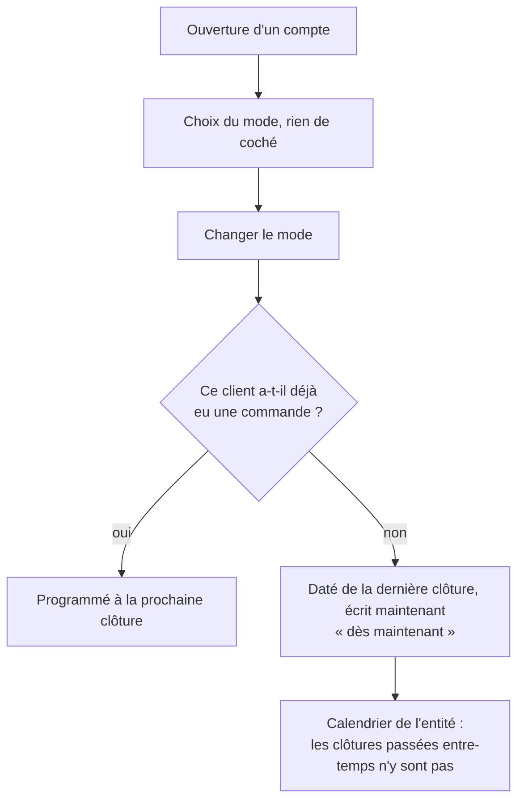

# Le mode de facturation d'un client : choisi à l'ouverture, immédiat tant qu'il n'a rien commandé

> ✅ **Doc d'état** (vérifiée dans le code le 2026-11-13). Bâti le 2026-11-12
> (`96216e035`, `75d0fd1b8`, `0408ac70f`, `01441991e`). Les trois modes
> (mensuel, deux fois par mois, chaque semaine), leurs dates sur l'entité
> émettrice et le changement programmé sont décrits dans
> [`plan-rythme-de-facturation.md`](plan-rythme-de-facturation.md) §16 ; ce
> document ne décrit que le **choix** du mode et le **changement immédiat**.

## 1. En simple

- **Ouvrir un compte pro** (création par l'équipe, ou activation d'un compte
  déclaré) : le mode de facturation **se choisit**, sans case cochée
  d'avance.
- **Changer le mode** d'un client qui **n'a jamais commandé** : le nouveau
  mode vaut **tout de suite** (« dès maintenant »). Dès qu'il a commandé une
  fois, le changement est **programmé** à la prochaine clôture.
- Un client qui n'a **jamais choisi** est facturé au mensuel par défaut ; sa
  fiche dit « Mode non choisi », et la page de l'entité émettrice compte
  « N clients sans mode choisi ».

Le changement immédiat est **daté** de la dernière clôture passée (une vraie
clôture de l'ancien rythme, pour que les périodes restent justes) et **écrit**
maintenant. Les lundis passés entre les deux ne deviennent jamais, après
coup, des clôtures à facturer, à prélever ou « manquées » : l'entité ne compte
une clôture d'un client que si son mode était connu quand elle est passée.

## 2. Les règles

### 2.1 Une clôture de l'entité est une clôture connue

Un instant est une clôture de l'entité si le mensuel par défaut y clôt, ou si
un payeur y clôt **et** que le segment qui gouverne la période fermée à cet
instant a été écrit au plus tard à cet instant. Toutes les méthodes « de
l'entité » du calendrier (`isClosure`, `modesClosingAt`, `closureAfter`,
`lastClosureAtOrBefore`, `closuresToAttempt`…) passent par ce filtre, au même
endroit : l'émission, le prélèvement, l'automatisme, les clôtures manquées et
les écrans n'ont pas à le savoir. Les méthodes « du payeur » lisent l'histoire
datée telle quelle ; le relevé du payeur filtre les périodes qui n'ont pas
existé.

### 2.2 Quand le changement est immédiat

Les trois conditions, sinon le changement est programmé :

1. **Aucune commande au compte, jamais, hors annulées**, qui touche ce payeur :
   passée par lui, facturée à lui (`billed_company_id`), portant son principal,
   ou passée par un site qui le suit ou l'a suivi. La lecture est large exprès :
   un faux « non » programme, un faux « oui » ferait une période fausse.
2. Aucun segment vivant ne commence à la dernière clôture passée, ou après.
3. Aucun segment vivant n'a été écrit depuis cette clôture : un seul immédiat
   par période. Un changement programmé puis annulé ne compte pas (une
   annulation n'est admise qu'avant la prise d'effet : il n'a jamais valu).

### 2.3 Le premier choix

Un payeur sans segment vivant n'a pas choisi. Son premier geste écrit un
segment **même s'il redemande le mensuel** : le choix laisse une trace. Le
premier choix a sa route, sous le droit sociétés (pas le droit comptable),
pour que l'écran d'ouverture puisse le poser ; rejoué à l'identique, il
n'écrit rien ; un autre mode, une fois choisi, est refusé (409) et passe par
le changement de mode. Un site qui suit la facturation de son principal n'a
pas de mode à choisir.

Le choix est exigé **par l'écran**, pas par le serveur à la création du
compte : un choix perdu entre la création et la pose se voit dans le compte
« sans mode choisi » de l'entité.

## 3. Technique (vérifié le 2026-11-13)

Racine : `apps/lfd-api/src/lafoliecoffee/accounting/`.

| Quoi                                                                                   | Où                                                                                                                                               |
| -------------------------------------------------------------------------------------- | ------------------------------------------------------------------------------------------------------------------------------------------------ |
| Le segment porte `writtenAt` ; `isKnownClosure`                                        | `domain/services/payer-timeline.ts:16`, `:80-82`                                                                                                 |
| Le filtre de l'entité (`knownClosesAt`, `knownClosureAfter`, `knownClosureAtOrBefore`) | `domain/services/invoicing-calendar.ts:226-260`                                                                                                  |
| `change()` : immédiat ou programmé, `PayerModeChange.immediate`                        | `domain/entities/payer-billing-mode-history.ts:110-170`                                                                                          |
| Conditions 2 et 3 (`isQuietSince`)                                                     | `domain/entities/billing-gesture.ts:44`                                                                                                          |
| `chooseFirst()`                                                                        | `domain/entities/payer-billing-mode-history.ts:181`                                                                                              |
| Le fait porte `immediate`                                                              | `domain/events/billing-mode.events.ts:41,66`                                                                                                     |
| Condition 1 : le port, l'adaptateur (part de `accountOrderWhere()`)                    | `domain/ports/payer-order-history.reader.ts`, `infrastructure/prisma-payer-order-history.reader.ts`                                              |
| Les segments lus avec `createdAt`                                                      | `infrastructure/prisma-payer-billing-modes.reader.ts:21,39`                                                                                      |
| Le geste lit la condition 1 puis appelle l'agrégat                                     | `application/payer-billing-mode-gesture-support.ts:85-101`                                                                                       |
| Changement / premier choix                                                             | `application/commands/set-payer-billing-mode.handler.ts`, `application/commands/choose-initial-payer-billing-mode.handler.ts`                    |
| Lecture du premier choix                                                               | `application/queries/get-initial-payer-billing-mode.handler.ts`                                                                                  |
| Routes `GET`/`PUT /admin/companies/:companyId/billing-mode/initial`                    | `http/admin-company-billing-mode.controller.ts:51,62`                                                                                            |
| Relevé du payeur filtré                                                                | `application/statement-period-support.ts:79`, `domain/services/statement-periods.ts:43-52`                                                       |
| « N clients sans mode choisi »                                                         | `domain/services/rhythm-payer-counts.ts` (`payersWithoutModeCount`), contrat `packages/contracts/src/legal-entity.ts` (`payersWithoutModeCount`) |

Back-office (`apps/lfd-backoffice-frontend/src/app/`) : le choix
`fiche-client/billing-mode-choice/`, son état `fiche-client/facturation/initial-billing-mode.ts`,
posé après la création ou l'activation (`fiche-client/informations/fiche-client.actions.ts`) ;
« Mode non choisi » et « dès maintenant » sur la carte du mode du payeur ;
le compte sur la carte des modes de l'entité (`billing-modes-card`).

Tests : `domain/services/__tests__/invoicing-calendar-known-closures.spec.ts`,
`domain/entities/__tests__/payer-billing-mode-history.spec.ts`,
`application/queries/__tests__/get-initial-payer-billing-mode.handler.spec.ts` ;
e2e `apps/lfd-api/test/billing-mode-immediate.e2e-spec.ts` (sans commande :
immédiat, aucune clôture passée ; avec commande : programmé ; commande
facturée par un site parti : programmé) et `billing-mode-initial.e2e-spec.ts`.

## 4. Reste à faire

Rien de ce qui a été décidé le 2026-11-12. Ce qui reste volontairement hors
du mécanisme :

- pas de refus serveur à la création d'un compte sans mode (le compte
  « sans mode choisi » le rend visible) ;
- pas d'immédiat dès qu'une des trois conditions manque ;
- les dates des modes de l'entité ne changent pas.
