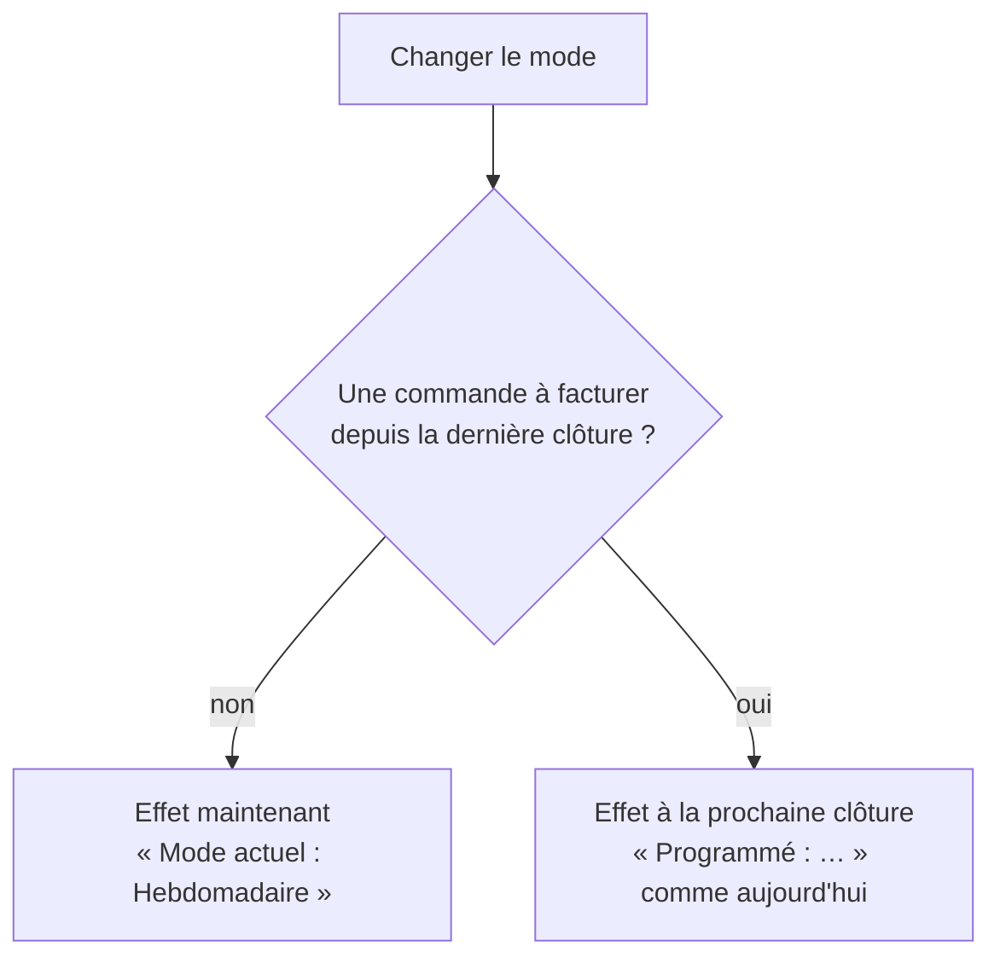

# Plan — un changement de mode immédiat quand rien n'est à facturer

> 📐 **Plan, 2026-11-12.** Rien n'est bâti. Demandé par Hugo : sur la fiche
> d'un client qui n'a jamais commandé, passer de mensuel à hebdomadaire
> affiche « Programmé : Hebdomadaire, à partir de la clôture du 1er décembre
> 2026 » ; il veut un changement immédiat. Touche la facturation : passe par
> `vitruve` avant Hugo. Règle d'aujourd'hui :
> [`plan-rythme-de-facturation.md`](plan-rythme-de-facturation.md) §16.6.
>
> 🔴 **Contredit par `vitruve` le 2026-11-12 : le §3 (T = l'instant du geste)
> est faux, deux BLOQUANT vérifiés.** Une bascule doit tomber sur une clôture
> de la suite d'avant (`invoicing-closures.ts:44`, `payer-timeline.ts:26-30`) :
> `closureAfter` lit le rythme en vigueur et ne voit pas une bascule posée
> entre deux clôtures, donc `closureAfter(C0)` sauterait toutes les clôtures
> hebdomadaires jusqu'au 1er décembre (jamais tentées par l'automatisme, jamais
> signalées manquées), et `previousClosureOf(W1)` rendrait une période fausse
> (`NotABillingClosureError`, chevauchement). Et la course n'a pas de verrou
> qui la ferme : `created_at` est l'instant du début de la passation.
> Deux voies restent, en attente de Hugo :
>
> - **A — rétroactif à la dernière clôture C0**, quand rien n'est facturable
>   dans `[C0, maintenant[` et qu'aucun segment vivant ne commence à C0 ou
>   après : C0 est une clôture de la suite d'avant, l'invariant tient sans
>   toucher au calcul. Reste à vérifier que les clôtures hebdomadaires passées
>   de `]C0, maintenant]` ne remontent pas en « manquées » pour l'entité
>   (`missed-closures.ts`, `closuresToAttempt`). La course ne perd rien : une
>   commande en vol tombe dans la période ouverte, qui sera émise.
> - **B — la bascule devient une clôture** (`PayerTimeline.closureAfter` =
>   min(clôture du rythme, prochaine bascule)) : touche `RhythmTimeline`,
>   partagé par trois suites, et fait tenter une période vide en plein jour.
>
> Un segment en vigueur ne s'annule pas (historique append-only) : une erreur
> de composition n'aurait pas de geste de sortie.

## 1. En simple

Changer le mode de facturation d'un client attend aujourd'hui la fin de sa
période en cours, pour ne jamais couper en deux une période qui porte des
commandes. Quand **la période en cours est vide** — aucune commande à
facturer depuis la dernière clôture —, il n'y a rien à protéger : le
nouveau mode prend effet **tout de suite**, et la première facture suit ses
dates à lui.

## 2. Ce qui existe (vérifié le 2026-11-12)

- `PayerBillingModeHistory.change()`
  (`apps/lfd-api/src/lafoliecoffee/accounting/domain/entities/payer-billing-mode-history.ts:88-117`)
  pose le segment à `timeline.closureAfter(gesture.at)`, la prochaine
  clôture de la suite actuelle, et refuse un second changement tant que le
  premier n'a pas pris effet (`pendingOf`).
- `PayerTimeline` (`domain/services/payer-timeline.ts`) : le premier segment
  d'un mode « court de T à sa prochaine clôture, même si T n'est pas une
  clôture du nouveau mode ». `previousClosureOf` compose les segments.
- Les commandes d'une période : `CycleOrdersReader.cycleOrders(companyIds,
cycle)` (`domain/ports/cycle-orders.reader.ts:81-99`), sur
  `[startsAt, closesAt[` par `created_at`, sociétés du principal et de ses
  sites, puis tri par payeur (`billedPayerOf`). Même périmètre que
  l'assiette : ni carte, ni gratuites, ni annulées, ni particuliers.
- `SetPayerBillingModeHandler` (`application/commands/set-payer-billing-mode.handler.ts`)
  charge l'historique et les dates des modes, appelle `change`, enregistre et
  publie `PayerBillingModeChangedEvent`.
- Les clôtures manquées se lisent sur le **calendrier de l'entité**
  (`missed-closures-support.ts`), pas sur les segments d'un payeur.

## 3. Le choix de T

Pourquoi pas la clôture **précédente** (rendre le nouveau mode rétroactif au
début de la période) : les clôtures hebdomadaires entre elle et maintenant
sont passées et n'ont jamais été émises pour ce payeur. Elles deviendraient
des clôtures manquées.

Donc **T = l'instant du geste**. La période mensuelle `[dernière clôture, T[`
se ferme à T sans facture, puisqu'elle est vide ; la suite hebdomadaire part
de T, et sa première clôture est la prochaine clôture hebdomadaire après T.

## 4. Le bâti

### I1 — domaine

- `change(mode, gesture, modes, openPeriod)` reçoit un fait :
  `openPeriod: "empty" | "billable"`. `empty` → `effectiveAt = gesture.at` ;
  `billable` → la règle d'aujourd'hui. `PayerModeChange` gagne
  `immediate: boolean`.
- `pendingOf` est inchangé : un segment immédiat n'est jamais « en attente ».
- Tests du domaine : les deux branches ; un second changement immédiat juste
  après le premier ; `modeAt(gesture.at)` rend le nouveau mode ;
  `previousClosureOf(prochaine clôture hebdo)` rend T.

### I2 — application

- Le handler lit la période ouverte du payeur :
  `[timeline.previousClosureOf(timeline.closureAfter(at)), at[`, par
  `CycleOrdersReader.cycleOrders` sur le payeur et ses sites, filtrée par
  `billedPayerOf`. Une seule définition de « facturable », celle de la
  clôture.
- e2e : un client sans commande passe à hebdomadaire, la fiche dit « Mode
  actuel : Hebdomadaire », sans encadré « Programmé » ; un client avec une
  commande dans la période reste programmé.

### I3 — écran

- La confirmation dit « Le changement prend effet immédiatement » ou « à la
  clôture du … » selon la réponse du serveur ; la carte relit la vue.
- `PayerBillingModeChangedEvent` porte `immediate` pour le journal.

## 5. Questions pour `vitruve`

- **V1 — la course.** Une commande passée entre la lecture de la période et
  l'enregistrement du segment tomberait dans `[dernière clôture, T[`, une
  période qu'aucune clôture n'émettra : une commande jamais facturée. Quel
  verrou : le verrou de passation du payeur, une relecture sous verrou dans
  la même transaction, ou refuser l'immédiat si une commande est en cours de
  composition ?
- **V2 — le prélèvement.** Les lots de prélèvement lisent-ils les modes des
  payeurs (`lot-payer-modes-support.ts`) d'une façon qu'une bascule au milieu
  d'une période dérangerait ?
- **V3 — T hors d'une clôture.** Quels lecteurs supposent qu'une borne de
  segment est une clôture de la suite d'avant (relevé, dossier de
  facturation, vues des périodes `InvoicePeriodsReader`) ?
- **V4 — les sites qui suivent.** Un site qui suit le principal change de
  mode avec lui : la période vide doit-elle couvrir ses commandes, et
  seulement celles facturées au principal ?

## 6. Ce qu'on ne fait pas

- Pas d'immédiat quand la période porte une commande : la règle
  d'aujourd'hui reste.
- Pas de changement aux dates des modes de l'entité.
