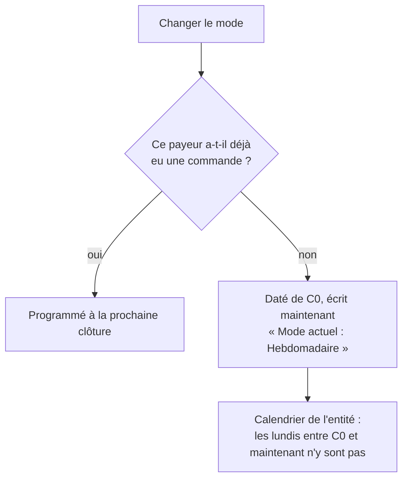

# Plan — le mode de facturation choisi, et immédiat quand rien n'est à facturer

> 📐 **Plan, 2026-11-12, quatrième version — relue par `vitruve` : plus de
> bloquant.** Rien n'est bâti. Demande de
> Hugo : sur la fiche d'un client qui n'a jamais commandé, passer de mensuel à
> hebdomadaire affiche « Programmé : Hebdomadaire, à partir de la clôture du
> 1er décembre 2026 » ; il veut **les deux cas** — le changement programmé
> quand la période porte des commandes, **l'immédiat** quand elle est vide —
> et que le mode se **choisisse** à l'ouverture d'un compte. Touche la
> facturation : passe par `vitruve` avant Hugo. Règle d'aujourd'hui :
> [`plan-rythme-de-facturation.md`](plan-rythme-de-facturation.md) §16.6.
>
> Deux versions refusées par `vitruve` le 2026-11-12 : la bascule à l'instant
> du geste (hors clôture, `closureAfter` saute les clôtures du nouveau mode),
> puis le rétroactif corrigé lecteur par lecteur (six lecteurs du calendrier
> au moins, dont l'automatisme du prélèvement, verraient les lundis passés
> comme des clôtures ; le calendrier n'avait pas la date d'écriture). Celle-ci
> garde le rétroactif et pose la règle **dans le calendrier lui-même**.

## 1. En simple

- **Changer le mode** d'un client qui **n'a jamais commandé** : le nouveau
  mode vaut **tout de suite**. Dès qu'il a commandé une fois, le changement
  est programmé à la prochaine clôture, comme aujourd'hui.
- **Ouvrir un compte pro** : le mode se choisit, sans case cochée d'avance.

Le mode immédiat est **daté** de la dernière clôture (une vraie clôture de
l'ancien rythme : le calcul des périodes reste juste) et **écrit**
maintenant. Le calendrier de l'entité émettrice — ce que lisent l'émission,
le prélèvement, l'automatisme et les écrans — ne compte une clôture que si
elle était connue quand elle est passée : un lundi passé ne devient jamais,
après coup, une clôture à tenter ou une clôture manquée.

## 2. Ce qui existe (vérifié le 2026-11-12)

- `PayerBillingModeHistory.change()` (`domain/entities/payer-billing-mode-history.ts:88-117`)
  pose un segment à `timeline.closureAfter(gesture.at)` ; il rend `null`
  quand le mode demandé est celui en vigueur (`:100-102`). Un segment porte
  `effectiveFrom` et `createdAt` (`billing-gesture.ts:17`) ; ils sont
  append-only en base (migration `20261012400000`).
- L'invariant : une bascule tombe sur une clôture de la suite d'avant
  (JSDoc de `RhythmTimeline`, `invoicing-closures.ts:41-44`). Un segment daté
  de C0 le respecte ; `previousClosureOf` et `closureAfter` tiennent avec
  d'autres segments, tant qu'aucun segment vivant ne commence à C0 ou après
  (relu par `vitruve`).
- `InvoicingCalendar` (`domain/services/invoicing-calendar.ts`) a deux sortes
  de méthodes :
  - **par payeur**, l'histoire datée : `timelineOf`, `closesFor`,
    `payerPeriodOf`, `payerPeriodStartAt`, `payerModeClosingAt` ;
  - **de l'entité**, l'union des payeurs et du mensuel : `isClosure`,
    `periodOf`, `modesClosingAt`, `cycleClosedAt`, `closureAfter`,
    `closureBefore`, `lastClosureAtOrBefore`, `closureToInvoice`,
    `closuresToAttempt`.
    Les lecteurs que `vitruve` a nommés passent tous par les secondes :
    l'automatisme du prélèvement (`collection-autopilot.ts:47`), la procédure
    du cycle (`collection-procedure-support.ts:221,233`), les clôtures manquées
    (`missed-closures-support.ts`), la fiche (`billing-modes-view-support.ts:54,65`),
    l'écran d'émission (`get-monthly-invoices.handler.ts:55`) et l'émission
    elle-même, qui n'accepte qu'une clôture que `isClosure` reconnaît
    (`issue-monthly-invoices.handler.ts:132`).
- Le calendrier est construit par `PayerBillingModesReader.segmentsOf`
  (`infrastructure/prisma-payer-billing-modes.reader.ts:18-31`), qui ne lit
  aujourd'hui que `mode` et `effectiveFrom` ; trois appelants.
- Le payeur d'une commande est copié sur elle (`orders.billed_company_id`,
  `billed-payer.ts:28-47`).

## 3. Les règles

### 3.1 Une clôture de l'entité est une clôture connue

Le filtre s'applique **payeur par payeur**, dans toutes les méthodes de
l'entité, `modesClosingAt` comprise, et dans `closesFor` : un payeur ne clôt
pas, pour l'entité, à un instant que son segment ne connaissait pas.

Un instant `c` est une clôture de l'entité si le mensuel y clôt, ou si un
payeur y clôt **et** que le segment qui gouverne la période fermée à `c`
(celui en vigueur juste avant `c`) a été écrit au plus tard à `c`.

- Le segment rétroactif daté de C0 et écrit le 12 gouverne les lundis 3 et
  10 : ils ne sont pas des clôtures de l'entité. Le lundi 17 l'est.
- Un segment programmé (écrit avant sa prise d'effet) gouverne des clôtures
  toutes postérieures à son écriture : rien ne change pour lui.
- Les méthodes **par payeur** ne changent pas : elles lisent l'histoire
  datée. La période du payeur close au 17 est `[10, 17[` ; ses périodes
  `[1, 3[`, `[3, 10[` ne sont jamais émises, et elles sont vides par la règle
  3.2.

Toutes les méthodes de l'entité passent par ce filtre, au même endroit :
aucun lecteur n'a à le savoir.

### 3.2 Quand l'immédiat est permis

Réduit le 2026-11-12, après la troisième relecture de `vitruve`, au cas que
Hugo a décrit : **un payeur qui n'a jamais commandé**. Une commande entre dans
une facture par son jour de solde (`settledOn`) ou de réception
(`receivedOn`), pas par sa création (`billable-order-criterion.ts:84-105`) :
une commande passée en octobre et livrée en novembre échappait à un test sur
`created_at`. Exiger « aucune commande, jamais » ferme ce cas, la course (une
commande en vol aura un jour de solde à venir, donc dans la période ouverte)
et les lecteurs qui mélangent l'entité et le payeur sur une même clôture
(`issue-monthly-invoices.handler.ts:132,175`, `procedure-invoices-step.ts:77,121`,
le lot) : ils n'ont rien à facturer pour ce payeur.

Les trois conditions, sinon le changement est programmé comme aujourd'hui :

1. **Aucune commande au compte, jamais, hors annulées**, qui touche ce
   payeur par l'un des chemins : passée par lui, par un site qui le suit ou
   l'a suivi, ou portant `billed_company_id = payeur`. La lecture est large
   exprès : un faux « non » programme, un faux « oui » ferait une période
   fausse.
2. **Aucun segment vivant ne commence à C0 ou après.**
3. **Aucun segment n'a été écrit depuis C0** : un seul immédiat par période.

Le relevé du payeur (`statement-period-support.ts:69`, `timelineOf`) peut
proposer les périodes passées du nouveau mode : elles sont vides. Il les
filtre par la règle 3.1, pour ne pas montrer une période qui n'a pas existé.

### 3.3 Le premier choix

Un payeur sans aucun segment n'a pas choisi. Son premier geste écrit un
segment **même s'il redemande le mensuel** : le choix laisse une trace, et la
fiche peut dire « Mode non choisi » à ceux qui n'en ont pas.

## 4. Le bâti

### I1 — domaine

- `PayerModeSegment` gagne `writtenAt` ; `InvoicingCalendar` applique 3.1 dans
  ses méthodes de l'entité.
- `change(mode, gesture, modes, opening)` : `opening` dit si la condition 1
  tient ; l'agrégat vérifie lui-même 2 et 3. `PayerModeChange` gagne `immediate`. Le premier choix (3.3).
- Tests : les deux branches ; les trois refus ; les lundis entre C0 et
  maintenant absents de `isClosure`, `closureAfter`, `lastClosureAtOrBefore`,
  `closuresToAttempt` et des clôtures manquées ; un segment programmé
  inchangé (non-régression) ; `payerPeriodOf(17)` = `[10, 17[`.

### I2 — persistance et application

- `segmentsOf` / `segmentsOfPayer` lisent `createdAt`.
- Un port `PayerOrderHistoryReader.hasEverOrdered(payer)`, qui **part de
  `accountOrderWhere()`** (`billable-order-criterion.ts:152-158`, l'assiette,
  sans la recopier ni la refiltrer) et y ajoute le rattachement large : le
  payeur, de ses sites présents ou passés, ou portant
  `billed_company_id = payeur`.
- `SetPayerBillingModeHandler` lit la condition 1 et appelle `change`.
- e2e : un client sans commande passe à hebdomadaire, la fiche dit « Mode
  actuel : Hebdomadaire », la carte des clôtures et les clôtures manquées de
  l'entité n'ont aucun lundi passé ; un client avec une commande reste
  programmé ; une commande facturée au payeur par un site parti bloque
  l'immédiat.

### I3 — écrans

- Fiche client : la confirmation dit « immédiat » ou « à la clôture du … » ;
  « Mode non choisi » pour un payeur sans segment.
- Création d'un client par l'équipe et activation d'un compte déclaré : le
  mode se choisit dans le formulaire, sans valeur cochée ; l'écran pose le
  mode juste après la création ou l'activation, par la même route. Une seule
  entité en service : elle est prise ; plusieurs : le mode se choisit pour
  celle de la fiche, les autres restent à « non choisi ».
- `PayerBillingModeChangedEvent` porte `immediate`.
- Les payeurs sans choix se comptent : la page des entités émettrices dit
  « N clients sans mode choisi », pour qu'un choix perdu entre la création
  et le mode se voie sans ouvrir chaque fiche.

## 5. Questions pour `vitruve`

- **V1** — la règle 3.1 dans le calendrier : une méthode de l'entité où elle
  donnerait un résultat faux (`periodOf`, `cycleClosedAt`, `closureBefore`) ?
  Un lecteur qui mélange une méthode de l'entité et une du payeur pour la
  même clôture ?
- **V2** — la lecture large de la condition 1 (§3.2) : un chemin de rattachement oublié ?
- **V3** — l'obligation par l'écran seulement (pas de refus serveur à la
  création) : suffisant, vu que « Mode non choisi » est visible ?

## 6. Ce qu'on ne fait pas

- Pas d'immédiat quand une des trois conditions manque.
- Pas de changement aux dates des modes de l'entité.
- Le mensuel par défaut reste la suite des payeurs qui n'ont rien choisi.
