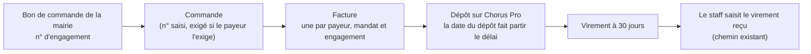
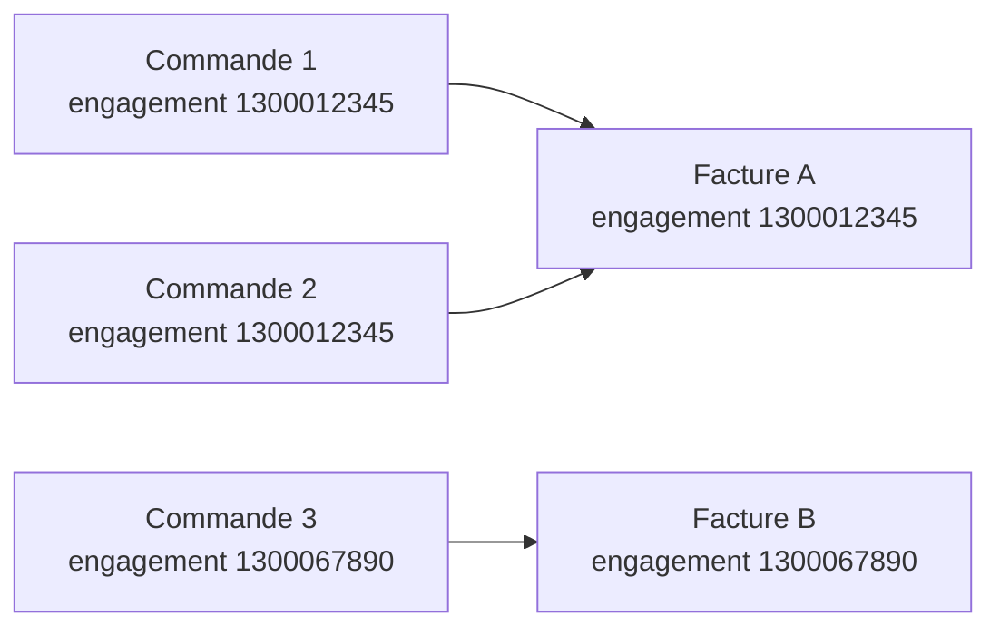
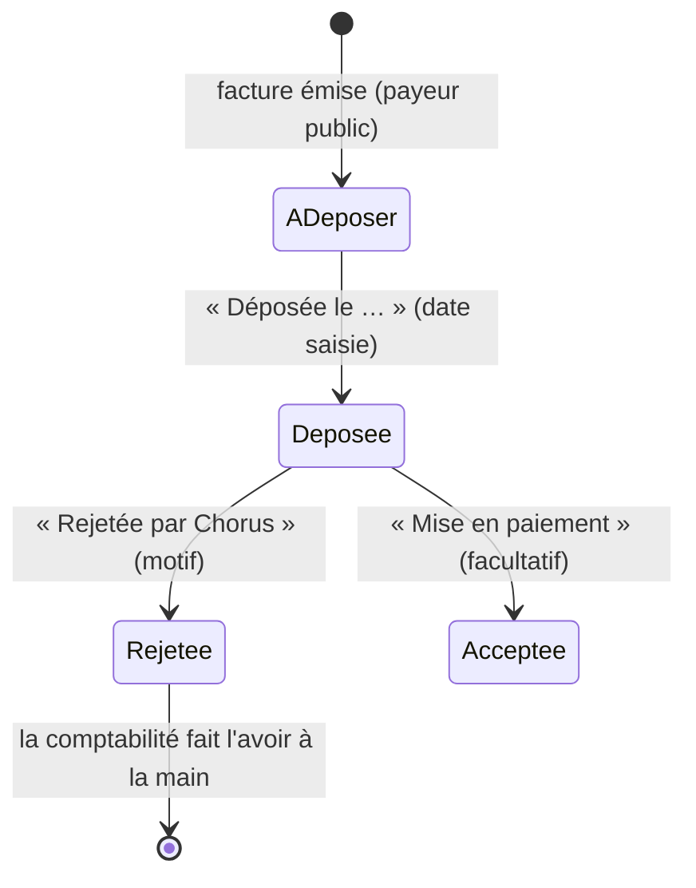
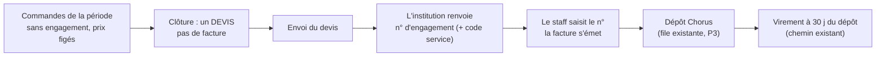
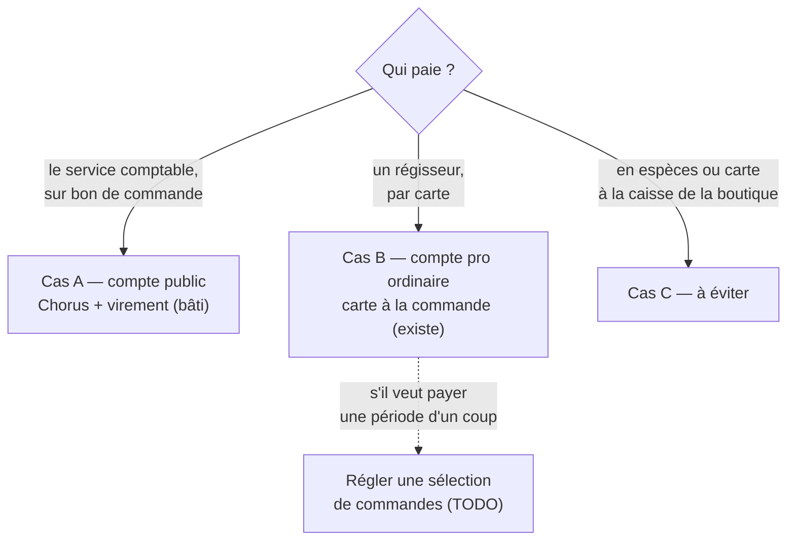
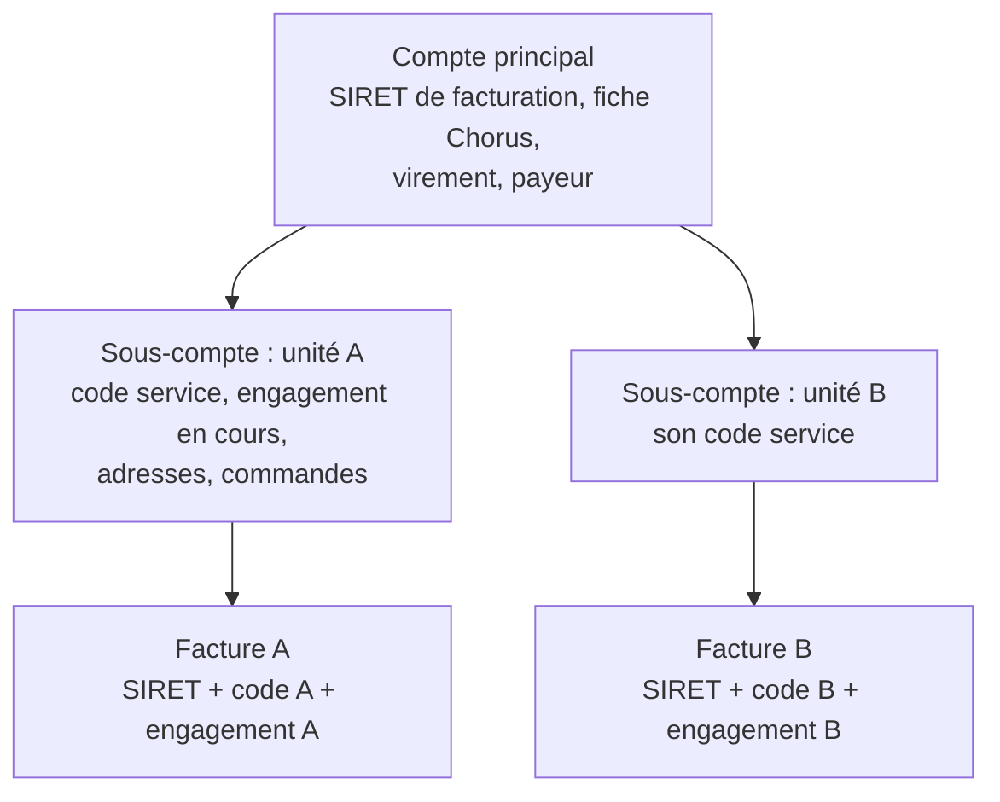
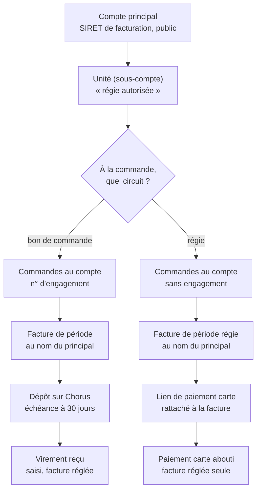
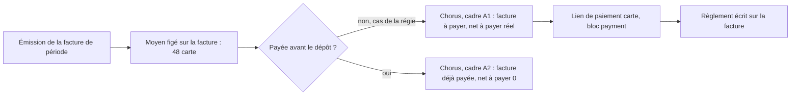

# Plan — les clients publics (armée, écoles, mairies) et Chorus Pro

> 🟨 **Plan v2** (2026-11-18). **P1a ✅ bâti** (`f4f10fb25`, § 6 bis), **P1b ✅ bâti** (2026-11-18, § 6 ter), **P2 ✅ bâti** (2026-11-18, § 6 quater, limites écrites), **P3 ✅ bâti** (2026-11-18, § 6 quinquies), **P2 ter ✅ bâti** (2026-11-24, § 6 octies) ; P2 bis en plan, P2 quater suspendu (§ 6 nonies) ; P4 attend le choix de la plateforme agréée. Contredit par `vitruve` le
> 2026-11-18 : 4 bloquants et 7 sérieux, tous intégrés (§ 10).

# Partie 1 — En simple

Un client public **commande comme un pro**, mais trois choses changent :

1. **Il ne paie qu'avec un bon de commande.** Chaque bon porte un **numéro
   d'engagement** budgétaire ; la facture doit le reprendre, sinon Chorus la
   rejette.
2. **La facture ne part pas par e-mail** : elle est **déposée sur Chorus Pro**,
   adressée à la structure et, souvent, à un **code service**.
3. **Il paie par virement** (mandat administratif), à **30 jours après
   réception de la facture** (50 pour un hôpital), jamais par carte ni par
   prélèvement.

**Ce qui est public, c'est le PAYEUR.** Un site qui suit la facturation d'un
principal public est facturé au principal : c'est le principal qui porte le
routage Chorus, le moyen de paiement et l'exigence d'engagement.

**Une facture ne regroupe que les commandes d'un même engagement.** Aujourd'hui
la facture d'une période est déjà découpée par (payeur, mandat). Elle le sera
par (payeur, mandat, engagement), l'engagement étant vide pour tout client
privé : un client privé garde exactement le même découpage.

Vocabulaire : « engagement » est déjà pris dans le commerce
(`AccountEngagement`, ce que la comptabilité a fait d'une commande). Le
nouveau concept s'appelle **engagement budgétaire** en français et
`budgetCommitment` dans le code ; il entre au [lexique](../lexique.md).

# Partie 2 — Technique

## 1. Ce qui existe (ouvert le 2026-11-18)

| Brique                                                                | État                          | Où                                                                                                     |
| --------------------------------------------------------------------- | ----------------------------- | ------------------------------------------------------------------------------------------------------ |
| Factur-X EN 16931, PDF/A-3, Schematron                                | ✅                            | `lafoliecoffee/accounting/domain/services/facturx-*.ts`, [`factur-x.md`](factur-x.md)                  |
| Découpage d'une période par (payeur, mandat)                          | ✅                            | `invoiceGroupKey` (`monthly-invoicing.ts:104`), PK de `invoice_monthly_outcome` (`invoice.prisma:193`) |
| Facture immuable (seul le document s'attache, une fois)               | ✅                            | déclencheur `invoice_immutable`, migration `20261008190000_la_facture_emise`                           |
| Moyen d'encaissement daté, append-only ; défaut `sepa_debit`          | ✅                            | `payer_collection_means`, `collection-means.ts:13`                                                     |
| Virement : échéance = émission + N jours (entité, 1..45)              | ✅                            | `transferDueDaysAfterIssue`, figée dans `creditor-snapshot.ts`                                         |
| État de règlement dérivé (`settled`, `transfer_overdue`)              | ✅                            | `invoice-settlement.ts`                                                                                |
| Passation : `Order.draft(...)`, révisions par `recompose` → `compose` | ✅                            | `orders/domain/entities/order.ts:157`, `:274`                                                          |
| Payeur d'une commande : `billed_company_id ?? company_id`             | ✅                            | `billedPayerOf`                                                                                        |
| Modes de facturation : `monthly`, `semimonthly`, `weekly`             | ✅                            | `billing-mode.prisma`                                                                                  |
| Port `EInvoiceTransport`                                              | ❌ décrit seulement           | [`../../b2b/architecture-facturation.md`](../../b2b/architecture-facturation.md)                       |
| Plateforme agréée                                                     | ❌ Q4 ouverte                 | [`plan-zero-faille.md`](plan-zero-faille.md)                                                           |
| BT-13 (référence de commande)                                         | ❌ vide, la liste vit en note | `facturx-mentions.ts:81`                                                                               |

## 2. Décisions proposées

- **D1 — Le payeur porte la nature publique.** Table
  `payer_public_routing` (`company_id` PK = le payeur) : `default_service_code`,
  `commitment_required`, `service_code_required`, `payment_deadline_days`
  (30 ou 50), `checked_on`. Pas de second SIRET : on adresse Chorus au SIRET
  de la société ; si un cas réel demande une structure facturée différente, on
  l'ajoutera alors. La présence d'une ligne **est** la nature publique, il n'y
  a pas de booléen à tenir à côté.
  Un site ne peut **suivre** un principal que si les deux ont la même nature :
  la période de suivi est refusée sinon (nommé : « Ce site est privé, son
  principal est public : il ne peut pas en suivre la facturation »).
- **D2 — Passer public, c'est un geste unique** qui écrit dans la même
  transaction : la ligne de routage **et** une ligne `payer_collection_means`
  `bank_transfer` (motif « client public »). L'écriture de
  `payer_collection_means` refuse ensuite `sepa_debit` pour un payeur public.
  Le changement de nature suit la règle du mode de facturation : **immédiat
  si le payeur n'a jamais commandé, refusé sinon** (§ 8, Q5).
- **D3 — La carte est refusée à la passation** d'une commande dont le payeur
  est public (`payByCard`, `order.ts:390`) : `BusinessError` nommée.
- **D4 — L'engagement budgétaire vit sur la commande.**
  `BudgetCommitment { number, serviceCode }`, entré dans `PricedDraftInput`.
  Le handler lit l'exigence du payeur par un port étroit
  (`PayerPublicRequirementsReader`, déclaré dans `orders`, implémenté par
  `accounting`). `Order.draft` refuse s'il manque alors qu'il est exigé.
  Une révision peut corriger l'engagement **tant que la commande n'est pas
  facturée** ; au-delà, refus nommé (`AccountEngagement` dit déjà `invoiced`) :
  la correction passe par un avoir et une nouvelle facture.
- **D5 — Une facture par (payeur, mandat, engagement).**
  `invoiceGroupKey(payerId, mandateId, commitment)` ;
  `invoice_monthly_outcome.budget_commitment_number` NOT NULL DEFAULT `''`,
  ajouté à la clé primaire ; le lecteur `invoicedGroups` le relit. Vaut pour
  les trois modes (même service). BT-13 porte le numéro ; le code service va
  dans la référence acheteur — **mapping Chorus à vérifier** dans les
  spécifications externes avant P2. Engagement et code service sont posés sur
  `invoice` **à l'INSERT** (l'immuabilité ne gêne pas).
- **D6 — La transmission est un journal à part**, append-only :
  `invoice_transmission(invoice_id, status, at, reason, staff_id)`, statuts
  `deposited` | `rejected` | `accepted`. « À déposer » = facture d'un payeur
  public **sans** ligne : décidé à l'émission, dans le domaine, pas par un
  CHECK. Le paiement n'y figure pas : il reste dérivé du virement reçu.
- **D7 — L'échéance d'une facture publique part du dépôt.** À l'émission,
  l'échéance est inconnue (`due_on` vide pour une facture publique). Le geste
  « Déposée le … » écrit l'échéance dans `invoice_transmission`
  (dépôt + `payment_deadline_days`), et la lecture du règlement la prend là.
  Les intérêts moratoires et les 40 € sont **affichés** sur un retard, pas
  facturés automatiquement.
- **D8 — Transport derrière `EInvoiceTransport`** : d'abord
  `ManualChorusDeposit` (le staff télécharge, dépose, saisit la date), puis
  l'adaptateur de la plateforme agréée (qui route aussi vers Chorus). Pas
  d'intégration directe de l'API Chorus.

## 3. Hors du plan

Marchés publics et appels d'offres ; facturation automatique des intérêts
moratoires ; contraintes d'accès des sites (elles tiennent dans
`DeliveryProcedure`) ; une audience tarifaire publique (prix pro, Q3) ; une
facture par commande (Q4).

## 4. Données (migrations additives)

- `payer_public_routing` (D1).
- `orders.budget_commitment_number`, `orders.budget_commitment_service_code`
  (nullables).
- `invoice.budget_commitment_number`, `invoice.budget_commitment_service_code`
  (nullables, posés à l'INSERT).
- `invoice_monthly_outcome.budget_commitment_number` + nouvelle clé primaire
  (`legalEntityId, periodClosesAt, payerCompanyId, mandateId,
budgetCommitmentNumber`).
- `invoice_transmission` (D6, D7).

## 5. Écrans

### 5.1 La fiche client du back-office (lot P1)

Même fiche, trois cartes qui changent ; contacts, adresses, sites, procédure
de livraison (badge, créneaux de l'armée), mode de facturation et tarifs
restent tels quels.

1. **Nature choisie à l'ouverture** — « Nouveau compte » : _Entreprise_ ou
   _Organisme public_, rien de coché d'avance (comme le mode de facturation).
   C'est le geste D2 ; après la première commande, il est refusé (Q5).
2. **Identité légale, mêmes champs, libellés selon la nature**
   (`lfd-company-identity-fields` et `lfd-company-identity-card`,
   `packages/b2b-ui` — tests depuis la racine) :

   | Pro                    | Organisme public             | Exemple                                         |
   | ---------------------- | ---------------------------- | ----------------------------------------------- |
   | Raison sociale         | Dénomination                 | Commune de Lyon, Ministère des Armées           |
   | Enseigne               | Établissement ou service     | École Jules Ferry, Base aérienne 701            |
   | Forme juridique        | Catégorie juridique          | collectivité territoriale, établissement public |
   | SIRET, SIREN           | identiques, **obligatoires** | le SIRET adresse Chorus                         |
   | TVA intracommunautaire | facultative                  | souvent absente                                 |

3. **Le KBIS laisse la place à la carte « Chorus Pro »**
   (`chorus-routing-card`, nouvelle) : SIRET trouvé dans l'annuaire (relevé à
   la main par le staff), engagement exigé, code service exigé et code par
   défaut, délai de paiement (30 / 50 jours), « vérifié le … ». Dans la
   checklist d'activation (`activation-steps.ts`), l'étape « KBIS certifié »
   devient « Fiche Chorus relevée ».
4. **Moyens de paiement, un seul bloc, sans choix** (`paiement-section`) :
   « Virement — mandat administratif. Facture déposée sur Chorus Pro,
   réglée à 30 jours après le dépôt. » Carte, coordonnées bancaires, mandat
   SEPA et choix du moyen ne s'affichent pas. Un site d'un principal public
   garde la note existante « payé par le principal ».

### 5.2 Les autres écrans

- Boutique, panier d'un payeur public : « N° d'engagement » (exigé ou non),
  code service prérempli, pas de carte proposée.
- Back-office, factures : file « À déposer sur Chorus », « Déposée le … »,
  « Rejetée » avec motif, échéance affichée après dépôt.

## 6. Risques

- **La clé de clôture est le cœur de l'argent** : non-régression = « même
  découpage qu'aujourd'hui » pour tous les payeurs privés, sur les trois modes.
- Un autre lecteur de la clé (relevé, lot de prélèvement, `counted-payers.ts`)
  peut supposer (payeur, mandat) : **à inventorier** au début de P2.
- La facture carte n'est pas concernée (carte interdite au payeur public).

## 6 bis. P1a — la fiche d'un organisme public (décidé le 2026-11-18)

Hugo commence par la fiche. P1 se coupe en deux : **P1a** (la fiche, ses
données, l'activation) et **P1b** (moyens d'encaissement et carte, D2–D3).

**La nature publique EST la forme juridique** (remplace le booléen de D1 et
le « présence d'une ligne » : ouvert le 2026-11-18, `LegalForm` de
`packages/contracts/src/legal-form.ts` pilote déjà la TVA exigée et
`activationGate` la checklist). Quatre formes ajoutées, toutes sans TVA
exigée :

| Valeur                        | Libellé                                                  | Délai légal |
| ----------------------------- | -------------------------------------------------------- | ----------- |
| `public_state`                | État et services de l'État (armée, préfecture…)          | 30 j        |
| `public_local_authority`      | Collectivité territoriale (commune, département, région) | 30 j        |
| `public_establishment`        | Établissement public (école, lycée, université…)         | 30 j        |
| `public_health_establishment` | Établissement public de santé                            | 50 j        |

`isPublicLegalForm(form)` et `publicPaymentDeadlineDays(form)` vivent à côté
de `legalFormRequiresVat`. Le délai se **dérive** de la forme : plus de
colonne `payment_deadline_days`.

**Le passage public ↔ privé est refusé dès que le compte est actif** (Q5,
plus strict que « dès la première commande » : l'activation précède toute
commande, et le compte n'a pas à lire le commerce). Une correction de forme
à l'intérieur d'une même nature reste libre. Refus nommé :
« Ce compte est actif : il ne peut pas passer d'entreprise à organisme
public. Ouvrez un autre compte. »

**Le routage Chorus est sur la société**, dans `account` (table
`company_chorus_routing`, PK `company_id`) : `commitment_required`,
`service_code_required`, `default_service_code` (texte, vide permis),
`checked_on` (date du relevé), `checked_by` (trace du staff). Value object
`ChorusRouting` ; posé par le staff (`PUT /admin/companies/:id/chorus-routing`,
`@IntentKey` ou `@Idempotent` selon la porte `lint:write-idempotence`) ;
refusé sur une société non publique ; un code service exigé sans code par
défaut est permis (il se saisira à la commande, P2). Lu dans la vue admin de
la fiche.

**Activation** (`activationGate`) : pour une forme publique, la pièce `kbis`
ne figure pas ; une pièce `chorus` **bloquante** la remplace (faite quand le
routage est relevé). Hors forme publique, rien ne change.

**Écrans** : § 5.1, sauf le bloc paiement qui, en P1a, n'est qu'un texte
(« Virement — mandat administratif… ») : les refus serveur viennent en P1b.

## 6 ter. P1b — un organisme public règle au compte, par virement

> 🟨 v2 du 2026-11-18. La v1 DÉRIVAIT la nature à la lecture ; `vitruve`
> (même jour) a montré qu'une dizaine de lecteurs (moyen effectif, émission,
> lot de prélèvement, comptoir, boutique) lui échappaient. La v2 ÉCRIT les
> faits une fois, à l'activation, et garde un filet à l'émission.

### En simple

Un organisme public **commande toujours au compte** et **paie toujours par
virement** : jamais de carte, jamais de prélèvement. À l'activation, le
système lui pose lui-même ce qu'un pro reçoit du staff (le compte, le
virement), puis refuse tout geste qui le déferait. Et si malgré tout une
facture publique devait partir au prélèvement, **elle ne s'émet pas** : elle
est bloquée avec un motif nommé.

### Ce qui existe (ouvert le 2026-11-18)

- « Au compte » se calcule à trois endroits sur les mêmes données :
  `Company.settlesOnAccount()` (`company.ts:720`, comptoir), le lecteur
  `prisma-order-guard.reader.ts:42` (passation) et le front de la boutique
  (`settles-on-account.ts`) — tous sur `granted_terms` et le blocage du
  prélèvement.
- Le moyen d'encaissement est une ligne datée par (entité, payeur) ; sans
  ligne, `sepa_debit`. Il est lu par `collectionMeansAt` et `.at(...)` à
  l'émission, au lot, aux payeurs comptés, à la fiche, dans `growth` et dans
  `account` (`transfer-payers.projection.ts`).
- `invoice-issuance-blockers.ts` porte déjà les motifs qui bloquent une
  émission (vendeur, payeur, commande).

### Décisions

- **B1 — Activer un organisme public lui accorde le compte.** Dans
  `Company.activate`, une forme publique pose `granted_terms = ["monthly"]`.
  L'agrégat refuse ensuite, pour une forme publique, de retirer le compte et
  de **bloquer le prélèvement** (409 nommé). Les trois calculs « au compte »
  restent inchangés et disent juste, puisqu'ils lisent ces données.
- **B2 — Activer un organisme public écrit le virement.** Dans la même
  transaction que l'activation, `account` appelle un port qu'il déclare
  (`PublicPayerOpening`, implémenté par `accounting`, relié par le module) :
  une ligne `bank_transfer`, motif « organisme public », chez **chaque entité
  émettrice en service**. Elle remplace toute ligne `sepa_debit` posée
  pendant `pending`. Un mandat déjà signé reste en base, **inerte** : le
  moyen effectif est le virement.
- **B3 — Le prélèvement est refusé à l'écriture** pour un payeur public
  (`SetPayerCollectionMeansHandler`, la nature lue par `PayerStandingReader`).
- **B4 — Le filet : une facture publique ne s'émet jamais au prélèvement.**
  Nouveau motif dans `invoice-issuance-blockers.ts` :
  `public_payer_not_on_transfer` (« Ce client est un organisme public : il
  règle par virement. Posez le virement comme moyen d'encaissement chez cette
  entité. »). Il couvre l'entité ouverte après l'activation, et tout chemin
  oublié : sans facture émise, rien n'entre dans un lot.
- **B5 — La carte n'est jamais le repli d'un payeur public.** Dans
  `requiresCardFor` : payeur public et `settlement === "card"` ⇒
  `PublicBuyerCardRefusedError` (409) ; payeur public sans compte
  (suspendu) ⇒ refus nommé, jamais la carte en silence (le chemin du
  back-office sans choix compris, `order-settlement.ts:89-92` et
  `staff-settlement-refusal.ts`). La nature est lue par
  `OrderGuardReader`, qui lit déjà la société.
- **B6 — Qui tranche : le payeur.** Pour la carte comme pour le compte. Un
  site ne suit en `billing` qu'un principal de même nature (P1a), donc le
  front, qui lit la société qui commande, et le serveur, qui lit le payeur,
  ne divergent pas.
- **B7 — L'échéance** reste celle du virement de l'entité jusqu'à P3 (D7).

### Écrans

- Boutique et back-office : le compte s'affiche déjà (B1) ; la carte est
  masquée quand la forme du payeur est publique (`isPublicLegalForm`, déjà
  servie avec la société).
- Fiche client : bloc fixe déjà fait (P1a) ; le bouton « Bloquer le
  prélèvement » n'apparaît pas.

### Tests

Domaine : activation publique ⇒ compte accordé ; refus de retirer le compte
et de bloquer le prélèvement. Application : activation ⇒ `bank_transfer` à
chaque entité, par-dessus une ligne `sepa_debit` antérieure ; écriture
`sepa_debit` refusée ; carte refusée, payeur public suspendu refusé sans
repli. **Émission** : un payeur public au prélèvement est bloqué par
`public_payer_not_on_transfer`. E2E : passation boutique en carte refusée,
au compte acceptée ; activation puis lecture du moyen à la fiche.

### Objections de `vitruve` (2026-11-18) et leur sort

| Objection                                   | Sort                                                                      |
| ------------------------------------------- | ------------------------------------------------------------------------- |
| B ligne `sepa_debit` antérieure non ignorée | écrasée par la ligne écrite à l'activation (B2) + filet à l'émission (B4) |
| B lecteurs du défaut mal comptés            | plus de défaut dérivé : des données écrites (B1, B2)                      |
| B trois calculs « au compte »               | B1 écrit `granted_terms` : les trois lisent juste sans changer            |
| S site privé / principal public             | B6, et P1a refuse le suivi entre natures                                  |
| S blocage du prélèvement d'un public        | refusé par l'agrégat (B1)                                                 |
| S mandats existants                         | inertes (B2)                                                              |
| S repli carte d'un public suspendu          | refus nommé (B5)                                                          |
| S « nature figée dès l'ouverture »          | faux pendant `pending` : la v2 n'en dépend plus                           |

## 6 quater. P2 — l'engagement budgétaire sur la commande et la facture

> 🟨 Écrit le 2026-11-18, à contredire par `vitruve` (argent : le découpage
> des factures).

### En simple

Quand l'armée commande, elle a un **bon de commande** avec un **numéro
d'engagement**. Ce numéro se saisit sur la commande ; la facture le reprend.
Une facture ne mélange jamais deux engagements : si l'armée passe trois
commandes sur deux bons dans le mois, elle reçoit **deux factures**. Un pro,
lui, ne voit rien changer.

### Le format attendu par Chorus (cherché le 2026-11-18)

- **Numéro d'engagement** → BT-13 (`BuyerOrderReferencedDocument/IssuerAssignedID`).
  Pour l'État, un engagement juridique fait **10 caractères** ; une
  collectivité peut en avoir d'autres. On ne valide donc qu'une forme large
  (1 à 50 caractères imprimables, sans espace en tête ni en queue), jamais
  le format de l'État en dur.
- **Code service** → BT-10 (`BuyerReference`).
- Source : guides d'intégration d'éditeurs et correspondance EN 16931/CII,
  **pas** la spécification officielle de l'AIFE, introuvable ce jour. Comme
  le dépôt est manuel jusqu'à P4 (le staff ressaisit le code service et
  l'engagement sur le portail), une erreur de correspondance ne bloque
  personne ; elle est à confirmer au premier dépôt réel et avant P4.

### Ce qui existe (ouvert le 2026-11-18)

- La clé « déjà facturé » d'une période : `invoiceGroupKey(payer, mandat)`
  (`monthly-invoicing.ts:104`), relue de `invoice_monthly_outcome`
  (PK `legalEntityId, periodClosesAt, payerCompanyId, mandateId`,
  `invoice.prisma:193`, déclencheur `invoice_monthly_outcome_final`).
- Ses lecteurs et écrivains : `prisma-monthly-invoicing.reader.ts:137`,
  `prisma-monthly-invoice-outcomes.ts` (écrit), `prisma-monthly-invoices.reader.ts:39`,
  `prisma-invoice-periods.reader.ts:29`, `cycle-order-membership.ts:116`.
- La passation : `Order.draft(...)` avec `PricedDraftInput`, les révisions
  par `recompose` → `compose` (`order.ts:157`, `:274`) ; `AccountEngagement`
  dit déjà si une commande est facturée.
- BT-13 est vide aujourd'hui, la liste des commandes vit en note
  (`facturx-mentions.ts:81`).
- Le code service et l'exigence d'engagement sont sur la fiche Chorus de la
  société (P1a, `company_chorus_routing`).

### Décisions

- **E1 — Le numéro vit sur la commande**, value object `BudgetCommitment`
  (`number`, `serviceCode`), colonnes `orders.budget_commitment_number` et
  `orders.budget_commitment_service_code`, nullables. Lu chez le **payeur** :
  sa fiche Chorus dit si le numéro et le code sont exigés ; le code service
  par défaut de la fiche est proposé.
- **E2 — Exigé ⇒ refusé sans.** Le handler lit l'exigence du payeur par un
  port étroit déclaré dans `orders` (`PayerCommitmentRequirements`, implémenté
  par `account`) et la passe dans `PricedDraftInput` ; `Order.draft` refuse
  (« Cette structure exige un numéro d'engagement : il figure sur son bon de
  commande. »). Même règle pour le code service exigé et sans défaut. Un
  payeur privé qui envoie un numéro est refusé aussi : rien ne se perd en
  silence.
- **E3 — Une révision peut corriger le numéro tant que la commande n'est pas
  facturée** ; au-delà, refus nommé (« Cette commande est déjà facturée :
  son numéro d'engagement ne change plus. Faites un avoir. »).
- **E4 — Une facture par (payeur, mandat, engagement).**
  `invoiceGroupKey(payer, mandat, engagement)` ; la colonne
  `invoice_monthly_outcome.budget_commitment_number` NOT NULL DEFAULT `''`
  entre dans la clé primaire (migration additive : la valeur par défaut
  remplit l'existant, la clé est recréée) ; les cinq fichiers ci-dessus la
  lisent ou l'écrivent. Un payeur privé a toujours `''` : même découpage
  qu'avant, sur les trois rythmes.
- **E5 — La facture porte son engagement**, figé à l'INSERT :
  `invoice.budget_commitment_number`, `invoice.budget_commitment_service_code`.
  Factur-X : BT-13 = le numéro, BT-10 = le code service ; la note des
  commandes reste. Le PDF l'imprime en tête (« Engagement n° … — Service … »).
- **E6 — La facture carte n'est pas concernée** (un public ne paie jamais par
  carte, P1b).

### Après contradiction (`vitruve`, 2026-11-18) — ce qui remplace E1–E6

- **E2′ — Le refus vit à la PASSATION, pas dans `Order.draft`** : le devis
  de la saisie (`estimate-order-for-customer`) doit garder ses totaux tant
  que le champ est vide. Méthode de l'agrégat appelée par les trois
  passations (boutique, commande pro, commande à la place du client), avec
  l'exigence lue chez `billedCompanyId ?? companyId`. Un organisme public
  sans fiche Chorus ne peut pas être actif (P1a) ; un payeur privé qui
  envoie un numéro est refusé.
- **E3′ — Corriger l'engagement est un geste à part**, pas une révision (la
  révision refuse dès la préparation, `order-revisability.ts:181`, alors
  qu'un numéro manquant se découvre souvent après la livraison) : commande
  « corriger l'engagement », méthode de l'agrégat, gardée par
  `AccountOrderEngagement` (non facturée), sous le verrou des lignes
  `orders` que prend l'émission (`prisma-order-rows-lock.ts`), avec un fait
  au journal.
- **E4′ — La clé est (payeur, mandat, numéro, code service).** Deux sites
  d'un même principal public peuvent avoir deux services : une facture n'a
  qu'un BT-10. Deux colonnes NOT NULL DEFAULT `''` dans la PK de
  `invoice_monthly_outcome` (même geste que
  `20261008210000_une_facture_par_mandat`).
- **E4″ — Sous le verrou, l'émission relit le numéro et le code des bons** et
  retire du groupe ceux dont la clé a changé (`withoutCancelled` ne relit
  aujourd'hui que les annulations). Test de la course.
- **E7 — Filet à l'émission** : motif `public_commitment_missing` dans
  `invoice-issuance-blockers.ts` quand la fiche du payeur exige le numéro (ou
  le code) et qu'un bon n'en a pas. Aucune commande publique n'existe en
  production (rien n'est déployé) : pas de rattrapage.
- **E8 — Le dossier de facturation simule par clé**, comme l'émission
  (`invoice-dossier-support.ts:99`), pour que l'arrondi de TVA dise la même
  chose.
- **E9 — L'avoir d'une facture publique reprend son numéro et son code**
  (copiés de la facture). Refacturer une commande sortie par un avoir suit
  le chemin existant ; s'il n'existe pas, c'est écrit comme limite.
- **E10 — Un blocage rangé sous une clé qui n'a plus de commande** (numéro
  corrigé depuis) ne s'affiche plus ; il reste en base (issue finale).
- **E11 — `MonthlyInvoiceView` porte le numéro**, pour distinguer deux
  factures d'un même payeur sans mandat.
- **Factur-X** : BT-10 premier fils de `ApplicableHeaderTradeAgreement`,
  BT-13 après la partie acheteur (ordre du XSD, validé par
  `xsd-validation.ts`) ; JSDoc de `facturx-mentions.ts:81` réécrit.
  `invoice_immutable` couvre les colonnes neuves sans changement.
- **Retour arrière** : gratuit tant qu'aucune facture publique n'est émise
  (les deux colonnes valent `''` partout) ; après, la clé à six colonnes ne
  se défait plus (`invoice_monthly_outcome_final`).

### Ce qui est bâti, et ses limites (2026-11-18)

- **Bâti** : E2′, E3′, E4′, E4″, E7, E9, E10, E11, Factur-X (BT-10, BT-13,
  validés par Schematron et XSD), le PDF, la migration
  `20261118160000_l_engagement_budgetaire`.
- **E8 n'est pas fait, et c'est assumé** : le dossier de facturation simule
  toute la période d'un payeur en une seule facture et ne découpe déjà pas
  par mandat. Le découper par clé change sa vue, ses trois CSV et son écran :
  chantier à part, à décider.
- **Une commande sortie d'une facture par un avoir ne se refacture pas**
  (`invoice_order_invoiced_once`, et `uninvoicedOrders` écarte toute commande
  déjà portée par une facture). Un engagement faux sur une facture émise n'a
  donc pas de sortie dans le système : le refus de correction renvoie à la
  comptabilité, sans promettre d'avoir. **Décidé par Hugo le 2026-11-18 : la
  refacturation après avoir se traite à la main, hors système** — la
  comptabilité fait l'avoir et émet la nouvelle facture elle-même.
- **Fiche Chorus** : le code service va en BT-10 sur la foi de guides
  d'éditeurs ; à confirmer au premier dépôt réel.

### Écrans

- Boutique, panier d'un payeur public : « N° d'engagement » (exigé ou non,
  dit à côté du champ) et « Code service » prérempli. Le numéro est rappelé
  dans le récapitulatif et sur la commande.
- Back-office, nouvelle commande et révision : les mêmes deux champs.
- Fiche commande : le numéro et le code, modifiables tant que non facturée.

### Tests

Domaine : `BudgetCommitment` (forme), `Order.draft` exigé/absent/privé,
révision avant et après facturation. Émission : deux engagements dans la
période ⇒ deux factures et deux issues ; un payeur privé ⇒ découpage
inchangé (un test qui compare au découpage par mandat) ; BT-13 et BT-10 dans
le XML, validé par le Schematron existant. E2E : passation boutique refusée
sans numéro pour l'armée, acceptée avec ; émission mensuelle à deux
engagements.

## 6 quinquies. P3 — le dépôt sur Chorus, à la main

> 🟨 Écrit le 2026-11-18, à contredire par `vitruve` (argent : l'échéance).

### En simple

Une facture d'organisme public ne part pas par e-mail pour être payée : la
comptabilité la **télécharge et la dépose sur le portail Chorus Pro**, puis
le dit dans le back-office. Une file « **À déposer sur Chorus** » montre
celles qui attendent. Le **délai de paiement (30 jours, 50 pour un hôpital)
part du jour du dépôt**, pas du jour de la facture : tant que la facture
n'est pas déposée, elle n'a pas d'échéance et ne peut pas être « en
retard ». Chorus peut **rejeter** une facture (numéro faux, service
inconnu) : la comptabilité le note avec le motif, et la facture sort de la
file des paiements attendus.

### Ce qui existe (ouvert le 2026-11-18)

- `invoice.due_on` (nullable) est figé à l'émission
  (`monthly-invoice-issuance.ts`) et lu par : le PDF (`invoice-pdf-header.ts`,
  `invoice-pdf-summary.ts`), le Factur-X (BT-9, `facturx-settlement.ts:221`,
  omis si NULL), l'e-mail d'avis (`invoice-notice-wording.ts`), les retards
  du virement (`prisma-unpaid-transfer-invoices.reader.ts:50` saute une
  facture sans échéance ; `transfer-arrears.ts`), les vues
  (`issued-invoice-view-support.ts`, `my-invoices-view-support.ts`).
- La facture est immuable (`invoice_immutable`) : rien ne s'écrit sur sa
  ligne après l'émission, sauf son document, une fois.
- Le port `EInvoiceTransport` n'existe que dans la doc.

### Décisions

- **T1 — Une facture publique s'émet sans échéance** (`due_on` NULL), et
  porte à la place la condition de paiement en clair, dans le PDF et en
  BT-20 : « Paiement à 30 jours (50 pour un établissement public de santé) à
  compter de la réception de la facture sur Chorus Pro. » Le délai vient de
  `publicPaymentDeadlineDays` (forme du payeur). Le e-mail d'avis dit la
  même chose, sans date.
- **T2 — Le dépôt est un journal à part, append-only** :
  `invoice_chorus_deposit(id, invoice_id, kind, occurred_on, reason,
staff_id, staff_name, recorded_at)`, `kind` ∈ `deposited` | `rejected` |
  `accepted`. Règles dans un agrégat `ChorusDeposit` (une facture) :
  déposer une seule fois (une facture rejetée ne se redépose pas : la
  comptabilité fait l'avoir et une nouvelle facture, à la main) ; rejeter ou
  accepter seulement après un dépôt ; `occurred_on` ≤ aujourd'hui et ≥ la
  date de la facture. Seulement pour une facture d'un payeur public, non
  annulée par un avoir.
- **T3 — L'échéance d'une facture publique = date de dépôt + délai** du
  payeur figé dans la ligne de dépôt (`deadline_days`), calculée par une
  seule fonction (`publicInvoiceDueOn`). Les lecteurs des retards et des
  vues prennent `due_on ?? échéance de dépôt` ; une facture publique non
  déposée n'est jamais en retard ; une facture rejetée sort des impayés
  attendus (elle sera remplacée).
- **T4 — `EInvoiceTransport` devient réel**, avec un seul adaptateur pour
  l'instant, `ManualChorusDeposit` : « transmettre » = mettre la facture
  dans la file « À déposer » (rien n'est envoyé). P4 branchera la
  plateforme agréée sur le même port, qui écrira lui-même les lignes de
  dépôt.
- **T5 — Les gestes du staff** (`b2b_accounting:write`) : « Déposée le … »,
  « Rejetée par Chorus » (motif obligatoire), « Mise en paiement »
  (facultatif, informatif). Chacun écrit un fait au journal. Clé
  d'intention ou `@Idempotent` selon `lint:write-idempotence`.

### Après contradiction (`vitruve`, 2026-11-18) — ce qui remplace T1–T5

La v1 émettait la facture publique **sans** `due_on`. Une dizaine de
lecteurs le supposent non nul (le lecteur des virements impayés lève une
erreur, l'avis par e-mail ne part pas, le Factur-X l'écrit « Avoir »,
l'agrégat refuse d'émettre). La v2 garde la donnée non nulle et change ce
qu'on en **dit** et ce qu'on en **fait**.

- **T1′ — `due_on` reste posé à l'émission**, et vaut **date de facture +
  délai du payeur** (30 ou 50 jours **calendaires**, `publicPaymentDeadlineDays`)
  : l'échéance au plus tôt, si la facture était déposée le jour même. Le
  délai est donc figé à l'émission (`due_on − issued_on`) : la condition
  imprimée et le calcul ne peuvent pas diverger. Rien ne change dans
  l'agrégat ni dans `invoice_immutable`.
- **T1″ — Ce qu'on imprime d'une facture publique, choisi par la NATURE du
  payeur** (jamais par `dueOn === null`, qui désigne l'avoir) : en BT-20 et
  sur le PDF, « Paiement à N jours à compter de la réception de la facture
  sur Chorus Pro. » ; BT-9 **omis** (BR-CO-25 est tenue par BT-20, toujours
  présent) ; l'e-mail d'avis dit la condition au lieu d'une date (gabarit et
  dictionnaire des e-mails, `mail-copy:digest`, spécimen).
- **T2′ — Un seul journal, `invoice_chorus_deposit`** (remplace
  `invoice_transmission` de D6/D7 et du § 10) : `(id, invoice_id, kind,
occurred_on, reason, staff_id, staff_name, recorded_at)`, `kind` ∈
  `deposited` | `rejected` | `accepted`. **Déclencheur qui refuse UPDATE et
  DELETE.** Agrégat `ChorusDeposit` : un seul dépôt ; rejet ou mise en
  paiement seulement après le dépôt ; `issued_on ≤ occurred_on ≤
aujourd'hui` ; facture d'un payeur public, de type 380, non annulée par
  un avoir.
- **T3′ — L'échéance effective** d'une facture publique, une seule fonction
  `effectiveDueOn` : non déposée ⇒ aucune (jamais en retard) ; déposée ⇒
  dépôt + (due_on − issued_on) ; rejetée ⇒ hors des impayés attendus. En
  retard dès le jour ouvré qui suit, comme un virement
  (`transferOverdueFrom`). **Tous** les lecteurs des retards et du
  règlement passent par elle : `prisma-unpaid-transfer-invoices.reader.ts`,
  `invoice-settlement.ts`, `transfer-arrears.ts`, les vues (factures
  émises, mes factures, factures du mois, fiche facture, carte client,
  virements en retard, `bank-transfer`, l'agent client). Un pro n'est pas
  touché : `effectiveDueOn = due_on`.
- **T3″ — Un virement reçu sur une facture rejetée** s'affecte quand même
  (l'argent est arrivé ; le refuser serait pire) ; la comptabilité règle
  l'écart avec l'avoir, à la main.
- **T4′ — La file « À déposer »** = factures 380 d'un payeur public, sans
  ligne de dépôt, **non annulées par un avoir**.
- **T5′ — Gestes** (`b2b_accounting:write`) : `@Idempotent`, raison
  « l'agrégat refuse un second dépôt / rejet » ; faits
  `invoice.chorus_deposited`, `invoice.chorus_rejected`,
  `invoice.chorus_accepted` {invoiceId, invoiceNumber, occurredOn, reason?,
  by}.

### Ce qui est bâti (2026-11-18)

T1′ à T5′, la migration `20261118180000_le_depot_chorus`, la page
« Chorus Pro » de la comptabilité, l'échéance effective sur tous les écrans
(back-office, agent client, « Mes factures »). Tranché en bâtissant :

- une facture **rejetée reste dans la liste des virements impayés**, sans
  échéance et jamais en retard, pour qu'un virement reçu puisse s'y
  affecter (T3″) ; « Mes factures » n'affiche alors aucune échéance ;
- « Mise en paiement » est informative : elle ne change ni l'échéance ni le
  règlement ;
- l'abonné `TransmitPublicInvoice` appelle `EInvoiceTransport` à chaque
  facture publique émise ; `ManualChorusDeposit` n'envoie rien (la file se
  lit sur l'absence de dépôt) — P4 remplacera l'adaptateur ;
- le document à déposer est un **PDF ordinaire**, sans le XML : la même
  pièce redessinée à la demande (route
  `GET /admin/accounting/chorus/invoices/:id/pdf`, `GetChorusDepositPdfHandler`),
  jamais rangée. L'exemplaire qui fait foi reste le PDF/A-3 Factur-X gardé.
  Voir « Le portail refuse une Factur-X » ci-dessous ;
- reste pour P4 : BT-49 / BR-FR-12, l'adresse électronique de l'acheteur
  lue à l'annuaire Chorus.

### Le portail refuse une Factur-X (constat du 2026-11-19)

Le DAF d'un client public a essayé de déposer une Factur-X sur le portail
Chorus Pro : refusée, et les équipes de Chorus lui ont confirmé que ça ne
marchait pas. Il a déposé un PDF ordinaire, accepté.

La documentation trouvée en ligne dit le contraire (Factur-X listée parmi les
formats acceptés, surtout par des éditeurs ; la documentation officielle AIFE
n'a pas été ouverte). On s'en tient au constat : **en dépôt manuel, on dépose
un PDF ordinaire**, et les données (engagement, code service) se ressaisissent
à l'écran — la page les affiche. Ne pas « corriger » vers la Factur-X sans un
dépôt réel réussi.

Pour **P4** : la plateforme agréée doit transmettre à Chorus un format qu'il
accepte, en convertissant nos pièces s'il le faut. C'est un critère
éliminatoire du choix.

### Écrans

- Comptabilité : nouvelle page « Chorus Pro » — onglet « À déposer »
  (payeur, n°, date, montant, « PDF à déposer » sans XML, « Déposée
  le … »), onglet « Déposées » (échéance, rejet, mise en paiement).
- Fiche facture / fiche client : l'état Chorus et l'échéance.
- Boutique (« Mes factures ») : « Déposée sur Chorus le … — échéance … » ou
  « En cours de dépôt sur Chorus ».

### Tests

Domaine : `ChorusDeposit` (une fois, ordre, dates), `publicInvoiceDueOn`.
Émission : facture publique sans `due_on`, BT-20 présent, BT-9 absent,
Schematron + XSD verts. Retards : non déposée jamais en retard, déposée en
retard à J+délai+1 jour ouvré, rejetée hors des impayés. E2E : émettre,
lister à déposer, déposer, relire l'échéance, rejeter.

## 6 sexies. P2 bis — le devis de période (commandes récurrentes)

> 📐 **Plan** (2026-11-22, Hugo). Pas bâti. Contradiction `vitruve` à venir
> (argent).

### En simple

Une institution qui commande régulièrement **n'a pas de numéro d'engagement
au moment de commander** : elle engage son budget sur un montant connu. Le
fonctionnement devient :

Le règlement ne change pas : virement, échéance comptée **depuis le dépôt**
sur Chorus. L'attente du numéro ne compte donc pas dans le délai de paiement.

**Les tarifs annoncés sont tenus par une mercuriale** (Hugo, 2026-11-22) :
l'institution engage un budget sur des prix qu'elle connaît d'avance, pas sur
le tarif du catalogue au jour de chaque commande. Ces prix sortent d'une
**négociation en amont** entre notre commercial et le service : la mercuriale
n'est pas une option ajoutée au compte, c'est l'accord lui-même, saisi avant
la première commande.

### Ce qui existe (ouvert le 2026-11-22)

- **Une commande fige ses prix à la passation** (`Order.draft`,
  `orders/domain/entities/order.ts:160`) et une révision tient les prix figés
  (R3, `order.ts:249`).
- **La facture émise est calculée par le dossier de facturation** à partir
  des commandes figées (`invoice-from-dossier.ts`,
  [`simulateur-dossier-de-facturation.md`](simulateur-dossier-de-facturation.md)).
  Le devis, tiré du même calcul, est donc égal à la facture par construction.
- **Les motifs qui bloquent une émission** vivent dans
  `accounting/domain/services/invoice-issuance-blockers.ts`.
- **La mercuriale fige le prix des articles qu'elle cite**, sur une période
  datée ; un article qu'elle ne cite pas suit le catalogue
  ([`comprendre-une-mercuriale.md`](../../pricing/mercuriales/comprendre-une-mercuriale.md)).
- **L'engagement est aujourd'hui saisi à la commande** (P2) et la clé de
  facture est (payeur, mandat, engagement).

### Deux rôles différents

- **Devis = facture** : garanti par les prix figés des commandes et le calcul
  unique. La mercuriale n'y est pour rien.
- **Prix annoncé = prix commandé** : c'est le rôle de la mercuriale. Sans
  elle, deux commandes de la même période peuvent porter deux prix différents
  si le catalogue ou une promotion change entre elles. Le devis reste juste,
  mais il ne correspond plus au tarif que l'institution avait budgété.

### Décisions proposées

- **DV1 — Le moment de l'engagement se règle sur la fiche Chorus** :
  `commitment_timing` = `at_order` (P2, l'existant) ou `on_period_quote`
  (ce lot). Il ne s'applique que si l'engagement est exigé.
- **DV2 — En `on_period_quote`, la commande se passe sans engagement**,
  même s'il est exigé : `Order.draft` ne le demande plus pour ce payeur.
- **DV3 — À la clôture, la facture du groupe n'est pas émise** : un motif
  `commitment_awaited` s'ajoute aux bloqueurs d'émission. La période est
  arrêtée (ses commandes appartiennent au groupe) et un **devis** est produit.
- **DV4 — Le devis est un document**, sans numéro de facture ni valeur
  comptable, tiré du dossier de facturation, avec son exemple sur la planche
  (`lint:pdf-specimens`). Il porte la période, les lignes, les totaux HT, TVA
  et TTC, la mercuriale appliquée et la mention « Devis — à retourner avec
  votre numéro d'engagement ».
- **DV5 — Un geste du staff, « Engagement reçu »** : numéro (et code
  service s'il est exigé) saisis, la facture s'émet avec ces valeurs (BT-13,
  BT-10), puis entre dans la file « À déposer » de P3. Clé d'intention
  (`lint:write-idempotence`).
- **DV6 — Une mercuriale active est exigée** pour un payeur en
  `on_period_quote` : pièce bloquante de l'activation, et refus de passer en
  `on_period_quote` sans mercuriale couvrant la date.

### Questions à trancher (Hugo)

1. **Un ou plusieurs numéros par devis ?** Plusieurs numéros découperaient le
   devis en plusieurs factures (par commande ? par site ?).
2. **Un article hors mercuriale** — _orienté par Hugo le 2026-11-22_ : en
   engagement, une négociation a eu lieu **en amont** entre le commercial et
   le service ; la mercuriale en est la trace, et ce qu'on commande est ce qui
   a été négocié. Proposé : **refusé à la commande**, refus nommé (« Cet
   article n'est pas dans le tarif convenu avec votre service »). À trancher :
   la carte des sites
   ([`carte-des-sites.md`](../../comptes-client/carte-des-sites.md)) ne règle
   que les sous-comptes, pas le principal lui-même — il faut donc une règle
   propre (« commandable = cité par la mercuriale active ») lue par
   `isOrderable`, ou étendre la carte au principal.
3. **Envoi du devis** : e-mail automatique par le bloc `mail`, ou
   téléchargé et envoyé par le staff ?
4. **Contestation** : pendant l'attente, peut-on modifier ou annuler une
   commande de la période (le devis se régénère) ou la période est-elle figée ?
5. **Relance** : un délai et une alerte si le numéro n'arrive pas ?
6. **L'armée** : `on_period_quote` remplace-t-il l'engagement à la commande
   pour elle, ou les deux modes coexistent-ils selon le client ?

### Après contradiction (`vitruve`, 2026-11-22) — ce qui corrige DV2–DV6

| Objection                                                                                                                                                                                                                                    | Sort proposé                                                                                                                                                                                                                                                                                                                                                              |
| -------------------------------------------------------------------------------------------------------------------------------------------------------------------------------------------------------------------------------------------- | ------------------------------------------------------------------------------------------------------------------------------------------------------------------------------------------------------------------------------------------------------------------------------------------------------------------------------------------------------------------------- |
| **B1** « Arrêter sans émettre » n'existe pas : un groupe bloqué ne rattache aucune commande (`issue-monthly-invoices.handler.ts:307`), et `uninvoicedOrders` relit tout depuis le plancher : la période suivante absorbe le devis en attente | **DV3′ — Le devis est un objet** : table `period_quote` (payeur, mandat, période, version, statut `awaiting` / `invoiced` / `superseded`) et `period_quote_order` (commande → devis, une seule fois). `uninvoicedOrders` écarte toute commande d'un devis non `superseded`. La période suivante ne voit plus ces commandes.                                               |
| **B2** L'engagement d'une facture vient des commandes ; `withoutMovedCommitments` retire celles qui diffèrent                                                                                                                                | **DV5′ — chemin (a)** : « Engagement reçu », dans une transaction, écrit le numéro sur **chaque commande du devis** (même règle que `correct-order-budget-commitment`), passe le devis à `invoiced` et émet la facture du groupe. La clé de facture ne change pas. La ligne `blocked` sous la clé vide n'existe pas : le devis remplace l'issue bloquée pour ces payeurs. |
| **B3** `isOrderable` n'est lu qu'au rayon ; la passation, la saisie staff et les abonnements ne l'appellent pas                                                                                                                              | **Q2 → contrôle à la passation** : un port `NegotiatedScope` (déclaré dans `orders`, implémenté par `pricing`) refuse dans les deux handlers de passation et à la génération d'abonnement un article non cité par la mercuriale active. Le rayon l'affiche en plus, il ne le garantit pas.                                                                                |
| **S4** `public_commitment_missing` bloque déjà et dit au staff de corriger chaque commande                                                                                                                                                   | Pour un payeur `on_period_quote`, ce motif ne s'applique pas : la clôture produit le devis au lieu de chercher à émettre. Pas de motif `commitment_awaited`.                                                                                                                                                                                                              |
| **S5** L'exigence passe par `Order.commitBudget` → `budgetCommitmentFor`, pas par `draft`                                                                                                                                                    | **DV2′** : `PayerCommitmentTerms` porte `timing` ; `budgetCommitmentFor` n'exige rien en `on_period_quote`. Lecteurs à suivre : `get-budget-commitment-requirements.handler.ts`, le panier. `correct-order-budget-commitment` refuse une commande d'un devis `awaiting` (le numéro passe par le devis).                                                                   |
| **S6** Annulation, révision ou reliquat entre devis et facture changent le contenu                                                                                                                                                           | **Q4 → devis versionné** : tant qu'il est `awaiting`, une commande peut changer ; le devis se régénère en version n+1, l'ancienne passe `superseded`, et l'écran dit « le devis envoyé n'est plus à jour, renvoyez la version n+1 ». La facture n'est émise que sur la dernière version.                                                                                  |
| **S7** Avenant daté en cours de période, mercuriale qui expire, promotions acceptées par la mercuriale                                                                                                                                       | **DV6′** : pour un payeur `on_period_quote`, la mercuriale exige `promotionMode = none`, et un avenant ou une fin ne prend effet **qu'au début d'une période**. Alerte au staff 30 jours avant l'expiration de la mercuriale. Une expiration atteinte : les commandes sont refusées, message nommé.                                                                       |
| **S8** Passer de `at_order` à `on_period_quote` en cours de période mélange les commandes                                                                                                                                                    | Changement du moment de l'engagement refusé dès la première commande (règle de Q5).                                                                                                                                                                                                                                                                                       |
| Mineur : devis envoyé par `mail`                                                                                                                                                                                                             | Le devis est rangé au stockage et joint par référence (`lint:mail-attachment-by-reference`) ; son exemple va sur la planche.                                                                                                                                                                                                                                              |

### Non vérifié

- Si une révision recalcule le prix au tarif du jour ou à la mercuriale
  (le devis versionné en dépend).
- Comment le relevé et les « payeurs comptés » lisent un groupe sans facture.
- Si l'autopilote rejoue les clôtures passées.
- La couverture de la mercuriale article par article.

## 6 septies. Qui paie ? Les cas de l'armée (2026-11-22)

> 📝 **Cas à instruire**, rien de décidé. Hugo, 2026-11-22 : l'armée veut
> notre pain, mais voudrait payer « en boutique à intervalle régulier, peut-être
> par carte » — leur mode de paiement est encore flou.

### En simple

Une administration paie en général de deux façons, **à confirmer avec
l'armée** (leurs règles internes ne sont pas vérifiées ici) :

- **sur bon de commande** : facture déposée sur Chorus, payée par virement
  par leur comptable — la voie bâtie (P1 à P3) ;
- **par une régie** : un régisseur dispose d'une petite enveloppe et paie sur
  place, par carte ou en espèces, de petites dépenses courantes. C'est
  probablement ce que recouvre « payer en boutique ».

**La question qui décide de tout : qui paie, et sur quel budget ?**

### Les cas

| Cas                                         | Comment ça marche                                                                                                               | À bâtir                                                                                                                       | Avis                          |
| ------------------------------------------- | ------------------------------------------------------------------------------------------------------------------------------- | ----------------------------------------------------------------------------------------------------------------------------- | ----------------------------- |
| **A. Bon de commande, Chorus**              | compte **organisme public**, au compte, facture de période, dépôt Chorus, virement à 30 j du dépôt                              | rien ; P2 bis si l'engagement arrive sur devis de période                                                                     | la voie normale du pain livré |
| **B. Régie, carte en ligne**                | compte **pro ordinaire** (forme non publique) pour la régie ; elle paie **par carte à la commande**, comme tout pro sans crédit | rien                                                                                                                          | propre, si c'est une régie    |
| **B′. Régie, une période d'un coup**        | sélection des commandes de la période, un lien de paiement **rattaché à ces commandes**, la facture en sort réglée              | le TODO [`régler une sélection de commandes`](../../commandes/reglement/todo-regler-une-selection-de-commandes.md) (pas bâti) | si B ne leur suffit pas       |
| **C. À la caisse de la boutique, au cumul** | les commandes s'accumulent ; le régisseur paie la somme à la caisse certifiée de la boutique                                    | un relevé à payer, et une caisse qui encaisse **nos** commandes                                                               | **à éviter**                  |

### Pourquoi pas le lien de paiement libre sur un compte public

La demande de paiement libre (Comptabilité › Liens de paiement,
[`les-liens-de-paiement.md`](../../payment/les-liens-de-paiement.md)) existe et encaisse par carte en ligne, ce que la règle fiscale permet.
Mais sur un compte **public** :

1. il n'est rattaché à aucune commande ni facture (pas de lettrage) ;
2. la facture de période est quand même émise, entre dans « À déposer sur
   Chorus » et attend un virement ;
3. elle reste donc impayée chez nous, passe en retard et se relance — et si
   leur comptable paie aussi la facture Chorus, **ils paient deux fois**.

Le lien libre ne sert qu'en dépannage ponctuel, et sur un compte non public.

### Pourquoi éviter le cas C

- **Notre système n'enregistre jamais un paiement au comptoir** : c'est ce qui
  nous dispense de logiciel de caisse certifié
  ([`pas-de-logiciel-de-caisse.md`](../caisse/pas-de-logiciel-de-caisse.md)).
  La caisse de la boutique encaisserait, et notre système ne saurait jamais
  que c'est payé : pas de suivi des impayés, rapprochement à la main entre
  deux systèmes.
- **Deux pièces pour une vente** : le ticket de caisse et notre commande, voire
  notre facture.
- La commande « réglée en boutique » d'un particulier
  ([`commande-particulier-reglee-en-boutique.md`](../../commandes/passation/commande-particulier-reglee-en-boutique.md))
  marche parce qu'**une commande = un paiement au retrait** ; elle ne sait pas
  régler un cumul.

### Questions à poser à l'armée

1. Paient-ils **sur bon de commande** (Chorus), **par une régie**, ou les deux
   selon le montant ?
2. Si régie : ont-ils une **carte** (carte d'achat ou carte du régisseur)
   utilisable **en ligne** ?
3. Quel **volume** ? Une régie vise de petits montants ; une livraison
   régulière de pain pour une base relève plutôt du bon de commande.
4. Si Chorus : un **numéro d'engagement par commande**, ou **un par période**
   sur devis (P2 bis) ?

**Recommandation (2026-11-22)** : A pour le pain livré régulièrement, B pour
les achats ponctuels s'ils ont une régie. Un même service peut avoir les deux
comptes ; ils ne se mélangent pas (natures différentes, règle de D1).

## 6 octies. Un SIRET de facturation, plusieurs services (option 1)

> 📐 **Plan** (2026-11-23, Hugo : option 1 retenue). Pas bâti.

### En simple

Sous un même SIRET de facturation, plusieurs **services** reçoivent leurs
factures, chacun avec son **code service** Chorus. Chez nous, **un SIRET de
facturation est un compte principal ; chaque service qui y facture est un
sous-compte**.

**Le cas réel (bon de commande reçu le 2026-11-22)** : un bon de l'armée
pour le pain d'une unité de Tignes porte un numéro d'engagement unique, un
code service (service exécutant), et le SIRET de facturation d'une plateforme
du Commissariat — pas celui de l'unité, livrée à sa propre adresse. Le bon
est **ouvert** (désignation sans quantité ni prix unitaire, 1,00 € HT
symbolique) et valable jusqu'au 31/12/2026.

### Qui partage un SIRET (connaissance générale, non vérifiée)

L'annuaire Chorus tranche client par client ; le staff le relève déjà sur la
carte Chorus.

| Client                                | Facturé à                                                  | Chez nous                                           |
| ------------------------------------- | ---------------------------------------------------------- | --------------------------------------------------- |
| unités de l'armée, services de l'État | une plateforme de facturation, SIRET partagé               | un principal, un sous-compte par unité              |
| écoles maternelles, élémentaires      | la **commune** (l'école n'a pas de personnalité juridique) | principal = la mairie, sous-compte = l'école livrée |
| collège, lycée, université, hôpital   | l'établissement, **son propre SIRET**                      | un compte, sans sous-compte sauf besoin             |

**L'État n'a pas un SIRET.** Chaque ministère a son SIREN, et chacun
plusieurs SIRET. On ne crée donc pas de compte « État français » : on crée
**un principal par SIRET de facturation, celui que porte le bon**, nommé
d'après lui (« Armées — Commissariat Sud-Est (SIRET …0044) »). Un bon avec un
autre SIRET ouvre un autre principal.

### Ce qui existe (ouvert le 2026-11-23)

- **SIRET unique** : index partiel `companies_siret_unique_when_known`
  (migration `20260811160000_unicite_siret_et_interlocuteur`). Il reste tel
  quel : les services n'ont pas de SIRET chez nous.
- **Sous-compte sans SIRET** : admis à l'activation quand il est porté par un
  principal actif (`isLegallyCarriedBy`,
  [`sous-comptes.md`](../../comptes-client/sous-comptes.md)) — le cas du
  chalet.
- **Même nature** : un site sans forme juridique peut suivre la facturation
  d'un principal public (`sameNature`, `sub-account-follows.ts:118`). Le
  payeur est alors le principal, public.
- **Une facture par engagement ET par code service** : le code service est
  dans la clé de groupement (`monthly-invoicing.ts:133`). Deux unités, même
  avec un même numéro, ont deux factures.
- **La fiche Chorus est sur le compte** (`company_chorus_routing`, PK
  `company_id`) : un seul code service par défaut, celui du principal.

### Décisions proposées

- **SV1 — Un principal par SIRET de facturation**, public, porteur de la fiche
  Chorus et du virement. Ouvert par le staff.
- **SV2 — Une unité (un service) = un sous-compte sans SIRET**, qui suit la
  facturation du principal. Ses adresses, contacts, commandes, mercuriale et
  carte lui sont propres.
- **SV3 — Le code service par défaut se lit d'abord sur le sous-compte**, puis
  sur le principal. Les exigences (engagement exigé, code exigé) restent celles
  du principal : elles appartiennent au SIRET dans l'annuaire Chorus.
- **SV4 — Un engagement en cours par sous-compte** : numéro, code service,
  date de fin (le 31/12/2026 du bon). Il préremplit chaque commande de l'unité
  tant qu'il court ; après sa fin, la commande le redemande. Il se saisit à
  réception du bon, par le staff.

### Conception de P2 ter (v2, 2026-11-23, après contradiction)

> ✅ **Bâti** le 2026-11-23 et le 2026-11-24 : le back (`f52bd9cb6`), le front
> (`e063c6415`), et la nature du payeur servie à la fiche staff (ci-dessous,
> « Ce qui a été tranché en bâtissant »). Non déployé.

**Le principe : préremplir à l'écran, ne rien décider à la place de celui
qui commande.** La règle de passation (`budgetCommitmentFor`), la correction
d'engagement et les révisions ne changent pas : la commande porte ce qui a
été envoyé, et la déclaration reste un acte. Seule la vue qui alimente le
panier et la saisie de l'équipe propose davantage.

**La fiche du service** — portée par **la société qui commande** (le
sous-compte de l'unité, ou un compte public seul) :

- Table `company_chorus_service` (`company_id` PK, schéma `public`, bloc
  `account`) : `payer_company_id` (le payeur au moment du geste),
  `service_code` (texte, vide permis), `commitment_number` (texte, vide
  permis), `commitment_ends_on` (date), traces du staff (`recorded_at`,
  `recorded_by_staff_id`, `_name`, `_role`, inscrites au registre de
  `lint:rgpd-staff`). `CHECK` : `commitment_number = ''` ⇔
  `commitment_ends_on IS NULL` — un engagement a toujours une fin.
- Value object `ChorusService`, aux formes de `BudgetCommitment` : un numéro
  de 1 à 50 caractères imprimables, un code service de 0 à 100.
- **Le geste** `PUT /admin/companies/:id/chorus-service`, `@Idempotent` (pose
  la fiche entière). Le handler résout le payeur **actuel** de la société
  (elle-même, ou le principal dont elle suit la facturation) et refuse si ce
  payeur n'est pas public. Sur un **payeur seul** (la société est son propre
  payeur), le code service doit être vide : c'est la fiche Chorus qui le porte,
  il n'y a pas deux codes par défaut. Fait au journal
  `company.chorus_service_recorded`. Retirer l'engagement = reposer la fiche
  sans numéro.

**La lecture** — un port étroit `OrderingChorusServiceReader` (déclaré dans
`orders`, implémenté par `account`) : `of(companyId)` rend la fiche, ou
`null`. Seul `GetBudgetCommitmentRequirementsHandler` l'appelle, pour la
société de la requête (`query.companyId` : l'espace actif du client, ou la
société que l'équipe saisit — la même que `order.companyId` à la passation).
La fiche est **ignorée** si son `payer_company_id` n'est pas le payeur que la
passation retiendrait : un sous-compte qui a changé de principal ne
propose pas l'engagement d'un autre SIRET.

**La vue** `BudgetCommitmentRequirementsView` :

- `defaultServiceCode` = code de la fiche du service, sinon celui de la fiche
  Chorus du payeur ;
- `currentCommitment` : `{ number, endsOn }` ou `null`, sans filtre de date au
  serveur.

**Les écrans** (panier de la boutique, saisie de l'équipe) préremplissent le
numéro **si la date de livraison choisie est au plus tard `endsOn`**, et
affichent « Engagement n° … en cours jusqu'au … ». Au-delà, le champ reste
vide avec « L'engagement n° … a pris fin le … ». Le client ou l'équipe peut
toujours effacer ou changer le numéro proposé. La fiche client du back-office
gagne une carte **« Service Chorus »**.

**Ce qui ne change pas, et pourquoi** : la passation, la correction (un
retrait reste possible), les révisions (elles gardent le numéro d'origine),
la boutique sans compte, la vente au comptoir et le réassort (ils ne portent
pas d'engagement). Un appel direct à l'API avec un code vide prend le code de
la fiche Chorus du payeur, comme aujourd'hui.

**Non vérifié** : la date que Chorus juge pour la validité d'un engagement
(commande, livraison ou facture). La livraison a été retenue parce que c'est
la date que porte le bon (« date de livraison : 31.12.2026 »).

### Ce qui a été tranché en bâtissant (2026-11-24)

- **Les longueurs** : celles de l'engagement d'une commande
  (`BudgetCommitment`), pour qu'une fiche posée soit toujours une déclaration
  acceptable — numéro ≤ 50, code service ≤ 100. L'écran n'a pas de plafond :
  le refus du serveur s'affiche tel quel.
- **Une société pas encore active** peut recevoir sa fiche : le bon de
  commande arrive souvent à l'ouverture du compte, et la fiche ne fait que
  préremplir. Ni le geste ni la carte n'exigent l'activation.
- **Où la carte s'offre** : la fiche staff sert
  `chorusServicePayerIsPublic` — le payeur d'aujourd'hui (le principal dont
  la société suit la facturation, sinon elle-même) est public, la règle même
  du geste. La carte s'affiche là, et partout où une fiche est déjà posée
  (pour rester lisible après un changement de payeur). Elle vit sous
  l'identité, **sites compris** : l'unité sous le SIRET de son principal est
  précisément un site.
- **Sans date de livraison choisie**, rien n'est proposé ni affiché : on ne
  juge pas un engagement contre une journée inconnue.
- **Une saisie n'est jamais remplacée** par la proposition, même effacée.

### Questions et non vérifié

1. **Un principal sans titulaire côté client** : personne de l'armée ne se
   connecte au principal, chaque unité se connecte à son sous-compte. Non
   vérifié qu'un principal s'active sans titulaire.
2. **Le montant symbolique du bon (1 €)** : une facture qui le dépasse est-elle
   acceptée par Chorus, ou faut-il que le service complète l'engagement avant ?
   À demander au service du bon. Si c'est la seconde réponse, le devis de
   période (P2 bis) devient le moyen de leur donner le montant.
3. **Le même numéro pour toutes les livraisons jusqu'au 31/12**, une facture
   par mois : à confirmer avec eux.
4. **Une unité qui paie autrement** (régie, carte) : hors de cette grappe, cas
   B du § 6 septies.

## 6 nonies. P2 quater — un service réglé par régie

> 📐 **Plan** (2026-11-23, Hugo : « le format le plus fiable et exact »).
> Pas bâti, pas encore contredit (`vitruve` obligatoire : encaissement).
> Remplace, pour la régie, les cas B et B′ du § 6 septies.

### En simple

Une régie est un régisseur qui **paie sur place, au nom de son organisme**.
Elle n'est donc ni un autre client ni une autre nature : c'est **un service
de l'organisme dont le moyen de paiement change**.

- La nature publique, le SIRET et le nom sur la facture restent **vrais** : la
  facture est au nom du principal, le payeur juridique.
- L'argent est **rattaché à sa facture** : rien à rapprocher à la main.
- Une même unité peut suivre les deux circuits sans les mélanger : le
  circuit se choisit **à chaque commande**, et l'option est posée par unité,
  jamais sur le payeur.

### Décisions proposées (v3, 2026-11-23 : la régie au compte, payée par lien)

Hugo, 2026-11-23 : la régie vit **sur le même sous-compte** que le bon de
commande (« même entité mais différent process ») et commande **au compte**
elle aussi ; elle paie **en fin de période, par un lien de paiement carte**.
Une même unité a donc deux circuits au compte, choisis **commande par
commande**.

- **RG1 — L'option « régie autorisée » est portée par le sous-compte**,
  posée par le staff, admise seulement si le payeur retenu est public.
- **RG2 — À la passation, l'unité choisit son circuit** : « bon de commande »
  (Chorus, inchangé : engagement, dépôt, virement) ou « régie ». Le circuit
  est figé sur la commande et ne change plus. Sans l'option, seul le bon de
  commande existe.
- **RG3 — Une facture ne mélange jamais les deux circuits** : le circuit
  entre dans la clé de groupement de la facture de période, à côté du mandat,
  de l'engagement et du code service. Une commande en régie ne porte pas
  d'engagement (l'exigence de la fiche Chorus ne s'applique qu'au circuit bon
  de commande).
- **RG4 — La facture de régie** est au nom du payeur retenu (le principal),
  n'entre **pas** dans la file « À déposer sur Chorus », et part avec un
  **lien de paiement carte rattaché à elle** (la porte du bloc `payment`,
  sujet « facture », montant dû de la facture). Le paiement abouti **règle la facture** ; sans paiement
  à l'échéance, elle passe en retard et se relance avec le même lien.
- **RG5 — Le prélèvement reste refusé** pour tout payeur public ; la carte
  à la commande aussi (le régisseur paie la facture, pas la commande).

**Ce que ça entraîne** : la régie ne construit pas son propre lien. Le bloc
`payment` sait déjà ouvrir un lien vers un **sujet** (P1, en production) ; la
« facture d'une période payée par carte », troisième moyen du paiement au
compte, est le lot **I0 → I2** de sa
[feuille de route](../../payment/feuille-de-route.md) § 2, en attente de
**l'avis du cabinet** sur le code Factur-X d'une facture à payer par carte (recherche préparatoire ci-dessous : code 48, cadre A1).
P2 quater s'appuie sur ce lot et ne le double pas : la régie y ajoute le
circuit par commande et l'exclusion de la file Chorus.

### À vérifier dans le code avant de bâtir

- Tous les lecteurs de la clé de groupement (émission, verrou du groupe,
  `invoice_monthly_outcome`, relevé, payeurs comptés) : ajouter le circuit
  sans changer le découpage d'un payeur privé ni d'un payeur Chorus.
- La file « À déposer sur Chorus » : elle doit écarter une facture de régie,
  alors qu'aujourd'hui elle retient toute facture d'un payeur public.
- L'échéance d'une facture de régie : celle d'un virement (émission + N jours)
  ou le délai légal du payeur public, sans dépôt pour le faire partir.
- Le sujet « facture » du bloc `payment` (`LinkableSubject`,
  `SubjectSettlement`) : ce que `quote` rend après un avoir partiel, et
  l'écriture du règlement de la facture au paiement.

### À confirmer avec l'organisme

Le régisseur peut-il payer **en ligne**, avec quelle carte (carte d'achat,
carte bancaire de la régie), et sous quel plafond ?

### Le code Factur-X d'une facture payée par carte (recherche du 2026-11-23)

> ⚠️ **Recherche documentaire, pas un avis.** Elle prépare la question au
> cabinet ; elle ne la remplace pas. Les sources sont listées à la fin ; une
> seule est officielle et française sur le cadre A2, et elle date de 2017.

#### En simple

Une facture électronique dit **comment** elle sera payée, par un code. Nous
écrivons déjà « virement » (58) et « prélèvement » (59). La carte a son code :
**48**. La facture de régie part **avant** que le régisseur paie par le lien :
elle n'est donc pas « déjà payée » au moment du dépôt, elle est « à payer par
carte ».

#### Ce que dit la norme (EN 16931, reprise par Factur-X)

| Zone      | Nom                                           | Ce qu'on y met pour la régie                                       |
| --------- | --------------------------------------------- | ------------------------------------------------------------------ |
| **BG-16** | Instructions de paiement                      | le groupe, comme pour 58 et 59                                     |
| **BT-81** | Code du moyen de paiement (liste UNTDID 4461) | **48** « carte bancaire »                                          |
| **BT-82** | Libellé du moyen                              | « Carte bancaire, par lien de paiement » (texte libre, facultatif) |
| **BG-17** | Virement (IBAN, BIC)                          | **rien** : ce n'est pas un virement                                |
| **BG-18** | Carte de paiement                             | **rien** : la carte n'est pas connue à l'émission                  |
| BT-87     | Numéro de la carte (dans BG-18)               | —                                                                  |
| BT-88     | Nom du porteur (dans BG-18, facultatif)       | —                                                                  |

- **48 plutôt que 54 ou 55.** La liste UNTDID 4461 a aussi 54 (carte de
  crédit) et 55 (carte de débit). Nous ne savons pas, à l'émission, quelle carte
  le régisseur utilisera : **48** (« carte émise par une banque ») est le code
  générique, et le seul qui reste vrai quel que soit le moyen choisi dans
  Stripe.
- **BG-18 vide.** La règle qui rend BG-18 obligatoire avec 48, 54 ou 55
  (`DE-R-024-1`) est **allemande** : elle ne vaut qu'entre vendeur et acheteur
  allemands (Peppol). Les sources divergent sur le contenu de BT-87 (numéro
  complet chez Peppol, qui interdit par ailleurs de l'imprimer ; 4 à 6 derniers
  chiffres chez Sovos pour la France). La question ne se pose pas ici : la
  carte n'existe pas encore quand la facture part, et **nous ne garderons
  jamais un numéro de carte** — c'est Stripe qui le tient.
- **Pas de règle de cohérence** propre au code 48 dans le cœur de la norme
  (les règles connues portent sur le virement et le prélèvement) — non
  vérifié dans le texte de la norme, que nous n'avons pas ouvert.

#### Ce que dit Chorus Pro : le cadre de facturation

Au dépôt, Chorus Pro demande un **cadre** :

| Cadre  | Sens                                               | Net à payer     | Conséquence                            |
| ------ | -------------------------------------------------- | --------------- | -------------------------------------- |
| **A1** | facture à payer — le cas courant                   | le montant réel | l'organisme met la facture en paiement |
| **A2** | facture **déjà payée** (souvent par carte d'achat) | **0**           | aucun paiement n'est déclenché         |

- La facture de régie est émise **avant** le paiement : elle relève d'**A1**,
  pas d'A2. A2 voudrait dire « soldée », et l'organisme la classerait comme
  telle même si le lien n'était jamais payé (mise en garde d'un éditeur de
  logiciel, source commerciale).
- A2 ne serait juste que si l'on déposait **après** l'encaissement du lien —
  un ordre que P2 quater ne prévoit pas, et qui ferait dépendre le dépôt d'un
  paiement.
- **Non trouvé** : une source officielle qui dise si Chorus accepte **A1 avec
  le code 48**, c'est-à-dire « à payer, par carte, hors de Chorus ». Le guide
  officiel trouvé sur A2 (net à payer à 0) est la spécification externe du
  portail v3.27, de **2017**.

#### Ce que ça décide pour nous

1. **I0 → I2 ajoute 48** aux codes que `invoice.payment_means` sait écrire, à
   côté de 58 et 59. Le Factur-X écrit BT-81 = 48, et **jamais** BG-17 ni BG-18.
   Le moyen est figé à l'émission, comme aujourd'hui (§ « I0 → I2 : une décision
   prise d'avance » de la [feuille de route de `payment`](../../payment/feuille-de-route.md)).
2. **Pas d'IBAN sur une facture payable par carte** : BG-17 est vide, et le PDF
   ne l'imprime pas comme moyen de paiement. Ce qui reste du pied de page
   (coordonnées de l'entité) se décide avec le PDF d'I0 → I2.
3. **Si la régie passe par Chorus** (réponse 1 du cabinet) : dépôt en **A1**,
   avec le code 48. Jamais A2 tant que la facture part avant le paiement.
4. **Si la régie ne passe pas par Chorus** : le code 48 vaut de la même façon
   dans le Factur-X envoyé par e-mail ; la question du cadre disparaît.

#### Questions au cabinet (resserrées)

1. Une facture adressée à un organisme public et payée par sa **régie
   d'avances** doit-elle être déposée sur Chorus Pro ? (la question déjà
   ouverte, qui décide si le lot existe)
2. Si oui : **cadre A1, BT-81 = 48, sans BG-18**, est-il accepté pour une
   facture payée ensuite par un lien de paiement carte, hors de Chorus ? Ou
   faut-il attendre le paiement et déposer en **A2** ?
3. Pour une facture privée réglée par lien (le chalet, I0 → I2) : 48 sans
   BG-18 suffit-il, ou une mention particulière est-elle attendue sur le PDF ?

#### Sources

- Liste UNTDID 4461 : [XRepository](https://www.xrepository.de/api/xrepository/urn:xoev-de:xrechnung:codeliste:untdid.4461_3:technischerBestandteilGenericode),
  [i-effect, BT-81](https://manual.i-effect.com/de/i-effect-manual/latest/untdid-4461-zahlungsart-code-bt-81)
- Peppol : [BG-16](https://test-docs.peppol.eu/tdd/sk/tdd-sk/trn-tdd/semantic-model/bg-16/),
  [BG-18](https://docs.peppol.eu/tdd/sk/tdd-sk/trn-tdd/semantic-model/bg-18/),
  [CardAccount](https://docs.peppol.eu/poacc/billing/3.0/syntax/ubl-invoice/cac-PaymentMeans/cac-CardAccount/),
  [règle DE-R-024-1](https://docs.peppol.eu/poacc/billing/3.0/upcoming/rules/ubl-peppol/DE-R-024-1/)
- France, achats par carte : [Sovos, cas d'usage 7](https://docs.sovos.com/indirect-tax/indirect-tax-products/einvoicing/compliance-network/country-setup-guides/france/lifecycles-and-use-cases/use-case-7-lodged-card-purchases)
- Chorus Pro (officiel, 2017) : [spécifications externes v3.27](https://communaute.chorus-pro.gouv.fr/wp-content/uploads/2017/08/20170630_Solution-portail_Dossier_Specifications_Externes_V3.27.pdf)
- Cadres A1 et A2 (sources secondaires) : [ma-facture-electronique.org](https://ma-facture-electronique.org/?p=2980),
  [propulsebyca.fr](https://propulsebyca.fr/comptabilite/facture/electronique/chorus-pro-deposer-facture)
- Norme AFNOR : [impots.gouv.fr](https://www.impots.gouv.fr/factures-norme-afnor)

### Contradiction (`vitruve`, 2026-11-23) — P2 quater suspendu

> 🟥 **Une question décide si le lot existe** : une facture adressée à un
> organisme public doit-elle passer par Chorus Pro **même quand une régie la
> paie** ? Si oui, le circuit régie « hors Chorus » n'est pas permis, et le
> lot se réduit à « déposer, puis payer par lien ». À trancher par le cabinet
> (et l'organisme) **avant tout bâti** — une facture émise hors Chorus ne se
> redépose pas proprement.

| Objection                                                                                                                                                                                                            | Sort                                                                                                                                                                                                                                                                                                                                                                                    |
| -------------------------------------------------------------------------------------------------------------------------------------------------------------------------------------------------------------------- | --------------------------------------------------------------------------------------------------------------------------------------------------------------------------------------------------------------------------------------------------------------------------------------------------------------------------------------------------------------------------------------- |
| **B1** RG4 nomme une session Stripe hébergée : ce canal est historique, `checkout.session.*` ne règle plus rien (`payment-link.ts:13`, `stripe-event-reduction.ts:37`)                                               | Le lien passe par la porte du bloc `src/payment/` : un `subject_type` « facture » qui implémente `LinkableSubject` et `SubjectSettlement`, avec son compte de carte. C'est le lot I0 → I2 de `payment`.                                                                                                                                                                                 |
| **B2** Une facture publique non déposée n'a jamais d'échéance ni de retard, et imprime la mention BT-20 « réception sur Chorus Pro » (`public-invoice-due.ts:85`, `:109`)                                            | Un **circuit persisté sur `invoice`**, lu par l'échéance, le retard, le PDF et le Factur-X. Pour la régie : échéance et mention d'une facture payable par carte (avis du cabinet attendu par I0 → I2).                                                                                                                                                                                  |
| **B3** Le circuit n'a pas de colonne ; la PK de `invoice_monthly_outcome` est (entité, clôture, payeur, mandat, numéro, code) : une facture bon de commande sans engagement et une facture de régie se confondraient | Colonne de circuit **dans la PK** et dans le déclencheur `invoice_monthly_outcome_final`, défaut « bon de commande » pour le passé. Migration de clé sur une table de facturation : `vitruve` à nouveau.                                                                                                                                                                                |
| File Chorus : `prisma-chorus-invoices.reader.ts:27` retient toute facture d'un acheteur public sans dépôt ; même trou dans les états de dépôt                                                                        | Les trois lecteurs lisent le circuit de la facture.                                                                                                                                                                                                                                                                                                                                     |
| Règlement : un payeur public est « au virement » (`invoice-settlement.ts:89`) ; `card_paid` veut dire « payée à la commande »                                                                                        | Un genre de règlement « par lien » distinct ; le paiement du lien écrit le règlement de la facture dans la transaction de `SubjectSettlement`. Le moyen du payeur reste `bank_transfer`.                                                                                                                                                                                                |
| Passation : aucun endroit nommé pour le choix du circuit, ni pour le figer ; révisions et correction d'engagement muettes                                                                                            | À concevoir : un champ de la commande posé à `draft`, refusé en révision ; la correction d'engagement refuse une commande de régie.                                                                                                                                                                                                                                                     |
| **I0 → I2 met la carte par lien sur le PAYEUR** (`payer_collection_means`, `COLLECTION_MEANS`), la régie la veut par **facture** ; et I0 → I2 n'a pas de plan, seulement une ligne de feuille de route               | **Anticipé le 2026-11-23** : le moyen appartient à la facture (`invoice.payment_means`, déjà figé à l'émission), le payeur n'en donne que le défaut, un circuit peut l'imposer à un groupe. Écrit dans la [feuille de route de `payment`](../../payment/feuille-de-route.md), § « I0 → I2 : une décision prise d'avance ». P2 quater dépend toujours d'I0 → I2 et de l'avis du cabinet. |
| Avoir d'une facture de régie payée                                                                                                                                                                                   | Remboursement par la porte `payment` (`refund.*`) : à écrire.                                                                                                                                                                                                                                                                                                                           |
| L'option si le payeur change                                                                                                                                                                                         | Comme la fiche du service : elle porte son payeur, et s'éteint s'il change.                                                                                                                                                                                                                                                                                                             |

## 7. Lots

| Lot              | Contenu                                                                                                                                                                                        | Dépend de                                                     |
| ---------------- | ---------------------------------------------------------------------------------------------------------------------------------------------------------------------------------------------- | ------------------------------------------------------------- |
| **P1** ✅        | D1, D2, D3 : routage du payeur, geste « passer public », virement forcé, carte refusée, suivi refusé entre natures ; fiche client                                                              | —                                                             |
| **P2** ✅        | D4, D5 : engagement sur la commande et ses révisions, clé de clôture à trois termes, BT-13 et référence acheteur ; champ dans le panier                                                        | P1, mapping Chorus vérifié, inventaire des lecteurs de la clé |
| **P3** ✅        | D6, D7, D8 : journal de transmission, échéance au dépôt, `ManualChorusDeposit`, file « À déposer »                                                                                             | P2                                                            |
| **P2 bis**       | Devis de période : engagement reçu après la clôture, facture émise ensuite, mercuriale exigée (§ 6 sexies)                                                                                     | P3, réponses de Hugo                                          |
| **P2 ter** ✅    | Un SIRET de facturation, plusieurs services : code service et engagement en cours par sous-compte (§ 6 octies)                                                                                 | P2, réponses de Hugo                                          |
| **P2 quater** 🟥 | Suspendu (question légale, § 6 nonies). La régie sur le sous-compte, au compte : circuit choisi par commande, facture de période régie hors Chorus, payée par lien carte rattaché (§ 6 nonies) | question légale, I0 → I2 (`payment`), avis du cabinet         |
| **P4**           | Adaptateur de la plateforme agréée (qui envoie à Chorus un format qu'il accepte), lecture de l'annuaire Chorus (exigences relues)                                                              | Q4 de [`plan-zero-faille.md`](plan-zero-faille.md)            |

## 8. Décisions de Hugo (2026-11-18)

- **Q1** — Premier client : **l'armée** (État : engagement toujours exigé,
  donc P2 avant le premier client), puis **une école**.
- **Q2** — **Dépôt manuel** sur Chorus au début (P3), plateforme agréée
  ensuite (P4).
- **Q3** — **Prix pro.** Aucune audience nouvelle.
- **Q4** — Hugo ne sait pas ; **retenu par défaut : les trois modes
  existants**, une facture par engagement et par période. Si l'armée émet un
  bon par livraison, la clé à trois termes donne déjà une facture par bon
  sans nouveau mode. La facture par commande reste un chantier à part, ouvert
  seulement si un client le demande.
- **Q5** — Hugo ne sait pas ; **retenu par défaut : refusé dès la première
  commande**, avec le message qui nomme le geste (ouvrir un autre compte).
  C'est la règle la plus sûre pour l'argent, et le cas est rare : on
  l'assouplira quand un cas réel se présentera.

## 9. Non vérifié

Le mapping Chorus du code service ; les autres lecteurs de la clé de clôture.

## 10. Contradiction (vitruve, 2026-11-18)

| Objection                                                                              | Sort                                                                 |
| -------------------------------------------------------------------------------------- | -------------------------------------------------------------------- |
| B1 statut sur `invoice` bloqué par `invoice_immutable` ; CHECK inter-tables impossible | journal `invoice_transmission`, décision dans le domaine (D6)        |
| B2 collision sur la PK de `invoice_monthly_outcome`                                    | troisième terme dans la clé et la PK (D5)                            |
| B3 le découpage est déjà par mandat                                                    | clé (payeur, mandat, engagement) ; non-régression « même découpage » |
| B4 qui est public, le site ou le payeur ?                                              | le payeur ; suivi refusé entre natures (D1)                          |
| `Order.place()` n'existe pas ; révision d'une commande facturée                        | `Order.draft` + `PricedDraftInput` ; refus après facturation (D4)    |
| aucun agrégat ne porte le moyen ; défaut `sepa_debit`                                  | geste unique qui écrit `bank_transfer` ; refus du prélèvement (D2)   |
| « engagement » déjà pris                                                               | `budgetCommitment`, lexique                                          |
| délai légal à partir de la réception                                                   | échéance au dépôt (D7)                                               |
| `paid` en doublon                                                                      | retiré (D6)                                                          |
| « à la commande » n'est pas un mode                                                    | dit dans Q4                                                          |
| règle du changement de nature mal nommée                                               | D2 + Q5                                                              |
| `chorus_siret` en double                                                               | retiré (D1)                                                          |
