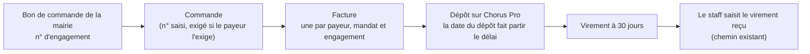
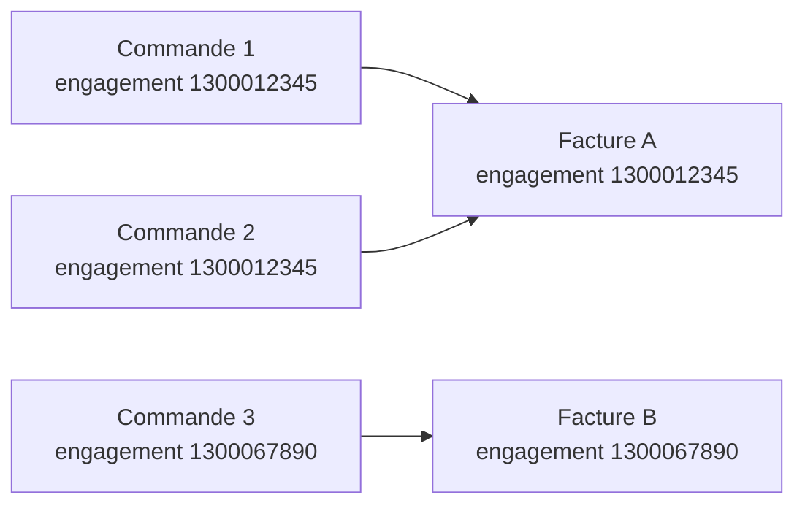
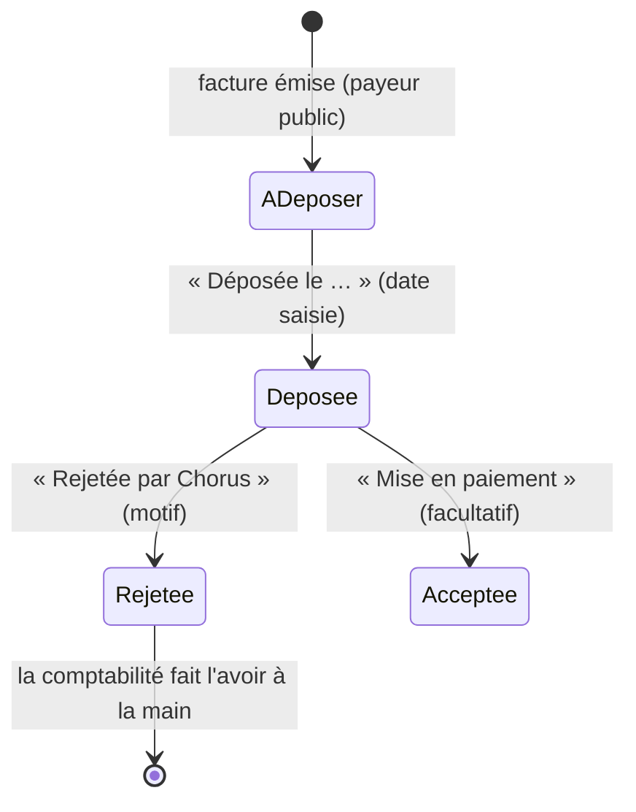

# Plan — les clients publics (armée, écoles, mairies) et Chorus Pro

> 🟨 **Plan v2** (2026-11-18). **P1a ✅ bâti** (`f4f10fb25`, § 6 bis), **P1b ✅ bâti** (2026-11-18, § 6 ter), **P2 ✅ bâti** (2026-11-18, § 6 quater, limites écrites), **P3 ✅ bâti** (2026-11-18, § 6 quinquies) ; P4 attend le choix de la plateforme agréée. Contredit par `vitruve` le
> 2026-11-18 : 4 bloquants et 7 sérieux, tous intégrés (§ 10).

# Partie 1 — En simple

Un client public **commande comme un pro**, mais trois choses changent :

1. **Il ne paie qu'avec un bon de commande.** Chaque bon porte un **numéro
   d'engagement** budgétaire ; la facture doit le reprendre, sinon Chorus la
   rejette.
2. **La facture ne part pas par e-mail** : elle est **déposée sur Chorus Pro**,
   adressée à la structure et, souvent, à un **code service**.
3. **Il paie par virement** (mandat administratif), à **30 jours après
   réception de la facture** (50 pour un hôpital), jamais par carte ni par
   prélèvement.

**Ce qui est public, c'est le PAYEUR.** Un site qui suit la facturation d'un
principal public est facturé au principal : c'est le principal qui porte le
routage Chorus, le moyen de paiement et l'exigence d'engagement.

**Une facture ne regroupe que les commandes d'un même engagement.** Aujourd'hui
la facture d'une période est déjà découpée par (payeur, mandat). Elle le sera
par (payeur, mandat, engagement), l'engagement étant vide pour tout client
privé : un client privé garde exactement le même découpage.

Vocabulaire : « engagement » est déjà pris dans le commerce
(`AccountEngagement`, ce que la comptabilité a fait d'une commande). Le
nouveau concept s'appelle **engagement budgétaire** en français et
`budgetCommitment` dans le code ; il entre au [lexique](../lexique.md).

# Partie 2 — Technique

## 1. Ce qui existe (ouvert le 2026-11-18)

| Brique                                                                | État                          | Où                                                                                                     |
| --------------------------------------------------------------------- | ----------------------------- | ------------------------------------------------------------------------------------------------------ |
| Factur-X EN 16931, PDF/A-3, Schematron                                | ✅                            | `lafoliecoffee/accounting/domain/services/facturx-*.ts`, [`factur-x.md`](factur-x.md)                  |
| Découpage d'une période par (payeur, mandat)                          | ✅                            | `invoiceGroupKey` (`monthly-invoicing.ts:104`), PK de `invoice_monthly_outcome` (`invoice.prisma:193`) |
| Facture immuable (seul le document s'attache, une fois)               | ✅                            | déclencheur `invoice_immutable`, migration `20261008190000_la_facture_emise`                           |
| Moyen d'encaissement daté, append-only ; défaut `sepa_debit`          | ✅                            | `payer_collection_means`, `collection-means.ts:13`                                                     |
| Virement : échéance = émission + N jours (entité, 1..45)              | ✅                            | `transferDueDaysAfterIssue`, figée dans `creditor-snapshot.ts`                                         |
| État de règlement dérivé (`settled`, `transfer_overdue`)              | ✅                            | `invoice-settlement.ts`                                                                                |
| Passation : `Order.draft(...)`, révisions par `recompose` → `compose` | ✅                            | `orders/domain/entities/order.ts:157`, `:274`                                                          |
| Payeur d'une commande : `billed_company_id ?? company_id`             | ✅                            | `billedPayerOf`                                                                                        |
| Modes de facturation : `monthly`, `semimonthly`, `weekly`             | ✅                            | `billing-mode.prisma`                                                                                  |
| Port `EInvoiceTransport`                                              | ❌ décrit seulement           | [`../../b2b/architecture-facturation.md`](../../b2b/architecture-facturation.md)                       |
| Plateforme agréée                                                     | ❌ Q4 ouverte                 | [`plan-zero-faille.md`](plan-zero-faille.md)                                                           |
| BT-13 (référence de commande)                                         | ❌ vide, la liste vit en note | `facturx-mentions.ts:81`                                                                               |

## 2. Décisions proposées

- **D1 — Le payeur porte la nature publique.** Table
  `payer_public_routing` (`company_id` PK = le payeur) : `default_service_code`,
  `commitment_required`, `service_code_required`, `payment_deadline_days`
  (30 ou 50), `checked_on`. Pas de second SIRET : on adresse Chorus au SIRET
  de la société ; si un cas réel demande une structure facturée différente, on
  l'ajoutera alors. La présence d'une ligne **est** la nature publique, il n'y
  a pas de booléen à tenir à côté.
  Un site ne peut **suivre** un principal que si les deux ont la même nature :
  la période de suivi est refusée sinon (nommé : « Ce site est privé, son
  principal est public : il ne peut pas en suivre la facturation »).
- **D2 — Passer public, c'est un geste unique** qui écrit dans la même
  transaction : la ligne de routage **et** une ligne `payer_collection_means`
  `bank_transfer` (motif « client public »). L'écriture de
  `payer_collection_means` refuse ensuite `sepa_debit` pour un payeur public.
  Le changement de nature suit la règle du mode de facturation : **immédiat
  si le payeur n'a jamais commandé, refusé sinon** (§ 8, Q5).
- **D3 — La carte est refusée à la passation** d'une commande dont le payeur
  est public (`payByCard`, `order.ts:390`) : `BusinessError` nommée.
- **D4 — L'engagement budgétaire vit sur la commande.**
  `BudgetCommitment { number, serviceCode }`, entré dans `PricedDraftInput`.
  Le handler lit l'exigence du payeur par un port étroit
  (`PayerPublicRequirementsReader`, déclaré dans `orders`, implémenté par
  `accounting`). `Order.draft` refuse s'il manque alors qu'il est exigé.
  Une révision peut corriger l'engagement **tant que la commande n'est pas
  facturée** ; au-delà, refus nommé (`AccountEngagement` dit déjà `invoiced`) :
  la correction passe par un avoir et une nouvelle facture.
- **D5 — Une facture par (payeur, mandat, engagement).**
  `invoiceGroupKey(payerId, mandateId, commitment)` ;
  `invoice_monthly_outcome.budget_commitment_number` NOT NULL DEFAULT `''`,
  ajouté à la clé primaire ; le lecteur `invoicedGroups` le relit. Vaut pour
  les trois modes (même service). BT-13 porte le numéro ; le code service va
  dans la référence acheteur — **mapping Chorus à vérifier** dans les
  spécifications externes avant P2. Engagement et code service sont posés sur
  `invoice` **à l'INSERT** (l'immuabilité ne gêne pas).
- **D6 — La transmission est un journal à part**, append-only :
  `invoice_transmission(invoice_id, status, at, reason, staff_id)`, statuts
  `deposited` | `rejected` | `accepted`. « À déposer » = facture d'un payeur
  public **sans** ligne : décidé à l'émission, dans le domaine, pas par un
  CHECK. Le paiement n'y figure pas : il reste dérivé du virement reçu.
- **D7 — L'échéance d'une facture publique part du dépôt.** À l'émission,
  l'échéance est inconnue (`due_on` vide pour une facture publique). Le geste
  « Déposée le … » écrit l'échéance dans `invoice_transmission`
  (dépôt + `payment_deadline_days`), et la lecture du règlement la prend là.
  Les intérêts moratoires et les 40 € sont **affichés** sur un retard, pas
  facturés automatiquement.
- **D8 — Transport derrière `EInvoiceTransport`** : d'abord
  `ManualChorusDeposit` (le staff télécharge, dépose, saisit la date), puis
  l'adaptateur de la plateforme agréée (qui route aussi vers Chorus). Pas
  d'intégration directe de l'API Chorus.

## 3. Hors du plan

Marchés publics et appels d'offres ; facturation automatique des intérêts
moratoires ; contraintes d'accès des sites (elles tiennent dans
`DeliveryProcedure`) ; une audience tarifaire publique (prix pro, Q3) ; une
facture par commande (Q4).

## 4. Données (migrations additives)

- `payer_public_routing` (D1).
- `orders.budget_commitment_number`, `orders.budget_commitment_service_code`
  (nullables).
- `invoice.budget_commitment_number`, `invoice.budget_commitment_service_code`
  (nullables, posés à l'INSERT).
- `invoice_monthly_outcome.budget_commitment_number` + nouvelle clé primaire
  (`legalEntityId, periodClosesAt, payerCompanyId, mandateId,
budgetCommitmentNumber`).
- `invoice_transmission` (D6, D7).

## 5. Écrans

### 5.1 La fiche client du back-office (lot P1)

Même fiche, trois cartes qui changent ; contacts, adresses, sites, procédure
de livraison (badge, créneaux de l'armée), mode de facturation et tarifs
restent tels quels.

1. **Nature choisie à l'ouverture** — « Nouveau compte » : _Entreprise_ ou
   _Organisme public_, rien de coché d'avance (comme le mode de facturation).
   C'est le geste D2 ; après la première commande, il est refusé (Q5).
2. **Identité légale, mêmes champs, libellés selon la nature**
   (`lfd-company-identity-fields` et `lfd-company-identity-card`,
   `packages/b2b-ui` — tests depuis la racine) :

   | Pro                    | Organisme public             | Exemple                                         |
   | ---------------------- | ---------------------------- | ----------------------------------------------- |
   | Raison sociale         | Dénomination                 | Commune de Lyon, Ministère des Armées           |
   | Enseigne               | Établissement ou service     | École Jules Ferry, Base aérienne 701            |
   | Forme juridique        | Catégorie juridique          | collectivité territoriale, établissement public |
   | SIRET, SIREN           | identiques, **obligatoires** | le SIRET adresse Chorus                         |
   | TVA intracommunautaire | facultative                  | souvent absente                                 |

3. **Le KBIS laisse la place à la carte « Chorus Pro »**
   (`chorus-routing-card`, nouvelle) : SIRET trouvé dans l'annuaire (relevé à
   la main par le staff), engagement exigé, code service exigé et code par
   défaut, délai de paiement (30 / 50 jours), « vérifié le … ». Dans la
   checklist d'activation (`activation-steps.ts`), l'étape « KBIS certifié »
   devient « Fiche Chorus relevée ».
4. **Moyens de paiement, un seul bloc, sans choix** (`paiement-section`) :
   « Virement — mandat administratif. Facture déposée sur Chorus Pro,
   réglée à 30 jours après le dépôt. » Carte, coordonnées bancaires, mandat
   SEPA et choix du moyen ne s'affichent pas. Un site d'un principal public
   garde la note existante « payé par le principal ».

### 5.2 Les autres écrans

- Boutique, panier d'un payeur public : « N° d'engagement » (exigé ou non),
  code service prérempli, pas de carte proposée.
- Back-office, factures : file « À déposer sur Chorus », « Déposée le … »,
  « Rejetée » avec motif, échéance affichée après dépôt.

## 6. Risques

- **La clé de clôture est le cœur de l'argent** : non-régression = « même
  découpage qu'aujourd'hui » pour tous les payeurs privés, sur les trois modes.
- Un autre lecteur de la clé (relevé, lot de prélèvement, `counted-payers.ts`)
  peut supposer (payeur, mandat) : **à inventorier** au début de P2.
- La facture carte n'est pas concernée (carte interdite au payeur public).

## 6 bis. P1a — la fiche d'un organisme public (décidé le 2026-11-18)

Hugo commence par la fiche. P1 se coupe en deux : **P1a** (la fiche, ses
données, l'activation) et **P1b** (moyens d'encaissement et carte, D2–D3).

**La nature publique EST la forme juridique** (remplace le booléen de D1 et
le « présence d'une ligne » : ouvert le 2026-11-18, `LegalForm` de
`packages/contracts/src/legal-form.ts` pilote déjà la TVA exigée et
`activationGate` la checklist). Quatre formes ajoutées, toutes sans TVA
exigée :

| Valeur                        | Libellé                                                  | Délai légal |
| ----------------------------- | -------------------------------------------------------- | ----------- |
| `public_state`                | État et services de l'État (armée, préfecture…)          | 30 j        |
| `public_local_authority`      | Collectivité territoriale (commune, département, région) | 30 j        |
| `public_establishment`        | Établissement public (école, lycée, université…)         | 30 j        |
| `public_health_establishment` | Établissement public de santé                            | 50 j        |

`isPublicLegalForm(form)` et `publicPaymentDeadlineDays(form)` vivent à côté
de `legalFormRequiresVat`. Le délai se **dérive** de la forme : plus de
colonne `payment_deadline_days`.

**Le passage public ↔ privé est refusé dès que le compte est actif** (Q5,
plus strict que « dès la première commande » : l'activation précède toute
commande, et le compte n'a pas à lire le commerce). Une correction de forme
à l'intérieur d'une même nature reste libre. Refus nommé :
« Ce compte est actif : il ne peut pas passer d'entreprise à organisme
public. Ouvrez un autre compte. »

**Le routage Chorus est sur la société**, dans `account` (table
`company_chorus_routing`, PK `company_id`) : `commitment_required`,
`service_code_required`, `default_service_code` (texte, vide permis),
`checked_on` (date du relevé), `checked_by` (trace du staff). Value object
`ChorusRouting` ; posé par le staff (`PUT /admin/companies/:id/chorus-routing`,
`@IntentKey` ou `@Idempotent` selon la porte `lint:write-idempotence`) ;
refusé sur une société non publique ; un code service exigé sans code par
défaut est permis (il se saisira à la commande, P2). Lu dans la vue admin de
la fiche.

**Activation** (`activationGate`) : pour une forme publique, la pièce `kbis`
ne figure pas ; une pièce `chorus` **bloquante** la remplace (faite quand le
routage est relevé). Hors forme publique, rien ne change.

**Écrans** : § 5.1, sauf le bloc paiement qui, en P1a, n'est qu'un texte
(« Virement — mandat administratif… ») : les refus serveur viennent en P1b.

## 6 ter. P1b — un organisme public règle au compte, par virement

> 🟨 v2 du 2026-11-18. La v1 DÉRIVAIT la nature à la lecture ; `vitruve`
> (même jour) a montré qu'une dizaine de lecteurs (moyen effectif, émission,
> lot de prélèvement, comptoir, boutique) lui échappaient. La v2 ÉCRIT les
> faits une fois, à l'activation, et garde un filet à l'émission.

### En simple

Un organisme public **commande toujours au compte** et **paie toujours par
virement** : jamais de carte, jamais de prélèvement. À l'activation, le
système lui pose lui-même ce qu'un pro reçoit du staff (le compte, le
virement), puis refuse tout geste qui le déferait. Et si malgré tout une
facture publique devait partir au prélèvement, **elle ne s'émet pas** : elle
est bloquée avec un motif nommé.

### Ce qui existe (ouvert le 2026-11-18)

- « Au compte » se calcule à trois endroits sur les mêmes données :
  `Company.settlesOnAccount()` (`company.ts:720`, comptoir), le lecteur
  `prisma-order-guard.reader.ts:42` (passation) et le front de la boutique
  (`settles-on-account.ts`) — tous sur `granted_terms` et le blocage du
  prélèvement.
- Le moyen d'encaissement est une ligne datée par (entité, payeur) ; sans
  ligne, `sepa_debit`. Il est lu par `collectionMeansAt` et `.at(...)` à
  l'émission, au lot, aux payeurs comptés, à la fiche, dans `growth` et dans
  `account` (`transfer-payers.projection.ts`).
- `invoice-issuance-blockers.ts` porte déjà les motifs qui bloquent une
  émission (vendeur, payeur, commande).

### Décisions

- **B1 — Activer un organisme public lui accorde le compte.** Dans
  `Company.activate`, une forme publique pose `granted_terms = ["monthly"]`.
  L'agrégat refuse ensuite, pour une forme publique, de retirer le compte et
  de **bloquer le prélèvement** (409 nommé). Les trois calculs « au compte »
  restent inchangés et disent juste, puisqu'ils lisent ces données.
- **B2 — Activer un organisme public écrit le virement.** Dans la même
  transaction que l'activation, `account` appelle un port qu'il déclare
  (`PublicPayerOpening`, implémenté par `accounting`, relié par le module) :
  une ligne `bank_transfer`, motif « organisme public », chez **chaque entité
  émettrice en service**. Elle remplace toute ligne `sepa_debit` posée
  pendant `pending`. Un mandat déjà signé reste en base, **inerte** : le
  moyen effectif est le virement.
- **B3 — Le prélèvement est refusé à l'écriture** pour un payeur public
  (`SetPayerCollectionMeansHandler`, la nature lue par `PayerStandingReader`).
- **B4 — Le filet : une facture publique ne s'émet jamais au prélèvement.**
  Nouveau motif dans `invoice-issuance-blockers.ts` :
  `public_payer_not_on_transfer` (« Ce client est un organisme public : il
  règle par virement. Posez le virement comme moyen d'encaissement chez cette
  entité. »). Il couvre l'entité ouverte après l'activation, et tout chemin
  oublié : sans facture émise, rien n'entre dans un lot.
- **B5 — La carte n'est jamais le repli d'un payeur public.** Dans
  `requiresCardFor` : payeur public et `settlement === "card"` ⇒
  `PublicBuyerCardRefusedError` (409) ; payeur public sans compte
  (suspendu) ⇒ refus nommé, jamais la carte en silence (le chemin du
  back-office sans choix compris, `order-settlement.ts:89-92` et
  `staff-settlement-refusal.ts`). La nature est lue par
  `OrderGuardReader`, qui lit déjà la société.
- **B6 — Qui tranche : le payeur.** Pour la carte comme pour le compte. Un
  site ne suit en `billing` qu'un principal de même nature (P1a), donc le
  front, qui lit la société qui commande, et le serveur, qui lit le payeur,
  ne divergent pas.
- **B7 — L'échéance** reste celle du virement de l'entité jusqu'à P3 (D7).

### Écrans

- Boutique et back-office : le compte s'affiche déjà (B1) ; la carte est
  masquée quand la forme du payeur est publique (`isPublicLegalForm`, déjà
  servie avec la société).
- Fiche client : bloc fixe déjà fait (P1a) ; le bouton « Bloquer le
  prélèvement » n'apparaît pas.

### Tests

Domaine : activation publique ⇒ compte accordé ; refus de retirer le compte
et de bloquer le prélèvement. Application : activation ⇒ `bank_transfer` à
chaque entité, par-dessus une ligne `sepa_debit` antérieure ; écriture
`sepa_debit` refusée ; carte refusée, payeur public suspendu refusé sans
repli. **Émission** : un payeur public au prélèvement est bloqué par
`public_payer_not_on_transfer`. E2E : passation boutique en carte refusée,
au compte acceptée ; activation puis lecture du moyen à la fiche.

### Objections de `vitruve` (2026-11-18) et leur sort

| Objection                                   | Sort                                                                      |
| ------------------------------------------- | ------------------------------------------------------------------------- |
| B ligne `sepa_debit` antérieure non ignorée | écrasée par la ligne écrite à l'activation (B2) + filet à l'émission (B4) |
| B lecteurs du défaut mal comptés            | plus de défaut dérivé : des données écrites (B1, B2)                      |
| B trois calculs « au compte »               | B1 écrit `granted_terms` : les trois lisent juste sans changer            |
| S site privé / principal public             | B6, et P1a refuse le suivi entre natures                                  |
| S blocage du prélèvement d'un public        | refusé par l'agrégat (B1)                                                 |
| S mandats existants                         | inertes (B2)                                                              |
| S repli carte d'un public suspendu          | refus nommé (B5)                                                          |
| S « nature figée dès l'ouverture »          | faux pendant `pending` : la v2 n'en dépend plus                           |

## 6 quater. P2 — l'engagement budgétaire sur la commande et la facture

> 🟨 Écrit le 2026-11-18, à contredire par `vitruve` (argent : le découpage
> des factures).

### En simple

Quand l'armée commande, elle a un **bon de commande** avec un **numéro
d'engagement**. Ce numéro se saisit sur la commande ; la facture le reprend.
Une facture ne mélange jamais deux engagements : si l'armée passe trois
commandes sur deux bons dans le mois, elle reçoit **deux factures**. Un pro,
lui, ne voit rien changer.

### Le format attendu par Chorus (cherché le 2026-11-18)

- **Numéro d'engagement** → BT-13 (`BuyerOrderReferencedDocument/IssuerAssignedID`).
  Pour l'État, un engagement juridique fait **10 caractères** ; une
  collectivité peut en avoir d'autres. On ne valide donc qu'une forme large
  (1 à 50 caractères imprimables, sans espace en tête ni en queue), jamais
  le format de l'État en dur.
- **Code service** → BT-10 (`BuyerReference`).
- Source : guides d'intégration d'éditeurs et correspondance EN 16931/CII,
  **pas** la spécification officielle de l'AIFE, introuvable ce jour. Comme
  le dépôt est manuel jusqu'à P4 (le staff ressaisit le code service et
  l'engagement sur le portail), une erreur de correspondance ne bloque
  personne ; elle est à confirmer au premier dépôt réel et avant P4.

### Ce qui existe (ouvert le 2026-11-18)

- La clé « déjà facturé » d'une période : `invoiceGroupKey(payer, mandat)`
  (`monthly-invoicing.ts:104`), relue de `invoice_monthly_outcome`
  (PK `legalEntityId, periodClosesAt, payerCompanyId, mandateId`,
  `invoice.prisma:193`, déclencheur `invoice_monthly_outcome_final`).
- Ses lecteurs et écrivains : `prisma-monthly-invoicing.reader.ts:137`,
  `prisma-monthly-invoice-outcomes.ts` (écrit), `prisma-monthly-invoices.reader.ts:39`,
  `prisma-invoice-periods.reader.ts:29`, `cycle-order-membership.ts:116`.
- La passation : `Order.draft(...)` avec `PricedDraftInput`, les révisions
  par `recompose` → `compose` (`order.ts:157`, `:274`) ; `AccountEngagement`
  dit déjà si une commande est facturée.
- BT-13 est vide aujourd'hui, la liste des commandes vit en note
  (`facturx-mentions.ts:81`).
- Le code service et l'exigence d'engagement sont sur la fiche Chorus de la
  société (P1a, `company_chorus_routing`).

### Décisions

- **E1 — Le numéro vit sur la commande**, value object `BudgetCommitment`
  (`number`, `serviceCode`), colonnes `orders.budget_commitment_number` et
  `orders.budget_commitment_service_code`, nullables. Lu chez le **payeur** :
  sa fiche Chorus dit si le numéro et le code sont exigés ; le code service
  par défaut de la fiche est proposé.
- **E2 — Exigé ⇒ refusé sans.** Le handler lit l'exigence du payeur par un
  port étroit déclaré dans `orders` (`PayerCommitmentRequirements`, implémenté
  par `account`) et la passe dans `PricedDraftInput` ; `Order.draft` refuse
  (« Cette structure exige un numéro d'engagement : il figure sur son bon de
  commande. »). Même règle pour le code service exigé et sans défaut. Un
  payeur privé qui envoie un numéro est refusé aussi : rien ne se perd en
  silence.
- **E3 — Une révision peut corriger le numéro tant que la commande n'est pas
  facturée** ; au-delà, refus nommé (« Cette commande est déjà facturée :
  son numéro d'engagement ne change plus. Faites un avoir. »).
- **E4 — Une facture par (payeur, mandat, engagement).**
  `invoiceGroupKey(payer, mandat, engagement)` ; la colonne
  `invoice_monthly_outcome.budget_commitment_number` NOT NULL DEFAULT `''`
  entre dans la clé primaire (migration additive : la valeur par défaut
  remplit l'existant, la clé est recréée) ; les cinq fichiers ci-dessus la
  lisent ou l'écrivent. Un payeur privé a toujours `''` : même découpage
  qu'avant, sur les trois rythmes.
- **E5 — La facture porte son engagement**, figé à l'INSERT :
  `invoice.budget_commitment_number`, `invoice.budget_commitment_service_code`.
  Factur-X : BT-13 = le numéro, BT-10 = le code service ; la note des
  commandes reste. Le PDF l'imprime en tête (« Engagement n° … — Service … »).
- **E6 — La facture carte n'est pas concernée** (un public ne paie jamais par
  carte, P1b).

### Après contradiction (`vitruve`, 2026-11-18) — ce qui remplace E1–E6

- **E2′ — Le refus vit à la PASSATION, pas dans `Order.draft`** : le devis
  de la saisie (`estimate-order-for-customer`) doit garder ses totaux tant
  que le champ est vide. Méthode de l'agrégat appelée par les trois
  passations (boutique, commande pro, commande à la place du client), avec
  l'exigence lue chez `billedCompanyId ?? companyId`. Un organisme public
  sans fiche Chorus ne peut pas être actif (P1a) ; un payeur privé qui
  envoie un numéro est refusé.
- **E3′ — Corriger l'engagement est un geste à part**, pas une révision (la
  révision refuse dès la préparation, `order-revisability.ts:181`, alors
  qu'un numéro manquant se découvre souvent après la livraison) : commande
  « corriger l'engagement », méthode de l'agrégat, gardée par
  `AccountOrderEngagement` (non facturée), sous le verrou des lignes
  `orders` que prend l'émission (`prisma-order-rows-lock.ts`), avec un fait
  au journal.
- **E4′ — La clé est (payeur, mandat, numéro, code service).** Deux sites
  d'un même principal public peuvent avoir deux services : une facture n'a
  qu'un BT-10. Deux colonnes NOT NULL DEFAULT `''` dans la PK de
  `invoice_monthly_outcome` (même geste que
  `20261008210000_une_facture_par_mandat`).
- **E4″ — Sous le verrou, l'émission relit le numéro et le code des bons** et
  retire du groupe ceux dont la clé a changé (`withoutCancelled` ne relit
  aujourd'hui que les annulations). Test de la course.
- **E7 — Filet à l'émission** : motif `public_commitment_missing` dans
  `invoice-issuance-blockers.ts` quand la fiche du payeur exige le numéro (ou
  le code) et qu'un bon n'en a pas. Aucune commande publique n'existe en
  production (rien n'est déployé) : pas de rattrapage.
- **E8 — Le dossier de facturation simule par clé**, comme l'émission
  (`invoice-dossier-support.ts:99`), pour que l'arrondi de TVA dise la même
  chose.
- **E9 — L'avoir d'une facture publique reprend son numéro et son code**
  (copiés de la facture). Refacturer une commande sortie par un avoir suit
  le chemin existant ; s'il n'existe pas, c'est écrit comme limite.
- **E10 — Un blocage rangé sous une clé qui n'a plus de commande** (numéro
  corrigé depuis) ne s'affiche plus ; il reste en base (issue finale).
- **E11 — `MonthlyInvoiceView` porte le numéro**, pour distinguer deux
  factures d'un même payeur sans mandat.
- **Factur-X** : BT-10 premier fils de `ApplicableHeaderTradeAgreement`,
  BT-13 après la partie acheteur (ordre du XSD, validé par
  `xsd-validation.ts`) ; JSDoc de `facturx-mentions.ts:81` réécrit.
  `invoice_immutable` couvre les colonnes neuves sans changement.
- **Retour arrière** : gratuit tant qu'aucune facture publique n'est émise
  (les deux colonnes valent `''` partout) ; après, la clé à six colonnes ne
  se défait plus (`invoice_monthly_outcome_final`).

### Ce qui est bâti, et ses limites (2026-11-18)

- **Bâti** : E2′, E3′, E4′, E4″, E7, E9, E10, E11, Factur-X (BT-10, BT-13,
  validés par Schematron et XSD), le PDF, la migration
  `20261118160000_l_engagement_budgetaire`.
- **E8 n'est pas fait, et c'est assumé** : le dossier de facturation simule
  toute la période d'un payeur en une seule facture et ne découpe déjà pas
  par mandat. Le découper par clé change sa vue, ses trois CSV et son écran :
  chantier à part, à décider.
- **Une commande sortie d'une facture par un avoir ne se refacture pas**
  (`invoice_order_invoiced_once`, et `uninvoicedOrders` écarte toute commande
  déjà portée par une facture). Un engagement faux sur une facture émise n'a
  donc pas de sortie dans le système : le refus de correction renvoie à la
  comptabilité, sans promettre d'avoir. **Décidé par Hugo le 2026-11-18 : la
  refacturation après avoir se traite à la main, hors système** — la
  comptabilité fait l'avoir et émet la nouvelle facture elle-même.
- **Fiche Chorus** : le code service va en BT-10 sur la foi de guides
  d'éditeurs ; à confirmer au premier dépôt réel.

### Écrans

- Boutique, panier d'un payeur public : « N° d'engagement » (exigé ou non,
  dit à côté du champ) et « Code service » prérempli. Le numéro est rappelé
  dans le récapitulatif et sur la commande.
- Back-office, nouvelle commande et révision : les mêmes deux champs.
- Fiche commande : le numéro et le code, modifiables tant que non facturée.

### Tests

Domaine : `BudgetCommitment` (forme), `Order.draft` exigé/absent/privé,
révision avant et après facturation. Émission : deux engagements dans la
période ⇒ deux factures et deux issues ; un payeur privé ⇒ découpage
inchangé (un test qui compare au découpage par mandat) ; BT-13 et BT-10 dans
le XML, validé par le Schematron existant. E2E : passation boutique refusée
sans numéro pour l'armée, acceptée avec ; émission mensuelle à deux
engagements.

## 6 quinquies. P3 — le dépôt sur Chorus, à la main

> 🟨 Écrit le 2026-11-18, à contredire par `vitruve` (argent : l'échéance).

### En simple

Une facture d'organisme public ne part pas par e-mail pour être payée : la
comptabilité la **télécharge et la dépose sur le portail Chorus Pro**, puis
le dit dans le back-office. Une file « **À déposer sur Chorus** » montre
celles qui attendent. Le **délai de paiement (30 jours, 50 pour un hôpital)
part du jour du dépôt**, pas du jour de la facture : tant que la facture
n'est pas déposée, elle n'a pas d'échéance et ne peut pas être « en
retard ». Chorus peut **rejeter** une facture (numéro faux, service
inconnu) : la comptabilité le note avec le motif, et la facture sort de la
file des paiements attendus.

### Ce qui existe (ouvert le 2026-11-18)

- `invoice.due_on` (nullable) est figé à l'émission
  (`monthly-invoice-issuance.ts`) et lu par : le PDF (`invoice-pdf-header.ts`,
  `invoice-pdf-summary.ts`), le Factur-X (BT-9, `facturx-settlement.ts:221`,
  omis si NULL), l'e-mail d'avis (`invoice-notice-wording.ts`), les retards
  du virement (`prisma-unpaid-transfer-invoices.reader.ts:50` saute une
  facture sans échéance ; `transfer-arrears.ts`), les vues
  (`issued-invoice-view-support.ts`, `my-invoices-view-support.ts`).
- La facture est immuable (`invoice_immutable`) : rien ne s'écrit sur sa
  ligne après l'émission, sauf son document, une fois.
- Le port `EInvoiceTransport` n'existe que dans la doc.

### Décisions

- **T1 — Une facture publique s'émet sans échéance** (`due_on` NULL), et
  porte à la place la condition de paiement en clair, dans le PDF et en
  BT-20 : « Paiement à 30 jours (50 pour un établissement public de santé) à
  compter de la réception de la facture sur Chorus Pro. » Le délai vient de
  `publicPaymentDeadlineDays` (forme du payeur). Le e-mail d'avis dit la
  même chose, sans date.
- **T2 — Le dépôt est un journal à part, append-only** :
  `invoice_chorus_deposit(id, invoice_id, kind, occurred_on, reason,
staff_id, staff_name, recorded_at)`, `kind` ∈ `deposited` | `rejected` |
  `accepted`. Règles dans un agrégat `ChorusDeposit` (une facture) :
  déposer une seule fois (une facture rejetée ne se redépose pas : la
  comptabilité fait l'avoir et une nouvelle facture, à la main) ; rejeter ou
  accepter seulement après un dépôt ; `occurred_on` ≤ aujourd'hui et ≥ la
  date de la facture. Seulement pour une facture d'un payeur public, non
  annulée par un avoir.
- **T3 — L'échéance d'une facture publique = date de dépôt + délai** du
  payeur figé dans la ligne de dépôt (`deadline_days`), calculée par une
  seule fonction (`publicInvoiceDueOn`). Les lecteurs des retards et des
  vues prennent `due_on ?? échéance de dépôt` ; une facture publique non
  déposée n'est jamais en retard ; une facture rejetée sort des impayés
  attendus (elle sera remplacée).
- **T4 — `EInvoiceTransport` devient réel**, avec un seul adaptateur pour
  l'instant, `ManualChorusDeposit` : « transmettre » = mettre la facture
  dans la file « À déposer » (rien n'est envoyé). P4 branchera la
  plateforme agréée sur le même port, qui écrira lui-même les lignes de
  dépôt.
- **T5 — Les gestes du staff** (`b2b_accounting:write`) : « Déposée le … »,
  « Rejetée par Chorus » (motif obligatoire), « Mise en paiement »
  (facultatif, informatif). Chacun écrit un fait au journal. Clé
  d'intention ou `@Idempotent` selon `lint:write-idempotence`.

### Après contradiction (`vitruve`, 2026-11-18) — ce qui remplace T1–T5

La v1 émettait la facture publique **sans** `due_on`. Une dizaine de
lecteurs le supposent non nul (le lecteur des virements impayés lève une
erreur, l'avis par e-mail ne part pas, le Factur-X l'écrit « Avoir »,
l'agrégat refuse d'émettre). La v2 garde la donnée non nulle et change ce
qu'on en **dit** et ce qu'on en **fait**.

- **T1′ — `due_on` reste posé à l'émission**, et vaut **date de facture +
  délai du payeur** (30 ou 50 jours **calendaires**, `publicPaymentDeadlineDays`)
  : l'échéance au plus tôt, si la facture était déposée le jour même. Le
  délai est donc figé à l'émission (`due_on − issued_on`) : la condition
  imprimée et le calcul ne peuvent pas diverger. Rien ne change dans
  l'agrégat ni dans `invoice_immutable`.
- **T1″ — Ce qu'on imprime d'une facture publique, choisi par la NATURE du
  payeur** (jamais par `dueOn === null`, qui désigne l'avoir) : en BT-20 et
  sur le PDF, « Paiement à N jours à compter de la réception de la facture
  sur Chorus Pro. » ; BT-9 **omis** (BR-CO-25 est tenue par BT-20, toujours
  présent) ; l'e-mail d'avis dit la condition au lieu d'une date (gabarit et
  dictionnaire des e-mails, `mail-copy:digest`, spécimen).
- **T2′ — Un seul journal, `invoice_chorus_deposit`** (remplace
  `invoice_transmission` de D6/D7 et du § 10) : `(id, invoice_id, kind,
occurred_on, reason, staff_id, staff_name, recorded_at)`, `kind` ∈
  `deposited` | `rejected` | `accepted`. **Déclencheur qui refuse UPDATE et
  DELETE.** Agrégat `ChorusDeposit` : un seul dépôt ; rejet ou mise en
  paiement seulement après le dépôt ; `issued_on ≤ occurred_on ≤
aujourd'hui` ; facture d'un payeur public, de type 380, non annulée par
  un avoir.
- **T3′ — L'échéance effective** d'une facture publique, une seule fonction
  `effectiveDueOn` : non déposée ⇒ aucune (jamais en retard) ; déposée ⇒
  dépôt + (due_on − issued_on) ; rejetée ⇒ hors des impayés attendus. En
  retard dès le jour ouvré qui suit, comme un virement
  (`transferOverdueFrom`). **Tous** les lecteurs des retards et du
  règlement passent par elle : `prisma-unpaid-transfer-invoices.reader.ts`,
  `invoice-settlement.ts`, `transfer-arrears.ts`, les vues (factures
  émises, mes factures, factures du mois, fiche facture, carte client,
  virements en retard, `bank-transfer`, l'agent client). Un pro n'est pas
  touché : `effectiveDueOn = due_on`.
- **T3″ — Un virement reçu sur une facture rejetée** s'affecte quand même
  (l'argent est arrivé ; le refuser serait pire) ; la comptabilité règle
  l'écart avec l'avoir, à la main.
- **T4′ — La file « À déposer »** = factures 380 d'un payeur public, sans
  ligne de dépôt, **non annulées par un avoir**.
- **T5′ — Gestes** (`b2b_accounting:write`) : `@Idempotent`, raison
  « l'agrégat refuse un second dépôt / rejet » ; faits
  `invoice.chorus_deposited`, `invoice.chorus_rejected`,
  `invoice.chorus_accepted` {invoiceId, invoiceNumber, occurredOn, reason?,
  by}.

### Ce qui est bâti (2026-11-18)

T1′ à T5′, la migration `20261118180000_le_depot_chorus`, la page
« Chorus Pro » de la comptabilité, l'échéance effective sur tous les écrans
(back-office, agent client, « Mes factures »). Tranché en bâtissant :

- une facture **rejetée reste dans la liste des virements impayés**, sans
  échéance et jamais en retard, pour qu'un virement reçu puisse s'y
  affecter (T3″) ; « Mes factures » n'affiche alors aucune échéance ;
- « Mise en paiement » est informative : elle ne change ni l'échéance ni le
  règlement ;
- l'abonné `TransmitPublicInvoice` appelle `EInvoiceTransport` à chaque
  facture publique émise ; `ManualChorusDeposit` n'envoie rien (la file se
  lit sur l'absence de dépôt) — P4 remplacera l'adaptateur ;
- un seul document à télécharger : le PDF/A-3 Factur-X (le XML y est
  embarqué) ;
- reste pour P4 : BT-49 / BR-FR-12, l'adresse électronique de l'acheteur
  lue à l'annuaire Chorus.

### Écrans

- Comptabilité : nouvelle page « Chorus Pro » — onglet « À déposer »
  (payeur, n°, date, montant, télécharger le PDF et le Factur-X, « Déposée
  le … »), onglet « Déposées » (échéance, rejet, mise en paiement).
- Fiche facture / fiche client : l'état Chorus et l'échéance.
- Boutique (« Mes factures ») : « Déposée sur Chorus le … — échéance … » ou
  « En cours de dépôt sur Chorus ».

### Tests

Domaine : `ChorusDeposit` (une fois, ordre, dates), `publicInvoiceDueOn`.
Émission : facture publique sans `due_on`, BT-20 présent, BT-9 absent,
Schematron + XSD verts. Retards : non déposée jamais en retard, déposée en
retard à J+délai+1 jour ouvré, rejetée hors des impayés. E2E : émettre,
lister à déposer, déposer, relire l'échéance, rejeter.

## 7. Lots

| Lot       | Contenu                                                                                                                                 | Dépend de                                                     |
| --------- | --------------------------------------------------------------------------------------------------------------------------------------- | ------------------------------------------------------------- |
| **P1** ✅ | D1, D2, D3 : routage du payeur, geste « passer public », virement forcé, carte refusée, suivi refusé entre natures ; fiche client       | —                                                             |
| **P2** ✅ | D4, D5 : engagement sur la commande et ses révisions, clé de clôture à trois termes, BT-13 et référence acheteur ; champ dans le panier | P1, mapping Chorus vérifié, inventaire des lecteurs de la clé |
| **P3** ✅ | D6, D7, D8 : journal de transmission, échéance au dépôt, `ManualChorusDeposit`, file « À déposer »                                      | P2                                                            |
| **P4**    | Adaptateur de la plateforme agréée, lecture de l'annuaire Chorus (exigences relues)                                                     | Q4 de [`plan-zero-faille.md`](plan-zero-faille.md)            |

## 8. Décisions de Hugo (2026-11-18)

- **Q1** — Premier client : **l'armée** (État : engagement toujours exigé,
  donc P2 avant le premier client), puis **une école**.
- **Q2** — **Dépôt manuel** sur Chorus au début (P3), plateforme agréée
  ensuite (P4).
- **Q3** — **Prix pro.** Aucune audience nouvelle.
- **Q4** — Hugo ne sait pas ; **retenu par défaut : les trois modes
  existants**, une facture par engagement et par période. Si l'armée émet un
  bon par livraison, la clé à trois termes donne déjà une facture par bon
  sans nouveau mode. La facture par commande reste un chantier à part, ouvert
  seulement si un client le demande.
- **Q5** — Hugo ne sait pas ; **retenu par défaut : refusé dès la première
  commande**, avec le message qui nomme le geste (ouvrir un autre compte).
  C'est la règle la plus sûre pour l'argent, et le cas est rare : on
  l'assouplira quand un cas réel se présentera.

## 9. Non vérifié

Le mapping Chorus du code service ; les autres lecteurs de la clé de clôture.

## 10. Contradiction (vitruve, 2026-11-18)

| Objection                                                                              | Sort                                                                 |
| -------------------------------------------------------------------------------------- | -------------------------------------------------------------------- |
| B1 statut sur `invoice` bloqué par `invoice_immutable` ; CHECK inter-tables impossible | journal `invoice_transmission`, décision dans le domaine (D6)        |
| B2 collision sur la PK de `invoice_monthly_outcome`                                    | troisième terme dans la clé et la PK (D5)                            |
| B3 le découpage est déjà par mandat                                                    | clé (payeur, mandat, engagement) ; non-régression « même découpage » |
| B4 qui est public, le site ou le payeur ?                                              | le payeur ; suivi refusé entre natures (D1)                          |
| `Order.place()` n'existe pas ; révision d'une commande facturée                        | `Order.draft` + `PricedDraftInput` ; refus après facturation (D4)    |
| aucun agrégat ne porte le moyen ; défaut `sepa_debit`                                  | geste unique qui écrit `bank_transfer` ; refus du prélèvement (D2)   |
| « engagement » déjà pris                                                               | `budgetCommitment`, lexique                                          |
| délai légal à partir de la réception                                                   | échéance au dépôt (D7)                                               |
| `paid` en doublon                                                                      | retiré (D6)                                                          |
| « à la commande » n'est pas un mode                                                    | dit dans Q4                                                          |
| règle du changement de nature mal nommée                                               | D2 + Q5                                                              |
| `chorus_siret` en double                                                               | retiré (D1)                                                          |
