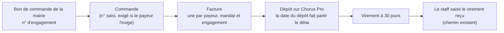

# Plan — les clients publics (armée, écoles, mairies) et Chorus Pro

> 🟨 **Plan v2** (2026-11-18). **P1a ✅ bâti** (`f4f10fb25`, § 6 bis), **P1b ✅ bâti** (2026-11-18, § 6 ter) ; P2–P4 restent. Contredit par `vitruve` le
> 2026-11-18 : 4 bloquants et 7 sérieux, tous intégrés (§ 10).

# Partie 1 — En simple

Un client public **commande comme un pro**, mais trois choses changent :

1. **Il ne paie qu'avec un bon de commande.** Chaque bon porte un **numéro
   d'engagement** budgétaire ; la facture doit le reprendre, sinon Chorus la
   rejette.
2. **La facture ne part pas par e-mail** : elle est **déposée sur Chorus Pro**,
   adressée à la structure et, souvent, à un **code service**.
3. **Il paie par virement** (mandat administratif), à **30 jours après
   réception de la facture** (50 pour un hôpital), jamais par carte ni par
   prélèvement.

**Ce qui est public, c'est le PAYEUR.** Un site qui suit la facturation d'un
principal public est facturé au principal : c'est le principal qui porte le
routage Chorus, le moyen de paiement et l'exigence d'engagement.

**Une facture ne regroupe que les commandes d'un même engagement.** Aujourd'hui
la facture d'une période est déjà découpée par (payeur, mandat). Elle le sera
par (payeur, mandat, engagement), l'engagement étant vide pour tout client
privé : un client privé garde exactement le même découpage.

Vocabulaire : « engagement » est déjà pris dans le commerce
(`AccountEngagement`, ce que la comptabilité a fait d'une commande). Le
nouveau concept s'appelle **engagement budgétaire** en français et
`budgetCommitment` dans le code ; il entre au [lexique](../lexique.md).

# Partie 2 — Technique

## 1. Ce qui existe (ouvert le 2026-11-18)

| Brique                                                                | État                          | Où                                                                                                     |
| --------------------------------------------------------------------- | ----------------------------- | ------------------------------------------------------------------------------------------------------ |
| Factur-X EN 16931, PDF/A-3, Schematron                                | ✅                            | `lafoliecoffee/accounting/domain/services/facturx-*.ts`, [`factur-x.md`](factur-x.md)                  |
| Découpage d'une période par (payeur, mandat)                          | ✅                            | `invoiceGroupKey` (`monthly-invoicing.ts:104`), PK de `invoice_monthly_outcome` (`invoice.prisma:193`) |
| Facture immuable (seul le document s'attache, une fois)               | ✅                            | déclencheur `invoice_immutable`, migration `20261008190000_la_facture_emise`                           |
| Moyen d'encaissement daté, append-only ; défaut `sepa_debit`          | ✅                            | `payer_collection_means`, `collection-means.ts:13`                                                     |
| Virement : échéance = émission + N jours (entité, 1..45)              | ✅                            | `transferDueDaysAfterIssue`, figée dans `creditor-snapshot.ts`                                         |
| État de règlement dérivé (`settled`, `transfer_overdue`)              | ✅                            | `invoice-settlement.ts`                                                                                |
| Passation : `Order.draft(...)`, révisions par `recompose` → `compose` | ✅                            | `orders/domain/entities/order.ts:157`, `:274`                                                          |
| Payeur d'une commande : `billed_company_id ?? company_id`             | ✅                            | `billedPayerOf`                                                                                        |
| Modes de facturation : `monthly`, `semimonthly`, `weekly`             | ✅                            | `billing-mode.prisma`                                                                                  |
| Port `EInvoiceTransport`                                              | ❌ décrit seulement           | [`../../b2b/architecture-facturation.md`](../../b2b/architecture-facturation.md)                       |
| Plateforme agréée                                                     | ❌ Q4 ouverte                 | [`plan-zero-faille.md`](plan-zero-faille.md)                                                           |
| BT-13 (référence de commande)                                         | ❌ vide, la liste vit en note | `facturx-mentions.ts:81`                                                                               |

## 2. Décisions proposées

- **D1 — Le payeur porte la nature publique.** Table
  `payer_public_routing` (`company_id` PK = le payeur) : `default_service_code`,
  `commitment_required`, `service_code_required`, `payment_deadline_days`
  (30 ou 50), `checked_on`. Pas de second SIRET : on adresse Chorus au SIRET
  de la société ; si un cas réel demande une structure facturée différente, on
  l'ajoutera alors. La présence d'une ligne **est** la nature publique, il n'y
  a pas de booléen à tenir à côté.
  Un site ne peut **suivre** un principal que si les deux ont la même nature :
  la période de suivi est refusée sinon (nommé : « Ce site est privé, son
  principal est public : il ne peut pas en suivre la facturation »).
- **D2 — Passer public, c'est un geste unique** qui écrit dans la même
  transaction : la ligne de routage **et** une ligne `payer_collection_means`
  `bank_transfer` (motif « client public »). L'écriture de
  `payer_collection_means` refuse ensuite `sepa_debit` pour un payeur public.
  Le changement de nature suit la règle du mode de facturation : **immédiat
  si le payeur n'a jamais commandé, refusé sinon** (§ 8, Q5).
- **D3 — La carte est refusée à la passation** d'une commande dont le payeur
  est public (`payByCard`, `order.ts:390`) : `BusinessError` nommée.
- **D4 — L'engagement budgétaire vit sur la commande.**
  `BudgetCommitment { number, serviceCode }`, entré dans `PricedDraftInput`.
  Le handler lit l'exigence du payeur par un port étroit
  (`PayerPublicRequirementsReader`, déclaré dans `orders`, implémenté par
  `accounting`). `Order.draft` refuse s'il manque alors qu'il est exigé.
  Une révision peut corriger l'engagement **tant que la commande n'est pas
  facturée** ; au-delà, refus nommé (`AccountEngagement` dit déjà `invoiced`) :
  la correction passe par un avoir et une nouvelle facture.
- **D5 — Une facture par (payeur, mandat, engagement).**
  `invoiceGroupKey(payerId, mandateId, commitment)` ;
  `invoice_monthly_outcome.budget_commitment_number` NOT NULL DEFAULT `''`,
  ajouté à la clé primaire ; le lecteur `invoicedGroups` le relit. Vaut pour
  les trois modes (même service). BT-13 porte le numéro ; le code service va
  dans la référence acheteur — **mapping Chorus à vérifier** dans les
  spécifications externes avant P2. Engagement et code service sont posés sur
  `invoice` **à l'INSERT** (l'immuabilité ne gêne pas).
- **D6 — La transmission est un journal à part**, append-only :
  `invoice_transmission(invoice_id, status, at, reason, staff_id)`, statuts
  `deposited` | `rejected` | `accepted`. « À déposer » = facture d'un payeur
  public **sans** ligne : décidé à l'émission, dans le domaine, pas par un
  CHECK. Le paiement n'y figure pas : il reste dérivé du virement reçu.
- **D7 — L'échéance d'une facture publique part du dépôt.** À l'émission,
  l'échéance est inconnue (`due_on` vide pour une facture publique). Le geste
  « Déposée le … » écrit l'échéance dans `invoice_transmission`
  (dépôt + `payment_deadline_days`), et la lecture du règlement la prend là.
  Les intérêts moratoires et les 40 € sont **affichés** sur un retard, pas
  facturés automatiquement.
- **D8 — Transport derrière `EInvoiceTransport`** : d'abord
  `ManualChorusDeposit` (le staff télécharge, dépose, saisit la date), puis
  l'adaptateur de la plateforme agréée (qui route aussi vers Chorus). Pas
  d'intégration directe de l'API Chorus.

## 3. Hors du plan

Marchés publics et appels d'offres ; facturation automatique des intérêts
moratoires ; contraintes d'accès des sites (elles tiennent dans
`DeliveryProcedure`) ; une audience tarifaire publique (prix pro, Q3) ; une
facture par commande (Q4).

## 4. Données (migrations additives)

- `payer_public_routing` (D1).
- `orders.budget_commitment_number`, `orders.budget_commitment_service_code`
  (nullables).
- `invoice.budget_commitment_number`, `invoice.budget_commitment_service_code`
  (nullables, posés à l'INSERT).
- `invoice_monthly_outcome.budget_commitment_number` + nouvelle clé primaire
  (`legalEntityId, periodClosesAt, payerCompanyId, mandateId,
budgetCommitmentNumber`).
- `invoice_transmission` (D6, D7).

## 5. Écrans

### 5.1 La fiche client du back-office (lot P1)

Même fiche, trois cartes qui changent ; contacts, adresses, sites, procédure
de livraison (badge, créneaux de l'armée), mode de facturation et tarifs
restent tels quels.

1. **Nature choisie à l'ouverture** — « Nouveau compte » : _Entreprise_ ou
   _Organisme public_, rien de coché d'avance (comme le mode de facturation).
   C'est le geste D2 ; après la première commande, il est refusé (Q5).
2. **Identité légale, mêmes champs, libellés selon la nature**
   (`lfd-company-identity-fields` et `lfd-company-identity-card`,
   `packages/b2b-ui` — tests depuis la racine) :

   | Pro                    | Organisme public             | Exemple                                         |
   | ---------------------- | ---------------------------- | ----------------------------------------------- |
   | Raison sociale         | Dénomination                 | Commune de Lyon, Ministère des Armées           |
   | Enseigne               | Établissement ou service     | École Jules Ferry, Base aérienne 701            |
   | Forme juridique        | Catégorie juridique          | collectivité territoriale, établissement public |
   | SIRET, SIREN           | identiques, **obligatoires** | le SIRET adresse Chorus                         |
   | TVA intracommunautaire | facultative                  | souvent absente                                 |

3. **Le KBIS laisse la place à la carte « Chorus Pro »**
   (`chorus-routing-card`, nouvelle) : SIRET trouvé dans l'annuaire (relevé à
   la main par le staff), engagement exigé, code service exigé et code par
   défaut, délai de paiement (30 / 50 jours), « vérifié le … ». Dans la
   checklist d'activation (`activation-steps.ts`), l'étape « KBIS certifié »
   devient « Fiche Chorus relevée ».
4. **Moyens de paiement, un seul bloc, sans choix** (`paiement-section`) :
   « Virement — mandat administratif. Facture déposée sur Chorus Pro,
   réglée à 30 jours après le dépôt. » Carte, coordonnées bancaires, mandat
   SEPA et choix du moyen ne s'affichent pas. Un site d'un principal public
   garde la note existante « payé par le principal ».

### 5.2 Les autres écrans

- Boutique, panier d'un payeur public : « N° d'engagement » (exigé ou non),
  code service prérempli, pas de carte proposée.
- Back-office, factures : file « À déposer sur Chorus », « Déposée le … »,
  « Rejetée » avec motif, échéance affichée après dépôt.

## 6. Risques

- **La clé de clôture est le cœur de l'argent** : non-régression = « même
  découpage qu'aujourd'hui » pour tous les payeurs privés, sur les trois modes.
- Un autre lecteur de la clé (relevé, lot de prélèvement, `counted-payers.ts`)
  peut supposer (payeur, mandat) : **à inventorier** au début de P2.
- La facture carte n'est pas concernée (carte interdite au payeur public).

## 6 bis. P1a — la fiche d'un organisme public (décidé le 2026-11-18)

Hugo commence par la fiche. P1 se coupe en deux : **P1a** (la fiche, ses
données, l'activation) et **P1b** (moyens d'encaissement et carte, D2–D3).

**La nature publique EST la forme juridique** (remplace le booléen de D1 et
le « présence d'une ligne » : ouvert le 2026-11-18, `LegalForm` de
`packages/contracts/src/legal-form.ts` pilote déjà la TVA exigée et
`activationGate` la checklist). Quatre formes ajoutées, toutes sans TVA
exigée :

| Valeur                        | Libellé                                                  | Délai légal |
| ----------------------------- | -------------------------------------------------------- | ----------- |
| `public_state`                | État et services de l'État (armée, préfecture…)          | 30 j        |
| `public_local_authority`      | Collectivité territoriale (commune, département, région) | 30 j        |
| `public_establishment`        | Établissement public (école, lycée, université…)         | 30 j        |
| `public_health_establishment` | Établissement public de santé                            | 50 j        |

`isPublicLegalForm(form)` et `publicPaymentDeadlineDays(form)` vivent à côté
de `legalFormRequiresVat`. Le délai se **dérive** de la forme : plus de
colonne `payment_deadline_days`.

**Le passage public ↔ privé est refusé dès que le compte est actif** (Q5,
plus strict que « dès la première commande » : l'activation précède toute
commande, et le compte n'a pas à lire le commerce). Une correction de forme
à l'intérieur d'une même nature reste libre. Refus nommé :
« Ce compte est actif : il ne peut pas passer d'entreprise à organisme
public. Ouvrez un autre compte. »

**Le routage Chorus est sur la société**, dans `account` (table
`company_chorus_routing`, PK `company_id`) : `commitment_required`,
`service_code_required`, `default_service_code` (texte, vide permis),
`checked_on` (date du relevé), `checked_by` (trace du staff). Value object
`ChorusRouting` ; posé par le staff (`PUT /admin/companies/:id/chorus-routing`,
`@IntentKey` ou `@Idempotent` selon la porte `lint:write-idempotence`) ;
refusé sur une société non publique ; un code service exigé sans code par
défaut est permis (il se saisira à la commande, P2). Lu dans la vue admin de
la fiche.

**Activation** (`activationGate`) : pour une forme publique, la pièce `kbis`
ne figure pas ; une pièce `chorus` **bloquante** la remplace (faite quand le
routage est relevé). Hors forme publique, rien ne change.

**Écrans** : § 5.1, sauf le bloc paiement qui, en P1a, n'est qu'un texte
(« Virement — mandat administratif… ») : les refus serveur viennent en P1b.

## 6 ter. P1b — un organisme public règle au compte, par virement

> 🟨 v2 du 2026-11-18. La v1 DÉRIVAIT la nature à la lecture ; `vitruve`
> (même jour) a montré qu'une dizaine de lecteurs (moyen effectif, émission,
> lot de prélèvement, comptoir, boutique) lui échappaient. La v2 ÉCRIT les
> faits une fois, à l'activation, et garde un filet à l'émission.

### En simple

Un organisme public **commande toujours au compte** et **paie toujours par
virement** : jamais de carte, jamais de prélèvement. À l'activation, le
système lui pose lui-même ce qu'un pro reçoit du staff (le compte, le
virement), puis refuse tout geste qui le déferait. Et si malgré tout une
facture publique devait partir au prélèvement, **elle ne s'émet pas** : elle
est bloquée avec un motif nommé.

### Ce qui existe (ouvert le 2026-11-18)

- « Au compte » se calcule à trois endroits sur les mêmes données :
  `Company.settlesOnAccount()` (`company.ts:720`, comptoir), le lecteur
  `prisma-order-guard.reader.ts:42` (passation) et le front de la boutique
  (`settles-on-account.ts`) — tous sur `granted_terms` et le blocage du
  prélèvement.
- Le moyen d'encaissement est une ligne datée par (entité, payeur) ; sans
  ligne, `sepa_debit`. Il est lu par `collectionMeansAt` et `.at(...)` à
  l'émission, au lot, aux payeurs comptés, à la fiche, dans `growth` et dans
  `account` (`transfer-payers.projection.ts`).
- `invoice-issuance-blockers.ts` porte déjà les motifs qui bloquent une
  émission (vendeur, payeur, commande).

### Décisions

- **B1 — Activer un organisme public lui accorde le compte.** Dans
  `Company.activate`, une forme publique pose `granted_terms = ["monthly"]`.
  L'agrégat refuse ensuite, pour une forme publique, de retirer le compte et
  de **bloquer le prélèvement** (409 nommé). Les trois calculs « au compte »
  restent inchangés et disent juste, puisqu'ils lisent ces données.
- **B2 — Activer un organisme public écrit le virement.** Dans la même
  transaction que l'activation, `account` appelle un port qu'il déclare
  (`PublicPayerOpening`, implémenté par `accounting`, relié par le module) :
  une ligne `bank_transfer`, motif « organisme public », chez **chaque entité
  émettrice en service**. Elle remplace toute ligne `sepa_debit` posée
  pendant `pending`. Un mandat déjà signé reste en base, **inerte** : le
  moyen effectif est le virement.
- **B3 — Le prélèvement est refusé à l'écriture** pour un payeur public
  (`SetPayerCollectionMeansHandler`, la nature lue par `PayerStandingReader`).
- **B4 — Le filet : une facture publique ne s'émet jamais au prélèvement.**
  Nouveau motif dans `invoice-issuance-blockers.ts` :
  `public_payer_not_on_transfer` (« Ce client est un organisme public : il
  règle par virement. Posez le virement comme moyen d'encaissement chez cette
  entité. »). Il couvre l'entité ouverte après l'activation, et tout chemin
  oublié : sans facture émise, rien n'entre dans un lot.
- **B5 — La carte n'est jamais le repli d'un payeur public.** Dans
  `requiresCardFor` : payeur public et `settlement === "card"` ⇒
  `PublicBuyerCardRefusedError` (409) ; payeur public sans compte
  (suspendu) ⇒ refus nommé, jamais la carte en silence (le chemin du
  back-office sans choix compris, `order-settlement.ts:89-92` et
  `staff-settlement-refusal.ts`). La nature est lue par
  `OrderGuardReader`, qui lit déjà la société.
- **B6 — Qui tranche : le payeur.** Pour la carte comme pour le compte. Un
  site ne suit en `billing` qu'un principal de même nature (P1a), donc le
  front, qui lit la société qui commande, et le serveur, qui lit le payeur,
  ne divergent pas.
- **B7 — L'échéance** reste celle du virement de l'entité jusqu'à P3 (D7).

### Écrans

- Boutique et back-office : le compte s'affiche déjà (B1) ; la carte est
  masquée quand la forme du payeur est publique (`isPublicLegalForm`, déjà
  servie avec la société).
- Fiche client : bloc fixe déjà fait (P1a) ; le bouton « Bloquer le
  prélèvement » n'apparaît pas.

### Tests

Domaine : activation publique ⇒ compte accordé ; refus de retirer le compte
et de bloquer le prélèvement. Application : activation ⇒ `bank_transfer` à
chaque entité, par-dessus une ligne `sepa_debit` antérieure ; écriture
`sepa_debit` refusée ; carte refusée, payeur public suspendu refusé sans
repli. **Émission** : un payeur public au prélèvement est bloqué par
`public_payer_not_on_transfer`. E2E : passation boutique en carte refusée,
au compte acceptée ; activation puis lecture du moyen à la fiche.

### Objections de `vitruve` (2026-11-18) et leur sort

| Objection                                   | Sort                                                                      |
| ------------------------------------------- | ------------------------------------------------------------------------- |
| B ligne `sepa_debit` antérieure non ignorée | écrasée par la ligne écrite à l'activation (B2) + filet à l'émission (B4) |
| B lecteurs du défaut mal comptés            | plus de défaut dérivé : des données écrites (B1, B2)                      |
| B trois calculs « au compte »               | B1 écrit `granted_terms` : les trois lisent juste sans changer            |
| S site privé / principal public             | B6, et P1a refuse le suivi entre natures                                  |
| S blocage du prélèvement d'un public        | refusé par l'agrégat (B1)                                                 |
| S mandats existants                         | inertes (B2)                                                              |
| S repli carte d'un public suspendu          | refus nommé (B5)                                                          |
| S « nature figée dès l'ouverture »          | faux pendant `pending` : la v2 n'en dépend plus                           |

## 7. Lots

| Lot       | Contenu                                                                                                                                 | Dépend de                                                     |
| --------- | --------------------------------------------------------------------------------------------------------------------------------------- | ------------------------------------------------------------- |
| **P1** ✅ | D1, D2, D3 : routage du payeur, geste « passer public », virement forcé, carte refusée, suivi refusé entre natures ; fiche client       | —                                                             |
| **P2**    | D4, D5 : engagement sur la commande et ses révisions, clé de clôture à trois termes, BT-13 et référence acheteur ; champ dans le panier | P1, mapping Chorus vérifié, inventaire des lecteurs de la clé |
| **P3**    | D6, D7, D8 : journal de transmission, échéance au dépôt, `ManualChorusDeposit`, file « À déposer »                                      | P2                                                            |
| **P4**    | Adaptateur de la plateforme agréée, lecture de l'annuaire Chorus (exigences relues)                                                     | Q4 de [`plan-zero-faille.md`](plan-zero-faille.md)            |

## 8. Décisions de Hugo (2026-11-18)

- **Q1** — Premier client : **l'armée** (État : engagement toujours exigé,
  donc P2 avant le premier client), puis **une école**.
- **Q2** — **Dépôt manuel** sur Chorus au début (P3), plateforme agréée
  ensuite (P4).
- **Q3** — **Prix pro.** Aucune audience nouvelle.
- **Q4** — Hugo ne sait pas ; **retenu par défaut : les trois modes
  existants**, une facture par engagement et par période. Si l'armée émet un
  bon par livraison, la clé à trois termes donne déjà une facture par bon
  sans nouveau mode. La facture par commande reste un chantier à part, ouvert
  seulement si un client le demande.
- **Q5** — Hugo ne sait pas ; **retenu par défaut : refusé dès la première
  commande**, avec le message qui nomme le geste (ouvrir un autre compte).
  C'est la règle la plus sûre pour l'argent, et le cas est rare : on
  l'assouplira quand un cas réel se présentera.

## 9. Non vérifié

Le mapping Chorus du code service ; les autres lecteurs de la clé de clôture.

## 10. Contradiction (vitruve, 2026-11-18)

| Objection                                                                              | Sort                                                                 |
| -------------------------------------------------------------------------------------- | -------------------------------------------------------------------- |
| B1 statut sur `invoice` bloqué par `invoice_immutable` ; CHECK inter-tables impossible | journal `invoice_transmission`, décision dans le domaine (D6)        |
| B2 collision sur la PK de `invoice_monthly_outcome`                                    | troisième terme dans la clé et la PK (D5)                            |
| B3 le découpage est déjà par mandat                                                    | clé (payeur, mandat, engagement) ; non-régression « même découpage » |
| B4 qui est public, le site ou le payeur ?                                              | le payeur ; suivi refusé entre natures (D1)                          |
| `Order.place()` n'existe pas ; révision d'une commande facturée                        | `Order.draft` + `PricedDraftInput` ; refus après facturation (D4)    |
| aucun agrégat ne porte le moyen ; défaut `sepa_debit`                                  | geste unique qui écrit `bank_transfer` ; refus du prélèvement (D2)   |
| « engagement » déjà pris                                                               | `budgetCommitment`, lexique                                          |
| délai légal à partir de la réception                                                   | échéance au dépôt (D7)                                               |
| `paid` en doublon                                                                      | retiré (D6)                                                          |
| « à la commande » n'est pas un mode                                                    | dit dans Q4                                                          |
| règle du changement de nature mal nommée                                               | D2 + Q5                                                              |
| `chorus_siret` en double                                                               | retiré (D1)                                                          |
