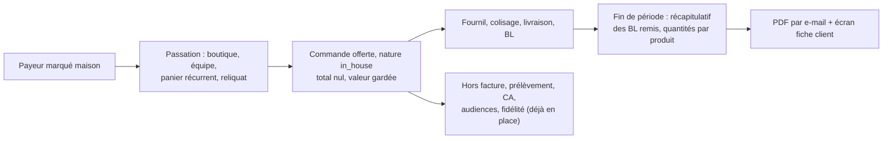

# Plan — nos restaurants : des commandes internes, un récapitulatif des BL

> 📐 **Plan v3** (2026-11-26). v1 et v2 contredites par `vitruve` le même jour ;
> les objections de la v2 (3 bloquantes, 6 sérieuses) sont intégrées au § 2.
> Rien n'est bâti. **Q1 (fiscal) se tranche avant le merge de L2.**
>
> Demande de Hugo, 2026-11-26 : « nos entités restaurants qui sont enregistrées
> comme des clients, on traque les commandes mais à la place de la facturation
> on fait un recap de tous les BL avec les quantités agrégées sur la période
> par produit ». Tranché le même jour : **quantités seules**, **un drapeau
> « maison » sur la société**, **un PDF par e-mail et un écran**, et — après la
> contradiction de la v1 — **la commande offerte comme point de départ**.
>
> La v1 créait une seconde façon de « ne pas facturer » : des commandes à
> montant positif, au compte, qu'il fallait retirer à la main d'une douzaine de
> lecteurs. La v2 s'appuie sur la commande offerte, qui sort déjà de la
> facture, du prélèvement, du chiffre d'affaires, des audiences, des habituels
> et de la fidélité **par construction** (total nul, `offer_nature` posée).

# Partie 1 — En simple

Un restaurant à nous est un client marqué **« maison »**. Il commande comme
avant — depuis son espace client, par la saisie de l'équipe, par un panier récurrent — mais **chaque
commande naît « interne »** : c'est une commande offerte de nature
`in_house`. Elle part au fournil, au colisage, en livraison ; elle n'est ni
facturée ni prélevée ; on garde ce qu'elle aurait valu.

À chaque fin de période, le restaurant reçoit un **récapitulatif des BL** :
chaque produit avec la quantité totale **remise** pendant la période, puis la
liste des BL couverts. Aucun prix.

**La bascule est simple** parce que le régime est porté par **chaque
commande** : marquer un restaurant « maison » ne touche que les commandes
passées **après** le geste. Ses commandes d'avant restent au compte et sont
facturées comme prévu ; aucune période n'est coupée en deux.

# Partie 2 — Technique

## 1. Ce qui existe (ouvert le 2026-11-26)

| Brique                                                                                                     | Où                                                                                                                                                                  |
| ---------------------------------------------------------------------------------------------------------- | ------------------------------------------------------------------------------------------------------------------------------------------------------------------- |
| La commande offerte, état implémenté                                                                       | [`../../commandes/passation/la-commande-offerte.md`](../../commandes/passation/la-commande-offerte.md)                                                              |
| Registre des natures `tasting, event, goodwill, replacement, sample`                                       | `packages/contracts/src/admin-order.ts:90` (`ORDER_OFFER_NATURES`)                                                                                                  |
| CHECK `orders_offer_nature_known` (liste en dur), `orders_offer_together`, `orders_offered_is_free`        | migration `20261123150100_la_commande_offerte`                                                                                                                      |
| Composition puis ligne « offert » ; recomposition à la révision                                            | `orders/domain/entities/order-offered-amounts.ts`                                                                                                                   |
| Lecteurs qui écartent `offer_nature IS NOT NULL`                                                           | doc offerte § 2.8                                                                                                                                                   |
| E-mails tus sans `notifyCustomer` ; BL « Commande offerte — sans facturation »                             | doc offerte § 2.9, `orders/domain/services/order-sheet-pdf-totals.ts`                                                                                               |
| Choix du règlement ; branche du payeur public                                                              | `orders/application/services/order-settlement.ts:86-88` (`requiresCardFor`, rend un booléen, APRÈS la composition)                                                  |
| L'offre est une ENTRÉE de la composition ; payeur résolu                                                   | `order-drafting.service.ts:223` (`orderPayerOf`), `:299` (`parties.offer`)                                                                                          |
| Le fait `order.offered` exige un auteur staff                                                              | `order-offered.event.ts:23`, `order-offering.ts:49-72`                                                                                                              |
| Libellé du courriel « Commande offerte » ; libellé du BL                                                   | `mail/templates/sections/order-mail-layouts.ts:17` ; `delivery-notes/domain/services/delivery-note-pdf.ts:296`                                                      |
| Nature publique dérivée de la forme juridique (pas de table)                                               | `prisma-order-guard.reader.ts` (`isPublicPayer`)                                                                                                                    |
| Passations d'une société (`place-shop-order` est l'invité sans société : hors sujet)                       | `orders/application/commands/place-order`, `place-order-for-customer` ; `services/recurring-occurrence-placement.ts` ; `backorder/.../convert-backorder.handler.ts` |
| BL : `handed_over_at`, `status` (dont `voided`), `content_version` ; lignes `sku`, `quantity`, `sale_unit` | `prisma/schema/public/delivery-notes.prisma`                                                                                                                        |

## 2. Décisions

- **D1 — La nature « maison » est une table du payeur.** `payer_in_house`
  (`company_id` PK, `declared_at`, `declared_by`). La présence d'une ligne
  **est** la nature. Écrivain : le contexte `account`. Lecture : un port
  `isInHousePayer(payerId)` à côté d'`isPublicPayer`.
- **D2 — Le geste**, sous un droit dédié `b2b_in_house_payers` (accordé à
  l'écran, jamais par migration), avec clé d'intention. **Toujours immédiat**,
  dans les deux sens : il ne vaut que pour les commandes passées après. Les
  commandes en cours gardent leur régime (la révision refuse déjà de changer
  l'offre, `OfferChangeOnRevisionError`).
- **D3 — Exclusions mutuelles, refus nommés** : un payeur public ne peut pas
  être maison ; un site ne suit la facturation d'un principal que si les deux
  ont la même nature maison.
- **D4 — Nature `in_house` au registre** des offres, et au CHECK
  `orders_offer_nature_known` par une migration **additive** (le CHECK est
  remplacé par sa liste élargie). Elle n'est **pas** proposée dans la saisie
  « Offerte » de l'équipe : elle ne naît que de D5.
- **D4 bis — `in_house` ne s'offre pas à la main.** Le domaine refuse une
  offre `in_house` venue de la saisie de l'équipe (`InHouseOfferNotStaffGrantable`) ;
  le menu des natures (`offer-reason-fields.ts:41`) la filtre.
- **D5 — Décidé à la composition, pas au règlement.** `OrderDrafting`, une
  fois le payeur résolu (`orderPayerOf`), lit `isInHousePayer` et injecte
  `offer: { nature: "in_house", note: "Commande interne", notifyCustomer: true }`
  avant `Order.draft` : la ligne « offert » et le total nul sont calculés par
  l'agrégat, comme pour toute offre. `requiresCardFor` ne garde qu'un refus
  nommé de la carte et du lien pour un payeur maison, placé avant la branche
  publique, sans lire `grantedTerms`. Pas de droit `b2b_offer_order` : la
  conversion d'un reliquat (`convert-backorder.handler.ts:94-98`) juge la
  branche maison **avant** `ensureMayOffer`. Passations couvertes :
  `place-order` (espace client), `place-order-for-customer`, paniers
  récurrents, conversion de reliquat. `isInHousePayer` est une lecture nommée
  publiée par `account` (`lint:prisma-model-ownership`).
- **D5 bis — Pas de fait `order.offered` pour `in_house`.** Ce fait dit
  « l'équipe a offert » et exige son auteur ; une commande interne n'a pas
  d'offrant. `order.offered` et `order.offer_revalued` ne sont pas publiés
  pour `in_house` ; la commande reste témoignée par `order.placed`, et sa
  nature se lit sur la commande. Aucun abonné neuf.
- **D5 ter — Ce que `in_house` hérite de `offered`, écrit et éprouvé.**
  Annulation : la règle d'une commande gratuite (`order-cancellation.ts:161`),
  sans engagement au compte — admis, c'est interne ; e2e d'une annulation
  tardive par le restaurant. Révision après l'arrêt : staff seul, comme
  aujourd'hui. Une commande au compte d'avant le marquage reste au compte ;
  la révision refuse de la rendre gratuite (`RevisionFreesAccountOrderError`).
- **D6 — Les libellés.** Régime `in_house` dans les courriels (dictionnaire,
  modèle, `pnpm tool mail-copy:digest`, `lint:mail-copy-digest`) : « Commande
  interne », pas « offerte ». BL (`delivery-note-pdf.ts:296`), feuille
  (`order-sheet-pdf-totals.ts`) et écrans : « Commande interne — sans
  facturation ». L'export des ventes expose la **nature** de l'offre à côté
  de `offered` (`sales-export.view.ts:56`) : la comptabilité ne confond pas
  cadeaux et consommation interne. Les 14 lecteurs de `offerNature !== null`
  dans `lafoliecoffee` sont relus un par un en L2 ; par défaut, `in_house` s'y
  comporte comme une offre.
- **D7 — Le récapitulatif est un document figé, sans montant.**
  `in_house_recap` (payeur, `[from, to[`, numéro `RBL-…`, émis le, clé de
  stockage, `replaced_by`), `in_house_recap_line` (`sku`, nom, `sale_unit`,
  quantité totale), `in_house_recap_note` (BL couverts, `content_version`
  figée). Un BL n'est que dans un récapitulatif **non remplacé** (index
  unique partiel). **Fenêtre par BL** : `status = 'handed_over'` et
  `handed_over_at` dans `[from, to[`, jours de Paris par la brique de
  `lint:business-day` ; BL courant, jamais `delivery_note_version`. Un
  reliquat (rang > 1) entre au mois de SA remise. Agrégation par (`sku`,
  `sale_unit`) ; nom affiché : celui du BL remis le plus tard, départagé par
  numéro.
- **D8 — Un BL révisé après récapitulatif** (`content_version` au-delà de la
  figée) est signalé à l'écran ; « Réémettre » fabrique un rectificatif qui
  remplace l'ancien (gardé, marqué remplacé). Pas d'avoir : pas d'argent.
- **D9 — Le mois civil, par une route de cron à lui.** Route
  `POST /internal/in-house-recaps/run` appelée par le cron de la passerelle le
  1er à 00h30 Paris, `@Idempotent` (une issue par (payeur, mois) dans
  `in_house_recap_run`, rejouable) ; test `dev-toolbox` des routes de cron mis
  à jour. Un mois sans BL écrit une issue « vide » : un récapitulatif manqué
  se distingue d'un mois vide, et l'écran le montre. Pas de branche dans
  l'automatisme des factures.
- **D10 — Remise.** PDF rangé au stockage, specimen sur la planche
  (`lint:pdf-specimens`) ; `mail.send` avec pièce jointe `pdfStored` et
  `subjects` littéraux, au contact principal du payeur. Onglet
  « Récapitulatifs » de la fiche client : liste, PDF, renvoyer, réémettre.
- **D11 — Les portes neuves à satisfaire** : ressource `b2b_in_house_payers`
  dans `StaffResource` (aucune migration ne l'accorde) ; `declared_by` au
  registre RGPD (`lint:rgpd-staff`) ; clés d'intention des gestes
  (`lint:intent-key-gestures`, `lint:front-intent-keys`).

## 3. Lots

| Lot    | Contenu                                                                                                                                                         |
| ------ | --------------------------------------------------------------------------------------------------------------------------------------------------------------- |
| **L1** | `payer_in_house`, la ressource, le geste, D3, la lecture publiée ; écran de la fiche client                                                                     |
| **L2** | Nature `in_house` (registre, CHECK) ; D4 bis, D5 à D6 ; e2e : espace client, équipe, récurrent, reliquat — total nul, hors facture, hors CA, annulation tardive |
| **L3** | Agrégation pure (tests domaine) ; tables ; handler mensuel et ses issues ; D8                                                                                   |
| **L4** | PDF, specimen, e-mail, écran                                                                                                                                    |

## 4. Questions

- **Q1 (Hugo / cabinet)** — Le cadre fiscal. La commande offerte a ses
  questions de TVA (doc offerte § 3) ; une livraison interne n'est pas un
  cadeau. Si un restaurant est une **société distincte**, une livraison entre
  sociétés est en principe une vente facturable. **À trancher avant le merge
  de L2** : `in_house` s'écrit au CHECK et une nature ne se retire jamais
  (`admin-order.ts:65`).
- **Q2** — Faut-il masquer les prix unitaires sur le BL d'une commande
  interne ? Proposé : oui en L2, le BL interne n'a pas de total à justifier.
- **Q3** — La valeur interne (ce que les commandes auraient coûté) doit-elle
  apparaître quelque part (coût matière par restaurant) ? Elle est gardée sur
  chaque commande ; aucun écran ne la somme dans ce plan.
