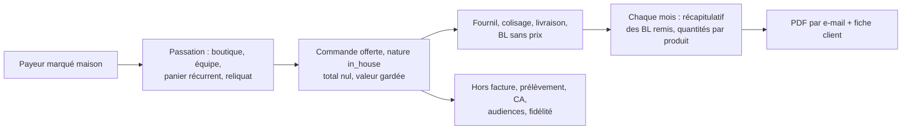

# Nos restaurants — des commandes internes, un récapitulatif des BL

> ✅ **Implémenté** (2026-11-26, commits `f0100b8db`, `606eadaac`, `5fd97cc10`,
> `02737ef0c`, `b67219c3e`, `9a1a9d355`), sur `dev`, pas en production.

# Partie 1 — En simple

Un restaurant à nous est un client marqué **« maison »**. Il commande comme
les autres — depuis son espace client, par la saisie de l'équipe, par un
panier récurrent, par la conversion d'un reliquat — mais **chaque commande
naît « interne »** : c'est une commande offerte de nature `in_house`. Elle
part au fournil, au colisage, en livraison ; elle n'est ni facturée ni
prélevée ; on garde ce qu'elle aurait valu.

Chaque mois, le restaurant reçoit un **récapitulatif des BL** : chaque
produit avec la quantité totale remise pendant le mois, puis la liste des BL
couverts. Aucun prix, ni sur le récapitulatif, ni sur le BL interne.

Le régime est porté par **chaque commande** : marquer un restaurant « maison »
(ou le démarquer) ne vaut que pour les commandes passées **après** le geste.
Ses commandes d'avant gardent leur régime ; aucune période n'est coupée en
deux.

# Partie 2 — Technique

## 1. La nature « maison » du payeur

- **Table `payer_in_house`** (`prisma/schema/public/account.prisma`,
  `PayerInHouse`), un **historique** : une ligne par période de marquage
  (`declared_at/by`, `withdrawn_at/by`). La nature est la ligne vivante
  (`withdrawn_at IS NULL`) ; l'index unique partiel
  `payer_in_house_live_company` en tient une au plus. Rien ne s'efface.
- **Écrivain** : le contexte `lafoliecoffee/account` (`InHousePayer`,
  `set-in-house-payer`). **Lectures publiées** : `InHousePayerReader`
  (`isInHousePayer`), `InHousePeriodsReader`, `InHouseMonthPayersReader` —
  les autres contextes ne lisent pas la table (`lint:prisma-model-ownership`).
- **Le geste** : `GET/PUT /admin/companies/:companyId/in-house`, sous la
  ressource `b2b_in_house_payers` (accordée à l'écran, jamais par migration),
  avec clé d'intention. Écran : carte `fiche-client/in-house-payer-card/`.
- **Refus nommés** (`account/domain/errors/in-house-payer-errors.ts`) : un
  payeur public ne devient pas maison, et un payeur maison ne devient pas
  public ; un site ne suit la facturation d'un principal que si les deux ont
  la même nature (`in-house-billing-follow.ts`).
- `declared_by` / `withdrawn_by` sont au registre RGPD (`lint:rgpd-staff`).

## 2. La commande interne

- **Nature `in_house`** au registre des offres (`ORDER_OFFER_NATURES`) et au
  CHECK `orders_offer_nature_known` (migration
  `20261126170000_la_commande_interne`). Elle n'est pas proposée dans la
  saisie « Offerte » de l'équipe, et le domaine refuse qu'on l'y pose.
- **Décidée à la composition** : `OrderDrafting`, une fois le payeur résolu,
  lit `isInHousePayer` et pose l'offre `in_house` avant `Order.draft`. La
  ligne « offert » et le total nul sont calculés par l'agrégat, comme pour
  toute offre ; la commande interne l'emporte sur une offre saisie par
  l'équipe. Passations couvertes : espace client, saisie de l'équipe, paniers
  récurrents, conversion de reliquat (jugée avant `ensureMayOffer`).
- **Règlement** : la carte et le lien sont refusés à un payeur maison, par un
  refus nommé (`orders/domain/errors/in-house-buyer-errors.ts`).
- **Pas de fait `order.offered`** ni `order.offer_revalued` pour `in_house` :
  il n'y a pas d'offrant. La commande est témoignée par `order.placed`, sa
  nature se lit sur la commande.
- **Hérité de l'offerte** : hors facture, prélèvement, chiffre d'affaires,
  audiences, habituels et fidélité (doc
  [`../../commandes/passation/la-commande-offerte.md`](../../commandes/passation/la-commande-offerte.md)
  § 2.8). Annulation : la règle d'une commande gratuite. Une commande au
  compte d'avant le marquage reste au compte ; la révision refuse de la
  rendre gratuite.
- **Libellés** : régime `in_house` dans les e-mails (« Commande interne ») ;
  BL et feuille de commande : « Commande interne — sans facturation ».
  L'export des ventes porte `offerNature` à côté de `offered`.
- **Sans prix** (décidé par Hugo le 2026-11-26) : le BL client
  (`delivery-note-pdf.ts`, `settlement === "in_house"`) et la feuille de
  commande (`order-sheet-pdf.ts`, `isPriced`) n'affichent que les quantités.
  Exemple sur la planche : `delivery-note-in-house.pdf`.

## 3. Le récapitulatif mensuel

Contexte `src/lafoliecoffee/in-house-recaps/`, tables
`prisma/schema/public/in-house-recap.prisma` :

| Table                 | Ce qu'elle porte                                                                                                   |
| --------------------- | ------------------------------------------------------------------------------------------------------------------ |
| `in_house_recap`      | payeur, mois `AAAA-MM`, `[period_from, period_to[`, numéro `RBL-AAAAMM-NNNN`, émis le, PDF rangé, `replaced_by_id` |
| `in_house_recap_line` | (`sku`, `sale_unit`), nom, quantité totale                                                                         |
| `in_house_recap_note` | les BL couverts, avec leur `content_version` figée                                                                 |
| `in_house_recap_run`  | une issue par (payeur, mois), vide comprise : un mois manqué se distingue d'un mois sans BL                        |

- **Fenêtre par BL** : BL courant remis (`handed_over`), `handed_over_at` dans
  le mois civil de Paris ; jamais une version figée
  (`lint:delivery-note-version-readers`). Un reliquat entre au mois de sa
  propre remise. Un BL n'est que dans un récapitulatif non remplacé.
- **Agrégation** (`recap-aggregation.ts`) par (`sku`, `sale_unit`) ; le nom
  affiché est celui du BL remis le plus tard.
- **Le passage** : le Worker de l'API appelle `POST admin/in-house-recaps/run`
  chaque jour à 00h30 Paris (`IN_HOUSE_RECAPS_CRON`, `container/worker.ts` et
  `wrangler.jsonc`). Le backend traite les mois clos manqués des payeurs
  maison (`missed-months.ts`) et se tait sur les issues déjà rangées : un 1er
  du mois manqué se rattrape le lendemain.
- **BL révisé après coup** (`content_version` au-delà de la figée) : listé par
  `GET admin/in-house-recaps/revised` ; « Réémettre » fabrique un rectificatif
  qui remplace l'ancien, gardé et marqué. Pas d'avoir : pas d'argent. Un
  récapitulatif remplacé ne se renvoie pas (409).
- **Remise** : le PDF (`in-house-recap-pdf.ts`, sans montant) est rangé au
  stockage et joint par référence (`pdfStored`) à l'e-mail
  `customer.in-house-recap`, parti par `mail.send`. Destinataire : la règle
  de la facture — le plus ancien contact de facturation, sinon le détenteur
  du compte ; personne à prévenir est un refus nommé, jamais une adresse
  devinée. Exemple sur la planche : `in-house-recap.pdf`.
- **Écran** : carte `fiche-client/in-house-recaps-card/` de l'onglet
  facturation — liste, PDF, renvoyer, réémettre.

## 4. Hors du système

- **La refacturation entre sociétés** ne passe pas par le système : le
  directeur financier et l'expert-comptable la font à leur façon (décidé par
  Hugo le 2026-11-26).
- **La valeur interne** (ce que les commandes auraient coûté) est gardée sur
  chaque commande ; aucun écran ne la somme par restaurant.
