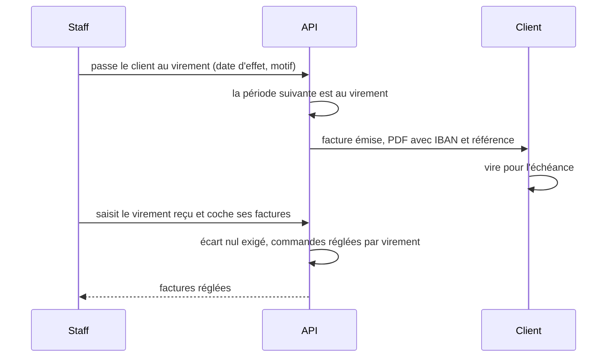

# Le paiement au compte par virement

> ✅ **Doc d'état, relue dans le code le 2026-11-12.** En production depuis
> `adb9c41e3` : le compte créancier aux quatre yeux, le moyen d'encaissement
> daté du payeur, la facture au virement, le virement reçu qui règle ses
> factures, les virements en retard. Sur `dev` seulement : l'écran « Moyens
> de paiement » de la fiche client et la boutique (`d7161d4a0`), l'écart
> montré avant de valider et « Réglée par virement le … » (`7fbaa6bad`). Ce
> document remplace le plan du chantier ; ses versions et ses cinq
> relectures par `vitruve` sont dans l'historique git.

# Partie 1 — L'explication simple

Un client pro règle **à la commande, par carte** (ouvert à tous), ou **au
compte** quand le staff lui accorde le paiement différé. Au compte, il y a
deux moyens d'encaisser :

- **le prélèvement SEPA** — RIB du client, mandat signé, prélèvement
  périodique ;
- **le virement bancaire** — rien à signer : la facture porte **notre IBAN**,
  une **référence à reporter** (le numéro de facture) et une **date
  d'échéance** ; le client vire ; le staff saisit le virement reçu, qui
  règle les factures.

```
Moyens de paiement (fiche client)
├─ À la commande — carte bancaire       le socle, ouvert à tous
└─ Paiement différé                     s'accorde au client, par le staff seul
   1 · Mode de facturation              hebdomadaire · deux fois par mois · mensuel
   2 · Comment il règle                 Prélèvement SEPA  |  Virement bancaire
   3 · Ce que ce choix demande
       ├─ Prélèvement : RIB → mandat → règlement périodique
       └─ Virement    : nos coordonnées, l'échéance du cycle, les factures à régler
```



Ce qu'il faut retenir :

- **Une période de facturation n'a qu'un moyen.** Un changement prend
  effet à la prochaine clôture du payeur — tout de suite pour un payeur qui
  n'a jamais commandé.
- **La facture fait foi** : le lot de prélèvement ne prend jamais un bon dont
  la facture demande un virement, et inversement.
- **L'IBAN ne voyage jamais par e-mail** (décidé par Hugo le 2026-11-12) :
  il n'est que sur la facture (PDF et XML Factur-X). L'e-mail dit
  « virement », l'échéance, la référence, et renvoie à la facture.
- **Changer notre IBAN demande deux personnes** : celui qui le saisit ne peut
  pas le confirmer, et le second le ressaisit à l'aveugle depuis le RIB de la
  banque.
- Un client au virement qui ne paie pas est **signalé** (virements en
  retard, fiche client), jamais bloqué automatiquement.

# Partie 2 — La technique

Tout vit dans `apps/lfd-api/src/lafoliecoffee/accounting/` sauf mention
contraire.

## 1. Le compte créancier aux quatre yeux

Migration `20261112100000_le_compte_creancier_aux_quatre_yeux` (additive,
retour dans `prisma/rollback/`).

- **La première saisie est immédiate** : tant que l'entité n'a aucun compte
  confirmé, aucun client ne paie. Les **changements** suivants passent aux
  quatre yeux : `LegalEntity` porte un compte en attente
  (`domain/value-objects/pending-creditor-account.ts` — IBAN, BIC, titulaire,
  adresse, chiffrés comme l'actuel, auteur, instant, identifiant).
- `confirmCreditorAccount(pendingId, ibanRetapé, confirmateur)` refuse :
  confirmateur = auteur (identifiant interne de la fiche staff, pas le
  `sub`), IBAN retapé différent (sans dire quel caractère), saisie remplacée,
  et la règle du titulaire après le premier mandat. Annuler la saisie en
  attente est un geste (`cancelPendingCreditorAccount`).
- Routes : `PUT admin/accounting/legal-entities/:id/creditor-account`
  (`admin-legal-entity-banking.controller.ts`),
  `POST …/creditor-account/pending/:pendingId/confirm` et
  `DELETE …/creditor-account/pending/:pendingId`
  (`admin-creditor-account-review.controller.ts`), sous `b2b_accounting`.
- **Le mapper est le seul point à tenir** (`infrastructure/legal-entity.mapper.ts`) :
  l'instantané `creditorSnapshot` ne se construit que depuis le compte
  confirmé. Factures, factures carte, pain.008, mandat PDF, arrêtés,
  brouillons, lot d'essai et spécimens passent tous par lui.
- Concurrence : une `version` sur l'entité, vérifiée par le `save` (409
  « l'entité a changé, rechargez »).
- La cloche de la comptabilité sonne à la proposition, à la confirmation et à
  l'annulation (`ring-creditor-account-review.handler.ts`) ; l'écran
  (`comptabilite/entites-juridiques/detail/creditor-account-pending/`) montre
  l'auteur, l'instant et les quatre derniers caractères de l'IBAN proposé.

## 2. Le moyen d'encaissement daté du payeur

Migrations `20261112150000_le_droit_du_moyen_d_encaissement` (la ressource
`b2b_collection_means`) et `20261112150100_le_moyen_d_encaissement_du_payeur`.

- `CollectionMeans` = `sepa_debit` | `bank_transfer`
  (`domain/value-objects/collection-means.ts`) ; aucune ligne = prélèvement.
- L'agrégat `PayerCollectionMeansHistory`
  (`domain/entities/payer-collection-means-history.ts`) a **son propre
  historique** : le moyen ne crée aucune clôture, il n'entre ni dans
  `PayerTimeline` ni dans `InvoicingCalendar`, et ne lit le calendrier du
  mode que pour se dater. Un changement prend effet à la prochaine clôture,
  ou tout de suite pour un payeur qui n'a jamais commandé et sans écriture
  depuis la dernière clôture — la règle du mode, partagée par une fonction
  pure.
- **Un seul changement en attente par payeur, mode et moyen confondus** :
  tant que l'un est programmé, l'autre est refusé (409 qui nomme le
  changement en attente et sa date, `payer-change-pending-errors.ts`). Les
  deux gestes prennent d'abord le verrou de la ligne du payeur
  (`domain/ports/payer-change-lock.ts`), dans le même ordre.
- Un site qui suit la facturation de son principal prend le moyen du
  principal. Les mandats restent en place au passage au virement.
- Routes : `GET`, `PUT` et `DELETE …/scheduled` sur
  `admin/accounting/legal-entities/:id/payers/:companyId/collection-means`
  (`admin-payer-collection-means.controller.ts`), avec motif, journalisés.

## 3. Le moyen d'une période, et qui le lit

- `collectionMeansAt(entries, début de période)`
  (`domain/services/collection-means-timeline.ts`) : le moyen d'une période
  est celui en vigueur à son début. Une commande prend le moyen de la
  période où elle est **soldée**, comme elle en prend la facture.
- L'émission et le lot lisent le moyen par payeur en une lecture groupée
  (`domain/ports/payers-collection-means.reader.ts`), jamais par commande.
- **La facture fige son moyen** : `invoicePaymentMeansOf`
  (`domain/services/monthly-invoicing.ts`) rend `SepaCreditTransferMeans`
  (`domain/entities/invoice.types.ts`, code 58) pour une période au
  virement. La clé de `invoice_monthly_outcome` ne change pas : un payeur
  n'a qu'un moyen par clôture.
- **Le lot lit le moyen de la FACTURE de chaque bon**, jamais celui du payeur
  aujourd'hui : un bon facturé « virement » n'est jamais prélevé, un bon
  facturé « prélèvement » l'est même si le payeur est passé au virement
  depuis. Les bons sans facture (chemin des arrêtés, prélèvement d'essai)
  lisent le moyen de LEUR période ; au virement, ils sont refusés (jamais
  d'arrêté au virement — `domain/services/collection-assembly.ts`).
- `VerdictContext.collectionMeansOf` (`domain/services/collection-verdict.ts`)
  est lu au même endroit par le jugement du mandat, la constitution, « vous
  serez prélevé », les payeurs comptés et le mandat effectif. Un payeur au
  virement n'est ni prélevé ni compté « sans mandat », et reste compté comme
  client « au compte » (`counted-payers.ts`).
- Le blocage (`directDebitBlockedAt`) vaut pour les deux moyens et se dit
  « paiement au compte suspendu » ; les noms de champs du contrat ne
  changent pas.

## 4. La facture au virement

- **Factur-X** (`domain/services/facturx-settlement.ts`) : BT-81 = 58,
  BT-84 l'IBAN figé de l'entité (BT-86 le BIC s'il est connu), BT-83 la
  référence (le numéro de facture).
- **L'échéance suit le cycle de facturation**, quel que soit le moyen :
  celle que l'émission calcule déjà (le délai du prélèvement après la
  clôture, reporté au premier jour ouvré). **Aucun plafond n'est contrôlé
  aujourd'hui** : une émission tardive peut porter l'échéance au-delà de
  45 jours. Le réglage propre au virement est un plan
  ([`plan-echeance-du-virement.md`](plan-echeance-du-virement.md)).
- **Le PDF** porte le bloc « Règlement par virement » avec IBAN et
  référence. **L'e-mail** « facture émise »
  (`apps/lfd-api/src/mail/templates/invoice-issued-mail.ts`) ne porte aucune
  coordonnée bancaire ; un test le tient
  (`mail/templates/__tests__/invoice-issued-mail.spec.ts`).
- **Le statut** (`domain/services/invoice-settlement.ts`) :
  `transfer_expected`, puis `settled` par un virement reçu, ou
  `transfer_overdue` après l'échéance.

## 5. Le virement reçu

Migrations `20261112170000_la_commande_reglee_par_virement` et
`20261112170100_le_virement_recu`.

- `ReceivedBankTransfer.record` (`domain/entities/received-bank-transfer.ts`) :
  un virement (montant en centimes, date, référence du relevé) et **les
  factures qu'il règle**, au virement, non réglées, d'un seul payeur. Le
  total des restes dus doit égaler le montant, sinon refus qui dit l'écart.
  Rejouer une facture déjà réglée est refusé en la nommant.
- Dans la même transaction, chaque commande de ces factures passe par
  l'agrégat `OrderCollection.settleByTransfer`
  (`domain/entities/order-collection.ts`, état `settled_by_transfer`) : une
  écriture sur la seule facture laisserait les commandes `due`, et un retour
  au prélèvement les prélèverait.
- **L'aperçu** : `previewBankTransfer` partage avec `record` le même juge des
  factures (une seule arithmétique). Routes, sous `b2b_accounting`
  (`http/admin-bank-transfers.controller.ts`) :
  `POST admin/accounting/legal-entities/:id/bank-transfers`,
  `GET …/bank-transfers/preview?amountCents=…&invoiceIds=a,b` →
  `{ amountCents, invoicesDueCents, gapCents }`,
  `GET admin/accounting/transfer-invoices/unpaid`.
- **Le panneau** (`apps/lfd-backoffice-frontend/src/app/comptabilite/bank-transfer-panel/`)
  lit l'aperçu à chaque saisie, montre l'écart avant « Enregistrer » et
  n'active le bouton qu'à écart nul. Les paiements partiels ne sont pas pris
  en charge. **Un avoir ne se déduit pas d'un virement** : le panneau le dit.
- **Les virements en retard** : `unpaid-transfer-invoices.reader.ts`, la
  page `comptabilite/virements-en-retard/` et la carte de la fiche client
  `fiche-client/transfer-invoices-card/`.
- **« Réglée par virement le … »** : `IssuedInvoiceView.settledByTransferOn`
  (le jour de réception, lu sur `received_bank_transfer_invoice` par
  `domain/ports/invoice-transfer-settlement.reader.ts`, `null` sinon), dit
  par la fiche facture du back-office et le dialogue de facture de la
  boutique.

## 6. Les écrans

- **Back-office**, fiche client › Moyens de paiement : le bloc « Paiement
  différé » porte un `fold-view-toggle` Prélèvement SEPA / Virement bancaire
  (`fiche-client/collection-means-choice/`) qui montre le dessous sans rien
  changer ; changer demande un motif, la confirmation annonce la date d'effet
  que le serveur posera. Un changement programmé ferme le choix et
  s'annule. Le dessous du virement (`fiche-client/bank-transfer-means/`) :
  titulaire, BIC, IBAN par ses quatre derniers caractères, l'échéance du
  cycle, les factures à régler. La carte du mode reste où elle est.
- **Boutique** : `GET companies/:companyId/collection-means` → `{ means }`
  (`http/company-collection-means.controller.ts`) — tout membre de la
  société (404 non divulguant sinon), le moyen du principal pour un site qui
  le suit, rien de l'entité servi. La carte « Paiement » de `/mon-compte`
  dit « Paiement au compte, par virement à réception de facture » et la
  carte du mandat disparaît (`apps/lfc-ecommerce-frontend/src/app/client/client-collection-means.service.ts`).
  Le dialogue d'une facture au virement non réglée dit la même phrase, la
  référence à reporter, et renvoie au PDF pour les coordonnées.

## 7. Les repères

Le code cite les règles par ces repères ; chacun dit ce qui est vrai
aujourd'hui.

| Repère   | La règle                                                                                                                      | Section |
| -------- | ----------------------------------------------------------------------------------------------------------------------------- | ------- |
| T0       | le compte créancier aux quatre yeux                                                                                           | § 1     |
| T1       | le moyen d'encaissement daté du payeur                                                                                        | § 2–3   |
| T2, T3   | la facture au virement, son statut, le virement reçu, les virements en retard                                                 | § 4–5   |
| T4, T5   | l'écran de la fiche client, la boutique                                                                                       | § 6     |
| V1       | le moyen est une propriété du payeur ; un site qui suit son principal prend le sien                                           | § 2     |
| V2       | un changement prend effet au début d'une période, jamais au milieu                                                            | § 2     |
| V3', V4' | le moyen d'une période est celui en vigueur à son début ; facture et lot lisent le même                                       | § 3     |
| V5       | la facture porte IBAN, BIC, référence, échéance, et en Factur-X 58, BT-84, BT-83                                              | § 4     |
| V6       | l'échéance suit le cycle de facturation ; aucun plafond contrôlé                                                              | § 4     |
| V7       | le virement reçu règle une ou plusieurs factures, écart nul, par `OrderCollection`                                            | § 5     |
| V8, C7   | une facture au virement non réglée à l'échéance remonte dans les virements en retard ; pas de relance par e-mail              | § 5     |
| V9, K4   | le blocage vaut pour les deux moyens : « paiement au compte suspendu »                                                        | § 3     |
| V10      | changer de moyen : geste daté, motif, journal, droit `b2b_collection_means` ; jamais d'arrêté au virement                     | § 2–3   |
| V11      | les mandats restent en place au passage au virement                                                                           | § 2     |
| V12      | pas de rapprochement bancaire automatique                                                                                     | § 8     |
| C1       | le moyen a son propre historique, hors `PayerTimeline` et `InvoicingCalendar`                                                 | § 2     |
| C3–C6    | l'IBAN confirmé est le seul lu par l'instantané ; double saisie à l'aveugle ; la confirmation désigne sa saisie ; quatre yeux | § 1     |
| K1, K11  | un seul changement en attente par payeur, mode et moyen confondus, sous le verrou du payeur                                   | § 2     |
| K2, K9   | le lot lit le moyen de la facture de chaque bon ; un bon sans facture lit celui de sa période                                 | § 3     |
| K3       | le moyen entre dans `VerdictContext`                                                                                          | § 3     |
| K5       | un payeur au virement est compté « au compte »                                                                                | § 3     |
| K7       | la clé de `invoice_monthly_outcome` ne change pas                                                                             | § 3     |
| K10      | `invoicePaymentMeansOf` rend le virement ; une facture émise avec `null` se lit « prélèvement »                               | § 3–4   |
| K12, K13 | les dates du mode restent hors de K1 ; la représentation après retour et l'autopilote lisent le moyen de la facture           | § 3     |

## 8. Reste à faire

- **Le moyen figé sur la facture dans `IssuedInvoiceView`** : le dialogue de
  la boutique lit « virement » sur le statut de la ligne
  (`transfer_expected`, `transfer_overdue`) transmis par la liste ; une
  facture réglée, ou ouverte d'ailleurs que la liste, ne dit pas son moyen.
- **L'IBAN entier de l'entité à l'écran du staff** : `LegalEntityView` ne sert
  que `creditorAccountLast4`, à dessein. Le servir en entier serait une
  décision (route dédiée, droit, journal).
- **Les décisions de la nuit du 2026-11-12** (écart avant de valider, avoir
  non déduit, « Réglée par virement le … ») ont été tranchées sans `vitruve`
  ni Hugo : à relire avec lui.
- **Avant de passer un vrai client au virement** : déployer T4 et T5, et
  vérifier en production (non vérifiable dans le dépôt) qu'aucune entité
  n'a `creditor_iban_sealed IS NULL AND creditor_iban IS NOT NULL` :
  l'instantané ne lit plus la colonne claire.
- Hors périmètre : la lecture des relevés bancaires (V12), les paiements
  partiels, la déduction d'un avoir, une relance automatique par e-mail.
