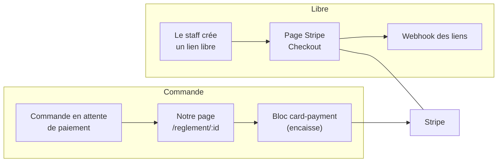
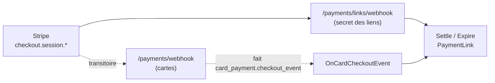
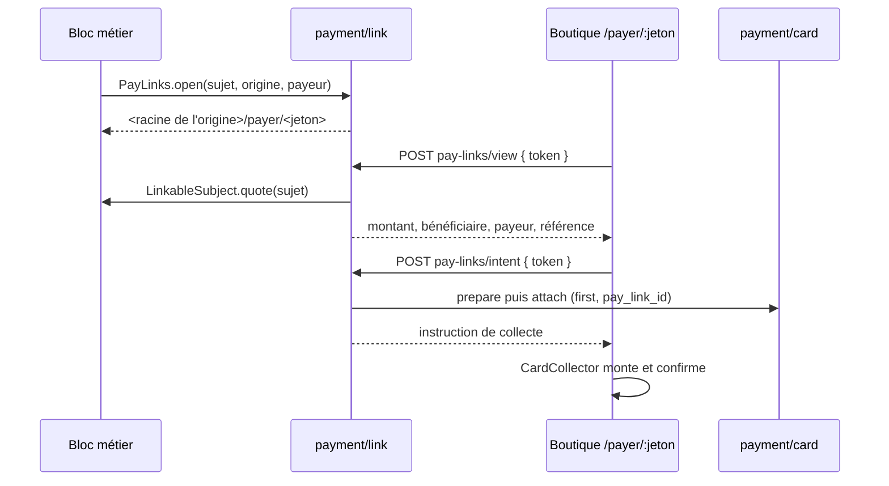

# Les liens de paiement

> ✅ **Doc d'état, relue dans le code le 2026-11-22.** Elle décrit ce qui
> existe. La suite envisagée (un lien vers n'importe quel sujet : commande,
> facture de période, régularisation) est dans
> [`plan-le-lien-vers-un-sujet.md`](plan-le-lien-vers-un-sujet.md).
> Le blocage du prélèvement, longtemps décrit dans la même page, a sa doc :
> [`../prelevement/blocage-du-prelevement.md`](../prelevement/blocage-du-prelevement.md).

# Partie 1 — L'explication simple

Un **lien de paiement** est une adresse qu'on envoie à un client pour qu'il
paie **par carte**, sans passer par la caisse ni par le prélèvement.

Il en existe **deux sortes** aujourd'hui, qui ne marchent pas pareil :

| Sorte                                    | Pour payer quoi                               | Où le client paie                                       | Qui le crée                                                                                    |
| ---------------------------------------- | --------------------------------------------- | ------------------------------------------------------- | ---------------------------------------------------------------------------------------------- |
| **Lien d'une commande**                  | une commande pas encore payée                 | **notre** page, dans l'espace client (`/reglement/:id`) | personne : il existe dès que la commande attend son paiement ; le staff le copie ou le renvoie |
| **Lien libre** (« Régularisation août ») | une somme hors commande, choisie par le staff | une page **Stripe Checkout** hébergée chez Stripe       | le staff, dans Comptabilité › Liens de paiement                                                |

Ce qu'il faut retenir :

- **Le lien d'une commande passe déjà par le bloc `card-payment`**, celui
  qui encaisse toutes les cartes : changer de prestataire de carte le
  ferait suivre.
- **Le lien libre, non** : il parle directement à Stripe, avec sa propre
  page, son webhook et son secret. C'est la partie qui dépend du prestataire.
- **Un lien libre n'est pas une commande** : il ne compte ni au chiffre
  d'affaires, ni au prélèvement, et ne règle aucune commande tout seul. Le
  rapprochement avec ce qu'il régularise se fait à la main.
- **On ne peut pas encore payer une facture** (une période de bons) par
  lien : une facture se règle par prélèvement ou par virement.

# Partie 2 — La technique

Écran : Comptabilité › Liens de paiement
(`apps/lfd-backoffice-frontend/src/app/comptabilite/liens-de-paiement/`),
deux onglets — « Commandes à régler » (`orders-to-settle/`) et « Liens
libres » (`free-links/`, panneau de création `new-link-panel/`).
Contrat : `packages/contracts/src/payment-link.ts`.

## 1. Le lien d'une commande

- **La liste** : les commandes au règlement `pending` ou `failed`, non
  annulées (`list-orders-awaiting-payment.handler.ts`), avec l'adresse de la
  page de règlement de l'espace client. Sans `CLIENT_BASE_URL`, `paymentUrl`
  vaut `null` : pas de lien affiché, et le renvoi est refusé en le disant.
- **Le renvoi par e-mail** à l'acheteur :
  `resend-order-payment-link.handler.ts`, modèle d'e-mail « lien de
  règlement d'une commande ».
- **La page** `/reglement/:id` (boutique, `client/commande/reglement-page/`),
  la seule page de règlement — `/commandes/:id/regler` a été retirée le
  2026-11-22, aucun e-mail ne l'ayant jamais portée en production. Le lien
  se génère dans `payment-link.ts`. La page relit le paiement par le bloc
  `payment` (`get-order-payment.handler.ts`) et n'en crée jamais un nouveau ;
  une carte refusée se règle encore tant que l'intention vit. Le formulaire
  de carte se monte par le service de collecte (`CardCollector`), qui lit
  l'instruction neutre du prestataire.
- **Qui entre** (`settle.guard.ts`) : le visiteur qui vient de passer la
  commande (son paiement est en mémoire, `HeldOrderPayment`, compte ou non) ;
  sinon un client connecté ; sinon la connexion d'abord, puis retour sur la
  page.
- **Commande saisie par l'équipe** (`place-order-for-customer.handler.ts`) :
  le règlement se fait par ce lien, que le client suit lui-même ; jamais un
  numéro de carte dicté. Non réglée à l'heure limite, elle fait sonner la
  cloche ; un rappel part au client (`order-settlement-reminders.e2e-spec`).

| Route                                                        | Geste                       |
| ------------------------------------------------------------ | --------------------------- |
| `GET admin/accounting/payment-links/orders`                  | les commandes à régler      |
| `POST admin/accounting/payment-links/orders/:orderId/resend` | renvoyer le lien par e-mail |

(`lafoliecoffee/orders/http/admin-order-payment-links.controller.ts`)

## 2. Le lien libre

- **Agrégat** `PaymentLink`
  (`lafoliecoffee/payments/domain/entities/payment-link.ts`) : société,
  montant en centimes (> 0), libellé (1 à 140 caractères, repris sur la page
  Stripe), session Stripe, URL ; états `open → paid | cancelled | expired`.
  Table `payment_links` (`prisma/schema/public/accounting.prisma`), sans
  suppression : un lien se clôt par son statut.
- **Payé** seulement sur `checkout.session.completed` avec
  `payment_status = paid`, ou sur `async_payment_succeeded` ; **expiré** sur
  `checkout.session.expired`. Un paiement qui arrive sur un lien annulé le
  passe quand même à `paid` (l'argent est encaissé) et fait sonner la cloche
  (`payment_link.paid_after_cancel`).
- **Annuler** ferme aussi la session chez Stripe : plus personne ne paie par
  elle.
- **Plafond** : `accounting_settings.payment_link_max_cents` (`null` =
  aucun), lu à la création ; au-delà, refus qui nomme le plafond. Réglage :
  `admin/accounting/settings`.

| Route                                            | Geste            |
| ------------------------------------------------ | ---------------- |
| `GET admin/accounting/payment-links`             | les liens libres |
| `POST admin/accounting/payment-links`            | créer            |
| `POST admin/accounting/payment-links/:id/cancel` | annuler          |

(`lafoliecoffee/payments/http/admin-payment-links.controller.ts`)

## 3. Le webhook des liens libres

Le bloc `card-payment` a repris les cartes, mais pas les liens libres (plan
M2, §4.5 : ils restent au commerce tant qu'un lien n'est pas un sujet de
`card-payment`). D'où deux chemins :

- **L'endpoint des liens** : `POST /payments/links/webhook`
  (`payment-links-webhook.controller.ts`), signé avec
  `STRIPE_LINKS_WEBHOOK_SECRET`. Sans secret ou avec une signature fausse :
  400, rien n'est traité, Stripe réessaie.
- **Le relais** : tant que l'endpoint des cartes reçoit les
  `checkout.session.*`, `card-payment` les relaie au commerce par le fait
  durable `card_payment.checkout_event`
  (`on-card-checkout-event.handler.ts`). Un même événement peut arriver par
  les deux chemins : régler ou expirer un lien déjà réglé ne réécrit rien.
- **Les tests** : `test/payment-links.e2e-spec.ts` passe par l'endpoint des
  liens, avec la vraie vérification de signature ; le relais est éprouvé par
  la spec unitaire de `OnCardCheckoutEvent`.

## 4. Le lien vers un sujet — la porte du bloc `payment`

Bâtie le 2026-11-22 (lot P1 de [`plan-le-lien-vers-un-sujet.md`](plan-le-lien-vers-un-sujet.md)),
**pas encore servie** : aucun sujet réel ne s'y branche avant la
régularisation (F1) et la facture d'une période (I2).

- **Le lien** (`payment/link/`) : table `card_payment.pay_link`, un seul lien
  vivant par sujet, aucun DELETE, révocation posée une fois. Le jeton (32
  octets) n'est jamais gardé en clair : une empreinte HMAC sous
  `payLinkTokenKey()` (dérivée de `FIELD_ENCRYPTION_KEY`) pour le retrouver,
  un scellé (`FieldCipher`) pour le recopier.
- **Le paiement sait qu'il vient d'un lien** : `card_payment.payment.pay_link_id`,
  immuable, indexé.
- **Les ports** (`payment/channels/`) : `PayLinks` (ouvrir, révoquer,
  recopier) pour les blocs métier ; `LinkableSubject` (`quote`), que chaque
  bloc sujet implémente.
- **Le registre des origines** (`platform/config/pay-link-origins.ts`) : une
  origine par application, avec sa racine publique ; `lafoliecoffee` prend
  `CLIENT_BASE_URL`.
- **Les routes publiques** : `POST pay-links/view` et `POST pay-links/intent`,
  le jeton dans le corps, limite de débit par route, `no-store`. Un jeton
  inconnu et un lien révoqué rendent le même 404.
- **La page** `/payer/:jeton` (`client/pay-link/`) : sans connexion, dans le
  cadre de la boutique sans menu d'espace, `noindex`. Elle fait payer par le
  service de collecte (`CardCollector`) et dit chaque phase (introuvable,
  réglé, annulé, à renouveler, indisponible, prêt, payé).

## 5. Ce qui reste ouvert

- **La bascule chez Stripe n'est pas attestée par le dépôt.** La destination
  « lfd-api production — liens de paiement » a été créée désactivée le
  2026-11-09. Le plan
  [`plan-le-lien-vers-un-sujet.md`](plan-le-lien-vers-un-sujet.md)
  propose de ne **pas** la faire : les nouveaux liens n'utiliseraient plus
  Stripe Checkout, et le relais suffit pour les derniers liens ouverts.
- Pas de lettrage automatique entre un lien libre et des commandes.
- Pas de paiement d'une facture par lien (voir le plan).
- Un remboursement d'un paiement par lien libre ne se rattache à aucune
  commande (`on-refund-without-order.handler.ts`).
