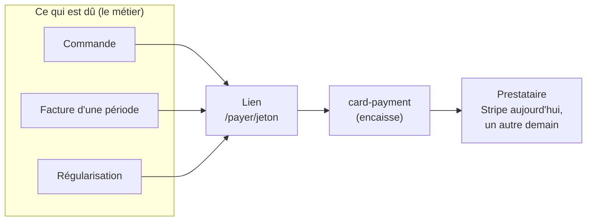
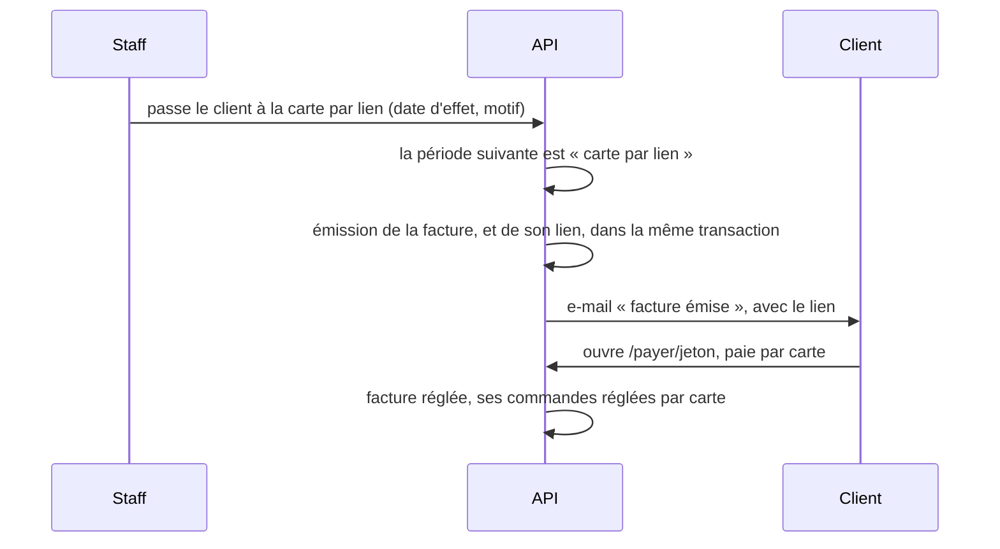

# Plan — un lien de paiement vers un sujet

> 📐 **Doc-first, rien n'est bâti.** Écrit le 2026-11-22 à la demande de
> Hugo. Ce qui existe aujourd'hui est décrit dans
> [`les-liens-de-paiement.md`](les-liens-de-paiement.md) ; chaque
> affirmation sur le code ci-dessous a été relue ce jour-là.
>
> Décisions de Hugo (2026-11-22) :
>
> - le lien ne doit pas dépendre du prestataire : « si je passe sur Caisse
>   d'Épargne, les deux marchent » ;
> - **trois sujets** : la commande, la **période de bons**, la régularisation ;
> - la période se règle par **une facture agrégée, comme au virement et au
>   prélèvement** : la carte par lien est un **troisième moyen** du paiement
>   au compte, rien de plus ;
> - le lien est créé **par le staff, ou par le système automatiquement** —
>   jamais par le client ;
> - **chaque paiement par lien, une fois encaissé**, envoie un e-mail à la
>   comptabilité : le montant, le canal (Stripe, Caisse d'Épargne…), le
>   client, le contexte (La Folie Coffee ou une autre application) ;
> - « je veux vraiment un bloc de paiement agnostique » : ni du prestataire,
>   ni de l'application qui demande à encaisser.
>
> Contredit par `vitruve` le 2026-11-22 : quatre bloquants et six sérieux,
> intégrés ci-dessous (§10 en dit la liste).

# Partie 1 — L'explication simple

**Le bloc qui encaisse s'appelle `payment`** (lot zéro) : il range la carte
et les liens, et accueillera un jour le prélèvement et le virement. Il ne
sait ni pour quelle application il encaisse, ni ce que le paiement règle.

**Un lien de paiement est une porte, pas une dette.** Ce qu'on doit
s'appelle le **sujet** : une commande, une facture, une régularisation. Le
lien dit seulement « ici, on paie ce sujet-là, par carte ».



- **L'adresse est la nôtre** (`/payer/<jeton>`, dans la boutique), jamais
  celle du prestataire. Changer de banque change l'adaptateur de
  `card-payment` ; les liens déjà envoyés restent bons.
- **Le client n'a pas besoin de compte** : le comptable d'un client paie
  avec le seul lien.
- **Celui qui possède le sujet dit ce qu'un paiement règle.** La facture
  passe « réglée », et ses commandes sortent du prélèvement ; la
  régularisation passe « payée ».
- **Le paiement encaissé, la comptabilité reçoit un e-mail** : combien,
  par quel canal, pour quel client, pour quelle application. C'est le bloc
  qui encaisse qui l'envoie : il le fait pour tous les liens, sans savoir
  ce qu'ils règlent.

**La facture d'une période par carte**, c'est le virement avec une carte à
la place du virement :

```
Paiement au compte (fiche client)
   1 · Mode de facturation    hebdomadaire · deux fois par mois · mensuel   (inchangé)
   2 · Comment il règle       Prélèvement SEPA | Virement | Carte par lien   ← le troisième
   3 · Ce que ce choix demande
       └─ Carte par lien : rien à signer ; à l'émission, la facture part avec son lien
```



Ce qui ne change pas : les commandes payées par carte à la commande, leur
page `/reglement/:id`, leurs factures acquittées, leurs
remboursements.

# Partie 2 — La technique

## 0. Lot zéro — le bloc `payment`

> ✅ **Bâti le 2026-11-22.** Typecheck des sources et des specs, 385 suites
> et 3 952 tests du bloc et de ses appelants, et les portes : identiques
> avant et après.

Décidé par Hugo le 2026-11-22 : le bloc qui encaisse devient **`payment`**,
agnostique de l'application **et du moyen**. La carte et le lien en sont les
deux premiers sous-dossiers ; le prélèvement et le virement y viendront le
jour où leur mécanique bancaire sortira de la facturation (un chantier à
part, avec son plan).

```
src/payment/
├── card/        l'actuel card-payment, déplacé tel quel
├── link/        les liens de ce plan (pay_link, PayLinks, la page publique)
└── channels/    ce que les autres blocs atteignent, rangé sous un titre :
                 « encaisser par carte », « ouvrir un lien », « les sujets »
```

Dans la suite de ce plan, `card-payment` désigne `payment/card` après Z.

### 0.1 Ce qui se renomme, et ce qui ne se renomme pas

| Se renomme (du code)                                                                                                                                                                              | Ne se renomme pas (des valeurs)                                           |
| ------------------------------------------------------------------------------------------------------------------------------------------------------------------------------------------------- | ------------------------------------------------------------------------- |
| l'ancien dossier `card-payment` : ses canaux sous `src/payment/channels/`, le reste sous `src/payment/card/` (119 fichiers)                                                                       | le schéma Postgres `card_payment` et ses tables                           |
| les imports qui l'atteignent (194 fichiers hors du bloc : tests, `appBootstrap/`, `lafoliecoffee/`)                                                                                               | les types de faits `card_payment.settled`, `card_payment.failed`…         |
| le bloc dans les portes : `context-boundaries`, `prisma-model-ownership`, `journal-tracked`, `controller-buses`, `network-outside-transaction`, les exceptions d'idempotence, et `dev-sweeps.mjs` | les noms des abonnés durables (clés de leurs reçus dans la boîte d'envoi) |
| la colonne et la ligne `card-payment` de la matrice du CLAUDE.md, et ses paragraphes                                                                                                              | le registre `CARD_ACCOUNTS` et les noms de comptes (`lfc-stripe`)         |

Les valeurs restent celles qui ont été écrites (CLAUDE.md §8, troisième
exception) : les renommer serait une migration pour rien.

### 0.2 L'ordre

1. **Les portes d'abord** : elles connaissent `payment` avant que le
   dossier bouge. Une porte qui liste ses blocs en dur ignorerait un dossier
   neuf, et le déménagement la désarmerait en silence.
2. **Le déménagement** : `git mv`, puis les imports. **Aucun comportement ne
   change** : le typecheck des sources et des specs, les specs du bloc et
   les e2e qui le traversent (`card-*`, `payment-links`, `order-settlement-*`)
   rendent le même compte avant et après.
3. **Le CLAUDE.md** : la matrice (colonne et ligne `payment`), et « la carte
   seulement » devient « un bloc `payment` agnostique de l'application et du
   moyen ; la carte et le lien aujourd'hui ».
4. **Ensuite seulement**, P0 puis P1 : les liens naissent dans
   `payment/link/`.

### 0.3 Les branches en vol

Au 2026-11-22, aucune branche ne modifiait l'ancien dossier, mais quatre
branches de travail d'agents (`worktree-agent-*`) ajoutent une ou deux
lignes qui le citent. Avant Z, relire `git branch` : une branche fusionnée
après Z verra ses imports cassés au typecheck, pas en silence — à corriger
à la fusion.

### 0.4 Le lot V — le vocabulaire du schéma

> ✅ **Bâti le 2026-11-22**, pas encore déployé : migration
> `20261122110000_le_vocabulaire_du_paiement`, retour arrière
> `prisma/rollback/20261122110000_le_vocabulaire_du_paiement.sql` (joué une
> fois sur une base jetable : catalogue revenu identique, puis V réappliquée),
> verrou unique `payment/shared/infrastructure/row-lock.ts`, section du
> runbook « Déployer le vocabulaire du paiement (lot V) ». `prisma migrate
diff` rend 15 écarts **antérieurs à V** et identiques avant et après lui
> (`pim`, `cart`, mandats…) : une dette à part, hors de `known-drift.json`.

Décidé par Hugo le 2026-11-22 : « je tiens à ce que le vocabulaire soit juste
quitte à faire une migration si ça ne change pas mes commandes déjà faites ».
Préfixe `card_` choisi par Hugo. À bâtir **juste après P1**. Inventaire fait
le 2026-11-22 sur une base jetable à jour (toutes les migrations).

#### Ce qui se renomme

| Objet                     | Aujourd'hui                                                                                                                                                       | Après V                                                                                                                                                                                                                     |
| ------------------------- | ----------------------------------------------------------------------------------------------------------------------------------------------------------------- | --------------------------------------------------------------------------------------------------------------------------------------------------------------------------------------------------------------------------- |
| schéma Postgres           | `card_payment`                                                                                                                                                    | `payment`                                                                                                                                                                                                                   |
| tables                    | `payment`, `refund`, `refund_request`, `takeover`, `pay_link`                                                                                                     | `card_payment`, `card_refund`, `card_refund_request`, `card_takeover`, `pay_link`                                                                                                                                           |
| clés, index, contraintes  | préfixés par l'ancien nom de table (`payment_pkey`, `refund_payment_id_idx`, `payment_account_known`…)                                                            | préfixés par le nouveau (`card_payment_pkey`, `card_refund_payment_id_idx`, `card_payment_account_known`…) — les noms que Prisma attend par défaut, et ceux écrits à la main (CHECK, index partiels) pour qu'aucun ne mente |
| fonctions et déclencheurs | `payment_guard`, `refund_guard`, `refund_request_guard`, `refuse_delete`, `refuse_refund_delete`, `pay_link_guard` et leurs déclencheurs `*_guard`, `*_no_delete` | `card_payment_guard`, `card_refund_guard`, `card_refund_request_guard`, `refuse_delete`, `refuse_refund_delete`, `pay_link_guard` ; déclencheurs au nom de leur table                                                       |
| messages des déclencheurs | « `card_payment.payment %` : … »                                                                                                                                  | « `payment.card_payment %` : … »                                                                                                                                                                                            |
| réglage de la purge       | `SET LOCAL card_payment.purge = 'on'`                                                                                                                             | `SET LOCAL payment.purge = 'on'`                                                                                                                                                                                            |
| fichiers Prisma           | un seul fichier, card_payment.prisma (retiré par V)                                                                                                               | un dossier `prisma/schema/payment/`, un fichier pour la carte, un pour les liens ; `@@schema("payment")`, `@@map` aux nouveaux noms                                                                                         |

Les **modèles Prisma** (`CardPayment`, `CardRefund`, `CardRefundRequest`,
`CardPaymentTakeover`, `PayLink`) gardent leur nom : il est déjà juste. Le
client TypeScript ne change pas.

#### Ce qui ne se renomme pas, le mot y étant juste

Les **valeurs écrites** qui disent « paiement par carte » : les faits
`card_payment.*` (boîte d'envoi), le sujet de journal `card_payment` et ses
types (`card_payment.issued`, `card_payment.retried`…), les cloches
`card_payment.refund_attention`…, la
ressource `card_payments`, `CARD_ACCOUNTS`.

#### La migration — renommer, jamais recréer

Une seule migration, dans une transaction :

1. `ALTER SCHEMA "card_payment" RENAME TO "payment"` — tables, fonctions,
   déclencheurs, séquences et index suivent le schéma ;
2. `ALTER TABLE … RENAME TO` pour les quatre tables de la carte ;
3. `ALTER TABLE … RENAME CONSTRAINT` et `ALTER INDEX … RENAME` pour chaque
   clé, index et contrainte ;
4. `ALTER FUNCTION … RENAME TO` et `ALTER TRIGGER … RENAME TO` ;
5. `CREATE OR REPLACE FUNCTION` pour les six fonctions : **le même texte**,
   seuls les messages et le nom du réglage de purge changent. Aucune ne fait
   de requête qualifiée par le schéma (vérifié dans `pg_proc` le 2026-11-22) :
   le renommage seul ne casse aucun déclencheur.

Aucune ligne n'est copiée ni réécrite. Aucune clé étrangère n'entre dans le
schéma depuis un autre (vérifié) ; les commandes, dans `public`, ne citent un
paiement que par un identifiant opaque : elles ne bougent pas.

#### Le code qui suit, dans le même déploiement

- 🔴 **Quatre requêtes SQL brutes** verrouillent une ligne en nommant le
  schéma (`SELECT … FROM "card_payment"."payment" … FOR UPDATE`) :
  `prisma-card-payment.repository.ts`, `prisma-card-refund-ledger.repository.ts`,
  `prisma-card-refund-request.repository.ts`, `prisma-pay-link.repository.ts`.
  Le compilateur ne les voit pas ; un e2e qui verrouille chacune le prouve.
- **Un seul endroit verrouille une ligne du bloc** (décidé par Hugo le
  2026-11-22). Prisma n'a pas de `SELECT … FOR UPDATE` : la requête brute est
  normale, ses quatre exemplaires ne le sont pas. Une fonction du bloc,
  `lockRow(table, id)`, porte les noms qualifiés des tables **une fois** ; les
  quatre dépôts l'appellent. Un e2e confronte chaque table qu'elle déclare au
  catalogue Postgres (`to_regclass`) et prend réellement chaque verrou : un
  renommage oublié rougit en e2e, pas au premier remboursement en
  production.
- La purge du scénario (`card-payment.purge.ts`, `purge-coverage.ts`) et les
  e2e qui posent le réglage de purge.
- `schema-ops.counter.ts` (le schéma de chaque modèle).
- `datasource.prisma` (la liste des schémas).
- Les portes : `card-accounts` (le nom du `CHECK` des comptes, lu dans les
  migrations : le dernier porte désormais le nouveau nom),
  `prisma-schema-layout`, `cross-schema-join` (lit `datasource`),
  `prisma-model-ownership`.
- Le harnais e2e tronque les tables lues dans le catalogue : rien à changer,
  à vérifier.
- Après la migration, `prisma migrate diff` entre les migrations et le schéma
  doit être **vide** : sinon Prisma proposerait de recréer les tables.

#### Ce que `vitruve` a contredit (2026-11-22), et les décisions

| Objection                                                                                                                                                                                                             | Classe   | Décision                                                                                                                                                                                                                                                                                                                                                                      |
| --------------------------------------------------------------------------------------------------------------------------------------------------------------------------------------------------------------------- | -------- | ----------------------------------------------------------------------------------------------------------------------------------------------------------------------------------------------------------------------------------------------------------------------------------------------------------------------------------------------------------------------------- |
| la porte `card-accounts` lit le `CHECK payment_account_known` **écrit** dans une migration : un `RENAME CONSTRAINT` ne pose aucun `CHECK` (`card-accounts.mjs`, l. 31, 49)                                            | BLOQUANT | V fait `DROP CONSTRAINT` puis `ADD CONSTRAINT "card_payment_account_known" CHECK ("account" IN (…))` **en toutes lettres**, avec les comptes du registre ; la porte lit ce nouveau nom                                                                                                                                                                                        |
| l'e2e de la copie (`card-refund-takeover-migration`, retiré par V) rejouait le `migration.sql` figé de `20261110010200_la_copie_des_remboursements`, qui nomme `"card_payment"` ; un `migration.sql` ne se touche pas | BLOQUANT | **l'e2e est retiré** : il éprouve une copie appliquée en production le 2026-11-10, qui ne se rejouera plus jamais ; ce qu'elle a produit reste tenu par les contraintes et les e2e de schéma. Décision prise ici, à confirmer par Hugo                                                                                                                                        |
| le retour arrière laissait V inscrite comme appliquée                                                                                                                                                                 | SÉRIEUX  | `prisma/rollback/<V>.sql` (la convention du runbook) : les `RENAME` inverses, `payment_guard` remise à sa version de `20261122100000`, puis la ligne de V retirée de `_prisma_migrations` ; le geste est écrit au runbook                                                                                                                                                     |
| l'inventaire du code oubliait le SQL brut des e2e (`card-payment-schema`, `card-refund-schema`, `pay-links`, `order-staff-cancel-orders.ts`, `order-revision-card-refund-sequences`) et les sept types enum du schéma | SÉRIEUX  | inventaire étendu ; les enums suivent le schéma, sans renommage                                                                                                                                                                                                                                                                                                               |
| les codes d'erreur `card_payment.payment.*`, `card_payment.refund_request.*`, `card_payment.refund.*` et le message de `card-payment-rows.ts` nomment des **tables** : ils mentiraient                                | SÉRIEUX  | renommés en `payment.card_payment.*`, `payment.card_refund_request.*`, `payment.card_refund.*` (aucun écran ne les lit, vérifié le 2026-11-22 ; V vérifie qu'aucun n'est écrit en base avant de les renommer) ; les JSDoc qui citent une table la nomment par son nouveau nom                                                                                                 |
| la fenêtre de déploiement : un remboursement parti chez Stripe dont l'écriture échoue                                                                                                                                 | SÉRIEUX  | **retardé, pas perdu** : la clé d'idempotence est `<demande>:<génération>:<tour>` (`card-refund-request.ts`, l. 92) et le tour n'avance pas sur un échec, donc le balayage suivant rend le même remboursement ; le webhook `refund.*` porte la demande en métadonnée. Consigne au runbook : après le déploiement, constater qu'aucune demande ne reste réclamée sans écriture |
| « six fonctions renommées »                                                                                                                                                                                           | MINEUR   | trois renommées, six réécrites                                                                                                                                                                                                                                                                                                                                                |
| les index partiels écrits à la main échappent à `migrate diff`                                                                                                                                                        | MINEUR   | l'e2e de `lockRow` et ceux du schéma vérifient leurs **noms** dans le catalogue                                                                                                                                                                                                                                                                                               |
| `PayLink` absent de `schema-ops.counter.ts`                                                                                                                                                                           | MINEUR   | ajouté                                                                                                                                                                                                                                                                                                                                                                        |

#### La fenêtre de déploiement

`migrate deploy` passe avant que l'image neuve serve (une à deux minutes,
`documentation/ops/runbook.md`). Pendant ce temps, l'ancien code cherche
`card_payment` : un paiement ou un remboursement par carte échoue, un webhook
de Stripe reçoit une erreur et sera rejoué. **Même discipline que les
migrations précédentes du même genre : sur un « pousse main » de Hugo, un
jour sans service ouvert, la boutique au calme**, et une entrée au runbook
(quoi constater avant, quoi vérifier après : un paiement de bout en bout, un
remboursement, la purge en dev).

#### Retour arrière

La même migration à l'envers (les mêmes `RENAME`, en sens inverse, et les
fonctions remises à leur texte), avec l'image d'avant. Pas de perte : rien
n'est copié.

### 0.5 Le lot W — les abonnés du commerce en `lfc.`

Décidé par Hugo le 2026-11-10 (renommage du bloc `b2b` en `lafoliecoffee`,
étape 3, jamais faite) et rappelé le 2026-11-22. À bâtir **après V**.

Le nom d'un abonné durable dit **le bloc qui écoute** : `<bloc>.<contexte>.<geste>`.
Le commerce **est** l'application La Folie Coffee, ses abonnés deviennent
donc tous `lfc.<contexte>.<geste>`. Le bloc `payment`, agnostique, n'en a
aucun aujourd'hui ; s'il en a un jour, il s'appellera `payment.<sous-contexte>.<geste>`,
sans nom d'application ni d'entreprise.

- **L'existant** (compté le 2026-11-22) : 92 fichiers d'abonnés dans
  `src/lafoliecoffee/` ; sur les 59 noms lisibles dans leur propre fichier,
  30 en `b2b.`, 16 en `orders.`, 7 en `accounting.`, 4 en `catalog.`, 1 en
  `account.`, 1 en `loyalty.`, aucun en `lfc.`. Les autres viennent de
  constantes importées : à résoudre au bâti, la liste complète se tire de la
  base (`platform.outbox_delivery.subscriber`) et du code, et les deux
  doivent coïncider.
- **Un nom est la clé des reçus** : la migration réécrit
  `platform.outbox_delivery.subscriber`, lignes livrées ou non, **dans le
  même déploiement que le code**. Sinon les faits déjà traités seraient
  rejoués sous le nouveau nom, ou ceux en attente perdus sous l'ancien.
  Boîte d'envoi vidée avant le déploiement.
- **Une porte** refuse un abonné du commerce sans le préfixe `lfc.`.
- **Le relais `OnCardCheckoutEvent`** est retiré en F2 : si F2 passe avant
  W, il n'est pas renommé.
- Migration de données en production : `vitruve` avant Hugo,
  `lecteur-de-migrations` avant tout push.

## 1. Ce qui existe, et ce que le plan en garde

| Pièce                                             | Aujourd'hui (relu le 2026-11-22)                                                                                                       | Après                                             |
| ------------------------------------------------- | -------------------------------------------------------------------------------------------------------------------------------------- | ------------------------------------------------- |
| `payment/channels/subjects/subject-settlement.ts` | le port qu'un bloc implémente par type de sujet ; un seul implémenteur, `order` (`order-subject-settlement.ts`)                        | **inchangé** ; deux implémenteurs de plus         |
| `payment/channels/requests/card-payments.ts`      | `prepare` (réseau, hors transaction) puis `attach` (dans la transaction) ; `retrieve`                                                  | **inchangé** ; la porte l'appelle                 |
| `card_payment.payment`                            | `subject_type` est un `TEXT` **sans `CHECK` sur ses valeurs** (migration `20261109030000`) ; un seul `first` par sujet (index partiel) | **aucune migration** pour un type de plus         |
| `RegisteredSubjectSettlements`                    | un registre par type, refuse un doublon                                                                                                | deux entrées de plus, reliées par `appBootstrap/` |
| `PaymentLink` (`lafoliecoffee/payments/`)         | Stripe Checkout, son client, son webhook, son secret                                                                                   | devient la **régularisation**, sans Stripe (§5)   |
| `PayerCollectionMeans`, `CollectionMeans`         | `sepa_debit` \| `bank_transfer`, `CHECK` en base (`20261112150100`) ; aucune ligne = prélèvement                                       | `card_link` en plus (§4)                          |
| `OrderCollectionState`                            | `settled_by_transfer` cite son virement (`CHECK`)                                                                                      | `settled_by_card` cite son paiement (§4.4)        |

## 2. La porte : `card-payment` tient les liens

> ✅ **Bâti le 2026-11-22 (lot P1)**, serveur et boutique. Le sous-contexte
> `payment/link/` ; la migration `20261122100000_les_liens_vers_un_sujet` ;
> les ports `PayLinks` et `LinkableSubject` dans `payment/channels/` ; le
> registre des origines (`platform/config/pay-link-origins.ts`) ; les routes
> publiques `POST pay-links/view` et `POST pay-links/intent` ; la page
> `/payer/:jeton` de la boutique (`client/pay-link/`). **Aucun sujet réel
> n'implémente encore `LinkableSubject`** : aucun lien ne s'ouvre hors des
> tests jusqu'à F1 (la régularisation) et I2 (la facture).
>
> Décisions prises au bâti :
>
> - le **scellé** du jeton passe par le chiffreur de champ commun
>   (`FieldCipher`), celui de toutes les colonnes sensibles ; l'**empreinte**,
>   qui sert à la recherche, a sa clé dérivée (`payLinkTokenKey()`) ;
> - la **limite de débit** est posée par route dans l'API (`@Throttle`), pas à
>   la passerelle, qui route par préfixe sans liste de routes ;
> - la page vit dans le cadre de la boutique (`ClientShell`), sans menu
>   d'espace ni retour, comme l'annulation par un invité ; elle pose
>   elle-même `noindex` ;
> - une **phase « lien à renouveler »** répond au 409 d'une intention close ;
> - `open` refuse un type de sujet qu'aucun `LinkableSubject` ne sert : pas de
>   lien mort ;
> - à améliorer : le `tag` du lien (`pay-link:<id>`) atterrit chez Stripe dans
>   une métadonnée nommée `companyId`, un nom que l'adaptateur Stripe devrait
>   rendre neutre.

Le lien appartient à `card-payment`. Il est agnostique comme le reste du
bloc : il connaît `(subject_type, subject_id)`, jamais une facture.

### 2.1 La table `card_payment.pay_link`

| Colonne                        | Rôle                                                                                                                                                                                                                                                                                     |
| ------------------------------ | ---------------------------------------------------------------------------------------------------------------------------------------------------------------------------------------------------------------------------------------------------------------------------------------- |
| `id`                           | ULID                                                                                                                                                                                                                                                                                     |
| `subject_type`, `subject_id`   | le sujet, opaque ; **un seul lien vivant par sujet** (index unique partiel `WHERE revoked_at IS NULL`)                                                                                                                                                                                   |
| `origin`                       | l'application qui a demandé le lien (`lafoliecoffee` aujourd'hui) — une valeur du **registre des origines**, dans la configuration de `platform` comme `CARD_ACCOUNTS` (nom, libellé « La Folie Coffee ») ; une origine hors registre est refusée à l'ouverture, jamais une chaîne libre |
| `payer_label`                  | le nom du client tel que l'appelant le donne à l'ouverture, figé : l'avis à la comptabilité le lit sans rappeler le sujet                                                                                                                                                                |
| `token_hash`                   | HMAC-SHA-256 du jeton, **unique** : la page publique cherche par lui                                                                                                                                                                                                                     |
| `token_sealed`                 | le jeton chiffré, avec le même scellé que l'IBAN de l'entité : le staff peut **recopier** le lien plus tard                                                                                                                                                                              |
| `created_at`, `created_by`     | `created_by` = fiche staff, ou `system` pour une émission automatique                                                                                                                                                                                                                    |
| `revoked_at`, `revoked_reason` | posés ensemble (`CHECK`) ; un lien révoqué ne se ranime pas                                                                                                                                                                                                                              |

- **Le jeton** : 32 octets aléatoires (`crypto.randomBytes`, par un port
  `TokenGenerator` — l'`IdGenerator` ULID est prévisible, il ne convient
  pas). En base, jamais en clair. **Aucune variable d'environnement de
  plus** (convention du 2026-10-13, comme les liens d'annulation et les
  jetons de désinscription) : `token_hash` est un HMAC-SHA-256 sous
  `payLinkTokenKey()`, dérivée de `FIELD_ENCRYPTION_KEY` par HKDF sous son
  étiquette ; `token_sealed` passe par le chiffreur de champ (`FieldCipher`).
  Deux usages, deux clés. Rien à poser en production avant le déploiement.
  Conséquence assumée : une rotation de `FIELD_ENCRYPTION_KEY` tue les liens
  déjà envoyés, comme les liens d'annulation.
- **Pas d'expiration par défaut** : une facture se paie en retard. Le lien
  meurt quand le sujet est réglé, annulé, ou quand le staff le révoque.
- **Pas de suppression physique** ; révocation par statut.

### 2.1 bis Le paiement sait qu'il vient d'un lien

`card_payment.payment` gagne une colonne **`pay_link_id`** (nullable, clé
étrangère vers `card_payment.pay_link`, dans le même schéma). `attach` la
pose quand l'intention naît de la page du lien (§2.3), et elle rejoint les
colonnes immuables de la ligne (le déclencheur de `20261109030000` les
énumère). Nulle pour une commande payée dans la boutique.

C'est **la trace qui fait foi** : la comptabilité distingue un paiement par
lien en lisant la base, pas un e-mail. Un relevé ou un export « paiements
par lien » sera une lecture de cette colonne. Aucun fait ni événement propre
au lien : `card_payment.settled` dit déjà qu'un paiement est encaissé, et
pourra porter `payLinkId` le jour où un abonné en aura besoin.

### 2.2 Les deux ports du canal

- **`PayLinks`** (`payment/channels/requests/`, demandé par les blocs
  métier) : `open(subject, { origin, payerLabel, by })` → `{ linkId, url }`, **dans la transaction de
  l'appelant, sans réseau** — l'émission d'une facture l'appelle ;
  `revoke(subject, reason)` ; `urlOf(subject)` pour recopier. `open` sur un
  sujet qui a déjà un lien vivant rend celui-là.
- **`LinkableSubject`** (`payment/channels/subjects/`, implémenté par le
  bloc qui possède le sujet) — un port **à part** de `SubjectSettlement`
  (ISP) : la commande ne l'implémente pas, rien ne change pour elle.
  `quote(subject)` → `{ payable, amountCents, payeeName, payerName,
reference, dueOn | null }` ou `{ payable: false, reason }` (réglé,
  annulé). **Aucune ligne de facture, aucune adresse** n'est servie à la page
  publique : le PDF reste dans l'espace authentifié.

### 2.3 La page publique

- **API** (`payment/link/http/`, `@Public()`), sur le modèle de
  l'annulation par un invité : **le jeton voyage dans le corps d'un
  `POST`**, jamais dans l'adresse de l'API, pour ne pas finir dans un
  journal ; `@Throttle` par route ; `no-store` ; `@Idempotent` :
  - `POST pay-links/view` `{ token }` → la vue de `quote`. 404 pour un
    jeton inconnu **ou révoqué**, sans distinguer ;
  - `POST pay-links/intent` `{ token }` → s'il existe déjà un `first` pour le sujet,
    il est relu (`retrieve`) ; sinon `prepare` (hors transaction) puis, sous
    le verrou du sujet (`lockSubject`), `attach` comme `first`, avec le
    `pay_link_id` du lien (§2.1 bis). Rend une **instruction de
    collecte** neutre (§2.3 bis), jamais un secret propre à Stripe. `@Idempotent` : l'index
    `payment_first_per_subject_key` (`WHERE role = 'first'`, **sans filtre
    d'état**) n'admet qu'un `first` par sujet, le rejeu relit.
  - **Pourquoi un seul `first` suffit** : une intention refusée par la
    banque revient à « en attente d'un moyen de paiement » et se repaie ;
    une intention n'expire pas chez Stripe, et le bloc ne l'annule que
    quand le sujet ne veut plus être payé (réglé ailleurs, annulé) — le lien
    est alors révoqué aussi. Si un prestataire rend un jour une intention
    morte sur un sujet encore dû, la page le dit (409 « lien à refaire »)
    et le staff révoque puis rouvre : le `first` mort est **annulé** par
    `card-payment`, et la réouverture crée un `complement`. Ce chemin est un
    lot à part (P2), testé contre le double.
  - `Cache-Control: no-store` (`lint:cache-control`), throttle par IP à la
    passerelle.
- **Pourquoi l'intention naît à l'ouverture, pas à l'émission** : l'émission
  tourne en transaction, et un appel réseau y est interdit
  (`assertOutsideTransaction`, porte `network-outside-transaction`). Et une
  facture jamais ouverte ne crée rien chez le prestataire.
- **La page `/payer/:jeton` appartient à l'application d'origine du lien.**
  Le registre des origines porte, pour chacune, sa **racine publique** :
  `PayLinks.open` compose `<racine de l'origine>/payer/<jeton>`, et le
  client d'une autre application reste chez elle. Chaque application monte
  cette page avec le **service de collecte partagé** (§2.3 bis), sans écrire
  de formulaire ni connaître de prestataire. Le service vit aujourd'hui dans
  la boutique (`client/payment-collection/card-collector.ts`), écrit sans
  rien de propre à La Folie Coffee ; il rejoint un paquet de `packages/` le
  jour où une deuxième application encaisse.

### 2.3 bis L'instruction de collecte, neutre du prestataire

> ✅ **Bâti le 2026-11-22 (lot P0).** Le serveur, le contrat et la boutique
> passent par l'instruction ; aucun changement visible pour le client.

Le port d'encaissement rendait `clientSecret` et `publishableKey` : le
modèle de Stripe, un formulaire intégré à notre page. Beaucoup de solutions
bancaires demandent une **redirection** vers leur page, ou un jeton de
formulaire à elles (l'offre de la Caisse d'Épargne n'a pas été vérifiée).
Il rend désormais une union fermée, `CardCollection`, que l'adaptateur de
chaque prestataire remplit :

| Genre      | Ce que la page reçoit                                    | Exemple            |
| ---------- | -------------------------------------------------------- | ------------------ |
| `embedded` | le prestataire, sa clé publique, le jeton de CE paiement | Stripe aujourd'hui |
| `redirect` | l'adresse de la page du prestataire                      | une page bancaire  |

- **Serveur** : `CreatedIntent` / `RetrievedIntent` (port du prestataire),
  puis `CardPaymentPreparation` / `RetrievedCardPayment` (canal
  `payment/channels/requests/`) portent `collection`. L'adaptateur Stripe
  remplit `embedded` (`stripe-card-provider.ts`).
- **Contrat** : `packages/contracts/src/card-collection.ts`, porté par
  `OrderPaymentIntent` (passation, passation boutique, règlement d'une
  commande) et `CardComplementPaymentView` (complément d'une hausse). Les
  six gestes du commerce le composent par `cardCollectionFields`.
- **Un déploiement de transition** : `clientSecret` et `publishableKey`
  restent servis, dépréciés, pour une page ouverte avant ; ils ne se
  remplissent que pour `embedded`. À retirer au déploiement suivant.
- **Boutique** : un seul service connaît un prestataire, `CardCollector`
  (`client/payment-collection/`) — il monte, suit la langue, confirme ou
  redirige. La page de règlement et le paiement du complément ne gardent que
  leur logique (phases, délai, abandon).
- **Le résultat** arrive toujours par le webhook du compte qui encaisse,
  jamais par la page.
- **Ce qui manque pour une vraie redirection** : `prepare` ne prend pas
  encore d'adresse de retour. Elle s'ajoutera avec le premier prestataire
  qui redirige ; la page de retour ne fera qu'afficher « nous vérifions
  votre paiement » puis relire l'état.

### 2.4 L'avis à la comptabilité, après encaissement

Quand un paiement **dont la ligne porte un `pay_link_id`** est encaissé,
`card-payment` demande l'e-mail « paiement reçu par lien » à l'adresse de
suivi de l'origin, par `mail.send`, **dans la transaction même qui
enregistre l'encaissement** — juste après la réponse du sujet (`onPaid`).

- **Pas d'abonné, pas d'événement** : `mail.send` écrit la demande dans la
  boîte d'envoi du bloc `mail`, envoyée après validation et relancée en cas
  d'échec. C'est déjà une émission durable.
- **Atomique** : l'encaissement est écrit si et seulement si l'avis est
  demandé. Un rollback n'envoie rien ; un paiement enregistré a toujours
  son avis.
- **Rien à lire hors de la transaction** : montant, compte, client, origin
  et sujet sont en base. Un appel au prestataire, interdit en transaction,
  n'est pas nécessaire.

| Ce que dit l'e-mail | D'où il vient                                                                                                                 |
| ------------------- | ----------------------------------------------------------------------------------------------------------------------------- |
| la provenance       | « par lien » : la ligne porte un `pay_link_id` ; la date de création du lien et son auteur (le système ou un membre du staff) |
| le montant          | la ligne `card_payment.payment` (centimes)                                                                                    |
| le canal            | le **compte** qui a encaissé et son prestataire (`CARD_ACCOUNTS` : `lfc-stripe` → Stripe ; demain un autre)                   |
| le client           | `pay_link.payer_label`, figé à l'ouverture                                                                                    |
| le contexte         | `pay_link.origin`, dit par son libellé (« La Folie Coffee »)                                                                  |
| ce qui est réglé    | `SubjectSettlement.describe` (libellé et écran), déjà exigé de tout sujet                                                     |

- **Après l'encaissement, jamais avant** : ni l'ouverture du lien ni la
  création de l'intention ne demandent d'e-mail. Un
  paiement **refusé par le sujet** (et donc remboursé) part aussi, avec la
  mention « refusé, remboursement demandé » : la comptabilité voit l'argent
  passer dans les deux sens.
- **L'adresse** est une donnée : un réglage par origin dans
  `card_payment.link_notice_recipient`, saisi à l'écran par l'admin. Sans
  adresse, rien ne part et la cloche de la comptabilité le dit.
- **Le canal du mail** : `card-payment` atteint le bloc `mail` par son
  canal (`mail.send`, clé d'e-mail tirée du paiement, sans adresse dans la
  clé — `lint:mail-key-no-pii`). La matrice du CLAUDE.md l'admet en
  « port uniquement » depuis le 2026-11-22, porte `context-boundaries`
  comprise : Hugo l'a ouvert parce que l'avis est un besoin de toutes les
  applications qui encaisseront, pas de chacune.
- **Agnostique** : le bloc ne sait ni ce qu'est une facture ni ce qu'est
  La Folie Coffee ; il lit des libellés que l'appelant a posés. Une autre
  application qui ouvrirait des liens n'aurait qu'à déclarer son origin.

### 2.5 ⚠️ Le lien n'est pas « carte »

Le bloc s'appelle `card-payment`, et le CLAUDE.md le borne à « la carte
seulement ». Le lien, lui, est plus large que la carte : il pourrait un
jour proposer un virement instantané ou Wero. Pour que rien ne le grave :

- `pay_link` ne dépend que de `(sujet, origine)`, **jamais d'un compte de
  carte** ; le compte est choisi à la création de l'intention ;
- l'avis à la comptabilité dit « paiement reçu par lien », le canal en
  donnée ;
- le jour où un second moyen par lien arrive, il faudra choisir : élargir
  le bloc en `payment`, ou sortir le lien dans un bloc à lui. Pas
  aujourd'hui.

## 3. Le sujet `order` — rien ne bouge

La page `/reglement/:id` reste la porte de la commande La Folie Coffee, avec
ce que le lien générique n'a pas (l'abandon, le retour à la confirmation,
l'espace client). La commande n'implémente pas `LinkableSubject`.

**Piste, pas décidée** : faire de la commande un sujet « liable », et faire
pointer les liens envoyés par e-mail vers `/payer/<jeton>` plutôt que vers
`/reglement/:id`. Une autre application n'a, elle, pas besoin d'une page de
règlement à elle : un lien générique lui suffit.

## 4. Le sujet `invoice` — la carte, troisième moyen du paiement au compte

Propriétaire : `lafoliecoffee/accounting/`. Tout suit le virement
([`../le-paiement-par-virement.md`](../le-paiement-par-virement.md)) ; seul
ce qui diffère est écrit ici.

### 4.1 Le moyen `card_link`

- `CollectionMeans` = `sepa_debit` \| `bank_transfer` \| `card_link` ;
  migration qui élargit le `CHECK` de `payer_collection_means`.
- Mêmes règles que le virement : daté, effet à la prochaine clôture (V2),
  motif obligatoire, un seul changement en attente (K1), droit
  `b2b_collection_means`, un site qui suit son principal prend le sien.

### 4.2 🔴 Le piège : aujourd'hui, « pas virement » veut dire « prélèvement »

Deux formes, toutes deux à fermer :

- **les comparaisons au type** `=== "bank_transfer"`, qui rangent tout le
  reste au prélèvement — dans `accounting/` (`collection-verdict.ts`,
  `collection-assembly.ts`, `monthly-invoicing.ts`, `counted-payers.ts`…),
  mais aussi **hors** d'`accounting/` : `account/infrastructure/transfer-payers.projection.ts`
  (l. 8), qui ferait demander un mandat à un payeur `card_link` ;
- **le lecteur du moyen de la facture**,
  `infrastructure/invoice-collection-means.ts` (l. 16-21) : il relit le
  code UNTDID de `payment_means` et rend `"bank_transfer"` pour 58,
  **`"sepa_debit"` pour tout le reste**. C'est lui que lit le lot
  (`prisma-collection-candidates.reader.ts`, l. 221). Une facture carte par
  lien y serait prélevée.

**Le geste (lot I0), sans changement de comportement :**

1. **L'inventaire se fait par ce qui LIT le moyen**, pas par une chaîne :
   tout usage du type `CollectionMeans`, de `payment_means`, du contrat
   `collectionMeansSchema` (`packages/contracts/src/payer-collection-means.ts`)
   et de `sales-oversight.ts`, `journal-facts/accounting.ts`. Le décompte
   « quinze occurrences » de la première version comptait la mauvaise
   forme : il est refait au bâti, et chaque lecteur est nommé dans le lot.
2. Un `switch` exhaustif (`never` au défaut) partout où les moyens
   divergent, et un prédicat `isDirectDebit` là où seule la question
   « prélevé ? » se pose.
3. `invoice-collection-means.ts` lit le **genre** du moyen figé (§4.3), plus
   le code : 59 → prélèvement, 58 → virement, carte acquittée → aucune
   collecte, carte par lien → aucune collecte, inconnu → **refus**, jamais
   prélèvement par défaut.
4. Une porte (`lint:collection-means-exhaustive`) refuse une comparaison à
   un littéral de moyen hors du value object.

### 4.3 La facture « carte par lien »

- **Moyen figé** (BG-16) : 🔴 le code 48 veut dire aujourd'hui « carte
  **déjà payée** ». L'invariant `invoice-invariants.ts` (l. 257) refuse une
  facture 48 sans montant déjà payé, et `settlementKindOf`
  (`invoice.ts`, l. 293) ou `invoice-settlement.ts` (l. 93) en tirent
  « réglée par carte ». Le moyen figé gagne donc un **genre** dans son
  `jsonb` (`payment_means.kind` : `sepa_debit`, `bank_transfer`,
  `card_paid`, `card_link`), lu par l'invariant (`card_paid` ⇔ déjà payé ;
  `card_link` ⇔ rien de payé), par `settlementKindOf` et par le lecteur du
  §4.2 ; une facture émise sans `kind` se lit par son code, comme
  aujourd'hui (`body_version` monte). Factur-X écrit 48 pour les deux
  genres carte. ⚠️ **Irréversible une fois émis** : le code d'une facture
  émise est figé par `invoice_immutable`. Si le cabinet dit « pas 48 pour
  une carte à payer », seules les factures suivantes changeront — d'où la
  question posée **avant** I1 (§11).
- **Échéance** : la même règle que le virement — N jours après l'émission
  réelle, réglage de l'entité `transfer_due_days_after_issue`. Le réglage
  change de nom à l'écran (« Échéance d'une facture à réception ») ; la
  colonne garde le sien.
- **Le lien naît avec la facture**, dans la transaction de l'émission :
  `PayLinks.open({ type: "invoice", id }, "system")`. Un avoir n'a pas de
  lien.
- **L'e-mail « facture émise »** porte le lien (une adresse chez nous, pas
  une coordonnée bancaire : la règle de l'IBAN tient). Le PDF dit « Réglez
  par carte » et donne le lien.
- **Statut** (`invoice-settlement.ts`) : `card_expected`, puis `settled`, ou
  `card_overdue` au premier jour ouvré après l'échéance — la règle du
  virement (`transferOverdueFrom`). La liste « Virements en retard » devient
  « Factures en retard », avec le moyen.

### 4.4 Le paiement reçu

**L'ordre des verrous est celui du virement.** `record-bank-transfer.handler.ts`
(l. 97, l. 121-125) ne prend que les verrous des **commandes**
(`OrderInvoicingLock`) ; aucun code d'`accounting/` ne prend `FOR UPDATE`
sur une ligne `invoice`. Le sujet `invoice` fait donc pareil :
`lockSubject` prend `OrderInvoicingLock` sur les commandes de la facture,
dans l'ordre de leurs identifiants — le même que le virement. Deux gestes
concurrents s'attendent ; le second relit et voit la facture réglée.

`InvoiceSubjectSettlement.onPaid` (dans la transaction de `card-payment`,
après `lockSubject`) :

1. **relit sous ces verrous** : facture au genre `card_link`, pas un avoir,
   aucune ligne `invoice_card_settlement` ni `received_bank_transfer_invoice`,
   aucune commande hors de `due` / `excluded` ;
2. refuse si le montant ≠ TTC — pas de paiement partiel, comme au virement ;
3. écrit `invoice_card_settlement` (`invoice_id` unique, `payment_id`
   opaque sans clé étrangère, `paid_on` du `Clock`) — la figure de
   `received_bank_transfer_invoice` ;
4. passe chaque commande par `OrderCollection.settleByCard(paymentId)` :
   `due` ou `excluded` → **`settled_by_card`** (migration d'enum, `CHECK` :
   `card_payment_id` posé ⇔ cet état). La transition refuse depuis
   `settled_by_transfer`, et `settleByTransfer` refuse depuis
   `settled_by_card` ;
5. révoque le lien (`PayLinks.revoke`, raison `settled`).

**Un refus n'est jamais une exception** : toute condition non remplie aux
étapes 1-2 rend `refused`, et — comme la commande annulée, qui publie
`OrderPaidAfterCancellationEvent` (`order-subject-settlement.ts`, l. 105-108)
— **le sujet demande lui-même le remboursement intégral**, par
`CardRefunds.requestRemainder` (`payment/channels/requests/card-refunds.ts`),
hors de la transaction, par un abonné durable de son propre fait
`invoice.card_payment_refused`. L'argent en trop revient toujours au
client ; la cloche de la comptabilité sonne.

Une facture réglée autrement (virement reçu, `settled_otherwise`) révoque
aussi son lien.

### 4.5 Le prélèvement

Le lot lit le moyen **de la facture** (K2) : après I0, une facture
`card_link` n'est jamais prélevée, et un bon sans facture d'une période
`card_link` est refusé comme au virement (jamais d'arrêté).

### 4.6 Le remboursement

- **Un paiement refusé** (de trop, en retard, en course) : remboursé
  intégralement et automatiquement (§4.4). Dans la v1.
- **Un paiement accepté que le staff voudrait rendre** : hors de la v1. Il
  demande un avoir sur la facture, puis un remboursement qui le constate
  (`refund_credit`) ; le geste de remboursement du staff ne propose pas un
  paiement de sujet `invoice` tant que ce lot n'existe pas.

### 4.7 Le reste du contrat `SubjectSettlement`

Les dix méthodes du port (`subject-settlement.ts`, l. 61-123) ont une
réponse pour la facture et la régularisation : `onPaymentFailed` laisse le
sujet dû (le client réessaie) ; `isCancelled` = facture réglée autrement ou
lien révoqué ; `describe` = numéro et fiche ; **`claim` rend `null` et
`referencesSince` une liste vide** : tout paiement d'un lien naît par
`attach`, avec sa ligne, et il n'existe aucune intention d'avant le bloc à
rapprocher.

## 5. Le sujet `free_charge` — la régularisation

- `PaymentLink` (`lafoliecoffee/payments/`) garde son métier — société,
  montant, libellé, plafond, `open → paid | cancelled` — et perd Stripe : à
  la création, `PayLinks.open({ type: "free_charge", id }, staff)`.
  `expired` ne sert plus qu'aux anciennes lignes.
- La table garde son nom (`payment_links`) ; `stripe_session_id` et `url`
  deviennent nullables : les anciennes lignes gardent leurs valeurs (une
  colonne morte reste en base).
- `onPaid` : `paid`, même après annulation (la règle d'aujourd'hui, cloche
  comprise) ; le lien est révoqué. Annuler révoque le lien.

## 6. La sortie de Stripe Checkout

1. Les nouveaux liens libres passent par la porte (lot F1).
2. Les anciens restent payables par leur session : le **relais** du
   webhook des cartes (`card_payment.checkout_event`) continue de les
   régler. **La destination Stripe dédiée n'est pas activée.**
3. **Ne pas attendre les webhooks** : un `checkout.session.expired` perdu
   laisserait une ligne `open` pour toujours. Au lot F2, une commande du
   staff ferme **chez Stripe** chaque session encore ouverte
   (`expireCheckoutSession`, qui existe) et passe la ligne à `expired` ;
   une session déjà payée est relue et réglée. Les sessions durent 24 h
   (aucun `expires_at` n'est posé par `stripe-checkout-gateway.ts`) : F2
   attend au moins ce délai après F1. Ensuite seulement, on retire : le relais et
   `card_payment.checkout_event`, `/payments/links/webhook`,
   `StripeCheckoutGateway`, `STRIPE_LINKS_WEBHOOK_SECRET` et la destination
   chez Stripe ; puis les trois `checkout.session.*` de l'endpoint des
   cartes.

## 7. Les lots

| Lot | Contenu                                                                                                                                                                                                                                                                                                                                     | Dépend de  |
| --- | ------------------------------------------------------------------------------------------------------------------------------------------------------------------------------------------------------------------------------------------------------------------------------------------------------------------------------------------- | ---------- |
| Z   | ✅ le bloc `payment` : `card-payment` → `payment/card`, les portes d'abord, le CLAUDE.md (§0) — **aucun changement de comportement**                                                                                                                                                                                                        | —          |
| P0  | ✅ l'instruction de collecte neutre (§2.3 bis) : le port, l'adaptateur Stripe, la page `/commandes/:id/regler` passée au composant de collecte partagé — **aucun changement visible**                                                                                                                                                       | Z          |
| I0  | `isDirectDebit`, `switch` exhaustifs, la porte — **aucun changement de comportement**                                                                                                                                                                                                                                                       | —          |
| P1  | ✅ `card_payment.pay_link`, `PayLinks`, `LinkableSubject`, le registre des origines, la page publique (API et boutique), les tests                                                                                                                                                                                                          | P0         |
| V   | ✅ le vocabulaire du schéma (§0.4) : `card_payment` → `payment`, tables de la carte préfixées `card_`                                                                                                                                                                                                                                       | P1         |
| W   | les abonnés du commerce en `lfc.<contexte>.<geste>` (§0.5), reçus de la boîte d'envoi migrés dans le même déploiement                                                                                                                                                                                                                       | V          |
| P1b | l'avis à la comptabilité après encaissement (§2.4), l'adresse par origin, le modèle d'e-mail                                                                                                                                                                                                                                                | P1         |
| F1  | la régularisation par la porte ; l'écran des liens libres recopie `urlOf`                                                                                                                                                                                                                                                                   | P1         |
| I1  | `card_link` : moyen, genre du moyen figé, échéance, statut, factures en retard, spécimen PDF (`specimen-data.ts`, `lint:pdf-specimens`) ; contrats et écrans (back-office : `collection-means-choice`, `paiement-section`, `sales-oversight-filters`, `accounting-values`, `invoice-phrases` ; boutique : `payment-section`, `compte-page`) | I0, §11 b  |
| I2  | le sujet `invoice` : `onPaid`, `settled_by_card`, `invoice_card_settlement`, le lien à l'émission, l'e-mail                                                                                                                                                                                                                                 | I1, P1     |
| F2  | la sortie de Stripe Checkout (§6)                                                                                                                                                                                                                                                                                                           | F1 + délai |

## 8. Ce que le plan ne fait pas

- Pas de lien créé par le client ; pas de sélection de commandes par le
  client (`todo-regler-une-selection-de-commandes.md` reste ouvert pour la
  facture d'une sélection).
- Pas de paiement partiel, pas de déduction d'avoir.
- Pas de lien public pour une commande.
- Pas d'autre prestataire : le plan rend ce changement possible sans toucher
  aux sujets, il ne le fait pas.

## 9. Doutes tranchés seul, à relire

- **L'échéance** reprend le réglage du virement plutôt qu'un réglage
  propre : une entité n'a qu'un délai « à réception ».
- **Le jeton scellé** plutôt que haché seul : le staff doit pouvoir recopier
  un lien, et le renvoyer ne doit pas tuer celui qui est déjà dans la boîte
  du client.
- **Le remboursement automatique d'un paiement refusé** (§4.4) plutôt que
  « on garde et on rapproche à la main » : l'argent d'un client ne reste
  jamais chez nous sans raison.

## 10. Ce que `vitruve` a contredit (2026-11-22), et ce qui a changé

| Objection                                                                        | Classe   | Où c'est réglé |
| -------------------------------------------------------------------------------- | -------- | -------------- |
| le code 48 veut dire « déjà payé » ; l'invariant refuse une facture 48 non payée | BLOQUANT | §4.3 (genre)   |
| `invoice-collection-means.ts` range tout ce qui n'est pas 58 au prélèvement      | BLOQUANT | §4.2           |
| « refused, et card-payment remboursera » : c'est le sujet qui demande            | BLOQUANT | §4.4, §4.6     |
| aucun verrou sur la facture ; un virement concurrent passerait                   | BLOQUANT | §4.4           |
| l'unicité du `first` ne connaît pas l'échec                                      | SÉRIEUX  | §2.3           |
| `transfer-payers.projection.ts` hors d'`accounting/`                             | SÉRIEUX  | §4.2           |
| contrats et écrans non comptés                                                   | SÉRIEUX  | §7 (I1)        |
| `claim` et `referencesSince` sans réponse                                        | SÉRIEUX  | §4.7           |
| irréversibilité (enum, CHECK, code figé) non dite                                | SÉRIEUX  | §4.3, §11      |
| retrait de Stripe Checkout suspendu à des webhooks                               | SÉRIEUX  | §6             |
| même clé pour le jeton et l'IBAN ; pas de spécimen PDF                           | MINEUR   | §2.1, §7       |

## 11. Ce qui attend Hugo avant le bâti

a. ~~Ouvrir `card-payment → mail` en « port uniquement »~~ — **décidé par
Hugo le 2026-11-22**, matrice et porte à jour.
b. **Le code Factur-X d'une facture à payer par carte** (48 ou autre), à
demander au cabinet **avant** I1 : une facture émise ne se corrige pas.
c. ~~Les valeurs `card_link` et `settled_by_card`~~ — **validées par Hugo
le 2026-11-22**. Elles ne se retirent plus une fois une ligne écrite.
