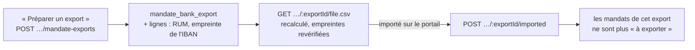

# L'export des mandats pour le portail de la banque

> 🔴 **2026-10-23 — conforme au modèle de la banque.** La banque a répondu et
> envoyé son modèle ; l'export a été corrigé le même jour : F en `AAAAMMJJ`,
> G `RECURRENT` / `PONCTUEL`, K `O` et L `N` (supposés, Q-B2), **18
> colonnes**, nom entier jusqu'à 140 puis refusé, 200 mandats par export. Le
> sujet entier (questions, réponses, modèle, hypothèses) :
> [`../prelevement/prerequis-export-mandats.md`](../prelevement/prerequis-export-mandats.md).

> Doc d'état, écrite le 2026-10-09 à partir du code. Elle remplace le plan
> « L'export des mandats pour le portail de la banque » (supprimé ; il reste dans
> l'historique git, et des migration.sql le citent encore).

La Caisse d'Épargne importe les mandats par un fichier CSV avant le premier
dépôt d'un lot (modèle `ModeleImportMandats`, reçu le 2026-10-08). Le fichier
sort des **IBAN en clair** : c'est une frontière de sécurité. Les choix faits en
l'absence d'Hugo sont dans [`../arbitrages-en-absence.md`](../arbitrages-en-absence.md).

## Le fichier

ASCII, `;` séparateur **et** terminateur de chaque cellule, CRLF, sans
en-tête, **18 colonnes**, **200 lignes au plus**
(`domain/services/mandate-bank-export-csv.ts`, revu le 2026-10-23) :

| Col | Ce qu'on écrit                                                                    |
| --- | --------------------------------------------------------------------------------- |
| A   | RUM du mandat                                                                     |
| B   | ICS de l'entité émettrice                                                         |
| C   | nom du débiteur, celui du `pain.008` (`Dbtr/Nm`), entier ; > 140 : fichier refusé |
| D   | IBAN en clair, descellé, sans espaces                                             |
| E   | BIC                                                                               |
| F   | jour Europe/Paris de `accepted_at`, `AAAAMMJJ` (`localDay`, celle de `DtOfSgntr`) |
| G   | `RECURRENT` / `PONCTUEL`                                                          |
| H   | `CORE` / `B2B` (schéma figé du mandat)                                            |
| I–J | vides                                                                             |
| K   | `O` (« mandat déjà émis » — supposé, Q-B2)                                        |
| L   | `N` (« mandat migré » — supposé, Q-B2)                                            |
| M–R | vides                                                                             |

F, G et H sont celles que la banque a dites le 2026-10-23 ; K et L sont
supposées d'après l'exemple du modèle. Les cinq s'écrivent en un seul endroit,
`mandate-bank-export-values.ts`. Chaque cellule
passe par `sepa()` (translittération ASCII de `pain008-document.ts`) puis perd
tout `+ - = @` de tête (injection de formule).

## Le cycle

- **Un export est une écriture.** `ExportMandatesForBank` fige un export :
  `mandate_bank_export` (entité, auteur, instant, nombre, « importé » par qui et
  quand) et `mandate_bank_export_line` (mandat, RUM, **empreinte SHA-256 de
  l'IBAN**, `account-fingerprint.ts`). Aucun IBAN ni BIC en base. Une entité
  sans ICS ne peut pas préparer d'export (409). Un export porte **200 mandats
  au plus** (l'agrégat le refuse au-delà) : préparer prend les 200 premiers
  dans l'ordre des RUM, les suivants restent « à exporter ».
- **Le fichier est recalculé** depuis les mandats de l'export et refusé (409)
  si l'empreinte d'un compte ne correspond plus, ou si un mandat est devenu
  inexportable (révoqué, RIB retiré, BIC vidé). Servi en
  `text/csv; charset=us-ascii`, `Cache-Control: no-store`, `attachment`, nommé
  `CENET-EXM-<n>-mandats-<k>-sur-<N>-<nombre>-mandats-<AAAA-MM-JJ>.csv` depuis
  le 2026-10-23 (avant : `mandats-banque-<SIREN>-<id>.csv`) — cf.
  [`../prelevement/procedure-de-prelevement.md`](../prelevement/procedure-de-prelevement.md) § 4 bis.
- **« Déjà importé » se lit par l'empreinte** : un mandat est « à exporter »
  s'il n'a aucune ligne d'un export **importé** portant l'empreinte de son
  compte actuel. Un changement de compte le fait ressortir.
- **« Marquer importé » marque un export** : `MandateBankExport.markImported`
  refuse un double marquage ; l'export appartient à l'entité de la route.
- **Écartés et nommés** en tête de la carte : mandats repris d'un autre
  créancier (`creditor_id` nul, nommés sur la carte de chaque entité), mandat
  actif sans compte recopié, BIC vide. Un mandat révoqué après import n'est pas
  signalé à la banque (il n'entre plus dans un lot) ; l'écran le dit.

## Où ça vit

- **Lecture par créancier** : port `MandatesForBankExportReader.activeOf(creditorId)`,
  déclaré par la comptabilité (`b2b/accounting/domain/ports/`), implémenté par
  `b2b/payments` (`PrismaMandatesForBankExportReader`, même `FieldCipher` et
  même `debitedAccounts` que le lot), relié dans
  `appBootstrap/debtor-mandate.module.ts`. L'ICS vient de l'entité, le nom du
  débiteur de `CompanyNamesReader.companyNames` (port étroit sorti de
  `CollectionCandidatesReader` le 2026-10-24, même adaptateur).
- **Routes** (`http/admin-mandate-bank-exports.controller.ts`, sous
  `admin/accounting/legal-entities/:id/mandate-exports`) : `GET` (la carte,
  lecture), `POST` (préparer, `b2b_accounting:write`), `GET
…/:exportId/file.csv` (**`b2b_accounting:write`**), `POST …/:exportId/imported`.
- **Faits** `mandate_bank_export.created` et `mandate_bank_export.imported`
  (sujet : l'entité ; `mandateCount` ; jamais un IBAN ni l'id de l'export).
- **Écran** : carte « Mandats à la banque », onglet 2 de la procédure de prélèvement (sur la fiche de l'entité juridique jusqu'au 2026-10-24, qui n'en garde qu'un renvoi).
- Les deux colonnes d'auteur sont au registre RGPD
  (`documentation/legal/rgpd-registre.json`).

## Ce qui reste ouvert

- **Les RIB destinataires** : la banque demande de les importer avant les
  mandats ; son modèle n'est pas reçu, rien n'est bâti.
- **K et L** à confirmer (Q-B2) ; **M–R** et la révocation (Q-B3) ; les
  mandats repris restent écartés.
- **Marquer importé sauf les lignes en erreur** du compte rendu (réponse 13).
