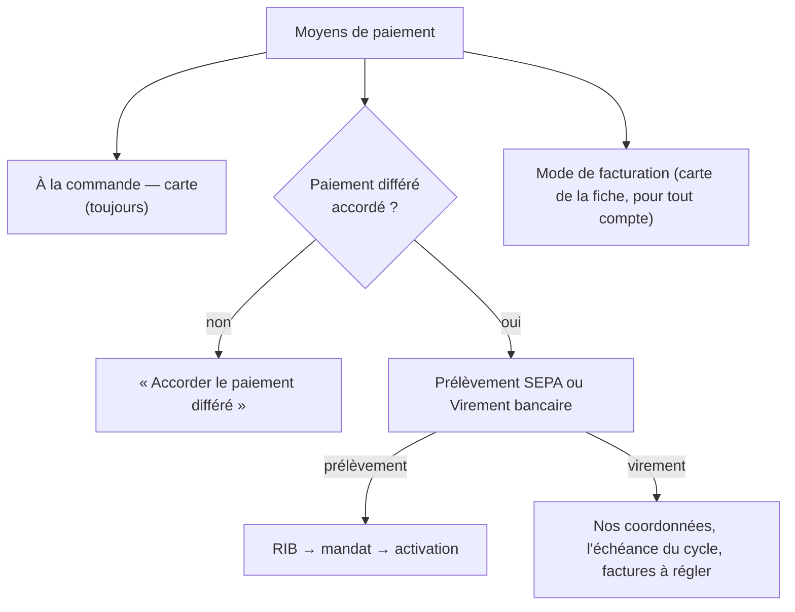

# Plan — le paiement au compte par virement

> 📐 **Plan, écrit le 2026-11-11** à la demande de Hugo : « certains clients
> veulent payer en virement ». Rien n'est bâti. Les affirmations sur
> l'existant ont été vérifiées dans le code le même jour (exploration puis
> relecture des points porteurs) ; les chemins sont cités.
>
> Questions tranchées et ajustements le 2026-11-12 (sections en fin de
> Partie 2) ; nouvelle relecture de `vitruve` avant de bâtir.

# Partie 1 — Comprendre

## Aujourd'hui

Un client pro règle **à la commande, par carte** (le socle, ouvert à tous),
ou **au compte** quand le staff lui accorde le paiement différé. Au compte,
il n'existe qu'**un** moyen d'encaisser : le **prélèvement SEPA**. L'écran
« Informations › Moyens de paiement » le dit en trois étapes — RIB, mandat,
règlement périodique — et l'**échéance de facturation** (mensuel, deux fois
par mois, hebdomadaire) vit dans une carte à part, affichée « Mensuel » par
défaut même quand le client n'a pas de paiement différé.

## Ce qu'on veut

```
Moyens de paiement
├─ À la commande — carte bancaire      le socle, ouvert à tous
└─ Paiement différé                    s'accorde au client
   1 · Échéance de facturation         hebdomadaire · deux fois par mois · mensuelle
   2 · Comment il règle                 Prélèvement SEPA  |  Virement bancaire
   3 · Ce que ce choix demande
       ├─ Prélèvement : RIB du client → mandat SEPA → activation   (inchangé)
       └─ Virement    : rien à signer ; nos coordonnées et une référence
                         sur chaque facture, l'échéance du cycle de facturation, le suivi
```

- **L'échéance est l'étape commune** : elle dit quand on facture, pas comment
  on encaisse (Hugo, 2026-11-11).
- **« Mensuel » ne s'affiche plus par défaut** tant que le paiement différé
  n'est pas accordé ; l'écran le pose au moment de l'accorder.
- **Virement** : le client reçoit sa facture avec **notre IBAN**, une
  **référence à reporter** sur son virement et une **date d'échéance** ; il
  vire ; le staff **marque la facture réglée** à réception. Rien n'est prélevé.

## Les décisions

Corrigées après la contradiction de `vitruve` (2026-11-11, § « Contredit par
vitruve » en fin de document). Le principe qui les tient : **le prélèvement
encaisse des COMMANDES** (`order_collection`, états `due` / `excluded`,
`accounting/domain/entities/order-collection.ts:8-12`), pas des factures ni
des payeurs — le moyen se fige donc là où l'argent est dû.

| #   | Décision                                                                                                                                                                                                                                                                                                                                                                                                                                                                                                                                          | Pourquoi                                                                                                                                                                    |
| --- | ------------------------------------------------------------------------------------------------------------------------------------------------------------------------------------------------------------------------------------------------------------------------------------------------------------------------------------------------------------------------------------------------------------------------------------------------------------------------------------------------------------------------------------------------- | --------------------------------------------------------------------------------------------------------------------------------------------------------------------------- |
| V1  | Le moyen d'encaissement est une propriété **du payeur** (`sepa_debit` \| `bank_transfer`), daté. Un site qui suit la facturation de son principal prend le moyen du principal ; un site qui ne la suit pas a le sien.                                                                                                                                                                                                                                                                                                                             | C'est le payeur qui reçoit la facture et que la passation lit (`order-settlement.ts:131`).                                                                                  |
| V2  | Un changement de moyen prend effet **au début d'une période de facturation** du payeur, jamais au milieu.                                                                                                                                                                                                                                                                                                                                                                                                                                         | Une période — donc une facture — n'a qu'un moyen. Plus de facture qui annonce un moyen et en subit un autre.                                                                |
| V3  | **Le moyen se fige sur chaque COMMANDE à la passation** (sur `order_collection`), d'après la période où elle tombe. Les commandes déjà passées gardent leur moyen ; la facture prend celui de ses commandes (toutes le même, par V2).                                                                                                                                                                                                                                                                                                             | Les commandes au compte déjà passées ont ainsi un moyen sans ambiguïté.                                                                                                     |
| V4  | **Le lot de prélèvement ne prend que les commandes figées « prélèvement »** — il lit le moyen de la commande, jamais celui du payeur relu à la clôture. Une commande « virement » n'est ni prélevée ni comptée « sans mandat ».                                                                                                                                                                                                                                                                                                                   | Le moyen relu sur le payeur ferait prélever une facture qui demandait un virement, ou abandonner une facture qui annonçait un prélèvement.                                  |
| V5  | La facture au virement porte **notre IBAN et BIC** (déjà dans l'instantané figé, `invoice-json.schema.ts:26-27`), une **référence de paiement** (le numéro de facture), sa **date d'échéance**, et en Factur-X le code **58** (BT-81), l'IBAN du bénéficiaire (**BT-84**) et la référence (**BT-83**). Les mentions de pénalités, d'indemnité de 40 € et d'escompte existent déjà sur l'entité.                                                                                                                                                   | La facture dit où et comment payer, et reste conforme.                                                                                                                      |
| V6  | **L'échéance suit le cycle de facturation, quel que soit le moyen** (Hugo, 2026-11-11) : une facture au virement a la même date d'échéance que si elle était prélevée — celle que l'émission calcule déjà (`issue-monthly-invoices.handler.ts:194-197`, `invoiceDueDay`). Le client vire pour cette date. Garde : le réglage du calendrier refuse une échéance à plus de **45 jours** de l'émission (plafond d'une facture périodique, art. L441-10 C. com. et 289 CGI).                                                                          | Un seul calendrier à apprendre, et une seule échéance par émission : pas de délai propre au virement.                                                                       |
| V7  | **Marquer réglé un virement reçu** : un geste du staff qui saisit **un virement** (montant, date, référence lue sur le relevé) et **les factures qu'il règle** (une ou plusieurs). Le total des factures choisies doit égaler le montant ; sinon refus qui dit l'écart. Le geste règle, **dans la même transaction et par l'agrégat `OrderCollection`**, chaque commande de ces factures (transition `settled_by_transfer`, à côté de `settleOtherwise`). Rejouer le même virement ou une facture déjà réglée est refusé, avec la facture nommée. | Une écriture nue sur la facture laisserait les commandes `due`, et un retour au prélèvement les prélèverait une seconde fois. Un virement règle souvent plusieurs factures. |
| V8  | **Retard** : une facture au virement non réglée à son échéance remonte dans le suivi des impayés et sur la fiche client. Pas de relance automatique par e-mail dans ce plan.                                                                                                                                                                                                                                                                                                                                                                      | Les impayés ont leur écran — à vérifier qu'il lit une facture non prélevée (T3).                                                                                            |
| V9  | Le **blocage** existant (carte forcée, paiement différé gardé) vaut pour les deux moyens. Ses libellés montrés au client et au staff deviennent « paiement au compte suspendu » au lieu de « prélèvement suspendu » ; les noms de champs du contrat (`directDebitBlocked`, …) ne changent pas (valeurs servies).                                                                                                                                                                                                                                  | Un client au virement lirait « prélèvement suspendu ».                                                                                                                      |
| V10 | **Changer de moyen** est un geste daté (V2), avec motif, journalisé, sous un droit propre (`b2b_collection_means`). Refusé tant qu'un **retour bancaire** du payeur est en cours. Un payeur au virement n'a jamais d'**arrêté** (`billing_statement`).                                                                                                                                                                                                                                                                                            | Changer de moyen arrête ou démarre un prélèvement : c'est un geste de comptabilité.                                                                                         |
| V11 | Les **mandats** existants restent en place quand on passe au virement (ils ne servent plus) ; repasser au prélèvement les retrouve. Les mandats propres des sites (`own_mandate_*`, `collection-form.ts`) suivent le moyen du payeur.                                                                                                                                                                                                                                                                                                             | Rien n'est détruit ; un mandat révoqué se révoque par son propre geste.                                                                                                     |
| V12 | **Pas de rapprochement bancaire automatique** (lecture de relevé).                                                                                                                                                                                                                                                                                                                                                                                                                                                                                | Hors périmètre.                                                                                                                                                             |

## Notre IBAN devient une consigne de paiement

Aujourd'hui l'IBAN de l'entité ne sert qu'à recevoir des prélèvements que
nous émettons. Au virement, **il est imprimé sur chaque facture comme le
compte à payer** : c'est la cible de la fraude au faux changement de RIB, et
le contrat le dit déjà (`staff-access.ts:240-244`). L'IBAN et le BIC restent
modifiables (`legal-entity.ts:249`).

**Décidé par Hugo le 2026-11-12 (Q4)** : un changement d'IBAN ou de BIC de
l'entité n'est pris par les factures **qu'après la confirmation d'un second
membre du staff** (quatre yeux : celui qui confirme n'est pas celui qui a
saisi), et il est notifié à toute la comptabilité (la cloche). Tant qu'il
n'est pas confirmé, les factures gardent l'ancien IBAN. C'est le lot **T0**,
préalable à toute facture au virement.

## L'écran



- La carte « mode de facturation » reste où elle est, pour tout compte : le
  mode se choisit à l'ouverture (A1). Le bloc « Paiement différé » ne porte
  que le moyen d'encaissement.
- Le choix « Prélèvement SEPA / Virement bancaire » est un `fold-view-toggle` ;
  le dessous change. Changer de moyen demande une **date d'effet** (V2) et un
  motif.
- Côté **boutique**, le client au virement voit « Paiement au compte, par
  virement à réception de facture », et sa facture avec les coordonnées ; pas
  d'espace mandat.

# Partie 2 — Le code

- **Domaine** (`apps/lfd-api/src/lafoliecoffee/accounting/`) : le moyen
  d'encaissement daté du payeur, avec SON historique (A2 corrigé : il lit le
  calendrier du mode pour se dater, il n'entre ni dans `PayerTimeline` ni
  dans `InvoicingCalendar`) ; une migration additive (table des moyens par payeur et date d'effet, aucune
  ligne = prélèvement, comme aujourd'hui).
- **Facture** : `invoicePaymentMeansOf` (`monthly-invoicing.ts:204-208`)
  rend aujourd'hui « prélèvement si mandat, sinon `null` » ; il rend le
  virement pour un payeur au virement, avec IBAN, référence et échéance ;
  `invoice.types.ts:98-111` gagne `BankTransferMeans` ; `facturx-settlement.ts`
  sort le code 58 et BT-84 ; le PDF de facture affiche le bloc « Règlement par
  virement ».
- **Lot** : les candidats (`collection-candidates.reader.ts`,
  `collection-constitution-support.ts`) écartent les commandes figées
  « virement » (V4 : le lot lit la commande, jamais le payeur).
- **Statut** : `invoice-settlement.ts` gagne l'état « virement attendu » puis
  `settled` par le geste V7 ; « en retard » après l'échéance.
- **Geste V7** : commande, route `POST …/legal-entities/:id/bank-transfers`
  (un virement : montant, date, référence ; les factures qu'il règle), journal,
  droit `b2b_accounting`.
- **Boutique** : le libellé et la facture.

## Lots

| Lot                         | Contenu                                                                                                                                                                                                                                                                                  |
| --------------------------- | ---------------------------------------------------------------------------------------------------------------------------------------------------------------------------------------------------------------------------------------------------------------------------------------- |
| **T0**                      | l'IBAN et le BIC de l'entité aux quatre yeux (Q4) : saisie en attente, confirmation par double saisie à l'aveugle d'un autre membre, notification à la comptabilité ; TOUS les lecteurs de `creditorSnapshot` (factures, lot SEPA, mandat, arrêtés) ne lisent que l'IBAN confirmé (§ C3) |
| **T1**                      | le moyen d'encaissement daté du payeur (V1, V2, V10, V11), figé sur la commande (V3), lu par le lot (V4)                                                                                                                                                                                 |
| **T2+T3** (livrés ensemble) | la facture au virement (V5, V6, Factur-X, PDF), le statut « virement attendu / réglée / en retard », le geste V7, le suivi des impayés (V8) — ensemble, sinon une facture au virement s'affiche « prélèvement prévu »                                                                    |
| **T4**                      | l'écran « Moyens de paiement » : le choix du moyen et le dessous qui change ; la carte du mode reste (A1)                                                                                                                                                                                |
| **T5**                      | la boutique ; doc d'état                                                                                                                                                                                                                                                                 |

## Décisions de Hugo (2026-11-12)

- **Q2** — un client au virement qui ne paie pas : **on le signale seulement**
  (suivi des impayés, fiche client, V8). Pas de blocage automatique ; le
  blocage existant reste un geste du staff (V9).
- **Q3** — **le staff seul** accorde le virement, comme le paiement différé.
  Le client peut le demander par message ; il ne le choisit pas dans son
  espace.
- **Q4** — l'IBAN aux quatre yeux (§ « Notre IBAN devient une consigne de
  paiement », lot T0).

## Ajustements du 2026-11-12, après le chantier du mode de facturation

Le même jour, le mode de facturation est devenu obligatoire à l'ouverture et
à l'activation d'un compte, et immédiat pour un payeur qui n'a jamais commandé
([`facturation/plan-changement-de-mode-immediat.md`](facturation/plan-changement-de-mode-immediat.md),
bâti et en production : `96216e035`, `75d0fd1b8`, `de2a9ee51`, `0408ac70f`,
`7fa2fe78b`).

- **A1 — la carte du mode ne disparaît pas** : le § « L'écran » prévoyait d'en
  faire l'étape 1 du paiement différé et de la retirer. Le choix du mode reste
  à l'ouverture et à l'activation (`billing-mode-choice`), et la carte de la
  fiche (`payer-billing-mode-card`) se range DANS le bloc « Paiement différé »
  au lieu d'être supprimée. « Sans paiement différé, aucune échéance
  affichée » devient : l'échéance est affichée, puisqu'elle a été choisie.
- **A2 — un changement de moyen suit la même règle que le mode** (V2) : il
  est daté de la dernière clôture du payeur et **immédiat pour un payeur qui
  n'a jamais commandé** (`hasEverOrdered`), sinon il prend effet à la
  prochaine clôture. Le calendrier de l'entité ne compte une clôture que si
  le segment qui la gouverne était écrit avant elle (§ 3.1 du plan du mode) :
  la même règle s'applique aux segments de moyen, par le même code, sans en
  écrire une seconde.

## Corrections du 2026-11-12, après la seconde relecture de `vitruve`

Elles font foi sur ce qui précède.

- **C1 — le moyen a son propre historique (BLOQUANT 1).** Le moyen ne crée
  aucune clôture : il se fige sur la commande à la passation. Il ne s'écrit
  donc ni dans `PayerTimeline` (qui ne connaît que des modes) ni dans
  `InvoicingCalendar` : un segment de moyen écrit après une clôture la
  rendrait « inconnue » (`invoicing-calendar.ts:209-219`, `statement-periods.ts:51`),
  et sa facture ne serait jamais tentée. Il a sa table et son agrégat
  (`PayerCollectionMeansHistory`), et ne LIT le calendrier du mode que pour
  calculer sa date d'effet. La règle de l'immédiat est celle du mode telle
  qu'elle est écrite (`payer-billing-mode-history.ts:129`) : le payeur n'a
  jamais commandé et rien n'est écrit depuis la dernière clôture ; elle se
  partage par une fonction pure, pas par l'agrégat.
- **C2 — le moyen entre dans la clé d'une facture (BLOQUANT 2).** L'émission
  prend toutes les commandes non facturées du payeur
  (`prisma-monthly-invoicing.reader.ts:59-66`), et une commande
  `awaiting_remainder` part au mois de son solde : une facture pourrait mêler
  un bon figé « prélèvement » et un bon « virement ». La clé de groupe
  (`monthly-invoicing.ts:91-92`, `byMandate`) et `invoicedGroups`
  (`prisma-monthly-invoicing.reader.ts:136`) portent le moyen figé ; une
  facture n'a qu'un moyen. La forme de la clé des émissions déjà écrites est
  préservée : une commande sans moyen figé (toutes celles d'avant T1) est
  « prélèvement », et sa clé ne change pas.
- **C3 — l'IBAN confirmé est le seul que lit `creditorSnapshot` (SÉRIEUX 3).**
  Le même instantané (`legal-entity.ts:642-661`) nourrit les factures, le
  `CdtrAcct` du pain.008 (le compte qui reçoit chaque lot), le mandat PDF, les
  arrêtés et les brouillons. L'IBAN en attente vit dans des colonnes à part,
  chiffrées comme l'actuel (`creditorIbanSealed`), qu'aucun lecteur de
  l'instantané n'atteint.
- **C4 — la confirmation par double saisie à l'aveugle (SÉRIEUX 4).** L'IBAN
  ne ressort jamais (`set-creditor-account.handler.ts:27-29`). Le second
  membre ne le voit donc pas : il le **ressaisit** depuis le RIB de la banque
  (document hors système), et la confirmation n'aboutit que si les deux
  saisies sont égales. Un refus ne dit pas lequel des caractères diffère.
- **C5 — la confirmation désigne sa saisie (SÉRIEUX 5).** La saisie en
  attente porte un identifiant ; la confirmation le cite, et l'écriture est
  conditionnée (`WHERE pending_id = …`) : une saisie remplacée, déjà
  confirmée ou annulée entre-temps est refusée. Le `save` de l'entité
  (`prisma-legal-entity.repository.ts:48-51`, upsert de la ligne entière) ne
  touche plus aux colonnes de l'IBAN : elles ne s'écrivent que par ces deux
  gestes, conditionnés.
- **C6 — le droit et les quatre yeux (SÉRIEUX 7).** Saisir et confirmer
  demandent `b2b_accounting` en écriture ; la confirmation est refusée si
  l'auteur de la saisie et le confirmateur sont la même fiche du staff
  (identifiant interne, pas le `sub`). Une seule personne qui a deux fiches
  reste hors de portée du code : c'est dit.
- **C7 — les impayés de factures sont un écran neuf (SÉRIEUX 6).** Aucune
  lecture ne liste aujourd'hui une facture non réglée à son échéance
  (`invoice-settlement.ts:26-33`) ; T3 construit la lecture, sa route et
  l'écran, chiffrés dans le lot.
- **C8 — A1 tenu dans le corps** (SÉRIEUX 8) : ci-dessus, § « L'écran » et T4.

## V3 et V4 réécrits : le moyen se lit par période (Hugo, 2026-11-12)

Font foi sur V3, V4 et C2. La version « figé sur la commande à la
passation » est retirée après la contradiction de `vitruve` : une facture et
un lot prennent les commandes par **date de solde** (`settledOn`,
`billable-order-criterion.ts:84-89`), pas par date de passation — une
commande passée en mars, soldée en avril chez un payeur passé au virement le
1er avril, aurait apporté « prélèvement » sur une facture « virement ».

- **V3' — une période, un moyen.** Un changement de moyen tombe sur une
  limite de période du payeur (la prochaine clôture ; le début de la période
  pour un payeur qui n'a jamais commandé — A2/C1). Le moyen d'une période est
  donc **celui en vigueur à son début** (`collectionMeansAt(entries,
début de période)`). Rien n'est figé sur la commande : une commande prend le
  moyen de la période où elle est soldée, comme elle en prend la facture.
- **V4' — la facture et le lot lisent le même moyen.** L'émission et la
  constitution du lot lisent, pour chaque payeur, le moyen de la période
  qu'elles traitent, par un port de lecture déclaré par `accounting`
  (`PayerCollectionMeansReader`, une lecture groupée par clôture et par
  entité, jamais par commande). Le lot ne prend que les payeurs dont la
  période est au prélèvement ; un payeur au virement n'est ni prélevé ni
  compté « sans mandat ». La facture fige son moyen dans son instantané
  (`invoicePaymentMeansOf`), comme elle fige déjà le mandat.
- **C2' — la clé de facture.** Une période n'ayant qu'un moyen, une facture
  ne peut plus mêler deux moyens : la colonne `collection_means` dans la clé
  primaire de `invoice_monthly_outcome` n'est plus nécessaire **si** le moyen
  d'une période ne change jamais après coup. À vérifier : un changement
  immédiat (payeur sans commande) date le moyen du début de la période en
  cours — aucune facture de cette période n'existe encore, puisqu'il n'a
  jamais commandé.
- **L'entité** : celle que l'émission et le lot traitent déjà ; l'émission
  n'en admet aujourd'hui qu'une en service (`soleSeller`,
  `issue-monthly-invoices.handler.ts:207-213`).
- **Coût** : zéro à la passation ; une lecture groupée par clôture à
  l'émission et au lot.
- **Lecteurs à mettre au moyen de la période** (liste de `vitruve`) : le lot
  (`collection-candidates.reader.ts`, `collection-constitution-support.ts`),
  `isDebitedHereAt` (`collection-verdict.ts:91-98`, « vous serez prélevé »),
  `effectiveMandateOf` (une période au virement ne reçoit pas de mandat sur
  sa facture, BG-16), les arrêtés (`statement-billing.reader.ts`, V10 : jamais
  d'arrêté au virement), le dossier de facture (`invoice-dossier-support.ts`),
  l'annulation, le prélèvement d'essai.
- **Le blocage du prélèvement** (`directDebitBlockedAt`, `prisma-order-guard.reader.ts:51`) :
  pour un payeur au virement, il ne retire pas le paiement au compte (à
  trancher : le blocage devient-il « paiement au compte suspendu », V9, pour
  les deux moyens ?).
- **Révision d'une commande** qui déplace son solde d'une période à l'autre :
  elle prend le moyen de sa nouvelle période, comme elle en prend la facture.

## Corrections de V3'/V4' (Hugo, 2026-11-12, après la quatrième relecture)

Font foi sur la section précédente.

- **K1 — un seul changement en attente par payeur, mode et moyen confondus.**
  Tant qu'un changement de mode ou de moyen est programmé (pas encore en
  vigueur), un changement de l'autre est refusé (409, message qui nomme le
  changement en attente et sa date). Sans cette règle, un mode immédiat posé
  après un moyen programmé déplace les limites de période, et la limite du
  moyen tombe au milieu d'une période (`payer-collection-means-history.ts:129-132`,
  `payer-billing-mode-history.ts:128-131`, `payer-timeline.ts:30-35`). Avec
  elle, chaque limite de moyen est une limite de la suite du payeur.
- **K2 — le lot lit le moyen figé sur la FACTURE de chaque bon**, jamais le
  moyen du payeur pour « la » période : le lot reprend les bons des périodes
  antérieures (`prisma-collection-candidates.reader.ts:50-52`,
  `payerPeriodStartAt`). Un bon dont la facture demande un virement n'est
  jamais prélevé ; un bon dont la facture annonce un prélèvement l'est, même
  si le payeur est passé au virement depuis. La facture connaît déjà ses bons
  (`invoicesOf`). La facture fait foi.
- **K3 — le moyen entre dans `VerdictContext`** (`collection-verdict.ts`) :
  `judgeMandate`, la constitution, `isDebitedHereAt`, les payeurs comptés et
  `effectiveMandateOf` le lisent au même endroit.
- **K4 — le blocage** (`directDebitBlockedAt`) devient « paiement au compte
  suspendu » quel que soit le moyen (V9) : un payeur bloqué puis passé au
  virement reste bloqué jusqu'au déblocage par le staff.
- **K5 — un payeur au virement reste un client de l'entité** : le compte des
  payeurs (`counted-payers.ts:23-38`) compte « paiement au compte », plus
  « prélevé ».
- **K6 — la représentation après retour** vise une facture au prélèvement :
  admise. La **pré-notification** (`collection-notice-support.ts`) ne concerne
  que les factures au prélèvement ; elle couvre aussi un bon passé sous
  « virement » et soldé dans une période au prélèvement. L'**autopilote** du
  lot passe par la constitution (à vérifier au bâti).
- **K7 — la clé de facture ne change pas** : `invoice_monthly_outcome` n'a
  jamais eu de colonne de moyen (`invoice.prisma:191`) ; avec K1, une facture
  au virement (`mandateId = ""`) et une issue « sans mandat » du même payeur
  ne coexistent pas sur une même clôture.
- **K8 — pourquoi le moyen n'est pas une décision de passation**, alors que
  le terme l'est (`billable-order-criterion.ts`, Hugo, 2026-09-10) : le terme
  dit QUAND un bon est dû et engage le client à la commande ; le moyen dit
  COMMENT la facture se règle, et une facture n'a qu'un moyen. La commande
  le reçoit de sa facture.

> ✅ **V3'/V4' (K1–K13) bâtis le 2026-11-12**, sans migration. Reste T2 (PDF et e-mail de la facture au virement : IBAN, référence) **avant de passer un vrai client au virement**, puis T3–T5.

## Dernières corrections avant le bâti (Hugo, 2026-11-12, cinquième relecture)

- **K9 — les bons sans facture** (chemin des arrêtés, `collection-assembly.ts:169-175` :
  plancher absent, ou prélèvement d'essai `simulateUninvoiced`,
  `collection-constitution-support.ts:143`) lisent le moyen de LEUR période
  (`collectionMeansAt` au début de la période de leur solde) ; un bon dont la
  période est au virement y est refusé (V10 : jamais d'arrêté au virement).
- **K10 — la facture dit « virement »** : `invoicePaymentMeansOf`
  (`monthly-invoicing.ts:204-208`) se déduit du moyen de la période, plus du
  seul mandat ; une facture au virement écrit dans `payment_means` le code
  du virement (BG-16 : 58, IBAN du bénéficiaire BT-84, référence BT-83 — V5),
  distinct de `null`. `CollectableInvoice` et `invoicesOf`
  (`prisma-collection-candidates.reader.ts:194-217`) lisent ce moyen ; le lot
  écarte une facture au virement. Une facture émise avec `null` (sans
  mandat, ou d'avant le chantier) se lit « prélèvement », comme aujourd'hui.
- **K11 — un verrou pour K1** : les gestes de mode et de moyen d'un payeur
  prennent, dans leur transaction et AVANT de vérifier « aucun changement en
  attente », le verrou de la ligne du payeur chez l'entité (`SELECT … FOR
UPDATE` sur la société payeuse), dans le même ordre pour les deux.
- **K12 — les dates des modes de l'entité** ne sont pas dans K1 : leur
  changement est toujours programmé à `closureAfter` du mode
  (`billing-mode-dates-history.ts`), et un moyen programmé tombe sur la
  prochaine clôture du payeur, qui reste une clôture de la suite. Un test du
  domaine le tient (moyen programmé, puis dates du mode changées : la limite
  du moyen reste une clôture de `PayerTimeline`).
- **K13 — la représentation après retour et l'autopilote** lisent le moyen
  de la facture (K2, K10) ; le bâti les ouvre et le prouve par un test.

## T0 tel qu'il se bâtit (Hugo, 2026-11-12, après la troisième relecture)

> ✅ **T0 bâti le 2026-11-12** (migration `20261112100000_le_compte_creancier_aux_quatre_yeux`, additive). Avant son déploiement : vérifier en production qu'aucune entité n'a `creditor_iban_sealed IS NULL AND creditor_iban IS NOT NULL` — l'instantané ne lit plus la colonne claire.

- **La première saisie est immédiate** : tant que l'entité n'a aucun compte
  confirmé, aucun client ne paie et aucun lot ne part — rien à détourner. Le
  semis et les 23 e2e qui posent un compte puis prélèvent restent inchangés.
  Seuls les **changements** suivants passent aux quatre yeux.
- **Le compte entier passe aux quatre yeux** : IBAN, BIC, titulaire et
  adresse, saisis dans le même geste. L'agrégat `LegalEntity` porte un
  `pendingCreditorAccount` (identifiant, auteur, instant), chiffré comme
  l'actuel ; `setCreditorAccount` devient « proposer » quand un compte est
  confirmé ; `confirmCreditorAccount(pendingId, ibanRetapé, confirmateur)` est
  une méthode de l'agrégat qui refuse : confirmateur = auteur (identifiant
  interne de la fiche), IBAN retapé différent, saisie remplacée, et la règle
  existante du titulaire après le premier mandat (`legal-entity.ts:384-394`).
  Annuler une saisie en attente est un geste.
- **Concurrence : une version sur l'entité** (verrou optimiste), incrémentée
  à chaque `save` et vérifiée par lui : un des dix-neuf gestes qui a lu une
  version périmée est refusé (409, « l'entité a changé, rechargez »). C'est
  ce qui remplace l'écriture conditionnée du C5, sans écriture ciblée.
- **Un seul point à tenir : le mapper** (`legal-entity.mapper.ts`). Il ne
  construit l'instantané (`creditorSnapshot`) que depuis le compte confirmé,
  jamais depuis le compte en attente ni l'ancienne colonne en clair. Tous
  les lecteurs — factures, factures carte, pain.008, mandat PDF, arrêtés,
  brouillons, lot de test, spécimens — passent par lui.
- **La vue** dit qu'une saisie est en attente (auteur, instant, quatre
  derniers chiffres de l'IBAN proposé) ; la cloche de la comptabilité sonne à
  la proposition, à la confirmation et à l'annulation.
- **Migration additive** : colonnes du compte en attente (chiffrées), auteur,
  instant, identifiant, et `version` (défaut 0) sur l'entité.
- ~~Reporté à T2 : une colonne de moyen dans la clé de `invoice_monthly_outcome`~~ — retiré : K7, la clé ne change pas.

## Contredit par vitruve (2026-11-11)

Bloquants corrigés : un « marquer réglée » sur la facture laissait ses
commandes à prélever (V7 passe par `OrderCollection`) ; le moyen relu sur le
payeur à la clôture faisait prélever ou abandonner des factures (V3, V4 : figé
sur la commande, lu par le lot) ; les commandes déjà passées n'avaient pas de
moyen (V2, V3). Sérieux corrigés : formes de prélèvement des sites (V1, V11),
échéance (V6 : elle suit le cycle de facturation, décidé par Hugo ensuite), plafond de 45 jours (V6), BT-83 (V5), IBAN imprimé
(Q4), virement qui règle plusieurs factures et idempotence (V7), droit du
changement de moyen (V10), T2 et T3 ensemble, libellés du blocage (V9),
arrêtés et retours en cours (V10). Non vérifiés : `PayerTimeline` comme
modèle, les factures de groupe dans `planMonthlyInvoices`, l'écran des
impayés sur une facture non prélevée.
