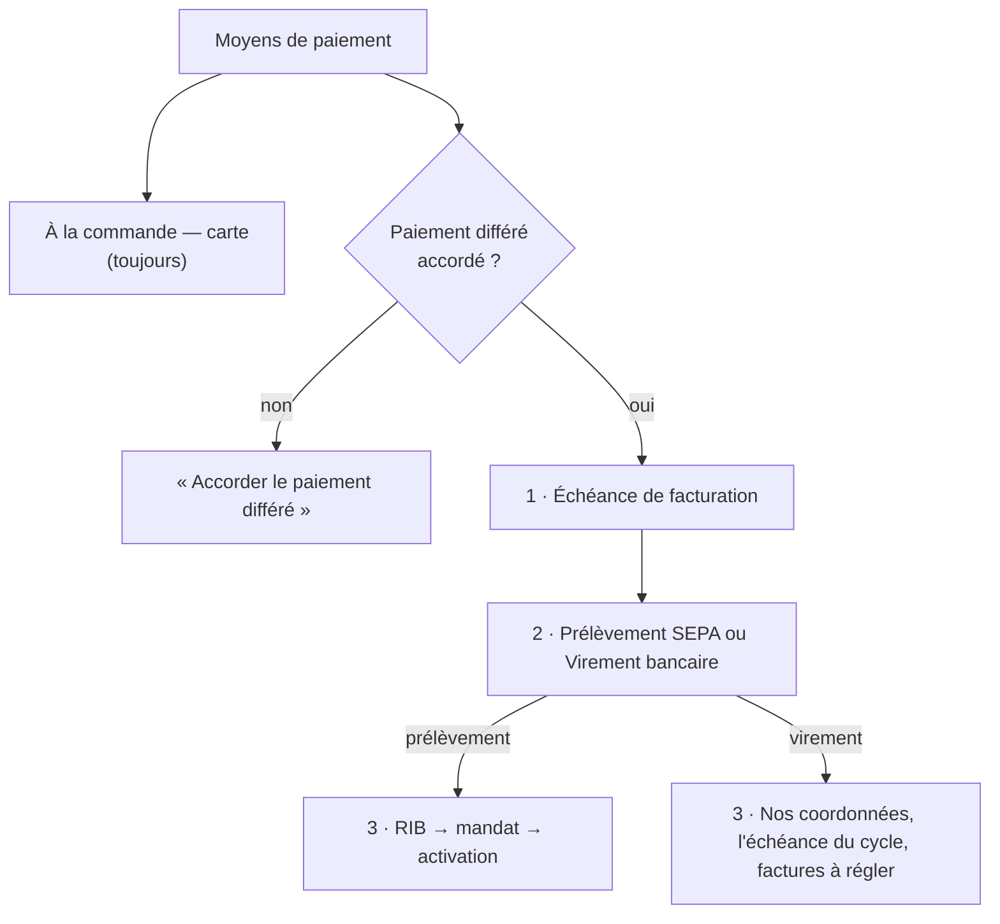

# Plan — le paiement au compte par virement

> 📐 **Plan, écrit le 2026-11-11** à la demande de Hugo : « certains clients
> veulent payer en virement ». Rien n'est bâti. Les affirmations sur
> l'existant ont été vérifiées dans le code le même jour (exploration puis
> relecture des points porteurs) ; les chemins sont cités.

# Partie 1 — Comprendre

## Aujourd'hui

Un client pro règle **à la commande, par carte** (le socle, ouvert à tous),
ou **au compte** quand le staff lui accorde le paiement différé. Au compte,
il n'existe qu'**un** moyen d'encaisser : le **prélèvement SEPA**. L'écran
« Informations › Moyens de paiement » le dit en trois étapes — RIB, mandat,
règlement périodique — et l'**échéance de facturation** (mensuel, deux fois
par mois, hebdomadaire) vit dans une carte à part, affichée « Mensuel » par
défaut même quand le client n'a pas de paiement différé.

## Ce qu'on veut

```
Moyens de paiement
├─ À la commande — carte bancaire      le socle, ouvert à tous
└─ Paiement différé                    s'accorde au client
   1 · Échéance de facturation         hebdomadaire · deux fois par mois · mensuelle
   2 · Comment il règle                 Prélèvement SEPA  |  Virement bancaire
   3 · Ce que ce choix demande
       ├─ Prélèvement : RIB du client → mandat SEPA → activation   (inchangé)
       └─ Virement    : rien à signer ; nos coordonnées et une référence
                         sur chaque facture, l'échéance du cycle de facturation, le suivi
```

- **L'échéance est l'étape commune** : elle dit quand on facture, pas comment
  on encaisse (Hugo, 2026-11-11).
- **« Mensuel » ne s'affiche plus par défaut** tant que le paiement différé
  n'est pas accordé ; l'écran le pose au moment de l'accorder.
- **Virement** : le client reçoit sa facture avec **notre IBAN**, une
  **référence à reporter** sur son virement et une **date d'échéance** ; il
  vire ; le staff **marque la facture réglée** à réception. Rien n'est prélevé.

## Les décisions

Corrigées après la contradiction de `vitruve` (2026-11-11, § « Contredit par
vitruve » en fin de document). Le principe qui les tient : **le prélèvement
encaisse des COMMANDES** (`order_collection`, états `due` / `excluded`,
`accounting/domain/entities/order-collection.ts:8-12`), pas des factures ni
des payeurs — le moyen se fige donc là où l'argent est dû.

| #   | Décision                                                                                                                                                                                                                                                                                                                                                                                                                                                                                                                                          | Pourquoi                                                                                                                                                                    |
| --- | ------------------------------------------------------------------------------------------------------------------------------------------------------------------------------------------------------------------------------------------------------------------------------------------------------------------------------------------------------------------------------------------------------------------------------------------------------------------------------------------------------------------------------------------------- | --------------------------------------------------------------------------------------------------------------------------------------------------------------------------- |
| V1  | Le moyen d'encaissement est une propriété **du payeur** (`sepa_debit` \| `bank_transfer`), daté. Un site qui suit la facturation de son principal prend le moyen du principal ; un site qui ne la suit pas a le sien.                                                                                                                                                                                                                                                                                                                             | C'est le payeur qui reçoit la facture et que la passation lit (`order-settlement.ts:131`).                                                                                  |
| V2  | Un changement de moyen prend effet **au début d'une période de facturation** du payeur, jamais au milieu.                                                                                                                                                                                                                                                                                                                                                                                                                                         | Une période — donc une facture — n'a qu'un moyen. Plus de facture qui annonce un moyen et en subit un autre.                                                                |
| V3  | **Le moyen se fige sur chaque COMMANDE à la passation** (sur `order_collection`), d'après la période où elle tombe. Les commandes déjà passées gardent leur moyen ; la facture prend celui de ses commandes (toutes le même, par V2).                                                                                                                                                                                                                                                                                                             | Les commandes au compte déjà passées ont ainsi un moyen sans ambiguïté.                                                                                                     |
| V4  | **Le lot de prélèvement ne prend que les commandes figées « prélèvement »** — il lit le moyen de la commande, jamais celui du payeur relu à la clôture. Une commande « virement » n'est ni prélevée ni comptée « sans mandat ».                                                                                                                                                                                                                                                                                                                   | Le moyen relu sur le payeur ferait prélever une facture qui demandait un virement, ou abandonner une facture qui annonçait un prélèvement.                                  |
| V5  | La facture au virement porte **notre IBAN et BIC** (déjà dans l'instantané figé, `invoice-json.schema.ts:26-27`), une **référence de paiement** (le numéro de facture), sa **date d'échéance**, et en Factur-X le code **58** (BT-81), l'IBAN du bénéficiaire (**BT-84**) et la référence (**BT-83**). Les mentions de pénalités, d'indemnité de 40 € et d'escompte existent déjà sur l'entité.                                                                                                                                                   | La facture dit où et comment payer, et reste conforme.                                                                                                                      |
| V6  | **L'échéance suit le cycle de facturation, quel que soit le moyen** (Hugo, 2026-11-11) : une facture au virement a la même date d'échéance que si elle était prélevée — celle que l'émission calcule déjà (`issue-monthly-invoices.handler.ts:194-197`, `invoiceDueDay`). Le client vire pour cette date. Garde : le réglage du calendrier refuse une échéance à plus de **45 jours** de l'émission (plafond d'une facture périodique, art. L441-10 C. com. et 289 CGI).                                                                          | Un seul calendrier à apprendre, et une seule échéance par émission : pas de délai propre au virement.                                                                       |
| V7  | **Marquer réglé un virement reçu** : un geste du staff qui saisit **un virement** (montant, date, référence lue sur le relevé) et **les factures qu'il règle** (une ou plusieurs). Le total des factures choisies doit égaler le montant ; sinon refus qui dit l'écart. Le geste règle, **dans la même transaction et par l'agrégat `OrderCollection`**, chaque commande de ces factures (transition `settled_by_transfer`, à côté de `settleOtherwise`). Rejouer le même virement ou une facture déjà réglée est refusé, avec la facture nommée. | Une écriture nue sur la facture laisserait les commandes `due`, et un retour au prélèvement les prélèverait une seconde fois. Un virement règle souvent plusieurs factures. |
| V8  | **Retard** : une facture au virement non réglée à son échéance remonte dans le suivi des impayés et sur la fiche client. Pas de relance automatique par e-mail dans ce plan.                                                                                                                                                                                                                                                                                                                                                                      | Les impayés ont leur écran — à vérifier qu'il lit une facture non prélevée (T3).                                                                                            |
| V9  | Le **blocage** existant (carte forcée, paiement différé gardé) vaut pour les deux moyens. Ses libellés montrés au client et au staff deviennent « paiement au compte suspendu » au lieu de « prélèvement suspendu » ; les noms de champs du contrat (`directDebitBlocked`, …) ne changent pas (valeurs servies).                                                                                                                                                                                                                                  | Un client au virement lirait « prélèvement suspendu ».                                                                                                                      |
| V10 | **Changer de moyen** est un geste daté (V2), avec motif, journalisé, sous un droit propre (`b2b_collection_means`). Refusé tant qu'un **retour bancaire** du payeur est en cours. Un payeur au virement n'a jamais d'**arrêté** (`billing_statement`).                                                                                                                                                                                                                                                                                            | Changer de moyen arrête ou démarre un prélèvement : c'est un geste de comptabilité.                                                                                         |
| V11 | Les **mandats** existants restent en place quand on passe au virement (ils ne servent plus) ; repasser au prélèvement les retrouve. Les mandats propres des sites (`own_mandate_*`, `collection-form.ts`) suivent le moyen du payeur.                                                                                                                                                                                                                                                                                                             | Rien n'est détruit ; un mandat révoqué se révoque par son propre geste.                                                                                                     |
| V12 | **Pas de rapprochement bancaire automatique** (lecture de relevé).                                                                                                                                                                                                                                                                                                                                                                                                                                                                                | Hors périmètre.                                                                                                                                                             |

## Notre IBAN devient une consigne de paiement

Aujourd'hui l'IBAN de l'entité ne sert qu'à recevoir des prélèvements que
nous émettons. Au virement, **il est imprimé sur chaque facture comme le
compte à payer** : c'est la cible de la fraude au faux changement de RIB, et
le contrat le dit déjà (`staff-access.ts:240-244`). L'IBAN et le BIC restent
modifiables (`legal-entity.ts:249`).

**Q4 — à trancher par Hugo** : quelle garde sur un changement d'IBAN quand des
clients règlent par virement ? Proposition : un changement d'IBAN n'est pris
par les factures **qu'après confirmation par un second membre du staff**, et
il est notifié à toute la comptabilité.

## L'écran



- La carte « mode de facturation » séparée disparaît : l'échéance devient
  l'étape 1 du paiement différé. Sans paiement différé, aucune échéance n'est
  affichée — le client règle à la commande, l'échéance ne le concerne pas.
- Le choix « Prélèvement SEPA / Virement bancaire » est un `fold-view-toggle` ;
  le dessous change. Changer de moyen demande une **date d'effet** (V2) et un
  motif.
- Côté **boutique**, le client au virement voit « Paiement au compte, par
  virement à réception de facture », et sa facture avec les coordonnées ; pas
  d'espace mandat.

# Partie 2 — Le code

- **Domaine** (`apps/lfd-api/src/lafoliecoffee/accounting/`) : le moyen
  d'encaissement daté du payeur, sur le modèle de l'échéance
  (`billing-mode.ts`, `PayerTimeline`, `mode-dates-timeline.ts`) ; une
  migration additive (table des moyens par payeur et date d'effet, aucune
  ligne = prélèvement, comme aujourd'hui).
- **Facture** : `invoicePaymentMeansOf` (`monthly-invoicing.ts:204-208`)
  rend aujourd'hui « prélèvement si mandat, sinon `null` » ; il rend le
  virement pour un payeur au virement, avec IBAN, référence et échéance ;
  `invoice.types.ts:98-111` gagne `BankTransferMeans` ; `facturx-settlement.ts`
  sort le code 58 et BT-84 ; le PDF de facture affiche le bloc « Règlement par
  virement ».
- **Lot** : les candidats (`collection-candidates.reader.ts`,
  `collection-constitution-support.ts`) écartent les payeurs au virement
  (V3).
- **Statut** : `invoice-settlement.ts` gagne l'état « virement attendu » puis
  `settled` par le geste V6 ; « en retard » après l'échéance.
- **Geste V6** : commande, route `POST …/invoices/:invoiceId/settle-by-transfer`,
  journal, droit `b2b_accounting`.
- **Boutique** : le libellé et la facture.

## Lots

| Lot                         | Contenu                                                                                                                                                                                                               |
| --------------------------- | --------------------------------------------------------------------------------------------------------------------------------------------------------------------------------------------------------------------- |
| **T1**                      | le moyen d'encaissement daté du payeur (V1, V2, V10, V11), figé sur la commande (V3), lu par le lot (V4)                                                                                                              |
| **T2+T3** (livrés ensemble) | la facture au virement (V5, V6, Factur-X, PDF), le statut « virement attendu / réglée / en retard », le geste V7, le suivi des impayés (V8) — ensemble, sinon une facture au virement s'affiche « prélèvement prévu » |
| **T4**                      | l'écran « Moyens de paiement » refondu (échéance en étape 1, choix du moyen, dessous qui change) ; la carte de mode séparée retirée                                                                                   |
| **T5**                      | la boutique ; doc d'état                                                                                                                                                                                              |

## Questions pour Hugo

- **Q2** — un client au virement qui ne paie pas : bloquer automatiquement
  après N jours de retard, ou seulement le signaler ?
- **Q3** — le virement est-il proposé au client dans son espace (il le
  demande), ou seulement accordé par le staff ?

## Contredit par vitruve (2026-11-11)

Bloquants corrigés : un « marquer réglée » sur la facture laissait ses
commandes à prélever (V7 passe par `OrderCollection`) ; le moyen relu sur le
payeur à la clôture faisait prélever ou abandonner des factures (V3, V4 : figé
sur la commande, lu par le lot) ; les commandes déjà passées n'avaient pas de
moyen (V2, V3). Sérieux corrigés : formes de prélèvement des sites (V1, V11),
échéance (V6 : elle suit le cycle de facturation, décidé par Hugo ensuite), plafond de 45 jours (V6), BT-83 (V5), IBAN imprimé
(Q4), virement qui règle plusieurs factures et idempotence (V7), droit du
changement de moyen (V10), T2 et T3 ensemble, libellés du blocage (V9),
arrêtés et retours en cours (V10). Non vérifiés : `PayerTimeline` comme
modèle, les factures de groupe dans `planMonthlyInvoices`, l'écran des
impayés sur une facture non prélevée.
