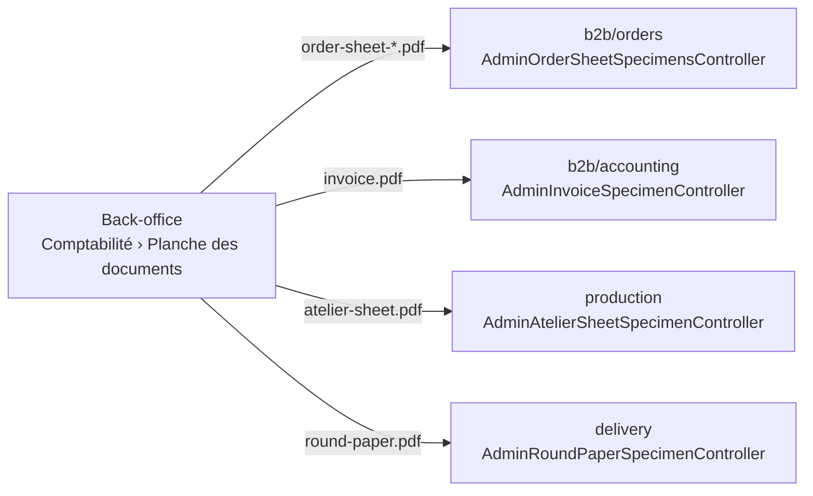

# Documents — la planche d'exemples

> Doc d'état, bâtie le 2026-10-20 (demande de Hugo : « une planche d'exemples
> pour un contrôle visuel des documents »). La version 2 (vrais articles,
> B2B/B2C, retrait/livraison, couleurs, transfert) est notée dans
> [`plan-planche-des-documents-v2.md`](plan-planche-des-documents-v2.md).

**Ce que c'est.** Un écran de la Comptabilité — `/comptabilite/planche-des-documents`
— qui montre les papiers tels qu'ils sortent, rendus à partir de **données
d'exemple fixes** : jamais une vraie commande, **rien d'écrit en base, rien
d'archivé, rien d'envoyé**. On choisit un document à gauche, l'aperçu PDF
s'affiche à droite, et « Ouvrir dans un onglet » sert à l'imprimer.

| Groupe            | Document                     | Route (`GET`)                                     | Bloc qui le sert | Rendu pur utilisé       |
| ----------------- | ---------------------------- | ------------------------------------------------- | ---------------- | ----------------------- |
| Bons chiffrés     | bon de commande pro          | `admin/document-specimens/order-sheet-pro.pdf`    | `b2b/orders`     | `renderOrderSheetPdf`   |
| Bons chiffrés     | bon de commande public       | `admin/document-specimens/order-sheet-public.pdf` | `b2b/orders`     | `renderOrderSheetPdf`   |
| Bons non chiffrés | fiche d'atelier              | `admin/document-specimens/atelier-sheet.pdf`      | `production`     | `renderAtelierSheetPdf` |
| Bons non chiffrés | feuille de tournée (livreur) | `admin/document-specimens/round-paper.pdf`        | `delivery`       | `renderRoundPaperPdf`   |
| Factures          | facture Factur-X (PDF/A-3)   | `admin/document-specimens/invoice.pdf`            | `b2b/accounting` | `renderInvoicePdf`      |

## Pourquoi chaque bloc sert ses propres exemplaires

La matrice des blocs (`CLAUDE.md` §3) interdit au commerce d'importer le
fournil ou la livraison. Un seul contrôleur qui rendrait les cinq documents
traverserait donc deux frontières. Chaque bloc sert les siens, sous le **même
préfixe** et le **même droit**, et l'écran les assemble :

Chaque contrôleur n'injecte que le `QueryBus` ; une query par document
(paramétrée par la variante pour le bon), un handler qui construit les données
d'exemple et appelle le rendu pur. L'horloge passe par le port `Clock` : la
commande d'exemple est passée aujourd'hui, pour le lendemain.

## Le droit : `b2b_accounting` en lecture, pour les cinq

La planche est un écran de la Comptabilité, et un seul droit l'ouvre. Les
routes du fournil et de la livraison portent donc `b2b_accounting` — et non
leurs surfaces habituelles (`production_plan`, `delivery_rounds`). Le nom de la
ressource n'est qu'une valeur de `@lfd/contracts` : aucun import du commerce.

## Les données d'exemple

Elles vivent dans un fichier par bloc, `…/application/document-specimens/specimen-data.ts`,
et leur JSDoc dit qu'elles ne sont jamais persistées. Tout ce qui désigne
quelqu'un porte « EXEMPLE » ; les numéros légaux sont en `999…` et
n'appartiennent à personne.

- **Bon pro** : un client pro fictif, quatre lignes à deux taux (5,5 % et 20 %),
  la remise de 5 % du point, des frais de livraison de 15 € HT, une note,
  réglé au compte. Les montants sortent de `Order.draft` — le même agrégat que
  la vraie commande, donc `computeOrderTotals` —, jamais d'une addition à la
  main. La remise est calculée par `discountCentsOf` sur le sous-total que
  l'agrégat rend.
- **Bon public** : les mêmes lignes, en retrait, taxe comprise scellée, payé
  par carte. Le QR de retrait encode le jeton `EXEMPLE`, qui ne désigne aucune
  commande.
- **Facture** : deux bons, qui sont l'état sérialisé de la commande pro
  d'exemple, passent par `simulateInvoiceDossier` puis `invoiceFromDossier`
  (donc `Invoice.issue` et ses refus) ; le XML EN 16931 est contrôlé comme pour
  une vraie pièce. Aucun compteur ne donne son numéro (rang `999999`), aucune
  pièce n'est rangée. Sans logo.
- **Fiche d'atelier** et **feuille de tournée** : les mêmes articles, recopiés
  et non importés. Le QR de colisage encode `/colisage/EXEMPLE-0001`.

## Ce que la planche ne montre pas

- **Pas de bon « staff »** : il n'existe pas de rendu PDF de la vue staff, sur
  décision (le bon que le bureau ouvre est celui du client).
- **Pas de seconde facture « Factur-X »** : la facture EST le PDF/A-3 Factur-X ;
  `renderFacturXPdf` n'est que son contenant.
- **Pas de mandat SEPA ni de dossier du jour** : hors demande. Le mandat
  d'exemple a déjà son aperçu sur la fiche d'une entité juridique ; le dossier
  du jour et le compte à produire demanderaient une journée d'exemple.
- **Pas de couleur de catégorie** sur le bon : elle se lit sur une vraie
  commande.

## Les preuves

- Unitaires : `…/document-specimens/__tests__/specimen-data.spec.ts` (bon,
  facture) et un spec par handler (`*-specimen.handler.spec.ts`).
- E2E : `apps/lfd-api/test/document-specimens.e2e-spec.ts` — chaque route rend
  `application/pdf` non vide, 401 sans jeton, 403 sans `b2b_accounting:read`, et
  le compte des commandes et des factures ne bouge pas.
- Écran : `apps/lfd-backoffice-frontend/src/app/comptabilite/document-specimens/`.

## La porte qui tient la planche complète (2026-10-22)

`pnpm lint:pdf-specimens` (`dev-toolbox/gates/pdf-specimens.mjs`) suit chaque
document PDF du serveur — une fonction exportée `render…Pdf` — jusqu'à l'écran :
un handler d'exemple (`…/application/queries/*specimen*.handler.ts`) qui
l'appelle, une route `admin/document-specimens/<clé>.pdf` qui sert sa requête,
et la clé rangée dans `SPECIMEN_GROUPS`
(`apps/lfd-backoffice-frontend/src/app/comptabilite/document-specimen-catalogue.ts`).
Un maillon manquant la fait rougir. Dans l'autre sens, une vignette dont
aucune route ne sert le PDF la fait rougir aussi. Une brique d'un document
couvert (le PDF Factur-X que la facture enveloppe) est couverte avec lui.

Cinq documents n'avaient pas d'exemple le 2026-10-22 : le mandat SEPA, le
récapitulatif de commandes d'une société, le compte à produire, la matrice des
allergènes et le dossier du jour. Ils sont inscrits en dette dans la porte, et
la liste ne peut que se vider.
