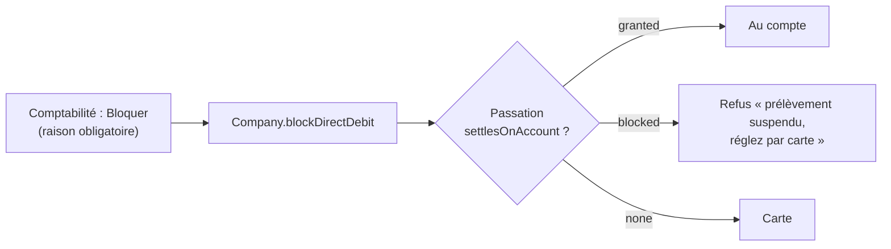

# Bloquer le prélèvement d'un client

> **Doc d'état**, écrite le 2026-10-08 à partir du code (relu ce jour-là). Elle
> remplace le plan du 2026-09-25 (« plan blocage prélèvement et liens de
> paiement », supprimé ; il reste dans l'historique git, et des `migration.sql`
> le citent encore sous son ancien nom).

Un outil de la comptabilité : faire payer par carte un client qui ne doit
plus passer par le prélèvement. Les liens de paiement, qui servent à faire
régler par carte, ont leur propre doc :
[`../liens-de-paiement/les-liens-de-paiement.md`](../liens-de-paiement/les-liens-de-paiement.md).

## 1. Le blocage du prélèvement

**Bloquer, c'est forcer un client au crédit mensuel à payer ses prochaines
commandes par carte, sans lui retirer le crédit accordé.** Débloquer le rend
tel quel.

- **Modèle** (`lafoliecoffee/account/`, table `companies`) :
  `direct_debit_blocked_at`, `_blocked_by` (fiche staff), `_block_reason` ;
  toutes nulles ou toutes renseignées (CHECK
  `companies_direct_debit_block_complete`).
- **Agrégat** `Company` : `blockDirectDebit(reason, at, by)` refuse un double
  blocage et une société sans crédit ; `unblockDirectDebit()` refuse une
  société non bloquée ; retirer tout crédit lève le blocage.
  `settlesOnAccount()` = crédit accordé **et** non bloqué.
- **Serveur** : la garde de passation (`OrderGuardReader.settlesOnAccount`,
  `granted | blocked | none`) refuse « au compte » sur les deux chemins,
  client et back-office, avec un message qui dit « suspendu ».
- **Front client** : le contrat `account` porte `directDebitBlocked` ; le
  panier ne propose plus « au compte », « Mon compte » le dit.
  `grantedTerms` n'est pas vidé : le client voit qu'il a un crédit, suspendu.
- **Le cycle ne change pas** : les commandes déjà passées au compte restent
  au prélèvement de leur mois. Pour ne pas prélever, le geste reste de
  retirer la ligne du lot.
- **Journal** : `company.direct_debit_blocked` (raison, auteur),
  `company.direct_debit_unblocked`.
- **Droit** : la liste sous `b2b_accounting:read` ; bloquer et débloquer
  exigent `b2b_deferred_payment_block:write`, accordé à `admin` et
  `comptabilite` seulement (`b2b_accounting:write` ne le donne pas).

| Route (`admin/accounting/direct-debit-blocks`) | Geste                          |
| ---------------------------------------------- | ------------------------------ |
| `GET`                                          | sociétés à crédit et leur état |
| `POST :companyId` `{ reason }`                 | bloquer                        |
| `DELETE :companyId`                            | débloquer                      |

Écran : Comptabilité › Blocages (`comptabilite/blocages-prelevement/`).

## 2. Ce qui reste ouvert

- Pas de blocage automatique sur un rejet de prélèvement, par décision
  (A36) : les retours bancaires sont lus depuis le 2026-10-09 (PA5,
  [`retours-bancaires.md`](retours-bancaires.md)), la cloche et
  la fiche le disent, le staff bloque par l'outil existant s'il le faut.
