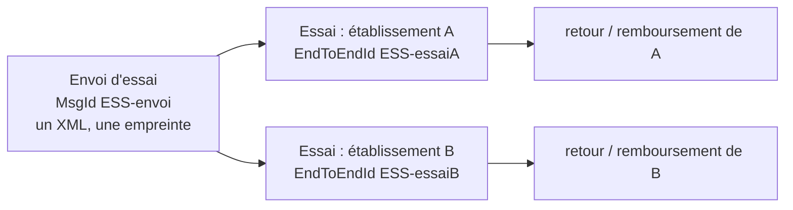

# Plan — un prélèvement d'essai à plusieurs débiteurs

> ✅ **Éprouvé à la banque le 2026-11-23** (Hugo) : un fichier d'essai sur
> deux établissements a été prélevé. Bâti le 2026-11-18. Prolonge
> [`plan-prelevement-d-essai.md`](plan-prelevement-d-essai.md) (essai à UN
> débiteur, bâti le 2026-10-22, éprouvé à la banque sur un établissement).

## En simple

Aujourd'hui, un essai = un fichier = un établissement débité. Hugo veut
déposer **un seul fichier** qui débite **deux de nos établissements** (ou plus),
pour voir comment la banque traite un vrai fichier à plusieurs lignes.

Chaque établissement garde **sa ligne d'essai** — son montant, sa séquence, son
retour bancaire, son « Marqué remboursé », son statut — exactement comme
aujourd'hui. Ce qui devient commun, c'est le **fichier** : un `MsgId`, un XML,
une empreinte, un bouton de téléchargement.

## 0. Ce qui existe (ouvert le 2026-11-18)

- `renderPain008Document` (`domain/services/pain008-document.ts`) rend déjà N
  débits, groupés en un `PmtInf` par séquence (`FRST`, `RCUR`, `OOFF`), avec un
  seul créancier, un seul schéma (`LclInstrm`) et une seule `ReqdColltnDt` par
  document. **Le rendu n'a pas à changer.**
- `renderTestFile` (`collection-test-file.ts`) l'appelle avec **un** débit ;
  `testSepaIdentifiers` tire `MsgId` = `EndToEndId` = `ESS-<ULID de l'essai>`
  (« un seul débit par fichier : `EndToEndId` n'a pas de rang »).
- `collection_test` porte, par ligne : `message_id` **UNIQUE**, `end_to_end_id`
  UNIQUE, `xml`, `file_sha256`. Le téléchargement (`GET :id/file.xml`,
  `export-collection-test-file.handler.ts`) relit `xml` et vérifie l'empreinte.
- Les retours se rattachent par `EndToEndId` (`collection-test-return-support.ts`,
  `collection-return-import-support.ts`) — pas par `MsgId`.
  `preview-collection-return-import.handler.ts` affiche `Essai <messageId>`.
- Idempotence : `runSealed`, sujet = `(companyId, montant, jour, séquence, libellé)`.
- Contrat : `generateCollectionTestPayloadSchema` (`packages/contracts/src/collection-test.ts`).

## 1. Ce qu'on bâtit

### 1.1 Modèle

- **Nouvelle table `collection_test_file`** (schéma `public`, bloc
  `lafoliecoffee/accounting`) : `id` (ULID), `legal_entity_id`, `scheme`,
  `requested_collection_day`, `message_id` UNIQUE, `xml`, `file_sha256`,
  `created_at`, `created_by_staff_id`. Elle porte l'IBAN des débiteurs en
  clair : inscrite au registre RGPD comme `collection_test.xml`.
- **`collection_test.file_id`** : nouvelle colonne, FK vers
  `collection_test_file`.
- **Migration additive, en une fois** (pré-release, CLAUDE.md §0) :
  1. créer la table ;
  2. **reprendre** chaque essai existant en un envoi d'une ligne :
     `id` = id de l'essai, `message_id` / `xml` / `file_sha256` recopiés —
     le fichier déjà déposé reste octet pour octet celui qu'on télécharge ;
  3. `collection_test.file_id` rempli puis `NOT NULL` ;
  4. `collection_test.message_id`, `xml`, `file_sha256` **restent en base**,
     rendus nullables, plus écrits (colonne morte, §0 : pas de suppression
     sans ordre). Le `UNIQUE` de `message_id` tombe avec : deux essais d'un
     même envoi partageraient le `MsgId`.

### 1.2 Domaine

- **Agrégat `CollectionTestFile`** (l'envoi) : `CollectionTestFile.generate()`
  reçoit N débiteurs jugés (verdict, montant, séquence, essais récents sur le
  mandat) et rend l'envoi **et** ses N `CollectionTest`. Il refuse :
  - zéro débiteur, ou plus de `MAX_DEBTORS_PER_TEST_FILE` (10) ;
  - deux fois le même établissement ;
  - deux **créanciers** différents (le `GrpHdr` et le `CdtrSchmeId` n'en
    portent qu'un) ;
  - deux **schémas** différents (`CORE` / `B2B`) — un document n'a qu'un
    `LclInstrm` dans le rendu actuel ;
  - et, par ligne, tout ce que l'essai refuse déjà (plafond 1 €, doublon
    récent sur le mandat, séquence admise, échéance, libellé).
    L'échéance et le libellé sont **communs** à l'envoi ; montant et séquence
    sont **par ligne**.
- **Identifiants** : `MsgId` = `ESS-<ULID de l'envoi>`, `PmtInfId` =
  `ESS-<ULID de l'envoi>-<séquence>` (≤ 35, comme aujourd'hui), `EndToEndId` =
  `ESS-<ULID de l'essai>` (inchangé : c'est lui qui rattache les retours).
  Un envoi d'une ligne garde `id envoi = id essai` → même fichier qu'aujourd'hui.
- `CollectionTest` perd `messageId` / `xml` / `fileSha256` de son état et gagne
  `fileId`. Retour, remboursement, statut : **inchangés**.
- Le fichier est relu par `isAuditCoherent` avant d'être gardé, comme aujourd'hui.

### 1.3 Application et HTTP

- `GenerateCollectionTestCommand` prend `debtors: { companyId, amountCents,
sequence }[]` + `requestedCollectionDay`, `remittance`. Rend **l'id de
  l'envoi**. Le cas à un débiteur est le même geste avec une ligne — pas de
  seconde route.
- Idempotence : sujet = l'envoi entier, débiteurs **triés par `companyId`**.
- Un fait `collection.test_generated` **par essai**, qui gagne `fileId` ; pas de
  nouveau fait pour l'envoi (le journal raconte des débits, l'envoi est leur
  enveloppe). Le registre des phrases du back-office est complété.
- Téléchargement : `GET /admin/accounting/collection-tests/files/:fileId/file.xml`.
  L'ancienne `GET :id/file.xml` reste, et rend le fichier de l'envoi de l'essai
  (contrat servi, et le bouton de la table continue de marcher).
- La liste des essais gagne `fileId` et `fileMessageId` ; l'aperçu d'import
  des retours affiche `Essai <MsgId de l'envoi>`.
- Contrat `@lfd/contracts` : `debtors` (1 à 10) remplace `companyId` /
  `amountCents` / `sequence` (pré-release : cassé dans le même déploiement,
  front et back ensemble).

### 1.4 Back-office (`prelevement-d-essai/generate-test-panel`)

- Le panneau liste les établissements essayables avec une case à cocher ; une
  ligne cochée ouvre son montant et sa séquence. Échéance et libellé restent
  en tête. Le total et le nombre de lignes s'affichent avant « Générer ».
- La table « Essais » regroupe visuellement les lignes d'un même envoi (même
  `MsgId`) ; le bouton **Prélèvement** télécharge le fichier de l'envoi.

## 2. Ce que ça ne fait pas

- Pas de lot réel, ni facture, ni bon : l'essai reste hors de l'encaissement.
- Pas d'envoi mixte `CORE` + `B2B`, ni multi-créanciers (refusés, nommés).
- Pas d'ajout d'une ligne à un envoi déjà généré : un envoi est figé.
- Les exports RIB / Mandat restent par établissement (boutons de ligne).

## 3. Tests

- Domaine : refus (vide, doublon d'établissement, créanciers ou schémas
  différents, > 10), `NbOfTxs`/`CtrlSum` d'en-tête = somme des lignes, un
  `PmtInf` par séquence, XSD `pain.008.001.02` sur un envoi à 2 lignes et 2
  séquences.
- Application : idempotence insensible à l'ordre des débiteurs ; un refus sur
  une ligne n'écrit rien.
- E2E : génération à 2 établissements, téléchargement, retour importé sur
  **une** des deux lignes (l'autre inchangée), migration : un essai d'avant se
  télécharge à l'identique (même empreinte).

## 4. Questions pour Hugo

1. Plafond : 1 € **par ligne** (proposé) ou par fichier ?
2. Maximum de lignes par envoi : 10 (proposé) ?
3. Un envoi mixte `CORE` / `B2B` vaut-il la peine (deux `PmtInf` de schémas
   différents dans un même fichier — à demander à la banque) ? Proposé : non.

## 5. Contredit par `vitruve` (2026-11-18) — l'emporte sur les §1–§3

Bloquants, corrigés ici :

1. **Le journal porte `messageId`** dans `test_generated`, `test_refunded` et
   `test_returned` (`domain/events/collection-test.events.ts:57-117`, contrat
   `packages/contracts/src/journal-facts/collection-test.ts:20`, obligatoire).
   → Les trois faits gardent `messageId` = **le `MsgId` de l'envoi** (c'est le
   fichier déposé, ce que la banque cite) et gagnent `endToEndId`, qui désigne
   la ligne. Les faits déjà écrits ne changent pas : pour eux, les deux sont
   égaux. Les phrases du back-office (`collection-test-phrases.ts`) sont à lire.
2. **`lint:rgpd-staff`** : `collection_test_file.created_by_staff_id` s'inscrit
   au registre avec `xml`.

Sérieux, tranchés :

3. **IBAN gardé deux fois** : la migration recopie puis **vide**
   `collection_test.xml` (mise à `NULL`, pas de suppression de ligne) ; le
   registre dit la colonne vide et retirée.
4. **CHECK** : `collection_test_references` est remplacé par un CHECK sur
   `collection_test_file.message_id` (préfixe `ESS-`, ≤ 35) ; `end_to_end_id`
   garde le sien. Le `UNIQUE` de `collection_test.message_id` est un index
   Prisma : `DROP INDEX`.
5. **Rejeu** : un geste scellé avant le déploiement rejouera un id d'essai ;
   accepté en pré-release (un écran ouvert se recharge).
6. **Identifiants** : l'envoi a **toujours** son propre ULID (N+1 ids). La
   règle « envoi d'une ligne = id de l'essai » ne vaut que pour la reprise des
   essais existants. XSD et `isAuditCoherent` testés sur 1 et 2 lignes.
7. **Retour arrière** : après le merge, revenir à un fichier par essai demande
   une migration de données (recopier xml / msgId de l'envoi sur ses lignes
   quand l'envoi n'en a qu'une). Chiffré : une requête, faisable tant que les
   envois sont d'une ligne.
8. **Écriture** : un seul port `CollectionTestFileRepository.save(file)` qui
   écrit l'envoi et ses essais dans la même UoW ; `CollectionTestRepository`
   reste pour le retour et le remboursement (ligne seule). Propriétaire :
   `accounting`.

Mineurs : la liste garde `messageId` (= celui de l'envoi) ; le port
`collection-test-return-targets.reader.ts` est dans le périmètre.

**Risque nouveau, non vérifié** : un rejet du **fichier entier** (pain.002
`GrpSts`, `OrgnlMsgId` seul) ne se rattacherait à aucune ligne — l'import ne lit
que l'`EndToEndId`. À observer sur le premier retour réel d'un envoi à deux lignes.
