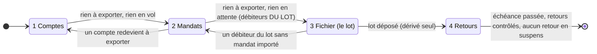

# Plan — la page « Procédure de prélèvement »

> ⚠️ **2026-10-24** : `delivered_on` est renommée `received_on` (colonne
> `orders` et `invoice_order`, déclencheur `orders_received_on_frozen`,
> `deliveredOnOf` → `receivedOnOf`), et la date est posée avec la remise par
> `MarkOrderFulfilledHandler` — plan
> [`date-de-reception.md`](../../commandes/date-de-reception.md). Les mentions ci-dessous gardent
> l'ancien nom : elles décrivent ce qui a été bâti à leur date.

> 📝 **Doc-first, écrit le 2026-10-23.** **P1** et **P2** sont bâtis
> (2026-10-23 — § 8) : la page existe, sans attestations du lot. **P4 bâti
> le 2026-10-24, révisé** : un avertissement par débiteur du lot, pas un
> verrou (§ 8). **P3, partie retours** (« Retours contrôlés »,
> onglet 4) bâtie le même jour (§ 8).
> Questions du § 9 **tranchées** le même jour. Demande de Hugo, ce
> jour-là : « dans comptabilité on doit avoir une page procédure de
> prélèvement, en gros des onglets qui se déverrouillent au fur et à mesure
> comme un wizard mais avec de la mémoire. 1 export des RIB, 2 export des
> mandats — si pas de nouveaux éléments, dire "aucune action à mener" et bouton
> suivant —, 3 générer le fichier de prélèvement, 4 contrôle pain.002 ».
>
> **§ 12 bâti le 2026-10-24** (non commité à l'écriture) : un onglet
> **3 « Factures »** s'insère avant le fichier — l'ordre devient 1 Comptes,
> 2 Mandats, 3 Factures, 4 Fichier, 5 Retours —, et la page « Prélèvement du
> mois » est **retirée**. ⚠️ Dans les §§ 1 à 11, « onglet 3 » et « onglet 4 »
> désignent le Fichier et les Retours, devenus 4 et 5.
>
> **§ 11 bâti le 2026-10-23** (non commité à l'écriture) : l'arrivée de la
> page est une **table de toutes les procédures**, chacune ouvre son détail.
>
> Toutes les citations `fichier:ligne` ont été **ouvertes le 2026-10-23**.
>
> La page est l'écran de la procédure écrite
> ([`procedure-de-prelevement.md`](procedure-de-prelevement.md)) : elle ne
> remplace pas la procédure, elle la rend **suivable**. Contredit par `vitruve`
> (§ 10).

## 1. Le principe : la mémoire est lue, pas tenue

Un wizard « avec de la mémoire » se bâtit d'ordinaire en stockant l'étape
atteinte. Ici, ce serait la faute : **l'étape stockée mentirait** dès qu'un
fait change ailleurs — un client signe un mandat à 15 h, un lot est annulé
depuis « Prélèvement du mois », un export est marqué importé depuis la fiche
de l'entité. Le wizard dirait « étape 3 » alors que l'étape 1 a redevenu à
faire, et c'est exactement le cas que Hugo nomme.

**La règle du plan** : l'état de chaque onglet est **calculé** à chaque
lecture depuis les objets que l'outil possède déjà (exports, lots, retours).
On ne note que ce qui **n'existe nulle part** dans l'outil — des gestes faits
hors de lui (CENET) dont la procédure exige qu'on les atteste. Il n'y a **pas**
de colonne « étape courante » : l'onglet ouvert à l'arrivée est le premier
onglet « à faire », recalculé.

### 1.1 Ce qui se dérive

| Fait                                                                | Lu dans                                                                                                                                                                      |
| ------------------------------------------------------------------- | ---------------------------------------------------------------------------------------------------------------------------------------------------------------------------- |
| des comptes destinataires sont à exporter                           | `AccountBankExportsView.toExport` (`packages/contracts/src/account-bank-export.ts:40`)                                                                                       |
| un export de comptes est en vol (préparé, ni importé, ni abandonné) | `inFlightCount` (`:42`), `exports[].importedAt` / `abandonedAt` (`:31-32`)                                                                                                   |
| des mandats sont à exporter                                         | `MandateBankExportsView.toExportCount` (`packages/contracts/src/mandate-bank-export.ts:33`)                                                                                  |
| un export de mandats attend « Marquer importé »                     | `exports[].importedAt === null && abandonedAt === null` (`:28`, `:30` — `abandonedAt` depuis P1)                                                                             |
| le lot de la clôture existe, son état                               | `CollectionCycleView.batches` (`packages/contracts/src/collection-batch.ts:190`) ; `status`, `depositedAt`, `cancelledAt`, `depositable`, `unmandatedCompanies` (`:143-158`) |
| l'échéance et la limite de dépôt                                    | `requestedCollectionDay`, `depositDeadline` (`:165`, `:178`)                                                                                                                 |
| les avis du lot                                                     | `lines[].notice` (`:116`)                                                                                                                                                    |
| les retours enregistrés et leur résolution                          | `BatchCollectionReturnsView.returns[].resolution` (`packages/contracts/src/collection-return.ts:66`)                                                                         |

### 1.2 Ce qui doit être noté — et rien d'autre

Quatre attestations, toutes **par lot**, toutes des gestes hors de l'outil que
rien ne peut constater :

| Attestation                          | Pourquoi aucune donnée ne la porte                                                                                                                                                                                                                                                                     |
| ------------------------------------ | ------------------------------------------------------------------------------------------------------------------------------------------------------------------------------------------------------------------------------------------------------------------------------------------------------ |
| **« Contrôle CSV relu »**            | le téléchargement de `audit.csv` n'écrit rien (une requête, `apps/lfd-api/src/b2b/accounting/http/admin-collection-batches.controller.ts:133`) ; et avoir téléchargé n'est pas avoir relu                                                                                                              |
| **« Remise signée sur CENET »**      | la signature est sur le portail (procédure § 2.8) ; l'outil ne connaît que « Marquer déposé », qui la **précède** (§ 2.7)                                                                                                                                                                              |
| **« Accusés PSR lus »**              | les PSR ne sont que sur CENET (procédure § 2.9, réponse 24)                                                                                                                                                                                                                                            |
| **« Retours contrôlés jusqu'au … »** | un import qui ne trouve **aucun** impayé n'écrit rien : la confirmation ne rend que les retours enregistrés (`CollectionReturnImportResultView.recordedIds`, `packages/contracts/src/collection-return.ts:149`), et aucune table ne garde les fichiers importés. Or « aucun impayé » est le cas normal |

Ce qui **n'est pas** noté, alors que la demande y fait penser :

- **« Aucune action à mener »** sur les onglets 1 et 2 : c'est `toExport` vide
  et rien en vol. Le constater, c'est le lire ; le noter créerait un second
  avis qui mentirait au prochain mandat signé.
- **« Le compte rendu CENET a été lu »** pour les exports : il l'est déjà, par
  « Marquer importé », dont la procédure fait la condition (§ 1.6 : « seulement
  si le compte rendu ne porte aucune erreur »). Une seconde case doublerait le
  même geste.
- **« Fichier téléchargé »** : utile au journal (R8, déjà au reste à faire de
  [`prerequis-export-ribs.md`](prerequis-export-ribs.md) § 8), inutile à
  l'enchaînement — « Marquer déposé » le suppose.

**Où les noter** : une table `collection_batch_attestation` (schéma `public`,
bloc `b2b/accounting`), une ligne par lot et par attestation — `batch_id`,
`kind` (`audit_reviewed`, `remittance_signed`, `psr_read`), `attested_at`,
`attested_by_staff_id` (au registre RGPD, `lint:rgpd-staff`), `note`
facultative. Les retours contrôlés n'y vont pas : ce n'est pas un fait du
lot, c'est un fait **du jour** et de l'entité (un fichier d'impayés est
quotidien et mêle les lots, § 6). Table distincte
`bank_return_check(legal_entity_id, checked_through_day, checked_at, by,
outcome)` — `outcome` = `no_return` | `imported`. Chaque attestation émet un
fait au journal (sujet : l'entité, jamais un IBAN). Aucune ligne ne
s'efface : une attestation fausse se **retire** par une ligne de plus, `kind`
identique et `withdrawn = true`, note obligatoire. **La dernière ligne par
(lot, kind) fait foi** — c'est la seule règle de lecture, et S1 la tient.

Une attestation n'est **jamais** une condition d'un geste du domaine :
« Marquer déposé » reste gardé par sa relecture (`apps/lfd-api/src/b2b/accounting/domain/entities/collection-batch.ts:212`),
pas par « Contrôle CSV relu ». Les attestations ne gouvernent que l'écran.
Sinon, un oubli de case bloquerait un dépôt avant la limite.

## 2. La granularité

Trois mailles, pas une, parce que les quatre étapes n'ont pas le même sujet :

| Onglet    | Sujet                                  | Pourquoi                                                                                                                                                                                |
| --------- | -------------------------------------- | --------------------------------------------------------------------------------------------------------------------------------------------------------------------------------------- |
| 1 Comptes | **l'entité**                           | un compte s'importe une fois, quel que soit le lot (prérequis-export-ribs § 8) ; il n'a pas d'échéance                                                                                  |
| 2 Mandats | **l'entité**                           | idem (`prerequis-export-mandats.md:90-94`)                                                                                                                                              |
| 3 Fichier | **le lot** = entité × schéma × clôture | un lot est un fichier, une échéance (procédure § 2, `apps/lfd-api/src/b2b/accounting/domain/services/pain008-document.ts:185`) ; « un fichier par schéma et par échéance » (réponse 18) |
| 4 Retours | **l'entité et le jour**                | un fichier d'impayés est quotidien et peut porter des lignes de plusieurs lots (retours-bancaires.md:3-6)                                                                               |

**Les trois rythmes d'un même mois** ne sont pas trois procédures : ce sont
jusqu'à cinq clôtures (procédure § 2), donc jusqu'à cinq lots par schéma. La
page choisit **un lot** comme fil des onglets 3 et 4, par défaut **le lot
non déposé dont la limite de dépôt est la plus proche** (cf. § 4.3), et les autres lots ouverts sont
listés en tête de l'onglet 3 avec leur état. Le sélecteur d'entité (affiché seulement s'il y a plus d'une entité) reprend
celui de « Prélèvement du mois » (page retirée le 2026-10-24, § 12).

Adresse : `/comptabilite/procedure-de-prelevement?entite=:id&lot=:batchId` —
l'onglet n'est **pas** dans l'URL : il est calculé (§ 1). Un lien direct vers
un onglet verrouillé ouvrirait un mensonge. Un `lot=` qui désigne un lot
`cancelled` affiche « Ce lot a été annulé le … » et propose le lot de la même
entité, du même schéma et de la même clôture s'il a été préparé de nouveau
(sinon « Préparer le lot ») — la page ne suit jamais un lot mort en silence.

> ⚠️ **Corrigé le 2026-10-24.** L'onglet peut désormais être DEMANDÉ par
> l'adresse : `?onglet=comptes|mandats|fichier|retours` sur le détail
> `/comptabilite/procedure-de-prelevement/:id` choisit l'onglet d'arrivée,
> sinon `arrivalStep` décide comme avant. Il ne déverrouille rien : un
> onglet verrouillé s'ouvre verrouillé, avec sa raison et le lien vers
> l'onglet qui le débloque — pas de mensonge. Et
> `/comptabilite/procedure-de-prelevement/entite/:entityId` renvoie à la
> procédure en cours de l'entité (celle du lot suivi, sinon de la clôture à
> préparer ; à défaut, la table de l'entité) : c'est l'adresse de la fiche
> de l'entité, qui pointe l'onglet Comptes s'il reste des comptes à
> exporter, sinon Mandats.

## 3. Les onglets et leurs états

Chaque onglet a l'un de quatre états, calculés :

- **verrouillé** — un onglet antérieur est à faire, et celui-ci en dépend ;
- **à faire** — un geste est attendu, nommé ;
- **en attente** — un geste a été fait hors de l'outil, l'outil attend son
  constat (« Marquer importé », un retour) ;
- **fait** — « Aucune action à mener », bouton « Suivant ».



### 3.1 Onglet 1 — Les comptes à la banque

| État       | Condition (dérivée)                    | Ce que l'onglet montre                                                                                    |
| ---------- | -------------------------------------- | --------------------------------------------------------------------------------------------------------- |
| à faire    | `toExport.length > 0`                  | les comptes nommés, « Préparer l'export », puis Télécharger                                               |
| en attente | `toExport` vide, `inFlightCount > 0`   | l'export en vol : « Marquer importé » (compte rendu sans erreur) ou « Abandonner » (rejeté par la banque) |
| fait       | `toExport` vide, `inFlightCount === 0` | « Aucune action à mener » ; les écartés (sans BIC) restent nommés, avec leur effet sur l'onglet 3         |

Un compte **écarté** (`excluded`, sans BIC) ne rend pas l'onglet « à faire » :
aucun geste de l'onglet ne le résout. Il remonte sur l'onglet 3 s'il est d'un
débiteur du lot (il ne sera alors pas prélevable, § 3.3).

**Réutilise** la carte `app-account-bank-export-card` telle quelle
(`apps/lfd-backoffice-frontend/src/app/comptabilite/entites-juridiques/detail/account-bank-export-card/account-bank-export-card.ts:62`,
une seule entrée `entity: LegalEntityView` — la page charge donc l'entité
complète), incluse dans le panneau : elle porte déjà la lecture, les quatre
gestes et le « Déjà connu de la banque ». Elle restait aussi
sur la fiche de l'entité — **retirée de la fiche le 2026-10-24** (décision de
Hugo, doublon) : la fiche n'en garde qu'un renvoi « Comptes et mandats à la
banque », avec les deux nombres du serveur. La procédure est son seul hôte. Ce qui manque à la carte — une
**modification**, pas un réemploi tel quel : elle n'a aucune sortie
aujourd'hui ; émettre un `changed` après chaque geste, pour que la page recalcule les états des onglets.

### 3.2 Onglet 2 — Les mandats à la banque

| État       | Condition (dérivée)                             | Ce que l'onglet montre                                                                                                             |
| ---------- | ----------------------------------------------- | ---------------------------------------------------------------------------------------------------------------------------------- |
| verrouillé | onglet 1 « à faire » ou « en attente »          | « Importer d'abord les comptes » : la banque refuse un mandat dont le compte lui est inconnu (`prerequis-export-mandats.md:20-23`) |
| à faire    | `toExportCount > 0` et aucun export non importé | « Préparer l'export », Télécharger, la consigne « vérifier puis importer »                                                         |
| en attente | un export `importedAt === null`                 | « Marquer importé » — seulement si le compte rendu ne porte aucune erreur                                                          |
| fait       | `toExportCount === 0`                           | « Aucune action à mener » ; les **écartés** restent nommés, en alerte s'ils sont d'un débiteur du lot suivi                        |

Le verrou sur l'onglet 1 est **entier** (toute l'entité), en v1 : le serveur
ne sait pas dire « ce mandat-ci a son compte importé » (reste à faire de
[`prerequis-export-ribs.md`](prerequis-export-ribs.md) § 8 : « avertir sur la
carte des mandats quand un compte n'est pas importé »). Le verrou entier est
plus strict que la règle de la banque, jamais plus lâche.

~~⚠️ **Un export de mandats ne s'abandonne pas**~~ — **bâti le 2026-10-23
(P1, § 8)** : l'agrégat `MandateBankExport` se clôt une fois, importé **ou**
abandonné, et `MandateBankExportSummaryView` porte `abandonedAt`. Un export
rejeté par CENET n'est donc plus « en attente » pour toujours : « en attente »
se lit désormais `importedAt === null && abandonedAt === null`.

**Réutilise** `app-mandate-bank-export-card` (`…/mandate-bank-export-card.ts:63`,
entrée `entity`, hébergée aussi par `legal-entity-detail-page.html:209`),
même règle que l'onglet 1, même sortie `changed` à ajouter.

### 3.3 Onglet 3 — Le fichier de prélèvement (un lot)

Verrouillé tant que l'onglet 2 n'est pas « fait » **pour les débiteurs du
lot**. C'est le point qui sépare ce wizard d'un wizard naïf : un nouveau client
qui signe pendant qu'un lot attend son dépôt **ne doit pas** bloquer le dépôt
de ce lot, où il n'est pas — sinon la page ferait manquer une limite de dépôt
pour une raison sans rapport. Il faut pour ça une lecture serveur (S2, § 7) :
pour chaque ligne du lot, « compte importé » et « mandat importé ». En
attendant S2, la page **n'a pas de quoi** tenir ce verrou : elle avertit
(bandeau sur l'onglet 3 « 2 mandats de l'entité ne sont pas importés —
vérifier qu'aucun n'est d'un débiteur de ce lot ») et ne verrouille pas.

> ⚠️ **Révisé le 2026-10-24 (P4, § 8)** : l'onglet 3 ne se verrouille pas
> par débiteur du lot ; il nomme chaque débiteur au compte ou au mandat non
> importé. La banque ne contrôle pas son référentiel au dépôt d'un fichier
> (réponse 15) : bloquer empêcherait des prélèvements valides. Le bandeau à
> l'échelle de l'entité a disparu de l'onglet 3.

🔴 **Le risque, nommé** : « Marquer déposé » ne relit **pas** l'import chez
CENET (sa relecture porte sur les sociétés sans mandat, les avis, les
mandats révoqués, l'IBAN et les commandes, `collection-batch.ts:212-233`), et
la banque ne contrôle rien au dépôt (réponse 15). Un débiteur du lot dont le
mandat n'est pas importé — ou est écarté (`excluded`) — passe le dépôt, la
signature, puis revient **en rejet le jour J**. Jusqu'à P4, le bandeau est la
seule défense : c'est un rejet après signature, pas un inconfort.

Sous-étapes, dans l'ordre de la procédure (§ 2.2 à § 2.9), chacune avec son
état dérivé ou attesté :

| #   | Sous-étape                           | État                                                                                    | Source                                      |
| --- | ------------------------------------ | --------------------------------------------------------------------------------------- | ------------------------------------------- |
| a   | Factures émises                      | dérivé — la clôture du lot a ses factures                                               | `app-month-invoices`                        |
| b   | Lot préparé                          | dérivé — un lot `constituted` pour la clôture ; sinon « Préparer le lot »               | `CollectionCycleView`                       |
| c   | Avis tous `envoyé`                   | dérivé — `lines[].notice`                                                               | idem                                        |
| d   | Contrôle CSV relu                    | **attesté** (`audit_reviewed`)                                                          | § 1.2                                       |
| e   | Fichier téléchargé, déposé sur CENET | **non suivi** — consigne seule, avec l'échéance et la limite de dépôt affichées en tête | `requestedCollectionDay`, `depositDeadline` |
| f   | « Marquer déposé »                   | dérivé — `status === 'deposited'`                                                       | `depositedAt`                               |
| g   | Remise signée sur CENET              | **attesté** (`remittance_signed`), ouvert seulement si f est fait                       | § 1.2                                       |
| h   | Accusés PSR lus                      | **attesté** (`psr_read`), facultatif pour passer à l'onglet 4                           | § 1.2                                       |

**L'ordre f avant g est imposé par l'écran** : la case « signée » n'apparaît
qu'une fois le lot déposé. C'est l'ordre que `vitruve` a fait corriger dans la
procédure (§ 2.7, objection BLOQUANT du § 7) — la page le rend matériel.

**L'heure limite** est en tête de l'onglet, en grand, avec le compte à
rebours ; si `depositDeadline` est `null` (limite non renseignée, procédure
§ 0.4), l'onglet le dit en alerte et donne la consigne provisoire (J-2 ouvré,
13 h 45) — il ne calcule **rien** à la place de l'entité.

**Réutilise** `app-pending-batch` (`apps/lfd-backoffice-frontend/src/app/comptabilite/procedure-de-prelevement/pending-batch/pending-batch.ts:49-53`, déplacé le 2026-10-24 :
`batch`, `canWrite`, `pending`, sortie `gesture`) pour b à f, `app-excluded-orders`
pour les exclusions, et les gestes de la page « Prélèvement du mois »
(préparer, annuler, déposer). Ces gestes vivent aujourd'hui **dans la page**
(de « Prélèvement du mois », retirée depuis) ; ils se déplacent dans un service partagé des
deux pages — c'est un déplacement, pas une copie.

**Fait** : lot déposé et signature attestée. Un lot `cancelled` ne fait pas
« fait » : il renvoie à b (préparer de nouveau).

### 3.4 Onglet 4 — Le contrôle des retours

Verrouillé tant que le lot n'est pas déposé (un retour exige un lot déposé,
`apps/lfd-api/src/b2b/accounting/domain/entities/collection-return.ts:111-112`) — **et seulement par
là** : l'attestation de signature n'y entre pas, sinon une case oubliée
fermerait l'import des impayés d'un lot réellement débité.

| État       | Condition                                                                                                   |
| ---------- | ----------------------------------------------------------------------------------------------------------- |
| en attente | l'échéance n'est pas passée : « rien à contrôler avant le … » (impayés quotidiens, après l'échéance)        |
| à faire    | échéance passée et **aucun contrôle attesté** couvrant les jours depuis l'échéance ; ou un retour `pending` |
| fait       | contrôles attestés jusqu'à **échéance + N jours**, et aucun retour du lot en `pending`                      |

**Couverture** : un `bank_return_check` du jour J couvre **tous** les lots de
l'entité déposés dont l'échéance est ≤ J, les deux schémas compris (un
fichier d'impayés est quotidien et mêle les lots). Un lot est couvert
jusqu'à échéance + N si **chaque jour ouvré** de [échéance, échéance + N] a
son contrôle : S1 calcule les jours manquants et l'onglet les **nomme** (« pas
de contrôle le 19 et le 20 ») — un trou ne se lisse pas en « fait ».

N = la fenêtre au-delà de laquelle on cesse de suivre le lot sur cette page
(question Q3) ; un retour plus tardif (contestation CORE, 13 mois) arrive
quand même par l'import et la cloche `collection.returned`
(`retours-bancaires.md:95-96`), et rouvre l'onglet.

Gestes : « Importer un fichier de la banque » (déjà là,
`apps/lfd-backoffice-frontend/src/app/comptabilite/procedure-de-prelevement/bank-returns/bank-returns.html:4`, panneau
`import-returns-panel`), puis « Contrôle fait : aucun impayé » ou, après un
import, l'attestation `imported` (posée par la confirmation d'import elle-même,
pas par une case — S4). ⚠️ La confirmation exige au moins une transaction
(`endToEndIds.min(1)`, `packages/contracts/src/collection-return.ts:142`) : un fichier lu
qui ne retient **aucune** ligne ne se confirme pas et n'écrit rien. Ce jour-là
— le cas normal — c'est la case « Contrôle fait : aucun impayé » qui le
couvre. Les retours du lot et leurs trois gestes
(re-présenter, régler autrement, perte) viennent de `app-bank-returns`
(`bank-returns.ts:77-78`, entrées `batches`, `canWrite`), **inclus**, pas
recopiés.

## 4. Quand un onglet antérieur redevient « à faire »

### 4.1 Le cas

Un client signe un mandat le lendemain de la préparation du lot. L'onglet 1
repasse « à faire », l'onglet 2 aussi. Le lot, lui, ne le contient pas.

### 4.2 La règle

- L'onglet **redevient « à faire »** — il ne garde pas « fait » par mémoire.
- Les onglets suivants **ne se reverrouillent pas** si le changement ne
  touche pas le lot choisi (§ 3.3, après S2) : un dépôt en cours ne s'arrête
  pas pour un client qui n'y est pas.
- La barre d'onglets porte un **badge** sur l'onglet redevenu à faire
  (`FoldTabItem.badge`, le nombre de comptes ou de mandats), et l'onglet 3
  affiche « Un nouveau client attend son import — il entrera au lot
  suivant ».
- Si le changement **touche** le lot (un débiteur du lot dont le mandat n'est
  plus importé sous son compte, après un changement d'IBAN), l'onglet 3 se
  reverrouille **avant** dépôt — et « Marquer déposé » refuse de toute façon
  (IBAN changé, `DepositRecheckFailedError`, `collection-batch.ts:232`).
  **Après** dépôt, rien ne se reverrouille : on ne dé-dépose pas (procédure
  § 2.8).

### 4.3 Quel lot la page suit

Dans cet ordre, le premier qui existe :

1. le lot **non déposé** (`constituted`, ou clôture passée sans lot) dont la
   **limite de dépôt** est la plus proche — à limite inconnue, l'échéance la
   plus proche (`depositDeadline`, `requestedCollectionDay`,
   `packages/contracts/src/collection-batch.ts:165`, `:178`) ;
2. le lot déposé le plus ancien dont l'onglet 3 ou 4 n'est pas « fait ».

Le dépôt passe **avant** le suivi des retours : une limite ne se rattrape pas,
un contrôle d'impayés se fait le lendemain. Tous les lots ouverts restent
listés en tête, avec leur limite, et un lot non déposé ne se cache jamais
derrière un repli « autres lots ▸ » — c'est l'oubli que la procédure dit
invisible (« ⛔ Rien ne signale un lot préparé depuis longtemps sans être
déposé », § 2.7).

## 5. L'écran

```
Procédure de prélèvement              [Entité ▾]
Lot suivi : B2B · du 1er au 4 nov. · échéance 18 nov. · déposer avant 14 nov. 13:45
           (autres lots ouverts : 2 ▸)
┌────────────┬────────────┬────────────────┬──────────────┐
│ 1 Comptes ✓│ 2 Mandats 2│ 3 Fichier 🔒   │ 4 Retours 🔒 │
└────────────┴────────────┴────────────────┴──────────────┘
[ panneau de l'onglet : la carte réutilisée, ou « Aucune action à mener » + Suivant ]
```

**fold-ng** : `fold-tabs` + `fold-tab-panel` existent
(`apps/lfd-backoffice-frontend/node_modules/fold-ng/types/fold-ng.d.ts:8709`,
`:8809`), avec `badge` et `icon` par onglet (`FoldTabItem`, `:8657-8666`).
**Ils n'ont pas d'onglet désactivé** : `FoldTabItem` n'a que `key`, `label`,
`icon`, `badge`. Deux voies :

- **(A, retenue)** l'onglet verrouillé reste **sélectionnable** et son panneau
  dit pourquoi (« Importer d'abord les mandats — onglet 2 », bouton vers
  l'onglet) avec l'icône cadenas. C'est plus honnête qu'un onglet gris : on
  voit ce qui attend, et le clavier ARIA n'a pas de trou.
- (B) ajouter `disabled` à `FoldTabItem` dans fold-ng — une évolution de la
  bibliothèque, hors de ce dépôt, pour un seul usage.

fold-ng n'a pas de wizard verrouillable ; `fold-timeline` se décrit en
« progress stepper » horizontal (`apps/lfd-backoffice-frontend/node_modules/fold-ng/types/fold-ng.d.ts:7420`, nœuds `:7374`) — un
affichage, sans panneaux ni verrou, qui pourrait au mieux résumer les
sous-étapes de l'onglet 3 ; les sous-étapes de
l'onglet 3 sont une liste (`fold-data-table` ou liste de lignes à coche, cf.
`app-pending-batch`), pas un composant neuf.

« Suivant » est un `foldButton` qui écrit `activeKey` ; il n'existe que sur un
onglet « fait ».

Menu : Comptabilité › **Procédure de prélèvement**, au-dessus de
« Prélèvement du mois ». Les deux pages coexistent : « Prélèvement du mois »
reste la vue d'ensemble du mois (aperçu, toutes les clôtures, historique) ;
la procédure est le **fil d'un lot**. Droits : lecture sous `b2b_accounting`,
gestes et attestations sous `b2b_accounting:write` (comme les gestes
réutilisés).

## 6. Ce qui reste à la main, dit sur la page

La page ne fait pas croire que l'outil tient ce qu'il ne tient pas. Chaque
sous-étape attestée ou non suivie porte la mention « sur CENET, l'outil ne
peut pas le vérifier ». Restent hors de la page : le contrat et la limite de
dépôt (procédure § 0), le crédit global et le relevé SDD (§ 3.1-3.2), la
relance du client (§ 3.9).

## 7. Ce qui manque côté serveur

| #   | Manque                                                                                                                                                                                                                                                      | Pourquoi                                                                                                                                                                                              |
| --- | ----------------------------------------------------------------------------------------------------------------------------------------------------------------------------------------------------------------------------------------------------------- | ----------------------------------------------------------------------------------------------------------------------------------------------------------------------------------------------------- |
| S1  | **Une lecture d'état de la procédure** : `GET admin/accounting/collection-procedure?legalEntityId=` → l'état calculé de chaque onglet, le lot suivi, les autres lots ouverts, les attestations. Une query, un handler, qui lit les trois lecteurs existants | l'état des onglets ne se calcule pas à l'écran à partir de quatre appels : la règle de déverrouillage est du métier, elle vit côté serveur et se teste une fois                                       |
| S2  | ~~**Par ligne de lot : compte importé, mandat importé**~~ — bâti le 2026-10-24 (P4 révisé, § 8)                                                                                                                                                             | l'avertissement par débiteur du lot de l'onglet 3 (§ 3.3) — un avertissement, pas un verrou (réponse 15) ; c'est l'avertissement « mandat non importé » que la procédure disait manquant (§ 2.4, § 5) |
| S3  | ~~**« Abandonner » un export de mandats**~~ — bâti le 2026-10-23 (P1)                                                                                                                                                                                       | sinon un export rejeté bloque l'onglet 2 pour toujours (§ 3.2)                                                                                                                                        |
| S4  | **Les attestations** : tables `collection_batch_attestation` et `bank_return_check` (migration additive), commandes `AttestCollectionBatch`, `RecordBankReturnCheck`, faits au journal ; la confirmation d'import pose son `bank_return_check` (`imported`) | § 1.2                                                                                                                                                                                                 |
| S5  | Les gestes de « Prélèvement du mois » sortis de la page vers un service partagé (front)                                                                                                                                                                     | deux hôtes, une logique (§ 3.3)                                                                                                                                                                       |

Ce qui n'est **pas** demandé : stocker l'onglet courant, ni un état de
procédure par lot. S1 est une lecture ; elle n'écrit rien (CQRS).

## 8. Découpage

1. ~~**P1** — S3 (abandonner un export de mandats), seul : un manque de l'outil
   indépendamment de la page.~~ **Bâti le 2026-10-23** (non commité à
   l'écriture) : `AbandonMandateBankExport` (`POST …/mandate-exports/:exportId/abandoned`),
   fait `mandate_bank_export.abandoned`, bouton « Abandonner » sur la carte
   « Mandats à la banque », migration additive
   `20261024000000_l_abandon_d_un_export_des_mandats` (`abandoned_at`,
   `abandoned_by_staff_id`, clos une fois). Avec lui, le volet mandats de R8
   ([`prerequis-export-ribs.md`](prerequis-export-ribs.md) § 5) : chaque
   téléchargement du fichier des mandats est journalisé
   (`mandate_bank_export.downloaded`), et un export abandonné ne se
   télécharge plus.
2. ~~**P2** — 🔴 **exige P1** (sans « Abandonner », un export de mandats
   rejeté fige l'onglet 2 et masque l'onglet 3). S1 sans attestations ni S2 : la page, les quatre onglets, cartes
   réutilisées, verrou de l'onglet 3 en **avertissement**. Utile tout de suite.~~
   **Bâti le 2026-10-23** (non commité à l'écriture) : S1
   `GET admin/accounting/collection-procedure?legalEntityId=&batchId=`
   (`GetCollectionProcedureHandler`, état pur dans
   `apps/lfd-api/src/b2b/accounting/domain/services/collection-procedure.ts`), S5 (`CollectionBatchGestures`,
   partagé avec « Prélèvement du mois »), sortie `changed` des deux cartes
   d'export, la page et son entrée de menu, l'avertissement « moins de 2 jours
   ouvrés » (`tightDepositMargin`) sur la carte « Prélèvement automatique » et
   l'onglet 3. **Écarts assumés jusqu'à P3**, faute d'attestation : l'onglet 3
   est « fait » au **dépôt** (sans la signature attestée) ; l'onglet 4 est « à
   faire » chaque jour de [échéance, échéance + 5 jours ouvrés] (le contrôle
   quotidien ne s'atteste pas encore), puis « fait » sans retour en suspens.
   **Titre de la page** (Hugo, 2026-10-23) : « Procédure de prélèvement —
   <rythme> — période du … au … », rythme et période lus au serveur
   (`payerModes`, `periodLabel` du lot) ; **une clôture qui réunit plusieurs
   rythmes** dans un même lot — une fin de mois commune au mensuel et au
   « deux fois par mois » — les nomme tous, mensuel d'abord (« Mensuel et deux
   fois par mois ») ; sans lot ouvert, « Procédure de prélèvement » et la
   prochaine clôture en sous-titre. Les lots ouverts en tête portent le même
   libellé court (rythme · période).
3. **P3** — S4 : les attestations, l'onglet 3 complet, l'onglet 4.
   **Partie retours bâtie le 2026-10-23** (non commitée à l'écriture), avec
   quatre corrections de Hugo du même jour :
   - **« Retours contrôlés »** : table `bank_return_check` (migration additive
     `20261024080000_le_controle_des_retours_de_la_banque` — entité, jour de
     Paris, auteur au registre RGPD, instant ; un retrait est une ligne
     `withdrawn` de plus avec sa note, la base refuse UPDATE et DELETE par
     déclencheur ; la dernière ligne d'un jour fait foi,
     `apps/lfd-api/src/b2b/accounting/domain/services/bank-return-checks.ts`).
     Gestes `POST admin/accounting/bank-return-checks` et `…/withdrawn`, faits
     `bank_return_check.attested` / `.withdrawn` (sujet : l'entité). **Écarts
     au § 1.2** : pas de colonne `outcome` (la liste de Hugo ne la porte pas),
     et la confirmation d'import **ne pose pas** d'attestation `imported` —
     le geste est « Retours contrôlés pour aujourd'hui », fait après l'import
     comme un jour sans impayé. Un jour PASSÉ s'atteste encore (rattrapage,
     bouton par jour manquant) ; un jour à venir est refusé.
   - **Onglet 4** : « fait » quand échéance + 5 jours ouvrés est passée, qu'aucun
     retour n'attend, ET que chaque jour ouvré de la fenêtre est attesté ; les
     jours manquants sont nommés (`missingCheckDays`), raison
     `unchecked_days` après la fenêtre. Un lot à trou reste parmi les lots
     ouverts. Aucune attestation ne conditionne un geste du domaine.
   - **Barre d'actions au-dessus** de l'onglet : « Importer le fichier de
     rejets de la banque », puis « Signaler un retour à la main » (choix de la
     ligne) ; `app-bank-returns` prend `actions` (comme `app-pending-batch`) et
     perd son bouton d'en-tête dans l'onglet.
   - **Compte rendu d'import** : la confirmation rend `report` (lues,
     enregistrées, déjà enregistrées, introuvables avec `EndToEndId`, RUM
     lue dans le fichier — `MndtId` — et montant, écartées avec leur raison),
     montré dans le panneau d'import des deux pages. Ce qui s'enregistre ne
     change pas.
   - **Chiffres clés** en tête : lignes du lot, retours en attente de décision,
     re-présentés, réglés autrement, passés en perte.

   ~~Reste de P3 : `collection_batch_attestation` (CSV relu, remise signée,
   PSR lus) et l'onglet 3 complet.~~ **Bâti le 2026-10-24** (non commité à
   l'écriture) : table `collection_batch_attestation` (migration additive
   `20261024090000_les_attestations_du_lot_de_prelevement` — lot, sorte
   `audit_reviewed` | `remittance_signed` | `psr_read` bornée par CHECK,
   auteur au registre RGPD, instant ; un retrait est une ligne `withdrawn` de
   plus avec sa note, la base refuse UPDATE et DELETE par déclencheur ; la
   dernière ligne d'un (lot, sorte) fait foi,
   `apps/lfd-api/src/b2b/accounting/domain/services/collection-batch-attestations.ts`).
   Agrégat `CollectionBatchAttestations` : il tient l'ordre du § 3.3 (la
   remise ne se signe qu'un lot déposé, les PSR ne se lisent qu'après un
   dépôt, un lot annulé n'atteste rien). Gestes
   `POST admin/accounting/collection/batches/:id/attestations` et
   `…/withdrawn`, sous `b2b_accounting`, faits
   `collection_batch_attestation.attested` / `.withdrawn` (sujet : l'entité,
   le lot cité). **Onglet 3** : déposé sans « remise signée » attestée, il est
   « en attente » (raison `signature_to_attest`, invite « Signer la remise
   sur CENET, puis cocher ») ; signé, « fait » — « PSR lus » facultatif (Q5).
   Chaque lot de la procédure porte ses `attestations`, montrées sous sa barre
   d'actions avec « fait le … par … » et « Retirer » (panneau avec note). La
   table dit « déposé · signature à attester » (`signatureToAttest`). Aucune
   attestation ne conditionne un geste du domaine ni le verrou de l'onglet 4.

4. ~~**P4** — S2 : le verrou de l'onglet 3 par débiteur du lot.~~ **Révisé
   par Hugo le 2026-10-24 (option 1), bâti le même jour** (non commité à
   l'écriture) : **pas de blocage du dépôt.** La réponse 15 de la banque
   ([`reponses-de-la-banque.md`](reponses-de-la-banque.md)) dit que pour un
   dépôt de fichier, CENET ne contrôle pas le référentiel des RIB et des
   mandats : bloquer empêcherait des prélèvements valides. À la place, S2
   est un **avertissement par débiteur** : pour chaque ligne du lot suivi et
   des autres lots vivants de la procédure, le serveur dit si le compte du
   débiteur et son mandat sont importés dans CENET, sous l'empreinte du compte
   actuel du mandat, par les deux sélections des exports sans en recopier la
   règle (`apps/lfd-api/src/b2b/accounting/domain/services/lot-debtor-bank-standing.ts`,
   port `LotDebtorsReader`, champ `file.debtorsNotImported` du contrat). L'onglet 3 dit
   « N débiteur(s) de ce lot n'ont pas leur compte ou leur mandat importé
   dans CENET : la banque ne le contrôle pas au dépôt (réponse 15), mais
   importez-les pour garder le référentiel à jour », puis la liste nommée
   (société, RUM, ce qui manque) avec un lien vers l'onglet 1 ou 2. Plus
   d'avertissement à l'échelle de l'entité dans l'onglet 3 (les onglets 1 et
   2 le portent ; `mandatesNotImportedCount`, `excludedMandateCount`,
   `excludedAccountCount` ont été retirés du contrat le 2026-10-24, le front
   ne les lisant plus). Aucun verrou d'onglet.
   **Question reposée à la banque** : un prélèvement déposé par fichier sous
   une RUM jamais importée est-il exécuté normalement, et vers un compte
   jamais importé ? **Si elle répond non, P4 devient un blocage par débiteur**
   (petit lot : la lecture existe, il reste le refus de « Marquer déposé » et
   le verrou de l'onglet).

## 9. Questions pour Hugo

> ✅ **Tranchées par Hugo le 2026-10-23** : « ok pour tout ». Chaque
> proposition du plan est retenue :
>
> - **Q1** — attestations **nommées** (l'auteur est une personne, donc une
>   colonne au registre RGPD, `documentation/legal/rgpd-registre.json`) ;
> - **Q2** — l'onglet 3 se verrouille **par débiteur du lot** (P4) —
>   **révisé le 2026-10-24** : il avertit par débiteur, sans verrou (§ 8) ;
> - **Q3** — **N = 5 jours ouvrés** après l'échéance ;
> - **Q4** — **un** lot suivi, et **tous les lots ouverts listés en tête** ;
> - **Q5** — « PSR lus » **facultatif** ;
> - **Q6** — **option A** : onglet verrouillé sélectionnable, avec son
>   explication.
>
> ⚠️ **Avertissement décidé le même jour (à bâtir en P2).** Quand le délai de
> pré-notification de l'entité laisse **moins de 2 jours ouvrés** avant la
> limite de dépôt — B2B : 13 h 45 à J-1 selon la banque, contradiction J-2
> non tranchée ([`reponses-de-la-banque.md`](reponses-de-la-banque.md),
> étape 6) —, l'écran le dit **sur la carte des réglages du prélèvement de
> l'entité** ET **sur l'onglet 3**. Il avertit, il ne refuse pas.

Le texte des questions, tel que posé :

- **Q1** — Les **attestations** (« Contrôle CSV relu », « signée », « PSR
  lus », « retours contrôlés ») : les veux-tu notées par une personne nommée
  (registre RGPD) — ou seulement datées ? Le plan propose nommées.
- **Q2** — L'onglet 3 verrouillé **par débiteur du lot** (P4) plutôt que par
  entité : d'accord que la page laisse déposer un lot pendant qu'un nouveau
  client, absent du lot, attend son import ?
- **Q3** — **N** de l'onglet 4 : combien de jours après l'échéance suit-on un
  lot sur la page ? Proposition : 5 jours ouvrés (rejets et retours
  interbancaires usuels) ; au-delà, la cloche suffit.
- **Q4** — Le lot suivi : un à la fois, le plus ancien non clos (§ 4.3) — ou
  tous les lots ouverts côte à côte ?
- **Q5** — « PSR lus » est-il une condition de « fait » de l'onglet 3, ou
  facultatif ? Le plan le met facultatif tant que la banque n'a pas dit quand
  PSR1 arrive (procédure § 2.9).
- **Q6** — Onglet verrouillé **sélectionnable** avec explication (A), ou
  ajouter un état désactivé à fold-ng (B) ?

## 10. La contradiction de `vitruve`

Passé le 2026-10-23. Citations vérifiées exactes, sauf celles corrigées
ci-dessous. Non vérifié par lui : les renvois aux autres docs,
`app-month-invoices`, le registre RGPD.

| Objection                                                                                                                           | Rang     | Suite                                                                                                           |
| ----------------------------------------------------------------------------------------------------------------------------------- | -------- | --------------------------------------------------------------------------------------------------------------- |
| Suivre « le plus ancien lot non clos » laisse un lot plus récent manquer sa limite de dépôt pendant qu'on suit des retours          | BLOQUANT | **corrigée** : le lot non déposé à la limite la plus proche d'abord, puis les retours (§ 4.3, § 2)              |
| Le diagramme verrouillait l'onglet 4 sur la signature attestée, le § 3.4 sur le dépôt seul                                          | BLOQUANT | **corrigée** : dépôt seul ; une attestation ne ferme jamais l'import des impayés (§ 3, § 3.4)                   |
| L'attestation `imported` par la confirmation n'existe pas pour un fichier sans impayé (`min(1)`) ; trous non détectés               | SÉRIEUX  | **corrigée** : la case « aucun impayé » couvre ce jour ; les jours manquants sont nommés (§ 3.4)                |
| Contrôle par jour, « fait » par lot : règle de couverture absente                                                                   | SÉRIEUX  | **corrigée** : un contrôle de J couvre tous les lots déposés d'échéance ≤ J, deux schémas (§ 3.4)               |
| Onglet 2 « fait » malgré un mandat écarté ou non importé d'un débiteur du lot → rejet après signature                               | SÉRIEUX  | P4 révisé (2026-10-24) : nommé par débiteur, sans verrou (§ 8)                                                  |
| Attestations indéfaisables, laquelle fait foi                                                                                       | SÉRIEUX  | **corrigée** : retrait par une ligne `withdrawn`, la dernière par (lot, kind) fait foi (§ 1.2) ; à valider (Q1) |
| URL épinglée sur un lot annulé                                                                                                      | SÉRIEUX  | **corrigée** : la page le dit et propose le lot re-préparé (§ 2)                                                |
| P2 dépend de P1 sans l'imposer                                                                                                      | SÉRIEUX  | **corrigée** : prérequis dur (§ 8)                                                                              |
| Mineurs : `fold-timeline` est un « stepper » ; cartes sans sortie, entrée `LegalEntityView` ; ligne `:344` ; sélecteur conditionnel | MINEUR   | corrigés (§ 3.1, § 3.2, § 5, § 2)                                                                               |

## 11. La table des procédures (bâtie le 2026-10-23)

Demande de Hugo, ce jour-là : « l'arrivée de Procédure de prélèvement devrait
être une table avec toutes les procédures ; au clic, un détail avec le
backlink pour revenir à la table ; cette table aurait l'état actuel de la
procédure et les warnings ».

**Une procédure = une clôture d'une entité.** Elle porte ses lots (un par
schéma, CORE et B2B) quand ils existent. Son identifiant est
`<entité>~<AAAA-MM-JJ>` — le jour (Paris) de la clôture
(`procedureIdOf` / `parseProcedureId`, domaine de la comptabilité).
**Pas l'identifiant du lot** : une procédure existe avant son lot (à venir, à
préparer) et peut en porter deux ; l'adresse d'un détail ne change pas quand
le lot est préparé.

**La table** — `GET admin/accounting/collection-procedures?legalEntityId=&includeClosed=`
(`ListCollectionProceduresHandler`, sous `b2b_accounting`), calcul pur dans
`procedureRowsOf` (domaine) :

| Ligne      | Quand                                                                                                                                                            |
| ---------- | ---------------------------------------------------------------------------------------------------------------------------------------------------------------- |
| `open`     | un lot à déposer, un lot déposé encore suivi (§ 3.4), ou la dernière clôture sans lot vivant                                                                     |
| `upcoming` | la prochaine clôture de chaque rythme **suivi** (`isRhythmFollowed`, la règle du tableau de bord des rythmes) ; deux rythmes qui closent ensemble font une ligne |
| `closed`   | tout est déposé et la fenêtre des retours close, ou la procédure abandonnée (lots annulés) ; listées sur « Afficher les closes », trois derniers mois (92 jours) |

L'**étape** d'une ligne est l'onglet que le détail ouvrirait — les mêmes
`fileStatus`, `returnsStatus` et `arrivalStepOf` que S1, rien de recopié ;
à venir, le fichier est « en attente » et l'étape est celle des onglets de
l'entité. Les **avertissements** : limite dépassée sans dépôt, limite non
réglée, marge < 2 jours ouvrés (la même `tightDepositMargin`, factorisée dans
`depositWarnings` et relue par l'onglet 3), comptes et
mandats de l'entité à exporter, débiteurs du lot sans mandat
(`unmandatedCompanies`), retours en suspens.

**Tri** (Hugo, 2026-10-24) : par jour de clôture **décroissant**, la plus
récente en haut — la table se lit comme un historique (`byMostRecent`). Une
manquée ou une limite dépassée se signale par son badge et ses
avertissements, plus par l'ordre. Le front ne retrie pas. ~~Ce qui reste à
déposer d'abord, la limite la plus proche en tête ; puis les déposées
suivies ; les closes à la fin~~ — règle du 2026-10-23, retirée le 2026-10-24.

**Le détail** est la page des § 1-5, sur
`/comptabilite/procedure-de-prelevement/:id` (`?lot=` épingle un lot), avec
« ← Toutes les procédures » (`fold-back-link`) en tête. S1 accepte
`procedureId` : le lot suivi est celui de **cette** clôture
(`followedAtClosure`), et « Préparer » n'est proposé que si cette clôture est
la dernière. Le sélecteur d'entité est passé sur la table.

**Les anciennes adresses** `?entite=&lot=` mènent au détail du lot qu'elles
désignent (redirection sur la table). Le tableau de bord des rythmes ouvre
directement le détail : `BillingRhythmPeriodView.procedureId`.

**Les clôtures manquées** (Hugo, 2026-10-23 — bâties le même jour, non
commitées) : une ligne `missed`, ~~en tête de table, la plus ancienne
d'abord~~ à sa place par clôture décroissante depuis le 2026-10-24, badge « Manquée » en alerte et l'avertissement `missed_closure`.
La règle n'est pas refaite : `missedClosures` (R4b), lue par
`readMissedClosures` (`application/missed-closures-support.ts`) avec
`current` = la dernière clôture passée et le même `AutopilotCoverageReader`
que l'automatisme. Conséquences de cette règle, assumées telles quelles :
une entité dont l'automatisme n'a jamais tenté une clôture n'a rien de
manqué ; un lot vivant sur la dernière clôture couvre toutes les
précédentes ; « avait des factures à prélever » se lit comme « clôture du
calendrier de la facture » (un rythme sans payeur ne clôt pas), sans compter
les factures. Une manquée dont les lots ont été annulés reste manquée.

**Préparer le lot d'une clôture ancienne n'est pas un geste** :
`ConstituteCollectionBatchesCommand` ne prend que l'entité et prépare la
dernière clôture (vérifié le 2026-10-23). Le détail d'une manquée
(`CollectionProcedureView.missed`) ne propose donc pas « Préparer » : il dit
que la période n'a jamais été préparée et renvoie à la dernière clôture,
dont le lot reprend ses commandes (le geste que nomme déjà
`missedClosuresMessage`), par « Ouvrir la dernière clôture ».

### 11.1 Le code, la mutualisation, et la fin de « Suivre » (2026-10-23)

Décisions de Hugo, bâties le même jour (non commitées à l'écriture) :

- **Le code court** `PRL-<AAMMJJ>-<rythmes>` de chaque procédure — colonne
  « Code » de la table, titre du détail, barres du tableau de bord. Règle et
  exemples : [`procedure-de-prelevement.md`](procedure-de-prelevement.md)
  § 4 bis.
- **Le détail ne montre que SA procédure.** La liste des lots ouverts en tête
  et son bouton « Suivre » sont retirés (la décision Q4 « tous les lots
  ouverts listés en tête » est remplacée : la table fait ce choix). Une
  procédure qui porte deux lots (CORE et B2B) les montre tous les deux sous
  l'onglet 3 (`CollectionProcedureView.procedureBatches`), sans « suivre » ;
  le lot préparé de nouveau après une annulation y apparaît aussi, à la place
  de « Suivre le lot préparé de nouveau ». `openBatches` reste servi, plus lu
  par l'écran. Les anciennes adresses `?lot=` restent redirigées vers la
  procédure du lot.
- **La mutualisation** : une clôture que plusieurs rythmes partagent porte un
  badge « Mutualisée » dans la table, un encadré dans le détail (les rythmes
  réunis et leurs clients, lus des factures des lots —
  `CollectionProcedureView.procedure.payerCounts`), et un repère sur la marque
  de clôture des barres du tableau de bord.

## 12. L'onglet « Factures », et la fin de « Prélèvement du mois » (bâti le 2026-10-24)

Décision de Hugo, le 2026-10-24 : la procédure gagne un onglet **3
« Factures »**, AVANT le fichier, qui reprend de « Prélèvement du mois » la
facturation de **la période de la procédure** ; puis la page du mois est
retirée, route comprise, **sans renvoi** (« tu dégages son ancienne
adresse »). Précision du même jour : « juste bons à constater est
intéressant par période ».

### 12.1 L'état, calculé au serveur

`CollectionProcedureView.invoices` (`packages/contracts/src/collection-procedure-invoices.ts`),
calculé par `ProcedureInvoicesStep` (`apps/lfd-api/src/b2b/accounting/application/services/procedure-invoices-step.ts`)
et décidé par `invoicesStatus` (`apps/lfd-api/src/b2b/accounting/domain/services/collection-procedure-invoices.ts`) :

| État       | Raison                         | Quand                                                                                        |
| ---------- | ------------------------------ | -------------------------------------------------------------------------------------------- |
| verrouillé | `not_yet_issuable`             | la veille de la clôture, 23 h 55, n'est pas passée                                           |
| fait       | `before_service`               | la clôture précède la mise en service de la facture du mois                                  |
| à faire    | `receipts_to_confirm` (§ 12.4) | des commandes de la période attendent qu'on confirme leur réception (premier geste)          |
| à faire    | `receipts_to_invoice` (§ 12.4) | des réceptions confirmées n'ont pas leur facture                                             |
| fait       | `all_invoiced`                 | tout est facturé, rien à constater                                                           |
| fait       | `no_closure`                   | aucune clôture, ou une clôture hors du calendrier de facturation (un lot d'un ancien rythme) |

**Aucune règle recopiée.** Les bons sans facture sont ceux que « Émettre »
prendrait : `uninvoicedOrders(plancher, clôture)` restreints aux payeurs qui
closent ici (`closesFor`), comme `IssueMonthlyInvoicesHandler.prepare`. La
lecture passe par un port étroit, `UninvoicedOrdersReader`, dont
`MonthlyInvoicingReader` hérite (même adaptateur, relié par `useExisting`).
La carte de la clôture est `closureView`, celle de la lecture des factures du
mois.

**Les bons à constater de la période** : la lecture existante
`UnconfirmedDeliveriesReader.servedBefore` prend une borne basse (`from`,
le premier jour de la période affichée) ; le service garde ceux dont le jour
demandé tombe au plus tard le dernier jour de la période et dont le payeur
(`billedPayerOf`) clôt ici. Ils s'affichent en tête, avec leur numéro, leur
client, leur jour, ce qui manque (retrait ou livraison non constaté) et
« Constater sur la commande » — le geste vit sur la commande (le retrait
enregistré pose `delivered_on`).

**La table des procédures ne calcule pas cet onglet** : il faudrait lire
l'assiette de chaque clôture. Son étape reste bancaire ; le détail dit les
factures.

### 12.2 Le fichier n'en dépend pas

La constitution d'un lot n'exige **pas** que toutes les factures soient
émises : une ligne encaisse les factures émises qu'elle trouve
([`../facturation/le-prelevement-suit-la-facture.md`](../facturation/le-prelevement-suit-la-facture.md) § 1,
vérifié le 2026-10-24). L'onglet 4 ne se verrouille donc pas sur l'onglet 3.

### 12.3 Ce que « Prélèvement du mois » faisait, et où c'est passé

| Section de la page retirée                      | Désormais                                                                                    |
| ----------------------------------------------- | -------------------------------------------------------------------------------------------- |
| les factures de la clôture et « Émettre »       | onglet 3 (`month-invoices`, la clôture de la procédure seule)                                |
| les bons à constater (`unconfirmed-deliveries`) | onglet 3, dans la liste des commandes (« Réception à confirmer », § 12.4)                    |
| les bons écartés et « Réglée autrement »        | onglet 4 depuis le § 12.4 (`excluded-orders`, `settle-panel`)                                |
| les factures carte signalées                    | onglet 3 (`card-invoice-signals`)                                                            |
| l'aperçu du mois (`month-preview`)              | onglet 4, tant qu'aucun lot n'est suivi (avant préparation)                                  |
| le lot à traiter, ses gestes                    | onglet 4 (déjà, P2)                                                                          |
| les retours de la banque                        | onglet 5 (déjà, P2)                                                                          |
| l'historique des lots (`batch-history`)         | la table, « afficher les procédures closes » ; le fichier se retélécharge du détail — retiré |
| le calendrier et la dernière tentative          | la fiche de l'entité (carte « Prélèvement automatique ») — `month-schedule` retiré           |

Les composants gardés vivent sous `comptabilite/procedure-de-prelevement/` ;
la route, l'entrée de menu, `closures-in-order` et le service front des bons
à constater (la lecture passe par la procédure) sont supprimés. Les liens
qui menaient à la page (tableau de bord, facture émise, arrêté, carte des
retours de la fiche client) mènent à la procédure.

### 12.4 Une commande, un statut (refonte du 2026-10-24, bâtie)

Hugo ne lisait pas l'onglet : des bons « à constater » et des factures en
dessous, sans lien ; « Émettre » flou. Constat en dev le même jour : des
commandes **remises et déjà facturées** (factures d'avant la règle ZL du
2026-10-22, `delivered_on` absent) sortaient « à constater », parce que le
lecteur des bons à constater lit `delivered_on IS NULL`.

Décisions de Hugo, bâties :

- **Une seule liste** des commandes de la période, **un statut** chacune,
  décidé au serveur (`procedureOrderStatus`, `domain/services/collection-procedure-invoices.ts`) :
  « Réception à confirmer » (ni `handed_over_at` ni `delivered_on`, jour
  passé), « Réception confirmée » (remise enregistrée, sans facture),
  « Facturée » (une ligne `invoice_order` 380 — l'emporte toujours, avec son
  numéro). Remise sans `delivered_on` : « Réception confirmée » + « date de
  remise manquante — à reprendre ».
- **La lecture** est un port à part, `ProcedureOrdersReader`
  (`infrastructure/prisma-procedure-orders.reader.ts`), en trois requêtes
  groupées : une commande est de la période si une facture de la clôture la
  porte, si elle est dans l'assiette de l'émission (`billableOrderWhere`,
  plancher → clôture), ou si, sans jour de livraison (`accountOrderWhere`),
  son jour demandé est dans la période et passé. Hors des factures de la
  clôture, seuls restent les payeurs qui closent ici (`closesFor`). Les suivis
  de facturation passent par un port étroit, `BillingFollowsReader`, que
  `MonthlyInvoicingReader` étend (il remplace `UninvoicedOrdersReader`).
- **Le contrat** (`CollectionProcedureInvoicesView`) porte `orders`,
  `figures` et `issuableCount` ; `missingOrderCount` et
  `unconfirmedDeliveries` sont retirés (pré-release). Raisons :
  `receipts_to_confirm`, `receipts_to_invoice` remplacent
  `unconfirmed_deliveries`, `missing_invoices`.
- **Le geste** : « Confirmer la réception » par ligne (vers la commande) ;
  « Émettre les factures des réceptions confirmées (N) » en tête, seulement
  si N > 0 (N = réceptions confirmées qui ont leur jour), appelle l'émission
  existante de la période. La carte de la clôture n'a plus de bouton.
- **L'état** : « fait » quand plus rien n'est à confirmer ni confirmé non
  facturé.
- Les **commandes écartées du lot** passent dans l'onglet « Fichier de
  prélèvement » ; les factures carte signalées restent sous la liste.
