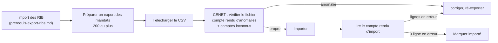

# Prérequis de l'export des mandats — l'import des mandats dans CENET

> Écrit le **2026-10-23**, le jour où la Caisse d'Épargne a répondu et envoyé
> son modèle. Il **rassemble** le sujet : ce qu'on a demandé, ce que la banque
> a dit, ce que son modèle montre, ce que le code écrit, et ce que nous
> supposons encore. Les citations de code (`fichier:ligne`) ont été **ouvertes
> le 2026-10-23**, après la correction de l'export faite ce jour-là, sous
> `apps/lfd-api/src/b2b/accounting/`.
>
> Sources : les questions ([`question-banque.md`](question-banque.md)), les
> réponses ([`reponses-de-la-banque.md`](reponses-de-la-banque.md), réponses 10
> à 15 et § 2 bis), le modèle
> ([`modeles-banque/modele-import-mandats-cenet-remises.xlsx`](modeles-banque/modele-import-mandats-cenet-remises.xlsx)),
> la doc d'état de l'export
> ([`../mandat/export-des-mandats-pour-la-banque.md`](../mandat/export-des-mandats-pour-la-banque.md))
> et la RUM ([`../mandat/rum.md`](../mandat/rum.md)).

## 1. L'ordre : les RIB d'abord, les mandats ensuite

La banque importe **d'abord les comptes destinataires** (les RIB), **puis les
mandats** (réponses 6 et 8). Un mandat dont le compte est inconnu de CENET ne
passe pas : la vérification avant import rend alors un **fichier des comptes à
importer** (réponse 10). Le sujet des RIB a sa propre référence :
[`prerequis-export-ribs.md`](prerequis-export-ribs.md).

## 2. Ce que la banque a dit (2026-10-23)

| Rép. | Ce qu'elle dit                                                                                                                                                                                      |
| ---- | --------------------------------------------------------------------------------------------------------------------------------------------------------------------------------------------------- |
| 10   | F en `AAAAMMJJ` ; G `RECURRENT` / `PONCTUEL` ; H `CORE` / `B2B`. CENET **vérifie le fichier** avant l'import : compte rendu d'anomalies, et fichier des comptes à importer si des RIB sont inconnus |
| 11   | CSV **sans en-tête**, colonnes en jaune obligatoires, nom **≤ 140** caractères                                                                                                                      |
| 12   | **Nouveaux seulement**, **200 lignes** au plus                                                                                                                                                      |
| 13   | Compte rendu d'import : lignes du fichier, chargées, en erreur, et le tableau des lignes en erreur avec leur motif                                                                                  |
| 14   | Mandat modifié, révoqué ou repris : compléter les colonnes **M à R**                                                                                                                                |
| 15   | **Aucun** contrôle des RIB ni des mandats au dépôt d'une remise : l'import est notre discipline, pas une barrière de la banque                                                                      |

## 3. Ce que le modèle montre

Une feuille, 18 colonnes **A à R**. Consignes écrites sur la feuille :
« enregistrer en CSV sans la ligne d'en-tête », « se connecter sur l'interface
du client pour importer le fichier », « colonnes en jaune sont obligatoires ».
**Jaunes : A à H, K et L.** F est formatée `yyyymmdd`. Ligne d'exemple :
G `RECURRENT`, H `CORE`, K `O`, L `N`, le reste vide.

## 4. Colonne par colonne

Légende de la dernière colonne : **DIT** = réponse de la banque, **MONTRE** =
le modèle, **SUPPOSÉ** = notre hypothèse, à confirmer.

| Col. | Intitulé                              | Oblig.  | Source chez nous                                            | Ce qu'on écrit (transformation)                                   | Fondement                                    |
| ---- | ------------------------------------- | ------- | ----------------------------------------------------------- | ----------------------------------------------------------------- | -------------------------------------------- |
| A    | Référence unique du mandat            | oui     | la RUM du mandat                                            | telle quelle, cellule sûre (`bankCell`)                           | MONTRE                                       |
| B    | Numéro d'identifiant créancier        | oui     | l'ICS de l'entité émettrice                                 | tel quel ; une entité sans ICS ne prépare pas d'export (409)      | MONTRE                                       |
| C    | Nom débiteur                          | oui     | raison sociale de la société débitrice, celle du `pain.008` | ASCII SEPA, **entier** ; au-delà de 140, la ligne est **refusée** | DIT (11)                                     |
| D    | IBAN débiteur                         | oui     | le compte descellé du mandat                                | sans espaces                                                      | MONTRE                                       |
| E    | BIC débiteur                          | oui     | le BIC du mandat (sans BIC : écarté)                        | tel quel                                                          | MONTRE                                       |
| F    | Date de signature                     | oui     | `accepted_at`                                               | jour **de Paris** (`localDay`), `AAAAMMJJ`                        | DIT (10), MONTRE                             |
| G    | Séquence de paiement                  | oui     | type de paiement du mandat                                  | `RECURRENT` / `PONCTUEL`                                          | DIT (10), MONTRE                             |
| H    | Nature du prélèvement                 | oui     | schéma figé du mandat                                       | `CORE` / `B2B`                                                    | DIT (10)                                     |
| I    | Référence du contrat sous-jacent      | non     | —                                                           | vide                                                              | MONTRE                                       |
| J    | Montant par défaut                    | non     | —                                                           | vide (nos montants varient)                                       | MONTRE                                       |
| K    | Mandat déjà émis                      | **oui** | —                                                           | **`O`** pour tous nos mandats                                     | MONTRE (exemple), **SUPPOSÉ** le sens (Q-B2) |
| L    | Mandat migré                          | **oui** | —                                                           | **`N`** pour tous nos mandats                                     | MONTRE (exemple), **SUPPOSÉ** le sens (Q-B2) |
| M    | Ancien numéro d'identifiant créancier | non     | —                                                           | vide                                                              | DIT (14) : modification / reprise            |
| N    | Ancien IBAN débiteur                  | non     | —                                                           | vide                                                              | idem                                         |
| O    | Ancien BIC débiteur                   | non     | —                                                           | vide                                                              | idem                                         |
| P    | Liste de mandat                       | non     | —                                                           | vide                                                              | sens inconnu (Q-B3)                          |
| Q    | Ancienne Référence Unique du Mandat   | non     | —                                                           | vide                                                              | idem M                                       |
| R    | Migration code intervenant initial    | non     | —                                                           | vide                                                              | sens inconnu (Q-B3)                          |

Forme du fichier : ASCII, `;` après **chaque** cellule (y compris la
dernière), CRLF, sans en-tête. Chaque cellule passe par `sepa()` puis perd tout
`+ - = @` de tête (injection de formule). L'encodage, le `;` final et le CRLF
n'ont pas eu de réponse explicite : la vérification CENET le dira.

## 5. Les règles, et où le code les tient

- **Nouveaux seulement** (réponse 12) : un mandat est « à exporter » s'il n'a
  aucune ligne d'un export **marqué importé** sous l'empreinte de son compte
  actuel (`domain/services/mandate-bank-export-selection.ts:33-46`). « Tous les
  mandats actifs » existe pour un renvoi complet, à n'utiliser qu'à la demande
  de la banque.
- **200 lignes au plus** (réponse 12) : **découpage**, pas refus. Préparer un
  export prend les 200 premiers mandats à exporter, dans l'ordre des RUM
  (`apps/lfd-api/src/b2b/payments/infrastructure/prisma-mandates-for-bank-export.reader.ts:48`),
  et les suivants restent « à exporter » pour l'export d'après
  (`application/commands/export-mandates-for-bank.handler.ts:60`). L'agrégat
  refuse un export de plus de 200 (`domain/entities/mandate-bank-export.ts:51`),
  le rendu aussi (`domain/services/mandate-bank-export-csv.ts:75`). Même avec
  « tous », un export porte 200 mandats.
- **Nom ≤ 140** (réponse 11) : **refus**, pas troncature. Le rendu refuse le
  fichier en nommant la RUM de chaque mandat en cause
  (`domain/services/mandate-bank-export-csv.ts:79-85`,
  `BankExportDebtorNameTooLongError`) ; le geste est de raccourcir la raison
  sociale sur la fiche de la société. Jusqu'au 2026-10-23, le nom était coupé
  à 70 en silence alors que le `pain.008` l'écrit entier : la banque aurait
  connu le débiteur sous deux noms.
- **Compte rendu lu avant de marquer importé** (réponse 13) : « marquer
  importé » marque l'export **entier**. Consigne tant que le marquage partiel
  n'existe pas : un import avec des lignes en erreur **ne se marque pas** ; on
  corrige et on ré-exporte.
- **Toujours vérifier dans CENET avant l'import réel** (réponse 10) : c'est la
  seule vérification du format que nous aurons, la banque ne contrôle rien au
  dépôt d'une remise (réponse 15).

Les valeurs F, G, H, K, L s'écrivent en un seul endroit,
`domain/services/mandate-bank-export-values.ts` (G : l. 21-24, H : l. 27-30,
K : l. 36, L : l. 43, F : l. 52-54). Le nombre de colonnes, la borne du nom et
celle des lignes sont dans `domain/services/mandate-bank-export-csv.ts:29-40`.

## 6. Ce qui manque, et l'hypothèse retenue

| Manque                                                                                            | Hypothèse retenue                                                                                                                                                           | Question  |
| ------------------------------------------------------------------------------------------------- | --------------------------------------------------------------------------------------------------------------------------------------------------------------------------- | --------- |
| Sens et valeurs de **K** « Mandat déjà émis »                                                     | `O` : nos mandats sont signés chez nous avant l'import                                                                                                                      | Q-B2, D11 |
| Sens et valeurs de **L** « Mandat migré »                                                         | `N` : aucun mandat exporté n'est repris d'un autre créancier — les repris sont **écartés** de l'export (`domain/ports/mandates-for-bank-export.reader.ts:26`, `taken_over`) | Q-B2      |
| **M–R** contre la réponse 14 : P « Liste de mandat » et R ne sont pas des données de modification | toutes vides ; aucun mandat modifié ou repris n'est exporté aujourd'hui                                                                                                     | Q-B3      |
| **Révocation** : aucune colonne ne la nomme                                                       | non déclarée à la banque ; un mandat révoqué n'entre plus dans aucun lot                                                                                                    | Q-B3      |
| **Changement de compte** : nouveau mandat (réponse 9) ou modification en M–R (réponse 14)         | le mandat ressort comme un mandat à importer, sans colonne « ancien IBAN » (`domain/services/mandate-bank-export-selection.ts:25-29`)                                       | D9        |
| Encodage, `;` final, CRLF                                                                         | ASCII, `;` final, CRLF — la vérification CENET tranchera                                                                                                                    | —         |

## 7. Décisions pour Hugo

- **D11** — K = `O` et L = `N` pour tous nos mandats, **en attendant Q-B2**.
  Le code les écrit déjà (constantes nommées) ; une autre réponse se corrige en
  une ligne.
- **Nom > 140 : refus** de la ligne plutôt que troncature (bâti). À revoir si
  une société réelle dépasse — c'est peu probable.
- **> 200 mandats : découpage** en exports successifs (bâti), plutôt qu'un
  refus qui obligerait à choisir à la main.
- **D9** — changement de compte : nouveau mandat ou M–R (inchangé, voir
  [`reponses-de-la-banque.md`](reponses-de-la-banque.md) § 4).
- **Marquage partiel** (réponse 13) : pouvoir marquer importé **sauf** les RUM
  en erreur — non bâti ; d'ici là, la consigne du § 5.
