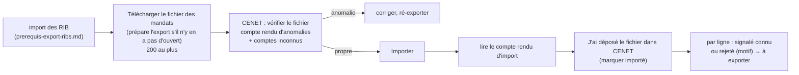

# Prérequis de l'export des mandats — l'import des mandats dans CENET

> Écrit le **2026-10-23**, le jour où la Caisse d'Épargne a répondu et envoyé
> son modèle. Il **rassemble** le sujet : ce qu'on a demandé, ce que la banque
> a dit, ce que son modèle montre, ce que le code écrit, et ce que nous
> supposons encore. Les citations de code (`fichier:ligne`) ont été **ouvertes
> le 2026-10-23**, après la correction de l'export faite ce jour-là, sous
> `apps/lfd-api/src/b2b/accounting/`.
>
> Sources : les questions ([`question-banque.md`](question-banque.md)), les
> réponses ([`reponses-de-la-banque.md`](reponses-de-la-banque.md), réponses 10
> à 15 et § 2 bis), le modèle
> ([`modeles-banque/modele-import-mandats-cenet-remises.xlsx`](modeles-banque/modele-import-mandats-cenet-remises.xlsx)),
> la doc d'état de l'export
> ([`../mandat/export-des-mandats-pour-la-banque.md`](../mandat/export-des-mandats-pour-la-banque.md))
> et la RUM ([`../mandat/rum.md`](../mandat/rum.md)).

> **Numéro et nom de fichier (2026-10-23).** Chaque export porte un numéro
> court `EXM-<n>` (compteur global, figé à la préparation) et son rang dans la
> série ; le fichier se télécharge sous
> `CENET-EXM-4-mandats-1-sur-1-12-mandats-AAAA-MM-JJ.csv` (il s'appelait
> `mandats-banque-<SIREN>-<id>.csv`). Règles : [`procedure-de-prelevement.md`](procedure-de-prelevement.md) § 4 bis.

## 1. L'ordre : les RIB d'abord, les mandats ensuite

La banque importe **d'abord les comptes destinataires** (les RIB), **puis les
mandats** (réponses 6 et 8). Un mandat dont le compte est inconnu de CENET ne
passe pas : la vérification avant import rend alors un **fichier des comptes à
importer** (réponse 10). Le sujet des RIB a sa propre référence :
[`prerequis-export-ribs.md`](prerequis-export-ribs.md).

## 2. Ce que la banque a dit (2026-10-23)

| Rép. | Ce qu'elle dit                                                                                                                                                                                      |
| ---- | --------------------------------------------------------------------------------------------------------------------------------------------------------------------------------------------------- |
| 10   | F en `AAAAMMJJ` ; G `RECURRENT` / `PONCTUEL` ; H `CORE` / `B2B`. CENET **vérifie le fichier** avant l'import : compte rendu d'anomalies, et fichier des comptes à importer si des RIB sont inconnus |
| 11   | CSV **sans en-tête**, colonnes en jaune obligatoires, nom **≤ 140** caractères                                                                                                                      |
| 12   | **Nouveaux seulement**, **200 lignes** au plus                                                                                                                                                      |
| 13   | Compte rendu d'import : lignes du fichier, chargées, en erreur, et le tableau des lignes en erreur avec leur motif                                                                                  |
| 14   | Mandat modifié, révoqué ou repris : compléter les colonnes **M à R**                                                                                                                                |
| 15   | **Aucun** contrôle des RIB ni des mandats au dépôt d'une remise : l'import est notre discipline, pas une barrière de la banque                                                                      |

## 3. Ce que le modèle montre

Une feuille, 18 colonnes **A à R**. Consignes écrites sur la feuille :
« enregistrer en CSV sans la ligne d'en-tête », « se connecter sur l'interface
du client pour importer le fichier », « colonnes en jaune sont obligatoires ».
**Jaunes : A à H, K et L.** F est formatée `yyyymmdd`. Ligne d'exemple :
G `RECURRENT`, H `CORE`, K `O`, L `N`, le reste vide.

## 4. Colonne par colonne

Légende de la dernière colonne : **DIT** = réponse de la banque, **MONTRE** =
le modèle, **SUPPOSÉ** = notre hypothèse, à confirmer.

| Col. | Intitulé                              | Oblig.  | Source chez nous                                            | Ce qu'on écrit (transformation)                                               | Fondement                                    |
| ---- | ------------------------------------- | ------- | ----------------------------------------------------------- | ----------------------------------------------------------------------------- | -------------------------------------------- |
| A    | Référence unique du mandat            | oui     | la RUM du mandat                                            | telle quelle, cellule sûre (`bankCell`)                                       | MONTRE                                       |
| B    | Numéro d'identifiant créancier        | oui     | l'ICS de l'entité émettrice                                 | tel quel ; une entité sans ICS ne prépare pas d'export (409)                  | MONTRE                                       |
| C    | Nom débiteur                          | oui     | raison sociale de la société débitrice, celle du `pain.008` | ASCII SEPA, **coupé à 70** comme le `pain.008` (décision de Hugo, 2026-10-23) | DIT (11)                                     |
| D    | IBAN débiteur                         | oui     | le compte descellé du mandat                                | sans espaces                                                                  | MONTRE                                       |
| E    | BIC débiteur                          | oui     | le BIC du mandat (sans BIC : écarté)                        | tel quel                                                                      | MONTRE                                       |
| F    | Date de signature                     | oui     | `accepted_at`                                               | jour **de Paris** (`localDay`), `AAAAMMJJ`                                    | DIT (10), MONTRE                             |
| G    | Séquence de paiement                  | oui     | type de paiement du mandat                                  | `RECURRENT` / `PONCTUEL`                                                      | DIT (10), MONTRE                             |
| H    | Nature du prélèvement                 | oui     | schéma figé du mandat                                       | `CORE` / `B2B`                                                                | DIT (10)                                     |
| I    | Référence du contrat sous-jacent      | non     | —                                                           | vide                                                                          | MONTRE                                       |
| J    | Montant par défaut                    | non     | —                                                           | vide (nos montants varient)                                                   | MONTRE                                       |
| K    | Mandat déjà émis                      | **oui** | —                                                           | **`O`** pour tous nos mandats                                                 | MONTRE (exemple), **SUPPOSÉ** le sens (Q-B2) |
| L    | Mandat migré                          | **oui** | —                                                           | **`N`** pour tous nos mandats                                                 | MONTRE (exemple), **SUPPOSÉ** le sens (Q-B2) |
| M    | Ancien numéro d'identifiant créancier | non     | —                                                           | vide                                                                          | DIT (14) : modification / reprise            |
| N    | Ancien IBAN débiteur                  | non     | —                                                           | vide                                                                          | idem                                         |
| O    | Ancien BIC débiteur                   | non     | —                                                           | vide                                                                          | idem                                         |
| P    | Liste de mandat                       | non     | —                                                           | vide                                                                          | sens inconnu (Q-B3)                          |
| Q    | Ancienne Référence Unique du Mandat   | non     | —                                                           | vide                                                                          | idem M                                       |
| R    | Migration code intervenant initial    | non     | —                                                           | vide                                                                          | sens inconnu (Q-B3)                          |

Forme du fichier : ASCII, `;` après **chaque** cellule (y compris la
dernière), CRLF, sans en-tête. Chaque cellule passe par `sepa()` puis perd tout
`+ - = @` de tête (injection de formule). L'encodage, le `;` final et le CRLF
n'ont pas eu de réponse explicite : la vérification CENET le dira.

## 5. Les règles, et où le code les tient

- **Nouveaux seulement** (réponse 12) : un mandat est « à exporter » s'il n'a
  aucune ligne, sous l'empreinte de son compte actuel, ni d'un export
  **marqué importé**, ni d'un export **ouvert** (ni importé, ni abandonné)
  (`domain/services/mandate-bank-export-selection.ts:41-60`). Sur la carte, un
  mandat d'un export ouvert est « en attente de la banque », pas « à
  exporter » ; « À exporter » et « En attente de la banque » se lisent sur
  l'état de chaque mandat (`application/queries/get-mandate-bank-exports.handler.ts`,
  `toExportCount` / `inFlightCount`), comme la carte des comptes.
  **La préparation les écarte aussi depuis le 2026-10-23** (Hugo, aligné sur
  les comptes) : deux exports n'ont jamais un mandat commun, et quand tous
  les mandats exportables sont en vol, importés ou écartés, la préparation
  est refusée (409 `accounting.mandate_bank_export.nothing_to_export`). La
  procédure de prélèvement (étape « mandats »,
  `application/collection-procedure-support.ts`) lit la même sélection.
  Jusque-là, un second export préparé pendant qu'un premier était ouvert
  reprenait ses mandats, et la banque l'aurait rejeté en entier.
- **Pas de renvoi complet** (Hugo, 2026-10-23) : la case « Tous les mandats
  actifs, y compris ceux déjà importés » et le champ `all` de
  `POST /admin/legal-entities/:id/mandate-exports` sont **retirés**. La banque
  rejette l'import entier dès qu'un seul mandat lui est déjà connu (réponse 12) : la case ne pouvait produire qu'un fichier refusé. Le corps attendu est
  désormais `{}`, strict — un `all` envoyé est refusé (400).
  **Si la banque vide son référentiel CENET — NON DÉCIDÉ** (Hugo,
  2026-10-23) : il n'y a pas de geste complet. Dans les 30 jours après le
  dépôt, « Rejeté par la banque » sur chaque ligne concernée la remet « à
  exporter », et le fichier suivant la porte ; un export jamais déposé
  s'abandonne (« Abandonner ») et ses mandats redeviennent à exporter.
  **Au-delà des 30 jours, rien** : aucun geste ne refait sortir un mandat
  déjà importé. C'est délibéré — on attendra que le cas se présente plutôt
  que de bâtir un geste dangereux (un renvoi complet produirait un fichier
  que la banque rejette en entier dès qu'un mandat lui est connu).
- **200 lignes au plus** (réponse 12) : **découpage**, pas refus. Préparer un
  export prend les 200 premiers mandats à exporter, dans l'ordre des RUM
  (`apps/lfd-api/src/b2b/payments/infrastructure/prisma-mandates-for-bank-export.reader.ts:48`),
  et les suivants restent « à exporter » pour l'export d'après
  (`application/commands/export-mandates-for-bank.handler.ts:68-69`). L'agrégat
  refuse un export de plus de 200 (`domain/entities/mandate-bank-export.ts:51`),
  le rendu aussi (`domain/services/mandate-bank-export-csv.ts:75`).
- **Nom coupé à 70** (décision de Hugo, 2026-10-23) : la banque accepte 140
  (réponse 11), mais le `pain.008` porte 70 ; la colonne C est coupée par la
  même règle que le `Dbtr/Nm` (`sepaText(…, SEPA_NAME_MAX)`,
  `domain/services/sepa-text.ts`), pour que le débiteur ait un seul nom chez la
  banque. Le refus au-delà de 140, bâti le matin même, est retiré.
- **Le dépôt, puis le compte rendu ligne par ligne** (réponse 13 ; Hugo,
  2026-10-23) : « J'ai déposé le fichier dans CENET » (le geste « marquer
  importé ») marque l'export entier, et **se refuse (409) tant que son fichier
  n'a jamais été téléchargé** — `mandate_bank_export.last_downloaded_at`
  (migration additive `20261024030000_le_telechargement_d_un_export_des_mandats`),
  posé par `MandateBankExport.recordDownload` à chaque téléchargement. Ensuite,
  chaque mandat de l'export reçoit au plus **une** correction tirée du compte
  rendu, pendant 30 jours après le dépôt (même règle et même fenêtre que les
  comptes, [`prerequis-export-ribs.md`](prerequis-export-ribs.md) § 2.6) :
  « Signalé comme connu par la banque » (`reported_by_bank` : il reste
  importé, fait `mandate_bank_export.mandate_reported_known`) ou « Rejeté par
  la banque » (`rejected` + motif obligatoire : il redevient « à exporter » et
  part dans le prochain fichier, fait `mandate_bank_export.mandate_rejected`).
  Avant le dépôt, les deux gestes sont visibles mais grisés (« Disponible
  après le dépôt dans CENET ») et le serveur les refuse (409). L'agrégat porte
  la règle (`MandateBankExport.reportKnownByBank` / `rejectMandate`) ; les
  colonnes sont sur `mandate_bank_export_line` (migration
  `20261024040000_le_compte_rendu_d_import_cenet_par_ligne`).
- **L'écran** (2026-10-23, aligné sur la carte des comptes) : un tableau des
  mandats actifs (débiteur, RUM, quatre derniers de l'IBAN, état — écartés
  compris) et, au-dessus, une barre : « Télécharger le fichier des mandats
  (N mandats) » prépare **puis** télécharge d'un clic s'il n'y a pas d'export
  ouvert, sinon redonne le fichier de CET export (« Télécharger à nouveau le
  fichier ») ; « J'ai déposé le fichier dans CENET » ; « Abandonner »,
  discret. Plus d'historique ni de paragraphe.
- **Toujours vérifier dans CENET avant l'import réel** (réponse 10) : c'est la
  seule vérification du format que nous aurons, la banque ne contrôle rien au
  dépôt d'une remise (réponse 15).

Les valeurs F, G, H, K, L s'écrivent en un seul endroit,
`domain/services/mandate-bank-export-values.ts` (G : l. 21-24, H : l. 27-30,
K : l. 36, L : l. 43, F : l. 52-54). Le nombre de colonnes, la borne du nom et
celle des lignes sont dans `domain/services/mandate-bank-export-csv.ts:29-40`.

## 6. Ce qui manque, et l'hypothèse retenue

| Manque                                                                                            | Hypothèse retenue                                                                                                                                                           | Question  |
| ------------------------------------------------------------------------------------------------- | --------------------------------------------------------------------------------------------------------------------------------------------------------------------------- | --------- |
| Sens et valeurs de **K** « Mandat déjà émis »                                                     | `O` : nos mandats sont signés chez nous avant l'import                                                                                                                      | Q-B2, D11 |
| Sens et valeurs de **L** « Mandat migré »                                                         | `N` : aucun mandat exporté n'est repris d'un autre créancier — les repris sont **écartés** de l'export (`domain/ports/mandates-for-bank-export.reader.ts:26`, `taken_over`) | Q-B2      |
| **M–R** contre la réponse 14 : P « Liste de mandat » et R ne sont pas des données de modification | toutes vides ; aucun mandat modifié ou repris n'est exporté aujourd'hui                                                                                                     | Q-B3      |
| **Révocation** : aucune colonne ne la nomme                                                       | non déclarée à la banque ; un mandat révoqué n'entre plus dans aucun lot                                                                                                    | Q-B3      |
| **Changement de compte** : nouveau mandat (réponse 9) ou modification en M–R (réponse 14)         | le mandat ressort comme un mandat à importer, sans colonne « ancien IBAN » (`domain/services/mandate-bank-export-selection.ts:30-40`)                                       | D9        |
| Encodage, `;` final, CRLF                                                                         | ASCII, `;` final, CRLF — la vérification CENET tranchera                                                                                                                    | —         |

## 7. Décisions pour Hugo

- **D11** — K = `O` et L = `N` pour tous nos mandats, **en attendant Q-B2**.
  Le code les écrit déjà (constantes nommées) ; une autre réponse se corrige en
  une ligne.
- **Nom coupé à 70** dans les deux fichiers (tranché par Hugo le 2026-10-23).
- **> 200 mandats : découpage** en exports successifs (bâti), plutôt qu'un
  refus qui obligerait à choisir à la main.
- **D9** — changement de compte : nouveau mandat ou M–R (inchangé, voir
  [`reponses-de-la-banque.md`](reponses-de-la-banque.md) § 4).
- **Référentiel CENET vidé par la banque** : **non décidé** (Hugo,
  2026-10-23) — « Rejeté par la banque » ligne par ligne dans les 30 jours,
  rien au-delà ; à trancher le jour où le cas se présente (§ 5).
- **Marquage partiel** (réponse 13) : bâti le 2026-10-23 sous une autre
  forme — on marque l'export déposé, puis on rejette, ligne par ligne, les RUM
  que le compte rendu met en erreur (§ 5).
