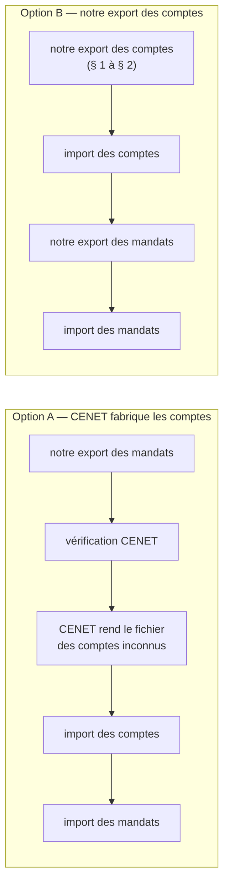
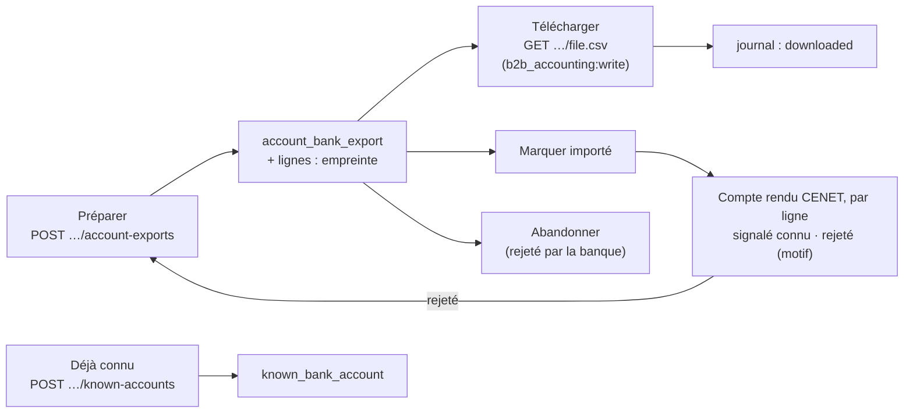

# Prérequis de l'export des RIB — le fichier des comptes destinataires

> **Bâti le 2026-10-23** (Hugo : « R1 oui, lance l'export des RIB, on
> documente nos choix faits en l'absence d'info »). Écrit doc-first le même
> jour ; l'état réel du code est au **§ 8**, et les valeurs choisies faute de
> réponse de la banque au **§ 7** — à relire dès qu'elle répond. Ce document est
> la **référence du sujet RIB côté banque** : il rassemble les questions posées,
> les réponses reçues, le modèle, la décision sur le BIC, ce que le code sait
> déjà des RIB et le lien avec l'export des mandats.
> [`question-banque.md`](question-banque.md) et
> [`reponses-de-la-banque.md`](reponses-de-la-banque.md) y renvoient au lieu de
> le recopier.
>
> Chaque « le code fait » cite un fichier et une ligne **ouverts le
> 2026-10-23**. Trois registres sont tenus séparés partout :
> **DIT** (la banque l'a écrit), **MONTRÉ** (le modèle le porte),
> **SUPPOSÉ** (notre lecture, à confirmer).

> **Numéro et nom de fichier (2026-10-23).** Chaque export porte un numéro
> court `EXC-<n>` (compteur global, figé à la préparation) et son rang dans la
> série (« fichier 1 sur 2 ») ; le fichier se télécharge sous
> `CENET-EXC-12-comptes-1-sur-2-200-comptes-AAAA-MM-JJ.csv`. Les règles, et ce
> que la migration a fait aux exports déjà préparés : [`procedure-de-prelevement.md`](procedure-de-prelevement.md) § 4 bis.

---

## Avant tout : deux parcours, et peut-être rien à bâtir

L'introduction de l'**étape 4** du mail de la banque (avant la réponse 10)
**DIT** : avant d'importer le fichier des mandats, on peut le **vérifier** ;
CENET rend un compte rendu des anomalies et, **si des RIB destinataires sont
inconnus, met à disposition un fichier de comptes à importer**. CENET sait
donc fabriquer lui-même le fichier des comptes à partir du fichier des mandats.

|                        | **Option A** — CENET fabrique                                                                                                                                        | **Option B** — nous fabriquons                                                                          |
| ---------------------- | -------------------------------------------------------------------------------------------------------------------------------------------------------------------- | ------------------------------------------------------------------------------------------------------- |
| À bâtir côté RIB       | **rien** ; le vrai prérequis est un **export des mandats conforme** (F, G, K, L, 18 colonnes — reponses-de-la-banque.md § 2 bis), qu'il faut faire dans les deux cas | les lots 1–3 du § 4 (domaine, tables, routes, écran, journal)                                           |
| Ce qui reste inconnu   | le format du fichier rendu, s'il s'importe tel quel, et quel nom / adresse CENET y met (il ne les connaît que par la colonne C des mandats)                          | les valeurs des cellules du § 3 (K, consigne D–G coupée, M, P, portée)                                  |
| « Nouveaux seulement » | tenu **par construction** : CENET ne rend que les inconnus                                                                                                           | tenu par **nous** (empreintes, exports en vol, « déjà connu » — § 2.1, § 2.6) ; une erreur rejette tout |
| IBAN en clair          | un fichier de plus qui passe par le poste (celui de CENET), hors de notre système                                                                                    | un fichier de plus produit par nous : droits, journal, `no-store` (§ 2.3)                               |
| Coût                   | une manipulation de plus par import ; aucun code                                                                                                                     | plusieurs lots ; une table, une migration, une carte                                                    |
| Risque                 | adresse et titulaire peut-être absents ou approximatifs dans le fichier rendu                                                                                        | une mauvaise valeur de cellule ; un compte déjà connu qui fait tout rejeter                             |

**Direction retenue : l'option B** — Hugo, 2026-10-23 : « on serait
peut-être mieux à bâtir notre export ». Nous maîtrisons le titulaire,
l'adresse et le moment de l'import, au lieu de dépendre d'un fichier dont nous
ne connaissons ni le format ni le contenu.

**L'option A reste un filet de contrôle** : après l'import de nos comptes, la
vérification CENET du fichier des mandats ne doit plus rendre **aucun** compte
inconnu. Si elle en rend, notre export a raté quelque chose (un compte oublié,
un IBAN mal découpé), et le fichier rendu permet de débloquer l'import en
attendant la correction. Q-B8 reste utile pour savoir ce qu'il contient.

### À quoi sert le référentiel des comptes, pour nous ?

Deux réponses le cernent :

- **réponse 15** (DIT) : un **dépôt de fichier** de remise n'est **pas**
  contrôlé contre le référentiel ; il ne sert qu'à la **saisie en ligne** et
  aux **contrôles d'import** ;
- **réponse 9** (DIT) : un changement de compte passe par un **nouveau mandat**
  puis la mise à jour de l'IBAN **dans notre logiciel** ; aucune mise à jour
  de RIB **par fichier** n'est décrite.

Conséquence (déduite) : pour un créancier qui dépose des fichiers, le
référentiel des comptes **n'a qu'un usage — faire passer l'import des
mandats**. Il ne protège aucune remise, et il n'a pas à suivre nos
changements de compte : un nouveau mandat arrive avec un nouvel IBAN, que
l'option A ferait de nouveau reconnaître par CENET. C'est un argument pour A ;
il ne change pas la direction retenue, il dit seulement qu'aucun compte n'est
à tenir à jour par fichier. Si la banque attache un autre usage au référentiel (rapprochement des
retours, contrôle anti-fraude, obligation contractuelle), il est à demander :
question Q-B10.

---

## 0. Ce qui existe

### 0.1 Ce que nous avons demandé à la banque

Le premier envoi ([`question-banque.md`](question-banque.md), « Étape 3 » du
texte envoyé, questions 6 à 9) demandait : le modèle (colonnes, ordre,
longueurs, séparateur, encodage, en-tête, `;` final, IBAN avec ou sans
espaces, BIC obligatoire ou non) ; la clé de rattachement d'un RIB à son
mandat ; fichier complet ou nouveaux seulement ; le changement de compte.

### 0.2 Ce que la banque a répondu (2026-10-23)

| Rép. | DIT                                                                                                                                                                                                | Pour nous                                                                      |
| ---- | -------------------------------------------------------------------------------------------------------------------------------------------------------------------------------------------------- | ------------------------------------------------------------------------------ |
| 6    | « le modèle de fichier en pièce jointe **avec les informations obligatoires** dans le fichier »                                                                                                    | les consignes du modèle (§ 0.3) **sont** la réponse sur les obligatoires       |
| 7    | « l'IBAN est lié à la RUM »                                                                                                                                                                        | mais le modèle n'a **aucune colonne RUM** (§ 3, Q-B5)                          |
| 8    | **nouveaux RIB seulement** ; un RIB déjà connu fait **rejeter l'import entier** ; **200 lignes** au plus                                                                                           | § 2.1, § 2.2                                                                   |
| 9    | changement de compte : **nouveau mandat** d'abord, puis actualiser l'IBAN                                                                                                                          | § 2.4                                                                          |
| 10   | avant l'import des mandats, CENET **vérifie** le fichier et produit un **fichier des comptes à importer** si des RIB sont inconnus                                                                 | le filet de contrôle de l'option A (en tête du document)                       |
| 11   | « longueur max pour le nom du **bénéficiaire** = 140 caractères » — réponse donnée à une question sur le fichier des **mandats**, mais avec le mot du modèle des comptes (« banque bénéficiaire ») | retenue pour B (§ 1)                                                           |
| 15   | **aucun** contrôle des RIB/mandats au dépôt d'une remise                                                                                                                                           | la banque ne nous protège pas d'un compte non importé : c'est notre discipline |
| —    | (2026-10-08) importer les RIB **avant** les mandats                                                                                                                                                | § 2.3                                                                          |

L'encodage, le `;` final et la ligne d'en-tête n'ont **pas** reçu de réponse
écrite (reponses-de-la-banque.md § 5).

### 0.3 Le modèle reçu

[`modeles-banque/modele-comptes-destinataires-2026.csv`](modeles-banque/modele-comptes-destinataires-2026.csv),
ouvert le 2026-10-23 avec `iconv -f ISO-8859-1` et `od -c` :

- **MONTRÉ** : ISO-8859-1 (« Clé », « bénéficiaire » encodés `0xE9`), CRLF,
  séparateur `;` **sans `;` final** (la ligne d'en-tête finit sur `NIF\r\n`),
  **16 colonnes A–P**, une ligne d'en-tête, puis des lignes de consigne en
  colonne A et trois lignes vides. **Aucune ligne d'exemple.**
- Consignes **MONTRÉES** : « colonne A : R pour RIB » ; « colonne A : I pour
  IBAN » ; « Colonne K : BBAN/IBAN sans espace » ; « Colonne L : BIC
  obligatoire pour les pays hors SEPA » ; « Colonne D, E, F, G : » **coupée,
  sans texte**.
- Ces consignes **sont** la réponse de la banque sur les informations
  obligatoires (réponse 6) : A (le type), K (le compte, sans espace), L (le
  BIC, hors SEPA), et D–G, dont la consigne est **coupée** — c'est le seul
  trou. Le CSV n'a pas de couleurs (le modèle des mandats, un classeur, a ses
  cellules jaunes).

### 0.4 Ce que le code sait déjà des RIB

- **Saisie** : par le staff (fiche client) et par le client (`/mon-compte`,
  `owner` et `billing` seulement), la même commande
  `record-company-bank-account.ts` — détail dans
  [`../mandat/rib-client.md`](../mandat/rib-client.md) §§ 1–3.
- **Stockage** : `company_bank_accounts` — IBAN **scellé** AES-256-GCM
  (`iban_sealed`, `apps/lfd-api/prisma/schema/public/accounting.prisma:314`),
  `iban_last4` en clair pour l'écran (l. 317), **BIC en clair** (l. 321 : il
  figure sur tout virement). Un RIB par société ; les sites peuvent garder
  celui du principal (commentaire l. 345-347).
- **Validation** : `Iban` (`apps/lfd-api/src/b2b/accounting/domain/value-objects/iban.ts:4-5`)
  accepte **15 à 34** caractères — donc un IBAN **non français** de la zone
  SEPA est possible.
- **Mandat actif** : le client ne peut plus remplacer son RIB (409) ; le
  changement passe par le staff (rib-client.md § 4).
- **Journal** : `company.bank_account_changed` à chaque dépôt (rib-client.md § 5).
- **Ouvert** : la revue de la transmission —
  [`../mandat/todo-rib-client-transmission.md`](../mandat/todo-rib-client-transmission.md).

### 0.5 L'export des mandats — le calque

Doc d'état : [`../mandat/export-des-mandats-pour-la-banque.md`](../mandat/export-des-mandats-pour-la-banque.md).
Sous `apps/lfd-api/src/b2b/accounting/` :

| Pièce                                                            | Ce qu'elle fait                                                                                                                                                                                              |
| ---------------------------------------------------------------- | ------------------------------------------------------------------------------------------------------------------------------------------------------------------------------------------------------------ |
| `domain/entities/mandate-bank-export.ts:36-77`                   | l'agrégat : au moins une ligne, chaque mandat une fois, « importé » marqué une seule fois                                                                                                                    |
| `domain/services/account-fingerprint.ts:13-16`                   | SHA-256 de l'IBAN normalisé : **seule** trace du compte en base                                                                                                                                              |
| `domain/services/mandate-bank-export-selection.ts:33-45`         | « à exporter » = aucune ligne d'un export **importé** portant l'empreinte du compte actuel                                                                                                                   |
| `domain/services/mandate-bank-export-selection.ts:54-70`         | au téléchargement, 409 si une empreinte ne correspond plus                                                                                                                                                   |
| `domain/services/mandate-bank-export-csv.ts:54-86`               | rendu : `sepa()` (ASCII), `;` terminateur, CRLF, sans en-tête, neutralisation des débuts de formule                                                                                                          |
| `application/commands/export-mandates-for-bank.handler.ts:47-71` | fige l'export dans une transaction, publie `mandate_bank_export.created`                                                                                                                                     |
| `application/queries/export-mandate-bank-file.handler.ts:39-49`  | recalcule le fichier, **jamais rangé**                                                                                                                                                                       |
| `http/admin-mandate-bank-exports.controller.ts:42-103`           | `@AdminSurface("b2b_accounting")` ; le `GET …/file.csv` exige `b2b_accounting:write` (l. 73), `no-store`, pièce jointe                                                                                       |
| `domain/ports/mandates-for-bank-export.reader.ts:54-56`          | lecteur par créancier, implémenté par `payments` (qui descelle), écartés nommés (`taken_over`, `no_account`, `no_bic`)                                                                                       |
| `domain/events/mandate-bank-export.events.ts:16-29`              | fait au journal : sujet l'entité, `mandateCount`, jamais d'IBAN                                                                                                                                              |
| back-office                                                      | carte « Mandats à la banque », onglet 2 de la procédure de prélèvement (retirée de la fiche de l'entité le 2026-10-24) (`apps/lfd-backoffice-frontend/src/app/comptabilite/mandate-bank-exports.service.ts`) |

**Ce qui n'existait pas** à l'écriture : aucun export des RIB. Il existe
depuis le 2026-10-23 — § 8.

---

## 1. Le fichier, colonne par colonne

Une ligne par **compte débité** (pas par mandat : deux mandats CORE et B2B, ou
un site qui garde le RIB du principal, débitent le même compte — SUPPOSÉ : la
banque refuserait un même IBAN deux fois, réponse 8).

| Col. | Intitulé (MONTRÉ)                    | Ce que nous écririons                                        | Source                                                                                                                                          | Transformation                        | Registre                                                                                                         |
| ---- | ------------------------------------ | ------------------------------------------------------------ | ----------------------------------------------------------------------------------------------------------------------------------------------- | ------------------------------------- | ---------------------------------------------------------------------------------------------------------------- |
| A    | Type format                          | `I`                                                          | constante                                                                                                                                       | —                                     | MONTRÉ (`I` pour IBAN)                                                                                           |
| B    | Nom                                  | le **titulaire du compte**                                   | `company_bank_accounts.holder` (`accounting.prisma:298-302` : « tels que la banque du client les connaît », peut différer de la raison sociale) | `sepa()`, 140 car. au plus            | DIT 140 (réponse 11, nuance § 0.2) ; la source est la décision R6                                                |
| C    | Siren                                | 9 chiffres                                                   | `Company.siren` (`apps/lfd-api/src/b2b/account/domain/entities/company.ts:326`), **nullable**                                                   | vide si `null`                        | SUPPOSÉ (facultatif ?)                                                                                           |
| D    | Adresse 1                            | `addressLine1`                                               | l'adresse **du titulaire**, sur le RIB (`accounting.prisma:307-311`) — pas l'adresse de facturation                                             | `sepa()`, longueur ❓                 | SUPPOSÉ (consigne coupée, Q-B1)                                                                                  |
| E    | Adresse 2                            | `addressLine2` (vide si vide)                                | idem                                                                                                                                            | idem                                  | SUPPOSÉ                                                                                                          |
| F    | Adresse 3                            | `postalCode city`                                            | idem                                                                                                                                            | idem                                  | SUPPOSÉ                                                                                                          |
| G    | Adresse 4                            | vide                                                         | —                                                                                                                                               | le pays va en H                       | SUPPOSÉ                                                                                                          |
| H    | Code Pays Dest                       | `countryCode` (ISO alpha-2, défaut `FR`)                     | `company_bank_accounts.country_code` (l. 311)                                                                                                   | tel quel — aucune table de conversion | SUPPOSÉ (sens exact ❓, Q-B7)                                                                                    |
| I    | Code Pays Iban                       | caractères 1–2 de l'IBAN                                     | IBAN descellé                                                                                                                                   | —                                     | SUPPOSÉ (déduit de l'intitulé)                                                                                   |
| J    | Clé Iban                             | caractères 3–4                                               | idem                                                                                                                                            | —                                     | SUPPOSÉ                                                                                                          |
| K    | BBAN/RIB                             | caractères 5 à fin (le BBAN ; 23 pour la France)             | idem                                                                                                                                            | sans espace                           | MONTRÉ « BBAN/IBAN sans espace » ; BBAN seul **SUPPOSÉ** (Q-B4)                                                  |
| L    | Bic                                  | le BIC, **toujours** ; BIC vide = compte **écarté et nommé** | `company_bank_accounts.bic`                                                                                                                     | majuscules, tel quel                  | **Décision de Hugo, 2026-10-23** (« dans le doute on mettra le bic ») ; MONTRÉ : obligatoire hors SEPA seulement |
| M    | Nom liste                            | vide                                                         | —                                                                                                                                               | —                                     | sens inconnu (Q-B4)                                                                                              |
| N    | Type identifiant banque bénéficiaire | vide                                                         | —                                                                                                                                               | —                                     | SUPPOSÉ hors SEPA                                                                                                |
| O    | ABA/BSB/INS                          | vide                                                         | —                                                                                                                                               | —                                     | SUPPOSÉ hors SEPA (codes bancaires US/AU)                                                                        |
| P    | NIF                                  | vide                                                         | —                                                                                                                                               | —                                     | sens inconnu (Q-B4 : numéro d'identification fiscale ?)                                                          |

### 1.1 Les règles de rendu

- **Encodage** : le modèle est ISO-8859-1 (MONTRÉ) ; mais `sepa()` ne rend
  que de l'**ASCII**, sous-ensemble de Latin-1 — il n'y a rien à encoder, le
  Latin-1 n'est que l'en-tête HTTP. Aucun encodeur à écrire.
- CRLF, `;` séparateur **sans** `;` final
  (MONTRÉ — l'inverse du fichier des mandats, qui termine chaque cellule).
- **Un caractère hors Latin-1** (un `œ`, un `€`, une apostrophe typographique,
  un caractère d'un autre alphabet) : il ne peut pas s'écrire. Proposition :
  passer **tous** les champs texte par le `sepa()` existant
  (`apps/lfd-api/src/b2b/accounting/domain/services/pain008-document.ts:295-302`,
  alphabet `A-Za-z0-9/-?:().,'+ ` l. 25) — on perd les accents, mais le nom
  est alors **identique** à celui du fichier des mandats et du `pain.008`.
  SUPPOSÉ acceptable (Q-B6). ⚠️ `sepa()` remplace aussi `&`, `°`, `_`… par
  une espace : « 12 bis, rue X & Y » sort altéré, en silence. Assumé. La neutralisation des débuts de formule
  (`bankCell`, `mandate-bank-export-csv.ts:84-86`) s'applique aussi.
- **Ligne d'en-tête : non** (hypothèse, § 3) — la consigne des mandats dit
  de l'enlever, et une en-tête prise pour un compte rejetterait l'import entier.
- **Siren et adresse** : renseignés quand on les a (D12, reponses-de-la-banque.md § 4).
  L'adresse du titulaire est obligatoire à la saisie du RIB (`addressLine1`,
  `postalCode`, `city` non nuls) : pas de compte sans adresse.

---

## 2. Les règles

### 2.1 Nouveaux seulement (réponse 8)

Un compte est « à exporter » s'il n'a **aucune ligne** portant **l'empreinte
de son IBAN** dans : un export de comptes **marqué importé**, **ou** un export
**en vol** (préparé, ni importé ni abandonné), **ou** une déclaration « déjà
connu de la banque » (§ 2.6). Sans les deux derniers, deux exports préparés
avant le premier marquage sortiraient les mêmes comptes, et le second serait
rejeté en entier (vitruve, objection 3).

**Portée** : par **abonnement CENET**, pas par entité émettrice — un compte
destinataire vit dans l'annuaire du contrat, pas sous un ICS (SUPPOSÉ, Q-B9).
Hypothèse retenue : **globale**. Se tromper dans ce sens coûte un compte
oublié pour une seconde entité, que la vérification CENET des mandats signale
(réponse 10) ; se tromper dans l'autre (par entité alors que l'annuaire est
partagé) coûte un import rejeté en entier, et une reprise des lignes déjà
marquées. Aujourd'hui une seule entité émet ; la question est à poser avant
la seconde. Même mécanisme que `selectForBankExport`, même empreinte
(`accountFingerprint`). Pas de bouton « tout réexporter » : contrairement aux
mandats (`payload.all`, `export-mandates-for-bank.handler.ts:77`), un seul
compte connu **rejette tout l'import** (DIT).

### 2.2 200 lignes au plus (réponse 8)

L'agrégat refuse un export de plus de 200 comptes ; la préparation en prend
les 200 premiers (ordre stable : date de dépôt du RIB) et l'écran dit
combien restent.

### 2.3 Marquer « importé » — le calque

Un agrégat `AccountBankExport` (nom provisoire) : lignes = (société, empreinte),
jamais d'IBAN ; « importé » marqué une fois, par qui et quand ; fichier
**recalculé** au téléchargement et refusé (409) si une empreinte ne
correspond plus ; faits `account_bank_export.created` / `.imported` au
journal, sujet l'entité, un compte, jamais un IBAN ; colonnes d'auteur au
registre RGPD.

Trois ajouts au calque, pour un fichier fait **uniquement** d'IBAN :

- **Chaque téléchargement est journalisé** (`account_bank_export.downloaded`,
  qui, quand, combien de comptes, jamais un IBAN). L'export des mandats ne le
  fait pas (`admin-mandate-bank-exports.controller.ts:72-89`) : la lacune est
  à reporter aussi chez lui (vitruve, objection 4).
- **Droits** : préparer, télécharger, marquer et abandonner sous
  `b2b_accounting:write` ; la carte en lecture sous `b2b_accounting`.
- **Abandonner** un export que CENET a rejeté : il sort de « en vol », ses
  comptes redeviennent « à exporter ». Une fois, avec auteur et fait.

### 2.4 Les RIB avant les mandats

DIT (2026-10-08) : sans le compte importé, l'import du mandat échoue. Le
code peut le tenir : la préparation d'un export de **mandats** avertit si un
mandat débite un compte dont aucun export de comptes n'est marqué importé.
Avertir, pas refuser — la saisie à la main dans CENET reste un chemin
légitime pour les premiers clients, et nous ne la voyons pas.

### 2.6 « Déjà connu de la banque » — sans fichier

Un compte saisi **à la main** dans CENET (lot 0), ou importé depuis le
fichier que CENET produit lui-même à la vérification des mandats (réponse 10),
n'a pas d'export marqué importé : il ressortirait « à exporter » et ferait
rejeter **tout** le fichier suivant (réponse 8 ; vitruve, objection 1). D'où
un geste par compte, qui pose son empreinte sans fichier, avec auteur et fait
au journal. Il est **préalable** au lot 0 dès qu'un lot 1 doit suivre.

**Deux boutons, une raison (Hugo, 2026-10-23).** Le geste unique « Déjà connu
de la banque » est devenu deux actions secondaires de la ligne du compte, dans
le tableau de la carte « Comptes à la banque ». Les deux retirent le compte de
l'export ; elles disent pourquoi :

| Bouton                                | Raison (valeur rangée) | Ce qu'on atteste                                                    | État affiché sur la ligne      |
| ------------------------------------- | ---------------------- | ------------------------------------------------------------------- | ------------------------------ |
| « Importé dans CENET directement »    | `entered_in_cenet`     | nous l'avons saisi à la main dans CENET                             | « saisi dans CENET le … »      |
| « Signalé comme connu par la banque » | `reported_by_bank`     | le compte rendu d'import CENET (ou la banque) dit qu'il existe déjà | « signalé par la banque le … » |

Une seule commande (`DeclareBankAccountKnownCommand`, champ `reason`) ; la
raison est rangée dans `known_bank_account.reason` (NOT NULL, CHECK sur les
deux valeurs ; migration `20261024010000`, les déclarations antérieures y
valent `entered_in_cenet`) et portée par le fait
`account_bank_export.account_known_declared` (`reason`, absent des faits
d'avant le 2026-10-23 — la phrase du journal n'en invente pas). Chaque bouton
demande une confirmation qui dit en une phrase ce qu'on atteste.

Le tableau montre chaque compte débité — écartés compris — avec sa société et
son titulaire, l'IBAN masqué (pays et quatre derniers), le BIC et son état :
à exporter, en export, importé le …, saisi dans CENET le …, signalé par la
banque le …, écarté (et pourquoi).

**Le compte rendu CENET, ligne par ligne (Hugo, 2026-10-23, en fin de
journée — remplace la règle « signalé dès le téléchargement » écrite le matin
même).** « Signalé par la banque », on ne le sait qu'**après le dépôt** :
c'est le compte rendu d'import qui le dit. Le geste quitte donc la
déclaration libre et devient, avec son pendant « rejeté », une **correction
de la ligne d'un export déposé** :

| État du compte                           | Gestes de la ligne                                                                                                          | Refusé côté serveur                                                                             |
| ---------------------------------------- | --------------------------------------------------------------------------------------------------------------------------- | ----------------------------------------------------------------------------------------------- |
| à exporter                               | « Importé dans CENET directement »                                                                                          | `reported_by_bank` en déclaration libre (409, `AccountReportedOnlyAfterDepositError`), toujours |
| en export (téléchargé ou non)            | « Signalé comme connu par la banque », « Rejeté par la banque » — **grisés**, avec « Disponible après le dépôt dans CENET » | les deux (409, `BankExportNotDepositedError`) ; `entered_in_cenet` (il part avec son fichier)   |
| importé, dans la fenêtre du compte rendu | les deux, **ouverts**                                                                                                       | une seconde correction (409) ; un motif vide ou > 200 caractères (400)                          |
| importé hors fenêtre, connu, écarté      | aucun                                                                                                                       | hors fenêtre (409, `BankReportWindowClosedError`)                                               |

- **« Signalé comme connu par la banque »** pose `reported_by_bank` sur la
  ligne : le compte reste connu, et la carte le dit « signalé par la banque
  le … ». Fait `account_bank_export.account_reported_known` (la société).
- **« Rejeté par la banque »** (ligne en erreur au compte rendu) pose
  `rejected` et le **motif saisi** (obligatoire, 200 caractères au plus, dans
  un panneau) : la ligne ne compte plus pour connue, le compte redevient « à
  exporter » et le prochain export le reprend. Fait
  `account_bank_export.account_rejected` (la société, `rejectionReason`).
- **Une correction par ligne** ; la première fait foi.
- **La fenêtre : 30 jours après le dépôt** (`BANK_REPORT_WINDOW_DAYS`,
  `apps/lfd-api/src/b2b/accounting/domain/entities/bank-line-correction.ts`). Choisie plutôt que « tant que
  l'export est le dernier déposé » : deux fichiers déposés le même jour se
  fermeraient l'un l'autre avant qu'on ait lu le premier compte rendu, et la
  règle demanderait à l'agrégat de lire les autres exports.
- **L'agrégat porte la règle** : `AccountBankExport.reportKnownByBank` /
  `rejectAccount` ; routes `POST …/account-exports/:exportId/accounts/:bankAccountId/reported-known`
  et `…/rejected` (`{ reason }`). Les colonnes `corrected_as`, `corrected_at`,
  `corrected_by_staff_id`, `rejection_reason` de `account_bank_export_line`
  (migration additive `20261024040000_le_compte_rendu_d_import_cenet_par_ligne`,
  trois CHECK) ; la ligne du tableau dit de quel export vient un compte importé
  et s'il se corrige encore (`imported.exportId`, `imported.correctable`).
- Les déclarations `reported_by_bank` d'avant ce changement restent lues
  telles quelles.

## 8. Ce qui est bâti (2026-10-23)

- **Domaine** (`apps/lfd-api/src/b2b/accounting/domain/`) : l'agrégat
  `AccountBankExport` (≥ 1, ≤ 200, chaque empreinte une fois, clos une fois :
  importé **ou** abandonné ; un abandonné ne se télécharge plus) ;
  `KnownBankAccount` (refuse une empreinte connue ou en vol) ; la sélection
  « à exporter » (ni importée, ni en vol, ni déclarée) ; le rendu
  `renderAccountBankCsv` (16 colonnes, `;` séparateur sans terminateur, CRLF).
- **Lecture des RIB** : `AccountsForBankExportReader`, déclaré par la
  comptabilité, implémenté par `payments` (descelle), relié dans
  `appBootstrap/debtor-mandate.module.ts`. Compte sans BIC : écarté et nommé.
- **Tables** (migration `20261023235000_l_export_des_comptes_pour_la_banque`,
  additive) : `account_bank_export`, `account_bank_export_line`,
  `known_bank_account` — empreintes seulement, jamais d'IBAN ; auteurs au
  registre RGPD.
- **Routes** sous `admin/accounting/legal-entities/:id/account-exports` :
  lecture sous `b2b_accounting`, tout le reste — fichier compris — sous
  `b2b_accounting:write`. Le fichier est recalculé, `no-store`, en pièce
  jointe, refusé (409) si un RIB a changé ; il est calculé **puis** journalisé.
- **Faits** : `account_bank_export.created`, `.downloaded`, `.imported`,
  `.abandoned`, `.account_known_declared`, `.account_reported_known`,
  `.account_rejected` — sujet l'entité, jamais un IBAN.
- **Écran** (2026-10-23) : carte « Comptes à la banque », onglet 1 de la
  procédure de prélèvement (sur la fiche de l'entité jusqu'au 2026-10-24, qui
  n'en garde qu'un renvoi) : trois chiffres qui
  filtrent, puis **une barre d'actions** au-dessus du tableau — un seul
  bouton « Télécharger le fichier des comptes (N comptes) » qui, sans export
  ouvert, **prépare puis télécharge** (l'écran enchaîne `POST` puis `GET` :
  si le téléchargement échoue, l'export reste ouvert et le même bouton,
  devenu « Télécharger à nouveau le fichier », redonne le fichier de CET
  export, jamais un neuf) ; « J'ai déposé le fichier dans CENET » (le geste
  « marquer importé », muet tant que le fichier n'a pas été téléchargé — le
  serveur le refuse aussi) ; « Abandonner », discret, confirmé. Plus
  d'historique des exports ni de paragraphe sous le tableau ; les gestes de
  chaque ligne sont au § 2.6.

**Reste à faire** : avertir sur la carte des mandats quand un compte n'est
pas importé (§ 2.4).

**Deux préparations simultanées se suivent** (corrigé le 2026-10-24) : la
préparation prend un verrou par (entité, sorte d'export) — `pg_advisory_xact_lock`,
port `BankExportPreparationLock` — dans sa transaction, AVANT de lire les
candidats et avant le numéro EXC et le rang « k sur N ». La seconde voit
donc les lignes de la première « en vol » : elle prend les suivants, ou est
refusée (409) s'il ne reste rien. Même verrou, sorte `mandates`, pour
l'export des mandats. E2E de course : `account-bank-export-race`,
`mandate-bank-export-race`.
