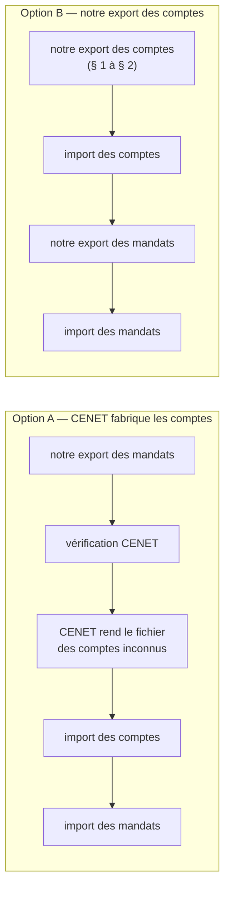
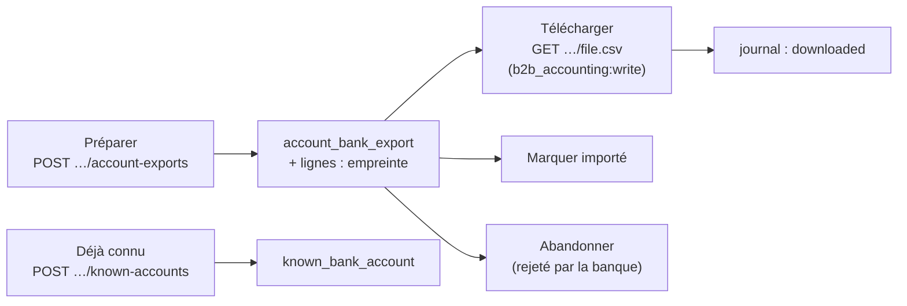

# Prérequis de l'export des RIB — le fichier des comptes destinataires

> **Bâti le 2026-10-23** (Hugo : « R1 oui, lance l'export des RIB, on
> documente nos choix faits en l'absence d'info »). Écrit doc-first le même
> jour ; l'état réel du code est au **§ 8**, et les valeurs choisies faute de
> réponse de la banque au **§ 7** — à relire dès qu'elle répond. Ce document est
> la **référence du sujet RIB côté banque** : il rassemble les questions posées,
> les réponses reçues, le modèle, la décision sur le BIC, ce que le code sait
> déjà des RIB et le lien avec l'export des mandats.
> [`question-banque.md`](question-banque.md) et
> [`reponses-de-la-banque.md`](reponses-de-la-banque.md) y renvoient au lieu de
> le recopier.
>
> Chaque « le code fait » cite un fichier et une ligne **ouverts le
> 2026-10-23**. Trois registres sont tenus séparés partout :
> **DIT** (la banque l'a écrit), **MONTRÉ** (le modèle le porte),
> **SUPPOSÉ** (notre lecture, à confirmer).

---

## Avant tout : deux parcours, et peut-être rien à bâtir

L'introduction de l'**étape 4** du mail de la banque (avant la réponse 10)
**DIT** : avant d'importer le fichier des mandats, on peut le **vérifier** ;
CENET rend un compte rendu des anomalies et, **si des RIB destinataires sont
inconnus, met à disposition un fichier de comptes à importer**. CENET sait
donc fabriquer lui-même le fichier des comptes à partir du fichier des mandats.

|                        | **Option A** — CENET fabrique                                                                                                                                        | **Option B** — nous fabriquons                                                                          |
| ---------------------- | -------------------------------------------------------------------------------------------------------------------------------------------------------------------- | ------------------------------------------------------------------------------------------------------- |
| À bâtir côté RIB       | **rien** ; le vrai prérequis est un **export des mandats conforme** (F, G, K, L, 18 colonnes — reponses-de-la-banque.md § 2 bis), qu'il faut faire dans les deux cas | les lots 1–3 du § 4 (domaine, tables, routes, écran, journal)                                           |
| Ce qui reste inconnu   | le format du fichier rendu, s'il s'importe tel quel, et quel nom / adresse CENET y met (il ne les connaît que par la colonne C des mandats)                          | les valeurs des cellules du § 3 (K, consigne D–G coupée, M, P, portée)                                  |
| « Nouveaux seulement » | tenu **par construction** : CENET ne rend que les inconnus                                                                                                           | tenu par **nous** (empreintes, exports en vol, « déjà connu » — § 2.1, § 2.6) ; une erreur rejette tout |
| IBAN en clair          | un fichier de plus qui passe par le poste (celui de CENET), hors de notre système                                                                                    | un fichier de plus produit par nous : droits, journal, `no-store` (§ 2.3)                               |
| Coût                   | une manipulation de plus par import ; aucun code                                                                                                                     | plusieurs lots ; une table, une migration, une carte                                                    |
| Risque                 | adresse et titulaire peut-être absents ou approximatifs dans le fichier rendu                                                                                        | une mauvaise valeur de cellule ; un compte déjà connu qui fait tout rejeter                             |

**Direction retenue : l'option B** — Hugo, 2026-10-23 : « on serait
peut-être mieux à bâtir notre export ». Nous maîtrisons le titulaire,
l'adresse et le moment de l'import, au lieu de dépendre d'un fichier dont nous
ne connaissons ni le format ni le contenu.

**L'option A reste un filet de contrôle** : après l'import de nos comptes, la
vérification CENET du fichier des mandats ne doit plus rendre **aucun** compte
inconnu. Si elle en rend, notre export a raté quelque chose (un compte oublié,
un IBAN mal découpé), et le fichier rendu permet de débloquer l'import en
attendant la correction. Q-B8 reste utile pour savoir ce qu'il contient.

### À quoi sert le référentiel des comptes, pour nous ?

Deux réponses le cernent :

- **réponse 15** (DIT) : un **dépôt de fichier** de remise n'est **pas**
  contrôlé contre le référentiel ; il ne sert qu'à la **saisie en ligne** et
  aux **contrôles d'import** ;
- **réponse 9** (DIT) : un changement de compte passe par un **nouveau mandat**
  puis la mise à jour de l'IBAN **dans notre logiciel** ; aucune mise à jour
  de RIB **par fichier** n'est décrite.

Conséquence (déduite) : pour un créancier qui dépose des fichiers, le
référentiel des comptes **n'a qu'un usage — faire passer l'import des
mandats**. Il ne protège aucune remise, et il n'a pas à suivre nos
changements de compte : un nouveau mandat arrive avec un nouvel IBAN, que
l'option A ferait de nouveau reconnaître par CENET. C'est un argument pour A ;
il ne change pas la direction retenue, il dit seulement qu'aucun compte n'est
à tenir à jour par fichier. Si la banque attache un autre usage au référentiel (rapprochement des
retours, contrôle anti-fraude, obligation contractuelle), il est à demander :
question Q-B10.

---

## 0. Ce qui existe

### 0.1 Ce que nous avons demandé à la banque

Le premier envoi ([`question-banque.md`](question-banque.md), « Étape 3 » du
texte envoyé, questions 6 à 9) demandait : le modèle (colonnes, ordre,
longueurs, séparateur, encodage, en-tête, `;` final, IBAN avec ou sans
espaces, BIC obligatoire ou non) ; la clé de rattachement d'un RIB à son
mandat ; fichier complet ou nouveaux seulement ; le changement de compte.

### 0.2 Ce que la banque a répondu (2026-10-23)

| Rép. | DIT                                                                                                                                                                                                | Pour nous                                                                      |
| ---- | -------------------------------------------------------------------------------------------------------------------------------------------------------------------------------------------------- | ------------------------------------------------------------------------------ |
| 6    | « le modèle de fichier en pièce jointe **avec les informations obligatoires** dans le fichier »                                                                                                    | les consignes du modèle (§ 0.3) **sont** la réponse sur les obligatoires       |
| 7    | « l'IBAN est lié à la RUM »                                                                                                                                                                        | mais le modèle n'a **aucune colonne RUM** (§ 3, Q-B5)                          |
| 8    | **nouveaux RIB seulement** ; un RIB déjà connu fait **rejeter l'import entier** ; **200 lignes** au plus                                                                                           | § 2.1, § 2.2                                                                   |
| 9    | changement de compte : **nouveau mandat** d'abord, puis actualiser l'IBAN                                                                                                                          | § 2.4                                                                          |
| 10   | avant l'import des mandats, CENET **vérifie** le fichier et produit un **fichier des comptes à importer** si des RIB sont inconnus                                                                 | le filet de contrôle de l'option A (en tête du document)                       |
| 11   | « longueur max pour le nom du **bénéficiaire** = 140 caractères » — réponse donnée à une question sur le fichier des **mandats**, mais avec le mot du modèle des comptes (« banque bénéficiaire ») | retenue pour B (§ 1)                                                           |
| 15   | **aucun** contrôle des RIB/mandats au dépôt d'une remise                                                                                                                                           | la banque ne nous protège pas d'un compte non importé : c'est notre discipline |
| —    | (2026-10-08) importer les RIB **avant** les mandats                                                                                                                                                | § 2.3                                                                          |

L'encodage, le `;` final et la ligne d'en-tête n'ont **pas** reçu de réponse
écrite (reponses-de-la-banque.md § 5).

### 0.3 Le modèle reçu

[`modeles-banque/modele-comptes-destinataires-2026.csv`](modeles-banque/modele-comptes-destinataires-2026.csv),
ouvert le 2026-10-23 avec `iconv -f ISO-8859-1` et `od -c` :

- **MONTRÉ** : ISO-8859-1 (« Clé », « bénéficiaire » encodés `0xE9`), CRLF,
  séparateur `;` **sans `;` final** (la ligne d'en-tête finit sur `NIF\r\n`),
  **16 colonnes A–P**, une ligne d'en-tête, puis des lignes de consigne en
  colonne A et trois lignes vides. **Aucune ligne d'exemple.**
- Consignes **MONTRÉES** : « colonne A : R pour RIB » ; « colonne A : I pour
  IBAN » ; « Colonne K : BBAN/IBAN sans espace » ; « Colonne L : BIC
  obligatoire pour les pays hors SEPA » ; « Colonne D, E, F, G : » **coupée,
  sans texte**.
- Ces consignes **sont** la réponse de la banque sur les informations
  obligatoires (réponse 6) : A (le type), K (le compte, sans espace), L (le
  BIC, hors SEPA), et D–G, dont la consigne est **coupée** — c'est le seul
  trou. Le CSV n'a pas de couleurs (le modèle des mandats, un classeur, a ses
  cellules jaunes).

### 0.4 Ce que le code sait déjà des RIB

- **Saisie** : par le staff (fiche client) et par le client (`/mon-compte`,
  `owner` et `billing` seulement), la même commande
  `record-company-bank-account.ts` — détail dans
  [`../mandat/rib-client.md`](../mandat/rib-client.md) §§ 1–3.
- **Stockage** : `company_bank_accounts` — IBAN **scellé** AES-256-GCM
  (`iban_sealed`, `apps/lfd-api/prisma/schema/public/accounting.prisma:314`),
  `iban_last4` en clair pour l'écran (l. 317), **BIC en clair** (l. 321 : il
  figure sur tout virement). Un RIB par société ; les sites peuvent garder
  celui du principal (commentaire l. 345-347).
- **Validation** : `Iban` (`apps/lfd-api/src/b2b/accounting/domain/value-objects/iban.ts:4-5`)
  accepte **15 à 34** caractères — donc un IBAN **non français** de la zone
  SEPA est possible.
- **Mandat actif** : le client ne peut plus remplacer son RIB (409) ; le
  changement passe par le staff (rib-client.md § 4).
- **Journal** : `company.bank_account_changed` à chaque dépôt (rib-client.md § 5).
- **Ouvert** : la revue de la transmission —
  [`../mandat/todo-rib-client-transmission.md`](../mandat/todo-rib-client-transmission.md).

### 0.5 L'export des mandats — le calque

Doc d'état : [`../mandat/export-des-mandats-pour-la-banque.md`](../mandat/export-des-mandats-pour-la-banque.md).
Sous `apps/lfd-api/src/b2b/accounting/` :

| Pièce                                                            | Ce qu'elle fait                                                                                                                              |
| ---------------------------------------------------------------- | -------------------------------------------------------------------------------------------------------------------------------------------- |
| `domain/entities/mandate-bank-export.ts:36-77`                   | l'agrégat : au moins une ligne, chaque mandat une fois, « importé » marqué une seule fois                                                    |
| `domain/services/account-fingerprint.ts:13-16`                   | SHA-256 de l'IBAN normalisé : **seule** trace du compte en base                                                                              |
| `domain/services/mandate-bank-export-selection.ts:33-45`         | « à exporter » = aucune ligne d'un export **importé** portant l'empreinte du compte actuel                                                   |
| `domain/services/mandate-bank-export-selection.ts:54-70`         | au téléchargement, 409 si une empreinte ne correspond plus                                                                                   |
| `domain/services/mandate-bank-export-csv.ts:54-86`               | rendu : `sepa()` (ASCII), `;` terminateur, CRLF, sans en-tête, neutralisation des débuts de formule                                          |
| `application/commands/export-mandates-for-bank.handler.ts:47-71` | fige l'export dans une transaction, publie `mandate_bank_export.created`                                                                     |
| `application/queries/export-mandate-bank-file.handler.ts:39-49`  | recalcule le fichier, **jamais rangé**                                                                                                       |
| `http/admin-mandate-bank-exports.controller.ts:42-103`           | `@AdminSurface("b2b_accounting")` ; le `GET …/file.csv` exige `b2b_accounting:write` (l. 73), `no-store`, pièce jointe                       |
| `domain/ports/mandates-for-bank-export.reader.ts:54-56`          | lecteur par créancier, implémenté par `payments` (qui descelle), écartés nommés (`taken_over`, `no_account`, `no_bic`)                       |
| `domain/events/mandate-bank-export.events.ts:16-29`              | fait au journal : sujet l'entité, `mandateCount`, jamais d'IBAN                                                                              |
| back-office                                                      | carte « Mandats à la banque » sur la fiche de l'entité (`apps/lfd-backoffice-frontend/src/app/comptabilite/mandate-bank-exports.service.ts`) |

**Ce qui n'existait pas** à l'écriture : aucun export des RIB. Il existe
depuis le 2026-10-23 — § 8.

---

## 1. Le fichier, colonne par colonne

Une ligne par **compte débité** (pas par mandat : deux mandats CORE et B2B, ou
un site qui garde le RIB du principal, débitent le même compte — SUPPOSÉ : la
banque refuserait un même IBAN deux fois, réponse 8).

| Col. | Intitulé (MONTRÉ)                    | Ce que nous écririons                                        | Source                                                                                                                                          | Transformation                        | Registre                                                                                                         |
| ---- | ------------------------------------ | ------------------------------------------------------------ | ----------------------------------------------------------------------------------------------------------------------------------------------- | ------------------------------------- | ---------------------------------------------------------------------------------------------------------------- |
| A    | Type format                          | `I`                                                          | constante                                                                                                                                       | —                                     | MONTRÉ (`I` pour IBAN)                                                                                           |
| B    | Nom                                  | le **titulaire du compte**                                   | `company_bank_accounts.holder` (`accounting.prisma:298-302` : « tels que la banque du client les connaît », peut différer de la raison sociale) | `sepa()`, 140 car. au plus            | DIT 140 (réponse 11, nuance § 0.2) ; la source est la décision R6                                                |
| C    | Siren                                | 9 chiffres                                                   | `Company.siren` (`apps/lfd-api/src/b2b/account/domain/entities/company.ts:326`), **nullable**                                                   | vide si `null`                        | SUPPOSÉ (facultatif ?)                                                                                           |
| D    | Adresse 1                            | `addressLine1`                                               | l'adresse **du titulaire**, sur le RIB (`accounting.prisma:307-311`) — pas l'adresse de facturation                                             | `sepa()`, longueur ❓                 | SUPPOSÉ (consigne coupée, Q-B1)                                                                                  |
| E    | Adresse 2                            | `addressLine2` (vide si vide)                                | idem                                                                                                                                            | idem                                  | SUPPOSÉ                                                                                                          |
| F    | Adresse 3                            | `postalCode city`                                            | idem                                                                                                                                            | idem                                  | SUPPOSÉ                                                                                                          |
| G    | Adresse 4                            | vide                                                         | —                                                                                                                                               | le pays va en H                       | SUPPOSÉ                                                                                                          |
| H    | Code Pays Dest                       | `countryCode` (ISO alpha-2, défaut `FR`)                     | `company_bank_accounts.country_code` (l. 311)                                                                                                   | tel quel — aucune table de conversion | SUPPOSÉ (sens exact ❓, Q-B7)                                                                                    |
| I    | Code Pays Iban                       | caractères 1–2 de l'IBAN                                     | IBAN descellé                                                                                                                                   | —                                     | SUPPOSÉ (déduit de l'intitulé)                                                                                   |
| J    | Clé Iban                             | caractères 3–4                                               | idem                                                                                                                                            | —                                     | SUPPOSÉ                                                                                                          |
| K    | BBAN/RIB                             | caractères 5 à fin (le BBAN ; 23 pour la France)             | idem                                                                                                                                            | sans espace                           | MONTRÉ « BBAN/IBAN sans espace » ; BBAN seul **SUPPOSÉ** (Q-B4)                                                  |
| L    | Bic                                  | le BIC, **toujours** ; BIC vide = compte **écarté et nommé** | `company_bank_accounts.bic`                                                                                                                     | majuscules, tel quel                  | **Décision de Hugo, 2026-10-23** (« dans le doute on mettra le bic ») ; MONTRÉ : obligatoire hors SEPA seulement |
| M    | Nom liste                            | vide                                                         | —                                                                                                                                               | —                                     | sens inconnu (Q-B4)                                                                                              |
| N    | Type identifiant banque bénéficiaire | vide                                                         | —                                                                                                                                               | —                                     | SUPPOSÉ hors SEPA                                                                                                |
| O    | ABA/BSB/INS                          | vide                                                         | —                                                                                                                                               | —                                     | SUPPOSÉ hors SEPA (codes bancaires US/AU)                                                                        |
| P    | NIF                                  | vide                                                         | —                                                                                                                                               | —                                     | sens inconnu (Q-B4 : numéro d'identification fiscale ?)                                                          |

### 1.1 Les règles de rendu

- **Encodage** : le modèle est ISO-8859-1 (MONTRÉ) ; mais `sepa()` ne rend
  que de l'**ASCII**, sous-ensemble de Latin-1 — il n'y a rien à encoder, le
  Latin-1 n'est que l'en-tête HTTP. Aucun encodeur à écrire.
- CRLF, `;` séparateur **sans** `;` final
  (MONTRÉ — l'inverse du fichier des mandats, qui termine chaque cellule).
- **Un caractère hors Latin-1** (un `œ`, un `€`, une apostrophe typographique,
  un caractère d'un autre alphabet) : il ne peut pas s'écrire. Proposition :
  passer **tous** les champs texte par le `sepa()` existant
  (`apps/lfd-api/src/b2b/accounting/domain/services/pain008-document.ts:295-302`,
  alphabet `A-Za-z0-9/-?:().,'+ ` l. 25) — on perd les accents, mais le nom
  est alors **identique** à celui du fichier des mandats et du `pain.008`.
  SUPPOSÉ acceptable (Q-B6). ⚠️ `sepa()` remplace aussi `&`, `°`, `_`… par
  une espace : « 12 bis, rue X & Y » sort altéré, en silence. Assumé. La neutralisation des débuts de formule
  (`bankCell`, `mandate-bank-export-csv.ts:84-86`) s'applique aussi.
- **Ligne d'en-tête : non** (hypothèse, § 3) — la consigne des mandats dit
  de l'enlever, et une en-tête prise pour un compte rejetterait l'import entier.
- **Siren et adresse** : renseignés quand on les a (D12, reponses-de-la-banque.md § 4).
  L'adresse du titulaire est obligatoire à la saisie du RIB (`addressLine1`,
  `postalCode`, `city` non nuls) : pas de compte sans adresse.

---

## 2. Les règles

### 2.1 Nouveaux seulement (réponse 8)

Un compte est « à exporter » s'il n'a **aucune ligne** portant **l'empreinte
de son IBAN** dans : un export de comptes **marqué importé**, **ou** un export
**en vol** (préparé, ni importé ni abandonné), **ou** une déclaration « déjà
connu de la banque » (§ 2.6). Sans les deux derniers, deux exports préparés
avant le premier marquage sortiraient les mêmes comptes, et le second serait
rejeté en entier (vitruve, objection 3).

**Portée** : par **abonnement CENET**, pas par entité émettrice — un compte
destinataire vit dans l'annuaire du contrat, pas sous un ICS (SUPPOSÉ, Q-B9).
Hypothèse retenue : **globale**. Se tromper dans ce sens coûte un compte
oublié pour une seconde entité, que la vérification CENET des mandats signale
(réponse 10) ; se tromper dans l'autre (par entité alors que l'annuaire est
partagé) coûte un import rejeté en entier, et une reprise des lignes déjà
marquées. Aujourd'hui une seule entité émet ; la question est à poser avant
la seconde. Même mécanisme que `selectForBankExport`, même empreinte
(`accountFingerprint`). Pas de bouton « tout réexporter » : contrairement aux
mandats (`payload.all`, `export-mandates-for-bank.handler.ts:77`), un seul
compte connu **rejette tout l'import** (DIT).

### 2.2 200 lignes au plus (réponse 8)

L'agrégat refuse un export de plus de 200 comptes ; la préparation en prend
les 200 premiers (ordre stable : date de dépôt du RIB) et l'écran dit
combien restent.

### 2.3 Marquer « importé » — le calque

Un agrégat `AccountBankExport` (nom provisoire) : lignes = (société, empreinte),
jamais d'IBAN ; « importé » marqué une fois, par qui et quand ; fichier
**recalculé** au téléchargement et refusé (409) si une empreinte ne
correspond plus ; faits `account_bank_export.created` / `.imported` au
journal, sujet l'entité, un compte, jamais un IBAN ; colonnes d'auteur au
registre RGPD.

Trois ajouts au calque, pour un fichier fait **uniquement** d'IBAN :

- **Chaque téléchargement est journalisé** (`account_bank_export.downloaded`,
  qui, quand, combien de comptes, jamais un IBAN). L'export des mandats ne le
  fait pas (`admin-mandate-bank-exports.controller.ts:72-89`) : la lacune est
  à reporter aussi chez lui (vitruve, objection 4).
- **Droits** : préparer, télécharger, marquer et abandonner sous
  `b2b_accounting:write` ; la carte en lecture sous `b2b_accounting`.
- **Abandonner** un export que CENET a rejeté : il sort de « en vol », ses
  comptes redeviennent « à exporter ». Une fois, avec auteur et fait.

### 2.4 Les RIB avant les mandats

DIT (2026-10-08) : sans le compte importé, l'import du mandat échoue. Le
code peut le tenir : la préparation d'un export de **mandats** avertit si un
mandat débite un compte dont aucun export de comptes n'est marqué importé.
Avertir, pas refuser — la saisie à la main dans CENET reste un chemin
légitime pour les premiers clients, et nous ne la voyons pas.

### 2.6 « Déjà connu de la banque » — sans fichier

Un compte saisi **à la main** dans CENET (lot 0), ou importé depuis le
fichier que CENET produit lui-même à la vérification des mandats (réponse 10),
n'a pas d'export marqué importé : il ressortirait « à exporter » et ferait
rejeter **tout** le fichier suivant (réponse 8 ; vitruve, objection 1). D'où
un geste par compte, qui pose son empreinte sans fichier, avec auteur et fait
au journal. Il est **préalable** au lot 0 dès qu'un lot 1 doit suivre.

**Deux boutons, une raison (Hugo, 2026-10-23).** Le geste unique « Déjà connu
de la banque » est devenu deux actions secondaires de la ligne du compte, dans
le tableau de la carte « Comptes à la banque ». Les deux retirent le compte de
l'export ; elles disent pourquoi :

| Bouton                                | Raison (valeur rangée) | Ce qu'on atteste                                                    | État affiché sur la ligne      |
| ------------------------------------- | ---------------------- | ------------------------------------------------------------------- | ------------------------------ |
| « Importé dans CENET directement »    | `entered_in_cenet`     | nous l'avons saisi à la main dans CENET                             | « saisi dans CENET le … »      |
| « Signalé comme connu par la banque » | `reported_by_bank`     | le compte rendu d'import CENET (ou la banque) dit qu'il existe déjà | « signalé par la banque le … » |

Une seule commande (`DeclareBankAccountKnownCommand`, champ `reason`) ; la
raison est rangée dans `known_bank_account.reason` (NOT NULL, CHECK sur les
deux valeurs ; migration `20261024010000`, les déclarations antérieures y
valent `entered_in_cenet`) et portée par le fait
`account_bank_export.account_known_declared` (`reason`, absent des faits
d'avant le 2026-10-23 — la phrase du journal n'en invente pas). Chaque bouton
demande une confirmation qui dit en une phrase ce qu'on atteste.

Le tableau montre chaque compte débité — écartés compris — avec sa société et
son titulaire, l'IBAN masqué (pays et quatre derniers), le BIC et son état :
à exporter, en export, importé le …, saisi dans CENET le …, signalé par la
banque le …, écarté (et pourquoi).

**Un geste par état (Hugo, 2026-10-23, le même jour).** « Signalé par la
banque », on ne peut pas le savoir avant d'avoir déposé le fichier dans
CENET : c'est le compte rendu d'import qui le dit. Les deux gestes ne vivent
donc pas sur la même ligne :

| État du compte                               | Seul geste offert                          | Refusé côté serveur (409, dans `KnownBankAccount.declare`)          |
| -------------------------------------------- | ------------------------------------------ | ------------------------------------------------------------------- |
| à exporter                                   | « Importé dans CENET directement »         | `reported_by_bank` : le compte n'est dans aucun export téléchargé   |
| en export, fichier **pas encore** téléchargé | aucun (« téléchargez le fichier d'abord ») | `entered_in_cenet` (il part avec son fichier) et `reported_by_bank` |
| en export, fichier téléchargé                | « Signalé comme connu par la banque »      | `entered_in_cenet` : le compte est en vol                           |
| importé, connu, écarté                       | aucun                                      | les deux : déjà connu (ou non débité)                               |

« Téléchargé » se lit sur l'export (`last_downloaded_at` non nul, ni importé
ni abandonné) ; le port des empreintes le rend en `inDownloadedExport`, et la
ligne du tableau en `in_flight.downloaded`. Signaler un compte en export
**ne touche pas l'export** — on ne réécrit pas un fichier déposé. Le compte
passe « connu » tout de suite (une empreinte connue l'emporte sur une
empreinte en vol) ; quand l'export est marqué importé ensuite, il reste
« signalé par la banque le … » (la carte garde le plus ancien tampon, et la
déclaration précède l'import) et ne ressort jamais « à exporter ». Le
journal porte le fait `account_known_declared` (`reported_by_bank`) puis
l'import de l'export, rien de plus.

### 2.5 Le changement de compte (réponse 9)

Nouveau mandat d'abord (DIT). Le nouvel IBAN a une nouvelle empreinte : il
ressort « à exporter » tout seul, dans les deux exports. L'ancien compte
reste chez la banque — on ne sait pas le retirer par fichier (aucune
colonne de suppression). Lié à D9.

---

## 3. Ce qui manque pour faire exactement ce qu'il faut

Les questions à reposer (numérotation de reponses-de-la-banque.md § 5 bis),
avec l'hypothèse par défaut **si on bâtit avant la réponse** et ce que coûte
l'erreur. Le coût est **le plus souvent** un import refusé en entier, sans
débit, puis une correction de rendu. **Pas toujours** : la banque ne contrôle
rien au dépôt d'une remise (réponse 15). Un fichier **accepté mais faux** — un
compte rattaché au mauvais titulaire (Q-B5), un K mal interprété mais
syntaxiquement valide (Q-B4c) — ne se verrait qu'au débit (vitruve,
objection 6). Pour ces deux-là, on bâtit, mais on ne dépose pas de remise
réelle avant la réponse ou un essai concluant.

| #     | Question                                                                                                                                                                                                     | Hypothèse par défaut                            | Si elle est fausse                                                                                                  |
| ----- | ------------------------------------------------------------------------------------------------------------------------------------------------------------------------------------------------------------ | ----------------------------------------------- | ------------------------------------------------------------------------------------------------------------------- |
| Q-B1  | Que dit la consigne coupée « Colonne D, E, F, G : » ?                                                                                                                                                        | adresse facultative, 4 lignes libres            | si obligatoire : écarter les sociétés sans adresse ; si longueur bornée : couper                                    |
| Q-B4a | (confirmation seulement — les consignes ont répondu, réponse 6) B, I, J sont-elles exigées en type `I` ?                                                                                                     | A, B, I, J, K, L remplies                       | import refusé ; ajouter la colonne                                                                                  |
| Q-B4b | Avec ou sans ligne d'en-tête ?                                                                                                                                                                               | **sans**                                        | la première ligne serait perdue ou l'import refusé                                                                  |
| Q-B4c | En type `I`, K = BBAN seul, ou IBAN entier ?                                                                                                                                                                 | **BBAN seul** (I et J portent déjà pays et clé) | le plus souvent refus ; mais un IBAN reconstruit valide et faux ne se verrait qu'au débit                           |
| Q-B4d | Confirmer que les 140 caractères de la réponse 11 valent pour B                                                                                                                                              | 140                                             | refus si la borne est plus courte ; couper                                                                          |
| Q-B4e | « Nom liste » (M) ?                                                                                                                                                                                          | vide                                            | si obligatoire : refus ; si c'est un regroupement, une constante                                                    |
| Q-B4f | NIF (P) ?                                                                                                                                                                                                    | vide                                            | idem                                                                                                                |
| Q-B4g | Type identifiant banque (N), ABA/BSB/INS (O) ?                                                                                                                                                               | vides (hors SEPA)                               | aucun en zone SEPA                                                                                                  |
| Q-B5  | Comment un compte rejoint-il sa RUM, sans colonne RUM ?                                                                                                                                                      | par l'IBAN de la colonne D des mandats          | si c'est par le nom : B (titulaire) ≠ C des mandats (raison sociale) casse le lien — **accepté mais faux**, voir R6 |
| Q-B6  | Un nom sans accents est-il accepté (Latin-1 permis) ?                                                                                                                                                        | oui ; on translittère par `sepa()`              | aucun refus attendu ; au pire un nom moins joli                                                                     |
| Q-B7  | (nouvelle) H « Code Pays Dest » : pays de l'adresse ou de la banque ?                                                                                                                                        | pays de l'adresse                               | valeur fausse sans refus probable : FR des deux côtés pour nos clients                                              |
| Q-B9  | (nouvelle) L'annuaire des comptes est-il propre à l'**abonnement** CENET ou à chaque **ICS** ?                                                                                                               | abonnement (portée globale, § 2.1)              | par entité alors qu'on suppose global : un compte oublié, signalé par la vérification CENET                         |
| Q-B8  | (nouvelle) Confirmer le parcours de l'option A : le fichier des comptes inconnus que CENET rend à la vérification des mandats s'importe-t-il tel quel ? Quel format, quel nom et quelle adresse y figurent ? | oui (option A)                                  | on bâtit l'option B                                                                                                 |
| Q-B10 | (nouvelle) Le référentiel des comptes a-t-il un autre usage que de faire passer l'import des mandats, pour un créancier qui dépose des fichiers (réponse 15) ?                                               | non                                             | si oui : il faut le tenir à jour à chaque changement de compte                                                      |

**Réponse courte à « a-t-on toutes les infos ? »** — **non**, mais assez pour
bâtir : la forme (encodage, séparateur, 16 colonnes, nouveaux seulement,
200 lignes, nom ≤ 140) est MONTRÉE ou DITE ; ce qui manque porte sur des
**valeurs** de cellules, corrigeables en une ligne de rendu. Deux réponses
(Q-B4c, Q-B5) conditionnent la **première remise réelle**, pas la
construction.

---

## 4. Lots proposés

0. **Facultatif, en attendant** : saisir à la main dans CENET un compte qui
   doit être prélevé avant le lot 1 — à déclarer « déjà connu » (§ 2.6) dès
   que le geste existe.
1. **Domaine** : rendu pur (`renderAccountBankCsv` : ASCII via `sepa()`,
   découpage IBAN, CRLF, sans `;` final, sans en-tête), agrégat
   `AccountBankExport` (≥ 1, ≤ 200, chaque empreinte une fois, importé ou
   abandonné une fois), sélection par empreinte (importés + en vol + déclarés
   connus), déclaration « déjà connu ». Tests aux trois niveaux.
2. **Lecture et écriture** : port déclaré par la comptabilité, implémenté par
   `payments` (qui descelle), comme `MandatesForBankExportReader` ; tables
   `account_bank_export(_line)` (empreinte seulement), migration additive,
   registre RGPD ; routes sous `admin/accounting/legal-entities/:id/account-exports`,
   fichier sous `b2b_accounting:write`, `no-store`,
   `text/csv; charset=iso-8859-1`, pièce jointe.
3. **Écran** : carte « Comptes à la banque » au-dessus de « Mandats à la
   banque », même gestes ; avertissement § 2.4 sur la carte des mandats.

---

## 5. Décisions pour Hugo

| #   | Décision                                                                                           | Proposition                                                                 |
| --- | -------------------------------------------------------------------------------------------------- | --------------------------------------------------------------------------- |
| —   | ✅ **Option B** (notre export), A en filet de contrôle — Hugo, 2026-10-23                          | tranché                                                                     |
| R1  | ✅ Bâtir avant les réponses Q-B1/Q-B4, sur les hypothèses du § 3 — **Hugo, 2026-10-23 : oui**      | tranché                                                                     |
| R2  | Saisie manuelle (lot 0) d'un compte à prélever avant le lot 1                                      | seulement si nécessaire, et déclaré « déjà connu » ensuite                  |
| R3  | Accents : translittérer par `sepa()` ou garder le Latin-1                                          | `sepa()` : un seul nom partout                                              |
| R4  | Adresse et SIREN renseignés quand on les a (D12)                                                   | oui                                                                         |
| R5  | Un compte = une ligne, même s'il porte plusieurs mandats ou sites                                  | oui                                                                         |
| R6  | Colonne B : le **titulaire** du RIB (`holder`) ou la **raison sociale** (C des mandats, `Dbtr/Nm`) | titulaire, si Q-B5 répond « par l'IBAN » ; raison sociale si « par le nom » |
| R7  | Portée de « déjà importé » : globale (abonnement) ou par entité                                    | globale (§ 2.1), jusqu'à la réponse Q-B9                                    |
| R8  | Journaliser chaque téléchargement, ici **et** sur l'export des mandats                             | oui                                                                         |
| —   | ✅ BIC toujours renseigné (D13, Hugo, 2026-10-23)                                                  | tranché                                                                     |

**R2 à R7 : bâtis selon la proposition** (consigne de Hugo du 2026-10-23 :
« pour R2–R8, retenir la proposition du doc et l'écrire »). R8 est bâti pour
les **comptes** ; le volet **mandats** l'est aussi depuis le 2026-10-23, avec
le lot P1 de [`plan-page-procedure-de-prelevement.md`](plan-page-procedure-de-prelevement.md)
§ 8 : fait `mandate_bank_export.downloaded`, calculé puis journalisé comme ici. Le § 2.4 (avertir sur la carte des
mandats) n'est pas fait non plus, pour la même raison.

---

## 6. Contradiction de `vitruve` (2026-10-23)

Passé sur la première version de ce document. Tout ce qu'il a soulevé est
**corrigé dans le corps**, sauf ce qui est dit assumé.

| Gravité  | Objection                                                                                                      | Suite                                                                                    |
| -------- | -------------------------------------------------------------------------------------------------------------- | ---------------------------------------------------------------------------------------- |
| BLOQUANT | 1. Un compte saisi à la main dans CENET (lot 0) ressort « à exporter » et fait rejeter tout le fichier suivant | corrigé : geste « déjà connu de la banque » (§ 2.6), préalable au lot 0 si un lot 1 suit |
| BLOQUANT | 2. Portée par entité alors que l'annuaire CENET est sans doute par abonnement                                  | corrigé : portée globale par défaut (§ 2.1), question Q-B9, décision R7                  |
| SÉRIEUX  | 3. Deux exports préparés avant le premier marquage sortent les mêmes comptes (et les mêmes 200)                | corrigé : les exports en vol comptent ; geste « abandonner » (§ 2.1, § 2.3)              |
| SÉRIEUX  | 4. Le téléchargement des IBAN en clair n'est pas journalisé ; droit de la préparation non dit                  | corrigé : fait `downloaded`, droits listés (§ 2.3) ; la lacune des mandats → R8          |
| SÉRIEUX  | 5. B et D–H pris à la société, alors que le RIB porte titulaire et adresse, et `countryCode` en alpha-2        | corrigé : source = `company_bank_accounts` (§ 1) ; titulaire ou raison sociale → R6      |
| SÉRIEUX  | 6. « Import refusé, borné » faux quand le fichier est accepté mais faux (réponse 15)                           | corrigé : § 3 ; pas de remise réelle avant Q-B4c / Q-B5 ou un essai                      |
| MINEUR   | `sepa()` rend de l'ASCII ; il altère `&`, `°`, `_` ; BIC vide à écarter                                        | corrigé (§ 1, § 1.1)                                                                     |

Non vérifié par lui, et ouvert ici le 2026-10-23 : les champs titulaire et
adresse de `company_bank_accounts` (`accounting.prisma:298-311`), confirmés.

---

## 7. Choix faits en l'absence de réponse de la banque

Bâti le 2026-10-23 sur R1. Chaque ligne est une **valeur** que la banque n'a
pas dite ; elle vit dans **une** constante ou fonction nommée, dont le JSDoc
daté renvoie ici. Sauf mention, le fichier est
`apps/lfd-api/src/b2b/accounting/domain/services/account-bank-export-values.ts`.

| Colonne / règle               | Choix                                                                     | Question | Coût si faux                                                                        | Où le changer                                                                                                                   |
| ----------------------------- | ------------------------------------------------------------------------- | -------- | ----------------------------------------------------------------------------------- | ------------------------------------------------------------------------------------------------------------------------------- |
| B — source du nom             | le **titulaire** du RIB (`holder`), pas la raison sociale                 | Q-B5, R6 | **accepté mais faux** si la banque rattache par le nom : pas de remise réelle avant | `accountBankCsvOf` (`apps/lfd-api/src/b2b/accounting/application/account-bank-export-support.ts`)                               |
| B — longueur                  | 140 après `sepa()` ; au-delà **refus** nommant la société, jamais coupé   | Q-B4d    | import refusé si la borne est plus courte                                           | `ACCOUNT_HOLDER_MAX_LENGTH` (= `SEPA_MAX140_TEXT`)                                                                              |
| Accents                       | translittérés par `sepa()` (ASCII) ; `&`, `°`, `_` → espace               | Q-B6, R3 | aucun refus attendu ; un nom moins joli                                             | `bankCell` (`mandate-bank-export-csv.ts`, partagé)                                                                              |
| En-tête                       | **aucune**                                                                | Q-B4b    | première ligne perdue, ou import refusé                                             | `ACCOUNT_FILE_HEADER`                                                                                                           |
| C — SIREN                     | celui de la société du RIB, vide s'il manque                              | R4       | refus si obligatoire                                                                | `PrismaAccountsForBankExportReader` (`payments`)                                                                                |
| D, E, F — adresse             | rue / complément / « code postal ville », non coupées                     | Q-B1, R4 | refus si une longueur est bornée : couper                                           | `cityLineCell` ; `cellsOf` (`apps/lfd-api/src/b2b/accounting/domain/services/account-bank-export-csv.ts`)                       |
| G — adresse 4                 | vide                                                                      | Q-B1     | refus si obligatoire                                                                | `ADDRESS_LINE_4_CELL`                                                                                                           |
| H — pays dest.                | pays de l'**adresse** du titulaire                                        | Q-B7     | valeur fausse sans refus probable (FR des deux côtés)                               | `cellsOf` (`apps/lfd-api/src/b2b/accounting/domain/services/account-bank-export-csv.ts`)                                        |
| I, J, K — IBAN                | pays / clé / **BBAN seul**                                                | Q-B4c    | le plus souvent refus ; au pire **accepté mais faux** : pas de remise réelle avant  | `ibanCells`                                                                                                                     |
| M — nom liste                 | vide                                                                      | Q-B4e    | refus si obligatoire                                                                | `LIST_NAME_CELL`                                                                                                                |
| N, O — identifiants hors SEPA | vides                                                                     | Q-B4g    | aucun en zone SEPA                                                                  | `BANK_IDENTIFIER_TYPE_CELL`, `ABA_BSB_INS_CELL`                                                                                 |
| P — NIF                       | vide                                                                      | Q-B4f    | refus si obligatoire                                                                | `TAX_IDENTIFIER_CELL`                                                                                                           |
| Portée de « déjà connu »      | **tout l'abonnement**, toutes entités confondues                          | Q-B9, R7 | un compte oublié pour une seconde entité, signalé par la vérification CENET         | `PrismaKnownAccountFingerprintsReader` (`apps/lfd-api/src/b2b/accounting/infrastructure/prisma-account-bank-exports.reader.ts`) |
| Comptes candidats             | ceux que désigne un mandat **actif** de l'entité ; pas les mandats repris | —        | un compte de mandat repris manquant : la vérification CENET le signale              | `PrismaAccountsForBankExportReader` (`payments`)                                                                                |
| Un compte = une ligne         | dédoublonné par empreinte d'IBAN, le RIB le plus ancien                   | R5       | refus si la banque veut une ligne par mandat                                        | `fingerprintedAccounts` (`apps/lfd-api/src/b2b/accounting/domain/services/account-bank-export-selection.ts`)                    |
| Encodage HTTP                 | `text/csv; charset=iso-8859-1`, octets ASCII                              | —        | aucun : l'ASCII est du Latin-1                                                      | `AdminAccountBankExportsController.file`                                                                                        |

Les deux lignes marquées « accepté mais faux » (Q-B4c, Q-B5) conditionnent
la **première remise réelle**, pas la construction (§ 3).

## 8. Ce qui est bâti (2026-10-23)

- **Domaine** (`apps/lfd-api/src/b2b/accounting/domain/`) : l'agrégat
  `AccountBankExport` (≥ 1, ≤ 200, chaque empreinte une fois, clos une fois :
  importé **ou** abandonné ; un abandonné ne se télécharge plus) ;
  `KnownBankAccount` (refuse une empreinte connue ou en vol) ; la sélection
  « à exporter » (ni importée, ni en vol, ni déclarée) ; le rendu
  `renderAccountBankCsv` (16 colonnes, `;` séparateur sans terminateur, CRLF).
- **Lecture des RIB** : `AccountsForBankExportReader`, déclaré par la
  comptabilité, implémenté par `payments` (descelle), relié dans
  `appBootstrap/debtor-mandate.module.ts`. Compte sans BIC : écarté et nommé.
- **Tables** (migration `20261023235000_l_export_des_comptes_pour_la_banque`,
  additive) : `account_bank_export`, `account_bank_export_line`,
  `known_bank_account` — empreintes seulement, jamais d'IBAN ; auteurs au
  registre RGPD.
- **Routes** sous `admin/accounting/legal-entities/:id/account-exports` :
  lecture sous `b2b_accounting`, tout le reste — fichier compris — sous
  `b2b_accounting:write`. Le fichier est recalculé, `no-store`, en pièce
  jointe, refusé (409) si un RIB a changé ; il est calculé **puis** journalisé.
- **Faits** : `account_bank_export.created`, `.downloaded`, `.imported`,
  `.abandoned`, `.account_known_declared` — sujet l'entité, jamais un IBAN.
- **Écran** : carte « Comptes à la banque » sur la fiche de l'entité,
  au-dessus de « Mandats à la banque » : à exporter (nommés, avec « Déjà connu
  de la banque »), en attente, connus, écartés, exports passés avec
  Télécharger / Marquer importé / Abandonner.

**Reste à faire** : avertir sur la carte des mandats quand un compte n'est
pas importé (§ 2.4) ; deux préparations simultanées ne sont pas
sérialisées (même trou que l'export des mandats).
