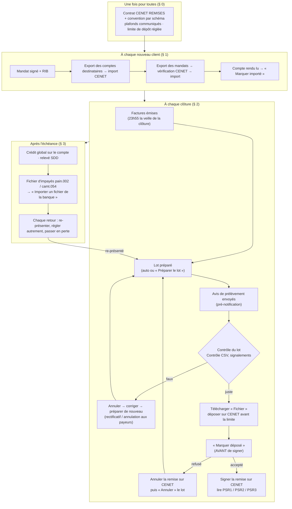

# La procédure de prélèvement, pas à pas

> **Procédure, destinée à devenir un runbook.** Écrite le 2026-10-23 à la
> demande de Hugo (« une doc procédure de prélèvement qui fait un récap de ce
> qu'on doit faire à la clôture d'une période »). Chaque étape cite l'écran, la
> route ou le fichier qui la fait, **ouverts le 2026-10-23**. Elle ne décrit pas
> le mécanisme (les docs d'état le font) : elle dit **qui fait quoi, quand, où,
> et ce qu'on vérifie**. Contredite par `vitruve` le même jour (§ 7).
>
> **Son écran existe depuis le 2026-10-23 (lot P2, non commité à l'écriture
> de cette ligne)** : Comptabilité › **Procédure de prélèvement**
> (`/comptabilite/procedure-de-prelevement?entite=…&lot=…`), quatre onglets
> — 1 Comptes (§ 1), 2 Mandats (§ 1), 3 Fichier (§ 2.2 à § 2.9), 4 Retours
> (§ 3) — dont l'état est relu au serveur à chaque affichage
> (`GET admin/accounting/collection-procedure`), jamais stocké. Le titre dit
> le lot suivi (rythme et période), les lots ouverts sont listés en tête, la
> limite de dépôt la plus proche d'abord. Ce qu'il ne fait **pas encore** : les
> attestations hors outil — contrôle CSV relu, remise signée, PSR lus, retours
> contrôlés (P3). Depuis le 2026-10-24 (P4 révisé), l'onglet 3 **nomme
> chaque débiteur du lot** dont le compte ou le mandat n'est pas importé dans
> CENET, avec un lien vers l'onglet 1 ou 2 ; il **avertit**, il ne bloque pas
> — la banque ne contrôle pas son référentiel au dépôt d'un fichier
> (réponse 15). Plan : [`plan-page-procedure-de-prelevement.md`](plan-page-procedure-de-prelevement.md).
>
> 🔴 **Aujourd'hui, aucune remise ne peut partir** : le contrat CENET REMISES
> n'est pas signé ([`reponses-de-la-banque.md`](reponses-de-la-banque.md) § 3).
> L'export des comptes destinataires est bâti depuis le 2026-10-23
> (`5a7e9c6f4`, [`prerequis-export-ribs.md`](prerequis-export-ribs.md) § 8),
> et l'export des mandats suit le modèle de la banque depuis le même jour
> ([`prerequis-export-mandats.md`](prerequis-export-mandats.md)) — l'un et
> l'autre sur des valeurs que la banque doit encore confirmer. Le § 0 n'est
> donc pas fait ; tout le reste suppose qu'il l'est. _(Corrigé le
> 2026-10-23 : cette tête disait l'export des comptes « pas encore bâti ».)_

Légende, sur chaque geste :

- ✅ **dans l'outil** — un écran ou un automatisme du back-office le fait ;
- ✋ **à la main** — hors de l'outil (portail CENET, mail, téléphone), ou dans
  l'outil mais sans contrôle qui le garantisse ;
- ⛔ **pas bâti** — décrit comme à faire ; aujourd'hui personne ne le fait.

Écrans cités (back-office, menu Comptabilité, `b2b_accounting`) :

- **Prélèvement du mois** — `/comptabilite/prelevement-du-mois`
  (`apps/lfd-backoffice-frontend/src/app/comptabilite/prelevement-du-mois/`) ;
- **Fiche de l'entité** — `/comptabilite/entites-juridiques/:id` (cartes
  « Prélèvement automatique », « Mandats à la banque ») ;
- **Prélèvement d'essai** — `/comptabilite/prelevement-d-essai`.

Routes API sous `apps/lfd-api/src/b2b/accounting/http/` (abrégé `http/`).

## Le cycle

---

## 0. Une fois pour toutes

Rien de ceci n'est dans l'outil, sauf le réglage de la limite de dépôt.
Responsable : Hugo.

| #   | Geste                                                                                                                                                                                   | Où                                                                                                                       | État                                                                                     |
| --- | --------------------------------------------------------------------------------------------------------------------------------------------------------------------------------------- | ------------------------------------------------------------------------------------------------------------------------ | ---------------------------------------------------------------------------------------- |
| 0.1 | Signer le contrat **CENET REMISES** et une **convention d'émission par schéma** (B2B au moins ; CORE si décidé, D8) ; faire paramétrer les services aller (remises) et retour (impayés) | la banque                                                                                                                | ✋ ; 🔴 pas fait — sans lui, **aucun dépôt possible** (réponse 1)                        |
| 0.2 | Communiquer les **trois plafonds** : par opération, par remise, cumul mensuel (D1)                                                                                                      | la banque                                                                                                                | ✋ ; pas fait                                                                            |
| 0.3 | Choisir le format des retours (`pain.002` ou `camt.054`, D6), l'imputation des impayés (D7), le PSR2 (D5)                                                                               | la banque                                                                                                                | ✋ ; pas fait                                                                            |
| 0.4 | Renseigner la **limite de dépôt** de l'entité (jours ouvrés + heure)                                                                                                                    | fiche de l'entité, carte « Prélèvement automatique »                                                                     | ✅ réglage (`legal_entities.deposit_cutoff_*`) ; **vide** tant que D4 n'est pas tranchée |
| 0.5 | Envoyer **par mail** à la banque un fichier d'essai et un brouillon de lot, pour qu'elle les teste (réponse 23)                                                                         | écran Prélèvement d'essai ; `GET admin/accounting/billing-cycle/draft.xml` (`http/admin-billing-cycle.controller.ts:71`) | ✋ ; pas fait                                                                            |
| 0.6 | Importer les **comptes destinataires** existants, puis les **mandats** existants                                                                                                        | voir § 1                                                                                                                 | dépend de 0.1                                                                            |

**La limite de dépôt n'est pas tranchée.** La banque a écrit deux choses :
« au plus tard J-2 » avant la date de règlement (réponse 3) et « CORE reçu à
J-1 avant 14 h 45, B2B avant 13 h 45 » (réponse 22). Les deux ne sont pas
conciliées (décision D4, [`reponses-de-la-banque.md`](reponses-de-la-banque.md)
§ 4). La proposition écrite là-bas — **2 jours ouvrés, 13:45** — tient les deux
lectures ; elle n'est **pas confirmée par la banque**. Tant qu'elle n'est pas
renseignée, l'écran n'affiche aucune date limite (`depositDeadlineOf` rend
`null`, `apps/lfd-api/src/b2b/accounting/domain/services/collection-calendar.ts:83`)
et **rien ne prévient d'un dépôt tardif**.

_Si on l'oublie_ : sans contrat, le fichier est inutilisable ; sans limite, un
dépôt tardif décale l'échéance chez la banque (« recalculée à J+2 », réponse 22)
alors que l'avis envoyé au débiteur annonçait l'ancienne date.

Les deux imports de départ ont leurs propres documents, en cours d'écriture le
2026-10-23 et non recopiés ici : [`prerequis-export-ribs.md`](prerequis-export-ribs.md)
(comptes destinataires) et [`prerequis-export-mandats.md`](prerequis-export-mandats.md)
(mandats).

---

## 1. À chaque nouveau client prélevé

Qui : la comptabilité (`b2b_accounting`), sauf 1.1 (le client). Quand : **avant
la première clôture** où le client a des factures, et au plus tard avant le
dépôt de ce lot.

| #   | Geste                                                                                                                                                                | Où                                                                                                                                                                                     | État                                                                                                                                                                                                                                                                                                                                                                |
| --- | -------------------------------------------------------------------------------------------------------------------------------------------------------------------- | -------------------------------------------------------------------------------------------------------------------------------------------------------------------------------------- | ------------------------------------------------------------------------------------------------------------------------------------------------------------------------------------------------------------------------------------------------------------------------------------------------------------------------------------------------------------------- |
| 1.1 | Le client saisit son **RIB** et **signe le mandat** (détenteur ou comptable de la société)                                                                           | boutique, `/mon-compte` ([`../mandat/rib-client.md`](../mandat/rib-client.md), [`../mandat/plan-mandat-client.md`](../mandat/plan-mandat-client.md))                                   | ✅                                                                                                                                                                                                                                                                                                                                                                  |
| 1.2 | Exporter son **compte destinataire** et l'importer dans CENET (nouveaux seulement : un compte déjà connu fait rejeter **tout** l'import ; 200 lignes au plus)        | fiche de l'entité, carte « Comptes à la banque » ; `admin/accounting/legal-entities/:id/account-exports` ([`prerequis-export-ribs.md`](prerequis-export-ribs.md) § 8)                  | ✅ depuis le 2026-10-23 (`5a7e9c6f4`) : un seul bouton « Télécharger » (prépare s'il le faut, journalisé), « J'ai déposé le fichier dans CENET » (refusé avant téléchargement), abandonner, « importé dans CENET directement » ; après le dépôt, « signalé connu » / « rejeté » par ligne (§ 2.6, 2026-10-23) ; valeurs à confirmer par la banque (§ 7 du même doc) |
| 1.3 | « Télécharger le fichier des mandats » (prépare l'export s'il n'y en a pas d'ouvert — un seul bouton depuis le 2026-10-23)                                           | fiche de l'entité, carte « Mandats à la banque » ; `POST`/`GET admin/accounting/legal-entities/:id/mandate-exports…` (`http/admin-mandate-bank-exports.controller.ts:61`, `:78`)       | ✅ conforme au modèle depuis le 2026-10-23 (F `AAAAMMJJ`, G `RECURRENT`/`PONCTUEL`, K `O` et L `N` supposés, 18 colonnes, 200 mandats par export, nom > 140 refusé — [`prerequis-export-mandats.md`](prerequis-export-mandats.md))                                                                                                                                  |
| 1.4 | Sur CENET : **vérifier le fichier** d'abord (compte rendu d'anomalies), puis l'importer                                                                              | CENET                                                                                                                                                                                  | ✋                                                                                                                                                                                                                                                                                                                                                                  |
| 1.5 | **Lire le compte rendu d'import** : lignes lues, chargées, en erreur                                                                                                 | CENET                                                                                                                                                                                  | ✋                                                                                                                                                                                                                                                                                                                                                                  |
| 1.6 | « J'ai déposé le fichier dans CENET », puis reporter le compte rendu **ligne par ligne** : « Signalé comme connu par la banque » ou « Rejeté par la banque » (motif) | même carte ; `POST …/mandate-exports/:exportId/imported` (`http/admin-mandate-bank-exports.controller.ts:102`) ; « Abandonner » si la banque le rejette (`:115`, depuis le 2026-10-23) | ✅ depuis le 2026-10-23 : refusé tant que le fichier n'a pas été téléchargé ; une RUM rejetée repart dans le prochain fichier ; 30 jours après le dépôt pour reporter                                                                                                                                                                                               |

À vérifier : le nom, l'IBAN et la RUM de la ligne CENET correspondent à la
fiche. Un import avec des lignes en erreur se dit déposé, puis **chaque ligne
en erreur se rejette** avec le motif du compte rendu : elle repart dans le
prochain fichier, une fois la cause corrigée (réponse 13 de
[`reponses-de-la-banque.md`](reponses-de-la-banque.md) ; geste bâti le
2026-10-23, il remplace la consigne « ne pas marquer, tout ré-exporter »).

_Si on l'oublie_ : la banque **ne contrôle pas** les mandats au dépôt d'un
fichier (réponse 15) ; le débit part, puis revient en rejet le jour J. Rien
dans l'outil ne relie aujourd'hui « mandat jamais importé » et « lot à
déposer » (⛔ avertissement prévu, réponse 15).

Changement de compte d'un client : la banque demande **un nouveau mandat**
(réponse 9) ; la forme exacte (nouvelle RUM ou colonnes M–R) n'est pas tranchée
(D9). Ne pas traiter de changement de compte sans cette décision.

---

## 2. À chaque clôture

Une **clôture** est un jour du rythme de facturation (mensuel, deux fois par
mois, hebdomadaire, réglé par mode sur l'entité, le client choisissant un mode),
**et le 1er de chaque mois** (`isClosingDay`, `domain/services/billing-cycle.ts`,
[`../facturation/plan-rythme-de-facturation.md`](../facturation/plan-rythme-de-facturation.md)
§ 16 et § 17). D'où **jusqu'à cinq remises par mois**. Chaque clôture donne
**un lot par entité et par schéma** ; chaque lot est **un fichier**, avec une
seule échéance (`ReqdColltnDt`, `apps/lfd-api/src/b2b/accounting/domain/services/pain008-document.ts:185`) —
ce que la banque exige (« un fichier par schéma et par échéance », réponse 18).

### 2.1 Les factures sont émises — ✅ automatique

- **Quand** : 23h55 heure de Paris, la veille de la clôture (cron
  `55 21,22 * * *` UTC, `POST admin/accounting/monthly-invoices/autopilot`,
  `http/invoice-autopilot.controller.ts:30`) ; rattrapé par le passage horaire
  du lot si 23h55 a été manqué ([`prelevement-automatique.md`](prelevement-automatique.md) § 5).
  Le cron passe **deux fois** par soir (été / hiver) ; le handler ne tente qu'à
  23h55 heure de Paris et l'autre passage se tait
  (`http/invoice-autopilot.controller.ts:12-20`) — un passage à 22h55 ou 00h55
  dans les journaux n'est pas une anomalie.
- **Où le voir** : Prélèvement du mois › « Les factures du mois ».
- **Vérifier** : la tentative automatique est « émise », et les payeurs
  signalés sont nuls ou compris.
- **Si elle a manqué** : bouton « Émettre les factures … »
  (`POST admin/accounting/monthly-invoices`, `http/admin-monthly-invoices.controller.ts:47`),
  rejouable. ✅
- _Si on l'oublie_ : le lot n'encaisse que des factures émises ; sans facture,
  la ligne n'a rien à prélever.

### 2.2 Le lot est préparé — ✅ automatique ou bouton

- **Quand** : après la clôture, plus le délai réglé (1 h par défaut), si
  « Préparer le lot tout seul » est coché sur la fiche de l'entité ; une seule
  tentative par clôture (cron `15 * * * *`, `POST admin/accounting/collection/autopilot`,
  `http/collection-autopilot.controller.ts:43`). Sinon, ou si l'automatisme a
  manqué une clôture (il se **suspend** et le dit) : bouton « Préparer le lot … »
  (`POST admin/accounting/collection/batches`, `http/admin-collection-batches.controller.ts:75`).
- **Ce qui se passe** : les lignes (une par débiteur, ses factures), les
  exclusions nommées, le XML **figé et stocké** avec son empreinte, l'échéance
  figée (`frozenCollectionDay`, `domain/services/collection-calendar.ts:108` :
  jamais avant clôture + N, ni avant préparation + délai de pré-notification,
  puis jour ouvré TARGET2) — et **un avis de prélèvement par ligne** mis en file.

### 2.3 La pré-notification part — ✅ automatique, à surveiller

- **Ce que dit le code** : un avis par ligne (montant, échéance, RUM, ICS,
  factures réglées), envoyé au contact de facturation de la société payeuse,
  sinon à son détenteur ; ni l'un ni l'autre → `unsendable`
  ([`prelevement-automatique.md`](prelevement-automatique.md) § 4). Délai réglé
  sur l'entité, **14 jours par défaut** ; le prélèvement ne peut pas tomber plus
  tôt (`CollectionBeforeNoticeError`, `domain/value-objects/collection-schedule.ts:126`).
- **Ce que dit la banque** : elle ne lit pas la pré-notification (réponse 4).
  **Cela ne la lève pas** : l'obligation est envers le **débiteur** (règlement
  SEPA, CGV, mandat), et un prélèvement non pré-notifié est contestable
  ([`prelevement-sepa.md`](prelevement-sepa.md) § 8). Ne rien retirer de l'avis.
- **Réduire le délai sous 14 jours** demande une clause CGV et mandat qui
  n'est pas écrite (question non répondue, [`reponses-de-la-banque.md`](reponses-de-la-banque.md) § 5). ✋
- **Vérifier** : Prélèvement du mois › lot à traiter › état des avis — tous
  `envoyé`. **Tout autre état bloque le dépôt** — `échec`, `impossible`, mais
  aussi `en attente` (l'envoi n'a pas encore abouti : recharger la page,
  `pending-batch/pending-batch.html:40-45`)
  (`CollectionNoticesNotSentError`, `apps/lfd-api/src/b2b/accounting/domain/entities/collection-batch.ts:253`).
  Il n'y a **pas de bouton « renvoyer »** : corriger le contact, puis annuler et
  préparer de nouveau (§ 2.4).

### 2.4 Contrôler le lot — ✋ dans l'outil

Qui : la comptabilité. Où : Prélèvement du mois › le lot à traiter.

- Télécharger **« Contrôle CSV »** (`GET batches/:id/audit.csv`,
  `http/admin-collection-batches.controller.ts:133`, IBAN masqués) et le relire :
  un débiteur par ligne, montants égaux à la somme TTC de ses factures,
  échéance.
- Relire les **exclusions** (sans mandat, payeur détaché, mandat ponctuel déjà
  débité, créancier ambigu…) et les **sociétés sans mandat** : elles bloquent
  le dépôt (`BatchHasUnmandatedCompaniesError`, `collection-batch.ts:240`).
  Pour une commande à sortir du prélèvement : « Marquer réglée » (réglée
  autrement, avec une note ; `POST orders/:orderId/settle-otherwise`,
  `http/admin-collection-batches.controller.ts:150`).
- Comparer le total aux **plafonds** communiqués à la banque (§ 0.2). ⛔ Aucun
  avertissement dans l'outil ; au-delà, la banque **appelle** (réponse 2), elle
  ne rejette pas.
- Vérifier que chaque débiteur a son compte et son mandat **importés** chez
  la banque (§ 1.6). ✅ Depuis le 2026-10-24, l'onglet 3 de la page
  « Procédure de prélèvement » nomme chaque débiteur du lot à qui il en manque
  un (société, RUM, ce qui manque) et mène à l'onglet qui le règle. Un
  **avertissement**, pas un blocage : pour un dépôt de fichier, CENET ne
  contrôle pas le référentiel (réponse 15) — bloquer empêcherait des
  prélèvements valides. Importer quand même, pour garder le référentiel à
  jour. Si la banque répond qu'un débit sous une RUM jamais importée n'est
  pas exécuté, l'avertissement devient un blocage par débiteur
  ([plan](plan-page-procedure-de-prelevement.md) § 8, P4).
- **Corriger** : « Annuler » (`POST batches/:id/cancel`, `:92` ; ses commandes
  repassent dues), corriger la cause, « Préparer le lot » de nouveau. Les payeurs
  déjà avisés reçoivent un **rectificatif** (termes changés) ou une
  **annulation** (plus prélevés) ; mêmes termes, rien ne part. ✅

_Si on l'oublie_ : une erreur déposée et signée ne s'annule plus (§ 4.2) ; seul
un retour, ou un remboursement hors de l'outil, la défait.

### 2.5 Télécharger le fichier `pain.008` — ✅

- Bouton **« Fichier »** (`GET batches/:id/file.xml`, `:120`) : le XML stocké,
  sous le nom `CENET-PRL-<AAMMJJ>-<rythmes>-<schéma>-echeance-<jour>-<n>-debits.xml`
  (§ 4 bis, 2026-10-23),
  pas re-rendu ; l'empreinte est vérifiée au téléchargement. Droit d'**écriture**
  exigé (IBAN en clair) : le bouton s'affiche aussi en lecture seule
  (`pending-batch.html:54`), et l'API refuse alors.
- **Un fichier par lot**, donc par schéma et par échéance ; deux schémas ou deux
  clôtures = deux fichiers, deux remises.
- **Ne jamais retoucher le XML à la main** (`MsgId`, `CreDtTm`, montants) : le
  lot ne le saurait pas, et le rapprochement des retours par `EndToEndId` non
  plus.
- Ranger le fichier téléchargé dans un dossier local hors du dépôt, et le
  supprimer après dépôt : il porte des IBAN en clair. ✋
- **Le téléchargement est gardé** (2026-10-23) : le lot retient l'instant du
  dernier téléchargement (`collection_batch.last_downloaded_at`, migration
  `20261024060000_le_telechargement_d_un_lot_de_prelevement`) et le journal
  inscrit chaque téléchargement (`collection.batch_downloaded`). Un lot dont
  le fichier n'a jamais été téléchargé ne se marque pas déposé (§ 2.7). Un lot
  préparé avant cette date se télécharge une fois de plus — un clic.
- Sur la page « Procédure de prélèvement », onglet **Fichier** (2026-10-23) :
  une barre au-dessus de la carte du lot, comme les onglets Comptes et
  Mandats — « Télécharger le fichier de remise », « J'ai déposé le fichier
  dans CENET » (= « Marquer déposé »), « Contrôle CSV », « Annuler le lot »
  en retrait. Sans limite de dépôt réglée sur l'entité, l'onglet ne propose
  plus de délai : il dit que la limite n'est pas réglée et mène à la fiche
  de l'entité (« Régler la limite de dépôt »).

### 2.6 Déposer sur CENET avant la limite — ✋

- **Quand** : avant la **date limite de dépôt** affichée par le calendrier du
  lot (si elle est renseignée, § 0.4). Repères de la banque, non conciliés :
  **B2B avant 13 h 45, CORE avant 14 h 45, à J-1** de l'échéance (réponse 22) —
  **ou J-2** (réponse 3). **D4 tranchée par Hugo le 2026-10-23 : J-3 ouvrés,
  avant 13 h 45**, plus prudent que les deux. C'est un réglage de l'entité
  (§ 0.4) : tant qu'il n'est pas renseigné, l'outil ne calcule ni n'affiche de
  limite, et l'onglet « Fichier » renvoie au réglage au lieu de proposer un
  délai.
- **Où** : CENET REMISES, service « remises » (aller), convention du **schéma
  du lot** (B2B ou CORE).
- **Vérifier** à l'écran CENET avant de signer : nombre d'opérations et montant
  total = ceux du lot dans le back-office ; schéma ; date d'échéance.
- _Si on dépose trop tard_ : la banque recalcule l'échéance (J+2, réponse 22) ;
  le débit ne tombe plus à la date annoncée au débiteur.

### 2.7 « Marquer déposé » — ✅, **avant** de signer

🔴 **L'ordre compte.** Une remise signée ne s'annule plus (réponse 29) ; un lot
refusé par « Marquer déposé » ne peut plus recevoir de retours (un retour exige
un lot déposé, `domain/entities/collection-return.ts:111-112`). Signer d'abord
laisserait de l'argent parti que l'outil ne peut ni constater ni défaire. On
fait donc le geste de l'outil **pendant que la remise est encore annulable**.

- **Quand** : remise déposée sur CENET, contrôlée (§ 2.6), **pas encore
  signée**, et sans PSR1.
- Bouton « Marquer déposé » (`POST batches/:id/deposit`,
  `http/admin-collection-batches.controller.ts:102` ;
  `CollectionBatch.markDeposited`, `collection-batch.ts:233`). Il relit tout et
  **refuse en nommant le cas** : société sans mandat, avis pas `envoyé`, mandat
  révoqué, IBAN changé, commande annulée (`DepositRecheckFailedError`, `:256`).
- Refusé aussi, depuis le 2026-10-23, tant que le fichier de **ce** lot n'a
  jamais été téléchargé (`BatchNeverDownloadedError`, 409) : l'écran garde
  le bouton fermé et dit « Téléchargez d'abord le fichier de remise ».
- **S'il refuse** : annuler la remise **sur CENET** (non signée, donc possible),
  puis « Annuler » le lot, corriger, préparer de nouveau (§ 4.1).
- **S'il accepte** : le lot est `déposé`, « Annuler » disparaît ; passer à 2.8.
- _Si on l'oublie_ : les commandes restent dans un lot préparé, le lot suivant
  ne les reprend pas, aucun retour ne peut être enregistré — et « Annuler »
  reste ouvert (règle ci-dessous). ⛔ Rien ne signale un lot préparé depuis
  longtemps sans être déposé.

Un lot **déposé** ne s'annule pas : le domaine le refusait déjà
(`cancel()` exige l'état constitué), et depuis le 2026-10-23 le refus nomme le
cas (`DepositedBatchNotCancellableError`, 409 : « l'annuler ferait prélever
deux fois si la remise est signée ») ; aucun des deux écrans ne propose
« Annuler » sur un lot déposé.

🔴 **Règle : ne jamais cliquer « Annuler » sur un lot dont la remise est signée
chez la banque.** L'outil ne le sait pas et ne l'empêche pas (`cancel()` n'exige
que l'état constitué, `collection-batch.ts:215-219` ; bouton sans confirmation,
`pending-batch.html:84-95`, `procedure-batch-actions.html:47-60`) : les commandes redeviendraient dues et le lot
suivant les **prélèverait une seconde fois**. L'ordre ci-dessus rend le cas
impossible en temps normal ; il redevient possible si l'on signe avant d'avoir
marqué déposé.

### 2.8 Signer la remise — ✋

- Sur CENET, la remise déposée **se signe** pour partir. Avant signature, elle
  s'annule entière dans le suivi des remises ; jamais une seule ligne
  (réponse 29).
- ⚠️ La façon de signer (qui, quel moyen) dépend du contrat CENET REMISES,
  pas encore signé : **non documenté**.
- Si un PSR1 arrive **après** « Marquer déposé » (le fichier ENTIER est
  refusé, la remise n'a pas été signée) : **« La banque a rejeté ce fichier »**
  sur le lot déposé (onglet Fichier de la procédure), attestation cochée et
  motif de l'accusé recopié. ✅ depuis le 2026-10-23
  ([`plan-lot-rejete-par-la-banque.md`](plan-lot-rejete-par-la-banque.md)) :
  le lot passe « Rejeté par la banque » (définitif), ses bons redeviennent à
  prélever, ses arrêtés sont annulés ; puis **« Préparer de nouveau »** — à la
  main, l'automatisme ne reprend pas la clôture. Les payeurs recevront un
  second avis, sans mention « remplace » (pas de rectificatif dans ce lot).
  L'outil **refuse** dès qu'une ligne a un retour (la remise est partie), et à
  partir du jour d'échéance. « Annuler » reste refusé sur un lot déposé.
- ⛔ Si la **signature** échoue sans PSR1, l'outil n'a toujours pas de geste :
  ne rien déclarer, remonter à Hugo. Un rejet déclaré à tort fait débiter deux
  fois (§ 4.7).

### 2.9 Lire les accusés PSR — ✋

Sur CENET (pas par mail, réponse 24) :

| Accusé | Ce qu'il dit                                          | Que faire                                              |
| ------ | ----------------------------------------------------- | ------------------------------------------------------ |
| PSR1   | le **fichier** est KO (n'arrive qu'en cas d'échec)    | avant « Marquer déposé » : § 4.1 ; après : § 2.8       |
| PSR2   | les **opérations** (positif + négatif par défaut, D5) | comparer au lot ; un négatif se traite en retour (§ 3) |
| PSR3   | les **opérations écartées**                           | chaque ligne écartée se traite comme un retour (§ 3)   |

⚠️ À quel moment PSR1 arrive (au dépôt, ou après signature) n'est pas dit par
la banque : à constater à la première remise.

---

## 3. Après l'échéance

| #       | Geste                                                                                                                                                                                                                                                                                                                                                                   | Qui, où                                                                                                                                                                                                                                                  | État                                                                                              |
| ------- | ----------------------------------------------------------------------------------------------------------------------------------------------------------------------------------------------------------------------------------------------------------------------------------------------------------------------------------------------------------------------- | -------------------------------------------------------------------------------------------------------------------------------------------------------------------------------------------------------------------------------------------------------- | ------------------------------------------------------------------------------------------------- |
| 3.1     | Constater le **crédit global** de la remise sur le compte (un seul crédit par remise, réponse 19) ; le comparer au total du lot                                                                                                                                                                                                                                         | compta, relevé bancaire                                                                                                                                                                                                                                  | ✋                                                                                                |
| 3.2     | Rapprocher ligne à ligne avec le **relevé SDD** de la banque                                                                                                                                                                                                                                                                                                            | compta, CENET                                                                                                                                                                                                                                            | ✋                                                                                                |
| 3.3     | Télécharger le **fichier d'impayés** du jour (`pain.002` ou `camt.054`, quotidien)                                                                                                                                                                                                                                                                                      | compta, CENET, service « retour »                                                                                                                                                                                                                        | ✋ ; dépend de 0.1 et D6                                                                          |
| 3.4     | L'importer : « Importer le fichier de rejets de la banque » → aperçu (chaque transaction jugée à blanc) → confirmer (tout ou rien) → **compte rendu** : lues, enregistrées, déjà enregistrées (doublon ignoré), introuvables (`EndToEndId`, RUM, montant — à chercher sur le portail), écartées avec leur raison                                                        | Procédure de prélèvement › onglet « Retours » (barre d'actions), ou Prélèvement du mois › « Les retours de la banque » ; `POST admin/accounting/collection-returns/import/preview` puis `import/confirm` (`http/admin-collection-returns.controller.ts`) | ✅ (compte rendu depuis le 2026-10-23), ⚠️ **jamais éprouvé sur un vrai fichier** de la banque    |
| 3.4 bis | Noter **« Retours contrôlés pour aujourd'hui »** — même sans impayé : un jour sans impayé n'écrit rien ailleurs. Un jour oublié se rattrape (« Contrôlé le … ») ; une attestation fausse se **retire** avec sa raison, rien ne s'efface. L'onglet n'est « fait » que si chaque jour ouvré de [échéance, échéance + 5 jours ouvrés] est noté, et nomme ceux qui manquent | Procédure de prélèvement › onglet « Retours » ; `POST admin/accounting/bank-return-checks` (`…/withdrawn`)                                                                                                                                               | ✅ (2026-10-23) ; ne bloque **aucun** geste : il ne gouverne que l'onglet                         |
| 3.5     | À défaut, **saisir** le retour à la main : « Signaler un retour à la main » (barre de l'onglet, choix de la ligne) ou « Signaler un retour » sur la ligne (type, motif, date, frais)                                                                                                                                                                                    | même section ; `POST batches/:batchId/lines/:rank` (`:77`)                                                                                                                                                                                               | ✅                                                                                                |
| 3.6     | Décider pour chaque retour : **« Re-présenter »** (entre au lot suivant, avec un avis « nouvelle présentation »), **« Régler autrement »** (lien de paiement, virement), ou **« Passer en perte »**                                                                                                                                                                     | même section ; `:100`, `:109`, `:123`                                                                                                                                                                                                                    | ✅ décision ; ✋ relance du client                                                                |
| 3.7     | Motif qui appelle une révocation (MD01, AC04…) : révoquer le mandat par le geste existant (proposé, jamais automatique)                                                                                                                                                                                                                                                 | fiche client                                                                                                                                                                                                                                             | ✋                                                                                                |
| 3.8     | **Frais** de rejet : la banque les passe en écriture **distincte** (réponse 31) ; les saisir dans le champ frais du retour                                                                                                                                                                                                                                              | compta                                                                                                                                                                                                                                                   | ✅ champ ; ⛔ non refacturés (CGV à confirmer) ; ⛔ traitement comptable d'une perte : au cabinet |
| 3.9     | **Relancer** le client dont la ligne est revenue                                                                                                                                                                                                                                                                                                                        | compta, mail / téléphone                                                                                                                                                                                                                                 | ✋ ; aucun blocage automatique du client                                                          |

Rien ne repart tout seul : une ligne `returned` n'entre dans aucun lot tant
qu'un humain n'a pas décidé ([`retours-bancaires.md`](retours-bancaires.md)).
Re-présenter est refusé pour un mandat ponctuel consommé, un mandat inactif, ou
une ligne d'avant la facture émise.

_Si on l'oublie_ : l'outil continue de croire la facture payée ; le client ne
paie jamais ; et un fichier d'impayés non importé à temps se retrouve mêlé aux
suivants (⛔ un rejet du **lot entier**, sans détail par transaction, n'est pas
lu par l'import).

---

## 4. Incidents

### 4.1 Le fichier est rejeté (PSR1)

1. **Ne pas** « Marquer déposé » (s'il l'a déjà été : § 2.8).
2. Lire le motif sur CENET. Un défaut de **format** (un accent dans un nom…)
   fait rejeter le fichier entier ([`../mandat/rum.md`](../mandat/rum.md) § 4).
3. Dans le back-office : « Annuler » le lot, corriger la cause, « Préparer le
   lot » de nouveau. Le nouveau lot a un **nouvel ULID**, donc un nouveau
   `MsgId` et une nouvelle heure de création : c'est ce que la banque demande
   pour redéposer (« modifier l'heure de création », réponse 28). ✅
4. Les payeurs reçoivent un rectificatif si les termes ont changé (§ 2.4). ✅
5. Redéposer avant la limite. ⚠️ L'outil recule l'échéance du nouveau lot
   **seulement** pour tenir le préavis (`frozenCollectionDay`,
   `collection-calendar.ts:108`), **pas** pour la limite de dépôt : un redépôt
   tardif garde l'ancienne échéance sans prévenir. Si la limite est passée,
   vérifier l'échéance du nouveau lot à la main ; ⛔ la repousser n'a pas de
   geste propre.

### 4.2 Annuler une remise déposée

- **Avant signature** : l'annuler **entière** sur CENET, dans le suivi des
  remises (✋), **puis** « Annuler » le lot dans le back-office (✅). Dans cet
  ordre : l'inverse laisse une remise vivante chez la banque que l'outil croit
  morte.
- **Après signature** : impossible (réponse 29). **Ne pas** annuler le lot
  dans l'outil (règle du § 2.7 : double débit). Laisser partir, puis traiter
  les lignes fausses comme des retours ou des remboursements. ⛔ Le
  remboursement d'un prélèvement encaissé à tort n'a pas de geste dans l'outil.

### 4.3 Doublon

La banque contrôle sur **10 à 15 jours glissants** : au niveau fichier (`MsgId`

- nombre + montant) et au niveau transaction (`EndToEndId`, RUM, IBAN, montant,
  échéance) (réponse 21).

* Un lot n'est jamais déposé deux fois sous le même `MsgId` : un lot
  reconstitué en prend un autre ✅. Mais **déposer deux fois le même fichier
  téléchargé** est possible côté CENET (✋) : avant tout dépôt, vérifier dans le
  suivi CENET que la remise de ce lot n'y est pas déjà.
* **Essais** : un essai répété à l'identique (même débiteur, montant, échéance)
  dans les 15 jours peut être pris pour un doublon — varier le montant ou
  l'échéance.

### 4.4 Dépassement de plafond

La banque n'arrête pas la remise : son service EDI **appelle** pour vérifier
(réponse 2). Répondre avec le Contrôle CSV du lot. ⛔ L'outil ne prévient pas
avant ; ✋ comparer soi-même au § 2.4.

### 4.5 Mandat inconnu de la banque

La banque ne contrôle pas au dépôt (réponse 15) ; le débit est rejeté **le jour
d'exécution** et revient comme un retour (réponse 27). Traiter par § 3, puis
importer le mandat (§ 1) avant de re-présenter.

### 4.6 Lot manqué

Si l'automatisme a manqué une clôture, il se **suspend** et l'écran le dit, avec
le geste « Préparer le lot » ([`prelevement-automatique.md`](prelevement-automatique.md)
§ 5). ✅ Le lot manuel couvre les clôtures manquées ; l'échéance est repoussée
pour tenir le préavis.

### 4.7 Un rejet déclaré à tort — double débit

Symptôme : un retour bancaire (saisi ou importé) est **refusé** sur une ligne
d'un lot « Rejeté par la banque », avec le message « ce lot a été déclaré
rejeté par la banque le … ; … a pu être débité deux fois ». La remise était
donc partie, et le lot reconstitué a débité les mêmes bons une seconde fois.

1. Sur CENET, vérifier les débits du payeur : celui du lot déclaré rejeté, et
   celui du lot reconstitué (suivi des remises, relevé SDD). ✋
2. S'il y a deux débits : **rembourser le doublon** par virement au payeur
   (⛔ aucun geste dans l'outil, comme au § 4.2), et le prévenir. ✋
3. Le retour refusé ne s'enregistre pas dans l'outil : le noter à la main
   (journal du lot, motif) et remonter à Hugo. Le lot rejeté est définitif ;
   ses lignes ne se réouvrent pas. ✋
4. L'auteur et le motif du rejet sont au journal du lot
   (`collection.batch_rejected_by_bank`).

### 4.8 « Le lot a changé d'état pendant le geste » (2026-10-23)

Symptôme : « Marquer déposé », « Annuler » ou un téléchargement rend un 409 qui
dit que le lot « a changé d'état pendant le geste ». Deux personnes (ou deux
onglets) ont agi sur le même lot au même instant ; rien n'a été enregistré
pour ce geste-là.

1. **Relire le lot** : l'autre geste, lui, est passé (déposé, annulé ou rejeté).
2. Ne refaire le geste que s'il a encore lieu d'être — un lot déposé ne
   s'annule pas (§ 4.2), un lot annulé se reconstitue (§ 2.4). ✋

Pourquoi c'est sûr (revue qualité, 2026-10-23) : jusque-là, ni le dépôt ni
l'annulation ne prenaient le verrou du lot, et aucune contrainte en base ne
refusait `deposited ↔ cancelled` (le déclencheur `collection_batch_transition`
ne tient que `rejected_by_bank`). Deux gestes simultanés pouvaient donc tous
deux réussir : le dernier écrit gagnait, et les commandes restaient dans l'état
de l'autre. Désormais le dépôt, l'annulation, le rejet et le téléchargement
prennent le verrou du lot avant de le lire, et le lot ne s'écrit que s'il est
encore dans l'état lu (`CollectionBatchChangedConcurrentlyError`,
`infrastructure/prisma-collection-batch.repository.ts`). Éprouvé par
`apps/lfd-api/test/collection-batch-race.e2e-spec.ts`.

Même jour : le **contrôle CSV** (§ 2.4) ne compte plus 0 un montant illisible
du fichier. Il écrit « ILLISIBLE « … » » dans la colonne, ajoute une ligne
« 🔴 Montant illisible » qui nomme le champ (`InstdAmt` de telle ligne, ou
`CtrlSum`) et sa valeur, et rend le verdict « INCOHÉRENT — ne pas déposer ».

---

## 4 bis. Les identifiants courts et les noms de fichiers (Hugo, 2026-10-23)

Trois sortes d'objets se citent au téléphone, se cherchent dans CENET et se
rangent sur un bureau : la **procédure**, l'**export** d'annuaire (comptes ou
mandats) et la **remise** `pain.008`. Chacun a désormais un nom court et un nom
de fichier qui dit ce qu'il porte.

### Le code d'une procédure — `PRL-<AAMMJJ>-<rythmes>`

| Exemple         | Ce qu'il dit                                                                      |
| --------------- | --------------------------------------------------------------------------------- |
| `PRL-261101-M`  | la clôture du 1er novembre 2026 (Paris), mensuelle                                |
| `PRL-261102-H`  | la clôture hebdomadaire du lundi 2 novembre 2026                                  |
| `PRL-261031-BM` | une clôture **mutualisée** : le « deux fois par mois » et le mensuel, un seul lot |
| `PRL-270201-HM` | le lundi 1er février 2027 : l'hebdomadaire et le mensuel tombent le même jour     |

- **Calculé, jamais rangé ni compté** : `procedureCodeOf`
  (`apps/lfd-api/src/b2b/accounting/domain/services/collection-procedure-code.ts`),
  depuis le jour de clôture et les **rythmes de la procédure**
  (`procedureRhythms`, ci-dessous). `H` hebdomadaire, `B` deux fois par mois,
  `M` mensuel ; plusieurs lettres **triées** (`B` < `H` < `M`). Une clôture
  sans rythme qui ait un client n'a pas de lettre (`PRL-261101`) — on n'invente
  pas un mensuel.
- 🔴 **Un rythme ne compte que s'il a au moins un client** (décision de Hugo,
  2026-10-23). Avant, le code prenait les rythmes que le calendrier clôt ce
  jour-là (`InvoicingCalendar.modesClosingAt`), et un lundi 1er devenait
  « `HM` / Mutualisée » sans aucun client mensuel. Une seule fonction,
  `procedureRhythms`
  (`apps/lfd-api/src/b2b/accounting/domain/services/procedure-rhythms.ts`),
  liée aux lots et aux clients par `procedureRhythmsOf`
  (`apps/lfd-api/src/b2b/accounting/application/procedure-rhythms-support.ts`), sert la table, le détail, le
  tableau de bord des rythmes et le nom des fichiers `pain.008` :
  - **un lot existe** pour la clôture : les rythmes des clients **du lot**
    (`lotPayerModes`, réunis sur les lots vivants CORE et B2B ; à défaut de
    lot vivant, sur les lots annulés) ;
  - **sinon** (procédure à venir, manquée, sans lot) : les rythmes qui closent
    ce jour-là **et** ont au moins un client compté — le même compte que les
    barres du tableau de bord (`countedPayerIdsAt` + `payerCountsAt` : société
    active, facturée en son nom, mandat signé actif chez l'entité), pris
    aujourd'hui ;
  - **aucun** : code sans lettre, jamais « Mutualisée ».
- **Unique tant qu'il n'y a qu'une entité émettrice.** Une seconde entité
  produirait le même code le même jour : il faudra alors lui ajouter l'entité.
  Il ne la porte pas aujourd'hui, délibérément.
- Servi dans les vues : ligne de la table (`CollectionProcedureRowView.code`),
  détail (`CollectionProcedureView.procedure.code`), période du tableau de bord
  des rythmes (`BillingRhythmPeriodView.procedureCode`). Affiché dans le titre
  du détail, en colonne « Code » de la table, sur les marques et la phrase
  « Prochaine procédure » des barres du tableau de bord.
- ⚠️ Depuis le 2026-10-23, quand un lot existe, les rythmes du **code** sont
  ceux de la colonne « Rythme · période » (les **clients du lot**) : un lot qui
  rattrape une facture mensuelle un lundi dit « hebdomadaires et mensuels » et
  sa procédure est `-HM`, mutualisée.
- ⚠️ **Nom d'un fichier déjà téléchargé** : il se recalcule à chaque
  téléchargement. Pour un lot préparé avant le 2026-10-23, il ne change que si
  les rythmes de ses clients diffèrent de ceux du calendrier ce jour-là (un
  `-HM` sans client mensuel devient `-H`). Le XML, lui, ne change pas.

**Mutualisée** : deux rythmes ou plus **qui ont des clients** closent le même
jour (`isPooledClosure` sur `procedureRhythms`).
La table porte un badge « Mutualisée » à côté du rythme (survol :
« hebdomadaire + mensuel : une seule clôture, un seul lot ») ; le détail, un
encadré qui dit les rythmes réunis et combien de clients de chacun ses lots
non annulés prélèvent — lus des factures du lot (`lotPayerModeCounts`, le mode
sous lequel chaque payeur a clos **sa** période) ; sans lot préparé, il dit
que le compte se lira une fois le lot préparé. Sur le tableau de bord, la
marque de clôture commune porte un repère (`data-pooled`) sur chaque barre
concernée.

### Le numéro d'un export — `EXC-<n>` et `EXM-<n>`

- `EXC` pour les **comptes destinataires**, `EXM` pour les **mandats**. Un
  compteur **global** par sorte (`bank_export_counter`), toutes entités
  confondues, qui ne repart jamais à zéro (déclencheur
  `bank_export_counter_forward` : ni recul, ni suppression).
- Attribué à la **préparation**, dans la transaction (`INSERT … ON CONFLICT DO
UPDATE … RETURNING`, comme `ORD-<n>`), et **figé** sur l'export
  (`reference`, unique). Un échec après coup laisse un trou, sans conséquence.
- Affiché sur les cartes « Comptes à la banque » et « Mandats à la banque »,
  et cité par le journal (`reference` dans la charge des faits
  `account_bank_export.*` / `mandate_bank_export.*` ; absent des faits
  d'avant).
- La migration `20261024050000_les_numeros_courts_des_exports_bancaires` a
  numéroté les exports **déjà préparés** par ordre de création (`created_at`,
  puis `id`), toutes entités confondues, et posé chaque compteur au nombre
  d'exports existants. Leur rang « k sur N » reste vide : la file au moment de
  leur préparation n'a pas été gardée.

### « Fichier k sur N »

Le portail n'importe que 200 lignes par fichier ; une file plus longue part en
plusieurs fichiers, déposés l'un après l'autre. À la préparation
(`exportPartOf`, `apps/lfd-api/src/b2b/accounting/domain/services/bank-export-reference.ts`) :

- **k** = k' + 1 si le dernier export **non abandonné** de l'entité était le
  fichier k' d'une série de N' > k' fichiers ; sinon 1 ;
- **N** = (k − 1) + ⌈file ÷ 200⌉, où _file_ est le nombre de lignes à exporter
  au moment de la préparation, **avant** la coupe à 200 (celles de ce fichier
  comprises, celles d'un export en vol exclues).

237 comptes à exporter : `EXC-12` est « 1 sur 2 » ; une fois déposé, il en
reste 37, et `EXC-13` est « 2 sur 2 ». Un abandon rend ses lignes à la file :
le fichier qui les reprend reprend son rang. Des lignes arrivées entre deux
fichiers allongent la série ; N est figé fichier par fichier.

Les cartes le disent : « EXC-12 · Fichier 1 sur 2 — 200 comptes. Les 37
suivants partiront dans le fichier 2, une fois celui-ci déposé dans CENET. »,
puis « EXC-13 · Fichier 2 sur 2 — 37 comptes. ».

### Les noms des fichiers

ASCII, sans espace, **figés par export** (un second téléchargement redonne le
même nom), servis en `Content-Disposition`
(`apps/lfd-api/src/b2b/accounting/domain/services/bank-file-names.ts`). La date est
celle de la **préparation**, à Paris.

| Fichier               | Nom                                                        |
| --------------------- | ---------------------------------------------------------- |
| comptes destinataires | `CENET-EXC-12-comptes-1-sur-2-200-comptes-2026-10-23.csv`  |
| mandats               | `CENET-EXM-4-mandats-1-sur-1-12-mandats-2026-10-23.csv`    |
| remise `pain.008`     | `CENET-PRL-261031-M-B2B-echeance-2026-11-05-14-debits.xml` |

- Un seul compte ou débit : au singulier (`1-compte`, `1-debit`).
- Un export d'avant la numérotation : pas de segment `k-sur-N`.
- Une remise : un fichier par schéma et par échéance ; elle garde ses préfixes
  d'état, `BROUILLON-` (indéposable) et `ANNULE-` ; un lot d'avant le
  2026-10-08 n'a pas d'échéance gardée, donc pas de segment `echeance-…`.

---

## 5. Ce qui manque dans l'outil, en un coup d'œil

| Manque                                                                                                                                                                                                                                 | Effet sur la procédure                                                                                    | Référence                                                       |
| -------------------------------------------------------------------------------------------------------------------------------------------------------------------------------------------------------------------------------------- | --------------------------------------------------------------------------------------------------------- | --------------------------------------------------------------- |
| ~~Export des mandats non conforme~~ — corrigé le 2026-10-23 ; reste K et L à confirmer (Q-B2)                                                                                                                                          | 🟡 vérification CENET avant le premier import                                                             | [`prerequis-export-mandats.md`](prerequis-export-mandats.md)    |
| ~~Export des comptes destinataires~~ — bâti le 2026-10-23 (`5a7e9c6f4`) ; valeurs à confirmer par la banque                                                                                                                            | 🟡 vérification CENET avant le premier import                                                             | [`prerequis-export-ribs.md`](prerequis-export-ribs.md) § 7, § 8 |
| Limite de dépôt non renseignée (D4)                                                                                                                                                                                                    | aucune date limite affichée                                                                               | § 0.4                                                           |
| ~~« Marquer importé sauf les RUM en erreur »~~ — bâti le 2026-10-23 (rejet par ligne après dépôt) ; borne de 200 lignes                                                                                                                | un import partiel oblige à tout ré-exporter                                                               | réponses 12, 13                                                 |
| Avertissement plafond ; ~~mandat non importé~~ — averti par débiteur du lot sur la page, 2026-10-24 (P4 révisé)                                                                                                                        | plafond contrôlé à la main au § 2.4                                                                       | réponses 2, 15                                                  |
| Lien entre une remise CENET et le lot (signature, PSR)                                                                                                                                                                                 | « Marquer déposé » reste une déclaration humaine                                                          | réponse 24                                                      |
| « Annuler » ouvert sur un lot **préparé** dont la remise est signée (oubli de « Marquer déposé ») ; ~~pas de « dé-déposer » un lot déposé dont le fichier est rejeté (PSR1)~~ — bâti le 2026-10-23 (« La banque a rejeté ce fichier ») | règle écrite seulement (§ 2.7) ; un rejet déclaré à tort fait débiter deux fois, sortie à la main (§ 4.7) | `CollectionBatch.cancel`, `CollectionBatch.rejectByBank`        |
| Alerte d'un lot préparé et jamais déposé — en partie : la page « Procédure de prélèvement » liste en tête tout lot non déposé, limite la plus proche d'abord (P2, 2026-10-23) ; aucune alerte poussée                                  | un oubli ne se voit que sur la page                                                                       | § 2.7                                                           |
| Échéance repoussée pour une limite de dépôt passée                                                                                                                                                                                     | contrôle à la main                                                                                        | § 4.1                                                           |
| Import des retours jamais éprouvé ; rejet de lot entier non lu                                                                                                                                                                         | vérifier chaque import à la main la première fois                                                         | [`retours-bancaires.md`](retours-bancaires.md)                  |
| Remboursement d'un prélèvement à tort, frais refacturés, écriture de perte                                                                                                                                                             | hors outil                                                                                                | § 3, § 4.2                                                      |

---

## 6. Ce qui n'est pas tranché

- ~~J-1 ou J-2 pour la limite de dépôt (D4)~~ — tranché le 2026-10-23 :
  J-3 ouvrés, 13 h 45 (réglage de l'entité).
- **Clause CGV / mandat** pour pré-notifier à moins de 14 jours.
- Changement de compte d'un client : nouvelle RUM ou colonnes M–R (D9).
- Valeur de K « Mandat déjà émis » (Q-B2).
- La façon de signer une remise sur CENET REMISES (contrat non signé).

## 7. La contradiction de `vitruve` (2026-10-23)

`vitruve` a vérifié routes, lignes, libellés et crons : justes, à une ligne
près. Ses objections portaient sur l'ordre des gestes.

| Objection                                                                                                                                   | Rang     | Suite                                                                                                                                                                                                                                                                                        |
| ------------------------------------------------------------------------------------------------------------------------------------------- | -------- | -------------------------------------------------------------------------------------------------------------------------------------------------------------------------------------------------------------------------------------------------------------------------------------------- |
| Signer avant « Marquer déposé » : si l'outil refuse, aucune issue (retour impossible sur un lot non déposé, `collection-return.ts:111-112`) | BLOQUANT | **corrigée** : « Marquer déposé » avant la signature, refus → annuler sur CENET (§ 2.7) ; PSR1 ou signature ratée après coup **assumé** comme manque (§ 2.8, § 5)                                                                                                                            |
| « Annuler » possible sur une remise signée → double prélèvement                                                                             | BLOQUANT | **corrigée** par l'ordre (un lot déposé n'est plus annulable) et une règle écrite ; **assumée** côté outil pour un lot préparé, inscrit au § 5. 2026-10-23 : un lot déposé est refusé en 409 avec un message qui nomme le double prélèvement, et « J'ai déposé » exige le fichier téléchargé |
| Oubli de « Marquer déposé » sous-estimé ; pas d'alerte                                                                                      | SÉRIEUX  | corrigée (§ 2.7, § 5)                                                                                                                                                                                                                                                                        |
| Cron 23h55 qui passe deux fois                                                                                                              | SÉRIEUX  | corrigée (§ 2.1)                                                                                                                                                                                                                                                                             |
| Consigne J-2 que rien ne fournit                                                                                                            | SÉRIEUX  | corrigée : où lire l'échéance, renseigner 2 j / 13:45 tout de suite (§ 2.6)                                                                                                                                                                                                                  |
| Avis `en attente` bloque aussi le dépôt                                                                                                     | SÉRIEUX  | corrigée (§ 2.3)                                                                                                                                                                                                                                                                             |
| Redépôt tardif : échéance non recalculée pour la limite                                                                                     | SÉRIEUX  | corrigée (§ 4.1), manque au § 5                                                                                                                                                                                                                                                              |

Non vérifié par `vitruve` : les numéros de réponses de la banque, le compte
« cinq remises par mois », l'envoi du rectificatif à l'annulation.
