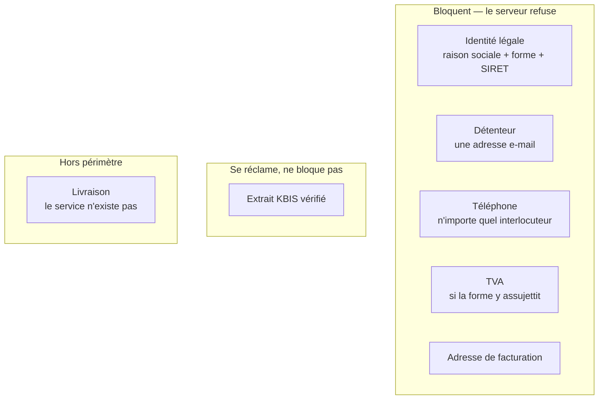

# Le dossier d'activation : ce qui bloque, ce qui se réclame

✅ **État au 2026-08-14.** Ce document décrivait une **configuration** — un mode
`hidden` / `optional` / `required` par pièce, réglable depuis Réglages →
Activation client. Elle a été **supprimée**. Ce qui suit décrit ce qui la
remplace, et pourquoi.

## 1. Pourquoi la configuration a disparu

Le parcours d'ouverture est arrêté. Une fois arrêté, il n'a plus à se redéfinir
depuis un écran : une case cochée un mardi soir changeait la définition de
« client » pour toute la plateforme — sans revue, sans test, sans trace, et sans
que personne puisse dire le lendemain pourquoi un compte était passé.

La règle vit désormais dans **une seule fonction**, `activationGate`
(`apps/lfd-api/src/b2b/account/domain/services/activation-gate.ts`),
pure, testée, et lue par les deux chemins qui comptent : la fiche staff (qui
l'affiche) et la commande d'activation (qui refuse). L'écran n'a plus le droit
de la rejouer.

## 2. La règle

**Le KBIS est une convention interne.** On veut voir l'extrait ; on ne veut pas
perdre la commande de demain matin pour un PDF. Le risque qu'il couvre — une
société qui n'est pas celle qu'elle dit — se matérialise à la **facturation**,
pas à la commande, sur des clients que le commercial a rencontrés. Il reste donc
demandé, son état reste vrai (« certifié », jamais « déposé »), et il ne tient
aucune porte.

Corollaire assumé : **rien ne suspend un compte pour un KBIS**. Ni le retrait de
vérification, ni le remplacement de l'extrait. Ces deux gestes menaient au même
état avec deux conséquences différentes — le second (ouvert au client sur sa
propre société) ne suspendait déjà pas. C'était l'incohérence, pas la règle.

**La livraison** n'est plus une pièce. Le jour où le service ouvre, elle revient
dans un commit avec ses tests. Côté écrans, son affichage suit le réglage de
livraison par clientèle (« E-commerce LFC → Réglages → Livraison ») — il a
remplacé la constante `DELIVERY_SERVICE_OPEN` le 2026-09-15.

## 3. La ligne d'avertissements

Une pièce qui ne bloque jamais devient décorative si personne ne la regarde. Le
KBIS non vérifié **se voit** donc, et pas sur la fiche — qu'on n'ouvre que
lorsqu'on a déjà un problème — mais sur la **liste des comptes clients**, l'écran
qu'on ouvre pour travailler.

**La forme : une galerie horizontale** en tête de la liste
(`apps/lfd-backoffice-frontend/src/app/comptes-clients/warnings-gallery/`,
posée dans `comptes-clients-page.html`) — un bandeau
de cartes d'avertissement qu'on parcourt en scrollant latéralement, une carte par
compte concerné.

Ce n'est pas un détail de présentation, c'est ce qui rend la chose tenable. Un
badge dans la colonne d'un tableau se lit compte par compte : il faut déjà savoir
lequel regarder. Une galerie se lit **par le manque** — « qu'est-ce qui traîne ce
matin ? » — et son défilement borne naturellement l'attention à ce qui tient dans
la rangée. Elle assume aussi de n'être pas exhaustive : on y met ce qui appelle un
geste, pas l'état de 250 comptes.

Ce que la forme impose :

- **Le défilement est le seul mode de navigation**, donc l'ordre est une décision
  serveur (le plus urgent d'abord), pas un tri d'écran.
- **Une carte porte un compte et un motif**, pas un compte et quatre motifs : deux
  manques sur le même compte font deux cartes, et la répétition du nom est le
  signal, pas un défaut.
- **Il faut un état vide qui se réjouisse**, parce qu'il sera fréquent, et un
  compteur qui dise combien de cartes attendent hors écran.

Ce n'est **pas** une entrée dans la `play-queue` du cockpit : cette file est un
modèle de **scoring commercial** (`LeadScoreView`, « les meilleurs coups du
jour ») ; y verser une tâche de
back-office fausserait le score.

**Le KBIS est le premier d'une famille**, et la famille est construite comme
telle. Quatre motifs, dans `packages/contracts/src/company-warning.ts`, du plus
coûteux au moins pressant :

| Motif (`kind`)       | Ce qu'il dit                                                     | `since`                          |
| -------------------- | ---------------------------------------------------------------- | -------------------------------- |
| `mandat_absent`      | un règlement différé accordé sans mandat SEPA actif              | `null` — un manque n'a pas d'âge |
| `activation_bloquee` | dossier en attente, identité, détenteur ou facturation manquants | ouverture du compte              |
| `attente_prolongee`  | en attente depuis 14 jours ou plus                               | ouverture du compte              |
| `kbis_a_verifier`    | l'extrait est là, personne ne l'a ouvert                         | dépôt de l'extrait               |

Le calcul est **une fonction pure côté serveur**, `companyWarnings`
(`apps/lfd-api/src/b2b/account/domain/services/company-warnings.ts`), à côté
de `activationGate` dont elle reprend la règle du sous-compte. Elle rend un
tableau **ordonné** (le plus grave d'abord, à gravité égale le plus vieux), et
`AdminCompanyView` le porte en `warnings` (`packages/contracts/src/admin-company.ts`)
— un tableau, pas un booléen KBIS qu'il aurait fallu défaire au deuxième motif.

Deux limites, assumées dans le code :

- **`activation_bloquee` sous-déclare** : il ne lit pas le téléphone, qui peut
  vivre sur n'importe quel interlocuteur. Un dossier auquel il ne manque que le
  téléphone n'apparaît pas dans la galerie ; sa fiche, elle, le dit.
- **« N'avance plus » n'est pas mesuré.** `attente_prolongee` compte depuis
  `createdAt`, faute d'une date de dernier geste : aucune n'est écrite sur
  `Company` (`updatedAt` bouge à n'importe quelle écriture — vérifié le
  2026-10-20).

La liste charge ce qu'il faut pour ce calcul : `COMPANY_SELECT`
(`prisma-admin-company.reader.ts`) porte l'existence d'une adresse de
facturation et d'un mandat actif (`addresses`, `mandates`), en plus de
`kbisUploadedAt`, `kbisCertifiedAt` et `createdAt` (vérifié le 2026-10-20).

## 4. À lire ensuite

- [`../auth-inscription/architecture-compte-client-cycle-de-vie.md`](../auth-inscription/architecture-compte-client-cycle-de-vie.md) — ouverture, activation, suspension
- [`architecture-alertes-compte-client.md`](architecture-alertes-compte-client.md) — les alertes de **commande** (à ne pas confondre avec ces avertissements de **dossier**)
