# Alertes de compte client

**État : livré — tranches A à D ; E livrée côté API seulement.** La route
`POST /orders/preflight` existe, mais aucun écran de la boutique ne l'appelle
(vérifié le 2026-10-20). Ce document reste la référence du _pourquoi_ ;
les écarts entre ce qui était prévu ici et ce qui a été construit sont signalés
en place.

Ce que le commercial n'a aujourd'hui aucun moyen d'apprendre : qu'un client
vient de commander un produit qu'il n'avait jamais pris, ou qu'il en a pris
trois fois moins que d'habitude. L'information est dans les commandes ; personne
ne la regarde, parce que la regarder suppose de comparer une commande à
l'historique du compte — à la main, compte par compte.

Une **alerte de compte client** est cette comparaison, automatisée : une règle
paramétrée globalement, évaluée à chaque commande, dérogeable compte par compte.

---

## 1. Le vocabulaire

| Terme                    | Ce que c'est                                                                                                                                      |
| ------------------------ | ------------------------------------------------------------------------------------------------------------------------------------------------- |
| **Type d'alerte** (kind) | Un **détecteur** — du code : `product.first_order`, `product.quantity_drift`, `product.quantity_outlier`, `subscription.changed`. Ouvert au code. |
| **Règle globale**        | Un type + ses paramètres + ses canaux, valables pour **tous** les comptes. Une ligne par type.                                                    |
| **Dérogation de compte** | Ce qu'un compte fait de cette règle : l'ignorer, ou en porter une version à lui.                                                                  |
| **Règle effective**      | `dérogation ?? règle globale`. C'est elle qu'on évalue, et elle seule.                                                                            |
| **Alerte** (déclenchée)  | Un fait daté : « le 11/08, sur la commande LFC-1042, 12 baguettes contre 4,3 en moyenne ».                                                        |

La distinction qui porte tout le modèle : un **type** est du code (un détecteur
a besoin d'un algorithme), une **règle** est de la donnée (seuils, canaux, on/off).
Ajouter un type de détection = ajouter un fichier détecteur, jamais une branche
dans un `switch` (OCP). Ajouter un seuil = écrire une ligne.

---

## 2. Les types

Trois types portent sur les produits d'une commande ; un quatrième,
`subscription.changed`, écoute la modification d'un panier récurrent
(`watchQuantities`, `watchRecurrence`, `watchFulfillment` — au moins une
facette cochée). Ce document détaille les trois premiers.

### `product.first_order` — un produit jamais pris

Une ligne de commande dont le SKU n'apparaît dans **aucune** commande antérieure
du compte.

| Paramètre           | Défaut | Pourquoi                                                                                                    |
| ------------------- | ------ | ----------------------------------------------------------------------------------------------------------- |
| `minPreviousOrders` | `1`    | Sur la **toute première** commande d'un compte, _tout_ est nouveau : 20 lignes = 20 alertes, donc 0 signal. |

### `product.quantity_drift` — un écart à sa propre moyenne

La quantité d'un SKU s'écarte de plus de `thresholdPercent` de sa moyenne sur ce
compte.

| Paramètre           | Défaut          | Pourquoi                                                                                                    |
| ------------------- | --------------- | ----------------------------------------------------------------------------------------------------------- |
| `riseTiers`         | 200/100/50/25 % | L'écart **à la hausse** qui déclenche, par palier, indexé sur la moyenne de ce compte pour ce SKU (§2.1).   |
| `dropTiers`         | 50/50/40/25 %   | L'écart **à la baisse**, même découpage : une baisse de moitié est un signal à tout volume.                 |
| `direction`         | `both`          | `up` \| `down` \| `both` — on veut savoir qu'il monte (opportunité) **et** qu'il baisse (signal de départ). |
| `baselineOrders`    | `6`             | Les N dernières commandes **contenant ce SKU**, la commande courante exclue.                                |
| `minBaselineOrders` | `3`             | En dessous, « la moyenne » n'est pas une moyenne — la règle se tait plutôt que de mentir.                   |
| `windowDays`        | `365`           | Au-delà, une commande est trop vieille pour dire quoi que ce soit des habitudes actuelles.                  |

La **moyenne de ce compte pour ce SKU est la référence la plus adaptable dont on
dispose** : elle sait, elle, que ce client-là prend ce produit-là à l'unité ou par
palettes, là où une norme catalogue ne connaît qu'une moyenne d'usages qui n'ont
rien à voir. C'est pour ça qu'elle a la priorité dès qu'elle existe, et que ses
paliers sont **plus serrés** que ceux de l'aberration produit : à référence plus
fine, même écart plus significatif.

> Un ancien `minQuantity` (plancher plat sur la quantité) a disparu : les paliers
> font le même travail, mais **par échelle** au lieu d'un seuil unique. Deux
> boutons pour un seul métier, c'est un de trop.

**La moyenne se calcule sur les commandes qui contiennent le SKU**, pas sur
toutes. Un SKU absent d'une commande **n'est pas** un « 0 commandé » : sinon
chaque commande lèverait une alerte de chute pour tout le catalogue non commandé.

### `product.quantity_outlier` — une quantité aberrante **pour le produit**

Le pendant de la précédente là où elle est structurellement aveugle : une
**première commande** n'a aucun historique de compte, donc aucune moyenne à
laquelle se comparer — et c'est précisément là qu'un 5 tapé 500 passe sans que
rien ne bronche. On change alors de référence : non plus « ce que ce client prend
d'habitude », mais **« ce qu'on prend habituellement de ce produit »**, tous
comptes confondus.

| Paramètre                    | Défaut                 | Pourquoi                                                                             |
| ---------------------------- | ---------------------- | ------------------------------------------------------------------------------------ |
| `riseTiers`                  | 4 paliers (ci-dessous) | Le seuil **descend quand la norme monte** — voir juste après.                        |
| `windowDays`                 | `180`                  | La fenêtre sur laquelle la norme du produit se mesure.                               |
| `minSampleLines`             | `20`                   | Sous ce nombre de lignes observées, il n'y a pas de « norme » à invoquer.            |
| `onlyWithoutAccountBaseline` | `true`                 | Le compte a sa propre moyenne ? Elle est plus fine, elle fait autorité — on se tait. |

### 2.1 Le seuil est une **échelle**, pas un nombre — pour les deux règles

Un pourcentage unique ne peut pas couvrir les deux bouts du catalogue. Sur un
produit qu'on prend à l'unité, passer de 1 à 5 (+400 %) n'a rien d'anormal ; sur
un produit qu'on prend par 100, +30 % fait déjà trente unités de trop. Le seuil
doit donc **baisser à mesure que la norme monte**.

C'est de la **donnée**, pas une formule cachée — on veut pouvoir la lire et la
corriger à l'écran, et elle se règle par tâtonnement une fois qu'on voit ce que
les alertes disent vraiment :

| Référence  | `quantity_drift` `riseTiers`<br/>(sa moyenne pour ce SKU) | `quantity_outlier`<br/>(la norme du produit) |
| ---------- | --------------------------------------------------------- | -------------------------------------------- |
| jusqu'à 2  | 200 %                                                     | 400 %                                        |
| jusqu'à 10 | 100 %                                                     | 200 %                                        |
| jusqu'à 50 | 50 %                                                      | 80 %                                         |
| au-delà    | 25 %                                                      | 30 %                                         |

Le palier se choisit sur la **référence**, jamais sur la quantité commandée :
c'est la référence qui dit si l'on est sur un usage à l'unité ou à la centaine.
Et les deux colonnes ne sont pas les mêmes parce que les deux références ne se
valent pas — voir §2. La baisse de `quantity_drift` a sa propre échelle
(`dropTiers`, tableau du §2).

Deux invariants tenus par le contrat (`tiersSchema`, dans `packages/contracts/src/account-alert.ts`) : les bornes
sont **strictement croissantes**, et le **dernier palier est ouvert**. Sans ce
dernier, une norme au-dessus du plus haut seuil ne serait couverte par rien — et
la règle se tairait précisément sur les plus gros volumes, ceux qui coûtent.

Les deux invariants et l'éditeur d'échelle sont **partagés** — c'est le second
usage réel qui les a justifiés, pas une symétrie décidée d'avance.

Ce dernier paramètre est ce qui empêche les deux règles de crier ensemble pour un
même écart. Décoché, l'écran de réglages le dit là où on le décoche.

C'est un type **montrable au client** (`customerShowable`), mais **aucun type
n'est coché « client » par défaut** : `customerVisible` vaut `false` pour tous
dans `ALERT_KINDS` (`packages/contracts/src/account-alert-rule.ts`). Parler au
client se décide en Réglages, jamais par défaut.

> **Conséquence assumée : `quantity_drift` ne détecte pas un arrêt.** Un client qui
> cesse complètement un produit n'a plus de ligne, donc plus d'écart. C'est un
> **quatrième type** (`product.dropped` — silence de N jours sur un SKU habituel),
> évalué **par le temps** et non par une commande : il n'y a pas de commande sur
> laquelle l'accrocher. Hors lot 1, noté ici pour qu'on ne croie pas la chute
> couverte.

---

## 3. Portée : le sujet d'une alerte est la **société**

Une alerte se lit sur une fiche client, donc son sujet est une `Company`.

**Une commande « zéro friction » (`companyId = null`) ne produit aucune alerte.**
Elle n'appartient à aucun compte ; il n'y a ni historique auquel la comparer ni
fiche où l'afficher. Le jour où le rapatriement d'une commande vers une société
existe (cf. `../commandes/passation/architecture-flux-commande-zero-friction.md`), la question se
reposera — rétro-évaluer ou non. Aujourd'hui : silence, explicitement.

---

## 3.1 Ce qui compte dans l'historique (tranché)

Toute moyenne suppose qu'on sache **ce qu'on compte**. Ces réponses ne sont pas
des détails d'implémentation : chacune déplace les chiffres, donc les alertes.

| Question                                           | Décision                                        | Pourquoi                                                                                                                                                                                                                                                                                                                |
| -------------------------------------------------- | ----------------------------------------------- | ----------------------------------------------------------------------------------------------------------------------------------------------------------------------------------------------------------------------------------------------------------------------------------------------------------------------- |
| Deux lignes du même SKU dans une commande ?        | **Impossible** — index unique `(order_id, sku)` | `place-order` fusionnait déjà ; la contrainte rend la règle structurelle. Sans elle, « la quantité commandée » dépend de la façon dont le panier a été saisi.                                                                                                                                                           |
| Commandes **annulées** ?                           | **Hors** moyenne                                | Une commande annulée n'a jamais été un achat. La compter ferait baisser une moyenne sans qu'aucun volume n'ait bougé.                                                                                                                                                                                                   |
| Commandes issues d'un **abonnement** ?             | **Dedans**                                      | C'est du volume réel, et à LFC c'est même le volume principal. Les exclure viderait la moyenne de sa substance. La contrepartie est connue : un panier récurrent stabilise la moyenne, donc une commande manuelle ressort plus vite — c'est **voulu**, un écart sur un client régulier vaut justement qu'on le regarde. |
| Commandes **zéro friction** (`companyId = null`) ? | **Aucune alerte, et hors historique**           | Elles n'appartiennent à aucun compte : ni sujet où loger l'alerte, ni historique auquel les rattacher.                                                                                                                                                                                                                  |
| Quels comptes évalue-t-on ?                        | Les sociétés **actives** seulement              | Un dossier en attente, suspendu ou résilié n'a pas d'habitudes à comparer, et personne pour agir dessus.                                                                                                                                                                                                                |
| Norme d'un produit : moyenne ou médiane ?          | **Médiane**                                     | Une moyenne se fait déplacer par l'aberration qu'on cherche : une faute de frappe à 500 passée une fois éteindrait la détection des suivantes.                                                                                                                                                                          |

---

## 4. La dérogation est **tout-ou-rien**

Par (compte × type), trois états — et **pas de ligne du tout** quand le compte
suit le réglage global :

```
inherited   (aucune ligne)   → la règle globale, telle quelle
off         (ligne, mode=off) → ce type ne s'évalue pas sur ce compte
custom      (ligne, mode=custom) → params + canaux COMPLETS, propres au compte
```

Le mode `custom` copie **l'intégralité** des paramètres, pas un diff. C'est le
même choix que l'héritage gamme → produit du PIM, pour la même raison : un
override partiel oblige à répondre « que se passe-t-il quand le global change un
champ que le compte avait à moitié dérogé ? », et il n'y a pas de bonne réponse.
Tout-ou-rien : soit le compte suit, soit il a sa propre règle, et on peut
toujours dire laquelle il applique.

**La résolution vit côté serveur, une seule fois.** Le front n'implémente pas
`dérogation ?? global` : l'API de la fiche rend les trois choses ensemble
(`global`, `override`, `effective`), et l'écran les affiche. Deux
implémentations de la même résolution finiraient par diverger, et c'est
l'affichage qui aurait tort sans qu'on le voie.

**`off` éteint, il n'efface pas.** Une règle désactivée sur un compte garde les
paramètres du global : c'est ce qui permet de dire « désactivée » plutôt que
« vide », et de la rallumer telle qu'elle était. `custom`, lui, fige sa propre
copie — c'est toute la différence entre « ce compte se retire » et « ce compte a
sa règle ».

**Revenir au global, c'est SUPPRIMER la ligne** (`DELETE`), pas écrire un mode
« hérité ». L'absence _est_ l'héritage ; lui donner une seconde représentation
écrite créerait deux façons de dire la même chose, dont une seule serait vraie.

---

## 5. Les canaux

Une alerte atterrit **toujours** dans le journal d'alertes du compte — c'est ce
qui rend l'onglet Alertes utile. Les canaux sont ce qu'on fait **en plus** :

```ts
delivery: {
  staffInApp: boolean; // « Me prévenir → notifications »
  staffEmail: boolean; // « Me prévenir → e-mail »
  customerVisible: boolean; // « Afficher l'alerte chez le client »
}
```

- **`staffEmail`** — le template `staff.account-alert` de
  `apps/lfd-api/src/platform/mailer/mail-templates.ts`.
- **`staffInApp`** — le socle de notification staff construit en tranche D :
  le modèle `StaffNotification` (`prisma/schema/public/staff.prisma`), la route
  de `src/staff/notifications/http/my-staff-notifications.controller.ts`, et la
  cloche `app-notification-bell` du back-office. Il est **générique** — un
  sujet, un lien, un état lu/non-lu — et les alertes n'en sont qu'un
  consommateur. Les deux canaux partent de `dispatch-alert-channels.service.ts`.
- **`customerVisible`** — la case n'existe que pour les types **montrables au
  client** (§8). Un type déclare ce trait ; `product.first_order` ne l'est pas.

Pas d'invariant « au moins un canal » : une règle sans canal reste utile, elle
alimente le journal sans réveiller personne.

---

## 6. L'évaluation

```mermaid
flowchart LR
  A[OrderPlacedEvent] --> B{companyId ?}
  B -- null --> Z[rien]
  B -- société --> C[règles effectives du compte]
  C --> D[historique par SKU<br/>OrderHistoryReader]
  D --> E[détecteurs purs<br/>kind → AlertDraft&#91;&#93;]
  E --> F[persister<br/>clé idempotente]
  F --> G[canaux : e-mail / in-app / client]
```



- **Déclencheur** : `OrderPlacedEvent`, qui existe et est déjà écouté par
  `growth/`. Le contexte `b2b/alerts/` s'y abonne (`on-order-placed.handler.ts`).
- **Les détecteurs sont purs** : `(context, params) => AlertDraft[]`. Testables
  sans Nest, sans base, sans horloge — c'est là que vit toute la logique.
- **Un registre** `kind → détecteur` remplace le `switch`. Nouveau type = nouveau
  fichier + une entrée.
- **Idempotence** : clé déterministe `${kind}:${orderId}` (`alertIdempotencyKey`,
  `domain/evaluate-order.ts`), `@unique`. Une alerte par (type × commande), pas
  par produit : les lignes concernées sont dans ses `findings`. La clé ne porte
  pas les seuils — réévaluer après un ajustement de réglage ne repeuple pas
  l'historique.
- **Le message est figé au déclenchement** (« 12 contre 4,3 en moyenne »), pas
  recalculé à l'affichage : la moyenne d'aujourd'hui ne doit pas réécrire ce
  qu'on a constaté en mars.
- **Hors de la requête** : le handler d'événement confie l'évaluation à
  `BackgroundWork` (`platform/events/`), pour que la passation de commande
  n'attende pas les détecteurs.

### Découpage DDD

Le bounded context `apps/lfd-api/src/b2b/alerts/` (langage propre : règle,
dérogation, détecteur, alerte — ce n'est ni de l'acquisition ni de la commande) :

```
src/b2b/alerts/
├── domain/
│   ├── alert-rules.ts              # lecture des réglages globaux, repli sur les défauts
│   ├── account-alert-rules.ts      # resolveAccountRules : dérogation ?? global (pur)
│   ├── evaluate-order.ts           # détecteurs → alertes, clé d'idempotence
│   ├── customer-warnings.ts        # la phrase client, rendue depuis le constat
│   ├── alert-labels.ts
│   ├── detectors/{first-order,quantity-drift,quantity-outlier,deviation,context,registry}.ts
│   ├── errors/alert-errors.ts
│   └── ports/                      # account-alert.repository, alert-rules.store,
│                                   # account-alert-overrides.store, order-history.reader,
│                                   # evaluated-order.reader, product-norm.store,
│                                   # company.reader, alert-channels
├── application/{commands,queries,handlers}/
├── infrastructure/prisma-*.ts
└── http/{admin-alert-rules,admin-account-alert-rules,admin-account-alerts,
          admin-recompute-norms,order-preflight}.controller.ts
```

Les réglages globaux et les dérogations sont de la **config sans transition** :
CRUD honnête `Payload ↔ View`, validation par les schémas Zod du contrat.
L'alerte déclenchée n'a pas d'entité non plus : sa seule transition,
l'acquittement, est un `updateMany` **conditionné** sur `acknowledgedAt: null`
(`prisma-account-alert.repository.ts`) — un second acquittement ne réécrit ni
l'auteur ni l'instant.

`alerts/` lit les tables de commande **par ses propres adaptateurs**, sans passer
par `b2b/orders/` : `prisma-order-history.reader.ts`,
`prisma-evaluated-order.reader.ts` (Prisma sur `order` / `orderLine`) et
`prisma-product-norm.store.ts` (SQL `order_lines JOIN orders`) — vérifié le
2026-10-20. Les deux contextes sont dans le même bloc `b2b`, que la matrice des
frontières ne cloisonne pas ; chaque lecture reste derrière un port déclaré
dans `domain/ports/`.

---

## 7. Persistance

Les trois modèles vivent dans `apps/lfd-api/prisma/schema/public/alerts.prisma`
(commentaires omis ici) :

```prisma
model AlertRuleSetting {
  kind String @id
  enabled Boolean @default(true)
  params Json
  delivery Json                       // { staffInApp, staffEmail, customerVisible }
  updatedAt DateTime @updatedAt @map("updated_at")
  updatedBy String?  @map("updated_by")
}

model AccountAlertOverride {
  companyId String  @map("company_id")
  company   Company @relation(fields: [companyId], references: [id], onDelete: Cascade)
  kind String
  mode String                         // off | custom
  enabled  Boolean?                   // nuls en mode off
  params   Json?
  delivery Json?
  updatedAt DateTime @updatedAt @map("updated_at")
  updatedBy String?  @map("updated_by")
  @@id([companyId, kind])
  @@index([companyId])
}

model AccountAlert {
  id String @id                       // ULID
  companyId String  @map("company_id")
  company   Company @relation(fields: [companyId], references: [id], onDelete: Cascade)
  kind String
  orderId     String @map("order_id")
  orderNumber String @map("order_number")
  idempotencyKey String @unique @map("idempotency_key")   // kind:orderId
  occurredAt DateTime @map("occurred_at")
  findings Json                       // [{ sku, productName, quantity, baseline, deviationPercent, message }]
  acknowledgedAt DateTime? @map("acknowledged_at")
  acknowledgedBy String?   @map("acknowledged_by")
  createdAt DateTime @default(now()) @map("created_at")
  @@index([companyId, occurredAt])
  @@index([companyId, acknowledgedAt])
}
```

`kind` en `String` (union validée au bord par Zod), pas en enum Prisma : ajouter
un type ne doit pas coûter une migration.

---

## 8. Les surfaces

### Réglages → Commercial → « Alertes »

La section existe : `apps/lfd-backoffice-frontend/src/app/reglages/commercial/alertes-page/`.
Une carte par type de règle : on/off, ses paramètres, ses trois cases de canaux.

### Fiche client → 5ᵉ onglet « Alertes »

Deux blocs :

1. **Les règles, rappelées.** Pour chaque type : ce que dit le réglage global,
   ce que ce compte applique, et deux actions — _Désactiver sur ce compte_ /
   _Modifier sur ce compte_. Quand le compte déroge : un _Revenir au réglage
   global_, et l'écran dit **en clair** qu'il déroge (une dérogation invisible
   est un piège pour le prochain commercial).
2. **Ce qui s'est déclenché.** Le journal du compte, acquittable.

### Liste des comptes clients ✅

Une pastille sur la ligne d'un compte qui a des alertes non acquittées. Sans ça,
la feature n'existe que pour qui pense à ouvrir la fiche.

Elle **mène directement à l'onglet Alertes** : la seule chose actionnable de la
ligne ne doit pas demander deux clics et de savoir où regarder.

Une lecture agrégée (`GET /admin/alerts/pending`), pas une par ligne — la liste
est cross-tenant. Les comptes sans alerte en attente **ne figurent pas** dans la
réponse : l'absence vaut zéro, et la charge reste proportionnelle à ce qui
demande une action, pas au nombre de clients. Si ce compteur échoue, la liste
s'affiche quand même : la pastille est un rappel, et faire tomber l'écran de
travail du commercial pour une décoration serait un mauvais échange.

### Plateforme client → **un callout d'une ligne sous la ligne concernée** (tranché)

`customerVisible` s'affiche **au moment de commander**, pas après coup dans « Mes
commandes » : à ce moment-là le client peut encore corriger, alors qu'après la
commande est partie en production.

La forme est un **`fold-callout` d'une ligne, juste sous la ligne de panier
concernée** — pas une modale, pas une étape de confirmation à franchir. La
distinction n'est pas cosmétique : une alerte qui **bloque** transforme un
service en contrôle, et sera cliquée sans être lue dès la deuxième fois. Sous la
ligne, elle est là où le regard est déjà, elle désigne sans ambiguïté **quelle**
ligne est en cause, et elle s'ignore sans friction quand la quantité est voulue.

C'est donc un **garde-fou de saisie**, pas un rapport de surveillance, et le mot
doit le dire :

> « Habituellement **4 kg** — cette commande en porte **12**. »

Trois conséquences sur le modèle :

- **Le message client ne réutilise jamais celui du staff** (« écart +180 % vs
  moyenne 4,3 sur 6 commandes » est du vocabulaire de commercial).

  > **Écart avec ce qui était prévu ici.** Il était écrit qu'un détecteur rendrait
  > **deux** formulations. À la construction, une seule est écrite par le
  > détecteur ; la phrase client est **rendue** à partir du constat structuré
  > (quantité, référence) par `customerWarnings`, dans le domaine. Deux raisons :
  > le constat porte déjà tout ce qu'il faut pour l'écrire, et surtout une
  > formulation client figée dans le journal serait du poids mort — le journal
  > est staff, personne n'y lira jamais cette phrase. Le figeage garde son sens
  > là où il en a un : le message **staff**, lui, reste figé au déclenchement.

- **Il faut une évaluation AVANT la passation**, en plus de celle qui suit
  `OrderPlacedEvent` : une lecture pure sur le panier (`POST /orders/preflight`),
  qui ne persiste rien et ne notifie personne. Les détecteurs sont purs, donc
  c'est le même code appelé deux fois — pas une seconde implémentation. Elle rend
  les alertes **par SKU**, puisque l'affichage se rattache à une ligne.

  Ce que la construction a ajouté :

  - **La moitié commune est extraite** (`EvaluateBasket` : règles effectives +
    historique + détecteurs). C'était le **deuxième** usage réel, donc le moment
    d'extraire. Deux copies auraient fini par ne plus appliquer les mêmes seuils,
    et c'est le client qui aurait vu la différence — « rien à signaler » avant,
    une alerte au journal après.
  - **Le `companyId` du corps est muré.** Ce que la route renvoie — « habituellement
    4 » — est l'habitude d'achat d'un compte : sans vérifier l'appartenance, tout
    client connecté pourrait sonder celle d'un concurrent en essayant des
    identifiants. Non membre, société non active, pas de société, rien de coché
    « client » : **réponse vide**, jamais une erreur. Le panier n'est pas invalide.
  - **Le contrôleur vit dans `alerts/`**, malgré son URL sous `/orders` : faire
    appeler `alerts` par `orders` inverserait la dépendance qu'on tient depuis le
    début. Une URL n'est pas une frontière de module.
  - **Aucun nom de produit n'est résolu** : la commande n'existe pas encore, donc
    aucun nom n'a été figé — et le message client ne nomme pas le produit, le
    callout étant posé sous la ligne qui le nomme déjà.
  - **Côté écran, rien n'est bâti** : aucun appel à `preflight` dans
    `apps/lfc-ecommerce-frontend/src` (vérifié le 2026-10-20), donc pas de callout.
    Ce qui est prévu pour lui : un contrôle **débounçé** (500 ms) et un échec
    **silencieux** — un stepper qu'on tient enfoncé émet une valeur par pression,
    et afficher « le contrôle a échoué » sous une ligne inquiéterait sur un panier
    parfaitement valide.

- **`product.first_order` ne se montre jamais au client.** « Vous n'aviez jamais
  pris ce produit » n'est pas une erreur de saisie possible, c'est une évidence.
  Chaque type déclare s'il est **montrable au client** ; la case n'apparaît en
  Réglages que pour ceux qui le sont.

---

## 9. Les tranches

| #     | Contenu                                                                                             | Dépend de |
| ----- | --------------------------------------------------------------------------------------------------- | --------- |
| **A** | ✅ Contrats Zod + Prisma + réglages **globaux** (CRUD backend + section Réglages)                   | —         |
| **B** | ✅ Détecteurs purs + évaluation sur `order.placed` + journal + onglet Alertes (liste, acquittement) | A         |
| **C** | ✅ Dérogations par compte (backend + rappel/désactiver/modifier sur la fiche)                       | —         |
| **D** | ✅ Canaux staff : e-mail + **socle de notification** (table, endpoints, cloche du back-office)      | B         |
| **E** | ◐ Garde-fou client : `POST /orders/preflight` ✅ ; callout à la confirmation de commande — à bâtir  | B         |

B et C ont finalement été inversées : la dérogation était le cœur de la demande,
et elle ne dépendait de rien d'autre que du réglage global. B a suivi, et c'est
elle qui rend ces règles vérifiables : sans détecteur, un réglage n'est qu'une
intention.

**La tranche D a construit un socle, pas un canal.** Le back-office n'avait
aucune notion de notification staff ; elle l'a créée, et les alertes en sont le premier
consommateur. Deuxième consommateur immédiat : J2 (« RDV pris », « demande de
contact déposée »), qui attendait exactement ça — la cloche doit donc être
**générique** (un sujet, un lien, un état lu/non-lu), pas une cloche à alertes.

La cloche vit dans le **rail** du back-office (`app-notification-bell`) : cette
coquille n'a pas d'en-tête, et une notification finit toujours par une
navigation — sa place est avec les autres liens. Elle relance toutes les 60 s et
à l'ouverture ; un échec de relance ne produit **aucun toast** (un message par
minute parce que le réseau est tombé serait pire que le silence), il se lit dans
le panneau. Marquer lu est **optimiste**, et le geste est celui de l'équipe : le
fil est commun, `readBy` dit seulement qui s'en est chargé.

---

## 10. Décisions

1. ✅ **Cloche staff in-app** — construite dans la foulée (tranche D), en socle
   générique réutilisé par J2.
2. ✅ **Affichage client** — à la **confirmation de commande** (§8), comme un
   garde-fou de saisie. L'évaluation pré-passation existe ; l'écran qui
   l'affiche reste à bâtir.
3. ✅ **Rétro-évaluation** — **l'avenir seulement**. Activer une règle ne rejoue
   pas l'historique : ça produirait d'un coup des centaines d'alertes que
   personne n'acquitterait, et la première chose qu'on ferait serait de les
   effacer en masse — ce qui apprend à ignorer la liste.
