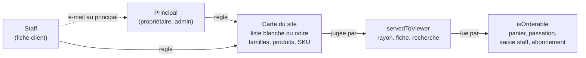

# La carte d'un sous-compte : ce que ses sites peuvent commander

> **Bâti le 2026-11-20** (lots C1 à C6). Décisions de Hugo du 2026-11-20.
> Vocabulaire des sous-comptes : [`sous-comptes.md`](sous-comptes.md).
>
> « Site » désigne aussi nos boutiques dans le code (`lafoliecoffee/sites/`) :
> les identifiants disent **`SubAccountMenu`**, jamais `SiteMenu`.

## 1. En simple

Un compte principal peut dire, site par site, ce que ce site a le droit de
commander. Le reste du catalogue, pour ce site, disparaît ou reste visible mais
verrouillé — au choix du principal.



Exemple : un client ne veut pas que ses chalets commandent de pâtisserie. Son
administrateur pose sur chaque chalet « tout sauf la famille Pâtisserie », en
verrouillé. Les chalets voient les pâtisseries grisées, « hors de la carte de
votre site », et ne peuvent pas les commander. Le siège commande tout.

| Décision (Hugo, 2026-11-20) | Règle                                                                          |
| --------------------------- | ------------------------------------------------------------------------------ |
| Qui règle la carte          | le propriétaire ou l'admin du principal, et le staff                           |
| Sous quelle forme           | liste blanche ou noire, au choix, site par site                                |
| À quel grain                | famille, produit, SKU ; le plus fin l'emporte                                  |
| Hors carte                  | absent, ou visible verrouillé, au choix du principal                           |
| Dérogation du staff         | aucune à la saisie                                                             |
| Avis                        | e-mail au principal quand **le staff** change la carte, jamais quand c'est lui |
| Carte modèle                | aucune ; « copier la carte d'un autre site »                                   |

## 2. Où le régler

- **Boutique, principal** : menu « Mes sites » (`/mes-sites`), montré au seul
  propriétaire ou admin du principal. En tête, la **carte commune** : ce
  qu'elle dit, et « Régler la carte commune » (`/mes-sites/carte-commune`).
  Puis chaque site, avec ce qui compte pour lui — « Carte commune », « Carte
  propre » ou « Pas de carte » (lu par `GET /companies/:id/menu`, une lecture
  par site) —, « Faire une carte propre » ou « Régler sa carte »
  (`/mes-sites/:id/carte`), et « Revenir à la carte commune » sur un site qui
  a sa carte propre. La page d'un site dit si sa carte propre masque la carte
  commune, et qu'une carte propre « Tout, sauf… » sans exclusion l'en exempte ;
  un site qui suit la carte commune part d'elle, et enregistrer lui fait une
  carte propre. Les deux cartes se règlent avec le même éditeur
  (`client/site-menu/site-menu-editor/`) : arbre famille → produit, chaque nœud
  à trois états (hérite, inclus, exclu), résumé « N articles ouverts sur M ».
  Le grain SKU ne se pose pas depuis la boutique (la vue du rayon ne porte pas
  les déclinaisons) ; une entrée SKU posée par le staff s'y affiche et se
  retire.
- **Boutique, site** : vignette, fiche et ligne de panier disent « hors de la
  carte de votre site » ; une mention coiffe le rayon, avec le lien « Voir la
  carte de mon site » vers **« Ma carte »** (`/ma-carte`). Cette page lit, en
  lecture seule, la carte qui compte pour l'espace affiché — ce qu'elle ouvre
  et ferme, et si elle est la carte commune ou propre au site. Aucun réglage
  (§ 3.2).
- **Back-office** : onglet « Carte » de la fiche d'un sous-compte
  (`/comptes-clients/:id/carte`, derrière `lfc_catalog:read`, en lecture seule
  sans `b2b_companies:write`), aux trois grains. Il dit ce qui compte pour le
  site ; la carte commune qu'il suit s'y lit sans se régler, avec « Faire une
  carte propre » ; une carte propre propose « Revenir à la carte commune »
  (clé d'intention). Sur la fiche d'un principal, l'onglet **« Carte des
  sites »** (`/comptes-clients/:id/carte-des-sites`) règle la carte commune,
  sous clé d'intention. Chaque site de la liste du principal dit « Carte
  commune : … » ou « Carte propre : … » (`SubAccountView.menuState`), ou rien,
  et son nom mène à l'onglet (décidé par Hugo le 2026-11-20). Les deux onglets
  partagent l'éditeur `fiche-client/carte/menu-editor/`. La saisie staff, la
  grille de prix et la mercuriale étiquettent « hors carte ».

## 3. Les règles

### 3.1 Où la carte s'attache, et quand elle compte

- Une carte s'attache à **un sous-compte**, clée par son `company_id`. Poser
  une carte sur une société sans principal est refusé (409).
- **Elle ne compte que sous un principal ACTIF**, comme la réservation.
  Principal suspendu, détaché ou absent : la carte dort en base et le site
  commande ce que son rayon lui sert — personne côté client ne pourrait plus
  la lever. Rattaché ou réactivé, elle revient.

### 3.2 Qui l'écrit

🔴 Le rôle effectif (`standingRole`) est le **maximum** du rôle propre et du
rôle hérité : il laisserait le propriétaire **du site** lever sa carte. Le
geste lit donc `canSetMenuOf(standing)`
(`shared/company-standing/domain/sub-account-menu-writing.ts`) :

- le client écrit si `standing.via.role ∈ {owner, admin}` — `standing.own`
  n'est jamais lu ;
- un membre du site, même son propriétaire, reçoit 403 ; qui n'atteint pas le
  site (principal étranger, membre `orders` du principal) reçoit 404 ;
- la carte d'un site se lit là où elle se règle, **et depuis le site** : tout
  membre accepté du site la lit, en lecture seule (`canReadSiteMenuOf`,
  `GET /companies/:id/menu` ; décidé par Hugo le 2026-11-20 : « le site lit
  mais ne paramètre pas ») ;
- le staff écrit sous `b2b_companies:write`.

L'admin du principal qui **entre** dans un site commande avec le lecteur du
site, donc sous sa carte. Pour commander hors carte, il commande pour le
principal, ou change la carte.

### 3.3 Ce qu'une carte dit

```
SubAccountMenu
  mode      : "only" (liste blanche) | "except" (liste noire)
  offMenu   : "hidden" | "visible_locked"
  entries[] : { level: "family" | "product" | "sku", ref, effect: "include" | "exclude" }
```

- **Le plus fin l'emporte** : SKU > produit (`productSku`) > famille la plus
  proche dans `CatalogFamily.path` > ses parentes.
- **Le mode donne le défaut** quand aucune entrée ne touche l'article : `only`
  ferme, `except` ouvre.
- **Une entrée peut contredire le mode** : « tout sauf Pâtisserie, mais la
  tarte au citron ».
- **`only` sans entrée** ferme tout ; l'écran l'annonce.
- **« Aucune restriction »** se dit `except` sans entrée. Il n'y a pas de geste
  « retirer la carte » : l'en-tête reste en base.
- Une référence que le catalogue ne livre plus dort ; l'écran la montre barrée.
- **La carte restreint, elle n'ouvre jamais** : un article absent du rayon du
  site (audience, réservé ailleurs, sur mesure) le reste même si la carte
  l'inclut.

### 3.4 Où elle est jugée

Un seul verdict : **`servedToViewer`** (`catalog/domain/served-to-viewer.ts`),
qui appelle le jugement pur `menuMarkOf`
(`catalog/domain/sub-account-menu-verdict.ts`) **après** les lignes gardées
d'une révision et **après** la réservation.

- Hors carte + `hidden` → `absent`, comme un article inconnu.
- Hors carte + `visible_locked` → listé, verrouillé, avec la marque
  `menu: "off"` et `lockedReason: "off_menu"`.

🔴 **« Commandable ? » ne se lit qu'en un endroit** : `isOrderable(item)`
(`catalog/domain/orderable.ts` : réservé à personne d'autre **et**
`menu === "on"`). Le rayon, la garde de l'abonnement, le refus de la
passation, le stock du jour et les SKU du client le lisent. La grille de prix,
le tarif du compte et le lecteur « réservé ailleurs » lisent
`isReservedElsewhere` : ils gardent l'article hors carte (3.6).
`lint:orderable-door` refuse toute comparaison à `"other"` hors de ce fichier.

Une valeur inconnue en base (le CHECK l'interdit) ferme la carte entière
(`UNREADABLE_MENU`) : écarter une seule exclusion ouvrirait l'article en
`except`.

### 3.5 Qui la subit

| Geste                                   | La carte s'applique ?                                                                                                         |
| --------------------------------------- | ----------------------------------------------------------------------------------------------------------------------------- |
| Passation par le site (boutique)        | oui, refus nommé                                                                                                              |
| Saisie staff au nom du site             | oui (`forBilling`), sans dérogation                                                                                           |
| Abonnement créé ou modifié              | oui, par la garde                                                                                                             |
| Révision                                | une ligne gardée reste ; la même ajoutée est refusée                                                                          |
| Échéances d'un abonnement déjà posé     | la génération des échéances n'existe pas ; quand elle viendra : jamais une commande amputée en silence (Hugo, 2026-10-30, Q7) |
| Le principal pour lui-même              | non                                                                                                                           |
| L'admin du principal entré dans le site | oui (3.2)                                                                                                                     |

Au panier, une ligne verrouillée hors carte est nommée ; une ligne devenue
**masquée** sort du catalogue comme un article retiré.

### 3.6 Le staff voit la carte

Le lecteur staff qui **regarde** un compte (`regarding`) porte sa carte :
l'article reçoit `menu: "off"` sans être retiré. La grille du site porte
`CompanyPricingCategoryView.offMenuSkus` ; une ligne de mercuriale porte
`lockedReason: "off_menu"` (réservé ailleurs l'emporte). **Poser une
mercuriale sur un article hors carte reste permis** : la carte peut changer,
le prix négocié doit survivre.

### 3.7 Le refus

`ArticleOffMenuError` (409, `catalog.article_off_menu`) nomme l'article et le
geste de sortie : le retirer, ou demander au principal de l'ajouter à la carte
du site. En `hidden`, le refus est celui d'un article inconnu : un hors-carte
invisible ne se distingue pas d'un article inexistant.

## 4. La partie technique

```
sub_account_menu         (company_id PK → companies RESTRICT, mode, off_menu, updated_at,
                          updated_by_staff_id | updated_by_user_id — exactement un)
sub_account_menu_entry   (id, company_id → sub_account_menu RESTRICT, level, ref, effect,
                          UNIQUE (company_id, level, ref))
```

- **Écriture** : `lafoliecoffee/account`. Agrégat `SubAccountMenu` (`compose`,
  `include`, `exclude`, `remove`, `switchMode`, `setOffMenu`) ; le `PUT` de la
  carte entière la recompose par ces méthodes (`domain/services/whole-menu.ts`) —
  une carte déjà dans l'état demandé n'écrit rien. Les entrées retirées sont
  supprimées physiquement, la carte jamais.
- **Routes** : `GET/PUT /companies/:subAccountId/menu` (principal,
  `@Idempotent`) et `GET/PUT /admin/companies/:companyId/menu` (staff,
  `@IntentKey()` + `runSealed`, parce que le geste envoie un e-mail). Contrat :
  `packages/contracts/src/sub-account-menu.ts`.
- **Lecture** : dans la **même** requête que le lecteur pro, sur ses deux
  chemins de `shared/company-standing/` (`readServedCompany`,
  `readReservationHolders`). `test/pricing-budget.e2e-spec.ts` tient le coût.
  La liste des sites d'un principal porte `SubAccountView.menu`
  (`{ mode, offMenu, entryCount } | null`), lu par relation.
- **Effets d'une pose** : le fait durable `company.sub_account_menu_set`
  (journal des comptes, sujet : le site), `ShelfChanges` après validation pour
  le seul site, et les déclencheurs `company_change`.
- **L'avis** : `NotifyPrincipalOnMenuChangedByTeam` (`sub-account-notices/`,
  `@DurableHandler`) ne prévient que si l'équipe a posé : owner et admin
  acceptés du principal, hors tableau des avis et hors interrupteur (ceux-ci
  règlent ce que font les sites), une fois chacun. Gabarit
  `customer.sub-account-gesture`, geste `menu_changed`.
- **Semis** : les deux tables sont dans `reset.seed.ts` et
  `reset-coverage.ts`.

Les tests qui tiennent la frontière : `test/sub-account-menu-{reading,wall,routes,pricing,notice}.e2e-spec.ts`
(le propriétaire du site refusé, le frère, le principal étranger ou suspendu,
le verrouillé refusé en passation, saisie et abonnement, la purge du rayon,
l'e-mail une fois par intention), et les specs du jugement, de `isOrderable`
et de l'agrégat.

## 5. Reste à faire

- Le pied du gabarit d'e-mail dit « nous réglons ces avis rôle par rôle »,
  inexact pour l'avis de la carte.
- La planche des e-mails montre `menu_changed` posé par le principal ; le cas
  « par notre équipe » n'est que dans les rendus de référence.
- Le grain SKU depuis la boutique demande que la vue du rayon porte les
  déclinaisons.

## 6. Évolution à bâtir : la carte commune des sites

> **Décidé par Hugo le 2026-11-20, pas encore bâti.** « J'ai un compte parent
> qui a 10 enfants et je veux utiliser la même liste pour tous pour le
> moment » ; « le parent n'est pas concerné par cette carte, mais c'est lui qui
> paramètre ses enfants » ; la règlent le principal et le staff. Cette décision
> remplace Q4 : la carte modèle commune existe maintenant.

### 6.1 Les règles

- **Une carte commune par principal**, de la même forme que celle d'un site
  (§ 3.3). Elle s'applique à **tous ses sites**, jamais au principal lui-même.
- **La carte effective d'un site** : sa carte propre s'il en a une **active**,
  sinon la carte commune de son principal, sinon aucune. Une carte propre
  **remplace** la carte commune : elles ne se fusionnent pas. Fusionner deux
  listes blanches ou noires de grains différents n'aurait pas de sens lisible.
- **Revenir à la carte commune** est un geste : la carte propre passe
  `follows_common` et ses entrées dorment en base (rien n'est détruit). Le
  geste inverse la réactive.
- Comme la carte d'un site, la carte commune **ne compte que sous un principal
  actif** (§ 3.1) et **n'ouvre jamais** (§ 3.3).
- **Qui l'écrit** : le client dont le rôle **propre** sur le principal est
  `owner` ou `admin` (c'est sa propre société : ici, le rôle propre est le
  bon), et le staff sous `b2b_companies:write`. Le droit d'écrire la carte
  propre d'un site ne change pas (§ 3.2, `via.role`).
- **Effets d'une pose** : un fait au journal du principal, `ShelfChanges` pour
  **chacun** de ses sites (après validation), et l'avis Q3 quand l'équipe pose.

### 6.2 La partie technique

- Deux tables additives, `principal_sites_menu` (PK `company_id` du principal)
  et `principal_sites_menu_entry`, de la forme de `sub_account_menu` ; les
  valeurs, les CHECK et le jugement sont partagés. `sub_account_menu` gagne
  `state` (`own` | `follows_common`, défaut `own`).
- La lecture reste **dans la même requête** que le lecteur pro, sur les deux
  chemins de `shared/company-standing/` : la carte du site et celle de
  `parentCompany`. `menuReadingOf` choisit la carte effective. Le budget de
  `test/pricing-budget.e2e-spec.ts` ne bouge pas.
- Routes : `GET/PUT /companies/:principalId/sites-menu` (principal) et
  `GET/PUT /admin/companies/:id/sites-menu` (staff, clé d'intention) ; la carte
  d'un site gagne le geste « suivre la carte commune » / « reprendre sa carte
  propre ». La lecture d'un site dit s'il suit la carte commune.
- Écrans : en tête de « Mes sites », la carte commune ; sur chaque site,
  « suit la carte commune » ou « carte propre », avec le geste de bascule. Au
  back-office, un onglet « Carte des sites » sur la fiche du principal ;
  l'onglet « Carte » d'un site montre la carte héritée en lecture et propose
  d'en faire une propre. L'indicateur de la liste dit « carte commune » ou
  « carte propre ».

### 6.3 Lots

| Lot | Contenu                                                                                                              |
| --- | -------------------------------------------------------------------------------------------------------------------- |
| K1  | Migration, agrégat de la carte commune, état de la carte propre, lecture effective, jugement — ✅ bâti le 2026-11-20 |
| K2  | Routes principal et staff, bascule d'un site, faits, purge des rayons des sites, avis — ✅ bâti le 2026-11-20        |
| K3  | Boutique et back-office — ✅ bâti le 2026-11-20                                                                      |

### 6.4 Ce que la contradiction a ajouté (vitruve, 2026-11-20)

- **Droit d'écrire la carte commune** : `canSetSitesMenuOf(standing)` (dans
  `shared/company-standing/domain/sub-account-menu-writing.ts`) exige un rôle
  propre `owner` ou `admin` **accepté** (`ownAccepted`) sur un principal
  **actif** ; un invité qui n'est pas entré, ou un principal suspendu, est
  refusé. Testé par ses refus.
- **Changement de principal** : au rattachement d'un site
  (`attach-to-parent.handler.ts`), sa carte propre repasse `follows_common`
  (une décision d'une autre société ne revient pas en vigueur) et
  `ShelfChanges` part pour le site.
- **Purge** : un seul `companyShelves(principalId)`, qui couvre déjà la
  société et ses sites, posé par `DeferredShelfChanges` : pas d'énumération,
  pas de course avec un rattachement.
- **Bascule** : un état visé, `PUT …/menu/state { state }`, `@Idempotent` côté
  client, `@IntentKey` côté staff ; rien n'est fait si l'état est déjà atteint.
- **Exempter un site** : une carte propre `except` sans entrée (« aucune
  restriction ») masque la carte commune. Une carte propre qui existait avant
  la carte commune continue de la masquer ; l'écran le dit.
- **Trois états lus** pour un site : `none` (pas de carte), `common`, `own`
  — nommés dans le contrat.
- **RGPD, semis, journal** : `principal_sites_menu.updated_by_staff_id` au
  registre ; les deux tables au semis et à sa couverture ; les déclencheurs
  `record_company_change` recopiés.
- **Modèles écartés** : une ligne de `sub_account_menu` posée sur le principal
  se confondrait avec « la carte du principal », que § 6.1 exclut ; une
  recopie dans N sites demanderait de resynchroniser N cartes.
- **À prouver en K1** : que le budget ne bouge pas avec la relation imbriquée
  `parentCompany.principalSitesMenu.entries`, et qu'un principal ne peut pas
  être lui-même un site (pas de cartes communes en cascade).
- **Tranché au bâti de K1** (2026-11-20) : le corps commun des deux cartes
  est `MenuBody` (`apps/lfd-api/src/lafoliecoffee/account/domain/entities/menu-body.ts`) ; `SubAccountMenu`
  y ajoute `state`, `PrincipalSitesMenu` le refus d'un site
  (`NotAPrincipalError`, 409). La recomposition est la même
  (`whole-menu.ts`). Enregistrer la carte propre d'un site la rend active
  (`own`) : c'est « en faire une propre ». `menuReadingOf(own, common,
activePrincipalId)` choisit ; un état inconnu ferme tout. Le budget de
  `pricing-budget.e2e-spec.ts` n'a pas bougé (14/14, chiffres inchangés). Pas
  de cascade : la carte commune n'est lue que par `parentCompany`, un site ne
  peut pas avoir de sites (`HierarchyPlace.attachTo`), et la composer sur un
  site est refusé.
- **Tranché au bâti de K2** (2026-11-20) : la bascule vers `own` sans carte
  propre est refusée (409, `NoOwnMenuToResumeError`) ; vers `follows_common`
  sans carte propre, rien n'est fait. La bascule écrit le fait
  `company.sub_account_menu_state_set` au journal du site et le fait durable
  `company.sub_account_menu_set` (la carte qui compte a changé : l'avis Q3
  part quand l'équipe bascule). La carte commune écrit
  `company.principal_sites_menu_set` au journal du principal et en durable ;
  l'avis est un second abonné (`NotifyPrincipalOnSitesMenuChangedByTeam` : un
  abonné durable écoute un seul fait), même gabarit, geste e-mail distinct
  `sites_menu_changed` qui nomme le principal. Au rattachement, la carte
  propre dort sans changer d'auteur. Les trois états (`SiteMenuStanding`)
  sont écrits sur ce qui est posé, pas sur l'activité du principal ; la vue
  d'un site (`SubAccountMenuView`) porte `state`, `menu` (la carte propre,
  même endormie) et `common`, et `SubAccountView` porte `menuState` et le
  résumé de la carte qui compte.
- **Le site lit, il ne règle pas** (décidé par Hugo le 2026-11-20) : un
  membre accepté du site lit la carte de son site par
  `GET /companies/:id/menu` ; il n'écrit ni la carte propre, ni la bascule,
  ni la carte commune (403, ou 404 sur le principal qu'il n'atteint pas).
- **Tranché au bâti de K3** (2026-11-20) : « Ma carte » s'atteint par le
  lien de la mention du rayon, pas par le menu — la boutique ne sait pas
  qu'un espace est un site sans lire sa carte. Conséquence : un site dont la
  carte est réglée « masqué » n'a pas de mention, donc pas de lien ; la page
  reste à son adresse. « Mes sites » lit l'état de chaque site par sa carte
  (une lecture par site) : la boutique n'a pas de liste des sites qui porte
  `menuState`.
