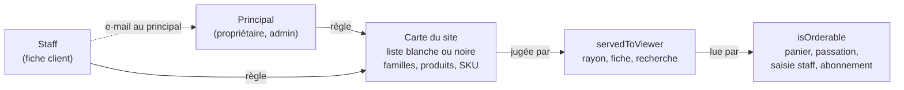

# La carte d'un sous-compte : ce que ses sites peuvent commander

> **Bâti le 2026-11-20** (lots C1 à C6). Décisions de Hugo du 2026-11-20.
> Vocabulaire des sous-comptes : [`sous-comptes.md`](sous-comptes.md).
>
> « Site » désigne aussi nos boutiques dans le code (`lafoliecoffee/sites/`) :
> les identifiants disent **`SubAccountMenu`**, jamais `SiteMenu`.

## 1. En simple

Un compte principal peut dire, site par site, ce que ce site a le droit de
commander. Le reste du catalogue, pour ce site, disparaît ou reste visible mais
verrouillé — au choix du principal.



Exemple : un client ne veut pas que ses chalets commandent de pâtisserie. Son
administrateur pose sur chaque chalet « tout sauf la famille Pâtisserie », en
verrouillé. Les chalets voient les pâtisseries grisées, « hors de la carte de
votre site », et ne peuvent pas les commander. Le siège commande tout.

| Décision (Hugo, 2026-11-20) | Règle                                                                          |
| --------------------------- | ------------------------------------------------------------------------------ |
| Qui règle la carte          | le propriétaire ou l'admin du principal, et le staff                           |
| Sous quelle forme           | liste blanche ou noire, au choix, site par site                                |
| À quel grain                | famille, produit, SKU ; le plus fin l'emporte                                  |
| Hors carte                  | absent, ou visible verrouillé, au choix du principal                           |
| Dérogation du staff         | aucune à la saisie                                                             |
| Avis                        | e-mail au principal quand **le staff** change la carte, jamais quand c'est lui |
| Carte modèle                | aucune ; « copier la carte d'un autre site »                                   |

## 2. Où le régler

- **Boutique, principal** : menu « Mes sites » (`/mes-sites`), montré au seul
  propriétaire ou admin du principal ; un site → « Régler la carte »
  (`/mes-sites/:id/carte`). Arbre famille → produit, chaque nœud à trois états
  (hérite, inclus, exclu), résumé « N articles ouverts sur M ». Le grain SKU ne
  se pose pas depuis la boutique (la vue du rayon ne porte pas les
  déclinaisons) ; une entrée SKU posée par le staff s'y affiche et se retire.
- **Boutique, site** : vignette, fiche et ligne de panier disent « hors de la
  carte de votre site » ; une mention coiffe le rayon.
- **Back-office** : onglet « Carte » de la fiche d'un sous-compte
  (`/comptes-clients/:id/carte`, derrière `lfc_catalog:read`, en lecture seule
  sans `b2b_companies:write`), aux trois grains. Sur la fiche du principal,
  chaque site de la liste montre sa carte (« liste blanche, 12 entrées ») et
  son nom mène à l'onglet (décidé par Hugo le 2026-11-20). La saisie staff, la
  grille de prix et la mercuriale étiquettent « hors carte ».

## 3. Les règles

### 3.1 Où la carte s'attache, et quand elle compte

- Une carte s'attache à **un sous-compte**, clée par son `company_id`. Poser
  une carte sur une société sans principal est refusé (409).
- **Elle ne compte que sous un principal ACTIF**, comme la réservation.
  Principal suspendu, détaché ou absent : la carte dort en base et le site
  commande ce que son rayon lui sert — personne côté client ne pourrait plus
  la lever. Rattaché ou réactivé, elle revient.

### 3.2 Qui l'écrit

🔴 Le rôle effectif (`standingRole`) est le **maximum** du rôle propre et du
rôle hérité : il laisserait le propriétaire **du site** lever sa carte. Le
geste lit donc `canSetMenuOf(standing)`
(`shared/company-standing/domain/sub-account-menu-writing.ts`) :

- le client écrit si `standing.via.role ∈ {owner, admin}` — `standing.own`
  n'est jamais lu ;
- un membre du site, même son propriétaire, reçoit 403 ; qui n'atteint pas le
  site (principal étranger, membre `orders` du principal) reçoit 404 ;
- la lecture de la carte a le même mur ;
- le staff écrit sous `b2b_companies:write`.

L'admin du principal qui **entre** dans un site commande avec le lecteur du
site, donc sous sa carte. Pour commander hors carte, il commande pour le
principal, ou change la carte.

### 3.3 Ce qu'une carte dit

```
SubAccountMenu
  mode      : "only" (liste blanche) | "except" (liste noire)
  offMenu   : "hidden" | "visible_locked"
  entries[] : { level: "family" | "product" | "sku", ref, effect: "include" | "exclude" }
```

- **Le plus fin l'emporte** : SKU > produit (`productSku`) > famille la plus
  proche dans `CatalogFamily.path` > ses parentes.
- **Le mode donne le défaut** quand aucune entrée ne touche l'article : `only`
  ferme, `except` ouvre.
- **Une entrée peut contredire le mode** : « tout sauf Pâtisserie, mais la
  tarte au citron ».
- **`only` sans entrée** ferme tout ; l'écran l'annonce.
- **« Aucune restriction »** se dit `except` sans entrée. Il n'y a pas de geste
  « retirer la carte » : l'en-tête reste en base.
- Une référence que le catalogue ne livre plus dort ; l'écran la montre barrée.
- **La carte restreint, elle n'ouvre jamais** : un article absent du rayon du
  site (audience, réservé ailleurs, sur mesure) le reste même si la carte
  l'inclut.

### 3.4 Où elle est jugée

Un seul verdict : **`servedToViewer`** (`catalog/domain/served-to-viewer.ts`),
qui appelle le jugement pur `menuMarkOf`
(`catalog/domain/sub-account-menu-verdict.ts`) **après** les lignes gardées
d'une révision et **après** la réservation.

- Hors carte + `hidden` → `absent`, comme un article inconnu.
- Hors carte + `visible_locked` → listé, verrouillé, avec la marque
  `menu: "off"` et `lockedReason: "off_menu"`.

🔴 **« Commandable ? » ne se lit qu'en un endroit** : `isOrderable(item)`
(`catalog/domain/orderable.ts` : réservé à personne d'autre **et**
`menu === "on"`). Le rayon, la garde de l'abonnement, le refus de la
passation, le stock du jour et les SKU du client le lisent. La grille de prix,
le tarif du compte et le lecteur « réservé ailleurs » lisent
`isReservedElsewhere` : ils gardent l'article hors carte (3.6).
`lint:orderable-door` refuse toute comparaison à `"other"` hors de ce fichier.

Une valeur inconnue en base (le CHECK l'interdit) ferme la carte entière
(`UNREADABLE_MENU`) : écarter une seule exclusion ouvrirait l'article en
`except`.

### 3.5 Qui la subit

| Geste                                   | La carte s'applique ?                                                                                                         |
| --------------------------------------- | ----------------------------------------------------------------------------------------------------------------------------- |
| Passation par le site (boutique)        | oui, refus nommé                                                                                                              |
| Saisie staff au nom du site             | oui (`forBilling`), sans dérogation                                                                                           |
| Abonnement créé ou modifié              | oui, par la garde                                                                                                             |
| Révision                                | une ligne gardée reste ; la même ajoutée est refusée                                                                          |
| Échéances d'un abonnement déjà posé     | la génération des échéances n'existe pas ; quand elle viendra : jamais une commande amputée en silence (Hugo, 2026-10-30, Q7) |
| Le principal pour lui-même              | non                                                                                                                           |
| L'admin du principal entré dans le site | oui (3.2)                                                                                                                     |

Au panier, une ligne verrouillée hors carte est nommée ; une ligne devenue
**masquée** sort du catalogue comme un article retiré.

### 3.6 Le staff voit la carte

Le lecteur staff qui **regarde** un compte (`regarding`) porte sa carte :
l'article reçoit `menu: "off"` sans être retiré. La grille du site porte
`CompanyPricingCategoryView.offMenuSkus` ; une ligne de mercuriale porte
`lockedReason: "off_menu"` (réservé ailleurs l'emporte). **Poser une
mercuriale sur un article hors carte reste permis** : la carte peut changer,
le prix négocié doit survivre.

### 3.7 Le refus

`ArticleOffMenuError` (409, `catalog.article_off_menu`) nomme l'article et le
geste de sortie : le retirer, ou demander au principal de l'ajouter à la carte
du site. En `hidden`, le refus est celui d'un article inconnu : un hors-carte
invisible ne se distingue pas d'un article inexistant.

## 4. La partie technique

```
sub_account_menu         (company_id PK → companies RESTRICT, mode, off_menu, updated_at,
                          updated_by_staff_id | updated_by_user_id — exactement un)
sub_account_menu_entry   (id, company_id → sub_account_menu RESTRICT, level, ref, effect,
                          UNIQUE (company_id, level, ref))
```

- **Écriture** : `lafoliecoffee/account`. Agrégat `SubAccountMenu` (`compose`,
  `include`, `exclude`, `remove`, `switchMode`, `setOffMenu`) ; le `PUT` de la
  carte entière la recompose par ces méthodes (`domain/services/whole-menu.ts`) —
  une carte déjà dans l'état demandé n'écrit rien. Les entrées retirées sont
  supprimées physiquement, la carte jamais.
- **Routes** : `GET/PUT /companies/:subAccountId/menu` (principal,
  `@Idempotent`) et `GET/PUT /admin/companies/:companyId/menu` (staff,
  `@IntentKey()` + `runSealed`, parce que le geste envoie un e-mail). Contrat :
  `packages/contracts/src/sub-account-menu.ts`.
- **Lecture** : dans la **même** requête que le lecteur pro, sur ses deux
  chemins de `shared/company-standing/` (`readServedCompany`,
  `readReservationHolders`). `test/pricing-budget.e2e-spec.ts` tient le coût.
  La liste des sites d'un principal porte `SubAccountView.menu`
  (`{ mode, offMenu, entryCount } | null`), lu par relation.
- **Effets d'une pose** : le fait durable `company.sub_account_menu_set`
  (journal des comptes, sujet : le site), `ShelfChanges` après validation pour
  le seul site, et les déclencheurs `company_change`.
- **L'avis** : `NotifyPrincipalOnMenuChangedByTeam` (`sub-account-notices/`,
  `@DurableHandler`) ne prévient que si l'équipe a posé : owner et admin
  acceptés du principal, hors tableau des avis et hors interrupteur (ceux-ci
  règlent ce que font les sites), une fois chacun. Gabarit
  `customer.sub-account-gesture`, geste `menu_changed`.
- **Semis** : les deux tables sont dans `reset.seed.ts` et
  `reset-coverage.ts`.

Les tests qui tiennent la frontière : `test/sub-account-menu-{reading,wall,routes,pricing,notice}.e2e-spec.ts`
(le propriétaire du site refusé, le frère, le principal étranger ou suspendu,
le verrouillé refusé en passation, saisie et abonnement, la purge du rayon,
l'e-mail une fois par intention), et les specs du jugement, de `isOrderable`
et de l'agrégat.

## 5. Reste à faire

- Le pied du gabarit d'e-mail dit « nous réglons ces avis rôle par rôle »,
  inexact pour l'avis de la carte.
- La planche des e-mails montre `menu_changed` posé par le principal ; le cas
  « par notre équipe » n'est que dans les rendus de référence.
- Le grain SKU depuis la boutique demande que la vue du rayon porte les
  déclinaisons.
