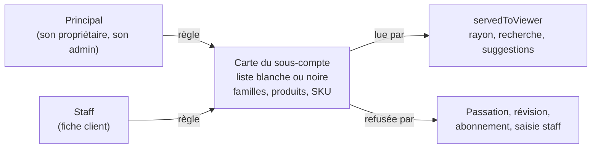

# Plan — la carte d'un sous-compte : ce que ses sites et entités peuvent commander

> **Doc-first, 2026-11-20.** Hugo : « certains clients veulent restreindre la
> carte commandable par leurs sous-comptes, sites et entités ». Rien n'est
> bâti. Touche le **mur tenant** (un principal écrit une règle qui vaut chez
> son sous-compte). Contredit par `vitruve` le 2026-11-20 : 2 bloquants,
> 6 sérieux, tous repris ci-dessous (§9). Le vocabulaire des sous-comptes est
> celui de [`sous-comptes.md`](sous-comptes.md).
>
> ⚠️ « Site » désigne aussi nos boutiques dans le code (`lafoliecoffee/sites/`).
> Les identifiants disent donc **`SubAccountMenu`**, jamais `SiteMenu` ; la
> prose dit « sous-compte » ou « site » quand le contexte est un chalet.

## 1. En bref

Un compte principal peut dire, sous-compte par sous-compte, ce que celui-ci a
le droit de commander. Le reste du catalogue, pour ce sous-compte, disparaît ou
reste visible mais verrouillé — au choix du principal.



Exemple : le Club Med ne veut pas que ses chalets commandent de pâtisserie.
Son administrateur pose sur chaque chalet « tout sauf la famille Pâtisserie »,
en verrouillé. Les chalets voient les pâtisseries grisées, « non ouvert à
votre site », et ne peuvent pas les mettre au panier. Le siège commande tout.

## 2. Décisions de Hugo (2026-11-20)

| #   | Question                              | Décision                                                           |
| --- | ------------------------------------- | ------------------------------------------------------------------ |
| D1  | Qui règle la carte ?                  | **Le principal** (son propriétaire ou son admin) **et le staff**   |
| D2  | Sous quelle forme ?                   | **Au choix, sous-compte par sous-compte** : liste blanche ou noire |
| D3  | À quel grain ?                        | **Famille, produit et SKU** ; le plus fin l'emporte                |
| D4  | Ce que voit le sous-compte hors carte | **Au choix du principal** : absent, ou visible verrouillé          |

## 3. Les règles

### 3.1 Où la carte s'attache, et quand elle compte

- Une carte s'attache à **un sous-compte** (`parent_company_id` non nul). Un
  compte seul ou un principal n'en a pas. Poser une carte sur une société
  sans principal est refusé.
- Elle est clé par le `company_id` **du sous-compte**, comme tout ce qui
  compte (sous-comptes.md §0).
- **Elle ne compte que sous un principal ACTIF** — la règle même de la
  réservation, qui n'hérite que d'un principal actif
  (`read-reservation-holders.ts`). Principal suspendu, détaché ou absent : la
  carte dort, en base, et le sous-compte commande ce que son rayon lui sert.
  Raison : personne côté client ne peut alors la modifier (le droit d'écrire
  passe par un principal actif, 3.2), et une restriction que plus personne ne
  peut lever ne doit pas tenir. Rattaché ou réactivé, elle revient. Rien
  n'est supprimé.

### 3.2 Qui l'écrit — un chemin neuf, qui ignore le rôle propre

🔴 Le rôle effectif de `standingRole` est le **maximum** du rôle propre et du
rôle hérité (`shared/company-standing/domain/company-standing.ts`) : il
laisserait le propriétaire **du sous-compte** écrire sa propre carte. La
carte ne se juge donc **pas** par le rôle effectif :

- le client écrit si `standing.via` existe (principal actif qui ouvre ce
  sous-compte à la personne) **et** `standing.via.role ∈ {owner, admin}` ;
  **`standing.own` n'est jamais lu** pour ce geste ;
- un membre `orders` ou `billing` du principal ne l'écrit pas ;
- le staff l'écrit sous `b2b_companies:write`.

C'est un **geste neuf** : aujourd'hui, côté client, aucun geste du principal
ne s'exerce _sur_ un sous-compte (S6 sert à y entrer —
[`plan-entrer-dans-ses-sites.md`](plan-entrer-dans-ses-sites.md), R8). Le
prédicat (`canSetMenuOf(standing)`) vit à côté de `standingRole`, pur et
testé seul.

Le sous-compte **lit** sa carte (son rayon la montre), il ne l'écrit pas.
Corollaire assumé : l'admin du principal qui **entre** dans le sous-compte
(S6, R5) commande avec le lecteur du sous-compte, donc **sous sa carte**. Pour
commander hors carte, il commande pour le principal, ou change la carte.

### 3.3 Ce qu'une carte dit

```
SubAccountMenu
  mode      : "only" (liste blanche) | "except" (liste noire)
  offMenu   : "hidden" | "visible_locked"
  entries[] : { level: "family" | "product" | "sku", ref, effect: "include" | "exclude" }
```

- **Le plus fin l'emporte** (D3) : SKU > produit (`productSku`) > famille la
  plus proche dans `family.path` > ses parentes. C'est la sémantique de
  famille de la tarification et de l'heure limite (`CatalogFamily.path`) :
  une seule dans le produit.
- **Le mode donne le défaut** quand aucune entrée ne touche l'article :
  `only` → hors carte ; `except` → dans la carte.
- **Une entrée peut contredire le mode** — l'exception d'une exception :
  « tout sauf Pâtisserie, mais la tarte au citron » ; « seulement la
  Viennoiserie, sauf le croissant AOP ». Sans cela le grain fin ne sert à rien.
- **`only` sans entrée** ferme tout : permis, annoncé en clair à l'écran.
- Les références sont `family.id` (id PIM, stable), `productSku`, `sku`. Une
  référence que le catalogue ne livre plus dort ; l'écran la montre barrée.
- **La carte restreint, elle n'ouvre jamais** : un article absent du rayon du
  sous-compte (audience, réservé ailleurs, sur mesure non attribué) le reste
  même si la carte l'inclut.

### 3.4 Où elle est jugée — un verdict, et une marque que TOUS lisent

Elle entre dans **`servedToViewer`** (`catalog/domain/served-to-viewer.ts`),
**après** le retour anticipé des lignes gardées (`waiveReservation`) et après
la réservation :

```
servedTo (audience, masquages, validations)
  → public / staff : servi            ← le staff reçoit une marque, 3.6
  → lignes gardées d'une révision : servi (avant la carte, donc gardées)
  → sur mesure / réservation
    → carte du sous-compte            ← neuf
```

- Hors carte + `hidden` → `absent`, comme un SKU inconnu.
- Hors carte + `visible_locked` → listé au seul lecteur `served_and_locked`,
  avec une marque neuve **`menu: "on" | "off"`** à côté de `reservation`.

🔴 **Le verrou n'est pas un verdict qui remonte, c'est une marque qu'on
relit** : un article verrouillé sort du lecteur comme un article résolu avec
sa marque (`prisma-catalog.reader.ts`). Aujourd'hui, **huit** lecteurs
décident « commandable ou non » sur `reservation === "other"` (relevé de
`vitruve` le 2026-11-20, à rouvrir en C2) :

| Fichier (sous `lafoliecoffee/`)                           | Ce qu'il en fait         |
| --------------------------------------------------------- | ------------------------ |
| `catalog/application/shop-catalogue-view.ts`              | « commandable » au rayon |
| `catalog/application/reserved-article-guard.service.ts`   | refus de l'abonnement    |
| `catalog/domain/errors/reserved-article-refused.error.ts` | refus de la passation    |
| `…/get-shelf-stock-today`                                 | stock du jour            |
| `…/list-customer-skus`                                    | SKU du client            |
| `…/company-price-sheets`                                  | grille de prix du compte |
| `…/company-pricing.query`                                 | tarif du compte          |
| `…/catalog-reserved-elsewhere`                            | réservé ailleurs         |

Chacun apprend `menu`. Pour qu'un neuvième ne l'oublie pas, C2 ajoute une
fonction unique **`isOrderable(item)`** (`reservation !== "other" && menu ===
"on"`), et les huit la lisent au lieu de comparer la marque ; une porte
(`lint:orderable-door`) refuse un nouveau `=== "other"` hors de cette fonction.

### 3.5 Qui la subit

| Geste                                          | La carte s'applique ?                                                                                                                                                                                                                                                              |
| ---------------------------------------------- | ---------------------------------------------------------------------------------------------------------------------------------------------------------------------------------------------------------------------------------------------------------------------------------- |
| Passation par le sous-compte (boutique)        | ✅ refus nommé à la ligne                                                                                                                                                                                                                                                          |
| Saisie staff au nom du sous-compte             | ✅ par `forBilling` (lecteur pro) — à tracer en C2, cf. §9 non vérifié                                                                                                                                                                                                             |
| Abonnement créé ou modifié                     | ✅ par la garde, qui lit `isOrderable`                                                                                                                                                                                                                                             |
| Révision : lignes gardées / ajoutées           | gardées : non (retour anticipé avant la carte) ; ajoutées : oui                                                                                                                                                                                                                    |
| Échéances d'un abonnement déjà posé            | la règle de Q7 des réservations (Hugo, 2026-10-30) : **jamais une commande amputée en silence** — l'échéance n'est pas générée et le staff est alerté. ⚠️ La génération des échéances n'existe pas encore : c'est la règle qu'elle devra suivre, pas un comportement d'aujourd'hui |
| Brouillon contenant un hors-carte              | la passation le refuse ; le signalement au panier est à lire en C4 (§9)                                                                                                                                                                                                            |
| Le principal pour lui-même                     | non                                                                                                                                                                                                                                                                                |
| L'admin du principal entré dans le sous-compte | **oui** (3.2)                                                                                                                                                                                                                                                                      |

### 3.6 Le staff voit la carte

`servedToViewer` rend `served` au personnel avant toute réservation. Le
lecteur staff qui **regarde** un compte (`regarding`, construit par
`catalog-viewers.service.ts`) porte désormais la carte du compte regardé, et
l'article reçoit la marque `menu: "off"` sans être retiré. Conséquences
voulues :

- la grille de prix du sous-compte (`company-price-sheets`) et l'aperçu de
  mercuriale étiquettent « hors carte » ;
- **poser une mercuriale sur un article hors carte reste permis** (la carte
  peut changer, le prix négocié doit survivre), mais l'écran l'annonce.

### 3.7 Le refus

`ArticleOffMenuError` (`BusinessError`, 409) : « L'article X n'est pas ouvert
à ce site par son compte principal — retirez-le, ou demandez au principal de
l'ajouter à la carte du site. » En `hidden`, le refus est celui d'un article
inconnu (`ArticleNotServedToCompanyError`) : un hors-carte invisible ne se
distingue pas d'un article inexistant.

## 4. Le modèle

```
sub_account_menu         (company_id PK → companies RESTRICT, mode, off_menu, updated_at, updated_by_*)
sub_account_menu_entry   (id, company_id → sub_account_menu RESTRICT, level, ref, effect,
                          UNIQUE (company_id, level, ref))
```

- `CHECK` sur `mode`, `off_menu`, `level`, `effect`. Les deux tables entrent
  au rechargement du semis et à sa couverture (`reset-coverage.ts`), et au
  journal des comptes (`company_change`, e2e `versions`) — les trois oublis
  qui ont rougi la CI le 2026-11-19.
- **Écrites par `lafoliecoffee/account`** : agrégat `SubAccountMenu`
  (`compose`, `include`, `exclude`, `remove`, `switchMode`, `setOffMenu`), qui
  refuse une entrée en double et une référence vide, sans savoir si la
  référence existe au catalogue.
- **Lues là où le lecteur pro se résout**, dans la **même** requête : il y a
  **deux** chemins, et les deux portent la carte (en-tête + entrées, une
  relation de plus dans la même requête Prisma, pas un aller-retour) :
  `readServedCompany` (pour `CatalogViewers` : rayon, facturation, lignes
  gardées, `regarding`) et `readReservationHolders` (pour la garde). Ils
  vivent dans `shared/company-standing/`. ⚠️ À vérifier au début de C1 :
  `lint:prisma-model-ownership` admet-il qu'un modèle écrit par `account` soit
  lu par `shared/` ? S'il refuse, on n'ajoute pas un port qui coûterait une
  lecture : on inscrit l'exception datée, avec la raison du budget.
- **Le budget** : `test/pricing-budget.e2e-spec.ts` tient le coût à froid ;
  il ne doit pas bouger (la relation ajoutée est dans la même requête).
- **Un enregistrement par geste** : l'écran envoie la carte entière (`PUT`),
  idempotente par nature (`@Idempotent`).
- Le cache des rayons : écrire une carte émet `ShelfChanges` après validation
  pour le seul compte (clé `company:<id>`).

## 5. Les écrans

- **Boutique, espace du principal** : la liste de ses sites → un site →
  « Carte du site ». Mode, visibilité hors carte, puis l'arbre familles →
  produits → déclinaisons, chaque nœud à trois états (_hérite_, _inclus_,
  _exclu_), et un résumé en tête (« 214 articles ouverts sur 312 »). Page de
  détail, fold d'abord.
- **Boutique, espace du sous-compte** : rien à régler ; les verrouillés portent
  « non ouvert à votre site ».
- **Back-office, fiche client du sous-compte** : onglet « Carte ». Sur la fiche
  du principal, la liste des sites dit lesquels en ont une.

## 6. Les lots

| Lot | Contenu                                                                                                                                             |
| --- | --------------------------------------------------------------------------------------------------------------------------------------------------- |
| C1  | Migration, agrégat, dépôt ; lecture dans les deux chemins de `shared/company-standing` ; semis, couverture, journal ; porte d'appartenance vérifiée |
| C2  | `servedToViewer` + marque `menu` ; `isOrderable` et les huit lecteurs ; `lint:orderable-door` ; refus ; lecteur staff ; budget tenu                 |
| C3  | Routes principal (`/companies/:subAccountId/menu`, prédicat `canSetMenuOf`) et staff (`/admin/companies/:id/menu`)                                  |
| C4  | Boutique : écran du principal, mention sur le rayon et au panier du sous-compte                                                                     |
| C5  | Back-office : onglet de la fiche, indicateur sur la liste des sites, étiquettes grille et mercuriale                                                |
| C6  | Avis (Q3) ; doc d'état, ce plan supprimé                                                                                                            |

## 7. Les tests qui tiennent la frontière

- 🔴 Le **propriétaire propre** du sous-compte ne peut pas écrire sa carte
  (403) — le test qui tombe si quelqu'un remet `standingRole`.
- Un sous-compte ne lit pas la carte d'un frère.
- Un principal n'écrit que sur **ses** sous-comptes ; un principal étranger
  reçoit le refus d'une société inconnue ; un principal **suspendu** n'écrit
  plus, et sa carte dort.
- Un membre `orders` ou `billing` du principal ne l'écrit pas.
- La carte n'ouvre pas un réservé d'un autre compte.
- Un hors-carte **verrouillé** est refusé en passation, en saisie staff, en
  abonnement — pas seulement l'absent.
- Une révision garde une ligne devenue hors carte, refuse la même ajoutée.
- Le grain, dans les deux modes : SKU contre produit contre famille contre
  famille parente, et l'exception d'une exception.

## 8. Questions tranchées (Hugo, 2026-11-20)

- **Q2** — L'équipe ne déroge pas à la carte lors d'une saisie, au départ.
  Une dérogation, si elle vient, sera un geste nommé, comme à l'heure limite.
- **Q3** — Le principal est prévenu par e-mail quand le **staff** change la
  carte d'un de ses sites ; pas quand il la change lui-même.
- **Q4** — Pas de carte modèle commune : un bouton « copier la carte d'un
  autre site » suffit.

## 9. Ce que la contradiction a changé (vitruve, 2026-11-20)

| Objection                                                          | Reprise                                             |
| ------------------------------------------------------------------ | --------------------------------------------------- |
| B1 — le rôle effectif laisse le sous-compte lever sa carte         | 3.2 : `via.role` seul, geste neuf, test 🔴          |
| B2 — « verrouillé » passe la garde et la passation                 | 3.4 : `isOrderable`, huit lecteurs, porte           |
| S3 — Q1 contredisait Q7 ; la génération des échéances n'existe pas | 3.5 : la règle de Q7, dite comme à venir            |
| S4 — deux résolutions du lecteur pro ; port contre même requête    | §4 : les deux chemins, même requête                 |
| S5 — le staff passe avant la carte ; grille et mercuriale muettes  | 3.6                                                 |
| S6 — principal suspendu                                            | 3.1 : la carte dort, comme la réservation           |
| S7 — l'admin du principal entré dans le site la subit              | 3.2 et 3.5, dit                                     |
| S8 — « site » est pris par nos boutiques                           | `SubAccountMenu`, `sub_account_menu`                |
| Mineur — `pricing-budget` introuvable                              | **faux** : `test/pricing-budget.e2e-spec.ts` existe |

**Non vérifié, à rouvrir au début du lot qui en dépend** : le chemin exact de
la saisie staff (C2) ; le signalement au panier d'une ligne devenue non servie
(C4) ; l'avis de `lint:prisma-model-ownership` (C1) ; le coût réel en lectures
(C2, par l'e2e).
