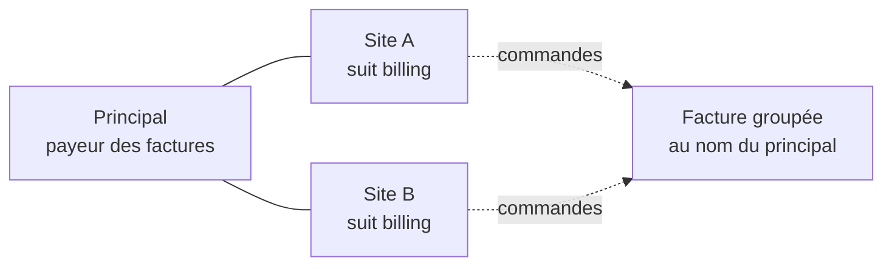

# Plan — durcir le compte de groupe (doc-first, 2026-11-11)

> 🟡 **Doc-first.** Rien n'est bâti. Décisions de Hugo du 2026-11-11, après
> l'audit du compte de groupe (principal + sites). Ce plan touche l'argent et
> le mur : il passe par `vitruve` avant Hugo.

## En bref

Un **compte de groupe** est une société mère (le « principal ») et ses
**sites**, des sociétés à part entière qui peuvent suivre la mère pour la
facturation (`billing`) et pour le tarif (`pricing`) — voir
[`sous-comptes.md`](sous-comptes.md).

Ce que l'audit a trouvé, et ce que ce plan décide :

| #   | Constat                                                                                                                                        | Décision de Hugo (2026-11-11)                                                                                      |
| --- | ---------------------------------------------------------------------------------------------------------------------------------------------- | ------------------------------------------------------------------------------------------------------------------ |
| 1   | Un site voit **toute** facture qui contient une de ses commandes, donc les commandes de ses frères ; il la reçoit aussi par e-mail, PDF joint. | **Fuite.** Un site qui ne facture pas ne voit que ses propres commandes.                                           |
| 2   | Un lot de prélèvement déjà constitué n'est pas rejugé après un détachement.                                                                    | Juste (la facture est au nom du principal) ; **la doc se corrige**.                                                |
| 3   | Un principal suspendu ou résilié fournit encore son tarif à ses sites.                                                                         | **On garde**, « on commence simple » ; la doc le dit.                                                              |
| 4   | Rattacher ne regarde rien du passé de l'enfant.                                                                                                | Rattacher reste libre ; **suivre `billing` est refusé** tant que le site a son propre crédit ou son propre mandat. |
| 5   | « Compte de groupe, sans livraison » ne fait que refuser la commande au nom du principal.                                                      | Rien à corriger dans le code ; **le libellé dit ce que ça fait**.                                                  |
| 6   | Résilier un site ne ferme rien.                                                                                                                | La résiliation d'un site **ferme ses suivis et révoque ses mandats** ; le rattachement reste.                      |

## 1. Les factures d'un site — ce qu'il voit (L1)

### Aujourd'hui (vérifié le 2026-11-11)

- `PrismaCompanyInvoicesReader` (`apps/lfd-api/src/lafoliecoffee/accounting/infrastructure/prisma-company-invoices.reader.ts`)
  : `visibleTo` et `oneVisibleTo` ouvrent une facture si
  `payerCompanyId = société` **OU** si un bon de la facture a été passé par
  elle (`invoice_order` ⨝ `orders.company_id`, `coveringOrdersOf`). Lu par
  `list-my-company-invoices`, `get-my-company-invoice`,
  `get-my-company-invoice-document` (PDF), `export-my-company-invoices-archive` (zip).
- La facture est regroupée par payeur et mandat
  (`accounting/domain/services/monthly-invoicing.ts`, `invoiceGroupKey`) :
  un site qui suit `billing` a le principal pour payeur, et sa facture
  porte les bons de tous les sites du même principal.
- La vue (`invoice.mapper.ts`) sert tous les bons de la pièce et ses lignes.
- L'e-mail `customer.invoice-issued` joint le PDF et part, en plus du payeur,
  aux contacts et membres `billing` de **chaque société qui a un bon sur la
  facture** (`domain/services/invoice-notice-recipients.ts`, source
  `site_billing`).
- `documentation/comptabilite/facturation/facture-emise.md` (« Mes factures »)
  l'écrit comme voulu : « un site voit donc la facture entière de sa maison
  mère ». Contredit par `sous-comptes.md` §3 (un sous-compte ne voit ni le
  principal ni ses frères).

### La règle

**Une facture se lit par son payeur, et par lui seul.** Le mur de « Mes
factures » devient `payerCompanyId = société`. Un site qui facture lui-même
(il ne suit pas `billing`) est son propre payeur et voit ses factures comme
aujourd'hui ; un site qui suit `billing` n'en voit aucune. Il garde ses
commandes, qu'il voit déjà dans « Mes commandes » (inchangé).

- L'e-mail de facture ne part plus qu'au payeur : la source `site_billing`
  disparaît de `invoiceNoticeRecipients`.
- L'écran « Mes factures » d'un site qui suit `billing` dit pourquoi il est
  vide : « Vos commandes sont facturées au compte principal, {nom}. » — pas
  un état vide muet. Le nom du principal est déjà servi au site (`via` des
  sites atteints) : à confirmer au bâti sur la route du site lui-même.
- Le détachement n'a plus rien à fermer côté factures : l'ex-site n'a jamais
  été payeur des factures groupées, il ne les voit pas, avant comme après.

### Ce qui reste à ouvrir au bâti (non vérifié ici)

- Les autres lecteurs qui ouvrent une facture par ses bons : les impayés
  (`PrismaUnpaidAccessReader`, page des impayés), les relances, l'avis de
  prélèvement (`collection-notice`). Chacun reçoit la même règle — payeur
  seul — ou une raison écrite de faire autrement.
- `PrismaInvoiceSiteContactsReader` (cité par le lecteur) : son seul usage
  est-il la liste `site_billing` ? S'il ne sert plus, il se retire.

## 2. La doc fausse — corrigée sans code (L2)

Dans [`sous-comptes.md`](sous-comptes.md) :

- §2.1 quater : « le principal n'est jamais débité d'office » est vrai **à la
  constitution d'un lot**. Un lot déjà constitué n'est pas rejugé après un
  détachement : la facture est au nom du principal, il en est le débiteur. Le
  dire, avec l'exemple.
- §2.1 bis : « Le KBIS est celui du principal tant que billing est suivi » —
  faux : le site télécharge le sien (`download-kbis.handler.ts`) ; seule la
  porte d'activation l'en dispense.
- §5 : le trigger `company_follows_current_parent` ne joue qu'à l'écriture
  d'une période ; une écriture directe de `parent_company_id` ne la ferme
  pas. Tout passe aujourd'hui par les gestes, sous le verrou.
- §4 : détacher ferme les suivis, mais **la forme de prélèvement survit** et
  se réapplique à un nouveau suivi.
- Un principal suspendu **ou résilié** fournit toujours son tarif à ses
  sites (décision du 2026-11-11 : on commence simple) ; seule la commande au
  compte est coupée (`orders/domain/services/order-payer.ts`).
- `facture-emise.md` (« Mes factures ») : la phrase sur la facture entière de
  la maison mère est remplacée par la règle du §1.

## 3. Suivre `billing` exige un site sans facturation propre (L3)

**Rattacher reste libre** : un site garde ses commandes, ses factures et son
historique. Le conflit n'est qu'au **suivi `billing`** : un site qui a encore
son propre crédit ou son propre mandat serait prélevé par deux voies.

`SubAccountFollows.follow("billing", …)`
(`account/domain/entities/sub-account-follows.ts`) refuse aujourd'hui
seulement un principal non actif. Il refuse en plus :

- un enfant dont `grantedTerms` n'est pas vide — « Ce site a son propre
  crédit : retirez-le avant qu'il suive la facturation du compte principal. » ;
- un enfant qui porte un mandat SEPA **actif dont il est le débiteur** —
  « Ce site a son propre mandat de prélèvement : révoquez-le avant… ».

Le mandat vit dans `payments/` (même bloc) : le compte DÉCLARE un port de
lecture étroit (« ce site a-t-il un mandat actif à son nom ? »), `payments`
l'implémente, comme `SiteMandateRevocation` aujourd'hui. Lu **sous le verrou**
de la hiérarchie, dans `FollowParentHandler` et `CreateSubAccountHandler`
(qui peut naître en suivant `billing`).

Les factures déjà émises au site restent dues au site ; rien ne les réécrit.

## 4. Le libellé du compte de groupe (L4)

`markGroupWithoutDelivery` ne fait qu'une chose : refuser une commande passée
au nom du principal (`GroupAccountOrderRefusedError`). Les sites commandent et
se font livrer normalement. Le libellé de la case (back-office,
`fiche-client/group-account-card/`) devient « Le compte principal ne commande
pas — seuls ses sites commandent », et sa phrase d'aide le dit. Le code ne
change pas.

## 5. Résilier un site (L5)

Aujourd'hui, `ChangeCompanyStatusHandler` (`terminate`) ne touche ni aux
suivis, ni aux mandats, ni au rattachement.

Résilier une société **qui a un principal**, sous `AccountHierarchyLock` et
dans la même unité de travail que le statut :

- **ferme tous ses suivis** (`SubAccountFollows.closeAll`, comme le
  détachement) : un site résilié ne vit plus sur son principal ;
- **révoque ses mandats** dont il est le débiteur, et ceux qui nomment le
  principal (`SiteMandateRevocation.revokeNaming` existe ; le premier cas
  demande une méthode de plus sur le port) ;
- **garde le rattachement** : le principal continue de voir l'historique du
  site, et l'on ne détache pas d'office.

Les factures déjà émises restent dues. Un site résilié ne commande plus
(déjà refusé : `CompanyClosedOrderRefusedError`).

## 6. Tests

- **L1** : e2e — l'admin d'un site qui suit `billing` ne voit aucune facture
  groupée (liste, détail 404, PDF 404, archive vide), même quand un bon de la
  facture est le sien ; le principal la voit ; un site qui facture lui-même
  voit les siennes. L'e-mail de facture ne part qu'au payeur (unitaire de
  `invoiceNoticeRecipients`, et l'abonné). Régression nommée : « un site ne
  lit pas la facture groupée de ses frères ».
- **L3** : unitaire de `SubAccountFollows` (crédit propre, mandat propre →
  refus) ; e2e du geste staff `follows` et de la création d'un site qui suit
  `billing`.
- **L5** : e2e — résilier un site ferme ses suivis, révoque ses mandats,
  garde `parent_company_id`, et le principal lit toujours ses commandes.

## 7. Lots

| Lot | Contenu                                                                     | Migration |
| --- | --------------------------------------------------------------------------- | --------- |
| L1  | mur des factures au payeur seul, e-mail au payeur seul, écran vide expliqué | aucune    |
| L2  | doc                                                                         | —         |
| L3  | refus du suivi `billing` + port de lecture des mandats                      | aucune    |
| L4  | libellé back-office                                                         | aucune    |
| L5  | résiliation d'un site                                                       | aucune    |

Ordre : L1 (la fuite), puis L3 et L5, L2 et L4 au fil de l'eau.

## 8. Questions ouvertes

- Q1 — Un site qui suit `billing` doit-il savoir qu'une de ses commandes est
  **facturée** (numéro de la facture du principal, sans le PDF) dans « Mes
  commandes » ? Proposé : oui, le numéro seul, plus tard.
- Q2 — Les données de facture déjà envoyées par e-mail aux sites (PDF
  groupés) restent dans leurs boîtes : rien à faire côté système ; à savoir.
