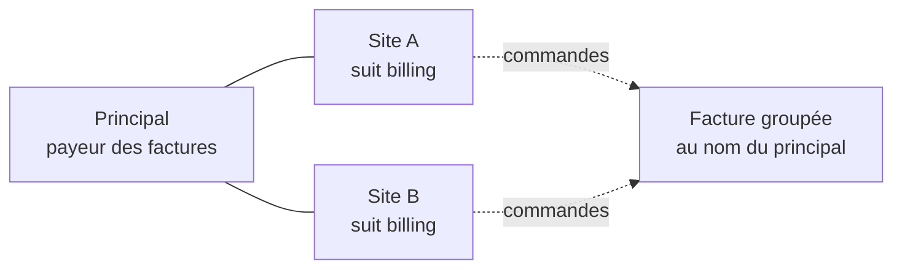

# Plan — durcir le compte de groupe (doc-first, 2026-11-11)

> 🟡 **Doc-first.** Rien n'est bâti. Décisions de Hugo du 2026-11-11, après
> l'audit du compte de groupe (principal + sites). Ce plan touche l'argent et
> le mur : contredit par `vitruve` le 2026-11-11 (3 bloquants, 5 sérieux,
> intégrés ci-dessous).

## En bref

Un **compte de groupe** est une société mère (le « principal ») et ses
**sites**, des sociétés à part entière qui peuvent suivre la mère pour la
facturation (`billing`) et pour le tarif (`pricing`) — voir
[`sous-comptes.md`](sous-comptes.md).

Ce que l'audit a trouvé, et ce que ce plan décide :

| #   | Constat                                                                                                                                        | Décision de Hugo (2026-11-11)                                                                                      |
| --- | ---------------------------------------------------------------------------------------------------------------------------------------------- | ------------------------------------------------------------------------------------------------------------------ |
| 1   | Un site voit **toute** facture qui contient une de ses commandes, donc les commandes de ses frères ; il la reçoit aussi par e-mail, PDF joint. | **Fuite.** Un site qui ne facture pas ne voit que ses propres commandes.                                           |
| 2   | Un lot de prélèvement déjà constitué n'est pas rejugé après un détachement.                                                                    | Juste (la facture est au nom du principal) ; **la doc se corrige**.                                                |
| 3   | Un principal suspendu ou résilié fournit encore son tarif à ses sites.                                                                         | **On garde**, « on commence simple » ; la doc le dit.                                                              |
| 4   | Rattacher ne regarde rien du passé de l'enfant.                                                                                                | Rattacher reste libre ; **suivre `billing` est refusé** tant que le site a son propre crédit ou son propre mandat. |
| 5   | « Compte de groupe, sans livraison » ne fait que refuser la commande au nom du principal.                                                      | Rien à corriger dans le code ; **le libellé dit ce que ça fait**.                                                  |
| 6   | Résilier un site ne ferme rien.                                                                                                                | La résiliation d'un site **ferme ses suivis et révoque ses mandats** ; le rattachement reste.                      |

## 1. Les factures d'un site — ce qu'il voit (L1)

### Aujourd'hui (vérifié le 2026-11-11)

- `PrismaCompanyInvoicesReader` (`apps/lfd-api/src/lafoliecoffee/accounting/infrastructure/prisma-company-invoices.reader.ts`)
  : `visibleTo` et `oneVisibleTo` ouvrent une facture si
  `payerCompanyId = société` **OU** si un bon de la facture a été passé par
  elle (`invoice_order` ⨝ `orders.company_id`, `coveringOrdersOf`). Lu par
  `list-my-company-invoices`, `get-my-company-invoice`,
  `get-my-company-invoice-document` (PDF), `export-my-company-invoices-archive` (zip).
- La facture est regroupée par payeur et mandat
  (`accounting/domain/services/monthly-invoicing.ts`, `invoiceGroupKey`) :
  un site qui suit `billing` a le principal pour payeur, et sa facture
  porte les bons de tous les sites du même principal.
- La vue (`invoice.mapper.ts`) sert tous les bons de la pièce et ses lignes.
- L'e-mail `customer.invoice-issued` joint le PDF et part, en plus du payeur,
  aux contacts et membres `billing` de **chaque société qui a un bon sur la
  facture** (`domain/services/invoice-notice-recipients.ts`, source
  `site_billing`).
- `documentation/comptabilite/facturation/facture-emise.md` (« Mes factures »)
  l'écrit comme voulu : « un site voit donc la facture entière de sa maison
  mère ». Contredit par `sous-comptes.md` §3 (un sous-compte ne voit ni le
  principal ni ses frères).

### La règle

**Un site voit une facture quand elle ne porte que ses propres commandes** —
ou quand il en est le payeur. Le mur de « Mes factures » devient :
`payerCompanyId = société` **OU** « tous les bons de la pièce ont été passés
par la société ». Une facture groupée qui porte un bon d'un frère ne s'ouvre
plus au site ; la facture **carte** d'une commande du site (une pièce, un bon,
émise au principal par `prepareCardInvoice` quand le site suit `billing`,
`accounting/application/card-invoice-support.ts`) reste à lui : c'est le
justificatif de son propre paiement, et un site qui suit `billing` peut payer
par carte (`orders/application/services/staff-settlement-refusal.ts`, le
règlement `card` n'est jamais refusé).

- La même règle choisit les destinataires de l'e-mail de facture : les
  contacts `billing` d'un site ne la reçoivent que si la pièce ne porte que
  ses bons. La source `site_billing` de `invoiceNoticeRecipients` reste, sous
  cette condition.
- L'écran « Mes factures » d'un site qui suit `billing` dit pourquoi il n'y
  voit pas ses factures du mois : « Vos commandes au compte sont facturées
  au compte principal. » — pas un état vide muet.
- Le détachement n'a rien à fermer : la règle ne dépend que des bons de la
  pièce, avant comme après.
- Le commentaire de tête de `PrismaCompanyInvoicesReader` se réécrit au même
  commit.

### Les autres lecteurs — inventaire fait (2026-11-11, `vitruve`)

- `PrismaUnpaidAccessReader` n'ouvre aucune facture : c'est le lecteur de
  rôle du mur.
- L'avis de prélèvement ne part qu'au payeur (`collection-notice-recipient.ts`).
- `PrismaOrderInvoicesReader` (par `invoice_order`) n'est servi qu'au staff
  (`admin-card-invoices.controller.ts`).
- Les impayés détachés (`get-my-detached-unpaid-orders.handler.ts`) passent
  par les bons, pas par la facture.
- `PrismaInvoiceSiteContactsReader` n'a qu'un usage, `InvoiceNoticeSender` :
  il reste, filtré par la règle ci-dessus.

## 2. La doc fausse — corrigée sans code (L2)

Dans [`sous-comptes.md`](sous-comptes.md) :

- §2.1 quater : « le principal n'est jamais débité d'office » est vrai **à la
  constitution d'un lot**. Un lot déjà constitué n'est pas rejugé après un
  détachement : la facture est au nom du principal, il en est le débiteur. Le
  dire, avec l'exemple.
- §2.1 bis : « Le KBIS est celui du principal tant que billing est suivi » —
  faux : le site télécharge le sien (`download-kbis.handler.ts`) ; seule la
  porte d'activation l'en dispense.
- §5 : le trigger `company_follows_current_parent` ne joue qu'à l'écriture
  d'une période ; une écriture directe de `parent_company_id` ne la ferme
  pas. Tout passe aujourd'hui par les gestes, sous le verrou.
- §4 : détacher ferme les suivis, mais **la forme de prélèvement survit** et
  se réapplique à un nouveau suivi.
- Un principal suspendu **ou résilié** fournit toujours son tarif à ses
  sites (décision du 2026-11-11 : on commence simple) ; seule la commande au
  compte est coupée (`orders/domain/services/order-payer.ts`).
- `facture-emise.md` (« Mes factures ») : la phrase sur la facture entière de
  la maison mère est remplacée par la règle du §1.

## 3. Un site qui suit `billing` n'a pas de facturation propre (L3)

**Rattacher reste libre** : un site garde ses commandes, ses factures et son
historique. La règle tient sur toute la durée du suivi `billing`, pas
seulement au geste qui l'ouvre : un site prélevé par deux voies est
l'état interdit.

**Le prédicat « mandat propre du site »** : `payment_mandate.company_id = site`
**et** (`debtor_company_id = site` **ou** `debtor_company_id IS NULL` — les
mandats d'avant S4, dont le débiteur est implicitement leur société,
`prisma/schema/public/accounting.prisma`), dans un statut **vivant** :
`draft`, `pending` ou `active` (`MandateStatus` en a cinq ; `revoked` et
`failed` sont morts).

Les gestes qui tiennent la règle, tous sous `AccountHierarchyLock` :

| Geste                                                                        | Refuse                                                                                                                                                               |
| ---------------------------------------------------------------------------- | -------------------------------------------------------------------------------------------------------------------------------------------------------------------- |
| suivre `billing` (`FollowParentHandler`, `CreateSubAccountHandler`)          | un site au crédit non vide, ou au mandat propre vivant — « Ce site a son propre crédit / mandat : retirez-le avant qu'il suive la facturation du compte principal. » |
| accorder un crédit (`GrantTermsHandler`)                                     | un site qui suit `billing` — « Ce site est facturé par son compte principal. »                                                                                       |
| frapper un mandat au nom du site (`mint-mandate`, `mint-my-company-mandate`) | un site qui suit `billing` et dont le débiteur serait lui-même                                                                                                       |

Le compte DÉCLARE un port de lecture étroit (« ce site a-t-il un mandat
propre vivant ? »), `payments` l'implémente, comme `SiteMandateRevocation`.
Les gestes de mandat prennent le même verrou ; à défaut, ils relisent le
suivi dans leur transaction (choix au bâti, écrit dans le commit).

**Les données existantes** : avant le bâti, une requête de dénombrement des
sites qui suivent `billing` avec un crédit ou un mandat propre vivant. S'il
y en a, la liste va au staff avec le geste de sortie (retirer le crédit,
révoquer le mandat) ; la règle ne réécrit rien d'office.

Les factures déjà émises au site restent dues au site.

## 4. Le libellé du compte de groupe (L4)

`markGroupWithoutDelivery` ne fait qu'une chose : refuser une commande passée
au nom du principal (`GroupAccountOrderRefusedError`). Les sites commandent et
se font livrer normalement. Le libellé de la case (back-office,
`fiche-client/group-account-card/`) devient « Le compte principal ne commande
pas — seuls ses sites commandent », et sa phrase d'aide le dit. Le code ne
change pas.

## 5. Résilier un site (L5)

Aujourd'hui, `ChangeCompanyStatusHandler` (`terminate`) ne touche ni aux
suivis, ni aux mandats, ni au rattachement, et lit l'agrégat **avant** sa
transaction.

Résiliation d'une société **qui a un principal** : le handler prend
`AccountHierarchyLock`, puis charge la société **dans** l'unité de travail
(la forme de `detach-from-parent.handler.ts`), et :

- **refuse** si un mandat du site figure dans un **lot de prélèvement
  vivant** (`prisma-batched-mandates.reader.ts`) — « Un prélèvement en
  cours vise ce site : attendez son règlement ou annulez le lot, puis
  résiliez. » Un mandat révoqué sous un lot vivant laisserait partir un
  `pain.008` sous un mandat mort ;
- **ferme tous ses suivis** (`SubAccountFollows.closeAll`) ;
- **révoque ses mandats propres vivants** (prédicat du §3) et ceux qui
  nomment le principal. `revokeNaming` ne voit aujourd'hui que `active` et
  `draft` (`payments/infrastructure/prisma-site-mandates.reader.ts`) : il
  couvre aussi `pending`, que l'agrégat sait révoquer ;
- **garde le rattachement** : le principal lit toujours l'historique du site.

**Les commandes au compte du mois, pas encore facturées** : leur payeur
copié est le principal et le suivi daté couvre leur passation ; la facture
du principal les porte comme avant, prélevée sur **son** mandat. Les mandats
qu'on révoque sont ceux du site : ils ne prélevaient pas ces bons.
(À vérifier au bâti dans `collection-verdict.ts` : quel mandat juge une
ligne d'un site qui suivait `billing` au moment de sa passation.)

La résiliation est terminale (`company.ts`) : aucun retour à traiter. Un
site résilié ne commande plus (`CompanyClosedOrderRefusedError`).

## 6. Tests

- **L1** : e2e — l'admin d'un site ne voit pas une facture groupée qui porte
  un bon d'un frère (liste, détail 404, PDF 404, archive), voit sa facture
  carte, et voit une pièce qui ne porte que ses bons ; le principal voit tout ;
  un site qui facture lui-même voit les siennes. L'e-mail ne part à un site
  que pour une pièce qui ne porte que ses bons. Régression nommée : « un site
  ne lit pas la facture groupée de ses frères ».
- **L3** : unitaire de `SubAccountFollows` (crédit propre, mandat `draft`,
  `pending`, `active`, mandat d'avant S4 sans débiteur → refus) ; e2e du
  suivi, de la création d'un site, du crédit refusé pendant le suivi, de la
  frappe d'un mandat refusée pendant le suivi.
- **L5** : e2e — résilier un site ferme ses suivis, révoque ses mandats
  (`pending` compris), garde `parent_company_id`, refuse quand un lot vivant
  vise un de ses mandats ; le principal lit toujours ses commandes.

## 7. Lots

| Lot | Contenu                                                                                                            | Migration |
| --- | ------------------------------------------------------------------------------------------------------------------ | --------- |
| L1  | mur des factures : payeur, ou pièce qui ne porte que les bons du site ; e-mail sous la même règle ; écran expliqué | aucune    |
| L2  | doc                                                                                                                | —         |
| L3  | refus du suivi `billing` + port de lecture des mandats                                                             | aucune    |
| L4  | libellé back-office                                                                                                | aucune    |
| L5  | résiliation d'un site                                                                                              | aucune    |

Ordre : L1 (la fuite), puis L3 et L5, L2 et L4 au fil de l'eau.

## 8. Questions ouvertes

- Q1 — Un site qui suit `billing` doit-il savoir qu'une de ses commandes est
  **facturée** (numéro de la facture du principal, sans le PDF) dans « Mes
  commandes » ? Proposé : oui, le numéro seul, plus tard.
- Q2 — Les données de facture déjà envoyées par e-mail aux sites (PDF
  groupés) restent dans leurs boîtes : rien à faire côté système ; à savoir.
