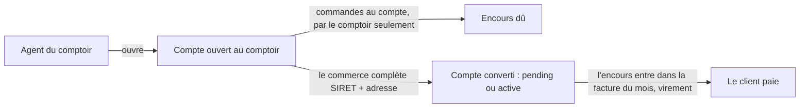

# Plan — les comptes du comptoir (doc-first, 2026-11-28)

> 📐 **Doc-first : aucune ligne de code.** Le plan touche l'argent (un crédit
> sans moyen d'encaisser) et une frontière (qui commande à crédit) :
> **`vitruve` avant Hugo** (CLAUDE.md § 9 bis). Chaque affirmation sur
> l'existant cite un fichier ouvert le 2026-11-28.

## 1. En deux mots

La Direction veut qu'un agent du comptoir puisse **ouvrir un compte pro
incomplet** — sans SIRET vérifié, sans RIB, sans mandat — et y **commander
au compte tout de suite**. Le commerce **convertit** ensuite ce compte en
compte normal, depuis une page qui liste ces comptes et ce qu'ils doivent.

### Décisions de Hugo du 2026-11-28

| #   | Question                        | Réponse                                                                          |
| --- | ------------------------------- | -------------------------------------------------------------------------------- |
| D1  | Qui ouvre et commande au compte | **Les agents du comptoir**, et seulement eux (pas le client depuis la boutique)  |
| D2  | Le statut                       | **« Ouvert au comptoir »**, un état nommé                                        |
| D3  | Plafond                         | **Réglage**, par défaut **aucun**                                                |
| D4  | Réconcilier                     | **Une page de l'espace commerce, une table** des comptes à convertir, avec le dû |
| D5  | Moyen d'encaissement            | **Virement obligé**                                                              |
| D6  | Droit                           | **Une ressource « les comptes du comptoir »**                                    |

## 2. Ce qui existe (ouvert le 2026-11-28)

- **Le crédit** se juge dans `accountStanding`
  (`apps/lfd-api/src/lafoliecoffee/orders/application/services/order-settlement.ts:166`) :
  société **`active`** (et payeur actif, `settlingStatusOf`) **et**
  `settlesOnAccount` du payeur. Sinon `TermsNotGrantedError`.
- **`settlesOnAccount`** (`prisma-order-guard.reader.ts:49`) lit
  `grantedTerms` (non vide) et `directDebitBlockedAt` ; l'agrégat a la même
  règle (`company.ts:746`). `DeferredTerm` n'a qu'une valeur, `monthly`
  (`prisma/schema/public/account.prisma:6`).
- **Les statuts** : `pending | active | suspended | terminated`
  (`account.prisma:32`). Rien entre « inscrit en ligne » et « validé ».
- **Le virement existe** comme moyen d'encaissement d'un payeur :
  `PayerCollectionMeans` (`prisma/schema/public/collection-means.prisma`),
  historique append-only, motif obligatoire, **aucune ligne = prélèvement**.
  La facture du mois prend l'échéance du virement quand le moyen est
  `SEPA_CREDIT_TRANSFER` (`monthly-invoice-issuance.ts:123`). Doc :
  [`../comptabilite/le-paiement-par-virement.md`](../comptabilite/le-paiement-par-virement.md).
- **Le comptoir a sa propre garde du crédit** : `staff-settlement-refusal.ts`
  reçoit `atCounter` et passe par `counterStatusRefusalOf` (`:171`), qui
  refuse tout statut autre que `active` (`company_inactive`). La boutique,
  elle, passe par `accountStanding`.
- **La facture exige un SIREN et une adresse** :
  `accounting/domain/services/invoice-issuance-blockers.ts:246`
  (`buyer_siren_missing`) et `:271` (`buyer_address_missing`).
- **Le mode de facturation** : aucune ligne `payer_billing_mode` = mensuel
  (`billing-mode.prisma:30`) ; rien à écrire à l'ouverture.
- **Le comptoir crée déjà des clients** : `register-counter-particular`
  (particuliers) et `admin-counter-customers.controller.ts` (lecture).
  Aucune création de société pro au comptoir.
- **La règle du 2026-11-05** (`plan-pros-en-cours-d-inscription.md` § 0 bis) :
  « le seul truc qu'on ne peut pas faire sur un pending, c'est au compte ».
  **Elle reste vraie** : un compte ouvert au comptoir n'est pas un pending.

## 3. Le modèle

### 3.1 Un statut, pas un drapeau

`CompanyStatus` gagne **`counter_opened`** (migration additive d'une valeur
d'enum). Pourquoi un statut plutôt qu'une colonne `opened_at_counter` sur un
`pending` : la garde du crédit lit le statut, et un drapeau ferait de chaque
lecteur de `pending` un lecteur à revoir. Un statut neuf est refusé partout
où on ne l'a pas admis — c'est le sens sûr (mémoire « interdire plutôt que
vérifier »).

- **Factory** : `Company.openAtCounter({ enseigne, contact, … }, by, at)`.
  Exige un nom d'usage et un contact joignable. **N'exige pas** SIRET,
  adresse de facturation, KBIS, RIB ni mandat (Q1, Hugo, 2026-11-28 :
  « plafond seul »).
- **Les lignes au prix pro** (Hugo, 2026-11-28) : une commande d'un compte
  du comptoir fige ses lignes avec la réduction de l'audience pro, comme
  toute commande pro, **de manière optimiste** (Hugo, 2026-11-28) : on
  suppose le compte pro avant que le commerce l'ait vu. Le snapshot ne
  change pas à la conversion ; un compte refusé ensuite garde ses lignes au
  prix pro (aucun re-tarif — lecture du mot « optimiste » à confirmer).
- **Pas facturable avant conversion** : sans SIREN ni adresse, l'émission
  du mois le bloque (§ 2). L'encours s'accumule sans facture ni échéance ;
  **le plafond (§ 3.3) est le seul frein**, et il est vide par défaut — un
  compte du comptoir est donc, par défaut, un crédit sans borne ni facture.
  C'est assumé ; la page du § 4 est le seul endroit qui le montre.
- **La conversion exige SIRET et adresse de facturation** : c'est ce qui rend
  l'encours facturable. Les commandes déjà passées entrent dans la facture de
  la période de leur clôture suivante (à vérifier en K5 : une commande d'une
  période close reste-t-elle facturable plus tard ?).
- **Transitions** : `counter_opened → pending` (le commerce complète la
  fiche ; le parcours d'activation normal reprend) ou `→ active` directement
  si le verdict d'activation existant (`plan-mon-compte-a-completer.md`) est
  vert — aucune garde neuve ; `→ terminated` comme les autres. Jamais
  `pending → counter_opened`.
- **Audience** : pro (`audienceOf` rend `b2b`), comme un pending.
- **Aucun membre** tant que `counter_opened` : l'invitation d'un membre est
  refusée par l'agrégat (le client n'a pas d'espace avant conversion).
- **L'acheteur sans accès** (Hugo, 2026-11-28) : « aucun membre » veut dire
  « personne ne se connecte ». Le contact donné à l'ouverture est rattaché au
  compte comme acheteur **sans accès** — aucune identité Auth0, aucune
  invitation, aucun lien de mot de passe —, pour que la passation de l'équipe
  (`ensureOrderMember`) ait au nom de qui commander. ⚠️ **Non bâti** : un
  rattachement (`memberships`) ouvre la société tant que son invitation vit
  (`openingMembership`, 7 jours depuis `invited_at`), et une fiche sans `sub`
  est reprise par la première connexion qui prouve son adresse
  (`GuestAccountClaim`). Rattacher le contact tel quel lui ouvrirait l'espace
  sept jours s'il se connectait à la boutique. Le geste de fermeture reste à
  trancher (relevé le 2026-11-28).
- **Ce que « refusé partout » demande** : le statut est recopié dans des
  types fermés qui ne dérivent pas de l'enum — `account/domain/value-objects/company-status.ts`,
  `orders/domain/ports/company-status.reader.ts`,
  `shared/company-standing/domain/company-standing.ts`,
  `packages/contracts/src/customer-sheet.ts` — et `CompanyStatus` apparaît
  dans 52 fichiers hors tests (compté par `vitruve` le 2026-11-28). Les
  tests `!== "pending"` (`company.ts:684`, `:1001`) ouvriraient un
  comportement : K1 les revoit un par un.

### 3.2 Le crédit d'un compte du comptoir

**Seule `counterStatusRefusalOf` admet `counter_opened`** (D1).
`accountStanding` — le chemin de la boutique — **ne change pas** : il rend
`none` pour `counter_opened`, et un e2e le tient. Aucun paramètre de canal
n'entre dans la garde de la boutique.

À l'ouverture, dans la même transaction :

- `grantedTerms = [monthly]` ;
- une ligne `PayerCollectionMeans` **`bank_transfer`**, motif « ouvert au
  comptoir » (D5) — à l'émission, ce moyen devient le code `"58"`
  (`SEPA_CREDIT_TRANSFER`, `invoice.types.ts:145`) ; K3 vérifie la traduction
  en e2e jusqu'à la facture émise. Sans elle, la facture se lirait « prélèvement sans mandat »
  et bloquerait le dépôt.

Le virement est **obligé** tant que le statut est `counter_opened` :
`setCollectionMeans(sepa_debit)` est refusé avec un message qui dit de
convertir le compte d'abord. **À la conversion**, le moyen reste le
virement ; le passage au prélèvement est un geste distinct du commerce, une
fois le mandat signé, avec son motif.

### 3.3 Le plafond (D3)

Un réglage `counterAccountCeilingCents` (entier, `null` = aucun, défaut
`null`). S'il est posé, la passation au compte d'un `counter_opened` est
refusée quand **encours non réglé + total de la commande > plafond**, par une
`BusinessError` qui nomme l'encours et le geste (« convertir le compte » ou
« encaisser par carte »). **L'encours n'a pas de lecture aujourd'hui** (cherché par `vitruve`).
K4 la crée : les commandes au compte non encore facturées (propriétaire :
`orders`) + les factures non réglées (propriétaire : `accounting`), deux
lectures nommées par lot, composées par la page et par la garde.

**Bâti (K4)** : la garde ne lit que la première — un compte du comptoir n'est
jamais facturé avant sa conversion, donc ses commandes au compte non annulées
sont tout son dû, et après conversion le statut n'est plus `counter_opened` et
la garde ne s'applique plus. Le réglage vit dans `counter_account_settings`
(une ligne `orders`, absente = aucun plafond) ; **aucun écran ne l'écrit
encore**. Le refus vaut à la passation (409
`orders.counter.ceiling_exceeded`) et à l'estimation (avertissement de même
code), seulement sur un règlement au compte.

### 3.4 Le droit (D6)

Une valeur `StaffResource` **`b2b_counter_accounts`** (préfixe `b2b_`
assumé : c'est celui de toutes les ressources du bloc, une valeur ne se
renomme pas), ajoutée par migration
**sans aucun droit à un rôle** (`lint:no-role-grants-in-migrations`) ;
accordée à l'écran. Elle couvre : ouvrir un compte au comptoir, et passer une
commande au compte pour lui. La page de conversion (§ 4) demande le droit
des comptes clients existant, pas celui-ci.

### 3.5 La preuve d'identité (Hugo, 2026-11-28)

**Aucune photo.** L'agent demande à voir une pièce d'identité, et l'écran
d'ouverture porte une case **« J'ai vu une preuve d'identité »**,
**non bloquante** : le compte s'ouvre qu'elle soit cochée ou non.

Ce qui est gardé, sur la trace d'ouverture : la case (oui/non), **l'agent
qui l'a cochée** (son identifiant staff, nommé à l'écran) et l'instant.
**Cocher engage la responsabilité de l'agent** (Hugo, 2026-11-28) :
l'écran le dit en clair à côté de la case (« En cochant, vous attestez avoir
vu une pièce d'identité de cette personne. Votre nom est enregistré. »),
et la trace est append-only — ni décochée, ni réattribuée après coup.
Rien de la pièce elle-même — ni type, ni numéro, ni image. La page du § 4
montre « pièce vue par <agent> » ou « pièce non vue ».

**L'écran** (K2, front) : le bouton « Ouvrir un compte pro » de la page
« Nouvelle commande pro » du comptoir, sous `b2b_counter_accounts:write`,
ouvre un panneau (enseigne, prénom, nom, fonction facultative, e-mail,
téléphone, la case et son texte). **Après le `201`, l'écran ouvre la saisie
de la commande pro pour ce compte** (`/nouvelle-commande/<id>`), pas la
fiche client : le client est en face, c'est pour commander qu'on ouvre son
compte, et l'agent du comptoir n'a pas le droit de la fiche
(`b2b_companies`). Un refus affiche le message du serveur tel quel.

### 3.7 Ce que sert un compte du comptoir (Hugo, 2026-11-28)

- **Le retrait seul** : `fulfillmentMethod = "pickup"` — le retrait en
  boutique, et le « Retrait immédiat » (`entryShortcut = "immediate_pickup"`,
  qui est un `pickup` sur la vitrine). Toute livraison (`"delivery"`) est
  refusée à la passation et à l'estimation de la saisie de l'équipe
  (`orders.counter.account_pickup_only`) : « un compte ouvert au comptoir se
  retire en boutique ; convertir le compte pour livrer ».
- **Pas de reliquat** : un départ incomplet d'une de ses commandes n'ouvre
  aucun reliquat (`BackorderOpening`), et transformer ou estimer un reliquat
  lui est refusé (`orders.counter.account_no_backorder`).

## 4. La page « Comptes du comptoir » (D4)

Dans l'espace commerce du back-office : une table, une ligne par société
`counter_opened` (hors supprimées, `lint:company-archived-views`).

| Colonne           | Source                                                  |
| ----------------- | ------------------------------------------------------- |
| Enseigne, contact | la société                                              |
| Ouvert le, par    | la trace d'ouverture, et « pièce vue par <agent> »      |
| Commandes         | nombre de commandes au compte                           |
| **Dû**            | encours non réglé (facturé + pas encore facturé), en €  |
| Ce qui manque     | le verdict d'activation existant (SIRET, KBIS, mandat…) |
| Action            | **Convertir** → la fiche, puis `pending` ou `active`    |

Le dû vient d'une lecture nommée de `accounting`, par lot (une requête pour
la page, pas une par ligne). Total du dû en pied de table.

### 3.6 🔴 La fin de période ne se touche pas (Hugo, 2026-11-28)

« Ça ne doit pas rentrer dans le calcul de fin de période — protège ce qui
marche bien. » Un compte `counter_opened` n'entre dans **aucun** calcul de
période (payeurs comptés, rythmes, devis de période, clôture, émission). Le
seul point de contact admis est **l'exclusion par statut** dans la lecture
des commandes à facturer (`prisma-monthly-invoicing.reader.ts`, K1). Les
calculs, gardes et ouvreurs existants de `accounting/` ne sont pas modifiés ;
l'ouverture d'un payeur du comptoir passe par un module neuf. Toute suite
existante de `accounting/` passe **sans que sa spec ait été modifiée** — c'est
la preuve que rien n'a bougé.

## 5. Lots

| Lot | Contenu                                                                                                                                                                                    |
| --- | ------------------------------------------------------------------------------------------------------------------------------------------------------------------------------------------ |
| K1  | Statut `counter_opened`, factory, transitions, tests domaine ; revue de tous les lecteurs du statut                                                                                        |
| K2  | Case « j'ai vu une preuve d'identité » et son agent (§ 3.5) ; ressource `b2b_counter_accounts` ; route et écran « ouvrir un compte pro » au comptoir ; virement et `monthly` à l'ouverture |
| K3  | Garde du crédit : `counter_opened` admis au comptoir seulement ; virement obligé ; e2e (boutique refusée, comptoir admis)                                                                  |
| K4  | Réglage du plafond et refus ; lecture de l'encours                                                                                                                                         |
| K5  | Page « Comptes du comptoir » et conversion                                                                                                                                                 |

## 6. À vérifier (pour `vitruve`)

1. Tous les lecteurs de `CompanyStatus` (switchs exhaustifs, `audienceOf`,
   promotions lues sur le statut, mur de la boutique, `isOrderable`) : que
   rend chacun pour `counter_opened` ?
2. ✅ **Écartés de la facturation** (Hugo, 2026-11-28) : tant que le commerce
   ne l'a pas vu — c'est-à-dire converti —, un compte `counter_opened` n'est
   pas un payeur du mois. La sélection des payeurs l'exclut **par son
   statut**, dans la requête ; il ne bloque donc jamais la clôture des
   autres. K1 le tient par un e2e (une clôture avec un compte du comptoir
   émet les factures des autres).
3. ✅ Connu : `atCounter` dans `staff-settlement-refusal.ts` (§ 3.2).
4. ✅ Tranché : la conversion exige SIRET et adresse, donc l'encours d'un
   compte converti puis refusé reste facturable et réglable par virement.
   Le recouvrement est celui d'une facture impayée. Un compte jamais
   converti n'a, lui, aucun recouvrement outillé : il reste sur la page.
5. ✅ **Q1 (Hugo, 2026-11-28)** : rien n'est exigé à l'ouverture ; plafond seul.
6. Le client peut-il se connecter à ce compte avant conversion (membre,
   invitation) ? ✅ Non (§ 3.1).
