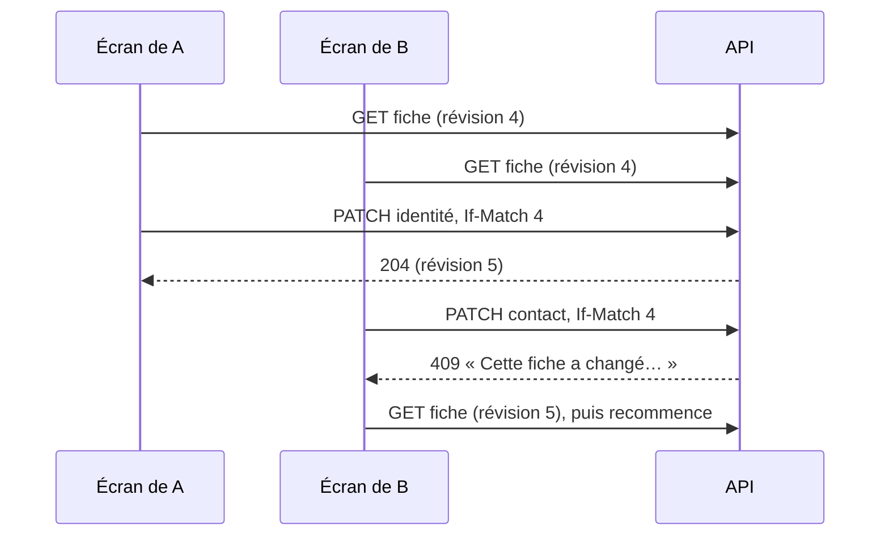

# Plan — refuser d'écrire sur une fiche client périmée

> Décidé par Hugo le 2026-11-12 (point 2 quater de
> `todos/plan-de-la-nuit-2026-11-12.md`). Un lot, bâti le 2026-11-12.

## 1. En simple

Deux personnes ouvrent la même fiche client. La première corrige l'enseigne et
enregistre. La seconde, qui a encore l'ancienne fiche sous les yeux, change le
contact principal et enregistre à son tour.

Aujourd'hui, la seconde écriture passe. Elle n'écrase que les colonnes qu'elle
touche, mais elle a été décidée sur une fiche qui n'existe plus, et personne ne
le sait.

Désormais, chaque fiche porte un **numéro de version** (la _révision_). L'écran
le lit avec la fiche et le renvoie avec chaque modification. Si la fiche a
changé entre-temps, l'API refuse :

> Cette fiche a changé depuis que vous l'avez ouverte : relisez-la avant
> d'enregistrer.

et l'écran propose **« Relire la fiche »**.



Un **rejeu à l'identique** (double clic, réseau qui renvoie) n'est pas un
conflit : la fiche porte déjà ce qu'on envoie, rien n'est écrit, rien n'est
refusé.

## 2. Technique (vérifié dans le code le 2026-11-12)

### 2.1 Où vit la révision

Une colonne `revision INTEGER NOT NULL DEFAULT 0` sur `public.companies`
(migration additive, `20261112233000_la_revision_des_fiches`). Elle n'est
écrite que par `PrismaCompanyRepository.save` :

- `load` lit `revision` et la passe à `Company.reconstitute` ;
- **tout** `save` qui écrit quelque chose monte `revision = revision + 1` ; un
  `save` sans écart n'écrit rien et ne la monte pas ;
- **seul** un geste décidé sur une fiche lue (`Company.readAt` non nul, posé
  par `ensureReadAt`) écrit sous condition : `UPDATE … WHERE id = ? AND
revision = <révision lue>` ; zéro ligne → `CompanyChangedSinceReadError`
  (`BusinessError`, 409, code `account.company.changed_since_read`). C'est la
  course entre `load` et `save` de deux écrans ouverts sur la même fiche ;
- quand l'écriture change le statut, la condition sur le statut chargé reste
  dans le `where`, et `CompanyChangedMeanwhileError` l'emporte si c'est lui
  qui a bougé (on relit la ligne pour le savoir).

⚠️ **Pourquoi pas `WHERE revision` sur tous les `save`.** C'était la
proposition de départ. Elle défait une décision écrite et tenue par
`test/company-races.e2e-spec.ts` : deux gestes concurrents sur des colonnes
différentes (une identité et le code NAF, une identité pendant une
suspension) gardent chacun ce qu'il a écrit (`changedColumns`). Un geste qui
n'a pas lu de fiche n'a rien décidé sur une version ; le refuser n'apprendrait
rien à personne.

**Ce que la révision ne voit pas** : les écritures de `companies` hors de
l'agrégat. Vérifié le 2026-11-12, il n'y en a qu'une en service,
`PrismaCompanyNafWriter` (le code NAF tiré de l'annuaire), qui ne monte pas la
révision — elle ne touche pas un champ que la fiche édite. Les tables propres
(adresses, contacts du carnet, procédure de livraison, suivis, mode de
facturation) ont leurs propres écritures et **restent hors du lot**.

### 2.2 La règle, dans l'agrégat

`Company` porte `revision` et une méthode `ensureReadAt(expected)` :
`expected === null` (l'appelant n'a rien lu) ne vérifie rien ; une valeur
différente de la révision chargée lève `CompanyChangedSinceReadError`. Le
handler l'appelle **après** la méthode métier, seulement si elle a changé
quelque chose :

```
if (!company.correctIdentity(payload)) return;   // rejeu : rien, pas de 409
company.ensureReadAt(command.expectedRevision);   // fiche lue périmée : 409
await save(company);                              // course entre load et save : 409
```

C'est ce qui règle l'idempotence : les quatre routes portées sont
`@Idempotent` (rejeu sans effet). Un rejeu de la même intention trouve la fiche
déjà dans l'état voulu, la méthode métier rend `false`, le handler sort avant
la vérification — 204, pas 409. Une route scellée (`@IntentKey` + `runSealed`)
rendrait sa réponse scellée avant même le handler ; aucune des quatre ne l'est.

### 2.3 Les gestes portés

Les gestes de la fiche staff qui modifient l'agrégat **depuis un formulaire**
lu avec la fiche :

| Route                                              | Commande                             |
| -------------------------------------------------- | ------------------------------------ |
| `PATCH admin/companies/:id/identity`               | `UpdateIdentityByStaffCommand`       |
| `PATCH admin/companies/:id/contact`                | `UpdatePrimaryContactByStaffCommand` |
| `PATCH admin/companies/:id/granted-terms`          | `GrantTermsCommand`                  |
| `PATCH admin/companies/:id/fulfillment-preference` | `PreferFulfillmentByStaffCommand`    |

Les autres `save` de `Company` (statut, activation, KBIS, blocage du
prélèvement, hiérarchie, gestes du client) ne portent pas la révision lue : ce
sont des transitions que l'agrégat garde déjà par leur état de départ. Ils
écrivent sans condition de révision, mais la **montent** : une fiche ouverte
ailleurs avant eux devient périmée.

### 2.4 Le transport

En-tête `If-Match: "<révision>"` (guillemets facultatifs), lu par
`@ExpectedRevision()` (`account/http/expected-revision.decorator.ts`) :
absent → `null` (rien de vérifié, compatible avec tout appelant actuel) ; mal
formé → 400. Un en-tête plutôt qu'un champ : les quatre schémas de corps sont
partagés avec les routes du client, qui l'auraient accepté sans s'en servir.

La fiche staff (`GET admin/companies/:id`, `AdminCompanyDetailView`) sert
`revision`.

### 2.5 L'écran

- `AdminCompaniesService` envoie `If-Match` sur les quatre gestes
  (`revisionOptions`).
- Les panneaux Identité et Contact (détenteur) reçoivent la révision avec leur
  préremplissage ; sur `account.company.changed_since_read`, ils affichent un
  `fold-callout` d'avertissement avec le message et un bouton **« Relire la
  fiche »** qui ferme le panneau (la fiche se relit à la fermeture).
- Les gestes en ligne (crédits accordés, préférence d'acheminement) disent le
  refus et relisent la fiche tout de suite.

### 2.6 Reste à faire

Rien dans ce lot. Hors lot : porter la révision sur les gestes du client
(`/me`) et sur les sous-entités qui ont leur table.
