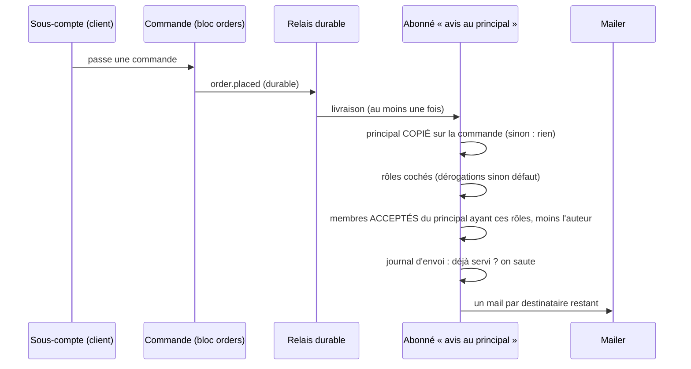

# Plan — le principal est prévenu de ce que font ses sous-comptes

> 📐 **Plan — N1, N2, N3, N4a à N4d et l'interrupteur bâtis le 2026-10-20**, N4e à faire. Demande de Hugo : « savoir quelles
> actions menées par le sous-compte doivent être notifiées au principal, avec un
> mapping de rôle ». Décisions de Hugo le même jour : **mail seul** ; le
> tableau action × rôle est **réglé par le staff, principal par principal**.
> Doc d'état du sujet : [`sous-comptes.md`](sous-comptes.md).
>
> **v2, contredit par `vitruve` le 2026-10-20** : deux objections BLOQUANTES
> corrigées (le principal « à la date du fait » n'existait pas ; des
> invitations jamais acceptées auraient reçu des mails), cinq SÉRIEUSES
> intégrées. Le détail est au §7.

## 0. Ce qui existe (ouvert le 2026-10-20)

| Fait                                                                                                                                             | Où                                                                                                                                                   |
| ------------------------------------------------------------------------------------------------------------------------------------------------ | ---------------------------------------------------------------------------------------------------------------------------------------------------- |
| Rôles d'une société : `owner`, `admin`, `orders`, `billing`                                                                                      | `prisma/schema/public/account.prisma` (`enum CustomerRole`), `account/domain/value-objects/company-role.ts`                                          |
| Les mails de commande partent à **une** personne, celle qui a passé la commande (`placedByUserId`)                                               | `orders/application/handlers/send-order-placed-mail.handler.ts`, `send-order-cancelled-mail…`, `send-payment-failed…`                                |
| La facture va au contact de facturation, au détenteur ou au site                                                                                 | `accounting/…/invoice-notice-recipients.ts`                                                                                                          |
| **Aucune** préférence de notification client, **aucune** cloche client                                                                           | cherché dans `prisma/schema` et `lfc-ecommerce-frontend`                                                                                             |
| Abonné durable : `@DurableHandler({ type, subscriber })`, au moins une fois, une seule action par la garde du relais                             | `platform/outbox/durable-handler.ts` ; exemples `growth/…/on-order-cancelled.handler.ts`, `loyalty/…/credit-points-on-handover.handler.ts`           |
| Faits publiés en DURABLE : passation (trois entrées), abandon, annulation, paiement confirmé, **paiement échoué**, prête, retirée, remboursement | `DurablePublisher` dans `orders/application/commands/place-order*.handler.ts`, `abandon-order.handler.ts`, `services/order-cancellation.service.ts`… |
| Faits **non** durables : abonnements, adresses, contacts, RIB (journal seulement)                                                                | `packages/contracts/src/journal-facts/accounts.ts`                                                                                                   |
| Le principal d'une société : `Company.parentCompanyId` ; pas de port de lecture dédié hors du verrou de hiérarchie                               | `account/domain/entities/company.ts`, `account/application/services/account-hierarchy-support.ts`                                                    |
| Le payeur est déjà COPIÉ sur la commande à la passation (`orders.billed_company_id`)                                                             | `prisma/schema/public/orders.prisma`, `orders/application/services/order-drafting.service.ts`                                                        |
| Aucun historique des rattachements : `parent_company_id` ne dit que l'état présent                                                               | `account.prisma` ; seules les périodes de `company_follows` sont datées                                                                              |
| Une `Membership` peut être une invitation jamais acceptée (`acceptedAt` nul)                                                                     | `account.prisma`, modèle `Membership`                                                                                                                |
| Une commande saisie par l'équipe porte `placedByStaffId`                                                                                         | `orders/domain/entities/order.ts`                                                                                                                    |
| Le principal ne peut PAS entrer dans l'espace client d'un sous-compte (S6 non bâti)                                                              | `sous-comptes.md` §3                                                                                                                                 |

## 1. Ce qu'on bâtit

Quand un **sous-compte** fait une action de la liste, les membres du
**principal** dont le rôle est coché pour cette action reçoivent un mail. Le
tableau est une donnée par principal ; tant que le staff n'y a pas touché, le
défaut s'applique.

### Le tableau par défaut

| Action du sous-compte                           | Clé                        | owner | admin | orders | billing |
| ----------------------------------------------- | -------------------------- | ----- | ----- | ------ | ------- |
| Commande passée                                 | `order_placed`             | ✉     | ✉     | ✉      | —       |
| Commande annulée ou abandonnée                  | `order_cancelled`          | ✉     | ✉     | ✉      | —       |
| Paiement échoué **à la charge du principal**    | `payment_failed`           | ✉     | —     | —      | ✉       |
| Abonnement créé, mis en pause, arrêté           | `subscription_changed`     | ✉     | ✉     | ✉      | —       |
| Adresse de livraison ajoutée, modifiée, retirée | `delivery_address_changed` | ✉     | ✉     | —      | —       |
| Contact ajouté ou retiré                        | `contact_changed`          | ✉     | ✉     | —      | —       |
| RIB ou mandat propre déposé                     | `bank_account_changed`     | ✉     | —     | —      | ✉       |
| Problème de commande signalé                    | `order_problem_reported`   | ✉     | ✉     | ✉      | —       |

La clé est une **valeur de donnée** (CLAUDE.md §8) : elle ne se renomme qu'en
migration.

## 2. Les règles

- **Sens unique, de l'enfant vers le principal.** Le principal voit ses
  sous-comptes, jamais l'inverse (`sous-comptes.md`, règle du 2026-10-05). Un
  frère n'est jamais prévenu.
- 🔴 **Le principal est COPIÉ sur la commande à la passation**
  (`orders.principal_company_id`, comme `billed_company_id`). Aucun historique
  des rattachements n'existe : lire `parent_company_id` à la livraison du fait
  préviendrait, après une panne du relais, le principal d'APRÈS — un site
  détaché puis rattaché ailleurs ferait fuiter ses commandes antérieures vers
  un autre client. La copie fige le principal de chaque commande ; annulation
  et paiement échoué relisent la commande, pas la hiérarchie. Pour N4 (gestes
  hors commande), le fait porte la même copie au moment où il est publié.
- 🔴 **Destinataires : membres ACCEPTÉS seulement** (`acceptedAt` non nul) :
  une invitation pendante ou périmée est une adresse saisie, pas une personne
  connue.
- **L'auteur n'est pas prévenu de son propre geste.** Une personne membre des
  deux sociétés ne reçoit pas le mail pour ce qu'elle vient de faire. Ses
  rôles se lisent dans le PRINCIPAL (c'est lui qu'on prévient).
- **Un geste du staff « au nom du client » compte** : une commande saisie par
  l'équipe pour un site est une commande du site. Le mail dit « saisie par
  La Folie Douce ».
- **Le mail ne porte pas de lien vers l'espace du sous-compte** : le principal
  ne peut pas y entrer tant que S6 n'est pas bâti. Il porte le résumé
  (site, action, numéro et montant de commande le cas échéant, date).
- **Idempotence par un journal d'envoi en base**, pas par le fournisseur :
  `sub_account_notice_sends (event_id, user_id)` unique, écrit dans l'unité de
  travail de la garde avant l'envoi. Une relivraison saute les destinataires
  déjà servis et reprend les autres. L'idempotence de Resend (fenêtre bornée)
  reste une seconde ligne. À vérifier en N2 : `event_id` est stable d'une
  relivraison à l'autre (`platform/outbox`).
- **Une adresse en rebond dur ne se rattrape pas** (CLAUDE.md §0) : le
  destinataire est une personne connue, pas une adresse saisie dans le tableau.

## 3. Le modèle

Trois ajouts, tous additifs : `orders.principal_company_id` (copie à la
passation), la table des **dérogations** au défaut, et le journal d'envoi.

```
sub_account_notice_rules
  principal_company_id  → companies.id
  kind                  enum Postgres SubAccountNoticeKind (une clé inconnue
                        est inexprimable ; retirer une clé = migration)
  role                  CustomerRole
  enabled               boolean
  updated_by, updated_at   (updated_by au registre RGPD : lint:rgpd-staff)
  unique (principal_company_id, kind, role)

sub_account_notice_sends
  event_id, user_id, sent_at   unique (event_id, user_id)
```

**Où vit l'abonné** : un contexte `b2b/sub-account-notices/`. Il lit les
membres et les dérogations par des ports que `account/` déclare et
implémente, et le résumé de la commande par un port que `orders/` implémente —
jamais les tables d'un autre contexte (`lint:prisma-model-ownership`). Tout
reste dans le bloc `b2b` : ni `durable-cross-block` ni `context-boundaries`
ne sont franchis.

Pas de ligne = le défaut du §1. Le défaut vit dans le domaine
(`apps/lfd-api/src/b2b/sub-account-notices/domain/sub-account-notice-defaults.ts`), pas en base : changer
le défaut ne demande pas de migration, et une dérogation posée reste la
volonté du staff.



## 4. Les lots

| Lot    | Contenu                                                                                                                                                                                                                                                                                                                                                                                                                                        | Agent     |
| ------ | ---------------------------------------------------------------------------------------------------------------------------------------------------------------------------------------------------------------------------------------------------------------------------------------------------------------------------------------------------------------------------------------------------------------------------------------------- | --------- |
| **N1** | Défaut du tableau (domaine pur + tests), migration additive (`orders.principal_company_id` copié à la passation par `OrderDraftingService`, dérogations, journal d'envoi), ports « membres acceptés d'une société par rôle » et « dérogations » (déclarés et implémentés en `account/`), port « résumé de commande » (`orders/`) ; routes staff `GET/PUT /admin/companies/:id/sub-account-notices` sous `@AdminSurface("b2b_companies")` ; e2e | batisseur |
| **N2** | Abonnés durables sur les faits de commande déjà durables (`order_placed`, `order_cancelled`, `payment_failed`) ; gabarit `customer.sub-account-activity` ; e2e : un site commande → les membres acceptés du principal aux bons rôles reçoivent ; l'auteur non, le frère non, l'invité non accepté non ; **un site rattaché ailleurs APRÈS sa commande ne fait pas prévenir le nouveau principal** ; une relivraison ne double aucun mail       | batisseur |
| **N3** | ✅ 2026-10-20. Écran : sous la grille de la page Sous-comptes du principal, le tableau action × rôle en boutons Activer / Désactiver (même forme que la grille), défaut visible et « Revenir au défaut ». **Seules les lignes dont le mail existe** s'affichent : les cinq de N4 restent cachées jusqu'à leur lot                                                                                                                              | pablo     |
| **N4** | Voir « N4 — conception, v2 » ci-dessous : cinq lots N4a…N4e, le socle dans N4a                                                                                                                                                                                                                                                                                                                                                                 | batisseur |

N1 → N2 → N3 livrent la valeur sur les commandes. N4 est séparé parce qu'il
touche cinq contextes qui ne publient aujourd'hui qu'au journal.

### N1 bâti (2026-10-20) — et ses écarts

- Migration `20261020110000_les_avis_au_principal` (additive, lue par
  `lecteur-de-migrations`). Copie à la passation par `OrderPayerReader`, qui
  rend aussi `principalId` et `followsPricing` (même lecture que le payeur) ;
  règle pure `apps/lfd-api/src/b2b/orders/domain/services/order-principal.ts`.
- `b2b/account/` déclare et implémente QUATRE ports, pas deux :
  `AcceptedMembersReader`, `SubAccountNoticeRulesReader`, et en plus
  `SubAccountNoticeRulesWriter` (lecture et écriture séparées) et
  `CompanyParentReader` (la garde « est un principal »).
- Le type des clés vient de `@lfd/contracts` : le domaine des avis et
  `account` le partagent sans dépendre l'un de l'autre.
- ⚠️ **Assumé** : la garde « ce compte est un principal » est lue puis suivie
  d'une écriture, sans verrou. Un rattachement exactement concurrent peut
  laisser une dérogation sur un compte devenu sous-compte ; elle est inerte
  (un sous-compte n'a pas de sous-comptes), et le détacher la réveille.
- **Reporté à N2** : le port « résumé de commande » (`orders/`), dont le mail
  est le premier lecteur.
- La remise à blanc de dev (`src/dev/seeding/reset.seed.ts`) vide les
  dérogations avant les sociétés : la clé étrangère est en `Restrict`.

### N2 bâti (2026-10-20) — et ses écarts

- Trois `@DurableHandler` dans `b2b/sub-account-notices/application/handlers/`,
  un service commun (`SubAccountNoticeDispatcher`) et des règles pures
  (`apps/lfd-api/src/b2b/sub-account-notices/domain/notice-recipients.ts`). Gabarit `customer.sub-account-activity`
  (`apps/lfd-api/src/platform/mailer/sub-account-activity-mail.ts`), français seul. e2e
  `apps/lfd-api/test/sub-account-notices.e2e-spec.ts`.
- **La passation n'a pas de fait `order.placed` durable** : le seul fait
  durable est `commerce.order_placed` (canal de la livraison), écrit par les
  trois entrées. L'abonné l'écoute, comme l'accusé de réception au client.
- **L'abandon n'a pas de fait durable à lui** (`OrderAbandonedEvent` ne va
  qu'au journal) : c'est `order.payment_failed` cause `abandoned` qui porte la
  ligne `order_cancelled`. `refused` et `day_closed` → `payment_failed` ;
  `expired` et `replaced` (clientèle `public` seule) → rien.
- **Port « résumé de commande »** déclaré ET implémenté par `orders/`
  (`OrderNoticeSummaryReader`, exporté), comme les ports d'`account/` en N1 ;
  le statut du principal est relu par un cinquième port d'`account/`,
  `CompanyLifecycleReader`.
- **L'auteur exclu est celui du GESTE** (§2), pas toujours `placedByUserId` :
  passation → `placedByUserId`, sauf commande saisie par l'équipe (personne) ;
  annulation → `cancelledByUserId` (personne si l'équipe a annulé) ; abandon
  → `placedByUserId` ; paiement échoué → personne.
- **« À la charge du principal »** (§1) est lu `billed_company_id =
principal_company_id` : un site qui paie lui-même ne fait pas prévenir son
  principal d'un refus de carte.
- **« Saisie par La Folie Douce »** (§2) est écrit « saisie par notre
  équipe » : un courriel client porte la marque `La Folie Coffee`
  (`mail-templates.ts`, `CUSTOMER_BRAND`), et nommer la maison y est la faute
  corrigée le 2026-09-22.
- `event_id` est STABLE d'une relivraison à l'autre : c'est l'id de la ligne
  `platform.outbox`, tiré une fois à l'écriture et relu à chaque tentative
  (vérifié le 2026-10-20).
- ⚠️ **Limite du journal d'envoi** : il est écrit dans la transaction de la
  garde du relais. Si un envoi lève au milieu de la liste, la transaction est
  annulée, journal compris, et la relivraison renvoie à tous ; c'est la clé
  d'idempotence du fournisseur (`sub-account-notice:<eventId>:<userId>`) qui
  évite alors le doublon. Le journal tient la relivraison d'un fait déjà
  validé (rejeu, reçu remis à zéro), pas l'échec partiel.
- **Décision de Hugo (2026-10-20)** : une commande payée par CARTE ne
  prévient le principal qu'au paiement confirmé (`order.paid`), comme
  l'accusé au client ; une commande au compte (`not_required`) prévient à la
  passation. Un quatrième abonné (`NotifyPrincipalOnOrderPaid`) envoie la clé
  `order_placed` ; la règle est UNE (`settlementDecidedAtPlacement`, dans
  `orders/domain/services/`, que l'accusé au client lit aussi).
- « Saisie par notre équipe » validé par Hugo le 2026-10-20.
- Aucune colonne de personne ajoutée en N2 : `sub_account_notice_sends.user_id`
  (N1) désigne un client, hors du périmètre de `lint:rgpd-staff`, qui est vert.

### N3 bâti (2026-10-20) — et ses écarts

- Carte `apps/lfd-backoffice-frontend/src/app/fiche-client/sub-account-notices-card/`,
  posée sur la page Sous-comptes SOUS la carte des sous-comptes (et non dans
  la grille des suivis : c'est un réglage du principal, pas d'un site),
  seulement quand le principal a au moins un sous-compte. Appels dans
  `AdminCompanyHierarchyService` (trois méthodes).
- Libellés de colonne : `COMPANY_ROLE_LABELS` de `@lfd/contracts` (« Détenteur
  du compte », « Administrateur », « Commandes », « Facturation »), la seule
  traduction des rôles — pas de libellés propres à l'écran.
- Droit : boutons désactivés sans `b2b_companies:write`. La grille des suivis
  ne garde que le tarif ; ici toute la carte est sur la surface
  `b2b_companies`, et le serveur reste le juge.
- Après toute écriture, réussie ou refusée, la carte RELIT le tableau : le
  refus s'affiche en `fold-callout` qui nomme l'action et le rôle, la cellule
  redit l'enregistré.
- Les cinq clés de N4 sont cachées ; une ligne discrète sous le tableau le dit.

### N4 — conception, v2 (2026-10-20)

> **v2** : la v1 a été contredite par `vitruve` le 2026-10-20, et Hugo a
> tranché le même jour (voir « Décisions de Hugo sur N4 » et « Ce que
> `vitruve` a changé », plus bas). Chaque chemin cité a été ouvert le
> 2026-10-20.

#### Décisions de Hugo sur N4 (2026-10-20)

- **Les gestes de l'équipe au nom du client préviennent aussi** le principal ;
  le mail dit « fait par notre équipe ».
- **Un mail par geste**, aucun regroupement : dix modifications d'une adresse
  font dix mails, assumé.
- **Le mail d'adresse ne dit RIEN de l'adresse** — ni ville, ni code postal, ni
  libellé : « X a ajouté / modifié / retiré une adresse de livraison ».
- **Tout N4, abonnements compris** : `subscriptions.company_id` (la société
  qui agit) s'ajoute par migration additive, et la commande de création la
  porte.

#### Le choix : un fait durable PAR GESTE, qui porte le principal figé

Chaque geste écrit, **dans la même `UnitOfWork.run` que son écriture**, un fait
`DurablePublisher` (`apps/lfd-api/src/platform/outbox/durable-publisher.ts`)
**nommé par le geste** — `order.problem_reported`,
`company.delivery_address_added`… — et non un fait générique « activité d'un
sous-compte ». Deux raisons :

- **Le nom est métier.** Le fait dit ce qui s'est passé dans le contexte qui
  l'émet ; il ne sait pas que l'avis au principal l'écoute (même règle que
  `production → b2b`, CLAUDE.md §3). Un fait « pour l'avis » ferait de
  l'émetteur un client de son abonné.
- **Le principal est figé dans la charge.** Chaque fait porte
  `principalCompanyId` (nul si le site n'a pas de principal), `siteCompanyId`,
  `siteName`, `authorUserId` (nul quand l'équipe agit) et `byTeam`. L'abonné ne
  relit jamais `parent_company_id` (§2). Le fait est écrit même sans
  principal : c'est un fait du domaine, pas un avis.

Les noms déjà au journal (`packages/contracts/src/journal-facts/accounts.ts`) :
`company.delivery_address_added|updated|removed`, `company.contact_added|removed`,
`company.bank_account_changed`, `subscription.created|status_changed|deleted`.
Les types durables les **réutilisent** — la boîte d'envoi et le journal sont
deux registres distincts, et un même nom y désigne le même geste. Neuf :
`order.problem_reported` (aucun fait de journal n'existe pour lui). La preuve
de mandat a son nom au journal, `payment_mandate.proof_attached` — cette
phrase la disait neuve sous `company.mandate_proof_attached` jusqu'à N4d
(corrigé le 2026-10-20).

`@DurableHandler` n'écoute qu'**un type** par classe
(`platform/outbox/durable-handler.ts`) : « un seul abonné » se lit donc **un
abonné par type, un seul dispatcher commun**, comme N2.

**Clé** (`DurableFact.key`, unique en base) : par GESTE, tirée par
`IdGenerator` ou égale à l'id créé (`order.problem_reported:<requestId>`) —
jamais par objet. ⚠️ **Une requête rejouée par le client fait deux gestes,
donc deux mails** : assumé (côté RIB, deux avis valent mieux que zéro).

#### La lecture du principal rejoint la transaction

`PrismaUnitOfWork.run` (`platform/database/unit-of-work.ts`) pose la
transaction dans un contexte asynchrone ; `transactionalPrisma`
(`platform/database/transactional-prisma.ts`) route **tout** appel du
`PrismaService` injecté vers la transaction en cours. Un port d'`account/`
lu à l'intérieur de `uow.run` lit donc dans la transaction de l'écriture, sans
passer de client. La lecture du principal se fait **dans** `uow.run`, après
un `SELECT … FOR UPDATE` sur la ligne `companies` du site — le rattachement
écrit cette ligne (`parent_company_id`), le verrou range donc le geste avant
ou après lui. Le carnet d'adresses le prend déjà
(`account/infrastructure/prisma-company-address.repository.ts`) ; contacts,
RIB, preuve de mandat et abonnement le prendront par le port de lecture du
principal (un port d'`account/`, déclaré et implémenté là, livré avec N4b,
son premier lecteur : le problème signalé ne lit pas la hiérarchie).

#### Le socle (N4a, et lui seul)

Bâti en N4a, sans rien laisser aux lots suivants :

- le dispatcher de N2 **découpé** : la fin commune (statut du principal → rôles
  → membres acceptés moins l'auteur → journal d'envoi → mail) devient
  `PrincipalNoticeSender` ; la commande garde sa lecture
  (`SubAccountNoticeDispatcher`) ; les gestes ont la leur
  (`GestureNoticeDispatcher`), qui ne lit que le fait ;
- un **second gabarit** `customer.sub-account-gesture` : le premier exige
  `orderNumber` et reste juste pour la commande (LSP : on ne relâche pas un
  contrat servi) ; chaque lot ajoute UN membre à l'union `SubAccountGesture`
  et ses deux phrases ;
- la **liste partagée** des actions dont le mail existe,
  `SUB_ACCOUNT_NOTICE_KINDS_WITH_MAIL` dans `@lfd/contracts`, que l'écran N3
  lit au lieu de sa liste en dur à trois : un lot bâti l'allonge d'une valeur.

#### Par action

| Action                     | Gestes client (contrôleur → handler)                                                                                                                                                                            | Gestes équipe                                                                                                                                  | Fait durable                                                                                       | Ce que dit le mail                             | Ce qu'il ne dit jamais                                               |
| -------------------------- | --------------------------------------------------------------------------------------------------------------------------------------------------------------------------------------------------------------- | ---------------------------------------------------------------------------------------------------------------------------------------------- | -------------------------------------------------------------------------------------------------- | ---------------------------------------------- | -------------------------------------------------------------------- |
| `order_problem_reported`   | `contact/http/my-order-problems.controller.ts` → `report-order-problem.handler.ts`                                                                                                                              | aucun                                                                                                                                          | `order.problem_reported` (neuf)                                                                    | site, numéro de commande                       | motif, message, photos (ils s'anonymisent ; un mail ne s'efface pas) |
| `delivery_address_changed` | `account/http/company-addresses.controller.ts` → `add-` / `update-` / `remove-delivery-address.handler.ts`                                                                                                      | `add-` / `update-` / `remove-delivery-address-by-staff.handler.ts`                                                                             | `company.delivery_address_added                                                                    | updated                                        | removed`                                                             | site, « ajouté / modifié / retiré une adresse »     | toute partie de l'adresse (décision de Hugo)                    |
| `contact_changed`          | `account/http/company-contacts.controller.ts` → `add-` / `remove-company-contact.handler.ts`                                                                                                                    | `add-` / `remove-contact-by-staff.handler.ts`                                                                                                  | `company.contact_added                                                                             | removed`                                       | site, « ajouté / retiré un contact »                                 | nom, adresse, rôle du contact (une personne tierce) |
| `bank_account_changed`     | `payments/http/company-bank-account.controller.ts` → `set-my-company-bank-account.handler.ts` (par `recordCompanyBankAccount`) ; `company-mandate.controller.ts` → `attach-my-company-mandate-proof.handler.ts` | `set-company-bank-account.handler.ts` (par `recordCompanyBankAccount`), `attach-mandate-proof.handler.ts` — hors de `recordCompanyBankAccount` | `company.bank_account_changed`, `payment_mandate.proof_attached` (déjà au journal — corrigé à N4d) | site, « RIB déposé » / « mandat signé déposé » | IBAN, quatre derniers caractères, titulaire (peut être une personne) |
| `subscription_changed`     | `subscriptions/http/subscriptions.controller.ts` → `create-` / `set-subscription-status-` / `delete-subscription.handler.ts`                                                                                    | aucun (`admin-subscriptions.controller.ts` ne fait que lire)                                                                                   | `subscription.created                                                                              | status_changed                                 | deleted`                                                             | site, « créé / mis en pause / repris / arrêté »     | lignes, adresse ; aucun montant (un abonnement n'a pas de prix) |

Notes par action :

- **Problème signalé** — le principal est celui **COPIÉ sur la commande**
  (`orders.principal_company_id`, N1), lu par `OrderNoticeSummaryReader` au
  moment du signalement : la commande dit à qui elle appartenait. Le
  signalement n'avait **aucune** unité de travail (`requests.save` puis
  `publish` en mémoire) : N4a en ajoute une autour de la sauvegarde et du fait,
  les photos restant rangées avant, hors transaction, comme aujourd'hui.
  🔴 **Une commande d'avant N1 (`principal_company_id` nul) ne prévient
  personne**, sans repli sur la hiérarchie vivante : assumé (pré-lancement,
  très peu de commandes).
- **Adresses** — la `uow.run` et le verrou existent ; un `publish` s'y ajoute.
- **Contacts** — `uow.run` existe ; le verrou et la lecture du principal
  s'ajoutent.
- **RIB** — `recordCompanyBankAccount` ne reçoit que `via` : il recevra
  l'auteur et le `DurablePublisher`, et publiera dans la closure de
  `writeVoidingDraft` qui sauve le RIB. Les deux handlers de preuve de mandat
  en sont **hors** et se traitent à part.
- **Abonnements** — la création n'a pas d'unité de travail : N4e en ajoute
  une. `DeleteSubscriptionHandler` **supprime physiquement**
  (`subscriptions.remove`) : l'avis « arrêté » reste dû, le fait porte ce
  qu'il faut avant la suppression. Les abonnements d'avant la colonne
  (`company_id` nul) ne préviennent personne.

#### Lots v2, dans cet ordre

| Lot | Contexte                     | Handlers touchés                                                          |
| --- | ---------------------------- | ------------------------------------------------------------------------- |
| N4a | `contact/` + socle           | 1 client                                                                  |
| N4b | `account/` adresses          | 4 client, 4 équipe (défaut compris, N4-Q1 oui)                            |
| N4c | `account/` contacts          | 4 client, 4 équipe (modification et contact principal compris, N4-Q1 oui) |
| N4d | `payments/`                  | 2 client, 2 équipe                                                        |
| N4e | `subscriptions/` + migration | 3 client                                                                  |

Soit **11 client et 7 équipe** au périmètre strict du §1, **14 et 10** si
N4-Q1 répond oui partout. L'écran N3 montre une ligne dès que son lot est
bâti (la liste partagée du socle).

#### Portes

- `lint:durable-cross-block` : émetteurs (`contact`, `account`, `payments`,
  `subscriptions`) et abonnés (`sub-account-notices`) sont tous dans `b2b`.
- `lint:events-tracked` : abonnés durables portés par le relais, qui
  n'ouvrent pas d'unité de travail.
- `lint:context-boundaries` : intra-bloc. `contact → account` existe déjà
  (`contact/contact.module.ts` importe `AccountModule`), comme `contact →
orders`. `payments → account` : un fichier implémente déjà un port
  d'`account/` (`payments/application/site-mandate-revoker.ts`), mais
  `PaymentsModule` n'importe pas `AccountModule` — **l'import de module est
  une arête neuve** (sans cycle selon `vitruve` ; à revérifier au bâti N4d).
- `lint:prisma-model-ownership` : aucun émetteur ne lit `companies` ni
  `orders` en Prisma hors de leur propriétaire ; tout passe par les ports.
- `lint:rgpd-staff` : aucune colonne de personne staff.

#### Questions de N4 tranchées par Hugo (2026-10-20)

- **N4-Q1 — oui** : le défaut de livraison changé, la modification d'un
  contact et le changement de contact principal entrent dans le périmètre —
  **14 gestes client, 10 équipe**.
- **N4-Q2 — douze mois** pour `sub_account_notice_sends.user_id` et pour
  l'auteur (`authorUserId`) porté par les faits de la boîte d'envoi, comme les
  demandes clients.

🔴 **Dette nommée (2026-10-20) : rien ne purge ces deux traces.** Les demandes
clients s'anonymisent à douze mois par une commande à elles
(`apps/lfd-api/src/b2b/contact/application/commands/anonymize-customer-requests.handler.ts`,
durée `CUSTOMER_REQUEST_RETENTION_MONTHS` dans
`apps/lfd-api/src/b2b/contact/domain/contact-retention.ts`). Aucune purge
n'existe ni pour `sub_account_notice_sends`, ni pour la boîte d'envoi
`platform.outbox` (seul le semis de démonstration en vide une,
`apps/lfd-api/src/dev/scenario/purge/outbox.purge.ts`). La durée décidée
n'est donc pas encore tenue ; la purge n'est pas bâtie, sur consigne. Le
registre `documentation/legal/rgpd-registre.json` ne la porte pas : sa porte
(`lint:rgpd-staff`) ne vise que le staff, les réceptionnaires, les personnes
qui écrivent et les tiers — pas un client, et pas une charge JSON.

**Décision (Hugo, 2026-10-20) : la purge se bâtit APRÈS N4, en un lot, nocturne
comme celle des demandes.** Deux gestes, parce que les deux traces ne servent
pas à la même chose :

- `sub_account_notice_sends` — **effacement** des lignes de plus de douze mois.
  Elle ne sert qu'à ne pas renvoyer un mail sur une relivraison ; passé ce
  délai, aucun fait ne sera plus livré, et l'identifiant de la personne fait
  partie de la clé : l'anonymiser ne laisserait rien.
- Les faits de geste en `platform.outbox` — **anonymisation** : l'auteur
  (`authorUserId`) est vidé, le fait reste (site, geste, instant), comme une
  demande client anonymisée garde la demande. Ni l'une ni l'autre ne sont des
  agrégats métier : la règle « pas de DELETE physique » ne les vise pas.

#### N4a bâti (2026-10-20) — et ses écarts

- **Socle** : `PrincipalNoticeSender`
  (`apps/lfd-api/src/b2b/sub-account-notices/application/services/principal-notice.sender.ts`),
  la fin commune ; `SubAccountNoticeDispatcher` (commande) et
  `GestureNoticeDispatcher` (gestes) n'en sont plus que la lecture. Gabarit
  `customer.sub-account-gesture`
  (`apps/lfd-api/src/platform/mailer/sub-account-gesture-mail.ts`), union
  `SubAccountGesture` à un membre (`problem_reported`). Liste partagée
  `SUB_ACCOUNT_NOTICE_KINDS_WITH_MAIL` (`packages/contracts/src/sub-account-notices.ts`),
  lue par la carte N3 : la ligne « Problème de commande signalé » s'affiche.
- **Problème signalé** : fait `order.problem_reported`
  (`apps/lfd-api/src/b2b/contact/domain/order-problem-reported.fact.ts`),
  écrit avec la demande dans une `UnitOfWork` neuve, sur une commande
  d'entreprise seulement. Le site et le principal COPIÉ sont lus par
  `OrderReportableOrderReader` via `OrderNoticeSummaryReader` (exporté par
  `orders/`) — `contact → orders` existait déjà. Abonné
  `NotifyPrincipalOnOrderProblemReported`.
- **Pas de verrou ni de lecture de la hiérarchie** ici : le principal vient
  de la commande. Le port de lecture du principal sous verrou arrive avec
  N4b, son premier lecteur.
- **Pas d'e2e « geste de l'équipe »** : un signalement n'a pas de geste
  équipe. « Fait par notre équipe » est éprouvé en unitaire (gabarit et
  `GestureNoticeDispatcher`) ; son premier e2e viendra avec N4b.
- e2e `apps/lfd-api/test/sub-account-notice-gestures.e2e-spec.ts` : bons rôles,
  auteure exclue, invitée exclue, aucun contenu du message ; commande sans
  principal copié → rien ; relivraison → aucun doublon.

#### N4b bâti (2026-10-20) — et ses écarts

- **Le port « principal sous verrou »** : `SitePrincipalLock`
  (`apps/lfd-api/src/b2b/account/domain/ports/site-principal.lock.ts`),
  adaptateur `SELECT parent_company_id … FOR UPDATE` qui **refuse d'être
  appelé hors d'une unité de travail**
  (`apps/lfd-api/src/b2b/account/infrastructure/prisma-site-principal.lock.ts`).
  Le carnet prend déjà ce verrou en sauvant ; le reprendre dans la même
  transaction ne coûte rien, et les lots suivants (contacts, RIB, abonnements),
  qui ne le prennent pas, l'auront par ce port.
- **L'annonce** : `SiteGesturePublisher`
  (`apps/lfd-api/src/b2b/account/application/services/site-gesture.publisher.ts`)
  lit le principal sous verrou, tire un id de geste et écrit un
  `SiteGestureFact` (`apps/lfd-api/src/b2b/account/domain/events/site-gesture.fact.ts`)
  sous le nom du journal : `company.delivery_address_added|updated|removed`,
  `company.default_delivery_set`. Charge : site, nom, principal, auteur,
  `byTeam`, et l'id de l'adresse — **rien d'autre**. Appelé dans le
  `uow.run` des huit handlers (quatre client, quatre équipe).
- **Les abonnés** : quatre, un par type, qui partagent
  `apps/lfd-api/src/b2b/sub-account-notices/application/handlers/site-gesture-notice.ts` ;
  le gabarit gagne quatre gestes, sans rien de l'adresse.
- **L'écran N3** montre la ligne `delivery_address_changed` (liste partagée).
- **Le rattachement concurrent** est éprouvé en e2e : une transaction qui
  rattache le site ailleurs tient la ligne, le geste attend, le fait porte le
  NOUVEAU principal. ⚠️ Ici c'est le verrou du carnet qui attend en premier ;
  le test ne distingue pas les deux verrous, il prouve le résultat.
- e2e `apps/lfd-api/test/sub-account-notice-addresses.e2e-spec.ts` ; scène
  partagée avec N4a extraite dans
  `apps/lfd-api/test/sub-account-notice-scene.ts`.

#### N4c bâti (2026-10-20) — et ses écarts

- **Huit handlers** (quatre client, quatre équipe) : contact ajouté,
  modifié, retiré, contact principal changé. Même forme que N4b :
  `SiteGesturePublisher` dans le `uow.run` de l'écriture, sous les noms du
  journal `company.contact_added|updated|removed` et
  `company.primary_contact_changed`. L'objet du geste est l'id du contact ;
  pour le contact principal, qui n'a pas d'id, c'est le site.
- **Le verrou** : les contacts n'en prenaient AUCUN sur la ligne du site.
  `SitePrincipalLock` le prend maintenant, et l'e2e « rattachement
  concurrent » le montre : le geste attend, le fait porte le nouveau
  principal. (Une insertion de contact ne prend qu'un `KEY SHARE` sur
  `companies` par sa clé étrangère, qui ne range pas un changement de
  `parent_company_id` — c'est pourquoi le verrou explicite est nécessaire.)
- **Personne n'est nommé** : la charge porte l'id du contact, jamais son
  nom, sa fonction, son rôle, son e-mail ni son téléphone ; le mail dit
  « a ajouté / modifié / retiré un contact », « a changé son contact
  principal ».
- Toute charge de geste garde `siteCompanyId` : la purge du scénario de dev
  s'en sert (`apps/lfd-api/src/dev/scenario/purge/outbox.purge.ts`, corrigée
  au commit de N4b).
- e2e `apps/lfd-api/test/sub-account-notice-contacts.e2e-spec.ts`.

#### Interrupteur bâti (2026-10-20)

**Décision de Hugo (2026-10-20)** : « un switch pour désactiver ces
notifications dans la partie sous-compte, surtout au début » — **par
principal, désactivé par défaut**.

- **Table** `sub_account_notice_settings` (migration additive
  `20261020130000_l_interrupteur_des_avis_au_principal`, retour arrière en
  tête, aucun droit accordé). **Pas de ligne = désactivé** : tous les
  principaux partent coupés, y compris ceux qui recevaient des avis depuis
  N2. `updated_by` est au registre RGPD (`lint:rgpd-staff` l'exige). La
  remise à blanc de dev la vide avant les sociétés (clé `Restrict`).
- **Ports** d'`account/` : `SubAccountNoticeSwitchReader` / `Writer`
  (`apps/lfd-api/src/b2b/account/domain/ports/sub-account-notice-switch.ts`).
- **Envoi** : `PrincipalNoticeSender` lit l'interrupteur du principal FIGÉ
  avant tout le reste — commandes (N2) comme gestes (N4) passent par lui.
  Coupé : ni mail, ni ligne au journal d'envoi. 🔴 **Un geste fait pendant la
  coupure n'est jamais rattrapé** : son fait a été livré et son reçu posé ;
  réactiver ne vaut que pour les faits suivants.
- **Routes** sous la surface `b2b_companies` : le `GET …/sub-account-notices`
  rend désormais `{ enabled, cells }` (contrat cassé dans le même déploiement
  que l'écran, pré-lancement) ; `PUT …/sub-account-notices/enabled
{ enabled }` → `SetSubAccountNoticesEnabledCommand`.
- **Écran N3** : en tête, « Avis par mail : désactivés / activés » et le
  bouton derrière une confirmation qui dit la conséquence ; désactivés, le
  tableau reste lisible mais grisé et inerte, sous « Rien ne part tant que
  les avis sont désactivés ».
- **e2e** : la scène commune active les avis
  (`apps/lfd-api/test/sub-account-notice-scene.ts`, `enableNotices`), comme
  le groupe de l'e2e N2 ; l'e2e N4a éprouve « par défaut rien, activé un
  mail, coupé plus rien — et rien de rattrapé ».

#### N4d bâti (2026-10-20) — et ses écarts

- **RIB** : `recordCompanyBankAccount`
  (`apps/lfd-api/src/b2b/payments/application/commands/record-company-bank-account.ts`)
  reçoit désormais l'auteur (`GestureActor`) au lieu du seul `via`, qui en
  est dérivé, et écrit `company.bank_account_changed` en durable dans la
  closure qui sauve le RIB. Ses deux appelants (client, équipe) le passent.
- **Preuve de mandat** : les deux chemins (`attach-my-company-mandate-proof`,
  `attach-mandate-proof`) passent par `attachProofToDraft`, dont l'unité de
  travail écrit le fait durable. ⚠️ **Écart au plan v2** : le type est
  `payment_mandate.proof_attached`, le nom que le journal portait DÉJÀ
  (`packages/contracts/src/journal-facts/accounting.ts`) — la v2 l'annonçait
  neuf sous `company.mandate_proof_attached`, à tort ; la règle « mêmes noms
  qu'au journal » l'emporte. À trancher par Hugo s'il préfère le nom neuf.
- **Le verrou** : ces gestes n'en prenaient aucun sur la ligne du site ;
  `SitePrincipalLock` le prend, éprouvé en e2e (rattachement concurrent).
- **L'arête `payments → account`** : `PaymentsModule` importe désormais
  `AccountModule`, qui exporte `SiteGesturePublisher` (arête neuve, sans
  cycle : `AccountModule` n'importe aucun module).
- **Le mail** : « a enregistré un nouveau RIB », « a déposé une preuve de
  mandat » — ni IBAN, ni ses derniers caractères, ni titulaire, ni BIC, ni
  nom de fichier. Les deux gestes partagent la ligne `bank_account_changed`
  (owner et billing par défaut), qui apparaît dans la carte N3.
- **Idempotence** : une requête rejouée fait deux faits, donc deux avis —
  assumé, sur un RIB deux avis valent mieux que zéro.
- e2e `apps/lfd-api/test/sub-account-notice-bank.e2e-spec.ts`.

#### Ce que `vitruve` a changé (2026-10-20)

- **BLOQUANT** — le socle était réparti entre N4a et N4b → il est dans N4a
  seul (« Le socle »).
- **BLOQUANT** — une commande d'avant N1 n'a pas de principal copié → pas
  d'avis, sans repli ; écrit et assumé.
- **SÉRIEUX** — un fait générique « activité » → un fait par geste, nommé par
  le geste, portant le principal figé.
- **SÉRIEUX** — la course avec un rattachement était « tolérée » → verrou
  `FOR UPDATE` sur la ligne du site, et le mécanisme par lequel la lecture
  rejoint la transaction est écrit.
- **SÉRIEUX** — la preuve de mandat (deux handlers hors
  `recordCompanyBankAccount`) manquait → incluse. Chiffrage en handlers par
  lot. Idempotence par geste et rejeu assumé. `payments → account` est une
  arête de module neuve.
- **MINEUR** — durée RGPD posée en question (N4-Q2) ; la suppression
  physique d'un abonnement n'efface pas l'avis « arrêté ».

## 5. Décisions (Hugo, 2026-10-20)

- **Q1 — Montants : oui, si le site suit `billing` ou `pricing`** au moment de
  la commande ; sinon le mail dit l'action sans montant. Ce « au moment »
  se fige comme le principal : `orders.principal_sees_amount` est copié à la
  passation, à côté de `principal_company_id`. Un suivi ouvert ou fermé
  ensuite ne change pas ce qu'on dit d'une commande passée.
- **Q2 — Principal `suspended` : prévenu. `terminated` : non.** Le statut
  lu est celui du principal à l'envoi (il dit si l'on écrit encore à ce
  client, pas ce qu'il était à la commande).
- **Q4 — Le mail ne nomme que le SITE**, jamais la personne qui a agi : ni nom,
  ni adresse, ni rôle. Ce qui part au principal est une information sur une
  société, pas sur une personne. La mention reste due dans les conditions
  générales des sous-comptes (à rédiger, hors de ce plan).
- **Q3 — Volume** : ouvert. Un récapitulatif quotidien a été écarté le
  2026-10-20 ; à rouvrir si le volume gêne.

## 6. Hors périmètre

- Une cloche dans l'espace client (écartée le 2026-10-20 : mail seul).
- Le réglage par le client lui-même (demanderait des préférences client, qui
  n'existent pas).
- L'entrée du principal dans l'espace de ses sous-comptes (S6).

## 7. Ce que `vitruve` a changé (2026-10-20)

- **BLOQUANT** — « le principal à la date du fait » ne s'appuyait sur aucune
  donnée : il n'y a pas d'historique des rattachements. → Copie du principal
  sur la commande (§2), e2e « rattaché ailleurs après le fait ».
- **BLOQUANT** — une `Membership` non acceptée aurait reçu des mails. →
  Membres acceptés seulement.
- **SÉRIEUX** — Q1/Q4 devaient précéder N2 → dit au §5. Idempotence par le
  fournisseur → journal d'envoi en base. Bloc de l'abonné non dit → contexte
  et ports nommés (§3). `kind` en texte libre → enum ; `updated_by` au
  registre RGPD. N4 vague et lignes promises sans mail → N4 marqué non
  chiffré, lignes cachées à l'écran jusqu'à lui.
- **MINEUR** — rôle d'une personne membre des deux sociétés : celui du
  principal. Paiement échoué ajouté au §0.
