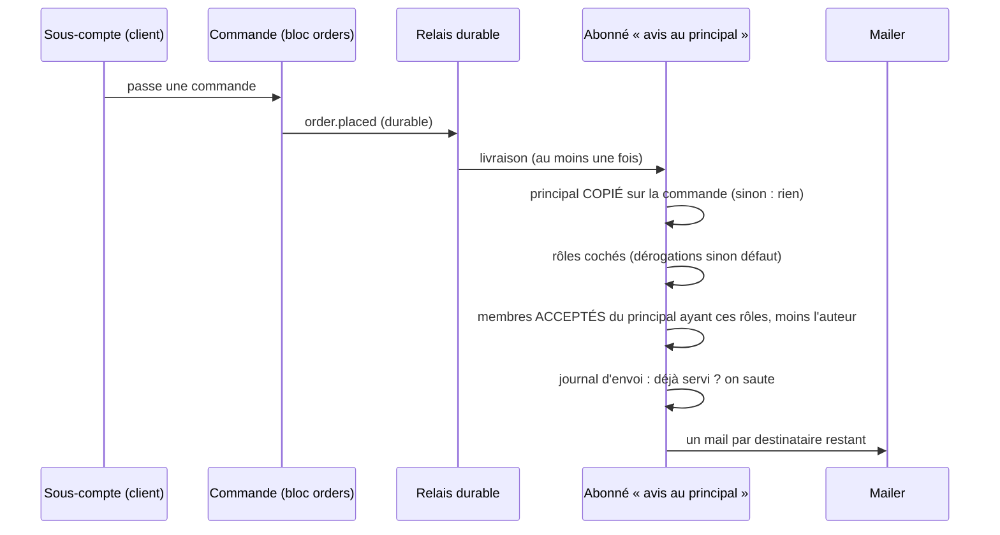

# Plan — le principal est prévenu de ce que font ses sous-comptes

> 📐 **Plan — N1, N2 et N3 bâtis le 2026-10-20**, N4 à faire. Demande de Hugo : « savoir quelles
> actions menées par le sous-compte doivent être notifiées au principal, avec un
> mapping de rôle ». Décisions de Hugo le même jour : **mail seul** ; le
> tableau action × rôle est **réglé par le staff, principal par principal**.
> Doc d'état du sujet : [`sous-comptes.md`](sous-comptes.md).
>
> **v2, contredit par `vitruve` le 2026-10-20** : deux objections BLOQUANTES
> corrigées (le principal « à la date du fait » n'existait pas ; des
> invitations jamais acceptées auraient reçu des mails), cinq SÉRIEUSES
> intégrées. Le détail est au §7.

## 0. Ce qui existe (ouvert le 2026-10-20)

| Fait                                                                                                                                             | Où                                                                                                                                                   |
| ------------------------------------------------------------------------------------------------------------------------------------------------ | ---------------------------------------------------------------------------------------------------------------------------------------------------- |
| Rôles d'une société : `owner`, `admin`, `orders`, `billing`                                                                                      | `prisma/schema/public/account.prisma` (`enum CustomerRole`), `account/domain/value-objects/company-role.ts`                                          |
| Les mails de commande partent à **une** personne, celle qui a passé la commande (`placedByUserId`)                                               | `orders/application/handlers/send-order-placed-mail.handler.ts`, `send-order-cancelled-mail…`, `send-payment-failed…`                                |
| La facture va au contact de facturation, au détenteur ou au site                                                                                 | `accounting/…/invoice-notice-recipients.ts`                                                                                                          |
| **Aucune** préférence de notification client, **aucune** cloche client                                                                           | cherché dans `prisma/schema` et `lfc-ecommerce-frontend`                                                                                             |
| Abonné durable : `@DurableHandler({ type, subscriber })`, au moins une fois, une seule action par la garde du relais                             | `platform/outbox/durable-handler.ts` ; exemples `growth/…/on-order-cancelled.handler.ts`, `loyalty/…/credit-points-on-handover.handler.ts`           |
| Faits publiés en DURABLE : passation (trois entrées), abandon, annulation, paiement confirmé, **paiement échoué**, prête, retirée, remboursement | `DurablePublisher` dans `orders/application/commands/place-order*.handler.ts`, `abandon-order.handler.ts`, `services/order-cancellation.service.ts`… |
| Faits **non** durables : abonnements, adresses, contacts, RIB (journal seulement)                                                                | `packages/contracts/src/journal-facts/accounts.ts`                                                                                                   |
| Le principal d'une société : `Company.parentCompanyId` ; pas de port de lecture dédié hors du verrou de hiérarchie                               | `account/domain/entities/company.ts`, `account/application/services/account-hierarchy-support.ts`                                                    |
| Le payeur est déjà COPIÉ sur la commande à la passation (`orders.billed_company_id`)                                                             | `prisma/schema/public/orders.prisma`, `orders/application/services/order-drafting.service.ts`                                                        |
| Aucun historique des rattachements : `parent_company_id` ne dit que l'état présent                                                               | `account.prisma` ; seules les périodes de `company_follows` sont datées                                                                              |
| Une `Membership` peut être une invitation jamais acceptée (`acceptedAt` nul)                                                                     | `account.prisma`, modèle `Membership`                                                                                                                |
| Une commande saisie par l'équipe porte `placedByStaffId`                                                                                         | `orders/domain/entities/order.ts`                                                                                                                    |
| Le principal ne peut PAS entrer dans l'espace client d'un sous-compte (S6 non bâti)                                                              | `sous-comptes.md` §3                                                                                                                                 |

## 1. Ce qu'on bâtit

Quand un **sous-compte** fait une action de la liste, les membres du
**principal** dont le rôle est coché pour cette action reçoivent un mail. Le
tableau est une donnée par principal ; tant que le staff n'y a pas touché, le
défaut s'applique.

### Le tableau par défaut

| Action du sous-compte                           | Clé                        | owner | admin | orders | billing |
| ----------------------------------------------- | -------------------------- | ----- | ----- | ------ | ------- |
| Commande passée                                 | `order_placed`             | ✉     | ✉     | ✉      | —       |
| Commande annulée ou abandonnée                  | `order_cancelled`          | ✉     | ✉     | ✉      | —       |
| Paiement échoué **à la charge du principal**    | `payment_failed`           | ✉     | —     | —      | ✉       |
| Abonnement créé, mis en pause, arrêté           | `subscription_changed`     | ✉     | ✉     | ✉      | —       |
| Adresse de livraison ajoutée, modifiée, retirée | `delivery_address_changed` | ✉     | ✉     | —      | —       |
| Contact ajouté ou retiré                        | `contact_changed`          | ✉     | ✉     | —      | —       |
| RIB ou mandat propre déposé                     | `bank_account_changed`     | ✉     | —     | —      | ✉       |
| Problème de commande signalé                    | `order_problem_reported`   | ✉     | ✉     | ✉      | —       |

La clé est une **valeur de donnée** (CLAUDE.md §8) : elle ne se renomme qu'en
migration.

## 2. Les règles

- **Sens unique, de l'enfant vers le principal.** Le principal voit ses
  sous-comptes, jamais l'inverse (`sous-comptes.md`, règle du 2026-10-05). Un
  frère n'est jamais prévenu.
- 🔴 **Le principal est COPIÉ sur la commande à la passation**
  (`orders.principal_company_id`, comme `billed_company_id`). Aucun historique
  des rattachements n'existe : lire `parent_company_id` à la livraison du fait
  préviendrait, après une panne du relais, le principal d'APRÈS — un site
  détaché puis rattaché ailleurs ferait fuiter ses commandes antérieures vers
  un autre client. La copie fige le principal de chaque commande ; annulation
  et paiement échoué relisent la commande, pas la hiérarchie. Pour N4 (gestes
  hors commande), le fait porte la même copie au moment où il est publié.
- 🔴 **Destinataires : membres ACCEPTÉS seulement** (`acceptedAt` non nul) :
  une invitation pendante ou périmée est une adresse saisie, pas une personne
  connue.
- **L'auteur n'est pas prévenu de son propre geste.** Une personne membre des
  deux sociétés ne reçoit pas le mail pour ce qu'elle vient de faire. Ses
  rôles se lisent dans le PRINCIPAL (c'est lui qu'on prévient).
- **Un geste du staff « au nom du client » compte** : une commande saisie par
  l'équipe pour un site est une commande du site. Le mail dit « saisie par
  La Folie Douce ».
- **Le mail ne porte pas de lien vers l'espace du sous-compte** : le principal
  ne peut pas y entrer tant que S6 n'est pas bâti. Il porte le résumé
  (site, action, numéro et montant de commande le cas échéant, date).
- **Idempotence par un journal d'envoi en base**, pas par le fournisseur :
  `sub_account_notice_sends (event_id, user_id)` unique, écrit dans l'unité de
  travail de la garde avant l'envoi. Une relivraison saute les destinataires
  déjà servis et reprend les autres. L'idempotence de Resend (fenêtre bornée)
  reste une seconde ligne. À vérifier en N2 : `event_id` est stable d'une
  relivraison à l'autre (`platform/outbox`).
- **Une adresse en rebond dur ne se rattrape pas** (CLAUDE.md §0) : le
  destinataire est une personne connue, pas une adresse saisie dans le tableau.

## 3. Le modèle

Trois ajouts, tous additifs : `orders.principal_company_id` (copie à la
passation), la table des **dérogations** au défaut, et le journal d'envoi.

```
sub_account_notice_rules
  principal_company_id  → companies.id
  kind                  enum Postgres SubAccountNoticeKind (une clé inconnue
                        est inexprimable ; retirer une clé = migration)
  role                  CustomerRole
  enabled               boolean
  updated_by, updated_at   (updated_by au registre RGPD : lint:rgpd-staff)
  unique (principal_company_id, kind, role)

sub_account_notice_sends
  event_id, user_id, sent_at   unique (event_id, user_id)
```

**Où vit l'abonné** : un contexte `b2b/sub-account-notices/`. Il lit les
membres et les dérogations par des ports que `account/` déclare et
implémente, et le résumé de la commande par un port que `orders/` implémente —
jamais les tables d'un autre contexte (`lint:prisma-model-ownership`). Tout
reste dans le bloc `b2b` : ni `durable-cross-block` ni `context-boundaries`
ne sont franchis.

Pas de ligne = le défaut du §1. Le défaut vit dans le domaine
(`apps/lfd-api/src/b2b/sub-account-notices/domain/sub-account-notice-defaults.ts`), pas en base : changer
le défaut ne demande pas de migration, et une dérogation posée reste la
volonté du staff.



## 4. Les lots

| Lot    | Contenu                                                                                                                                                                                                                                                                                                                                                                                                                                        | Agent     |
| ------ | ---------------------------------------------------------------------------------------------------------------------------------------------------------------------------------------------------------------------------------------------------------------------------------------------------------------------------------------------------------------------------------------------------------------------------------------------- | --------- |
| **N1** | Défaut du tableau (domaine pur + tests), migration additive (`orders.principal_company_id` copié à la passation par `OrderDraftingService`, dérogations, journal d'envoi), ports « membres acceptés d'une société par rôle » et « dérogations » (déclarés et implémentés en `account/`), port « résumé de commande » (`orders/`) ; routes staff `GET/PUT /admin/companies/:id/sub-account-notices` sous `@AdminSurface("b2b_companies")` ; e2e | batisseur |
| **N2** | Abonnés durables sur les faits de commande déjà durables (`order_placed`, `order_cancelled`, `payment_failed`) ; gabarit `customer.sub-account-activity` ; e2e : un site commande → les membres acceptés du principal aux bons rôles reçoivent ; l'auteur non, le frère non, l'invité non accepté non ; **un site rattaché ailleurs APRÈS sa commande ne fait pas prévenir le nouveau principal** ; une relivraison ne double aucun mail       | batisseur |
| **N3** | ✅ 2026-10-20. Écran : sous la grille de la page Sous-comptes du principal, le tableau action × rôle en boutons Activer / Désactiver (même forme que la grille), défaut visible et « Revenir au défaut ». **Seules les lignes dont le mail existe** s'affichent : les cinq de N4 restent cachées jusqu'à leur lot                                                                                                                              | pablo     |
| **N4** | Rendre durables les faits qui ne le sont pas (abonnements, adresses, contacts, RIB, problème signalé), chacun portant la copie du principal et l'auteur (client ou staff), puis leurs abonnés. **Non chiffré** : cinq contextes qui ne publient aujourd'hui qu'au journal ; à inventorier et à recontredire avant de bâtir                                                                                                                     | batisseur |

N1 → N2 → N3 livrent la valeur sur les commandes. N4 est séparé parce qu'il
touche cinq contextes qui ne publient aujourd'hui qu'au journal.

### N1 bâti (2026-10-20) — et ses écarts

- Migration `20261020110000_les_avis_au_principal` (additive, lue par
  `lecteur-de-migrations`). Copie à la passation par `OrderPayerReader`, qui
  rend aussi `principalId` et `followsPricing` (même lecture que le payeur) ;
  règle pure `apps/lfd-api/src/b2b/orders/domain/services/order-principal.ts`.
- `b2b/account/` déclare et implémente QUATRE ports, pas deux :
  `AcceptedMembersReader`, `SubAccountNoticeRulesReader`, et en plus
  `SubAccountNoticeRulesWriter` (lecture et écriture séparées) et
  `CompanyParentReader` (la garde « est un principal »).
- Le type des clés vient de `@lfd/contracts` : le domaine des avis et
  `account` le partagent sans dépendre l'un de l'autre.
- ⚠️ **Assumé** : la garde « ce compte est un principal » est lue puis suivie
  d'une écriture, sans verrou. Un rattachement exactement concurrent peut
  laisser une dérogation sur un compte devenu sous-compte ; elle est inerte
  (un sous-compte n'a pas de sous-comptes), et le détacher la réveille.
- **Reporté à N2** : le port « résumé de commande » (`orders/`), dont le mail
  est le premier lecteur.
- La remise à blanc de dev (`src/dev/seeding/reset.seed.ts`) vide les
  dérogations avant les sociétés : la clé étrangère est en `Restrict`.

### N2 bâti (2026-10-20) — et ses écarts

- Trois `@DurableHandler` dans `b2b/sub-account-notices/application/handlers/`,
  un service commun (`SubAccountNoticeDispatcher`) et des règles pures
  (`apps/lfd-api/src/b2b/sub-account-notices/domain/notice-recipients.ts`). Gabarit `customer.sub-account-activity`
  (`apps/lfd-api/src/platform/mailer/sub-account-activity-mail.ts`), français seul. e2e
  `apps/lfd-api/test/sub-account-notices.e2e-spec.ts`.
- **La passation n'a pas de fait `order.placed` durable** : le seul fait
  durable est `commerce.order_placed` (canal de la livraison), écrit par les
  trois entrées. L'abonné l'écoute, comme l'accusé de réception au client.
- **L'abandon n'a pas de fait durable à lui** (`OrderAbandonedEvent` ne va
  qu'au journal) : c'est `order.payment_failed` cause `abandoned` qui porte la
  ligne `order_cancelled`. `refused` et `day_closed` → `payment_failed` ;
  `expired` et `replaced` (clientèle `public` seule) → rien.
- **Port « résumé de commande »** déclaré ET implémenté par `orders/`
  (`OrderNoticeSummaryReader`, exporté), comme les ports d'`account/` en N1 ;
  le statut du principal est relu par un cinquième port d'`account/`,
  `CompanyLifecycleReader`.
- **L'auteur exclu est celui du GESTE** (§2), pas toujours `placedByUserId` :
  passation → `placedByUserId`, sauf commande saisie par l'équipe (personne) ;
  annulation → `cancelledByUserId` (personne si l'équipe a annulé) ; abandon
  → `placedByUserId` ; paiement échoué → personne.
- **« À la charge du principal »** (§1) est lu `billed_company_id =
principal_company_id` : un site qui paie lui-même ne fait pas prévenir son
  principal d'un refus de carte.
- **« Saisie par La Folie Douce »** (§2) est écrit « saisie par notre
  équipe » : un courriel client porte la marque `La Folie Coffee`
  (`mail-templates.ts`, `CUSTOMER_BRAND`), et nommer la maison y est la faute
  corrigée le 2026-09-22.
- `event_id` est STABLE d'une relivraison à l'autre : c'est l'id de la ligne
  `platform.outbox`, tiré une fois à l'écriture et relu à chaque tentative
  (vérifié le 2026-10-20).
- ⚠️ **Limite du journal d'envoi** : il est écrit dans la transaction de la
  garde du relais. Si un envoi lève au milieu de la liste, la transaction est
  annulée, journal compris, et la relivraison renvoie à tous ; c'est la clé
  d'idempotence du fournisseur (`sub-account-notice:<eventId>:<userId>`) qui
  évite alors le doublon. Le journal tient la relivraison d'un fait déjà
  validé (rejeu, reçu remis à zéro), pas l'échec partiel.
- **Décision de Hugo (2026-10-20)** : une commande payée par CARTE ne
  prévient le principal qu'au paiement confirmé (`order.paid`), comme
  l'accusé au client ; une commande au compte (`not_required`) prévient à la
  passation. Un quatrième abonné (`NotifyPrincipalOnOrderPaid`) envoie la clé
  `order_placed` ; la règle est UNE (`settlementDecidedAtPlacement`, dans
  `orders/domain/services/`, que l'accusé au client lit aussi).
- « Saisie par notre équipe » validé par Hugo le 2026-10-20.
- Aucune colonne de personne ajoutée en N2 : `sub_account_notice_sends.user_id`
  (N1) désigne un client, hors du périmètre de `lint:rgpd-staff`, qui est vert.

### N3 bâti (2026-10-20) — et ses écarts

- Carte `apps/lfd-backoffice-frontend/src/app/fiche-client/sub-account-notices-card/`,
  posée sur la page Sous-comptes SOUS la carte des sous-comptes (et non dans
  la grille des suivis : c'est un réglage du principal, pas d'un site),
  seulement quand le principal a au moins un sous-compte. Appels dans
  `AdminCompanyHierarchyService` (trois méthodes).
- Libellés de colonne : `COMPANY_ROLE_LABELS` de `@lfd/contracts` (« Détenteur
  du compte », « Administrateur », « Commandes », « Facturation »), la seule
  traduction des rôles — pas de libellés propres à l'écran.
- Droit : boutons désactivés sans `b2b_companies:write`. La grille des suivis
  ne garde que le tarif ; ici toute la carte est sur la surface
  `b2b_companies`, et le serveur reste le juge.
- Après toute écriture, réussie ou refusée, la carte RELIT le tableau : le
  refus s'affiche en `fold-callout` qui nomme l'action et le rôle, la cellule
  redit l'enregistré.
- Les cinq clés de N4 sont cachées ; une ligne discrète sous le tableau le dit.

## 5. Décisions (Hugo, 2026-10-20)

- **Q1 — Montants : oui, si le site suit `billing` ou `pricing`** au moment de
  la commande ; sinon le mail dit l'action sans montant. Ce « au moment »
  se fige comme le principal : `orders.principal_sees_amount` est copié à la
  passation, à côté de `principal_company_id`. Un suivi ouvert ou fermé
  ensuite ne change pas ce qu'on dit d'une commande passée.
- **Q2 — Principal `suspended` : prévenu. `terminated` : non.** Le statut
  lu est celui du principal à l'envoi (il dit si l'on écrit encore à ce
  client, pas ce qu'il était à la commande).
- **Q4 — Le mail ne nomme que le SITE**, jamais la personne qui a agi : ni nom,
  ni adresse, ni rôle. Ce qui part au principal est une information sur une
  société, pas sur une personne. La mention reste due dans les conditions
  générales des sous-comptes (à rédiger, hors de ce plan).
- **Q3 — Volume** : ouvert. Un récapitulatif quotidien a été écarté le
  2026-10-20 ; à rouvrir si le volume gêne.

## 6. Hors périmètre

- Une cloche dans l'espace client (écartée le 2026-10-20 : mail seul).
- Le réglage par le client lui-même (demanderait des préférences client, qui
  n'existent pas).
- L'entrée du principal dans l'espace de ses sous-comptes (S6).

## 7. Ce que `vitruve` a changé (2026-10-20)

- **BLOQUANT** — « le principal à la date du fait » ne s'appuyait sur aucune
  donnée : il n'y a pas d'historique des rattachements. → Copie du principal
  sur la commande (§2), e2e « rattaché ailleurs après le fait ».
- **BLOQUANT** — une `Membership` non acceptée aurait reçu des mails. →
  Membres acceptés seulement.
- **SÉRIEUX** — Q1/Q4 devaient précéder N2 → dit au §5. Idempotence par le
  fournisseur → journal d'envoi en base. Bloc de l'abonné non dit → contexte
  et ports nommés (§3). `kind` en texte libre → enum ; `updated_by` au
  registre RGPD. N4 vague et lignes promises sans mail → N4 marqué non
  chiffré, lignes cachées à l'écran jusqu'à lui.
- **MINEUR** — rôle d'une personne membre des deux sociétés : celui du
  principal. Paiement échoué ajouté au §0.
