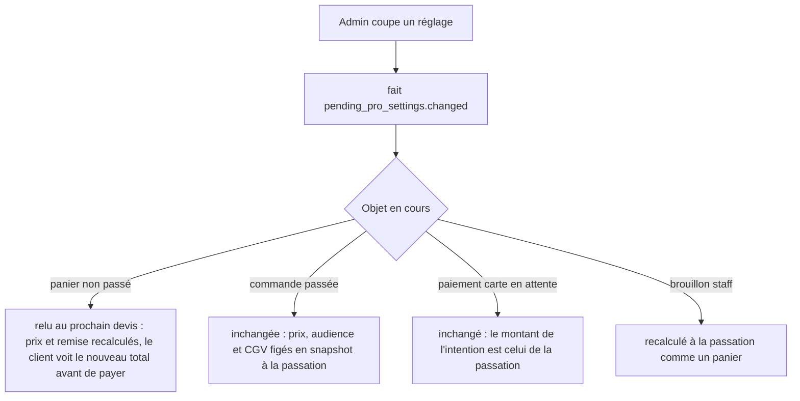

# Plan — les pros en cours d'inscription (doc-first, 2026-10-30)

> 📐 **Doc-first : aucune ligne de code.** Décision de Hugo du 2026-10-30,
> consignée au § 10 de
> [`../pricing/plan-promotions-par-audience-et-acheminement.md`](../pricing/plan-promotions-par-audience-et-acheminement.md).
> Le plan touche l'argent (prix pro, règlement) et une frontière de sécurité
> (qui est « pro ») : **`vitruve` avant Hugo** (CLAUDE.md § 9 bis).
> Chaque affirmation sur l'existant cite un fichier ouvert le 2026-10-30.

## 1. La décision (révisée le 2026-10-30 après vitruve)

Trois cas, trois règles, **une seule fabrique qui décide** (§ 3) :

| Statut de la société agissante | Commande au nom de la société | Moyen         | Tarif servi                                                          |
| ------------------------------ | ----------------------------- | ------------- | -------------------------------------------------------------------- |
| `active`                       | oui                           | carte, compte | pro                                                                  |
| `pending`                      | oui                           | carte seule   | pro **si** la case unique « traité en pro » est cochée, sinon public |
| `suspended`                    | oui                           | carte seule   | **pro ou public, choisi par le staff au geste de suspension**        |
| `terminated`                   | **non** — refus nommé         | —             | —                                                                    |

- **Pending, case unique** « Traiter en pro les sociétés en cours
  d'inscription » (Hugo, 2026-10-30) : catalogue, prix de canal, minimums,
  affichage HT, **mercuriale et réservations comprises**, remise pro de
  retrait. Défaut : cochée (« les plus souples »). Il n'y a plus de réglage
  séparé pour la mercuriale ni pour les autres gestes.
- **Suspendue** : le tarif est une **colonne additive sur la société**
  (`suspended_pricing`, `pro | public`, nullable), posée par la transition
  `Company.suspend(cause, pricing)` qui **l'exige** — pas de défaut codé
  (Hugo : « on doit décider en admin »). Le changer plus tard est un geste
  staff sur une société suspendue ; `reactivate()` l'efface.
- **Terminée** : la passation au nom de la société est refusée par une
  `BusinessError` nommée — « Ce compte est clos. Contactez-nous. » — ; la
  personne peut toujours commander **en particulier** (espace perso, société
  agissante `null`, prix public).
- **Espace perso** : toujours public, quel que soit le statut de la société.

« Au compte » reste inaccessible hors `active`, par construction (§ 3.5).

## 2. Constat — l'existant est déjà incohérent

Le § 10 affirme que les lecteurs de `audienceOf` (13 selon lui, 9 recomptés au § 11) « servent le public à une
société en attente ». **C'est vrai pour l'audience, faux pour le prix.**
Deux définitions de « pro » coexistent aujourd'hui :

1. **L'audience** — `audienceOf` (`packages/contracts/src/customer-audience.ts:23`)
   rend `b2b` pour `active` seulement. Elle pilote la remise et l'ouverture des
   points de retrait, la livraison, les CGV, le contact, et l'écran de la
   boutique (`apps/lfc-ecommerce-frontend/src/app/client/client-audience.service.ts:45`).
2. **Le lecteur du catalogue** — `CatalogViewers.forCompany`
   (`apps/lfd-api/src/b2b/catalog/application/catalog-viewers.service.ts:33-39`)
   rend `proViewer` pour **toute** société agissante non nulle, sans lire son
   statut. `ShopCataloguePricing.priced`
   (`apps/lfd-api/src/b2b/catalog/application/shop-catalogue-pricing.service.ts:111-121`)
   en déduit l'audience du prix « ICI, et c'est le seul endroit » : une société
   `pending` — **et `suspended`, et `terminated`** — voit donc déjà le
   catalogue pro, sa mercuriale et ses réservations, et le devis tarifera pro.

Conséquence **établie** (vitruve, puis rouvert le 2026-10-30) : ce n'est pas
qu'un affichage. `OrderLinePricing` (`apps/lfd-api/src/b2b/orders/application/services/order-line-pricing.service.ts:189`)
appelle le même `forCompany` pour le `billingViewer` : **le devis et la
passation** tarifent pro une société `pending`, `suspended` ou `terminated`.
Un pending se voit en outre refuser la remise pro de retrait et lire les CGV
particuliers (l'audience, elle, dit `b2c`). C'est le trou que ferme le lot P0.

La résolution de la société agissante **ne refuse pas** une société pending :
`resolveCompany` (`apps/lfd-api/src/platform/auth/resolve-company.ts:10-35`)
choisit parmi les rattachements sans lire de statut, et `@ActingCompany`
(`apps/lfd-api/src/platform/auth/acting-company.decorator.ts:20-23`) ne fait que
le rendre. Aucun refus de passation sur le statut n'a été trouvé dans
`b2b/orders/application` (grep `suspended|terminated|!== "active"` : seuls
`order-settlement.ts:122` et
`apps/lfd-api/src/b2b/orders/domain/services/order-payer.ts:33`, qui ne regarde
que le **payeur suivi** d'un site). Une société suspendue ou terminée commande
donc aujourd'hui par carte, au prix pro. Le brouillon staff
(`save-order-draft.handler.ts:34`) ne refuse qu'une société inconnue.

## 3. Inventaire — où se décide « pro ou non », et comment chacun lira le réglage

Principe : **la décision « pro ou pas » se prend une fois**, dans
`CatalogViewers.forCompany` (`catalog-viewers.service.ts:32-39`) ou la fabrique
qui le remplace, à partir de trois entrées relues en base à chaque requête :
le statut (`readCompanyStanding`), la case unique, et `suspended_pricing`.
Elle rend soit `proViewer(...)`, soit `PUBLIC_VIEWER` **et** la société à
passer au pricer (`companyId` ou `null`, voir B2 au § 11). Aucun appelant ne
relit le statut.

Pour que la boutique et le back-office affichent ce que le serveur tarife, la
même règle vit en fonction pure dans `@lfd/contracts` :

```
pricingAudienceOf(status, { treatPendingAsPro }, suspendedPricing) → "b2b" | "b2c"
  active                                   → b2b
  pending   ∧ treatPendingAsPro            → b2b
  suspended ∧ suspendedPricing = "pro"     → b2b
  sinon (dont terminated, null)            → b2c
```

`audienceOf(status)` (à un argument) est remplacé par elle dans ses lecteurs ;
il n'en reste aucun à un argument à la fin de P2.

| #    | Lieu (ouvert)                                                                                                                                                                                                                   | Décide aujourd'hui                                                                                   | Demain                                                                                                                                                                    |
| ---- | ------------------------------------------------------------------------------------------------------------------------------------------------------------------------------------------------------------------------------- | ---------------------------------------------------------------------------------------------------- | ------------------------------------------------------------------------------------------------------------------------------------------------------------------------- |
| 3.1  | `audienceOf` — `packages/contracts/src/customer-audience.ts:23`                                                                                                                                                                 | `active` seul                                                                                        | devient `pricingAudienceOf`                                                                                                                                               |
| 3.2  | `CustomerAudiences.of` — `apps/lfd-api/src/b2b/orders/application/services/customer-audiences.service.ts:23-28` (devis, caisse, composition `order-composition.service.ts:158`, retraits `cart-adjustments.service.ts:144-159`) | statut seul                                                                                          | `pricingAudienceOf`, case et tarif de suspension lus par un port (bloc `b2b`)                                                                                             |
| 3.3  | Catalogue servi — `catalog-viewers.service.ts:33-39`, `shop-catalogue-pricing.service.ts:111-121`                                                                                                                               | toute société = pro                                                                                  | **la fabrique unique** (ci-dessus) ; lit le statut par `readCompanyStanding` (`b2b/shared/company-standing/`) — `lint:company-role-readers`                               |
| 3.4  | Passation — `place-order.handler.ts` (règlement `:162`)                                                                                                                                                                         | pas de refus de statut trouvé                                                                        | refuse `terminated` (`CompanyClosedOrderRefusedError`, « Ce compte est clos. Contactez-nous. ») ; `pending`/`suspended` passent, carte seule (3.5)                        |
| 3.5  | « Au compte » — `accountStanding`, `apps/lfd-api/src/b2b/orders/application/services/order-settlement.ts:114-126`                                                                                                               | `!== "active"` → `none` ; `settlement === "account"` sans crédit → `TermsNotGrantedError` (`:82-86`) | **inchangé**. C'est le verrou structurel : pas de réglage qui puisse l'ouvrir. Le défaut « carte seulement » est donc déjà tenu ; le réglage n'existe que pour l'afficher |
| 3.6  | Minimums — `minQuantityFor(minimums, audience)` `apps/lfd-api/src/b2b/catalog/domain/catalog-min-quantities.ts:21-25`                                                                                                           | suit l'audience du lecteur                                                                           | suit 3.3                                                                                                                                                                  |
| 3.7  | Affichage HT/TTC — `ttcCentsFromHtMillicentsFor(…, audience)` `shop-catalogue-pricing.service.ts:268` ; front `client-audience.service.ts:45`                                                                                   | lecteur / statut actif                                                                               | suit 3.3 côté serveur ; le front lit la politique servie (§ 5)                                                                                                            |
| 3.8  | Mercuriale et réservations — `priced(companyId)` → lecteur porteur des réservations (`shop-catalogue-pricing.service.ts:117-121`)                                                                                               | toute société                                                                                        | suit 3.3 (case unique) ; au public, `companyId: null` au pricer (B2)                                                                                                      |
| 3.9  | Remise du point de retrait — `pickupOpenTo(point, audience)` `cart-adjustments.service.ts:155` ; `pickup-addresses.controller.ts:25-62`                                                                                         | audience                                                                                             | `pricingAudienceOf`                                                                                                                                                       |
| 3.10 | CGV — `salesTermsOf(audience)` `apps/lfd-api/src/b2b/orders/domain/services/sales-terms-of.ts:12`                                                                                                                               | audience                                                                                             | suit l'audience qui tarife (déjà écrit `:8`) : un pending qui commande pro accepte les CGV pro                                                                            |
| 3.11 | Contact — `prisma-contact-sender-audience.ts:19-25`                                                                                                                                                                             | `audienceOf(status)`                                                                                 | `pricingAudienceOf` (Q5)                                                                                                                                                  |
| 3.12 | Semis — `apps/lfd-api/src/dev/seeding/accepted-sales-terms.seed.ts:23`                                                                                                                                                          | `audienceOf(status)`                                                                                 | `pricingAudienceOf`, case par défaut                                                                                                                                      |
| 3.13 | E-mails — `mail-copy` a son **propre** `audienceOf(mail)` (`apps/lfd-api/src/b2b/mail-copy/domain/mail-copy-manifest.ts:33`), homonyme sans rapport (audience d'un texte, pas d'une société)                                    | —                                                                                                    | inchangé ; un texte « pro » envoyé à un pending suit l'audience de la commande                                                                                            |
| 3.14 | Nommage dans le journal — `growth/infrastructure/prisma-actor-namer.ts:87`                                                                                                                                                      | n'utilise pas `audienceOf` (écrit)                                                                   | inchangé                                                                                                                                                                  |

## 4. Le modèle

**Case unique — CRUD de config, pas un agrégat** (CLAUDE.md § 3.1). Une ligne
singleton dans `public`, sur le modèle de `LoyaltySettings`
(`apps/lfd-api/prisma/schema/public/loyalty.prisma:49-61`, `id = 'default'`
tenu par `CHECK`) :

```
pending_pro_settings
  id                    text  pk  CHECK (id = 'default')
  treat_pending_as_pro  bool  not null default true
  updated_at, updated_by_staff_id
```

**Tarif d'une suspendue — dans l'agrégat `Company`**, parce qu'une règle peut
refuser l'écriture : colonne additive `companies.suspended_pricing`
(enum `pro | public`, nullable) + `CHECK (status <> 'suspended' OR
suspended_pricing IS NOT NULL)`. **Migration de données** : les sociétés déjà
suspendues n'ont pas de valeur — le `CHECK` est posé `NOT VALID`, la liste
des suspendues existantes est sortie au lot P0 et Hugo choisit pour chacune à
l'écran ; tant qu'aucun choix n'est fait, la fabrique sert **public** (fermer
le trou d'abord ; c'est le comportement le moins coûteux à se tromper, voir
irréversibilité au § 11) puis `VALIDATE CONSTRAINT` dans un déploiement
suivant. Transitions : `suspend(cause, pricing)` exige `pricing` ;
`setSuspendedPricing(pricing)` refuse hors `suspended` ; `reactivate()` et
`terminate()` le remettent à `null`.

Migrations additives, sans écriture dans une table de droits.

**Journal** : `pending_pro_settings.changed` (acteur, avant, après), sur le
modèle de `packages/contracts/src/journal-facts/production-settings.ts:45` ;
le fait de suspension existant gagne le tarif choisi.

## 5. Qui peut le modifier

Ressource existante **`b2b_settings`**
(`apps/lfd-api/prisma/schema/public/staff.prisma:118`) — les réglages de la
plateforme. Pas de ressource neuve, donc rien à accorder ; et quand bien même,
**aucune migration n'accorde un droit à un rôle** (`lint:no-role-grants-in-migrations`).
Si Hugo préfère un droit à part (Q6), la ressource s'ajoute par migration et
s'accorde à l'écran `/admin/staff-roles`.

Routes : `GET/PUT /admin/settings/pending-pros` (contrôleur à bus seuls) ;
lecture côté boutique : la politique est servie avec l'espace de travail
(ou un `GET /shop/pending-pro-policy` public, sans donnée personnelle) pour
que `client-audience.service.ts` appelle `pricingAudienceOf`.

## 6. Quand un réglage change avec des paniers et commandes en cours



Règle : **le réglage est lu au moment de la question**, jamais figé ailleurs
qu'au snapshot de la commande — la même règle que le statut lu par
`CustomerAudiences` (`customer-audiences.service.ts:9-12`). Une commande passée
au prix pro par un pending reste au prix pro si le réglage est coupé ensuite,
et aussi si la société est terminée ensuite. Il n'existe **pas** de transition
de refus d'une société pending : `activate` (`company.ts:658-703`) refuse tout
sauf `pending`, `terminate` (`:796-800`) n'accepte que `active`/`suspended`.
Une demande refusée reste `pending` (Q7).
La validation (`pending → active`) ne réévalue rien : elle ne fait qu'ouvrir
« au compte » pour les commandes suivantes.

## 7. Suspendue, terminée

Voir § 1. `accountStanding` rend `none` hors `active` (`order-settlement.ts:122`) :
la suspendue paie par carte. Le changement visible pour les sociétés
suspendues et terminées existantes — elles perdent le prix pro, ou la
commande — est un **correctif de sécurité**, livré en premier (P0) et annoncé
comme tel.

## 8. Tests

**Domaine / contrats** — `pricingAudienceOf` : table complète
4 statuts × politique ouverte/fermée ; `null` → `b2c`.

**Domaine** — `Company.suspend` sans tarif refusé ; `setSuspendedPricing` hors
`suspended` refusé ; `reactivate`/`terminate` effacent.

**Application** — la fabrique (`forCompany`) : 4 statuts × case × tarif de
suspension ; au public, `companyId` passé au pricer = `null`.

**E2E** (vrai Postgres, `daysAgo`, aucune date absolue) :

1. pending, espace pro, défauts → catalogue au prix pro, mercuriale appliquée.
2. pending, espace pro → passe une commande, `settlement: card`, intention Stripe créée au prix pro.
3. pending → `settlement: account` refusé (`TermsNotGrantedError`, 409), même avec un crédit déclaré.
4. pending, espace **perso** → prix public.
5. case décochée → catalogue public **sans mercuriale ni réservation**, devis et passation publics, remise de retrait refusée.
6. suspendue « public » → rayon, devis, passation, habituels, suggestions, « achetés avec », liste staff des SKU au prix public, mercuriale ignorée ; suspendue « pro » → prix pro, carte seule.
7. terminée → passation refusée (`CompanyClosedOrderRefusedError`, 409) ; la même personne en espace perso commande au prix public (régression § 2).
   7 bis. site d'un principal suspendu/pending : le site suit son propre statut pour le prix ; la passation suit `orderPayerOf` (§ 11, S).
8. PUT réglages sans `b2b_settings` → 403 ; avec → fait journalisé avant/après ; suspension sans tarif → 400.
9. panier devisé pro, réglage coupé, re-devis → total public.
10. mur tenant : la politique ne lit aucune donnée d'une autre société.

## 9. Lots

| Lot | Contenu                                                                                                                                                                                                                                                                                                                                                                                                                                                                                                                                                                                                                                                                                                                                                                                                                                                                                                                                                                                                           |
| --- | ----------------------------------------------------------------------------------------------------------------------------------------------------------------------------------------------------------------------------------------------------------------------------------------------------------------------------------------------------------------------------------------------------------------------------------------------------------------------------------------------------------------------------------------------------------------------------------------------------------------------------------------------------------------------------------------------------------------------------------------------------------------------------------------------------------------------------------------------------------------------------------------------------------------------------------------------------------------------------------------------------------------- |
| P0  | ✅ **bâti le 2026-10-30, non commité** — décision `companyServiceOf` (`apps/lfd-api/src/b2b/catalog/domain/company-service.ts`) dans `CatalogViewers` (`forCompany`, `forBilling` qui refuse la terminée par `CompanyClosedOrderRefusedError`, `forKeptLines`), statut lu par `readServedCompany` (`b2b/shared/company-standing/`) dans la même requête que les porteurs de réservation ; `pricingCompanyOf(viewer)` passé au tarificateur ; e2e `apps/lfd-api/test/served-company-status.e2e-spec.ts` ; liste : `dev-toolbox/audits/suspended-companies.mjs`. Un pending reste servi pro (mercuriale comprise), carte seule, sans remise pro de retrait ni CGV pro (audience `b2c`) — comme avant. ~~**Correctif du trou** : terminée → passation refusée (erreur nommée) ; suspendue sans choix → public, `companyId: null` au pricer ; décision unique dans `forCompany` pour tous ses appelants ; e2e 6, 7 et rayon/devis/passation/habituels/suggestions. Liste des suspendues existantes sortie pour Hugo~~ |
| P1  | colonne `suspended_pricing` + `Company.suspend(cause, pricing)` + écran de suspension qui l'exige (pablo) ; table `pending_pro_settings` + CRUD admin + fait de journal                                                                                                                                                                                                                                                                                                                                                                                                                                                                                                                                                                                                                                                                                                                                                                                                                                           |
| P2  | `pricingAudienceOf` dans `@lfd/contracts`, ses lecteurs basculés (§ 11, S : compte exact) ; `lint:company-role-readers` vert                                                                                                                                                                                                                                                                                                                                                                                                                                                                                                                                                                                                                                                                                                                                                                                                                                                                                      |
| P3  | pending traité en pro par la fabrique (case), CGV, remise de retrait ; garde devis ↔ passation (§ 11)                                                                                                                                                                                                                                                                                                                                                                                                                                                                                                                                                                                                                                                                                                                                                                                                                                                                                                             |
| P4  | écran back-office « Pros en cours d'inscription » (une case) (pablo)                                                                                                                                                                                                                                                                                                                                                                                                                                                                                                                                                                                                                                                                                                                                                                                                                                                                                                                                              |
| P5  | boutique : politique servie, `client-audience.service.ts`, bandeau « en attente : carte seulement » ; `pnpm copy:digest`                                                                                                                                                                                                                                                                                                                                                                                                                                                                                                                                                                                                                                                                                                                                                                                                                                                                                          |

## 10. Questions ouvertes

- **Q1, Q2, Q3** — tranchées (case unique cochée par défaut ; carte seule
  sans ligne d'écran ; suspendue/terminée § 1). Le § 10 du plan des promotions
  est à aligner.
- **Q4** — Bloc de la case : `b2b/account/` ou un contexte dédié ?
- **Q9** — Suspendues existantes : public en attendant le choix de Hugo (§ 4),
  d'accord ?
- **Q5** — Le contact (3.11) doit-il traiter un pending en pro ?
- **Q6** — `b2b_settings` suffit-il, ou un droit à part ?
- **Q7** — Il n'existe pas de refus d'une demande (§ 6) : faut-il une
  transition `pending → terminated` (refus), et que deviennent ses commandes
  passées au prix pro ?
- **Q8** — Plusieurs rattachements dont un pending : rien de neuf (la société
  agissante est déclarée, `resolve-company.ts:27-31`) — à confirmer.

## Décisions de Hugo après vitruve (2026-10-30)

- **Suspendue** : commande possible, carte seule ; tarif pro/public **choisi
  par le staff au geste de suspension**, obligatoire, sans défaut codé —
  transition `Company.suspend(cause, pricing)`, colonne additive (§ 4).
- **Terminée** : commande refusée au nom de la société (« Ce compte est clos.
  Contactez-nous. ») ; la personne commande toujours en particulier.
- **Case unique** « traité en pro » pour les pending, mercuriale comprise :
  le réglage mercuriale séparé est supprimé.
- Le trou se ferme dans `forCompany` pour **tous** ses appelants, jamais au
  seul rayon.

## 11. Contradiction de vitruve (2026-10-30)

Chaque réponse cite un fichier rouvert le 2026-10-30.

- **B1 — `forCompany` a sept consommateurs, pas deux.** Rouvert : `order-line-pricing.service.ts:189`
  (`billingViewer`, prix du devis et de la passation), `list-my-usuals.handler.ts:65`,
  `staff-suggestion-showcase.ts:119`, `bought-with-showcase.ts:79`,
  `list-customer-skus.handler.ts:53`, `shop-catalogue-pricing.service.ts:120`
  (lui-même appelé par `read-my-shop-catalogue.ts:76` et
  `catalog-cart-suggestions.ts:66` via `priced(companyId)`).
  → La décision se prend **une fois**, dans `forCompany` ou la fabrique qui le
  remplace, à partir du statut relu en base, de la case et de
  `suspended_pricing` ; tous les appelants la suivent sans relire le statut.
  E2E sur rayon, devis, passation, habituels et suggestions (§ 8, 6).
- **B2 — mercuriale.** Sans objet comme réglage : la case unique l'emporte
  avec le reste. Reste le vrai risque : `pricer.load({ articles, companyId, … })`
  (`shop-catalogue-pricing.service.ts:225`, `order-line-pricing.service.ts:295`)
  charge mercuriale et tarif de canal **par `companyId`**, indépendamment du
  lecteur. Une société servie au public (suspendue « public », pending case
  décochée) passerait donc encore sa mercuriale. → La fabrique rend, avec le
  lecteur, la **société de tarification** : `companyId` pour pro, `null` pour
  public ; `priced` et `OrderLinePricing` passent celle-là au pricer, jamais
  le `companyId` brut. E2E : suspendue « public » avec une mercuriale posée →
  prix public.
- **S — lecteurs d'`audienceOf` à un argument.** Compte refait (grep hors
  tests, `mail-copy` homonyme exclu) : **9 sites dans 9 fichiers** — serveur
  `customer-audiences.service.ts:25,27`, `prisma-contact-sender-audience.ts:19,25`,
  `pickup-addresses.controller.ts:25` (visiteur, `null`),
  `accepted-sales-terms.seed.ts:23` ; boutique `client-audience.service.ts:45`,
  `preview/app/composition/demo-routes.ts:148` ; back-office
  `nouvelle-commande-page.ts:266`, `modifier-commande-page.ts:192`, et
  `acheminement-commande.ts:117` qui reçoit l'audience calculée par la page
  (commentaire, pas un appel). Le « 13 » du § 10 des promotions est faux.
  → Tous passent à `pricingAudienceOf` ; la saisie staff reçoit le statut, la
  case et `suspended_pricing` avec la société, et affiche le tarif que le
  serveur appliquera.
- **S — héritage du principal.** `reservationHoldersOf`
  (`b2b/shared/company-standing/infrastructure/read-reservation-holders.ts:5,61-66`)
  n'ouvre les réservations du principal que s'il est `active` ; `orderPayerOf`
  (`order-payer.ts:33`) refuse la passation d'un site dont le payeur suivi
  n'est pas actif (`OrderPayerNotActiveError`). → Un site d'un principal
  pending ou suspendu ne commande pas tant qu'il suit la facturation du
  principal : **inchangé**, et le refus nomme déjà le payeur. Le prix du site
  suit son propre statut ; les réservations héritées restent fermées. Proposé :
  ne rien ouvrir dans ce chantier (Q10).
- **S — inventaire manquant.** Grep `OrderLinePricing|PlaceOrderCommand|Pricer`
  dans `subscriptions/`, `resupply/`, `loyalty/`, `accounting/` : aucun ne
  tarife. Abonnements : **inchangé, vérifié** (aucun pricer ; à rouvrir si
  une échéance devient une commande tarifée). Réassort : **inchangé, vérifié**
  (pas de prix). Fidélité : `prisma-loyalty-conversion.gate.ts:10` ne lit que
  le statut de la **personne** — **inchangé, vérifié**. Factures et relances
  (`accounting/`) : lisent des commandes figées — **inchangé, vérifié**.
  Brouillon staff (`save-order-draft.handler.ts:34`) : n'enregistre rien de
  tarifé ; **bascule** à la passation (refus terminée, tarif de la fabrique).
- **S — devis ↔ passation.** Aucun mécanisme existant : le seul refus de
  divergence à la passation est l'empreinte d'idempotence
  (`place-order.handler.ts:88`, `IdempotencyKeyReusedError`), qui ne compare
  pas de total. → La passation reçoit le total TTC affiché au devis et refuse
  par une `BusinessError` nommée (« Le prix a changé depuis votre devis,
  vérifiez le nouveau total ») quand le total recalculé diffère (lot P3).
- **S — Q7, société refusée.** Pas de transition de refus dans `Company` :
  `activate` (`company.ts:703`) exige `pending`, `terminate` (`:796-800`)
  exige `active`/`suspended`. Dit au § 6 ; reste Q7.
- **S — irréversibilité.** Retirer le prix pro aux suspendues/terminées
  existantes se voit chez elles ; c'est un correctif de sécurité, lot P0, et
  les suspendues existantes servies public jusqu'au choix de Hugo (§ 4).
- **Mineurs** — chemin complet d'`order-payer.ts` donné (§ 2) ; le constat
  du § 2 est établi, plus « à confirmer ».

Questions ajoutées : **Q10** — un site dont le principal est pending : lui
ouvrir la passation par carte en le faisant payer lui-même, ou laisser le
refus actuel ?

## Arbitrages finaux (Hugo : « prends les décisions les plus cohérentes », 2026-10-30)

- **Q9 — suspendues existantes** : tarif **public** provisoire, liste sortie au
  lot P0 pour que Hugo tranche société par société.
- **Q10 — site d'un principal en attente** : il suit son principal. Si le
  principal est « traité en pro », le site commande au tarif pro, **par carte,
  en payant lui-même** (un payeur non actif reste refusé, `order-payer.ts:33` :
  le site ne peut pas faire payer un principal non validé).
- **Q7 — refuser une inscription pro** : oui, une transition
  `pending → terminated` (« inscription refusée ») ; les commandes déjà passées
  au prix pro restent telles quelles (prix figés), la suite passe au refus des
  sociétés terminées.
- **Q6 — droit** : `b2b_settings`, comme les autres réglages de la plateforme.
- **Q5 — contact** : une société en attente traitée en pro y est vue comme pro,
  par la même décision unique.
- **Q4 — emplacement** : `b2b/account/` (la politique porte sur le statut d'une
  société, que ce contexte possède).
- **Q8** : rien de neuf.
