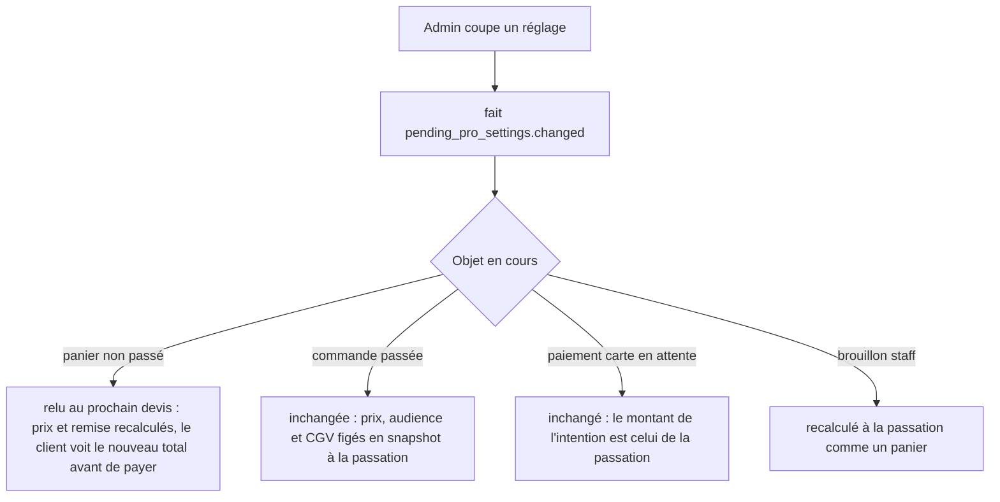

# Plan — les pros en cours d'inscription (doc-first, 2026-10-30)

> 📐 **Doc-first : aucune ligne de code.** Décision de Hugo du 2026-10-30,
> consignée au § 10 de
> [`../pricing/plan-promotions-par-audience-et-acheminement.md`](../pricing/plan-promotions-par-audience-et-acheminement.md).
> Le plan touche l'argent (prix pro, règlement) et une frontière de sécurité
> (qui est « pro ») : **`vitruve` avant Hugo** (CLAUDE.md § 9 bis).
> Chaque affirmation sur l'existant cite un fichier ouvert le 2026-10-30.

## 1. La décision

Un membre d'une société **en attente de validation** (`pending`), quand il agit
dans son **espace pro** (la société agissante est la sienne), est traité en
pro. Pour lui-même (espace perso, société agissante `null`), il reste un
particulier inscrit. Une société **suspendue** ou **terminée** n'est jamais
pro : rien ne change pour elle.

La politique n'est pas codée : c'est un écran de **Réglages** admin « Pros en
cours d'inscription ». Défauts **les plus souples** (consigne du 2026-10-30,
postérieure au tableau « défauts prudents » du § 10 — voir Q1) :

| Réglage (`pending` dans son espace pro) | Défaut          |
| --------------------------------------- | --------------- |
| Voir le catalogue et les prix pros      | oui             |
| Commander au prix pro                   | oui             |
| Moyens de paiement                      | carte seulement |
| Minimums et affichage HT des pros       | oui             |
| Mercuriale et réservations sur mesure   | oui             |
| Remise pro du point de retrait          | oui             |

« Au compte » n'est **pas** un réglage : il reste inaccessible avant
validation, par construction (§ 3.5).

## 2. Constat — l'existant est déjà incohérent

Le § 10 affirme que les 13 lecteurs de `audienceOf` « servent le public à une
société en attente ». **C'est vrai pour l'audience, faux pour le prix.**
Deux définitions de « pro » coexistent aujourd'hui :

1. **L'audience** — `audienceOf` (`packages/contracts/src/customer-audience.ts:23`)
   rend `b2b` pour `active` seulement. Elle pilote la remise et l'ouverture des
   points de retrait, la livraison, les CGV, le contact, et l'écran de la
   boutique (`apps/lfc-ecommerce-frontend/src/app/client/client-audience.service.ts:45`).
2. **Le lecteur du catalogue** — `CatalogViewers.forCompany`
   (`apps/lfd-api/src/b2b/catalog/application/catalog-viewers.service.ts:33-39`)
   rend `proViewer` pour **toute** société agissante non nulle, sans lire son
   statut. `ShopCataloguePricing.priced`
   (`apps/lfd-api/src/b2b/catalog/application/shop-catalogue-pricing.service.ts:111-121`)
   en déduit l'audience du prix « ICI, et c'est le seul endroit » : une société
   `pending` — **et `suspended`, et `terminated`** — voit donc déjà le
   catalogue pro, sa mercuriale et ses réservations, et le devis tarifera pro.

Conséquence : aujourd'hui un pending voit les prix pros mais se voit refuser la
remise pro de retrait et lire les CGV particuliers ; un suspendu voit les prix
pros. À **confirmer par un e2e** au lot P0 avant toute bascule (non exécuté
ici ; un lecteur du `proViewer` pourrait filtrer plus bas — non ouvert).

La résolution de la société agissante **ne refuse pas** une société pending :
`resolveCompany` (`apps/lfd-api/src/platform/auth/resolve-company.ts:10-35`)
choisit parmi les rattachements sans lire de statut, et `@ActingCompany`
(`apps/lfd-api/src/platform/auth/acting-company.decorator.ts:20-23`) ne fait que
le rendre. Aucun refus de passation sur le statut n'a été trouvé dans
`b2b/orders/application` (grep `suspended|terminated|!== "active"` : seul
`order-settlement.ts:122` et `order-payer.ts:33`) — **à confirmer** au P0 :
une société suspendue peut-elle aujourd'hui commander par carte ?

## 3. Inventaire — où se décide « pro ou non », et comment chacun lira le réglage

Principe : **une seule fonction** décide, et elle reste dans `@lfd/contracts`
pour que le serveur et la boutique ne divergent pas (raison écrite en tête de
`customer-audience.ts:12-22`). Elle gagne un second argument, la politique :

```
audienceOf(status, policy) → "b2b" | "b2c"
  active                       → b2b
  pending ∧ policy.seesProCatalogue → b2b
  sinon                        → b2c
```

et un compagnon pour les gestes plus fins :
`pendingMay(policy, geste)` — `order`, `mercuriale`, `pickupDiscount`,
`minimumsAndHt`. Aucun lecteur ne relit `status === "pending"` lui-même.

| #    | Lieu (ouvert)                                                                                                                                                                                                                   | Décide aujourd'hui                                                                                   | Demain                                                                                                                                                                                                                                                                                                              |
| ---- | ------------------------------------------------------------------------------------------------------------------------------------------------------------------------------------------------------------------------------- | ---------------------------------------------------------------------------------------------------- | ------------------------------------------------------------------------------------------------------------------------------------------------------------------------------------------------------------------------------------------------------------------------------------------------------------------- |
| 3.1  | `audienceOf` — `packages/contracts/src/customer-audience.ts:23`                                                                                                                                                                 | `active` seul                                                                                        | reçoit la politique                                                                                                                                                                                                                                                                                                 |
| 3.2  | `CustomerAudiences.of` — `apps/lfd-api/src/b2b/orders/application/services/customer-audiences.service.ts:23-28` (devis, caisse, composition `order-composition.service.ts:158`, retraits `cart-adjustments.service.ts:144-159`) | statut seul                                                                                          | lit la politique par un port `PendingProPolicyReader` (bloc `b2b`)                                                                                                                                                                                                                                                  |
| 3.3  | Catalogue servi — `catalog-viewers.service.ts:33-39`, `shop-catalogue-pricing.service.ts:111-121`                                                                                                                               | toute société = pro                                                                                  | **resserre** : `active` → pro ; `pending` → pro si `seesProCatalogue`, et réservations/mercuriale seulement si `mercuriale` ; `suspended`/`terminated` → public. Lit le statut par `readCompanyStanding` (`b2b/shared/company-standing/`, statut typé `domain/company-standing.ts:5`) — `lint:company-role-readers` |
| 3.4  | Passation — `place-order.handler.ts` (règlement `:162`)                                                                                                                                                                         | pas de refus de statut trouvé                                                                        | refuse `pending` si `!pendingMay(order)` (nouvelle `BusinessError` qui nomme le réglage), refuse `suspended`/`terminated` (à trancher Q3)                                                                                                                                                                           |
| 3.5  | « Au compte » — `accountStanding`, `apps/lfd-api/src/b2b/orders/application/services/order-settlement.ts:114-126`                                                                                                               | `!== "active"` → `none` ; `settlement === "account"` sans crédit → `TermsNotGrantedError` (`:82-86`) | **inchangé**. C'est le verrou structurel : pas de réglage qui puisse l'ouvrir. Le défaut « carte seulement » est donc déjà tenu ; le réglage n'existe que pour l'afficher                                                                                                                                           |
| 3.6  | Minimums — `minQuantityFor(minimums, audience)` `apps/lfd-api/src/b2b/catalog/domain/catalog-min-quantities.ts:21-25`                                                                                                           | suit l'audience du lecteur                                                                           | suit 3.3 ; coupé par `minimumsAndHt` → minimums publics                                                                                                                                                                                                                                                             |
| 3.7  | Affichage HT/TTC — `ttcCentsFromHtMillicentsFor(…, audience)` `shop-catalogue-pricing.service.ts:268` ; front `client-audience.service.ts:45`                                                                                   | lecteur / statut actif                                                                               | suit 3.3 côté serveur ; le front lit la politique servie (§ 5)                                                                                                                                                                                                                                                      |
| 3.8  | Mercuriale et réservations — `priced(companyId)` → lecteur porteur des réservations (`shop-catalogue-pricing.service.ts:117-121`)                                                                                               | toute société                                                                                        | coupé par `mercuriale` → lecteur pro sans réservation, prix de canal pro sans mercuriale                                                                                                                                                                                                                            |
| 3.9  | Remise du point de retrait — `pickupOpenTo(point, audience)` `cart-adjustments.service.ts:155` ; `pickup-addresses.controller.ts:25-62`                                                                                         | audience                                                                                             | audience **et** `pickupDiscount`                                                                                                                                                                                                                                                                                    |
| 3.10 | CGV — `salesTermsOf(audience)` `apps/lfd-api/src/b2b/orders/domain/services/sales-terms-of.ts:12`                                                                                                                               | audience                                                                                             | suit l'audience qui tarife (déjà écrit `:8`) : un pending qui commande pro accepte les CGV pro                                                                                                                                                                                                                      |
| 3.11 | Contact — `prisma-contact-sender-audience.ts:19-25`                                                                                                                                                                             | `audienceOf(status)`                                                                                 | même politique (Q5 : utile ?)                                                                                                                                                                                                                                                                                       |
| 3.12 | Semis — `apps/lfd-api/src/dev/seeding/accepted-sales-terms.seed.ts:23`                                                                                                                                                          | `audienceOf(status)`                                                                                 | passe la politique par défaut                                                                                                                                                                                                                                                                                       |
| 3.13 | E-mails — `mail-copy` a son **propre** `audienceOf(mail)` (`apps/lfd-api/src/b2b/mail-copy/domain/mail-copy-manifest.ts:33`), homonyme sans rapport (audience d'un texte, pas d'une société)                                    | —                                                                                                    | inchangé ; un texte « pro » envoyé à un pending suit l'audience de la commande                                                                                                                                                                                                                                      |
| 3.14 | Nommage dans le journal — `growth/infrastructure/prisma-actor-namer.ts:87`                                                                                                                                                      | n'utilise pas `audienceOf` (écrit)                                                                   | inchangé                                                                                                                                                                                                                                                                                                            |

## 4. Le modèle du réglage

**CRUD de config, pas un agrégat** (CLAUDE.md § 3.1) : six booléens/choix sans
transition. Une exception d'invariant : « au compte » n'est pas représentable
(il n'y a pas de colonne pour lui) — _inexprimable plutôt que refusé_.

Une ligne singleton dans `public`, sur le modèle de `LoyaltySettings`
(`apps/lfd-api/prisma/schema/public/loyalty.prisma:49-61`, `id = 'default'`
tenu par `CHECK`) :

```
pending_pro_settings
  id                       text  pk  CHECK (id = 'default')
  sees_pro_catalogue       bool  default true
  may_order                bool  default true
  payment_methods          enum  ('card')  default 'card'   -- une seule valeur : Q2
  minimums_and_ht          bool  default true
  mercuriale_and_reserved  bool  default true
  pickup_discount          bool  default true
  updated_at, updated_by_staff_id
```

Migration **additive** : `CREATE TABLE` + `INSERT` de la ligne par défaut.
Elle n'écrit dans aucune table de droits. Contrainte : `may_order ⇒
sees_pro_catalogue`, et les quatre gestes fins `⇒ sees_pro_catalogue`
(`CHECK` en base, refus aussi dans le handler pour un message lisible).

Bloc : `b2b/account/` (la notion de société en attente y vit) ou nouveau
contexte `b2b/pending-pros/` — Q4. Le port de lecture est consommé par
`orders` et `catalog` via le même bloc, sans franchir de frontière.

**Journal** : chaque écriture publie un fait `pending_pro_settings.changed`
(acteur, avant, après), sur le modèle de
`packages/contracts/src/journal-facts/production-settings.ts:45`.

## 5. Qui peut le modifier

Ressource existante **`b2b_settings`**
(`apps/lfd-api/prisma/schema/public/staff.prisma:118`) — les réglages de la
plateforme. Pas de ressource neuve, donc rien à accorder ; et quand bien même,
**aucune migration n'accorde un droit à un rôle** (`lint:no-role-grants-in-migrations`).
Si Hugo préfère un droit à part (Q6), la ressource s'ajoute par migration et
s'accorde à l'écran `/admin/staff-roles`.

Routes : `GET/PUT /admin/settings/pending-pros` (contrôleur à bus seuls) ;
lecture côté boutique : la politique est servie avec l'espace de travail
(ou un `GET /shop/pending-pro-policy` public, sans donnée personnelle) pour
que `client-audience.service.ts` appelle `audienceOf(status, policy)`.

## 6. Quand un réglage change avec des paniers et commandes en cours



Règle : **le réglage est lu au moment de la question**, jamais figé ailleurs
qu'au snapshot de la commande — la même règle que le statut lu par
`CustomerAudiences` (`customer-audiences.service.ts:9-12`). Une commande passée
au prix pro par un pending reste au prix pro si le réglage est coupé ensuite,
et aussi si la société est refusée (Q7 : annuler ? prévenir le commercial ?).
La validation (`pending → active`) ne réévalue rien : elle ne fait qu'ouvrir
« au compte » pour les commandes suivantes.

## 7. Suspendue, terminée

Inchangées dans l'intention : **jamais pro**, quel que soit le réglage.
`audienceOf` rend `b2c`, `accountStanding` rend `none` (`order-settlement.ts:122`).
Le seul changement est le **resserrement** 3.3 : le catalogue servi cesse de
leur montrer le prix pro (§ 2). C'est une fermeture de brèche, à annoncer
comme telle (Q3).

## 8. Tests

**Domaine / contrats** — `audienceOf(status, policy)` : table complète
4 statuts × politique ouverte/fermée ; `null` → `b2c`.

**Application** — `CustomerAudiences`, `CatalogViewers` et la passation avec
un `PendingProPolicyReader` doublé : chaque réglage coupé un par un.

**E2E** (vrai Postgres, `daysAgo`, aucune date absolue) :

1. pending, espace pro, défauts → catalogue au prix pro, mercuriale appliquée.
2. pending, espace pro → passe une commande, `settlement: card`, intention Stripe créée au prix pro.
3. pending → `settlement: account` refusé (`TermsNotGrantedError`, 409), même avec un crédit déclaré.
4. pending, espace **perso** → prix public.
5. réglages coupés (`sees_pro_catalogue = false`) → catalogue public, devis public, remise de retrait refusée.
6. `may_order = false` → passation refusée avec le nom du réglage, catalogue pro toujours visible.
7. suspendue et terminée → catalogue public, passation au prix pro impossible (régression § 2).
8. PUT réglages sans `b2b_settings` → 403 ; avec → fait journalisé avant/après.
9. panier devisé pro, réglage coupé, re-devis → total public.
10. mur tenant : la politique ne lit aucune donnée d'une autre société.

## 9. Lots

| Lot | Contenu                                                                                                                               |
| --- | ------------------------------------------------------------------------------------------------------------------------------------- |
| P0  | e2e de constat (§ 2 : pending/suspendu voient-ils le prix pro ? un suspendu commande-t-il ?) — rouges ou verts, ils fixent l'existant |
| P1  | table + migration additive + CRUD admin + fait de journal + port de lecture                                                           |
| P2  | `audienceOf(status, policy)` dans `@lfd/contracts`, ses 13 lecteurs basculés ; `lint:company-role-readers` vert                       |
| P3  | catalogue servi resserré (3.3, 3.6, 3.8) + passation (3.4)                                                                            |
| P4  | écran back-office « Pros en cours d'inscription » (pablo)                                                                             |
| P5  | boutique : politique servie, `client-audience.service.ts`, bandeau « en attente : carte seulement » ; recueil `pnpm copy:digest`      |

## 10. Questions ouvertes

- **Q1** — Défauts : le § 10 du plan des promotions dit « prudents »
  (commander = non, mercuriale = non) ; la consigne du 2026-10-30 dit « les
  plus souples ». Ce plan suit la seconde ; le § 10 est à aligner.
- **Q2** — « Moyens de paiement » n'a qu'une valeur légale (carte). Garder une
  ligne d'écran en lecture seule, ou l'enlever ?
- **Q3** — Le resserrement des sociétés suspendues/terminées (§ 2, § 7) est un
  changement de prix visible aujourd'hui : le livrer avec ce chantier ?
  Suspendue : passation refusée, ou permise au prix public ?
- **Q4** — Bloc du réglage : `b2b/account/` ou un contexte dédié ?
- **Q5** — Le contact (3.11) doit-il traiter un pending en pro ?
- **Q6** — `b2b_settings` suffit-il, ou un droit à part ?
- **Q7** — Une société refusée après avoir commandé au prix pro : rien,
  annulation, ou alerte au commercial ?
- **Q8** — Plusieurs rattachements dont un pending : rien de neuf (la société
  agissante est déclarée, `resolve-company.ts:27-31`) — à confirmer.

## Décisions de Hugo après vitruve (2026-10-30)

- **Société suspendue (par nous)** : elle peut encore commander, **par carte
  seulement** (le « au compte » est déjà fermé hors `active`,
  `order-settlement.ts:122`). Son **tarif — pro ou public — est un choix
  d'admin**, dans le même écran de réglages que les pros en cours
  d'inscription. **Pas de défaut codé** (Hugo, 2026-10-30 : « on doit décider
  en admin ») : le tarif d'une suspendue est un choix explicite et obligatoire
  du staff — proposé au geste de suspension, société par société, et rien ne
  part tant qu'il n'est pas fait (à confirmer au plan révisé : choix par société
  au moment de suspendre, plutôt qu'un réglage global).
- Le trou constaté par vitruve (une suspendue / terminée est tarifée pro au
  devis et à la passation, `order-line-pricing.service.ts:189` via
  `CatalogViewers.forCompany`, qui ne lit pas le statut) se ferme donc PAR ce
  réglage, au niveau de `forCompany` et de tous ses appelants (rayon, devis,
  passation, habituels, suggestions, « achetés avec », liste staff) — jamais au
  seul rayon.
- **Case unique** « traité en pro », mercuriale comprise (Hugo, 2026-10-30).
- Reste ouvert : la société **terminée** (commande refusée ?).
