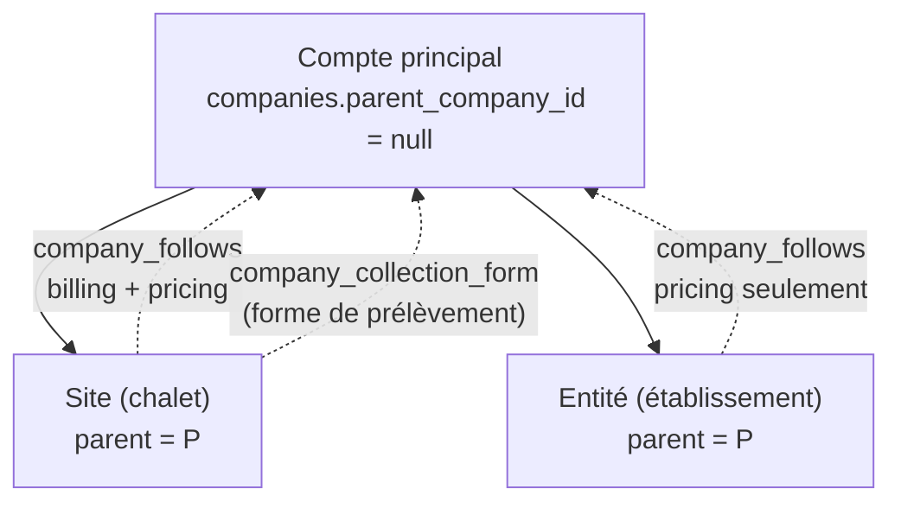
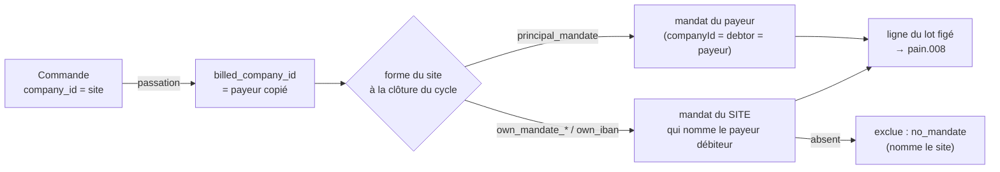

# Les sous-comptes d'un compte pro

> Doc d'état, relue contre le code le 2026-10-20 ; remplace le plan v3 du
> 2026-10-05 (supprimé ; lisible par `git show d56945be7:documentation/comptes-client/plan-sous-comptes.md`). Les trouvailles du chantier sont au registre
> [`ledger-sous-comptes.md`](ledger-sous-comptes.md).
>
> 🔴 **La numérotation est un contrat** : le code cite « §2.1 ter », « §2.2 »,
> « S3 », « Q9 »… Chaque numéro garde ici le sujet qu'il avait dans le plan.
>
> Touche **l'argent** et **le mur tenant** : tout changement de conception
> repasse par `vitruve` (CLAUDE.md §9 bis).

Demande d'origine (Hugo) : « en admin, un compte pro peut créer des
sous-comptes, avec leurs adresses, leur facturation, possibilité de partager
une donnée avec le compte principal — prendre exemple sur la fiche produit et
ses déclinaisons ».

## 0. Ce qui existe

| Lot  | État                | Où ça se voit                                                                                                                                  |
| ---- | ------------------- | ---------------------------------------------------------------------------------------------------------------------------------------------- |
| S1   | ✅ bâti             | migration `20261005100000_les_sous_comptes` ; `src/b2b/account/` (gestes, verrou, `SubAccountFollows`) ; e2e `sub-accounts`                    |
| S2   | ✅ bâti             | `lfd-backoffice-frontend/src/app/fiche-client/` (onglet `sous-comptes`, bandeau, cases « Suivre ») ; badge dans la liste et le cockpit         |
| S3   | ✅ bâti             | `pricing-parties.resolver.ts`, `followed-pricing-account.reader.ts`, volume Q6 ; e2e `sub-account-pricing`                                     |
| A1   | hors doc            | son propre plan : [`../commandes/plan-agregation-des-commandes.md`](../commandes/plan-agregation-des-commandes.md)                             |
| S4-0 | ✅ bâti             | migration `20261005140000_le_lot_de_prelevement_fige` ; `collection_batch`, `order_collection` ; e2e `collection-batches`                      |
| S4   | ✅ pour l'essentiel | migration `20261005200000_le_payeur_des_sous_comptes` ; payeur copié, trois formes, impayés détachés ; e2e `sub-account-billing` — reste au §6 |
| S5   | 🟡 à faire          | l'aspect `contacts` se suit (période écrite), mais **aucune lecture** ne combine les contacts                                                  |
| S6   | 🟡 à faire          | `src/platform/auth/resolve-company.ts` ignore les sous-comptes ; la règle de rôle effectif n'est lue par personne (§3)                         |

Le socle sur lequel tout repose, inchangé :

- **Un client est une `Company`, et une `Company` est un tenant fermé.** Une
  personne appartient à 0..N sociétés (`Membership`, unique sur
  `(userId, companyId)`, un `CustomerRole` par société). La requête **déclare**
  sa société, le mur la confronte aux memberships du `Principal`.
- **Tout ce qui compte est clé par `company_id`** : adresses, termes, RIB
  (`CompanyBankAccount`, un par société), mandats, mercuriale, engagements,
  règles de prix, commandes, brouillon, alertes, notes, fidélité.
- **Le modèle imité est la déclinaison** (`src/pim/catalogue/product/`) :
  suivi par aspect, profondeur 1, héritage vivant, valeur propre qui dort.

## 1. La décision de fond : un sous-compte EST une `Company`

Un sous-compte est une société à part entière, avec un lien vers son
principal — pas une sous-entité d'une `Company`.

**Pourquoi.** Tout le commerce est clé par `company_id` : commande, brouillon,
adresses, mercuriale, alertes, colisage, livraison, bon de commande. En faisant
du sous-compte une `Company`, rien de ce qui existait n'a changé : il commande,
il est livré, il a ses adresses, comme un client seul. Ce qui est neuf se
limite au **lien** et au **partage**.

C'est aussi la lecture juridique courante : un établissement a son SIRET (même
SIREN que le siège), une filiale a son SIREN.

## 2. Le modèle — calqué sur la déclinaison



| Déclinaison                        | Sous-compte (code)                                                                             |
| ---------------------------------- | ---------------------------------------------------------------------------------------------- |
| `product_variant.product_id`       | `companies.parent_company_id` (nullable), relation `CompanyHierarchy`                          |
| la déclinaison par défaut          | le compte principal                                                                            |
| `*_follows_default` par aspect     | une **période datée** par aspect, table `company_follows` (§2.1)                               |
| `CHECK` : le défaut ne se suit pas | `company_not_own_parent`, `company_follows_not_self`, trigger `company_follows_current_parent` |
| profondeur 1                       | trigger `companies_hierarchy_depth_one` + verrou consultatif (§5)                              |
| valeur propre qui dort             | adresses / RIB propres gardés, non lus pendant le suivi                                        |
| `AlignVariantOnDefaultCommand`     | `FollowParentCommand` / `StopFollowingParentCommand` (`aspect`)                                |

Les gestes, tous dans `src/b2b/account/application/commands/` :
`CreateSubAccount`, `AttachToParent`, `DetachFromParent`, `FollowParent`,
`StopFollowingParent`, `SetGroupWithoutDelivery`, `SetCollectionForm`. Les
périodes sont tenues par l'objet de domaine `SubAccountFollows`
(`domain/entities/sub-account-follows.ts`) et la valeur `FollowPeriod` ; le
port d'écriture est `CompanyFollowsRepository`, celui de lecture
`CompanyFollowsReader`.

**Différence assumée avec la déclinaison.** Un sous-compte a une vie propre
(statut, KBIS, commandes) : il n'est pas un enfant de l'agrégat `Company` du
principal. Le lien est une **référence** portée par l'enfant
(`onDelete: Restrict`), et les invariants qui traversent se tiennent en base
et dans les handlers, sous le verrou.

### 2.1 Les aspects partageables — et pourquoi ils sont DATÉS

Le prix se **relit à date** : un booléen vivant appliquerait le suivi
d'aujourd'hui à une commande d'hier. Le suivi est donc une **période** :

```
company_follows (
  company_id  → companies         -- le sous-compte
  parent_id   → companies         -- son principal au moment du suivi
  aspect      CompanyFollowAspect -- 'billing' | 'pricing' | 'contacts'
  valid_from  timestamptz(3) NOT NULL
  valid_to    timestamptz(3) NULL -- null = en cours
  PRIMARY KEY (company_id, aspect, valid_from)
  EXCLUDE USING gist (company_id =, aspect =, tstzrange(valid_from, valid_to, '[)') &&)
)
```

Suivre ouvre une période, cesser la ferme ; rien ne s'efface.
`parent_company_id` porte la **structure actuelle** ; une période ouverte ne
peut viser que le principal actuel (trigger `company_follows_current_parent`).

**Les deux cas réels qui fixent le modèle** (Hugo, 2026-10-05) :

- **Le gestionnaire de chalets** : une société, plusieurs chalets, chacun son
  adresse, son contact de livraison et ses factures, tous prélevés sur le
  même RIB. Un chalet n'a pas de SIRET.
- **Le Club Med** : trois entités qui règlent chacune, avec la même
  mercuriale.

| Aspect         | « Suit le principal » veut dire                                                                                                                                                        | Chalets  | Club Med | Lu par le code      |
| -------------- | -------------------------------------------------------------------------------------------------------------------------------------------------------------------------------------- | :------: | :------: | ------------------- |
| **`billing`**  | facturé au nom du principal, et prélevé selon la forme du §2.1 ter pour les commandes **au compte** (un site peut aussi régler par carte) ; identité légale, KBIS, termes du principal |    ✅    |    —     | ✅ (§2.1 bis, §2.3) |
| **`pricing`**  | la mercuriale et les engagements du principal                                                                                                                                          |    ✅    |    ✅    | ✅ (§2.2)           |
| **`contacts`** | un contact du principal partagé avec le sous-compte                                                                                                                                    | au choix | au choix | 🟡 S5               |

L'identité facturée et le RIB forment **un seul** aspect : les séparer
ouvrait le cas interdit, prélever A pour une facture émise à B.

**Toujours propres au sous-compte** : adresses de livraison, contacts de
livraison, commandes.

`billing` ne se suit que si le principal est **actif** : `SubAccountFollows.follow`
le refuse sinon.

**Facturation groupée ou séparée.** Ce n'est pas une case à part : c'est la
**forme de prélèvement** (§2.1 ter) qui décide s'il y a une ligne par
société ou une ligne par site. Côté écran, la carte
`fiche-client/payer-billing-mode-card/` la règle.

### 2.1 bis Un sous-compte qui suit `billing` n'a pas d'identité propre

`Company.activate(activatedAt, reachable, by, billingCarrier)`
(`src/b2b/account/domain/entities/company.ts`) reçoit le principal suivi en
`billing`, lu par `ActivateCompanyHandler` sous le verrou. Quand le
sous-compte est **porté** par un principal actif (`isLegallyCarriedBy`), ni
`hasLegalIdentity` (raison sociale, forme, SIRET) ni détenteur propre ne sont
exigés. Si le principal n'est pas actif, le refus dit : « activez d'abord le
compte principal, ou renseignez son propre SIRET ».

La même lecture tient dans la porte staff (`domain/services/activation-gate.ts`,
`isLegallyCarried`) et dans les avertissements
(`domain/services/company-warnings.ts`, `legalIdentityCarriedByParent`) : la
fiche d'un site ne réclame ni identité, ni détenteur, ni adresse de
facturation.

- **Cesser de suivre `billing`** ne change pas le statut (aucune transition
  `active → pending`) ; la fiche remontre les pièces manquantes, au staff de
  les compléter.
- **Le KBIS** est celui du principal tant que `billing` est suivi.
- **Le statut** reste propre ; seul le **payeur** suspendu bloque (§2.4).

### 2.1 ter Le prélèvement d'un sous-compte qui suit `billing` — trois formes

Un mandat SEPA lie un créancier, un **débiteur** et un compte. Le site qui
suit `billing` a trois formes, choisies par le client ou réglées par le staff
(`PUT admin/companies/:companyId/collection-form`, `SetCollectionFormCommand`) :

| Forme (`CollectionForm`)     | Débiteur nommé          | IBAN               | Mandat                    | Relevé bancaire     |
| ---------------------------- | ----------------------- | ------------------ | ------------------------- | ------------------- |
| `principal_mandate` (défaut) | la société du principal | celui du principal | celui du principal        | une ligne par débit |
| `own_mandate_principal_iban` | la société du principal | celui du principal | un mandat du site, sa RUM | une ligne par site  |
| `own_iban`                   | la société du principal | celui du site      | un mandat du site, sa RUM | sur un autre compte |



Ce que le code tient :

- **La forme est une décision datée** : table `company_collection_form`
  (`EXCLUDE` sur la fenêtre, défaut `principal_mandate` sans période). La date
  qui compte est la **clôture du cycle** : la constitution lit
  `collectionFormsAt(sites, cycle.closesAt)`
  (`accounting/application/collection-constitution-support.ts`).
- **Le choix du mandat** est une fonction pure,
  `accounting/domain/services/collection-verdict.ts` (`judgeMandate`,
  `effectiveMandateOf`) : en forme 1, les mandats du payeur ; en formes 2 et
  3, **seulement** ceux du site qui nomment le payeur débiteur — jamais de
  repli sur le mandat du principal. Sans eux, `no_mandate` nomme le site.
  La facture du mois fige le même mandat que le lot prendra.
- **Le mandat désigne son compte** : `payment_mandates.bank_account_id`, lu
  par les lecteurs de `payments/infrastructure/` (`mandate-accounts.ts`).
- **Le mandat fige son débiteur** : `debtor_company_id`, `debtor_siren`,
  `debtor_name`, `debtor_legal_form`, posés à la frappe.
- **La frappe lit l'identité résolue** par le port `MandateDebtorReader`
  (`payments/domain/ports/mandate-debtor.reader.ts`, résolution datée sur
  `company_follows` et `company_collection_form`), lu par `mint-readiness.ts`,
  `get-mandate-mint-blockers.handler.ts`, la frappe staff et client, et les
  routes client.
- **Détacher, ou cesser de suivre `billing`, révoque** les mandats actifs du
  site qui nomment le principal : port `SiteMandateRevocation` déclaré par
  `account`, implémenté par `payments/application/site-mandate-revoker.ts`,
  appelé dans la transaction du geste. Le mandat reste en base.
- **Un RIB propre** est un `CompanyBankAccount` du site ; le cas interdit
  reste l'inverse (une identité propre prélevée sur le compte d'une autre
  société).

🟡 **Reste** : le **brouillon** de cycle (`export-cycle-draft.handler.ts`,
`export-cycle-audit.handler.ts`, via `cycle-draft-support.ts`) lit encore
`DebtorMandateReader.activeFor(companyIds)`
(`payments/infrastructure/prisma-debtor-mandate.reader.ts`), clé **par
société** : il ne connaît pas les formes 2 et 3. Le lot figé, lui, passe par
`CollectionMandatesReader`.

### 2.1 quater Un sous-compte détaché avec des impayés — et ce qui manque pour le dire

**La décision (Hugo, 2026-10-05)** : le principal n'est jamais débité
d'office pour un sous-compte qui ne le suit plus. La commande sort du
prélèvement, est signalée en admin et au principal, et se règle à la main.

Ce qui manquait au prélèvement (un lot recalculé à chaque téléchargement,
rien d'enregistré sur une commande écartée) est comblé par **S4-0** :

- **un lot figé** : `collection_batch`, `collection_batch_line`, constitués
  par `ConstituteCollectionBatchesCommand` ; les téléchargements relisent le
  lot ;
- **un état d'encaissement par commande** : `order_collection.state`
  (`due`, `batched`, `excluded`, `collected`, `settled_otherwise`,
  `returned`, `written_off`, …) et `exclusion_reason`
  (`no_mandate`, `payer_detached`, `one_off_consumed`, `ambiguous_creditor`,
  `unbillable`, `invoice_split`) ; un plancher `collection_floor`.

Le cas du détachement : `judgeMandate` compare le payeur copié sur la
commande au suivi `billing` **à l'instant du jugement** ; s'ils diffèrent, la
commande sort en `payer_detached`. Le signalement se lit par
`GET admin/accounting/detached-unpaid/companies/:companyId` (staff, carte
`fiche-client/detached-unpaid-card/`) et
`GET companies/:companyId/detached-unpaid-orders` (client), sur
`accounting/domain/services/detached-unpaid.ts`.

🟡 **Non trouvé** : aucun écran de `lfc-ecommerce-frontend` n'appelle la
route client des impayés détachés (vérifié par recherche le 2026-10-20).

### 2.2 Le tarif — deux clés, pas une

`PricingParties` (`pricing/domain/loaded-pricer.ts`) porte **deux** clés :
`companyId` et `pricingCompanyId`. `PricingPartiesResolver`
(`pricing/application/pricing-parties.resolver.ts`) résout la seconde **à la
date** par `PricingAccountReader.pricingAccountOf(companyId, at)`, implémenté
par `pricing/infrastructure/followed-pricing-account.reader.ts` sur
`company_follows`.

| Lecture                                      | Clé lue                                                 |
| -------------------------------------------- | ------------------------------------------------------- |
| règles d'audience `company` (`PriceRule`)    | `companyId` — le **sous-compte**                        |
| mercuriale (`liveFor` / `liveAsOf`)          | `pricingCompanyId` — le **principal** suivi à la date   |
| engagements (`liveFor` / `liveAsOf`)         | `pricingCompanyId`                                      |
| volume mesuré (`customerVolumes.volumesFor`) | le compte **et** les sous-comptes qui le suivaient (Q6) |

Le chargeur est `pricing/application/pricing-materials.loader.ts` ; la
mercuriale (`company-mercuriale.ts`) ne s'applique qu'au contexte dont le
`pricingCompanyId` est le sien. Le volume Q6 est dans
`pricing/infrastructure/prisma-customer-volume.reader.ts` (`followersOver` :
les périodes `pricing` vers ce compte, rognées à la fenêtre).

Suivre ou cesser de suivre `pricing` passe par
`admin/companies/:companyId/pricing-follow` (`@AdminSurface("b2b_pricing")`)
et s'écrit au journal des prix par le port `PricingFollowJournal` (Q9).

### 2.3 Le payeur — copié sur la commande

Le payeur est lu **une fois**, à la passation, et **copié** :
`orders.billed_company_id`. `OrderDraftingService`
(`orders/application/services/order-drafting.service.ts`) lit
`OrderPayerReader.standingAt(companyId, now)` et applique la règle pure
`orderPayerOf` (`orders/domain/services/order-payer.ts`). Ce service est
partagé par `PlaceOrderHandler`, `PlaceOrderForCustomerHandler` (saisie
staff) et `PlaceShopOrderHandler`.

Après ce moment, l'argent lit le payeur copié (repli sur `company_id` quand
il est nul) : `accounting/domain/services/billed-payer.ts`, le regroupement
par payeur de `accounting/infrastructure/prisma-billable-orders.reader.ts`
(`byPayer`), le verdict de prélèvement, la facture du mois et la facture
carte. Réaligner un sous-compte ne déplace jamais une commande passée. Le
bon de commande lit `billedCompany.raisonSociale`
(`orders/infrastructure/prisma-order.reader.ts`).

⚠️ **Non confirmé** : le plan citait « la passation des abonnements » comme
troisième entrée. `src/b2b/subscriptions/` ne référence ni le payeur ni
`OrderDraftingService` ; si un abonnement crée des commandes, ce n'est pas
par ce chemin, et ce n'a pas été retrouvé.

### 2.4 Les gardes de passation

Toutes dans `orderPayerOf`, donc aux entrées du §2.3 :

- **Payeur suspendu** (Q4) : un site qui suit `billing` d'un principal non
  actif est refusé par `OrderPayerNotActiveError`, qui nomme le principal.
- **Compte de groupe sans livraison** : `companies.group_without_delivery` ;
  une commande au nom du principal lui-même est refusée par
  `GroupAccountOrderRefusedError`.
- **Le principal doit être actif** pour qu'un site commence à suivre
  `billing` : tenu par `SubAccountFollows.follow`, sous le verrou.

## 3. Le mur tenant — ce que Hugo a décidé, et comment il tient

**La règle (Hugo, 2026-10-05)** : le principal **voit et gère** ses
sous-comptes ; un sous-compte ne voit **que lui-même** ; un contact du
principal peut être partagé avec un sous-compte.

**Ce qui est bâti.** La règle est écrite une fois, en fonction pure :
`effectiveRole` (`src/b2b/account/domain/services/effective-role.ts`), testée
(`__tests__/effective-role.spec.ts`) :

```
rôle effectif dans X =
    rôle de membership(X)                       s'il existe
  | min(rôle de membership(P), admin)           si X.parent = P et ce rôle ∈ {owner, admin}
  | aucun
```

🔴 **Mais aucun code de production ne l'importe** (vérifié le 2026-10-20 :
seul son spec la cite). Le mur a toujours ses **deux** voies, et aucune ne
connaît les sous-comptes :

1. `resolveCompany` (`src/platform/auth/resolve-company.ts`, appelé par le
   garde d'authentification) retient la société déclarée si elle figure dans
   `principal.memberships` ;
2. `MembershipReader.roleOf(userId, companyId)`
   (`b2b/account/domain/ports/membership.reader.ts`), relu par les gestes
   client de `src/b2b`.

Aujourd'hui, donc, un owner du principal **n'entre pas** dans un sous-compte
côté plateforme ; seul le staff gère les sites.

🟡 **À faire — S6**, conception décidée :

- les deux voies lisent `effectiveRole` ; le plafond `admin` ferme à l'owner
  hérité les gestes réservés à l'owner (transfert, second détenteur) ;
- jamais dans l'autre sens : une membership dans un sous-compte ne donne rien
  sur le principal ni sur ses frères ;
- le sélecteur de société liste memberships **et** sous-comptes
  atteignables ; la branche « un seul rattachement sert d'office » est
  réécrite ;
- détacher coupe l'accès à la requête suivante (le principal est relu en
  base à chaque requête, sans cache — T7) ;
- écran « qui a accès » d'un sous-compte : ses memberships, plus « via
  _Principal_ » en lecture ; un admin hérité invite dans le sous-compte, et
  l'invité reçoit une membership **du sous-compte** ;
- le rôle `admin` hérité ne donne pas le geste rattacher / détacher (§4).

🔴 **Aucune route client ne résout vers le principal.** La résolution sert
aux lectures serveur (prix, payeur, prélèvement), jamais à répondre « mes
données » :

| Route client                              | Sous-compte qui suit `billing`                                     |
| ----------------------------------------- | ------------------------------------------------------------------ |
| `GET companies/:companyId/bank-account`   | murée sur la société déclarée                                      |
| `GET companies/:companyId/billed-to`      | « Facturé à _Principal_ », sans IBAN (`GetMyCompanyBilledToQuery`) |
| mandat client (`get-my-company-mandate*`) | lit le débiteur résolu par `MandateDebtorReader`                   |
| prix affichés, catalogue                  | le prix résolu (deux clés, §2.2), jamais la mercuriale en objet    |
| bon de commande                           | la raison sociale du payeur copié                                  |

## 4. Les écrans d'administration

Back-office, `apps/lfd-backoffice-frontend/src/app/` :

- **Onglet « Sous-comptes »** de la fiche client (route `sous-comptes`,
  `fiche-client/sous-comptes/sub-accounts-page`). Sur un principal : la
  **grille des suivis** (`follow-grid/`, dans `sub-accounts-card/`), une
  ligne par sous-compte, « Créer un sous-compte »
  (`panels/sub-account-panel/`), « Rattacher un compte client existant »
  (`panels/attach-sub-account-panel/`), la case « compte de groupe ». Sur un
  sous-compte : le bandeau « Site de / Entité rattachée à »
  (`parent-banner/`), la carte des sous-comptes floutée sous un cadenas
  (profondeur 1), la forme de prélèvement d'un site.
- 🔴 **Suivre et détacher se règlent depuis le principal** (Hugo,
  2026-10-20). La grille porte, par sous-compte, un bouton Activer /
  Désactiver pour `billing`, `pricing` et `contacts`, et « Détacher » ;
  chacun passe par un `fold-inline-confirm` qui dit les conséquences (payeur,
  prix des prochaines commandes, suivis fermés). Raisons : c'est le principal
  qui négocie et paie, on règle souvent plusieurs sites le même jour, et
  l'incohérence entre sites ne se voit que d'en haut. Chaque bouton appelle
  la route du sous-compte : mêmes gardes serveur qu'avant. Cela **inverse**
  la règle d'origine calquée sur les déclinaisons (« on ne règle pas un
  sous-compte depuis son principal ») pour ces gestes-là.
- **Sur la fiche de l'enfant, en lecture** : `follow-parent-toggle/` dit
  l'état de chaque aspect et sa date, dans son onglet (Contacts dans
  Informations, Tarif dans Tarifs via `pricing-follow/`), avec « Régler depuis
  _Principal_ » ; le bandeau renvoie au même endroit. La forme de prélèvement
  (`payer-billing-mode-card/`) et les impayés détachés
  (`detached-unpaid-card/`) restent sur la fiche du site.
- **L'onglet Informations d'un site montre l'hérité, il ne le réclame pas**
  (Hugo : « beaucoup de mélange avec les warnings ») : identité, facturation
  et paiement du principal en lecture.
- **Badge « Sous-compte de _Principal_ »** (`comptes-clients/sub-account-badge/`),
  cliquable, dans la liste des clients, le cockpit (`pinned-accounts`) et la
  fiche. Chaque sous-compte reste un client à part entière, sans total de
  groupe. ⚠️ Non retrouvé dans la liste des commandes (le lecteur
  `prisma-admin-order-list.reader.ts` connaît la hiérarchie ; l'écran n'a pas
  été ouvert).
- **Créer un sous-compte ne demande que le type et le nom** : « Un site de
  cette société » (naît en suivant `billing`) ou « Une entité distincte ». La
  case « Appliquer la mercuriale du principal » n'est honorée qu'avec
  `b2b_pricing:write` (`admin-company-hierarchy.controller.ts`) ; le
  sous-compte naît en `pending`.
- 🔴 **Rattacher et détacher sont des gestes du personnel, jamais du
  client** : routes de `AdminCompanyHierarchyController`
  (`@AdminSurface("b2b_companies")`, préfixe `admin/companies/:companyId`) —
  `POST sub-accounts`, `POST parent`, `POST parent/detach`, `POST follows`,
  `POST follows/stop`, `POST group-without-delivery`,
  `PUT collection-form`. Détacher ferme toutes les périodes de suivi ; le
  sous-compte reprend ses valeurs propres.

## 5. Base de données — additive

Trois migrations, toutes additives :

- `20261005100000_les_sous_comptes` : `companies.parent_company_id`
  (FK `RESTRICT`, index, `CHECK company_not_own_parent`),
  `companies.group_without_delivery`, enum `CompanyFollowAspect`, table
  `company_follows` (`company_follows_not_self`, `company_follows_window`,
  `EXCLUDE company_follows_no_overlap`, extension `btree_gist`), triggers
  `companies_hierarchy_depth_one` et `company_follows_current_parent`.
- `20261005140000_le_lot_de_prelevement_fige` : le lot figé (§2.1 quater).
- `20261005200000_le_payeur_des_sous_comptes` : `orders.billed_company_id`
  (`CHECK order_billed_needs_company`), `payment_mandates.bank_account_id`
  et l'instantané débiteur, enum `CollectionForm`, table
  `company_collection_form` (`EXCLUDE company_collection_form_no_overlap`).

**Profondeur 1 et pas de cycle, sous concurrence.** Un trigger qui lit une
autre ligne en READ COMMITTED ne voit pas l'écriture concurrente. Tout geste
qui change la structure prend donc d'abord le verrou consultatif
`pg_advisory_xact_lock(hashtextextended(<clé>, 0))` par
`PrismaAccountHierarchyLock` (`account/infrastructure/prisma-account-hierarchy.lock.ts`,
port `AccountHierarchyLock`), qui refuse d'être appelé hors transaction. Les
triggers restent en seconde ligne.

**Un principal ne se remplace pas** (2026-10-20, migration
`20261020100000_un_principal_ne_se_remplace_pas`). Le geste refuse de
rattacher un compte déjà rattaché (`AlreadySubAccountError`) ; le trigger
`companies_parent_not_replaced` refuse en base le passage direct d'un
principal à un autre, qui laisserait ouvertes des périodes de suivi au nom
de l'ancien. Rattacher et détacher, chacun en sa propre écriture, passent.

- `billed_company_id` est nul sur les commandes d'avant : lu comme « la
  société de la commande ». Aucun remplissage rétroactif.
- Aucun droit accordé à un rôle par migration.

## 6. Les lots

| Lot      | Contenu                                                                                                                                                                                                                                     | État                                                                                                                                                                                  |
| -------- | ------------------------------------------------------------------------------------------------------------------------------------------------------------------------------------------------------------------------------------------- | ------------------------------------------------------------------------------------------------------------------------------------------------------------------------------------- |
| **S1**   | migration §5 ; `Company` porte son parent ; `company_follows` et ses ports ; gestes staff sous le verrou ; e2e `sub-accounts`                                                                                                               | ✅                                                                                                                                                                                    |
| **S2**   | écrans admin §4                                                                                                                                                                                                                             | ✅ (badge des commandes non confirmé)                                                                                                                                                 |
| **S3**   | `pricingCompanyId` résolu à la date ; Q6 bâtie ; e2e `sub-account-pricing`                                                                                                                                                                  | ✅                                                                                                                                                                                    |
| **A1**   | agrégation des commandes, son propre plan ([`../commandes/plan-agregation-des-commandes.md`](../commandes/plan-agregation-des-commandes.md))                                                                                                | hors de cette doc                                                                                                                                                                     |
| **S4-0** | lot de prélèvement figé, état d'encaissement par commande                                                                                                                                                                                   | ✅                                                                                                                                                                                    |
| **S4**   | `billing` : trois formes, frappe sur l'identité résolue, mandat à la date de clôture, impayés détachés, checklist §2.1 bis, payeur copié, garde « payeur suspendu », routes client §3 ; e2e `sub-account-billing`, `cycle-statements-payer` | ✅ pour l'essentiel ; 🟡 brouillon de cycle encore par société (§2.1 ter) ; 🟡 entrée « abonnements » non retrouvée (§2.3) ; 🟡 aucun écran client des impayés détachés (§2.1 quater) |
| **S5**   | `contacts` : lecture combinée — la période s'écrit, aucun lecteur ne la lit                                                                                                                                                                 | 🟡 à faire                                                                                                                                                                            |
| **S6**   | côté client : `effectiveRole` dans les deux voies du mur, sélecteur, e2e (le principal agit dans un sous-compte ; un sous-compte ne voit ni le principal ni ses frères ; détacher coupe)                                                    | 🟡 à faire                                                                                                                                                                            |

🔴 **Condition de mise en service** (inchangée) : aucun vrai site ne s'ouvre
avant que S4 soit en ligne en production.

**Rôles dans un site** (Hugo) : la gouvernante est `admin` de son chalet et
invite ses collègues par le mécanisme d'invitation actuel. Un sous-compte
peut suivre le tarif sans suivre `billing` : voulu (le cas Club Med).

⚠️ **Irréversible** : dès que des commandes portent `billed_company_id` et
que des prélèvements sont émis sur le principal, revenir en arrière demande
une migration de données.

## 7. Questions — tranchées et ouvertes

**Tranchées par Hugo le 2026-10-05 :**

- **Q1 — Établissement ou filiale ?** Les deux : le site sans identité propre
  (`billing` suivi) et l'entité qui règle seule. Un seul modèle.
- **Q2 — Qui voit quoi côté client ?** Le principal voit ses sous-comptes ;
  un sous-compte ne voit que lui-même ; un contact peut être partagé (§3,
  S6 à faire).
- **Q3 — Payer pour une autre entité.** Non : identité facturée et
  prélèvement forment un seul aspect `billing`.
- **Q4 — Principal suspendu** : bloque les sous-comptes qui le suivent en
  `billing`, et eux seuls (`OrderPayerNotActiveError`, §2.4).
- **Q5 — Le RIB unique** : les sites prélèvent le RIB du principal ou le
  leur (forme `own_iban`) ; le modèle du RIB ne change pas.
- **Q6 — Le volume des sous-comptes compte pour l'engagement du
  principal** : oui, pour les sous-comptes qui suivaient `pricing` à la date
  de chaque commande (bâti, §2.2).
- **Q7 — La fidélité** va au payeur. ⚠️ Non vérifié dans `src/b2b/loyalty/`.
- **Q8 — Les dérogations au cut-off** restent par sous-compte (c'est une
  affaire de site). ⚠️ Non vérifié dans `src/b2b/order-waivers/`.
- **Q9 — Qui décide du tarif partagé** : le **commercial**. Le geste est
  derrière `@AdminSurface("b2b_pricing")`
  (`AdminCompanyPricingFollowController`) ; il s'écrit au journal des prix
  par `PricingFollowJournal`, déclaré par `account` et implémenté par
  `pricing/infrastructure/pricing-follow.journal-writer.ts`, dans la
  transaction du geste. Le journal est un affichage : la relecture du prix
  lit la table datée. À la création, `pricing` n'est suivi qu'avec le droit
  de tarification.

**Revue adversariale avec Hugo, 2026-10-05 :**

- **R1** — trois formes de prélèvement au choix du client (§2.1 ter) : bâti.
- **R2** — relevé par sous-compte ou consolidé : porté par la forme de
  prélèvement et le relevé de cycle (A1).
- **R3** — impayés d'un site détaché signalés, jamais débités d'office :
  bâti (§2.1 quater), sauf l'écran client.
- **R4 — Renégociation pour un seul établissement.** _Ouverte. Défaut : pas
  de copie de la mercuriale ; il retombe au tarif public jusqu'à ce que le
  commercial lui en pose une._
- **R5 — Un établissement sort pendant un engagement.** _Ouverte. Défaut :
  ses commandes passées restent comptées, les suivantes non_ — c'est ce que
  fait le volume daté de Q6.
- **R6** — principal holding : case « compte de groupe sans livraison »,
  bâtie.
- **R7** — le personnel d'un sous-compte voit les prix : aucun rôle neuf.
- **R8** — le principal choisit le sous-compte avant de commander : pas de
  panier réparti (dépend de S6).
- **R9** — cockpit : chaque sous-compte seul, avec un badge (bâti).
- **R10 — Plus d'un niveau.** _Ouverte. Défaut : un seul niveau_ (tenu en
  base, §5).

## 8. Hors périmètre et limitations

- **Prévenir le principal de ce que font ses sous-comptes** : plan à part,
  [`plan-notifications-sous-comptes.md`](plan-notifications-sous-comptes.md)
  (2026-10-20, rien n'est bâti).

- Pas de groupe à plusieurs niveaux, ni de sous-compte d'un sous-compte.
- Pas de facture **consolidée** pour N entités distinctes ; un site en
  `billing` est facturé au nom du principal selon sa forme.
- Pas de mercuriale « de groupe » distincte : le tarif partagé est celui du
  principal.
- La porte `lint:dated-decisions` (`dev-toolbox/gates/dated-decisions.mjs`)
  ne nomme ni `company_follows` ni `company_collection_form` ; ce qu'elle
  scanne n'a pas été vérifié pour ces tables.

## 9. Ce que `vitruve` a changé (historique)

Le plan v1 (2026-10-05) a été contredit deux fois par `vitruve` le même jour.
Les trois BLOQUANTS de la v1 — le suivi du tarif sans date, le chargeur à une
clé, la course sur la profondeur — ont donné `company_follows` daté,
`pricingCompanyId` et le verrou consultatif. Ceux de la v3 — un chalet sans
SIRET qui ne s'active pas, les deux voies d'autorisation — ont donné la
checklist qui lit le suivi `billing` (bâtie) et la règle `effectiveRole`
(écrite, pas encore branchée). Le détail est dans
l'ancien plan (§9, voir l'en-tête pour le retrouver) et au registre.
