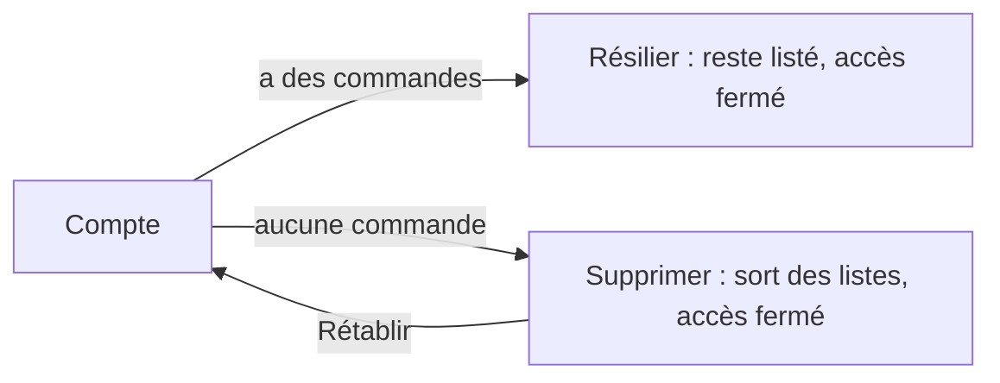

# Supprimer un compte client

**État : ✅ bâti** (2026-11-22, sur `dev`). Décisions de Hugo des 2026-11-17 et
2026-11-22.

## 1. En simple

Deux gestes de fin de vie, et ils ne disent pas la même chose :

| Geste                   | Quand                                                         | Le compte reste dans la liste ? | Ses membres y entrent encore ? |
| ----------------------- | ------------------------------------------------------------- | ------------------------------- | ------------------------------ |
| **Résilier**            | le client part (à sa demande, par exemple)                    | oui                             | non                            |
| **Supprimer le compte** | il a été créé par erreur ou en double, et n'a jamais commandé | **non**                         | non                            |

- **Supprimer** est un _soft delete_ : rien n'est effacé, le compte se
  **rétablit**, et le filtre « Supprimés » de la liste des clients le retrouve.
- **Un motif est obligatoire** : « Doublon », « Créé par erreur », ou
  « Autre » avec un texte. Il part au journal.
- **Une commande l'empêche** — passée par le compte, pour lui comme site, ou
  payée par lui (un brouillon ne compte pas). On résilie alors.
- **Un site ne se supprime pas**, ni un principal qui a des sites : on
  détache d'abord.
- **Une suspension** est toujours un geste humain, et se lève à la main.



## 2. Technique

### 2.1 Le modèle

Quatre colonnes sur `public.companies` (migration
`20261122090000_un_compte_se_supprime`) : `archived_at`,
`archived_by_staff_id`, `archived_by_name`, `archive_reason`. Le statut ne
bouge pas. Le CHECK `companies_archive_complete` lie `archived_at` et le motif
(non vide). Le déclencheur `companies_principal_stamp` monte aussi sur
`archived_at` : le principal en cache tombe à la suppression. Les colonnes
d'auteur sont au registre RGPD.

### 2.2 Le geste

- `Company.archive({ at, byStaffId, byName, reason, hasOrders })` refuse : un
  compte déjà supprimé, un site, un principal qui a des sites, un compte qui a
  des commandes (`CompanyHasOrdersError`, 409, « Résiliez-le »), un motif vide
  ou de plus de 500 caractères. `unarchive()` le rétablit.
- « A-t-il des commandes ? » est une lecture publiée par les commandes
  (`orders/domain/ports/company-has-orders.reader.ts`) : une commande non
  brouillon où la société est `company_id`, `principal_company_id` ou
  `billed_company_id`.
- `ArchiveCompanyHandler`, dans une transaction : verrou de la hiérarchie,
  ligne `companies` en `FOR UPDATE`, lecture des commandes, agrégat,
  sauvegarde, faits `company.archived` (avec le motif) / `company.unarchived`.
- Routes : `POST /admin/companies/:id/archive` (`{ reason }`) et
  `/unarchive`, `@Idempotent`, droit `b2b_companies` en écriture (celui du
  changement de statut).

### 2.3 Le mur : « la société est fermée »

Un seul prédicat, `isCompanyClosed` / `openCompanyWhere`
(`lafoliecoffee/shared/company-standing/`) : **supprimée ou résiliée**. Il est
lu par le principal (les memberships d'une société fermée ne sont plus
chargées), l'entrée d'un invité, `readCompanyStanding` (en propre et par
héritage), `inheritedSiteWhere`, « Mes entreprises » de `GET /me`, la boutique
(`servedCompanyServiceOf`) et le rattachement d'un site.

- **La passation** prend la société, son principal et le payeur en
  `FOR SHARE` (`orders/infrastructure/order-companies.share-lock.ts`), triés
  par identifiant, et refuse une société fermée (`orders.company_closed`,
  409). Une suppression et une commande simultanées ne réussissent jamais
  toutes les deux (e2e `company-closed-wall`).
- **Un espace déclaré injoignable est refusé** (`auth.workspace_unreachable`, 403) par `@ActingCompany`, au lieu de retomber sur une autre société. `GET
/me` répond encore : la boutique relit `/me` une fois par vague, retombe sur
  un espace atteignable et le dit (`client/workspace-unreachable.ts`).
- **Une invitée vers une société fermée** reçoit
  `account.invitation.company_closed` (403), sans fait « invitation expirée »
  ni alerte à l'équipe.

### 2.4 Les vues

Un compte **supprimé** sort des vues du staff ; un **résilié** y reste —
d'où `archivedAt` seul, et non le prédicat de fermeture. La porte
`company-archived-views` tient la règle : tout
`company.findMany|count|groupBy|aggregate` nomme `archivedAt` (ou un prédicat
qui le porte) dans son `where`, ou son fichier est inscrit avec le nombre de
ses appels et sa raison. Elle ne voit ni `findUnique`/`findFirst`, ni le SQL
écrit à la main.

Écartent le supprimé : la liste des clients et tout ce qui la filtre côté
écran (recherche, ciblage de promotion, rattachement d'un site), le
portefeuille, l'export CSV, le compteur d'avertissements, les accès clients,
les cartes du Comptoir, le suivi commercial, les ouvertures du jour, les
secteurs et l'adoption, les métriques du portefeuille, le tunnel d'activation
et le cockpit. `GET /admin/companies?archived=only` ne rend que les supprimés.

Ne l'écartent pas, avec raison : la fiche (elle s'ouvre avec son bandeau),
les notes du commercial, les noms des faits passés, tout lecteur qui part
d'une commande, d'une facture ou d'un prélèvement (un supprimé n'en a pas),
le calendrier commercial (un rendez-vous s'annule à la main). Les promotions
lisent `isCompanyClosed`.

### 2.5 L'écran

Fiche client, onglet Informations : la `fold-danger-zone` « Supprimer le
compte » (`fiche-client/account-deletion-zone/`), désarmée avec sa phrase
quand il y a des commandes, un principal ou des sites ; un compte supprimé
montre un bandeau (`deleted-account-banner/`) avec la date, l'auteur, le motif
et « Rétablir le compte ». Le rail « État du compte » porte, lui, mettre en
pause, réactiver et résilier.

## 3. Reste à faire

- `prisma-direct-debit-block.reader.ts` (blocages du prélèvement) doit
  écarter un supprimé ; il est inscrit dans la porte en attendant.
- Le sélecteur de titulaire n'a pas été relu.
- Le bandeau n'est que dans l'onglet Informations : la coquille de la fiche ne
  porte pas `archivedAt`.
- Sur `/connexion/erreur`, l'invitée d'une société fermée lit encore le titre
  « Invitation expirée » (le sous-titre dit le vrai cas).
- Au déploiement, les comptes **résiliés** perdent l'accès de leurs membres.
  À compter en production avant de livrer :

```sql
SELECT count(DISTINCT c.id) AS terminated_companies_with_active_members,
       count(DISTINCT m.user_id) AS members_losing_access
FROM public.companies c
JOIN public.memberships m ON m.company_id = c.id
JOIN public.users u ON u.id = m.user_id
WHERE c.status = 'terminated' AND m.accepted_at IS NOT NULL AND u.status = 'active';
```
