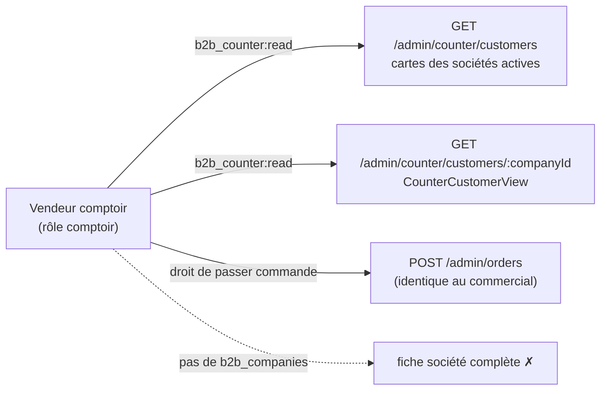

# La commande pro au comptoir, sous son propre droit

**État : ✅ bâti, relu contre le code le 2026-10-12.** Remplace
`plan-commande-au-comptoir` (ouvert le 2026-09-25, supprimé le 2026-10-12 ;
historique dans git). Demande de Hugo : « celui qui manipulera comptoir ne sera
pas forcément autorisé à utiliser commercial ». Touche une **frontière de
sécurité** (périmètre de permissions).

## 1. Le problème, la décision

L'espace Comptoir (`apps/lfd-backoffice-frontend/src/app/comptoir/`) sert à
vendre à un client pro. Le serveur, lui, n'était pas encapsulé : le sélecteur de
client lisait `GET /admin/companies*` sous `b2b_companies:read`, donc un rôle qui
n'aurait eu que le droit de commander prenait un 403 dès le sélecteur, et lui
donner `b2b_companies:read` aurait ouvert la fiche entière de tous les clients
(crédit, KBIS, contacts, conditions). Décision : **une ressource `b2b_counter`
et deux lectures taillées pour la prise de commande.** La passation, elle, reste
le même geste que celui du commercial (`POST /admin/orders`) : la dupliquer
aurait fait deux portes à tenir pour une règle.

## 2. Ce qui existe

- **Serveur** (`apps/lfd-api/src/b2b/account/`) :
  `http/admin-counter-customers.controller.ts`, `@Controller("admin/counter/customers")`,
  `@AdminSurface("b2b_counter")` ; deux lectures — la liste (cartes des sociétés
  **actives seulement**, rien de crédit ni de propriétaire) et le détail
  (`CounterCustomerView` : `settlesOnAccount`, adresses, acheteurs). Une société
  inconnue **ou non active** rend un 404 (`CounterCustomerNotFoundError`) : le
  comptoir ne distingue pas un compte suspendu d'un compte absent. Contrat :
  `packages/contracts/src/counter-customer.ts`.
- **`settlesOnAccount` est calculé par le serveur**, à partir de l'agrégat, au lieu
  d'exposer les conditions accordées : le comptoir n'a pas à lire le crédit, seulement
  à savoir s'il peut proposer « au compte ».
- **Ouverture de la livraison** : la route publique `GET /delivery-availability`
  suffit, aucune route neuve.
- **Droits** : `b2b_counter` est une valeur de `StaffResource`
  (`packages/contracts/src/staff-access.ts`), et un rôle `comptoir` existe.
- **Front** : `comptoir/nouvelle-commande` est gardé par **deux** permissions,
  `b2b_counter:read` et `b2b_place_order:write` (`COUNTER_ORDER_GUARDS`,
  `app.routes.ts`) — la seconde est sortie de `b2b_orders` le 2026-10-01
  ([`plan-droits-par-geste.md`](../livraisons/droits/plan-droits-par-geste.md), 5.1 bis).
  La page lit la société par une source choisie selon `origin`
  (`counter-customers.service.ts` au comptoir) ; la case « enregistrer l'adresse
  au carnet » n'y existe pas (elle exigerait `b2b_companies:write`).
- **Tests** : `apps/lfd-api/test/counter-customers.e2e-spec.ts` (403 sans le droit,
  chaque lecture de l'écran en 200 sous le rôle comptoir, actives seulement,
  suspendue en 404, aucun champ de crédit), `counter-roles-migration.e2e-spec.ts`
  (la migration rejouée sur un rôle composé à l'écran et sur un écart).

## 3. ⚠️ Les migrations : une exception historique à la règle des droits

Deux migrations, en deux temps (une valeur d'enum ne s'emploie pas dans sa
transaction d'ajout) : `20260926100000_le_comptoir_a_son_droit` (valeurs
`b2b_counter` et `comptoir`) puis `20260926100100_le_comptoir_est_accorde`.

**La seconde écrit dans `staff_role_definitions` et `staff_permission_overrides`**
(elle accorde `b2b_counter:read` à tout rôle qui porte `b2b_orders:write` — par le
**contenu**, jamais par la clé —, crée des écarts jumeaux et la définition du rôle
`comptoir`). Elle date du 2026-09-26, **antérieure à la règle du 2026-10-01**
(« une migration ajoute une ressource, jamais un droit à un rôle » ;
`lint:no-role-grants-in-migrations`). C'est une **exception historique**, qui ne
se rejoue pas : aujourd'hui, qui a quel droit se règle à l'écran. Les `migration.sql`
ne se touchent pas (le checksum Prisma).

## 4. Assumé, hors périmètre, reste à faire

- Le vendeur de comptoir voit aussi `GET /admin/orders` (toutes sociétés, lignes et
  montants), le bon PDF et le rappel de retrait : c'est son métier. On lui retire la
  **fiche client**.
- **Actives seulement** : un choix d'écran, pas un mur. `POST /admin/orders`
  accepte encore une société `pending` en lien ; un mur, s'il en faut un, se pose
  dans `PlaceOrderForCustomer` pour tous les écrans (non fait, non revérifié).
- **Le QR d'identification du client** (un jeton que le serveur résout en `id`)
  reste un plan à part ; le front du comptoir n'en porte pas (vérifié le 2026-10-12 :
  aucun fichier QR sous `comptoir/`).
